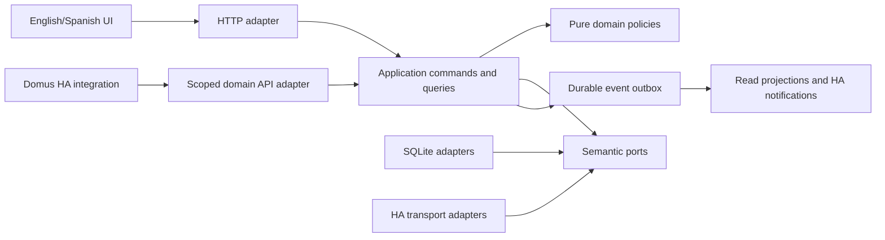

# Proposed Domus architecture

Status: Core architecture and stack accepted by the owner on 2026-10-29; implementation-specific decisions and evidence remain pending in [decisions](decisions.md).
Clean Architecture is a fixed owner requirement, not an optional style.

## Delivery alternatives

| Alternative | Benefits | Costs / limits | Assessment |
|---|---|---|---|
| Custom integration and custom panel only | One HA installation surface; direct native entities | Complex business persistence/UI jobs share Core lifecycle; no independent server boundary | Rejected as primary architecture |
| Supervisor App only | Own server, DB and Ingress UI | Does not cover confirmed standalone Container target; App alone is not a native entity provider | Insufficient |
| Independent server only | Full UI and deployment flexibility | Native entities/services still require a thin integration; standalone identity must be designed | Useful core, incomplete HA surface |
| Modular server plus companion integration | Same local core in App and Container; thin native HA adapter; independent UI | Two packages and explicit installation credential; more acceptance fixtures | Accepted by owner 2026-10-29 |

The owner requires both deployment targets from the first usable release.
The companion integration is Domus's native HA surface. The already integrated gateway remains unchanged.

## Components and dependency direction

Text equivalent: UI and native HA adapters enter the same application use cases. Use cases depend inward
on pure domain and semantic ports. SQL, HTTP and HA transport implement those ports at composition time.
A durable outbox updates derived views without duplicating domain mutations.

| Boundary | Owns | Enforced restriction |
|---|---|---|
| Domain | Value objects, entities, transitions, allocation and quantity policies | No frameworks, I/O, clock globals or concrete repositories |
| Application | Authorization, unit-of-work orchestration, commands, queries, ports | No SQL/HTTP/HA DTOs or concrete adapters |
| Infrastructure | DB, migrations, HA clients, bounded I/O, secret storage | No independent business rules |
| Entrypoints | Authentication, schema validation, safe mappings | No direct state/ledger manipulation |
| Frontend application | Controllers and transport-independent contracts | No browser fetch in domain decisions |
| Presentation | Components, navigation, view models and localized content | No role decisions or quantity/point calculation |
| Composition | Exactly one deployment wiring profile | No silent mode fallback |

Architecture tests parse imports and module graphs, detect cycles, and exercise semantic contracts across adapters.
Directory names will follow these boundaries, but no fake source files are created in this documentation task.

## Selected stack and trade-offs

The owner selected Python/FastAPI, SQLite and Lit/TypeScript/Vite on 2026-10-29 after reviewing Gateway and Symphonia. Domus owns HA-coherent presentation components, a Storybook catalog and Playwright browser contracts. Components contain presentation behavior; API clients, authorization and domain orchestration remain outside them. Neither gateway code nor private HA bundles become runtime dependencies.
React was an evaluated alternative and is not the selected UI stack. A later change needs explicit evidence and a superseding decision.
One household per installation is confirmed. A single DB writer remains the initial concurrency proposal; a port-based storage seam permits a reviewed later database migration.
There is no broker, microservice mesh, cloud backend, event-sourced reconstruction requirement or MCP server.

## One automation engine, two editors

The owner confirmed a simple/default editor and optional advanced editor in the first release. Both edit one versioned declarative rule model, recorded in [ADR 0005](adr/0005-one-automation-engine.md). The [automation SDD](../specs/household-automation.md) owns typed triggers/conditions, bounded branching/repetition/parallel steps, durable waits, previews and execution traces. The HA integration maps native rule entrypoints to the same engine; it does not evaluate a second rule language.

Rules invoke authorized domain commands and cannot replace stock, points or recurrence policy. A run pins rule revision and command receipts, checks grants before each side effect, resumes durable waits after restart and reports partial results honestly. Changing editor cannot discard unsupported advanced fields. Resource limits and disable/cancel semantics remain explicit engineering gates; no arbitrary scripting or raw SQL/network proxy is introduced.

The UI follows the owner's selected Symphonia/Gateway direction without inheriting assumptions about iframe context. Only a validated public host contract may supply UI hints; messages never establish identity or permissions. Theme and locale fall back deterministically to member/browser preferences when HA exposes no tested public signal. Domus does not inspect parent DOM or private storage. Host-managed safe-area padding applies once, and non-root Ingress paths need reload/deep-link tests as well as asset resolution. Storybook fixtures and Playwright scenarios enforce these boundaries.

## Data consistency

Definitions and occurrences, product identity and presentation, demand and purchase, receipt and stock posting,
and planned/actual actors are separate facts. Immutable stock and points ledgers use compensations.
Points use exact signed minor units and snapshot the configured allocation policy. Conservation of the base task value applies only to the conserve_total policy; other owner-required rounding/full-award policies record their actual total explicitly. Reopening compensates those actual entries rather than assuming the base value equals the award sum.
An allocation is unique per completion cycle independently of its policy version; all performer shares, inbox receipt and remainder-order change commit together. Closing a cycle prevents delayed approval or completion delivery from awarding it again. A genuine later completion has a separate cycle identity. Reversing spent points preserves any factual negative balance and fulfilled rewards while denying unaffordable new redemption.
The completion application orchestration accepts explicitly reviewed material intents in the same submission, delegating quantity rules to Inventory. Stable per-line identities preserve exact outcomes on replay. A stock shortage saves performed work plus a pending-regularization intent without a fabricated movement; explicit authorized settlement is separate from future restocking. Reopening a task never proves a physical material return.
Commands validate the authenticated principal, expected aggregate revision and idempotency key.
Receipt lookup/replay also checks current permissions. Routine audit retention cannot remove side-effect replay protection; compact guards and lifecycle identities remain consistent with backed-up business state.
A transaction commits domain state, operation receipt, audit reference and outbox.
Duplicate same-key requests return the original result; changed-payload replays return conflict.
Consumers record inbox identities with their effects. If a projection fails, the committed business operation
is reported as saved with pending follow-up. One UI green check cannot claim all side effects finished.

## Deployment and identity

Supervisor mode uses App/Ingress packaging and persistent App storage. Standalone uses a private Container
binding, an owned data volume, Core APIs and authenticated access; it assumes no Supervisor or Ingress.
Both map verified individual HA users to Domus membership and roles. Ingress headers are accepted only
behind a verified trust boundary; standalone never trusts a browser-supplied identity header.
HA OAuth or an equivalent supported HA authentication flow is a required proof step before implementation readiness.
No child PIN, shared adult session or parallel Domus password store is proposed.

Stable and Edge have separate instance IDs, HA registry unique IDs, credentials, DB volumes and exposed bindings.
The first release tests coexistence. An Edge installation cannot mutate Stable by accidentally selecting a
production entity; service commands validate installation/channel selection before applying a mutation.

## Calendar and optional integrations

Fixed schedules preserve anchors and retain missed occurrences visibly by default, with a per-task policy and explicit skip. Completion-relative rules anchor to actual completed_at independently of later verified_at. UTC instants and local
date-only values remain different types. The owner-confirmed DST gap policy advances an occurrence to the first valid local instant at or after its intended time while retaining nominal identity and showing the adjustment. This is an explicit Domus policy, not unqualified RFC 5545 expansion semantics. Fold behavior remains explicit and previewed.
External calendar sync is optional future work: start with read-only export; any two-way sync would need
stable external UIDs, remote revision/ETag conflict detection, an explicit field owner, deletion tombstones,
loop prevention and a user-visible conflict queue. No local change is silently overwritten and no export is on by default.

## Quality and operations

Every implemented source file starts with tests; supported first-party coverage metrics target and enforce 100%.
CI Check covers backend, frontend, integration, contracts, architecture, browser UX and packaging for each PR update.
A backup includes schema, ledgers, receipts and media metadata. Restore verifies integrity and channel.
Rollback uses compatible application/data versions. Required real Google Chrome evidence supplements CI
at the owner's authorized local HA; test artifacts are identified and cleaned explicitly.
