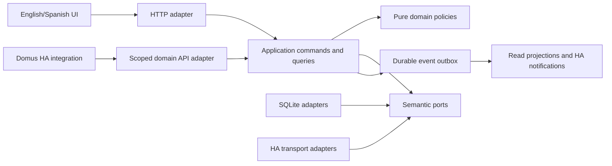

# Proposed Domus architecture

Status: Proposed. Confirmed scope and unresolved decisions are in [decisions](decisions.md).
Clean Architecture is a fixed owner requirement, not an optional style.

## Delivery alternatives

| Alternative | Benefits | Costs / limits | Assessment |
|---|---|---|---|
| Custom integration and custom panel only | One HA installation surface; direct native entities | Complex business persistence/UI jobs share Core lifecycle; no independent server boundary | Rejected as primary architecture |
| Supervisor App only | Own server, DB and Ingress UI | Does not cover confirmed standalone Container target; App alone is not a native entity provider | Insufficient |
| Independent server only | Full UI and deployment flexibility | Native entities/services still require a thin integration; standalone identity must be designed | Useful core, incomplete HA surface |
| Modular server plus companion integration | Same local core in App and Container; thin native HA adapter; independent UI | Two packages and explicit installation credential; more acceptance fixtures | Proposed |

The owner requires both deployment targets from the first usable release.
The companion integration is Domus's native HA surface. The already integrated gateway remains unchanged.

## Components and dependency direction

Text equivalent: UI and native HA adapters enter the same application use cases. Use cases depend inward
on pure domain and semantic ports. SQL, HTTP and HA transport implement those ports at composition time.
A durable outbox updates derived views without duplicating domain mutations.

| Boundary | Owns | Enforced restriction |
|---|---|---|
| Domain | Value objects, entities, transitions, allocation and quantity policies | No frameworks, I/O, clock globals or concrete repositories |
| Application | Authorization, unit-of-work orchestration, commands, queries, ports | No SQL/HTTP/HA DTOs or concrete adapters |
| Infrastructure | DB, migrations, HA clients, bounded I/O, secret storage | No independent business rules |
| Entrypoints | Authentication, schema validation, safe mappings | No direct state/ledger manipulation |
| Frontend application | Controllers and transport-independent contracts | No browser fetch in domain decisions |
| Presentation | Components, navigation, view models and localized content | No role decisions or quantity/point calculation |
| Composition | Exactly one deployment wiring profile | No silent mode fallback |

Architecture tests parse imports and module graphs, detect cycles, and exercise semantic contracts across adapters.
Directory names will follow these boundaries, but no fake source files are created in this documentation task.

## Proposed stack and trade-offs

Python/FastAPI, SQLite and Lit/TypeScript/Vite match observed gateway technologies and keep the frontend
independent of private HA bundles. These are proposals pending review; Domus does not import gateway code.
React is an alternative if calendar/components prove materially better during UX validation.
SQLite fits one household and one writer; a port-based storage seam permits a reviewed later database migration.
There is no broker, microservice mesh, cloud backend, event-sourced reconstruction requirement or MCP server.

## Data consistency

Definitions and occurrences, product identity and presentation, demand and purchase, receipt and stock posting,
and planned/actual actors are separate facts. Immutable stock and points ledgers use compensations.
Commands validate the authenticated principal, expected aggregate revision and idempotency key.
A transaction commits domain state, operation receipt, audit reference and outbox.
Duplicate same-key requests return the original result; changed-payload replays return conflict.
Consumers record inbox identities with their effects. If a projection fails, the committed business operation
is reported as saved with pending follow-up. One UI green check cannot claim all side effects finished.

## Deployment and identity

Supervisor mode uses App/Ingress packaging and persistent App storage. Standalone uses a private Container
binding, an owned data volume, Core APIs and authenticated access; it assumes no Supervisor or Ingress.
Both map verified individual HA users to Domus membership and roles. Ingress headers are accepted only
behind a verified trust boundary; standalone never trusts a browser-supplied identity header.
HA OAuth or an equivalent supported HA authentication flow is a required proof step before implementation readiness.
No child PIN, shared adult session or parallel Domus password store is proposed.

Stable and Edge have separate instance IDs, HA registry unique IDs, credentials, DB volumes and exposed bindings.
The first release tests coexistence. An Edge installation cannot mutate Stable by accidentally selecting a
production entity; service commands validate installation/channel selection before applying a mutation.

## Calendar and optional integrations

Fixed schedules preserve anchors; completion-relative rules use accepted completion. UTC instants and local
date-only values remain different types. DST gap/fold behavior is explicit and previewed.
External calendar sync is optional future work: start with read-only export; any two-way sync would need
stable external UIDs, remote revision/ETag conflict detection, an explicit field owner, deletion tombstones,
loop prevention and a user-visible conflict queue. No local change is silently overwritten and no export is on by default.

## Quality and operations

Every implemented source file starts with tests; supported first-party coverage metrics target and enforce 100%.
CI Check covers backend, frontend, integration, contracts, architecture, browser UX and packaging for each PR update.
A backup includes schema, ledgers, receipts and media metadata. Restore verifies integrity and channel.
Rollback uses compatible application/data versions. Required real Google Chrome evidence supplements CI
at the owner's authorized local HA; test artifacts are identified and cleaned explicitly.
