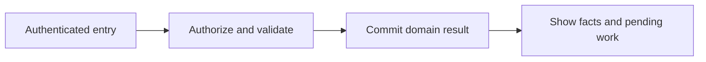
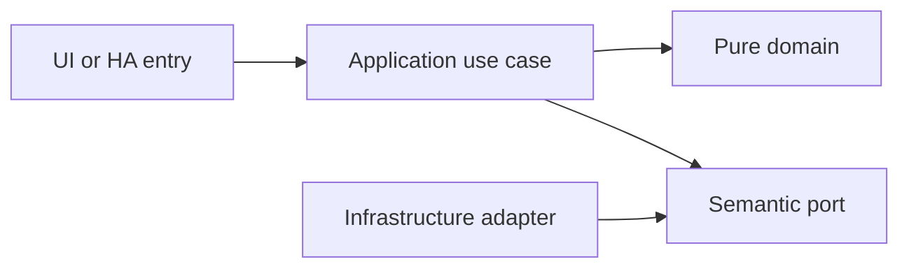

# Responsive application, household dashboard and navigation

- Status: Draft
- Date: 2026-10-28
- Catalog capability ID: application-experience
- Last verified: 2026-10-29 (document structure only; no implementation evidence)
- Owners: Domus maintainer; engineering/product reviewers to be assigned
- Scope: A complete household interface serves all six domains from the first release with fast daily actions, responsive navigation and clear operation results, independently of entity dashboards and AI.
- Related issues/PRs: https://github.com/vypdev/domus/issues/2
- Required review gates: product UX, architecture, testing, documentation, security/operations
- Open decisions blocking readiness: Detailed design system review; real mobile/companion and public host-context evidence; accessibility acceptance. The owner selected Lit/TypeScript/Vite, HA-coherent owned components, Storybook and Playwright on 2026-10-29. Catalog gate prerequisites remain unverified.

## 1. Executive summary

A complete household interface serves all six domains from the first release with fast daily actions, responsive navigation and clear operation results, independently of entity dashboards and AI.

```text
Authenticated member -> validated domain command -> durable result -> household and HA projections
```

This is a prospective Draft, not an implemented or accepted capability. The first usable release covers all domains and both deployment targets.

## 2. Problem, current behavior, and evidence

Household members need coherent task, calendar, shopping, inventory and participation workflows rather than a loose collection of HA entity cards.

Current verified sequence: (1) the repository has a minimal README and installed Copilot automation; (2) no Domus application, public service or tests exist; (3) this contract proposes the behavior to build.

Evidence: the owner's attached brief and subsequent decisions in [product vision](../docs/product-vision.md), the pinned [reference investigation](../docs/reference-investigation.md), and the existing repository baseline. Retrospective classification is not applicable: no as-built product baseline is reconstructed.

## 3. Actors, surfaces, and terminology

Actors: Authenticated household member; restricted member; administrator; keyboard and screen-reader users.

Primary surfaces: application UI, HTTP domain boundary, relevant HA entities/services, activity and diagnostics. Definitions of member, principal, occurrence, demand and ledger are shared in the [glossary](../docs/glossary.md). The actor recording an action is distinct from its selected target and actual performer.

## 4. Goals, non-goals, and fixed invariants

Goals and fixed invariants are the following normative requirements. No configuration may weaken authorization, ledger integrity, attribution or idempotency.

| Requirement | Behavior |
|---|---|
| application-experience-R1 | The application MUST provide complete navigation and first-release workflows across tasks, calendar, shopping, inventory, family and settings. |
| application-experience-R2 | The dashboard MUST prioritize actionable household information with distinct freshness and no invented zero values during failed reads. |
| application-experience-R3 | Commands MUST show pending, action-required, failed, partial and completed outcomes and preserve unsaved input on recoverable errors. |
| application-experience-R4 | The UI MUST support mobile, tablet, desktop, keyboard navigation, accessible names/focus and light/dark themes. |
| application-experience-R5 | English and Spanish localization MUST use stable keys and safe English fallback without localizing public service identifiers. |
| application-experience-R6 | The UI MUST use backend permissions and validated transports, remain useful without AI, isolate Lit presentation primitives from application/API logic, and reject private HA modules, parent-DOM/private-storage access and untrusted host messages as sources of authority. |

Non-goals: changing Copilot, changing the existing gateway, building an MCP server, adding mandatory cloud/AI dependencies, or claiming production readiness from a document.

## 5. Current versus proposed product journey

| Stage | Current | Proposed | User/operator effect |
|---|---|---|---|
| Enter | No Domus UI | Verified HA principal opens the relevant surface | Role and scope are explicit |
| Act | No domain command | Validate input, permission and current revision | Invalid data leaves the draft intact |
| Commit | No durable domain record | Store change and operation receipt atomically | Retry cannot duplicate effects |
| Observe | No projection | Show committed facts and pending downstream projections | Partial success remains understandable |



Text equivalent: authenticated entry -> authorization and validation -> durable domain commit -> visible facts with any pending projection. Domain-specific alternatives are described below.

## 6. Functional behavior and state model

### 6.1 Domain model and normal path

Routes: Dashboard, Tasks, Calendar, Shopping, Inventory, Family and Settings. A view model owns loading, data freshness, empty, validation, authorization, conflict, pending and partial states. Dashboard prioritizes today's tasks, overdue, my tasks, unclaimed work, shopping requirements, low stock, upcoming expirations/maintenance, recent completion, weekly points and participation. Optional recommendations are explicitly labeled and never silently execute. Displayed capabilities derive from backend permissions, which remain authoritative.

Explicit setup presents the three administrator-mapping modes with all HA administrators selected by default, while the backend proves setup authority. Settings exposes household permission profiles and per-member exceptions to authorized administrators, with effective-grant provenance and current policy revisions. Controls follow effective permissions rather than assuming a role label alone fixes every grant. A missing identity/administrator proof is a blocked setup state, not a reason to trust host UI hints or choose a weaker mapping silently.

### 6.2 States and alternatives

View idle -> loading -> ready/empty/error. Command draft -> validating -> submitting -> saved/pending/partial/conflict/denied. The client retains form data on a failure or conflict. A local server outage is not an offline-write queue; pending drafts remain visible without falsely claiming saved work.

A duplicate uses its original operation receipt. A changed payload under the same key is a conflict. Out-of-order events use aggregate revision and source identity. Cancellation never erases an already committed ledger effect; compensation is explicit.

## 7. User-facing configuration

| Input | Type | Recommended default | Allowed values/range | Scope/persistence |
|---|---|---|---|---|
| `theme` | enum | auto | light, dark or auto | member preference; persisted |
| `locale` | enum | browser language | en, es; base-language match then en | member preference; persisted |
| `dashboard_member_filter` | member reference | current member | authorized member or household view | member preference |
| `reduced_motion` | preference | system setting | respect reduced-motion; no essential animated-only information | browser; no server override |

These are proposed defaults pending review. Invalid values and contradictory combinations are rejected before saving; unknown future values require an explicit compatibility error. Precedence is fixed invariants, installation constraints, household policy, then member preferences; lower scopes cannot expand permissions. In-flight commands snapshot relevant policy versions, while revocation is checked at the transaction boundary.

Recommended example: keep the defaults above. Meaningful alternative: a member selects Spanish and dark theme while the same household policies remain in force. Transport secrets are installation concerns and are never domain form fields.

## 8. Clean Architecture design

### 8.1 Responsibilities and dependency direction

The owner selected Lit/TypeScript with Vite on 2026-10-29 after comparing Gateway and Symphonia. Domus owns reusable HA-coherent presentation primitives and semantic design tokens, cataloged in Storybook and exercised through Playwright. Presentation components call application controllers through a typed DomusPort; an HTTP adapter validates DTOs. Views do not calculate permissions, recurrence, stock consolidation or point awards. Relative URLs and deployment-aware base paths support Ingress and standalone. No private HA frontend bundles, parent DOM or private host storage are accessed. React is not the selected stack.

HA's outer shell owns host navigation; Domus owns interior routes and content. A public host-context adapter validates message source, origin, shape and bounds, treating all accepted fields as presentation hints only. It does not assume HA user theme, locale, timezone or authentication is forwarded to an App iframe. Explicit member preferences and deterministic browser fallbacks remain usable without host hints. Host-managed safe-area padding is applied once; a full-bleed opt-in requires supported-version evidence. Vite relative assets alone do not establish deep-route reload or Ingress compatibility, so those behaviors have explicit browser cases.

| Boundary | Owns | Forbidden dependency |
|---|---|---|
| Domain | Entities, value objects and pure rules | HA, HTTP, SQL, UI frameworks |
| Application | Authorized commands, queries and semantic ports | Concrete adapters and framework DTOs |
| Adapters | Schema mapping, persistence and provider error mapping | Alternate business rules |
| Composition | Explicit deployment wiring | Business decisions |
| Presentation | View models and rendering | Database access or client-only authorization |



Text equivalent: entrypoints call use cases; use cases depend on pure domain and ports; infrastructure implements ports. Architecture checks reject forbidden imports and cycles. Shared contract tests exercise each port adapter; schemas and migration checks enforce durable boundaries.

## 9. UI/UX and content contract

### 9.1 Primary state examples

| State | Visible content |
|---|---|
| Pending | Loading your household. No action required. |
| Action required | Choose who completed this task. Your other entries are retained. |
| Blocked | The household server is unavailable. Your draft is retained in this screen. Retry when it reconnects. |
| Partial | Your purchase was saved. Stock receipt needs attention. Open the receipt. |
| Complete | All six domains are available. Today's next action: complete “Clean the bathrooms”. |

The primary view names current status, retained facts and one next action, followed by descriptive links to the record/operation. Technical codes and correlation IDs are progressively disclosed. Duplicate responses update the same operation status rather than adding notifications. At most one routine notification per transition, with opt-out and bounded retry summaries.

English and Spanish use stable translation keys, base-language matching and English fallback. Mobile, tablet and desktop layouts, keyboard operation, visible focus, non-color status, accessible names, light/dark contrast and reduced motion are acceptance concerns. Untrusted text is rendered inert; no arbitrary HTML, commands or secret-bearing links.

## 10. Failure, recovery, and cleanup

| Failure | Retained facts | Retry / action | Cleanup |
|---|---|---|---|
| Invalid or denied input | Existing business records and form draft | Correct fields or request the proper role | No side effects |
| Stale revision | Current committed aggregate; user's entered fields | Review current state and submit a new deliberate operation | No automatic overwrite |
| Lost response after commit | Domain result and receipt | Look up or replay the same key | Never issue a fresh-key duplicate |
| Downstream projection unavailable | Successful domain result and durable pending event | Bounded backoff, then visible retry | Acknowledge outbox only after safe consumption |
| Restart or cancellation | Committed records; identified pending work | Recover receipts/cursors; compensate only by explicit command | Remove listeners and owned temporary artifacts |

Errors explain impact, safe cause, action and retained state. External availability is distinct from authorization denial. Retries are bounded and use deterministic backoff tests, not real waits.

## 11. Security, permissions, and privacy

Backend authorization applies to reads and writes. All requests and HA values are untrusted input; only authenticated principals and validated adapter context establish identity. Cross-household IDs, replayed operations and stale roles are covered in the inventory. A person entity and selected member ID do not authenticate a caller. Logs, traces, exports and browser artifacts redact credentials and unnecessary personal data. The technical HA principal has explicit narrow grants and cannot impersonate a household administrator.

## 12. Observability and operational UX

Show operation state and projection freshness to members; expose sanitized correlation, source event, aggregate revision, duration and safe error code to operators. No raw credentials or unrestricted HA payloads enter diagnostics. Counters distinguish denied, invalid, conflict, unavailable and completed operations. One durable activity entry per business transition; retries do not multiply notifications. No telemetry leaves the installation by default.

## 13. Compatibility, migration, rollout, and rollback

No existing Domus application data requires migration yet. The first schema is versioned from its first implementation. Upgrade fixtures cover pending operations and ledger compatibility; a backup precedes destructive migration. Unknown future schemas block writes. Downgrade requires a compatible image/database pair, never silent interpretation of newer data.

Both Supervisor and standalone are first-release acceptance targets. Stable and Edge use separate credentials, IDs, volumes and endpoint bindings. Experimental artifacts cannot automatically promote production. Publication, merge and deployment remain in the existing authorized maintainer lifecycle.

## 14. Testing strategy and numeric budget

Minimum: 26 distinct cases, derived from the explicit risk inventory below. Each inventory row counts once. The budget is a floor, not a claim of completeness or executed tests.

| Area | Minimum distinct cases | Behaviors/risks covered |
|---|---:|---|
| UI and accessibility | 14 | first-release membership permissions; a viewer account; overdue and decorative statistics |
| Integration and recovery | 2 | a maintenance task lacking a material; inventory read failure |
| State and concurrency | 1 | a command in progress |
| Deployment and contracts | 5 | localized navigation; an Ingress prefix or standalone base path |
| Security and privacy | 4 | direct backend denial after a role change; hostile task text and no AI service |
| **Total** | **26** | No double counting |

| Case ID | Area | Requirements | Scenario |
|---|---|---|---|
| application-experience-C01 | UI and accessibility | application-experience-R1 | Given first-release membership permissions, a user can navigate all domain routes and return to the previous filter state. |
| application-experience-C02 | Integration and recovery | application-experience-R1 | Given a maintenance task lacking a material, the user can inspect the linked inventory shortfall and shopping demand. |
| application-experience-C03 | UI and accessibility | application-experience-R1 | Given a default viewer account without mutation exceptions, visible controls reflect read-only access while routes remain understandable. |
| application-experience-C04 | UI and accessibility | application-experience-R2 | Given overdue and decorative statistics, the dashboard presents actionable tasks before summary charts. |
| application-experience-C05 | Integration and recovery | application-experience-R2 | Given inventory read failure, the dashboard shows unavailable stock facts rather than zero low-stock products. |
| application-experience-C06 | UI and accessibility | application-experience-R2 | Given an empty new household, the dashboard offers authorized setup actions without false completed statistics. |
| application-experience-C07 | State and concurrency | application-experience-R3 | Given a command in progress, repeated clicks reuse its operation key and show one pending result. |
| application-experience-C08 | UI and accessibility | application-experience-R3 | Given a conflict, entered form fields are retained while the user reviews the newer revision. |
| application-experience-C09 | UI and accessibility | application-experience-R3 | Given a saved receipt and failed stock post, the view names both retained success and the remaining action. |
| application-experience-C10 | UI and accessibility | application-experience-R4 | Given a 360-pixel viewport, primary actions and labels remain readable without page-level horizontal scrolling. |
| application-experience-C11 | UI and accessibility | application-experience-R4 | Given keyboard-only use, a modal manages focus and returns it to the triggering control. |
| application-experience-C12 | UI and accessibility | application-experience-R4 | Given dark theme and reduced motion, contrast, focus and non-animated state announcements remain usable. |
| application-experience-C13 | UI and accessibility | application-experience-R5 | Given an es-MX browser language, the Spanish base catalog is used. |
| application-experience-C14 | UI and accessibility | application-experience-R5 | Given a missing or invalid translation key, safe English copy appears without leaking raw markup. |
| application-experience-C15 | Deployment and contracts | application-experience-R5 | Given localized navigation, domus.complete_task remains the same public service identifier. |
| application-experience-C16 | Security and privacy | application-experience-R6 | Given direct backend denial after a role change, the view explains the denial without relying on hidden buttons. |
| application-experience-C17 | Deployment and contracts | application-experience-R6 | Given an Ingress prefix or standalone base path, assets and API requests resolve through their respective public roots. |
| application-experience-C18 | Security and privacy | application-experience-R6 | Given hostile task text and no AI service, rendering stays inert and ordinary task completion still works. |
| application-experience-C19 | Security and privacy | application-experience-R6 | Given a host-context message with a wrong source/origin or malformed fields, the adapter rejects it without changing authenticated identity, role or trusted UI context. |
| application-experience-C20 | Deployment and contracts | application-experience-R6 | Given a private HA module import or parent-DOM/private-storage lookup in presentation source, the executable boundary check rejects it. |
| application-experience-C21 | UI and accessibility | application-experience-R5 | Given absent public HA locale/theme hints, explicit member preferences then documented browser/English fallbacks render a usable UI without reading host internals. |
| application-experience-C22 | UI and accessibility | application-experience-R4 | Given a narrow Ingress iframe with host-managed safe-area padding, the UI applies insets once and keeps focused fields and actions visible with the virtual keyboard. |
| application-experience-C23 | Deployment and contracts | application-experience-R6 | Given a Storybook presentation primitive importing an API adapter or domain command, architecture validation rejects the component while pure presentation fixtures build independently. |
| application-experience-C24 | Deployment and contracts | application-experience-R6 | Given a direct reload of an interior route under a non-root Ingress prefix, the authenticated page, assets, API and any push transport resolve within the validated deployment base. |
| application-experience-C25 | UI and accessibility | application-experience-R6 | Given an authorized administrator editing a profile/member exception, the UI exposes the effective grant source and retained policy revision, and a later backend revocation updates controls without losing a denied user's draft. |
| application-experience-C26 | Security and privacy | application-experience-R6 | Given explicit setup, all three mapping modes are available with all_ha_administrators as default; failed proof of setup authority blocks saving and no browser/host field silently grants administration. |

Every implemented first-party module starts with meaningful behavior tests. Target and proposed merge gate: 100% lines/statements/functions/branches where the selected tools expose those metrics, enforced separately across backend, frontend and integration code. Third-party/generated artifacts are distinguished from authored source; broad exclusions cannot hide untested logic. No application coverage currently exists.

Inject deterministic clocks, IDs, provider fakes and transaction failures. Use semantic assertions alongside golden content, real adapter contracts and disposable HA integration environments. Add Google Chrome evidence from the owner's authorized local HA for real UX; it does not replace automated tests or unit coverage. CI Check runs the complete applicable suite for every PR update.

## 15. Documentation and discoverability

The following paths are explicit proposed documentation changes relative to the clean repository baseline; implementation source/test paths are intentionally not invented.

| Path | Change |
|---|---|
| specs/application-experience.md | create |
| specs/README.md | create |
| specs/_template.md | create |
| specs/catalog.json | create |
| specs/CATALOG.md | create |
| docs/architecture.md | create |
| docs/product-vision.md | create |
| docs/glossary.md | create |
| docs/decisions.md | create |
| docs/reference-investigation.md | create |
| docs/copilot-adoption.md | create |
| docs/operations.md | create |
| docs/user-guide.md | create |
| docs/contracts/home-assistant.md | create |
| docs/acceptance-plan.md | create |
| docs/roadmap.md | create |
| README.md | update |

| Audience | Artifact | Required content |
|---|---|---|
| Member | [User guide](../docs/user-guide.md) | Normal path, defaults and state meaning |
| Administrator/operator | [Operations](../docs/operations.md) | Setup, permissions, recovery, backup and rollback |
| Contributor | [Architecture](../docs/architecture.md) | Boundaries and executable constraints |
| HA consumer | [Entity/service contract](../docs/contracts/home-assistant.md) | Stable schemas, semantics and error handling |
| Reviewer | [Acceptance plan](../docs/acceptance-plan.md) | Tests, coverage and human evidence |

Link/path validation accompanies updates. Implementation changes update the owning SDD, catalog evidence, actual tests and user documentation together.

## 16. Acceptance scenarios

The Given/When/Then-equivalent observable scenarios in section 14 are the executable acceptance inventory. For each case, the given precondition and action must produce the specified result with state and side-effect assertions; tests are not implementation snapshots.

Acceptance includes normal, alternative, invalid, duplicate, concurrent, partial, failure, recovery, security, localization and accessibility paths as allocated above. Human review verifies the primary-state examples on desktop/mobile and light/dark themes. Live acceptance remains pending until an implemented artifact is exercised; no result is inferred from the budget.

## 17. Requirements traceability

| Requirement | Cases |
|---|---|
| application-experience-R1 | application-experience-C01, application-experience-C02, application-experience-C03 |
| application-experience-R2 | application-experience-C04, application-experience-C05, application-experience-C06 |
| application-experience-R3 | application-experience-C07, application-experience-C08, application-experience-C09 |
| application-experience-R4 | application-experience-C10, application-experience-C11, application-experience-C12, application-experience-C22 |
| application-experience-R5 | application-experience-C13, application-experience-C14, application-experience-C15, application-experience-C21 |
| application-experience-R6 | application-experience-C16, application-experience-C17, application-experience-C18, application-experience-C19, application-experience-C20, application-experience-C23, application-experience-C24, application-experience-C25, application-experience-C26 |

All requirement cases are reciprocal with section 14. Domain invariants are owned by pure policy, command/state rules by application use cases, provider behavior by adapters, and visible content by presentation; the boundary table in section 8 assigns these responsibilities. Evidence and user/operator documentation are linked in section 15.

## 18. Implementation sequence

1. Resolve the blocking decisions and review this contract before Ready for implementation.
2. Establish test harness, CI Check and architecture checks with the first source files.
3. Implement pure policies and their complete branch tests, then transactional use cases.
4. Add adapters, schema/error contracts, retry/race fixtures and both deployment wiring paths.
5. Build the accessible localized UI and HA projections with tests alongside each flow.
6. Verify migration, recovery, security, channel isolation and documentation.
7. Run the complete suite, review coverage, perform local Chrome dogfooding with recorded cleanup, and collect human evidence.

These are internal implementation steps within the first integrated release; they do not remove other domains or deployment targets from launch.

## 19. Definition of Done

- [ ] Every normative requirement has observable acceptance and reciprocal case links.
- [ ] Every declared case is implemented meaningfully; the numeric budget is met.
- [ ] Clean Architecture constraints and port contracts pass.
- [ ] All supported first-party coverage metrics reach 100% from the first implementation.
- [ ] CI Check passes for the current PR revision with no omitted required jobs.
- [ ] Configuration, state, permission, idempotency and recovery behaviors agree.
- [ ] Primary UI states, localization, responsive behavior and accessibility pass.
- [ ] Both deployment targets and isolated Stable/Edge channels pass acceptance.
- [ ] User/operator documentation, schema/migration evidence and catalog paths are current.
- [ ] Local Google Chrome evidence identifies the artifact, channel, test records and cleanup.
- [ ] The original Copilot validations pass when their real prerequisites exist; no check is weakened.
- [ ] No material decision blocking readiness remains unresolved; Copilot remains unchanged.

## 20. References and decisions

Primary sources: [Copilot standard](https://github.com/vypdev/copilot/blob/f5e5a4cf9a80248994469cd88ad55eecab5b95ca/specs/README.md), [original template](https://github.com/vypdev/copilot/blob/f5e5a4cf9a80248994469cd88ad55eecab5b95ca/specs/_template.md), and the linked [reference investigation](../docs/reference-investigation.md).

Confirmed owner choices and unresolved proposals are separated in [decisions](../docs/decisions.md). [Issue #2](https://github.com/vypdev/domus/issues/2) tracks the documentation foundation. The [adoption note](../docs/copilot-adoption.md) records the current catalog evidence limitation. Optional future depth remains explicitly deferred in the product vision; the gateway's installation and MCP internals are outside Domus scope.

## Proposed change: Shared presentation adoption in Domus

- Status: Draft
- Date: 2026-11-06
- Catalog capability ID: application-experience
- Last verified: Not applicable; prospective consumer change.
- Owners: Domus maintainers
- Related issue: [Domus issue 30](https://github.com/vypdev/domus/issues/30)
- Required review gates: product, architecture, security, documentation, CI and native review.
- Open decisions blocking drafting: none.

### 1. Executive summary

The existing Domus overview and household administration gain a shared upper navigation bar. The browser location selects a real destination; the package renders it, and Domus remains the authority for routes and all household facts.

### 2. Problem, current behavior, and evidence

The verified develop revision 0170085f283ea5775f41e77a2f8c8d9cc69f20b7 has working entry and administration surfaces without shared tabs. The public package was installed and bundled in the isolated local candidate d1c8f361545ff2cd6c2b6b3daaed371cce73f7e2. That candidate passed 91 Chromium journeys across both modes and 36 in the ARM64 image. The managed implementation and hosted review remain pending.

### 3. Actors, surfaces, and terminology

A verified participant may navigate Overview and Household. Household means the existing administration surface; each control retains the permissions already enforced. Ingress is the Supervisor App entry; standalone is the independently served authenticated entry.

### 4. Goals, non-goals, and fixed invariants

| Requirement | Behavior |
|---|---|
| G-01 | Install and lock the exact public npm version and integrity, retaining its published license notices in the compiled distribution. |
| G-02 | Render shared, localized Overview and Household navigation against the current real surfaces. Domus owns destination selection and access. |
| G-03 | Preserve relative links, focus, history and reload in Ingress and standalone. Unknown fragments never select a new destination. |
| G-04 | Preserve access, household drafts and original-operation recovery while moving between destinations. |
| G-05 | Support keyboard use, localized labels and overflow controls, and narrow and wide light/dark layouts and reduced motion. |
| G-06 | Deliver the verified assets in the wheel and current-source image, with complete global and per-file frontend coverage. |

This adoption does not implement task, calendar, supplies, points or Gateway workflows. It does not alter authentication, mutations, schemas, recovery, hosting, channels or first-release requirements.

### 5. Current versus proposed product journey

Open the same entry URL and authenticate if needed. With current household access, start at Overview, reach Household through the shared bar and return through browser history or the Overview link. Both destinations use the existing surfaces. Inactive or closed sessions retain their existing guidance and expose no protected navigation.

### 6. Functional behavior and state model

Domus recognizes the two fixed fragments, #overview and #household. An absent or unknown fragment leaves Overview selected without rewriting the URL. Selection has no authority; do not expose protected surfaces without current application evidence. Same-context fragment changes preserve mounted draft state, while existing session retirement and context replacement still clear drafts.

### 7. User-facing configuration

No new settings. Use the existing Domus language and theme precedence and the public component's styling hooks. Install and lock the exact public ha-ui core package version 0.1.0-next.1.

### 8. Clean Architecture design

Presentation uses the library's public navigation contract and component. Browser composition maps the current fragment to a known Domus destination. Controllers, ports, adapters, authorization, validation, commands and original-operation recovery keep their existing dependencies. Dependency Cruiser enforces that runtime imports of the package stay in presentation. The shared component receives view data and does not access the host frame, application authority or credentials.

### 9. UI/UX and content contract

Overview and Household are visible text labels in English; Inicio and Hogar are the corresponding Spanish labels. Use the shared indicator, keyboard support and accessible localized overflow controls. Normal links work within the current deployment base. Focus follows deliberate navigation to the existing content; narrow, wide, light, dark and reduced motion are covered.

### 10. Failure, recovery, and cleanup

Unknown fragments keep a valid default selection. Missing proof or an unavailable context uses the existing loading, closed or recovery states. No navigation sends commands, retries a write, reads unrelated storage or changes request identity. The existing application owns draft retirement and lifecycle cleanup.

### 11. Security, permissions, and privacy

Fragments are untrusted local presentation input. The server remains authoritative for permission, origin and session checks. Neither URL fragments nor component events grant access. Do not inspect the HA host DOM or private assets; do not render future or inaccessible surfaces.

### 12. Observability and operational UX

Use existing status, recovery and correlation evidence. Package pin, notices, coverage, browser receipts and built-artifact identity provide review evidence. Do not log private drafts or add telemetry.

### 13. Compatibility, migration, rollout, and rollback

Use the existing Lit runtime and public package integrity. Bundle the release and retain its published license and third-party notices. No data or configuration migration. Reverting the consumer change restores the prior UI with the same database and runtime contracts. Gateway adoption and production rollout are separate.

### 14. Testing strategy and numeric budget

Cover 12 distinct cases in addition to the retained regression suite.

| Area | Minimum distinct cases | Behaviors/risks covered |
|---|---:|---|
| Package | 2 | Observable scenarios in the case inventory. |
| Navigation | 3 | Observable scenarios in the case inventory. |
| Ingress | 1 | Observable scenarios in the case inventory. |
| Standalone | 1 | Observable scenarios in the case inventory. |
| Household workflow | 2 | Observable scenarios in the case inventory. |
| Presentation | 2 | Observable scenarios in the case inventory. |
| Coverage | 1 | Observable scenarios in the case inventory. |
| Total | 12 | Distinct inventory cases; repeated executions do not add cases. |

| Case ID | Area | Requirements | Scenario |
|---|---|---|---|
| domus-shared-nav-C01 | Package | G-01 | A frozen install resolves the exact public npm version and recorded integrity with one existing Lit runtime. |
| domus-shared-nav-C02 | Package | G-01, G-06 | The built navigation assets and wheel carry the installed package license and third-party notices and load through the packaged bundle contract. |
| domus-shared-nav-C03 | Navigation | G-02, G-03, G-05 | An active member starts with the existing overview and can reach the actual household administration using named keyboard-operable links. |
| domus-shared-nav-C04 | Navigation | G-02, G-03 | Empty and unrecognized fragments select Overview without rewriting the URL or reaching a foreign surface. |
| domus-shared-nav-C05 | Navigation | G-02, G-04 | Closed, unverified and replaced contexts cannot reveal protected destinations or use a fragment to grant access. |
| domus-shared-nav-C06 | Ingress | G-02, G-03, G-06 | In the current-source Ingress image, keyboard navigation, reload and back/forward preserve selection and the non-root deployment path. |
| domus-shared-nav-C07 | Standalone | G-02, G-03, G-06 | In the current-source standalone image, keyboard navigation, reload and back/forward preserve selection and the standalone deployment path. |
| domus-shared-nav-C08 | Household workflow | G-04 | Switching between existing areas leaves an unsent same-context administration draft intact and issues no write. |
| domus-shared-nav-C09 | Household workflow | G-04 | Existing authorization and original-operation browser regressions still pass on the compiled consumer. |
| domus-shared-nav-C10 | Presentation | G-02, G-05 | English and Spanish destinations retain accessible names and a visible selected indicator in wide light and narrow dark states. |
| domus-shared-nav-C11 | Presentation | G-05 | Constrained navigation exposes the localized overflow controls, retains keyboard reachability and honors reduced motion. |
| domus-shared-nav-C12 | Coverage | G-06 | The independent frontend source inventory verifies complete statements, branches, functions and lines for every authored runtime file and globally. |

### 15. Documentation and discoverability

Record the dependency boundary, user-visible navigation, roadmap status and actual verification receipts. The existing owner specifications are retained.

| Path | Change |
|---|---|
| `frontend/tests/e2e/workspace-navigation.spec.ts` | create |
| `docs/evidence/shared-presentation-adoption.json` | create |
| `frontend/src/composition/entry-page.ts` | update |
| `frontend/src/presentation/domus-app.ts` | update |
| `frontend/src/presentation/messages.ts` | update |
| `frontend/src/presentation/styles.ts` | update |
| `frontend/tests/page.test.ts` | update |
| `frontend/playwright.entry.config.ts` | update |
| `frontend/vite.config.ts` | update |
| `frontend/vitest.config.ts` | update |
| `architecture/frontend.mjs` | update |
| `tests/node/architecture.test.mjs` | update |
| `frontend/package.json` | update |
| `pnpm-lock.yaml` | update |
| `.github/workflows/ci_check.yml` | update |
| `tests/packaging/test_ui_wheel.py` | update |
| `tests/containers/test_app_ui.py` | update |
| `docs/architecture.md` | update |
| `docs/roadmap.md` | update |
| `docs/user-guide.md` | update |
| `specs/application-experience.md` | update |
| `specs/household-entry-interface.md` | reference |
| `specs/catalog.json` | reference |

### 16. Acceptance scenarios

The exact public tarball installs on a frozen lock, the compiled product and current-source image carry the package and its notices, and both deployment paths preserve keyboard navigation, focus, selection, reload, browser history and protected household operations. EN and ES, light and dark, narrow and wide, reduced motion and overflow are verified. The required CI and native review must complete on the implementation head; publishing this specification proves no runtime acceptance.

### 17. Requirements traceability

| Requirement | Cases |
|---|---|
| G-01 | domus-shared-nav-C01, domus-shared-nav-C02 |
| G-02 | domus-shared-nav-C03, domus-shared-nav-C04, domus-shared-nav-C05, domus-shared-nav-C06, domus-shared-nav-C07, domus-shared-nav-C10 |
| G-03 | domus-shared-nav-C03, domus-shared-nav-C04, domus-shared-nav-C06, domus-shared-nav-C07 |
| G-04 | domus-shared-nav-C05, domus-shared-nav-C08, domus-shared-nav-C09 |
| G-05 | domus-shared-nav-C03, domus-shared-nav-C10, domus-shared-nav-C11 |
| G-06 | domus-shared-nav-C02, domus-shared-nav-C06, domus-shared-nav-C07, domus-shared-nav-C12 |

### 18. Implementation sequence

After branch readiness, apply the locally verified candidate with its regression tests, exact package pin, shared navigation and bundled notices. Run focused and retained regressions, verify the wheel and image in both modes, and record review evidence.

### 19. Definition of Done

All listed cases and existing gates pass. Every authored frontend runtime file and the global report reach complete supported coverage. Exact current-head CI passes and Bugbot has no pending findings. Keep package publication, Domus verification and human UX evidence distinct.

### 20. References and decisions

The common implementation, API, adapters, catalog and publication remain with [ha-ui issue 7](https://github.com/vypdev/ha-ui/issues/7). Domus owns the consumer and household experience. Gateway remains deferred. The Action appends this proposed change to the existing application-experience specification and preserves the existing content.


## Operational acceptance clarification: combined browser budget

- Date: 2026-11-08; scope: CI execution only, product acceptance unchanged.
- Evidence: Domus CI run 42437023506 passed 98 entry journeys and interrupted
  the next at its 180-second global deadline, leaving three unfinished/unrun.
- Contract: `frontend/playwright.entry.config.ts` MUST execute the entire current
  101-case native/standalone suite within a bounded 360-second global deadline,
  including two fixture startups and cleanup, inside the 15-minute CI job.
  Preserve all four selected files, one worker, zero retries, individual case
  limits, 30-second startup and 5-second graceful shutdown. No partial run passes.
- Architecture/configuration: the test runner owns this fixed suite budget;
  application transports, authorization and runtime configuration are unchanged.
- Verification: execute all 101 existing browser journeys; no new product case
  is counted. Preserve the existing Python CI contract and all coverage gates.
  Record exact candidate/head and complete CI result. Local fixture evidence
  cannot replace actual-image or human HA acceptance.
- Operations: see the reviewed candidate pin/hash procedure in
  `docs/acceptance-plan.md`. A candidate SDK workflow edit MUST preserve its
  events, inputs and permissions and update only the corresponding reviewed protected digests. Commit and Pull Request
  use the same candidate; all other installed-resource hashes remain unchanged.
  Other installed-resource hashes remain unchanged. Rollback restores the prior
  workflow pins with their matching digests; do not disable the protection test.
- Readiness: current-head native Copilot and full CI qualification pending.


### Exact browser recovery evidence (2026-11-08)

The existing two native/standalone navigation cases retain all their assertions:
exact original int64 PUT input and real committed-reply bytes, deliberately lost
reply, reload, actual original-status GET, cleared pending state, selected value
and exactly one write. Capture the real committed reply before dropping it;
do not require later CDP access to a browser response whose resource was retired.
No generated response, extra GET, retry, skip or production behavior change is
introduced. Case counts stay unchanged. The reported last-selectable-month
finding is contradicted by existing production predicates; existing domain and
component boundary cases now explicitly assert the 9998-12-01 anchor and
9999-01-01 exclusive end, plus every calendar mode and both week starts.

## Proposed change: Open Shopping as a direct household workspace

- Status: Draft
- Catalog capability: application-experience

### 1. Executive summary

This delta adds a distinct, localized Shopping destination to the existing application-experience contract. It exposes the current shared list, manual extras, purchases, store sessions, and receipt workflow while preserving Inventory for catalog, stock, locations, material consumption, and replenishment. The retained owner remains the contract for shared navigation, presentation boundaries, and general accessibility and localization requirements; this delta specifies the Shopping and Inventory transition and its acceptance.

### 2. Problem, current behavior, and evidence

At the selected immutable base `7770b1e560800fa4bb78d36b0583b2c1beb784d7`, the shared navigation in `frontend/src/presentation/domus-app.ts` includes Inventory but not a Shopping destination, and Shopping renders within Inventory. The Shopping view is implemented in `frontend/src/presentation/domus-shopping.ts`; the entry composition is in `frontend/src/composition/entry-page.ts`, and shared inventory and shopping state is managed through `frontend/src/application/inventory-controller.ts`. The roadmap describes Shopping and Inventory as separate purposes in `docs/roadmap.md`. These source observations establish the current presentation arrangement, not installed-browser acceptance. The change must preserve the existing Shopping workflow and ownership while making its entry direct and understandable.

### 3. Actors, surfaces, and terminology

The actors are household members with current server-owned permissions, including readers, request-only members, and Shopping or Inventory managers. Shopping is the destination for the shared list, manual extras, purchases, store sessions, and receipt workflow. Inventory remains the destination for catalog, stock, locations, material consumption, and replenishment. Overview item links and existing inventory-shopping item fragments are contextual links: they must select the same product or manual extra in the Shopping workflow. The active destination must be clear through the localized tab, page heading, and deliberate content focus.

### 4. Goals, non-goals, and fixed invariants

The delta goals are direct Shopping entry through localized shared navigation and overflow; stable direct entry, reload, back/forward, and repeated-tab behavior; and preservation of contextual item links. Switching between Shopping and Inventory for the same household and member preserves unfinished forms, literal notes and priorities, selected work, and the identity of an interrupted write. On return, retained drafts and pending recovery are understandable; receipt lookup cannot replace a newer unrelated draft. Logout or a membership, household, or principal change retires protected state through the existing lifecycle. Navigation alone never posts stock, creates a purchase, cancels an effect, or resubmits a command; both destinations reuse the same application command and recovery owner. Existing grants and protected read/write contracts remain authoritative, and an already permitted Shopping action does not require a general Inventory mutation grant. The interface distinguishes unavailable data, denied access, read-only state, stale content, and pending or committed operations; unknown or malformed fragments use a safe existing fallback without executing a command. Qualify normal, loading, empty, denied, unavailable, read-only, stale, pending, committed, and conflict states, including revocation during retained drafts or interrupted operations. Verify English and Spanish, narrow touch and wide keyboard layouts, both themes, current source, actual amd64 and ARM64 images, standalone and Ingress base paths, and the immutable installed Edge candidate in Home Assistant; preserve complete global and per-file coverage and existing Shopping and Inventory acceptance assertions. Keep the domain schema, stock ledger, original receipts, and package cohort compatible without requiring a schema change solely for this presentation move. The registered publication outcome must state that the specification satisfies the required format, internal and cross-document consistency is checked, and reciprocal catalog ownership, paths, and evidence agree with the generated view. The concrete invocation and prerequisites for these checks, and execution of product acceptance, remain unverified in this source review; planned assertions or structural counts do not establish execution or semantic completeness.

| Requirement | Behavior |
| --- | --- |
| SDD-I162-U1-R1 | Provide a localized Shopping destination that opens the existing shared list, manual extras, purchases, store sessions, and receipt workflow; keep catalog, stock, locations, material consumption, and replenishment in Inventory. |
| SDD-I162-U1-R2 | Support direct entry, reload, back and forward navigation, repeated-tab activation, shared overflow navigation, deliberate content focus, and contextual Overview and inventory-shopping item links that select the same product or manual extra. |
| SDD-I162-U1-R3 | Preserve unfinished forms, literal notes and priorities, selected work, and interrupted-write identity when switching between Shopping and Inventory for the same household and member; make retained drafts and pending recovery understandable when returning. |
| SDD-I162-U1-R4 | Ensure receipt lookup does not overwrite a newer unrelated draft; retire protected state on logout, membership, household, or principal change using the existing lifecycle. |
| SDD-I162-U1-R5 | Ensure navigation does not post stock, create a purchase, cancel an effect, or resubmit a command; reuse the same application command and recovery owner across both destinations. |
| SDD-I162-U1-R6 | Preserve current server-owned grants and protected read/write contracts for readers, request-only members, and Shopping/Inventory managers; do not require a general Inventory mutation grant to reach an already permitted Shopping action. |
| SDD-I162-U1-R7 | Distinguish unavailable data, denied access, read-only state, stale content, and pending or committed operations; provide a safe existing fallback for unknown or malformed fragments without executing a command. |
| SDD-I162-U1-R8 | Make the active tab, page heading, and focus identify the destination in English and Spanish, on narrow touch screens and wide keyboard layouts, in both themes. |
| SDD-I162-U1-R9 | Qualify normal, loading, empty, denied, unavailable, pending, and conflict states, including revocation during a retained draft or interrupted operation. |
| SDD-I162-U1-R10 | Verify current source and actual amd64 and ARM64 images, standalone and Ingress base paths, and the immutable installed Edge candidate in Home Assistant; preserve complete global and per-file coverage and existing Shopping and Inventory acceptance assertions. |
| SDD-I162-U1-R11 | Keep the domain schema, stock ledger, original receipts, and package cohort compatible; do not require a new schema solely to move the presentation. |

### 5. Current versus proposed product journey

The retained application-experience owner describes a proposed first release; this delta adds Shopping as a distinct household destination within that journey. Members can open Shopping from the shared localized navigation or enter it directly, then use the existing shared list, manual extras, purchases, store sessions, and receipt workflow. Inventory remains responsible for catalog, stock, locations, material consumption, and replenishment. Contextual Overview links and previously shared inventory-shopping item fragments continue to select the same product or manual extra. After switching between destinations, members can return to their work with drafts and pending recovery understandable. Navigation changes presentation only: it does not post stock, create a purchase, cancel an effect, or resubmit a command.

At the selected immutable base `7770b1e560800fa4bb78d36b0583b2c1beb784d7`, the presentation registered Overview, Tasks, Calendar, Family, Inventory, and Household in `frontend/src/presentation/domus-app.ts`; `frontend/src/composition/entry-page.ts` mapped inventory-shopping fragments to Inventory. The application-experience owner is the immutable retained contract at revision 7770b1e560800fa4bb78d36b0583b2c1beb784d7. This delta does not claim installed-browser acceptance or completion of the owner's wider integrated-acceptance scope.

### 6. Functional behavior and state model

Shopping becomes a first-class destination with direct entry, reload, back and forward navigation, shared overflow access, and repeated activation that keeps the destination and its content focus clear. Overview item links and existing inventory-shopping fragments select the same target in Shopping. Unknown or malformed fragments use the existing safe fallback and never execute a command. Preserve standalone and Ingress base paths.

For the same household and member, switching between Shopping and Inventory retains unfinished forms, literal notes and priorities, selected work, and the original identity of an interrupted write. On return, show the retained draft and pending recovery state clearly. Receipt lookup must not replace a newer unrelated draft. Logout and membership, household, or principal changes retire protected state through the existing lifecycle.

Both destinations use the same application command and recovery owner. Navigation must not post stock, create a purchase, cancel an effect, or resubmit a command. Preserve server-owned grants and protected read/write contracts for readers, request-only members, and Shopping/Inventory managers; reaching an already permitted Shopping action must not require a general Inventory mutation grant. Present unavailable data, denied access, read-only state, stale content, and pending or committed operations distinctly. Qualify normal, loading, empty, denied, unavailable, pending, and conflict states, including revocation during a retained draft or interrupted operation. These additions refine the existing navigation, recovery, and permission invariants; they do not replace the retained owner cases.

### 7. User-facing configuration

Use the existing English and Spanish localization and shared navigation behavior. Shopping is labeled Shopping in English and Compras in Spanish. The active tab, page heading, and focused content identify the destination on narrow touch screens and wide keyboard layouts, in both themes. Preserve visible keyboard focus and accessible names. Keep the existing locale and theme preferences and fallback rules; this change adds no user-facing configuration.

### 8. Clean Architecture design

Add a Shopping presentation destination while keeping domain behavior and command ownership in the existing application layer. Reuse the installed public `@vypdev/ha-ui` cohort 0.1.0-next.5 and shared navigation controls. Keep Shopping and Inventory as presentation destinations over the existing workflows, not separate command or recovery owners. Do not add a second Shopping ledger, alternate permission evaluator, or schema requirement solely for this presentation change.

The current composition wires `InventoryController` and `InventorySessionJournal` in `frontend/src/composition/entry-page.ts`; the inventory destination renders in `frontend/src/presentation/domus-app.ts`. The new Shopping presentation and its composition must preserve draft scope, pending-command identity, permission lifecycle, contextual item selection, and protected-state retirement across both destinations. Keep validation and authorization at the existing application/server boundaries; presentation state and URL fragments confer no authority.

Qualification covers current source and actual amd64 and ARM64 images, standalone and Ingress base paths, and the immutable installed Edge candidate in Home Assistant. Preserve complete global and per-file coverage and existing Shopping and Inventory acceptance assertions. Confirm compatibility of the domain schema, stock ledger, original receipts, and package cohort. These are required product and compatibility outcomes; a concrete invocation or prerequisite for each qualification remains unverified in this prose.

### 9. UI/UX and content contract

Add Shopping as a distinct, localized household destination that presents the existing shared list, manual extras, purchases, store sessions, and receipt workflow. Keep catalog, stock, locations, material consumption, and replenishment in Inventory. The change exposes existing workflows; it does not claim completion of all integrated acceptance scope. The retained owner already specifies routes, shared navigation, accessible focus, localization, responsive layouts, and operation states in `specs/application-experience.md` §§6, 8–9; this delta narrows those contracts to the Shopping–Inventory boundary.

Shopping must be reachable by direct entry and the shared navigation, including its overflow behavior. Reload, back and forward, and repeated activation of the selected tab must leave the member at the intended destination. Overview links and previously shared inventory-shopping item fragments must select the same product or manual extra in Shopping. Preserve standalone and Ingress base paths. Unknown or malformed fragments use a safe existing fallback and never execute a command. Give Shopping deliberate content focus; the active tab, page heading, and focus must identify the destination. Use the established English and Spanish support, narrow touch and wide keyboard layouts, visible focus, accessible names, both themes, and non-color status cues.

Describe unavailable data, denied access, read-only state, stale content, and pending or committed operations distinctly. Retained drafts and pending recovery must be understandable when returning to either destination. Use the existing public shared presentation package and application command/recovery owner; do not add a second Shopping ledger or permission evaluator, consistent with the retained architecture in `specs/application-experience.md` §8.

### 10. Failure, recovery, and cleanup

Switching between Shopping and Inventory for the same household and member preserves unfinished forms, literal notes and priorities, selected work, and the original identity of an interrupted write. On return, show which draft is retained and whether an operation is pending, committed, or needs deliberate recovery. A receipt lookup must not replace a newer unrelated draft. Recovery checks the original operation through its existing owner; navigation, reload, or tab activation never creates a new command key or silently rebases a draft.

A failed or unavailable read must leave draft and committed facts distinguishable and offer a safe retry where supported. A conflict keeps entered values available for review; a denial does not imply that an operation failed before its effect was known. Unknown or malformed navigation falls back without side effects. Navigation must not post stock, create a purchase, cancel an effect, or resubmit a command. Logout, membership change, household change, or principal change retires protected state through the existing lifecycle. Preserve the lifecycle and recovery rules in `specs/household-entry-interface.md` §§10–11; qualify this destination split against them rather than defining a new journal or retention policy.

### 11. Security, permissions, and privacy

Keep the current server-owned grants and protected read/write contracts for readers, request-only members, and Shopping and Inventory managers. Reaching an already permitted Shopping action must not require a general Inventory mutation grant. Presentation state, URL fragments, item links, and retained drafts do not grant authority; the server continues to authorize every protected operation. Both destinations use the same application command and recovery owner, with no alternate permission evaluator or command path.

On revocation during a retained draft or interrupted operation, stop protected access, explain the safe next step, and do not replay or disclose incompatible state. Retire protected state on logout or household, membership, or principal change using the existing lifecycle. Keep the existing owner’s privacy and security constraints in `specs/application-experience.md` §11 and `specs/household-entry-interface.md` §11; this delta adds no new credential, storage, or host-context mechanism.

### 12. Observability and operational UX

Qualify user-visible normal, loading, empty, denied, unavailable, read-only, stale, pending, committed, and conflict states across Shopping and Inventory, including revocation during a retained draft or interrupted operation. Show which destination is active and preserve understandable operation status after switching. Verify direct entry, reload, history navigation, repeated-tab activation, overflow navigation, contextual item links, and safe fallback behavior without command side effects.

Record source and runtime evidence separately from browser and installed-product acceptance. Qualification must cover current source, actual amd64 and ARM64 images, standalone and Ingress base paths, and the immutable installed Edge candidate in Home Assistant. Preserve complete global and per-file coverage and all existing Shopping and Inventory acceptance assertions. Define the evidence and acceptance record in the declared qualification artifacts; their create status is prospective, not evidence that qualification has occurred. The issue’s stated baseline observations are not installed-browser acceptance evidence.

### 13. Compatibility, migration, rollout, and rollback

Keep the domain schema, stock ledger, original receipts, and package cohort compatible; moving the presentation does not require a new schema. Preserve existing Shopping and Inventory workflows, server grants, operation identity, recovery ownership, and previously shared item links. Use the already installed exact public `@vypdev/ha-ui` cohort `0.1.0-next.5`. Verify standalone and Ingress base paths and qualify actual amd64 and ARM64 images plus the immutable installed Edge candidate in Home Assistant before claiming deployment acceptance.

Treat this as a bounded presentation change to the immutable retained owner at `specs/application-experience.md`, not completion of that owner’s wider scope. Keep rollout Edge-only and use self-hosted runners. No data migration is required solely for the destination split. If rollout must be reversed, remove or disable the new entry while preserving existing Inventory access, item-link handling, in-flight operation identity, and committed records; do not cancel or replay effects. Publication acceptance must establish that the specification satisfies the required format, internal and cross-document consistency is checked, and reciprocal catalog ownership, paths, and evidence agree with the generated view. These are publication outcomes, not product goals or proof of executed runtime qualification.

### 14. Testing strategy and numeric budget

This update adds a floor of 6 distinct Shopping-workspace acceptance cases; each inventory case counts once. The retained application-experience owner’s 26-case floor and existing case identities remain unchanged. This increment does not claim semantic completeness, executed acceptance, or coverage results.

Qualify navigation and localization; direct, history, reload, and contextual item entry; retained drafts and interrupted-command recovery; lifecycle retirement; access and operation states; and deployment and compatibility. Use observable state and side-effect assertions. Repeated runs, viewport variations, deployment targets, and language variants do not create additional case identities. Exercise both standalone and Ingress bases, narrow touch and wide keyboard layouts, English and Spanish, and both themes where applicable.

At the selected immutable base `7770b1e560800fa4bb78d36b0583b2c1beb784d7`, `frontend/src/presentation/domus-app.ts` defined the shared navigation and destination focus behavior, while `frontend/src/composition/entry-page.ts` bound the inventory controller only for Inventory and mapped existing shopping fragments to Inventory. The base browser coverage in `frontend/tests/e2e/workspace-navigation.spec.ts` did not establish the proposed Shopping destination or installed-image qualification. The implemented delta and executed observations belong to `specs/shopping-workspace-navigation.md` and `docs/evidence/shopping-workspace-navigation-qualification.md`; their presence does not replace the required current-head and installed acceptance.

The selected frontend package declares `check`, `test`, `build`, `browser:catalog`, and `browser:entry` scripts in `frontend/package.json`. Their declarations do not establish that they cover this increment’s specifications, execute successfully, or prove deployed acceptance. The concrete invocation and prerequisite for SDK specification/catalog validation remain unverified in this selected project view. Require the stated acceptance outcomes and evidence rather than an unverified invocation or a script name.

| Area | Minimum distinct cases | Behaviors/risks covered |
|---|---:|---|
| Navigation and localization | 1 | Observable scenarios in the case inventory. |
| Navigation and item links | 1 | Observable scenarios in the case inventory. |
| Retained state and recovery | 1 | Observable scenarios in the case inventory. |
| Permissions and operation states | 1 | Observable scenarios in the case inventory. |
| Lifecycle retirement | 1 | Observable scenarios in the case inventory. |
| Deployment and compatibility qualification | 1 | Observable scenarios in the case inventory. |
| Total | 6 | Distinct inventory cases; repeated executions do not add cases. |

| Case ID | Area | Requirements | Scenario |
| --- | --- | --- | --- |
| inventory1-C01 | Navigation and localization | SDD-I162-U1-R1, SDD-I162-U1-R2, SDD-I162-U1-R8 | Open Shopping directly and through the shared localized tab, including overflow navigation; verify its workflow content, distinct Inventory responsibilities, active tab, heading, and focus in English and Spanish across narrow touch and wide keyboard layouts in both themes. |
| inventory1-C02 | Navigation and item links | SDD-I162-U1-R2, SDD-I162-U1-R7 | Exercise direct entry, reload, back and forward, repeated-tab activation, Overview item links, and previously shared inventory-shopping item fragments; verify the same product or manual extra is selected and unknown or malformed fragments use a safe existing fallback without executing a command. |
| inventory1-C03 | Retained state and recovery | SDD-I162-U1-R3, SDD-I162-U1-R4, SDD-I162-U1-R5 | Switch between Shopping and Inventory with unfinished forms, literal notes and priorities, selected work, and an interrupted write; return and inspect retained drafts and pending recovery, perform receipt lookup after a newer unrelated draft exists, and verify navigation does not post stock, create a purchase, cancel an effect, or resubmit a command. |
| inventory1-C04 | Permissions and operation states | SDD-I162-U1-R6, SDD-I162-U1-R7, SDD-I162-U1-R9 | Exercise reader, request-only member, and Shopping/Inventory manager access, including an already permitted Shopping action without a general Inventory mutation grant; observe normal, loading, empty, denied, unavailable, read-only, stale, pending, committed, and conflict states, plus revocation during a retained draft or interrupted operation. |
| inventory1-C05 | Lifecycle retirement | SDD-I162-U1-R4, SDD-I162-U1-R9 | With retained draft and interrupted-operation state, change membership, household, or principal and log out; verify protected state is retired using the existing lifecycle and revocation is presented safely. |
| inventory1-C06 | Deployment and compatibility qualification | SDD-I162-U1-R10, SDD-I162-U1-R11 | Qualify current source, actual amd64 and ARM64 images, standalone and Ingress base paths, and the immutable installed Edge candidate in Home Assistant; confirm complete global and per-file coverage, existing Shopping and Inventory acceptance assertions, and compatibility of schema, stock ledger, original receipts, and package cohort. |

### 15. Documentation and discoverability

Keep the existing application-experience specification as the owning contract and reconcile this delta with the retained shared navigation and Shopping requirements. The host’s declared change inventory contains five prospective creates: `specs/shopping-workspace-navigation.md`, `frontend/src/presentation/domus-shopping-workspace.ts`, `frontend/tests/e2e/shopping-workspace-navigation.spec.ts`, `docs/evidence/shopping-workspace-navigation-qualification.md`, and `docs/evidence/shopping-workspace-navigation.json`; it also updates `specs/application-experience.md`. These are proposed operations, not evidence that the files already exist. Current source references include `frontend/src/presentation/domus-app.ts`, `frontend/src/composition/entry-page.ts`, `frontend/src/presentation/domus-inventory.ts`, `frontend/src/presentation/domus-shopping.ts`, `frontend/src/presentation/messages.ts`, `frontend/src/presentation/inventory-messages.ts`, `frontend/src/application/inventory-controller.ts`, and `frontend/tests/e2e/workspace-navigation.spec.ts`.

Member-facing guidance must explain Shopping versus Inventory, direct and contextual entry, preserved selection and recovery states, permission-dependent actions, and safe fallback for unknown fragments. Keep navigation labels localized and distinguish unavailable, denied, read-only, stale, pending, committed, and conflict states. The qualification evidence must identify the exact source and image/deployment candidates observed, report global and per-file coverage and existing Shopping/Inventory assertions, and record limits without implying acceptance from source inspection alone.

Publication requires observable outcomes: the specification satisfies the required format; internal and cross-document consistency is checked; reciprocal catalog ownership, paths, and evidence agree with the generated view. The concrete invocation and prerequisites for specification/catalog validation remain unverified. A declared command or generated view is not proof that validation ran or passed.

| Path | Change |
| --- | --- |
| specs/shopping-workspace-navigation.md | create |
| frontend/src/presentation/domus-shopping-workspace.ts | create |
| frontend/tests/e2e/shopping-workspace-navigation.spec.ts | create |
| docs/evidence/shopping-workspace-navigation-qualification.md | create |
| docs/evidence/shopping-workspace-navigation.json | create |
| specs/application-experience.md | update |

[specs/shopping-workspace-navigation.md](shopping-workspace-navigation.md) · [frontend/src/presentation/domus-shopping-workspace.ts](../frontend/src/presentation/domus-shopping-workspace.ts) · [frontend/tests/e2e/shopping-workspace-navigation.spec.ts](../frontend/tests/e2e/shopping-workspace-navigation.spec.ts) · [docs/evidence/shopping-workspace-navigation-qualification.md](../docs/evidence/shopping-workspace-navigation-qualification.md) · [docs/evidence/shopping-workspace-navigation.json](../docs/evidence/shopping-workspace-navigation.json) · [specs/application-experience.md](application-experience.md)

### 16. Acceptance scenarios

The new acceptance inventory is the six declared cases, retaining their exact identities and concrete assertions. `inventory1-C01` checks the localized Shopping destination, its workflow content and Inventory’s distinct responsibilities, active navigation, heading, and focus across languages, themes, and responsive keyboard/touch layouts. `inventory1-C02` checks direct entry, reload, back/forward, repeated activation, Overview links, and previously shared item fragments selecting the same product or manual extra; unknown or malformed fragments must use a safe existing fallback without a command. `inventory1-C03` checks preservation of unfinished forms, literal notes and priorities, selected work, and interrupted-write identity between destinations; it also checks understandable recovery, receipt lookup against a newer unrelated draft, and no navigation-triggered stock post, purchase, cancellation, or resubmission.

`inventory1-C04` checks reader, request-only, and manager access; an already permitted Shopping action without a general Inventory mutation grant; and normal, loading, empty, denied, unavailable, read-only, stale, pending, committed, and conflict states, including revocation during retained work. `inventory1-C05` checks retirement of protected state after logout or membership, household, or principal change, and safe revocation presentation. `inventory1-C06` checks current source, actual amd64 and ARM64 images, standalone and Ingress bases, and the immutable installed Edge candidate in Home Assistant; it also checks global and per-file coverage, existing Shopping and Inventory assertions, and compatibility of schema, stock ledger, original receipts, and package cohort.

These are prospective acceptance criteria, not completed tests or installed-browser evidence. Existing owner cases remain owned by and referenced from the retained specification; this delta does not copy or recount them.

### 17. Requirements traceability

The declared requirement-to-case mapping is reciprocal: SDD-I162-U1-R1 is exercised by inventory1-C01; SDD-I162-U1-R2 by inventory1-C01 and inventory1-C02; SDD-I162-U1-R3 by inventory1-C03; SDD-I162-U1-R4 by inventory1-C03 and inventory1-C05; SDD-I162-U1-R5 by inventory1-C03; SDD-I162-U1-R6 by inventory1-C04; SDD-I162-U1-R7 by inventory1-C02 and inventory1-C04; SDD-I162-U1-R8 by inventory1-C01; SDD-I162-U1-R9 by inventory1-C04 and inventory1-C05; SDD-I162-U1-R10 by inventory1-C06; and SDD-I162-U1-R11 by inventory1-C06.

Each case exercises only the requirements named for it in the supplied inventory. Preserve the existing application-experience and household-entry-interface requirement and case identities as owner references; the derived mappings establish structural reciprocity only, not semantic completeness or executed acceptance. Publication consistency must also confirm reciprocal catalog ownership, paths, and evidence against the generated catalog view.

| Requirement | Cases |
|---|---|
| SDD-I162-U1-R1 | inventory1-C01 |
| SDD-I162-U1-R2 | inventory1-C01, inventory1-C02 |
| SDD-I162-U1-R3 | inventory1-C03 |
| SDD-I162-U1-R4 | inventory1-C03, inventory1-C05 |
| SDD-I162-U1-R5 | inventory1-C03 |
| SDD-I162-U1-R6 | inventory1-C04 |
| SDD-I162-U1-R7 | inventory1-C02, inventory1-C04 |
| SDD-I162-U1-R8 | inventory1-C01 |
| SDD-I162-U1-R9 | inventory1-C04, inventory1-C05 |
| SDD-I162-U1-R10 | inventory1-C06 |
| SDD-I162-U1-R11 | inventory1-C06 |

### 18. Implementation sequence

Implement this delta within the retained `application-experience` owner at immutable base `7770b1e560800fa4bb78d36b0583b2c1beb784d7`; preserve its existing requirements and cases. First reconcile the Shopping destination, shared-navigation, fragment, state-retention, permission, and lifecycle contracts with the retained owner and the shared navigation contract in `specs/household-entry-interface.md`. Keep the existing application command and recovery owner, server-owned grants, public shared presentation package, and deployment base-path behavior. Then implement the localized Shopping destination and contextual item selection, adding focused tests alongside the presentation and browser journeys. Qualify draft and interrupted-write retention, receipt lookup, lifecycle retirement, access revocation, and operation states before assessing the actual amd64 and ARM64 images, standalone and Ingress paths, and immutable installed Edge candidate in Home Assistant. Preserve the existing Shopping and Inventory acceptance assertions, complete global and per-file coverage, and documentation as implementation progresses. The declared prospective inventory contains five create operations and one update operation; its literal paths remain in the host-owned inventory.

### 19. Definition of Done

- [ ] Each new normative behavior has observable acceptance and reciprocal requirement-to-case mappings; every declared requirement has a concrete case, and each case maps only to requirements it exercises. Retain the six supplied case identities and their specific assertions, alongside the existing owner cases, without counting owner references as new cases.
- [ ] Direct entry, reload, back/forward, repeated-tab activation, shared overflow navigation, Overview links, and previously shared item fragments select the intended destination and product or manual extra. Unknown or malformed fragments use the safe existing fallback without executing a command.
- [ ] Switching destinations preserves same-household/member drafts, literal notes and priorities, selected work, and interrupted-write identity. Receipt lookup cannot overwrite a newer unrelated draft. Logout or membership, household, or principal changes retire protected state through the existing lifecycle; navigation does not post stock, create purchases, cancel effects, or resubmit commands.
- [ ] Readers, request-only members, and Shopping/Inventory managers retain current server-owned authority, including already permitted Shopping actions without a general Inventory mutation grant. Normal, loading, empty, denied, unavailable, read-only, stale, pending, committed, and conflict states are distinguishable; revocation during retained work is safe.
- [ ] Active tab, heading, and deliberate content focus identify Shopping in English and Spanish on narrow touch and wide keyboard layouts in both themes. The domain schema, stock ledger, original receipts, and package cohort remain compatible; no schema is required solely for this presentation change.
- [ ] Current source, actual amd64 and ARM64 images, standalone and Ingress base paths, and the immutable installed Edge candidate in Home Assistant are qualified. Preserve complete global and per-file coverage and existing Shopping and Inventory acceptance assertions. These are required outcomes; the concrete invocations and prerequisites for each qualification remain unverified here.
- [ ] The specification satisfies the repository's required format; internal and cross-document consistency is checked; reciprocal catalog ownership, paths, and evidence agree with the generated view. The standard documents `pnpm run validate:specifications`, but that invocation is not declared in the selected root or frontend package scripts, so its concrete invocation/prerequisite remains unverified. Do not treat declaration as execution, a pass, or acceptance.
- [ ] The prospective file inventory and evidence are reviewed against the selected source; no implementation or publication is inferred from this draft.

### 20. References and decisions

Primary source: [issue #162](https://github.com/vypdev/domus/issues/162). This is a bounded update to the immutable retained owner `specs/application-experience.md`; preserve its existing contract and cases. The shared navigation contract remains in `specs/household-entry-interface.md`. Repository guidance is in `specs/README.md` and `specs/_template.md`; the registered ownership and evidence view is `specs/catalog.json` and `specs/CATALOG.md`. Relevant selected-source context includes `docs/roadmap.md`, `frontend/src/presentation/domus-app.ts`, `frontend/src/presentation/domus-inventory.ts`, `frontend/src/presentation/domus-shopping.ts`, `frontend/src/composition/entry-page.ts`, and `frontend/package.json`. The selected package declares `@vypdev/ha-ui` version `0.1.0-next.5`; this declaration does not establish new-destination acceptance.

Decision: expose the existing Shopping workflow as a direct localized household destination while keeping catalog, stock, locations, material consumption, and replenishment in Inventory. Reuse existing commands, recovery ownership, permission contracts, and shared navigation. Do not add a second ledger, alternate permission evaluator, or schema solely for the presentation move. Deployment, coverage, and installed Edge qualification remain required evidence outcomes; no concrete invocation or completed acceptance is established by this draft.
