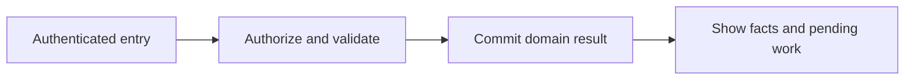
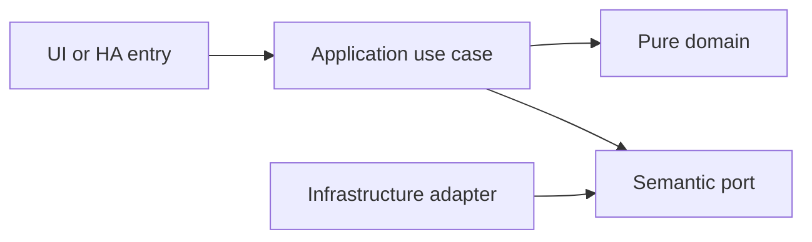

# Responsive application, household dashboard and navigation

- Status: Draft
- Date: 2026-10-28
- Catalog capability ID: application-experience
- Last verified: 2026-10-29 (document structure only; no implementation evidence)
- Owners: Domus maintainer; engineering/product reviewers to be assigned
- Scope: A complete household interface serves all six domains from the first release with fast daily actions, responsive navigation and clear operation results, independently of entity dashboards and AI.
- Related issues/PRs: https://github.com/vypdev/domus/issues/2
- Required review gates: product UX, architecture, testing, documentation, security/operations
- Open decisions blocking readiness: Detailed design system review; real mobile/companion and public host-context evidence; accessibility acceptance. The owner selected Lit/TypeScript/Vite, HA-coherent owned components, Storybook and Playwright on 2026-10-29. Catalog gate prerequisites remain unverified.

## 1. Executive summary

A complete household interface serves all six domains from the first release with fast daily actions, responsive navigation and clear operation results, independently of entity dashboards and AI.

```text
Authenticated member -> validated domain command -> durable result -> household and HA projections
```

This is a prospective Draft, not an implemented or accepted capability. The first usable release covers all domains and both deployment targets.

## 2. Problem, current behavior, and evidence

Household members need coherent task, calendar, shopping, inventory and participation workflows rather than a loose collection of HA entity cards.

Current verified sequence: (1) the repository has a minimal README and installed Copilot automation; (2) no Domus application, public service or tests exist; (3) this contract proposes the behavior to build.

Evidence: the owner's attached brief and subsequent decisions in [product vision](../docs/product-vision.md), the pinned [reference investigation](../docs/reference-investigation.md), and the existing repository baseline. Retrospective classification is not applicable: no as-built product baseline is reconstructed.

## 3. Actors, surfaces, and terminology

Actors: Authenticated household member; restricted member; administrator; keyboard and screen-reader users.

Primary surfaces: application UI, HTTP domain boundary, relevant HA entities/services, activity and diagnostics. Definitions of member, principal, occurrence, demand and ledger are shared in the [glossary](../docs/glossary.md). The actor recording an action is distinct from its selected target and actual performer.

## 4. Goals, non-goals, and fixed invariants

Goals and fixed invariants are the following normative requirements. No configuration may weaken authorization, ledger integrity, attribution or idempotency.

| Requirement | Behavior |
|---|---|
| application-experience-R1 | The application MUST provide complete navigation and first-release workflows across tasks, calendar, shopping, inventory, family and settings. |
| application-experience-R2 | The dashboard MUST prioritize actionable household information with distinct freshness and no invented zero values during failed reads. |
| application-experience-R3 | Commands MUST show pending, action-required, failed, partial and completed outcomes and preserve unsaved input on recoverable errors. |
| application-experience-R4 | The UI MUST support mobile, tablet, desktop, keyboard navigation, accessible names/focus and light/dark themes. |
| application-experience-R5 | English and Spanish localization MUST use stable keys and safe English fallback without localizing public service identifiers. |
| application-experience-R6 | The UI MUST use backend permissions and validated transports, remain useful without AI, isolate Lit presentation primitives from application/API logic, and reject private HA modules, parent-DOM/private-storage access and untrusted host messages as sources of authority. |

Non-goals: changing Copilot, changing the existing gateway, building an MCP server, adding mandatory cloud/AI dependencies, or claiming production readiness from a document.

## 5. Current versus proposed product journey

| Stage | Current | Proposed | User/operator effect |
|---|---|---|---|
| Enter | No Domus UI | Verified HA principal opens the relevant surface | Role and scope are explicit |
| Act | No domain command | Validate input, permission and current revision | Invalid data leaves the draft intact |
| Commit | No durable domain record | Store change and operation receipt atomically | Retry cannot duplicate effects |
| Observe | No projection | Show committed facts and pending downstream projections | Partial success remains understandable |



Text equivalent: authenticated entry -> authorization and validation -> durable domain commit -> visible facts with any pending projection. Domain-specific alternatives are described below.

## 6. Functional behavior and state model

### 6.1 Domain model and normal path

Routes: Dashboard, Tasks, Calendar, Shopping, Inventory, Family and Settings. A view model owns loading, data freshness, empty, validation, authorization, conflict, pending and partial states. Dashboard prioritizes today's tasks, overdue, my tasks, unclaimed work, shopping requirements, low stock, upcoming expirations/maintenance, recent completion, weekly points and participation. Optional recommendations are explicitly labeled and never silently execute. Displayed capabilities derive from backend permissions, which remain authoritative.

### 6.2 States and alternatives

View idle -> loading -> ready/empty/error. Command draft -> validating -> submitting -> saved/pending/partial/conflict/denied. The client retains form data on a failure or conflict. A local server outage is not an offline-write queue; pending drafts remain visible without falsely claiming saved work.

A duplicate uses its original operation receipt. A changed payload under the same key is a conflict. Out-of-order events use aggregate revision and source identity. Cancellation never erases an already committed ledger effect; compensation is explicit.

## 7. User-facing configuration

| Input | Type | Recommended default | Allowed values/range | Scope/persistence |
|---|---|---|---|---|
| `theme` | enum | auto | light, dark or auto | member preference; persisted |
| `locale` | enum | browser language | en, es; base-language match then en | member preference; persisted |
| `dashboard_member_filter` | member reference | current member | authorized member or household view | member preference |
| `reduced_motion` | preference | system setting | respect reduced-motion; no essential animated-only information | browser; no server override |

These are proposed defaults pending review. Invalid values and contradictory combinations are rejected before saving; unknown future values require an explicit compatibility error. Precedence is fixed invariants, installation constraints, household policy, then member preferences; lower scopes cannot expand permissions. In-flight commands snapshot relevant policy versions, while revocation is checked at the transaction boundary.

Recommended example: keep the defaults above. Meaningful alternative: a member selects Spanish and dark theme while the same household policies remain in force. Transport secrets are installation concerns and are never domain form fields.

## 8. Clean Architecture design

### 8.1 Responsibilities and dependency direction

The owner selected Lit/TypeScript with Vite on 2026-10-29 after comparing Gateway and Symphonia. Domus owns reusable HA-coherent presentation primitives and semantic design tokens, cataloged in Storybook and exercised through Playwright. Presentation components call application controllers through a typed DomusPort; an HTTP adapter validates DTOs. Views do not calculate permissions, recurrence, stock consolidation or point awards. Relative URLs and deployment-aware base paths support Ingress and standalone. No private HA frontend bundles, parent DOM or private host storage are accessed. React is not the selected stack.

HA's outer shell owns host navigation; Domus owns interior routes and content. A public host-context adapter validates message source, origin, shape and bounds, treating all accepted fields as presentation hints only. It does not assume HA user theme, locale, timezone or authentication is forwarded to an App iframe. Explicit member preferences and deterministic browser fallbacks remain usable without host hints. Host-managed safe-area padding is applied once; a full-bleed opt-in requires supported-version evidence. Vite relative assets alone do not establish deep-route reload or Ingress compatibility, so those behaviors have explicit browser cases.

| Boundary | Owns | Forbidden dependency |
|---|---|---|
| Domain | Entities, value objects and pure rules | HA, HTTP, SQL, UI frameworks |
| Application | Authorized commands, queries and semantic ports | Concrete adapters and framework DTOs |
| Adapters | Schema mapping, persistence and provider error mapping | Alternate business rules |
| Composition | Explicit deployment wiring | Business decisions |
| Presentation | View models and rendering | Database access or client-only authorization |



Text equivalent: entrypoints call use cases; use cases depend on pure domain and ports; infrastructure implements ports. Architecture checks reject forbidden imports and cycles. Shared contract tests exercise each port adapter; schemas and migration checks enforce durable boundaries.

## 9. UI/UX and content contract

### 9.1 Primary state examples

| State | Visible content |
|---|---|
| Pending | Loading your household. No action required. |
| Action required | Choose who completed this task. Your other entries are retained. |
| Blocked | The household server is unavailable. Your draft is retained in this screen. Retry when it reconnects. |
| Partial | Your purchase was saved. Stock receipt needs attention. Open the receipt. |
| Complete | All six domains are available. Today's next action: complete “Clean the bathrooms”. |

The primary view names current status, retained facts and one next action, followed by descriptive links to the record/operation. Technical codes and correlation IDs are progressively disclosed. Duplicate responses update the same operation status rather than adding notifications. At most one routine notification per transition, with opt-out and bounded retry summaries.

English and Spanish use stable translation keys, base-language matching and English fallback. Mobile, tablet and desktop layouts, keyboard operation, visible focus, non-color status, accessible names, light/dark contrast and reduced motion are acceptance concerns. Untrusted text is rendered inert; no arbitrary HTML, commands or secret-bearing links.

## 10. Failure, recovery, and cleanup

| Failure | Retained facts | Retry / action | Cleanup |
|---|---|---|---|
| Invalid or denied input | Existing business records and form draft | Correct fields or request the proper role | No side effects |
| Stale revision | Current committed aggregate; user's entered fields | Review current state and submit a new deliberate operation | No automatic overwrite |
| Lost response after commit | Domain result and receipt | Look up or replay the same key | Never issue a fresh-key duplicate |
| Downstream projection unavailable | Successful domain result and durable pending event | Bounded backoff, then visible retry | Acknowledge outbox only after safe consumption |
| Restart or cancellation | Committed records; identified pending work | Recover receipts/cursors; compensate only by explicit command | Remove listeners and owned temporary artifacts |

Errors explain impact, safe cause, action and retained state. External availability is distinct from authorization denial. Retries are bounded and use deterministic backoff tests, not real waits.

## 11. Security, permissions, and privacy

Backend authorization applies to reads and writes. All requests and HA values are untrusted input; only authenticated principals and validated adapter context establish identity. Cross-household IDs, replayed operations and stale roles are covered in the inventory. A person entity and selected member ID do not authenticate a caller. Logs, traces, exports and browser artifacts redact credentials and unnecessary personal data. The technical HA principal has explicit narrow grants and cannot impersonate a household administrator.

## 12. Observability and operational UX

Show operation state and projection freshness to members; expose sanitized correlation, source event, aggregate revision, duration and safe error code to operators. No raw credentials or unrestricted HA payloads enter diagnostics. Counters distinguish denied, invalid, conflict, unavailable and completed operations. One durable activity entry per business transition; retries do not multiply notifications. No telemetry leaves the installation by default.

## 13. Compatibility, migration, rollout, and rollback

No existing Domus application data requires migration yet. The first schema is versioned from its first implementation. Upgrade fixtures cover pending operations and ledger compatibility; a backup precedes destructive migration. Unknown future schemas block writes. Downgrade requires a compatible image/database pair, never silent interpretation of newer data.

Both Supervisor and standalone are first-release acceptance targets. Stable and Edge use separate credentials, IDs, volumes and endpoint bindings. Experimental artifacts cannot automatically promote production. Publication, merge and deployment remain in the existing authorized maintainer lifecycle.

## 14. Testing strategy and numeric budget

Minimum: 24 distinct cases, derived from the explicit risk inventory below. Each inventory row counts once. The budget is a floor, not a claim of completeness or executed tests.

| Area | Minimum distinct cases | Behaviors/risks covered |
|---|---:|---|
| UI and accessibility | 13 | first-release membership permissions; a viewer account; overdue and decorative statistics |
| Integration and recovery | 2 | a maintenance task lacking a material; inventory read failure |
| State and concurrency | 1 | a command in progress |
| Deployment and contracts | 5 | localized navigation; an Ingress prefix or standalone base path |
| Security and privacy | 3 | direct backend denial after a role change; hostile task text and no AI service |
| **Total** | **24** | No double counting |

| Case ID | Area | Requirements | Scenario |
|---|---|---|---|
| application-experience-C01 | UI and accessibility | application-experience-R1 | Given first-release membership permissions, a user can navigate all domain routes and return to the previous filter state. |
| application-experience-C02 | Integration and recovery | application-experience-R1 | Given a maintenance task lacking a material, the user can inspect the linked inventory shortfall and shopping demand. |
| application-experience-C03 | UI and accessibility | application-experience-R1 | Given a viewer account, visible controls reflect read-only access while routes remain understandable. |
| application-experience-C04 | UI and accessibility | application-experience-R2 | Given overdue and decorative statistics, the dashboard presents actionable tasks before summary charts. |
| application-experience-C05 | Integration and recovery | application-experience-R2 | Given inventory read failure, the dashboard shows unavailable stock facts rather than zero low-stock products. |
| application-experience-C06 | UI and accessibility | application-experience-R2 | Given an empty new household, the dashboard offers authorized setup actions without false completed statistics. |
| application-experience-C07 | State and concurrency | application-experience-R3 | Given a command in progress, repeated clicks reuse its operation key and show one pending result. |
| application-experience-C08 | UI and accessibility | application-experience-R3 | Given a conflict, entered form fields are retained while the user reviews the newer revision. |
| application-experience-C09 | UI and accessibility | application-experience-R3 | Given a saved receipt and failed stock post, the view names both retained success and the remaining action. |
| application-experience-C10 | UI and accessibility | application-experience-R4 | Given a 360-pixel viewport, primary actions and labels remain readable without page-level horizontal scrolling. |
| application-experience-C11 | UI and accessibility | application-experience-R4 | Given keyboard-only use, a modal manages focus and returns it to the triggering control. |
| application-experience-C12 | UI and accessibility | application-experience-R4 | Given dark theme and reduced motion, contrast, focus and non-animated state announcements remain usable. |
| application-experience-C13 | UI and accessibility | application-experience-R5 | Given an es-MX browser language, the Spanish base catalog is used. |
| application-experience-C14 | UI and accessibility | application-experience-R5 | Given a missing or invalid translation key, safe English copy appears without leaking raw markup. |
| application-experience-C15 | Deployment and contracts | application-experience-R5 | Given localized navigation, domus.complete_task remains the same public service identifier. |
| application-experience-C16 | Security and privacy | application-experience-R6 | Given direct backend denial after a role change, the view explains the denial without relying on hidden buttons. |
| application-experience-C17 | Deployment and contracts | application-experience-R6 | Given an Ingress prefix or standalone base path, assets and API requests resolve through their respective public roots. |
| application-experience-C18 | Security and privacy | application-experience-R6 | Given hostile task text and no AI service, rendering stays inert and ordinary task completion still works. |
| application-experience-C19 | Security and privacy | application-experience-R6 | Given a host-context message with a wrong source/origin or malformed fields, the adapter rejects it without changing authenticated identity, role or trusted UI context. |
| application-experience-C20 | Deployment and contracts | application-experience-R6 | Given a private HA module import or parent-DOM/private-storage lookup in presentation source, the executable boundary check rejects it. |
| application-experience-C21 | UI and accessibility | application-experience-R5 | Given absent public HA locale/theme hints, explicit member preferences then documented browser/English fallbacks render a usable UI without reading host internals. |
| application-experience-C22 | UI and accessibility | application-experience-R4 | Given a narrow Ingress iframe with host-managed safe-area padding, the UI applies insets once and keeps focused fields and actions visible with the virtual keyboard. |
| application-experience-C23 | Deployment and contracts | application-experience-R6 | Given a Storybook presentation primitive importing an API adapter or domain command, architecture validation rejects the component while pure presentation fixtures build independently. |
| application-experience-C24 | Deployment and contracts | application-experience-R6 | Given a direct reload of an interior route under a non-root Ingress prefix, the authenticated page, assets, API and any push transport resolve within the validated deployment base. |

Every implemented first-party module starts with meaningful behavior tests. Target and proposed merge gate: 100% lines/statements/functions/branches where the selected tools expose those metrics, enforced separately across backend, frontend and integration code. Third-party/generated artifacts are distinguished from authored source; broad exclusions cannot hide untested logic. No application coverage currently exists.

Inject deterministic clocks, IDs, provider fakes and transaction failures. Use semantic assertions alongside golden content, real adapter contracts and disposable HA integration environments. Add Google Chrome evidence from the owner's authorized local HA for real UX; it does not replace automated tests or unit coverage. CI Check runs the complete applicable suite for every PR update.

## 15. Documentation and discoverability

The following paths are explicit proposed documentation changes relative to the clean repository baseline; implementation source/test paths are intentionally not invented.

| Path | Change |
|---|---|
| specs/application-experience.md | create |
| specs/README.md | create |
| specs/_template.md | create |
| specs/catalog.json | create |
| specs/CATALOG.md | create |
| docs/architecture.md | create |
| docs/product-vision.md | create |
| docs/glossary.md | create |
| docs/decisions.md | create |
| docs/reference-investigation.md | create |
| docs/copilot-adoption.md | create |
| docs/operations.md | create |
| docs/user-guide.md | create |
| docs/contracts/home-assistant.md | create |
| docs/acceptance-plan.md | create |
| docs/roadmap.md | create |
| README.md | update |

| Audience | Artifact | Required content |
|---|---|---|
| Member | [User guide](../docs/user-guide.md) | Normal path, defaults and state meaning |
| Administrator/operator | [Operations](../docs/operations.md) | Setup, permissions, recovery, backup and rollback |
| Contributor | [Architecture](../docs/architecture.md) | Boundaries and executable constraints |
| HA consumer | [Entity/service contract](../docs/contracts/home-assistant.md) | Stable schemas, semantics and error handling |
| Reviewer | [Acceptance plan](../docs/acceptance-plan.md) | Tests, coverage and human evidence |

Link/path validation accompanies updates. Implementation changes update the owning SDD, catalog evidence, actual tests and user documentation together.

## 16. Acceptance scenarios

The Given/When/Then-equivalent observable scenarios in section 14 are the executable acceptance inventory. For each case, the given precondition and action must produce the specified result with state and side-effect assertions; tests are not implementation snapshots.

Acceptance includes normal, alternative, invalid, duplicate, concurrent, partial, failure, recovery, security, localization and accessibility paths as allocated above. Human review verifies the primary-state examples on desktop/mobile and light/dark themes. Live acceptance remains pending until an implemented artifact is exercised; no result is inferred from the budget.

## 17. Requirements traceability

| Requirement | Cases |
|---|---|
| application-experience-R1 | application-experience-C01, application-experience-C02, application-experience-C03 |
| application-experience-R2 | application-experience-C04, application-experience-C05, application-experience-C06 |
| application-experience-R3 | application-experience-C07, application-experience-C08, application-experience-C09 |
| application-experience-R4 | application-experience-C10, application-experience-C11, application-experience-C12, application-experience-C22 |
| application-experience-R5 | application-experience-C13, application-experience-C14, application-experience-C15, application-experience-C21 |
| application-experience-R6 | application-experience-C16, application-experience-C17, application-experience-C18, application-experience-C19, application-experience-C20, application-experience-C23, application-experience-C24 |

All requirement cases are reciprocal with section 14. Domain invariants are owned by pure policy, command/state rules by application use cases, provider behavior by adapters, and visible content by presentation; the boundary table in section 8 assigns these responsibilities. Evidence and user/operator documentation are linked in section 15.

## 18. Implementation sequence

1. Resolve the blocking decisions and review this contract before Ready for implementation.
2. Establish test harness, CI Check and architecture checks with the first source files.
3. Implement pure policies and their complete branch tests, then transactional use cases.
4. Add adapters, schema/error contracts, retry/race fixtures and both deployment wiring paths.
5. Build the accessible localized UI and HA projections with tests alongside each flow.
6. Verify migration, recovery, security, channel isolation and documentation.
7. Run the complete suite, review coverage, perform local Chrome dogfooding with recorded cleanup, and collect human evidence.

These are internal implementation steps within the first integrated release; they do not remove other domains or deployment targets from launch.

## 19. Definition of Done

- [ ] Every normative requirement has observable acceptance and reciprocal case links.
- [ ] Every declared case is implemented meaningfully; the numeric budget is met.
- [ ] Clean Architecture constraints and port contracts pass.
- [ ] All supported first-party coverage metrics reach 100% from the first implementation.
- [ ] CI Check passes for the current PR revision with no omitted required jobs.
- [ ] Configuration, state, permission, idempotency and recovery behaviors agree.
- [ ] Primary UI states, localization, responsive behavior and accessibility pass.
- [ ] Both deployment targets and isolated Stable/Edge channels pass acceptance.
- [ ] User/operator documentation, schema/migration evidence and catalog paths are current.
- [ ] Local Google Chrome evidence identifies the artifact, channel, test records and cleanup.
- [ ] The original Copilot validations pass when their real prerequisites exist; no check is weakened.
- [ ] No material decision blocking readiness remains unresolved; Copilot remains unchanged.

## 20. References and decisions

Primary sources: [Copilot standard](https://github.com/vypdev/copilot/blob/f5e5a4cf9a80248994469cd88ad55eecab5b95ca/specs/README.md), [original template](https://github.com/vypdev/copilot/blob/f5e5a4cf9a80248994469cd88ad55eecab5b95ca/specs/_template.md), and the linked [reference investigation](../docs/reference-investigation.md).

Confirmed owner choices and unresolved proposals are separated in [decisions](../docs/decisions.md). [Issue #2](https://github.com/vypdev/domus/issues/2) tracks the documentation foundation. The [adoption note](../docs/copilot-adoption.md) records the current catalog evidence limitation. Optional future depth remains explicitly deferred in the product vision; the gateway's installation and MCP internals are outside Domus scope.
