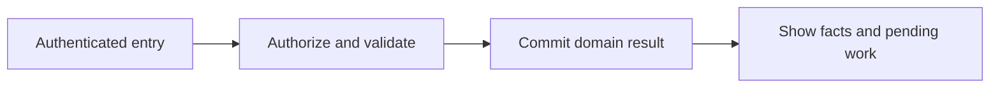
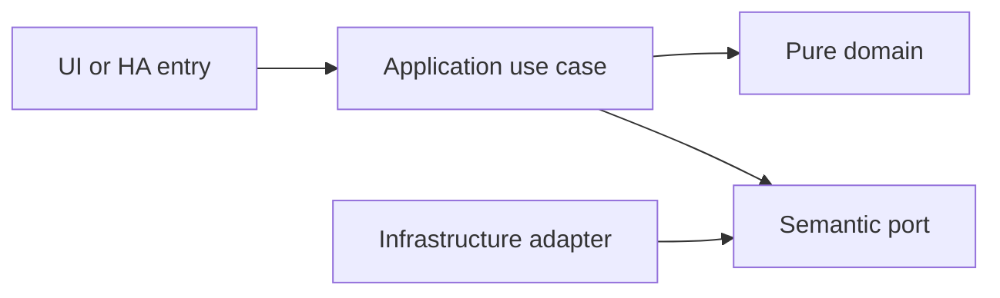

# Clean Architecture, CI Check and isolated Stable and Edge channels

- Status: Draft
- Date: 2026-10-28
- Catalog capability ID: delivery-quality
- Last verified: 2026-10-29 (partial tooling verified; application/channel acceptance pending)
- Owners: Domus maintainer; engineering/product reviewers to be assigned
- Scope: Every implemented capability starts with meaningful tests and enforced architecture boundaries. A CI Check workflow validates each PR update, and both deployment targets ship isolated experimental and production channels.
- Related issues/PRs: https://github.com/vypdev/domus/issues/2; https://github.com/vypdev/domus/issues/4
- Required review gates: product UX, architecture, testing, documentation, security/operations
- Open decisions blocking readiness: Current-head CI proof and required-check configuration by maintainer; real application/HA coverage and adapter contracts; channel IDs/integration coexistence; release publication authorization. Tooling versions and initial checks are implemented under issue #4. Catalog gate prerequisites remain unverified.

## 1. Executive summary

Every implemented capability starts with meaningful tests and enforced architecture boundaries. A CI Check workflow validates each PR update, and both deployment targets ship isolated experimental and production channels.

```text
PR update -> CI Check -> reviewed artifact -> authorized channel publication
```

This is a prospective Draft, not an implemented or accepted capability. The first usable release covers all domains and both deployment targets.

## 2. Problem, current behavior, and evidence

The owner requires full quality gates from the first code and explicit Stable/Edge channels analogous to the existing gateway, while prohibiting changes to Copilot.

The documentation foundation was merged through PR #3. Issue #4 implements locked development tooling, import/cycle contracts, local document-link checks and the project CI Check workflow with meaningful tests. The household application, public domain services, UI, HA runtime integration and channel packages remain unimplemented. This is partial delivery-quality evidence, not acceptance of every requirement below.

Evidence: the owner's attached brief and subsequent decisions in [product vision](../docs/product-vision.md), the pinned [reference investigation](../docs/reference-investigation.md), and the existing repository baseline. Retrospective classification is not applicable: no as-built product baseline is reconstructed.

## 3. Actors, surfaces, and terminology

Actors: Contributor; reviewer; release maintainer; local dogfooding operator.

Primary surfaces: application UI, HTTP domain boundary, relevant HA entities/services, activity and diagnostics. Definitions of member, principal, occurrence, demand and ledger are shared in the [glossary](../docs/glossary.md). The actor recording an action is distinct from its selected target and actual performer.

## 4. Goals, non-goals, and fixed invariants

Goals and fixed invariants are the following normative requirements. No configuration may weaken authorization, ledger integrity, attribution or idempotency.

| Requirement | Behavior |
|---|---|
| delivery-quality-R1 | Every first-party implementation MUST include meaningful tests from its first change and meet 100% available line, statement, function and branch coverage metrics without broad exclusions. |
| delivery-quality-R2 | Clean Architecture MUST be enforced by executable dependency, cycle and port-contract checks for backend, frontend and HA integration. |
| delivery-quality-R3 | A workflow named CI Check MUST run the full applicable suite for every PR head update, without path-based omissions, and publish a failing aggregate if any required job fails, skips unexpectedly or is cancelled. |
| delivery-quality-R4 | Stable and Edge MUST be available for both deployment targets with isolated data, credentials, identifiers and configured endpoints. |
| delivery-quality-R5 | Channel artifacts MUST identify immutable source and image digest, with tested migration/backup compatibility and no automatic production promotion. |
| delivery-quality-R6 | Google Chrome dogfooding MUST use the authorized local HA instance with identifiable test data, exact artifact evidence and explicit cleanup that preserves household production data. |
| delivery-quality-R7 | Tests and diagnostics MUST use bounded deterministic fakes in CI and redact secrets from artifacts while distinguishing browser evidence from unit coverage. |
| delivery-quality-R8 | Copilot MUST remain unchanged; application CI and channel work cannot edit its workflows, profiles, guidance, templates or implementation, with only the owner's narrow dependency-setup exception. |

Non-goals: changing Copilot, changing the existing gateway, building an MCP server, adding mandatory cloud/AI dependencies, or claiming production readiness from a document.

## 5. Current versus proposed product journey

| Stage | Current | Proposed | User/operator effect |
|---|---|---|---|
| Enter | No Domus UI | Verified HA principal opens the relevant surface | Role and scope are explicit |
| Act | No domain command | Validate input, permission and current revision | Invalid data leaves the draft intact |
| Commit | No durable domain record | Store change and operation receipt atomically | Retry cannot duplicate effects |
| Observe | No projection | Show committed facts and pending downstream projections | Partial success remains understandable |



Text equivalent: authenticated entry -> authorization and validation -> durable domain commit -> visible facts with any pending projection. Domain-specific alternatives are described below.

## 6. Functional behavior and state model

### 6.1 Domain model and normal path

VerificationRun records exact commit, tests, coverage, architecture checks and artifacts. ChannelManifest records stable or edge, version, source SHA, image digest, compatible schema and HA surface namespace. Proposed Supervisor slugs domus and domus_edge, isolated data/credentials, and distinct standalone volumes/ports. Edge identifies an immutable source commit and an experimental version; Stable uses an accepted versioned artifact. A moving alias is never rollback evidence. No publication is authorized by drafting this SDD.

### 6.2 States and alternatives

PR head -> CI Check queued -> running -> passed/failed/cancelled; only the current relevant head can pass acceptance. Artifact prepared -> tested -> eligible for review -> explicitly published. Experimental validation does not promote production. Restore/rollback selects a compatible image and database backup together.

A duplicate uses its original operation receipt. A changed payload under the same key is a conflict. Out-of-order events use aggregate revision and source identity. Cancellation never erases an already committed ledger effect; compensation is explicit.

## 7. User-facing configuration

| Input | Type | Recommended default | Allowed values/range | Scope/persistence |
|---|---|---|---|---|
| `coverage_threshold` | percentage | 100 | 100% first-party lines/statements/functions/branches where tools expose them; no blanket exclusions | repository quality invariant |
| `channel` | enum | explicit selection | stable or edge; no automatic promotion | installation; immutable namespace |
| `browser_evidence_retention_days` | integer | 7 | 1..30; sanitized failure artifacts only | CI; persisted by provider |
| `dogfood_target` | URL | http://homeassistant.local:8123/ | owner-authorized local HA target, Google Chrome | manual evidence; not a CI secret |

These are proposed defaults pending review. Invalid values and contradictory combinations are rejected before saving; unknown future values require an explicit compatibility error. Precedence is fixed invariants, installation constraints, household policy, then member preferences; lower scopes cannot expand permissions. In-flight commands snapshot relevant policy versions, while revocation is checked at the transaction boundary.

Recommended example: keep the defaults above. Meaningful alternative: a member selects Spanish and dark theme while the same household policies remain in force. Transport secrets are installation concerns and are never domain form fields.

## 8. Clean Architecture design

### 8.1 Responsibilities and dependency direction

A new project-owned CI Check workflow runs domain/application/adapter/UI tests, architecture import/cycle rules, schema and service contracts, English-source conventions, localization, coverage, browser E2E and packaging. It does not edit or call privileged Copilot mutation paths. Test dependencies are provisioned in the job that executes them. Any project dependency setup exception is limited to the existing project-owned preparation action after review. Release tooling consumes tested immutable artifacts with distinct channel manifests.

| Boundary | Owns | Forbidden dependency |
|---|---|---|
| Domain | Entities, value objects and pure rules | HA, HTTP, SQL, UI frameworks |
| Application | Authorized commands, queries and semantic ports | Concrete adapters and framework DTOs |
| Adapters | Schema mapping, persistence and provider error mapping | Alternate business rules |
| Composition | Explicit deployment wiring | Business decisions |
| Presentation | View models and rendering | Database access or client-only authorization |



Text equivalent: entrypoints call use cases; use cases depend on pure domain and ports; infrastructure implements ports. Architecture checks reject forbidden imports and cycles. Shared contract tests exercise each port adapter; schemas and migration checks enforce durable boundaries.

## 9. UI/UX and content contract

### 9.1 Primary state examples

| State | Visible content |
|---|---|
| Pending | CI Check is running for the latest PR commit. No action required. |
| Action required | CI Check needs attention: add the missing permission-denial test before review. |
| Blocked | CI Check failed. No artifact was promoted. Open the failing test report. |
| Partial | Unit and contract tests passed. Local Chrome dogfooding is still pending; this is not release acceptance. |
| Complete | CI Check passed for this commit. Stable and Edge artifacts remain separate and await the authorized release flow. |

The primary view names current status, retained facts and one next action, followed by descriptive links to the record/operation. Technical codes and correlation IDs are progressively disclosed. Duplicate responses update the same operation status rather than adding notifications. At most one routine notification per transition, with opt-out and bounded retry summaries.

English and Spanish use stable translation keys, base-language matching and English fallback. Mobile, tablet and desktop layouts, keyboard operation, visible focus, non-color status, accessible names, light/dark contrast and reduced motion are acceptance concerns. Untrusted text is rendered inert; no arbitrary HTML, commands or secret-bearing links.

## 10. Failure, recovery, and cleanup

| Failure | Retained facts | Retry / action | Cleanup |
|---|---|---|---|
| Invalid or denied input | Existing business records and form draft | Correct fields or request the proper role | No side effects |
| Stale revision | Current committed aggregate; user's entered fields | Review current state and submit a new deliberate operation | No automatic overwrite |
| Lost response after commit | Domain result and receipt | Look up or replay the same key | Never issue a fresh-key duplicate |
| Downstream projection unavailable | Successful domain result and durable pending event | Bounded backoff, then visible retry | Acknowledge outbox only after safe consumption |
| Restart or cancellation | Committed records; identified pending work | Recover receipts/cursors; compensate only by explicit command | Remove listeners and owned temporary artifacts |

Errors explain impact, safe cause, action and retained state. External availability is distinct from authorization denial. Retries are bounded and use deterministic backoff tests, not real waits.

## 11. Security, permissions, and privacy

Backend authorization applies to reads and writes. All requests and HA values are untrusted input; only authenticated principals and validated adapter context establish identity. Cross-household IDs, replayed operations and stale roles are covered in the inventory. A person entity and selected member ID do not authenticate a caller. Logs, traces, exports and browser artifacts redact credentials and unnecessary personal data. The technical HA principal has explicit narrow grants and cannot impersonate a household administrator.

## 12. Observability and operational UX

Show operation state and projection freshness to members; expose sanitized correlation, source event, aggregate revision, duration and safe error code to operators. No raw credentials or unrestricted HA payloads enter diagnostics. Counters distinguish denied, invalid, conflict, unavailable and completed operations. One durable activity entry per business transition; retries do not multiply notifications. No telemetry leaves the installation by default.

## 13. Compatibility, migration, rollout, and rollback

No existing Domus application data requires migration yet. The first schema is versioned from its first implementation. Upgrade fixtures cover pending operations and ledger compatibility; a backup precedes destructive migration. Unknown future schemas block writes. Downgrade requires a compatible image/database pair, never silent interpretation of newer data.

Both Supervisor and standalone are first-release acceptance targets. Stable and Edge use separate credentials, IDs, volumes and endpoint bindings. Experimental artifacts cannot automatically promote production. Publication, merge and deployment remain in the existing authorized maintainer lifecycle.

## 14. Testing strategy and numeric budget

Minimum: 24 distinct cases, derived from the explicit risk inventory below. Each inventory row counts once. The budget is a floor, not a claim of completeness or executed tests.

| Area | Minimum distinct cases | Behaviors/risks covered |
|---|---:|---|
| Coverage and tests | 4 | the first domain implementation; a module-wide coverage exclusion added to hide missed paths; UI and backend source |
| Architecture contracts | 3 | a domain import of HA or SQL; a frontend view importing a concrete transport adapter; an application port implemented by both deployment adapters |
| Workflow contracts | 6 | a new commit pushed to an open PR; one failed or unexpectedly skipped required job; a newer PR head |
| Deployment and channels | 4 | Stable and Edge installed together; both HA integrations; both standalone channels |
| Integration and recovery | 2 | rollback across an incompatible schema; a test-created task and stock item |
| Security and privacy | 3 | a passed experimental run; existing household data; a failed browser request with an authorization header |
| Browser and accessibility | 2 | local dogfooding; passing unit coverage but absent local Chrome evidence |
| **Total** | **24** | No double counting |

| Case ID | Area | Requirements | Scenario |
|---|---|---|---|
| delivery-quality-C01 | Coverage and tests | delivery-quality-R1 | Given the first domain implementation, a missing branch test fails the 100% branch coverage gate. |
| delivery-quality-C02 | Coverage and tests | delivery-quality-R1 | Given a module-wide coverage exclusion added to hide missed paths, the quality configuration check rejects it. |
| delivery-quality-C03 | Coverage and tests | delivery-quality-R1 | Given UI and backend source, separate reports enforce 100% supported first-party metrics rather than averaging away gaps. |
| delivery-quality-C04 | Architecture contracts | delivery-quality-R2 | Given a domain import of HA or SQL, the architecture job fails. |
| delivery-quality-C05 | Architecture contracts | delivery-quality-R2 | Given a frontend view importing a concrete transport adapter, the dependency rule fails. |
| delivery-quality-C06 | Architecture contracts | delivery-quality-R2 | Given an application port implemented by both deployment adapters, the same behavior contract runs for each. |
| delivery-quality-C07 | Workflow contracts | delivery-quality-R3 | Given a new commit pushed to an open PR, CI Check runs tests even when only documentation paths changed. |
| delivery-quality-C08 | Workflow contracts | delivery-quality-R3 | Given one failed or unexpectedly skipped required job, the aggregate check cannot report success. |
| delivery-quality-C09 | Workflow contracts | delivery-quality-R3 | Given a newer PR head, an older passing run is not accepted as evidence for that head. |
| delivery-quality-C10 | Deployment and channels | delivery-quality-R4 | Given Stable and Edge installed together, their DB volumes and installation credentials differ. |
| delivery-quality-C11 | Deployment and channels | delivery-quality-R4 | Given both HA integrations, entity unique IDs and public selection remain isolated by instance/channel. |
| delivery-quality-C12 | Deployment and channels | delivery-quality-R4 | Given both standalone channels, their configured host bindings do not collide and data is not shared. |
| delivery-quality-C13 | Deployment and channels | delivery-quality-R5 | Given an Edge build, its manifest records its exact source SHA and image digest. |
| delivery-quality-C14 | Integration and recovery | delivery-quality-R5 | Given rollback across an incompatible schema, tooling requires the paired backup and refuses a blind downgrade. |
| delivery-quality-C15 | Security and privacy | delivery-quality-R5 | Given a passed experimental run, no production publish, tag or deploy occurs without explicit release authorization. |
| delivery-quality-C16 | Browser and accessibility | delivery-quality-R6 | Given local dogfooding, evidence records Chrome, artifact digest, channel and exercised workflows. |
| delivery-quality-C17 | Integration and recovery | delivery-quality-R6 | Given a test-created task and stock item, cleanup removes only the recorded test artifacts and reconciles compensations. |
| delivery-quality-C18 | Security and privacy | delivery-quality-R6 | Given existing household data, the dogfooding harness cannot bulk-delete unowned records. |
| delivery-quality-C19 | Coverage and tests | delivery-quality-R7 | Given time and event-replay tests, injected clocks and IDs produce deterministic results without live service waits. |
| delivery-quality-C20 | Security and privacy | delivery-quality-R7 | Given a failed browser request with an authorization header, retained diagnostics redact its credential. |
| delivery-quality-C21 | Browser and accessibility | delivery-quality-R7 | Given passing unit coverage but absent local Chrome evidence, dogfooding remains explicitly unverified. |
| delivery-quality-C22 | Workflow contracts | delivery-quality-R8 | Given the documentation or implementation patch, an immutable baseline comparison detects any changed Copilot-owned file. |
| delivery-quality-C23 | Workflow contracts | delivery-quality-R8 | Given dependency preparation, only the existing project-owned setup action is eligible for the owner's stated exception. |
| delivery-quality-C24 | Workflow contracts | delivery-quality-R8 | Given a future Copilot limitation, the task reports it without patching the bot, weakening checks or inventing evidence. |

Every implemented first-party module starts with meaningful behavior tests. Target and proposed merge gate: 100% lines/statements/functions/branches where the selected tools expose those metrics, enforced separately across backend, frontend and integration code. Third-party/generated artifacts are distinguished from authored source; broad exclusions cannot hide untested logic. No application coverage currently exists.

Inject deterministic clocks, IDs, provider fakes and transaction failures. Use semantic assertions alongside golden content, real adapter contracts and disposable HA integration environments. Add Google Chrome evidence from the owner's authorized local HA for real UX; it does not replace automated tests or unit coverage. CI Check runs the complete applicable suite for every PR update.

Implemented tooling evidence is documented in [development](../docs/development.md): 64 Python tests, 11 Node policy tests and 10 Python architecture fixture tests, with 100% supported Python tooling coverage. The Node module is a declarative configuration with one executable statement and no authored functions/branches; it is not product UI coverage. These results partially support the tooling aspects of R1/R2/R3/R8 and do not complete the deployment, application port, channel or Chrome cases.

## 15. Documentation and discoverability

Owning documentation and actual tooling paths below are relative to the merged foundation at 0833f630aeff1b48558e0192e19ef3a42c328986. Other capabilities remain prospective. No product runtime path is invented.

| Path | Change |
|---|---|
| specs/delivery-quality.md | update |
| specs/catalog.json | update |
| specs/CATALOG.md | update |
| README.md | update |
| docs/roadmap.md | update |
| docs/acceptance-plan.md | update |
| docs/sdd-validation.md | update |
| docs/decisions.md | update |
| specs/README.md | reference |
| specs/_template.md | reference |
| docs/architecture.md | reference |
| docs/product-vision.md | reference |
| docs/glossary.md | reference |
| docs/reference-investigation.md | reference |
| docs/copilot-adoption.md | update |
| docs/operations.md | reference |
| docs/user-guide.md | reference |
| docs/contracts/home-assistant.md | reference |
| docs/development.md | create |
| docs/evidence/development-tooling.json | create |
| .github/workflows/ci_check.yml | create |
| .gitignore | create |
| .python-version | create |
| .node-version | create |
| pyproject.toml | create |
| uv.lock | create |
| package.json | create |
| pnpm-lock.yaml | create |
| pnpm-workspace.yaml | create |
| tsconfig.json | create |
| vitest.config.mjs | create |
| frontend/package.json | create |
| architecture/python-tooling.ini | create |
| architecture/python-application.ini | create |
| architecture/frontend.mjs | create |
| tooling/domus_tooling/__init__.py | create |
| tooling/domus_tooling/ci_policy.py | create |
| tooling/domus_tooling/docs.py | create |
| tooling/domus_tooling/cli.py | create |
| tests/python/test_ci_policy.py | create |
| tests/python/test_cli.py | create |
| tests/python/test_docs.py | create |
| tests/python/test_ci_contract.py | create |
| tests/architecture/test_python_architecture.py | create |
| tests/node/architecture.test.mjs | create |
| tests/contracts/copilot-resource-hashes.json | create |

| Audience | Artifact | Required content |
|---|---|---|
| Member | [User guide](../docs/user-guide.md) | Normal path, defaults and state meaning |
| Administrator/operator | [Operations](../docs/operations.md) | Setup, permissions, recovery, backup and rollback |
| Contributor | [Architecture](../docs/architecture.md) | Boundaries and executable constraints |
| HA consumer | [Entity/service contract](../docs/contracts/home-assistant.md) | Stable schemas, semantics and error handling |
| Reviewer | [Acceptance plan](../docs/acceptance-plan.md) | Tests, coverage and human evidence |

Link/path validation accompanies updates. Implementation changes update the owning SDD, catalog evidence, actual tests and user documentation together.

## 16. Acceptance scenarios

The Given/When/Then-equivalent observable scenarios in section 14 are the executable acceptance inventory. For each case, the given precondition and action must produce the specified result with state and side-effect assertions; tests are not implementation snapshots.

Acceptance includes normal, alternative, invalid, duplicate, concurrent, partial, failure, recovery, security, localization and accessibility paths as allocated above. Human review verifies the primary-state examples on desktop/mobile and light/dark themes. Live acceptance remains pending until an implemented artifact is exercised; no result is inferred from the budget.

## 17. Requirements traceability

| Requirement | Cases |
|---|---|
| delivery-quality-R1 | delivery-quality-C01, delivery-quality-C02, delivery-quality-C03 |
| delivery-quality-R2 | delivery-quality-C04, delivery-quality-C05, delivery-quality-C06 |
| delivery-quality-R3 | delivery-quality-C07, delivery-quality-C08, delivery-quality-C09 |
| delivery-quality-R4 | delivery-quality-C10, delivery-quality-C11, delivery-quality-C12 |
| delivery-quality-R5 | delivery-quality-C13, delivery-quality-C14, delivery-quality-C15 |
| delivery-quality-R6 | delivery-quality-C16, delivery-quality-C17, delivery-quality-C18 |
| delivery-quality-R7 | delivery-quality-C19, delivery-quality-C20, delivery-quality-C21 |
| delivery-quality-R8 | delivery-quality-C22, delivery-quality-C23, delivery-quality-C24 |

All requirement cases are reciprocal with section 14. Domain invariants are owned by pure policy, command/state rules by application use cases, provider behavior by adapters, and visible content by presentation; the boundary table in section 8 assigns these responsibilities. Evidence and user/operator documentation are linked in section 15.

## 18. Implementation sequence

1. Resolve the blocking decisions and review this contract before Ready for implementation.
2. Establish test harness, CI Check and architecture checks with the first source files.
3. Implement pure policies and their complete branch tests, then transactional use cases.
4. Add adapters, schema/error contracts, retry/race fixtures and both deployment wiring paths.
5. Build the accessible localized UI and HA projections with tests alongside each flow.
6. Verify migration, recovery, security, channel isolation and documentation.
7. Run the complete suite, review coverage, perform local Chrome dogfooding with recorded cleanup, and collect human evidence.

These are internal implementation steps within the first integrated release; they do not remove other domains or deployment targets from launch.

## 19. Definition of Done

- [ ] Every normative requirement has observable acceptance and reciprocal case links.
- [ ] Every declared case is implemented meaningfully; the numeric budget is met.
- [ ] Clean Architecture constraints and port contracts pass.
- [ ] All supported first-party coverage metrics reach 100% from the first implementation.
- [ ] CI Check passes for the current PR revision with no omitted required jobs.
- [ ] Configuration, state, permission, idempotency and recovery behaviors agree.
- [ ] Primary UI states, localization, responsive behavior and accessibility pass.
- [ ] Both deployment targets and isolated Stable/Edge channels pass acceptance.
- [ ] User/operator documentation, schema/migration evidence and catalog paths are current.
- [ ] Local Google Chrome evidence identifies the artifact, channel, test records and cleanup.
- [ ] The original Copilot validations pass when their real prerequisites exist; no check is weakened.
- [ ] No material decision blocking readiness remains unresolved; Copilot remains unchanged.

## 20. References and decisions

Primary sources: [Copilot standard](https://github.com/vypdev/copilot/blob/f5e5a4cf9a80248994469cd88ad55eecab5b95ca/specs/README.md), [original template](https://github.com/vypdev/copilot/blob/f5e5a4cf9a80248994469cd88ad55eecab5b95ca/specs/_template.md), and the linked [reference investigation](../docs/reference-investigation.md).

Confirmed owner choices and unresolved proposals are separated in [decisions](../docs/decisions.md). [Issue #2](https://github.com/vypdev/domus/issues/2) tracks the documentation foundation. The [adoption note](../docs/copilot-adoption.md) records the current catalog evidence limitation. Optional future depth remains explicitly deferred in the product vision; the gateway's installation and MCP internals are outside Domus scope.
