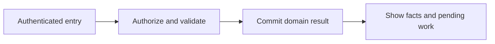
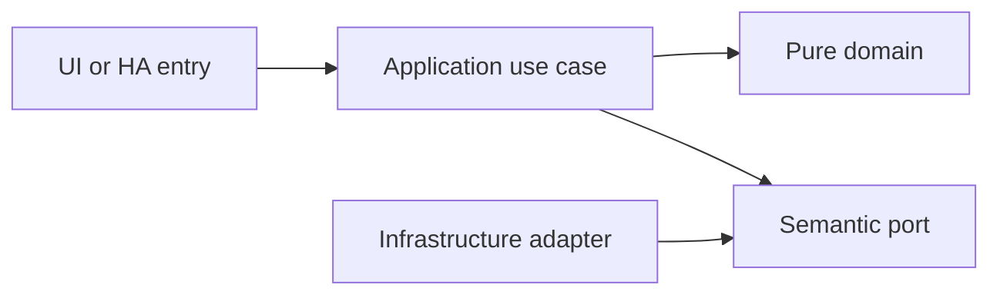

# Home Assistant entities, services and integration

- Status: Draft
- Date: 2026-10-28
- Catalog capability ID: home-assistant-surface
- Last verified: 2026-10-29 (document structure only; no implementation evidence)
- Owners: Domus maintainer; engineering/product reviewers to be assigned
- Scope: Domus exposes its household capabilities as native Home Assistant entities, services and events. The already integrated HA MCP consumes these surfaces; no gateway work or second MCP is included.
- Related issues/PRs: https://github.com/vypdev/domus/issues/2
- Required review gates: product UX, architecture, testing, documentation, security/operations
- Open decisions blocking readiness: Public service schemas and scope review; technical principal authorization; response-service exposure contract; supported HA matrix. Catalog gate prerequisites remain unverified.

## 1. Executive summary

Domus exposes its household capabilities as native Home Assistant entities, services and events. The already integrated HA MCP consumes these surfaces; no gateway work or second MCP is included.

```text
Authenticated member -> validated domain command -> durable result -> household and HA projections
```

This is a prospective Draft, not an implemented or accepted capability. The first usable release covers all domains and both deployment targets.

## 2. Problem, current behavior, and evidence

Agents and HA automations need stable, bounded ways to query and act on Domus without treating entity state as a complete database or bypassing domain permissions.

Current verified sequence: (1) the repository has a minimal README and installed Copilot automation; (2) no Domus application, public service or tests exist; (3) this contract proposes the behavior to build.

Evidence: the owner's attached brief and subsequent decisions in [product vision](../docs/product-vision.md), the pinned [reference investigation](../docs/reference-investigation.md), and the existing repository baseline. Retrospective classification is not applicable: no as-built product baseline is reconstructed.

## 3. Actors, surfaces, and terminology

Actors: HA user; HA automation; Domus companion integration; existing HA MCP consumer.

Primary surfaces: application UI, HTTP domain boundary, relevant HA entities/services, activity and diagnostics. Definitions of member, principal, occurrence, demand and ledger are shared in the [glossary](../docs/glossary.md). The actor recording an action is distinct from its selected target and actual performer.

## 4. Goals, non-goals, and fixed invariants

Goals and fixed invariants are the following normative requirements. No configuration may weaken authorization, ledger integrity, attribution or idempotency.

| Requirement | Behavior |
|---|---|
| home-assistant-surface-R1 | HA entities MUST have stable unique IDs, bounded attributes and honest unavailable/stale states while Domus remains authoritative. |
| home-assistant-surface-R2 | Public services MUST use validated versioned schemas and bounded structured responses instead of encoding rich data in entity attributes. |
| home-assistant-surface-R3 | Every mutation MUST traverse the same Domus authorization, state, revision, idempotency and audit rules as the UI. |
| home-assistant-surface-R4 | Human and technical principals MUST remain distinct; member_id and caller-provided identity fields cannot grant permissions. |
| home-assistant-surface-R5 | Task and shopping projections MUST preserve occurrence/item identity and refuse unsupported native operations rather than corrupt richer domain states. |
| home-assistant-surface-R6 | HA-facing rule invocations MUST preserve trigger identity, rule revision, technical-principal scope and causal correlation, delegating deduplication/cooldown/loop decisions to the owning Domus automation engine rather than implementing another rule evaluator. |
| home-assistant-surface-R7 | Both deployment targets MUST support reconnection, bounded queries and lifecycle unload without polling storms or leaking credentials. |
| home-assistant-surface-R8 | The integration MUST expose enough query/action metadata for HA consumers while requiring no MCP implementation or gateway modification. |

Non-goals: changing Copilot, changing the existing gateway, building an MCP server, adding mandatory cloud/AI dependencies, or claiming production readiness from a document.

## 5. Current versus proposed product journey

| Stage | Current | Proposed | User/operator effect |
|---|---|---|---|
| Enter | No Domus UI | Verified HA principal opens the relevant surface | Role and scope are explicit |
| Act | No domain command | Validate input, permission and current revision | Invalid data leaves the draft intact |
| Commit | No durable domain record | Store change and operation receipt atomically | Retry cannot duplicate effects |
| Observe | No projection | Show committed facts and pending downstream projections | Partial success remains understandable |



Text equivalent: authenticated entry -> authorization and validation -> durable domain commit -> visible facts with any pending projection. Domain-specific alternatives are described below.

## 6. Functional behavior and state model

### 6.1 Domain model and normal path

A companion integration connects to the application through a scoped installation credential and maintains projection cursors and availability. Entities have stable unique IDs based on household/record IDs, independent of renamed entity_ids. Proposed entities: sensor.domus_tasks_due, sensor.domus_tasks_overdue, sensor.domus_low_stock_products, sensor.domus_member_points_<member>, sensor.domus_member_points_balance_<member>, binary_sensor.domus_attention_required, calendar.domus_schedule, optional separate calendar.domus_completion_history, todo.domus_tasks and todo.domus_shopping. Weekly earned points use actual work dates and differ from the possibly negative lifetime balance; pending verification is never spendable credit. Rich fields stay in bounded response services. Service operations and response envelopes are defined in the linked contract document. A technical principal is not a household member and cannot assert a human identity through parameters.

The complete_task service accepts explicit actual material lines with stable identities and invokes the same combined application orchestration as the UI. Its structured result distinguishes saved completion, verification, points and each posted or pending-regularization material intent. Query/settlement services expose those retained intents within the caller's grants; a stock shortfall must not be reported as failure of already-saved work. A native to-do checkbox cannot supply missing actual performers or confirm planned materials on the caller's behalf. If its supported schema cannot express a required review, reject that native mutation before applying effects and direct the caller to the form or typed service.

Verified human context resolves the configured administrator mapping and current effective profile/member permissions; technical grants remain distinct even if the transport credential has HA administration. Task queries retain dependency_attention separately from real completed state. Points queries distinguish funding_hold from delivery and include retained approval/reservation status within permitted scope. Disabling a stored rule through HA has the same durable stopping boundary as the UI: new runs/later steps stop while already-started atomic commands settle visibly. None of these adapters applies an alternate authorization, dependency or affordability policy.

### 6.2 States and alternatives

Integration setup -> connected -> stale/unavailable -> reconnecting -> connected. A command returns completed, pending projection, conflict, denied, invalid or unavailable with an operation ID. A transport timeout means outcome unknown until receipt lookup; no automatic fresh-key retry. External HA automations may call typed Domus commands or invoke a stored Domus rule with stable trigger identity and causal correlation. The in-application simple/advanced editors and durable execution policy belong to [household automation](household-automation.md); this integration owns only their HA entrypoint mapping.

A duplicate uses its original operation receipt. A changed payload under the same key is a conflict. Out-of-order events use aggregate revision and source identity. Cancellation never erases an already committed ledger effect; compensation is explicit.

## 7. User-facing configuration

| Input | Type | Recommended default | Allowed values/range | Scope/persistence |
|---|---|---|---|---|
| `integration_enabled` | boolean | true | explicitly configured per installation | installation; persisted |
| `projection_poll_seconds` | integer | 30 | 5..300 as fallback; push notifications preferred | integration; restart-safe cursor |
| `service_max_items` | integer | 100 | 1..200; pagination required | request; not persisted |
| `automation_mutations_enabled` | boolean | false | explicit scoped grants required | installation; revocation checked per command |

Owner-confirmed defaults are recorded as accepted choices; other defaults and bounds remain proposals pending review. Invalid values and contradictory combinations are rejected before saving; unknown future values require an explicit compatibility error. Precedence is fixed invariants, installation constraints, household policy, then member preferences; lower scopes cannot expand permissions. In-flight commands snapshot relevant policy versions, while revocation is checked at the transaction boundary.

Recommended example: native projections and typed queries with automation mutations disabled. Meaningful alternative: explicitly grant a technical principal one bounded action while all domain authorization and receipt rules remain enforced. Transport secrets are installation concerns and are never domain form fields.

## 8. Clean Architecture design

### 8.1 Responsibilities and dependency direction

The companion integration adapts public HA entity/service APIs to Domus QueryHousehold and CommandHousehold use cases. Credentials stay server-side and are distinct from human authentication. A verified HA user context can map to that user's Domus role; absent or automation context uses only explicitly configured technical grants. member_id selects an authorized target, never authenticates the caller. No arbitrary proxy to Domus HTTP or Python execution is exposed. Native task/shopping entities are projections of Domus records, not independent stores or mirrors of unrelated HA lists.

Automation rule list/preview/run/enable adapters call the owning engine ports. They cannot compile a different DSL, apply their own collaboration points algorithm or maintain independent cooldown policy. Direct task/shopping commands continue to use their domain command receipts; invoking a stored rule additionally uses that rule's admitted trigger and durable run state.

| Boundary | Owns | Forbidden dependency |
|---|---|---|
| Domain | Entities, value objects and pure rules | HA, HTTP, SQL, UI frameworks |
| Application | Authorized commands, queries and semantic ports | Concrete adapters and framework DTOs |
| Adapters | Schema mapping, persistence and provider error mapping | Alternate business rules |
| Composition | Explicit deployment wiring | Business decisions |
| Presentation | View models and rendering | Database access or client-only authorization |



Text equivalent: entrypoints call use cases; use cases depend on pure domain and ports; infrastructure implements ports. Architecture checks reject forbidden imports and cycles. Shared contract tests exercise each port adapter; schemas and migration checks enforce durable boundaries.

## 9. UI/UX and content contract

### 9.1 Primary state examples

| State | Visible content |
|---|---|
| Pending | Connecting Domus entities to Home Assistant. |
| Action required | This automation needs permission to create maintenance tasks. Review its Domus service grants. |
| Blocked | Home Assistant rejected this command. No household data changed. Review the service error code. |
| Partial | The task is complete in Domus. Home Assistant is refreshing its projection. View operation. |
| Complete | Domus entities and services are connected. View the Home Assistant contract. |

The primary view names current status, retained facts and one next action, followed by descriptive links to the record/operation. Technical codes and correlation IDs are progressively disclosed. Duplicate responses update the same operation status rather than adding notifications. At most one routine notification per transition, with opt-out and bounded retry summaries.

English and Spanish use stable translation keys, base-language matching and English fallback. Mobile, tablet and desktop layouts, keyboard operation, visible focus, non-color status, accessible names, light/dark contrast and reduced motion are acceptance concerns. Untrusted text is rendered inert; no arbitrary HTML, commands or secret-bearing links.

## 10. Failure, recovery, and cleanup

| Failure | Retained facts | Retry / action | Cleanup |
|---|---|---|---|
| Invalid or denied input | Existing business records and form draft | Correct fields or request the proper role | No side effects |
| Stale revision | Current committed aggregate; user's entered fields | Review current state and submit a new deliberate operation | No automatic overwrite |
| Lost response after commit | Domain result and receipt | Look up or replay the same key | Never issue a fresh-key duplicate |
| Downstream projection unavailable | Successful domain result and durable pending event | Bounded backoff, then visible retry | Acknowledge outbox only after safe consumption |
| Restart or cancellation | Committed records; identified pending work | Recover receipts/cursors; compensate only by explicit command | Remove listeners and owned temporary artifacts |

Errors explain impact, safe cause, action and retained state. External availability is distinct from authorization denial. Retries are bounded and use deterministic backoff tests, not real waits.

## 11. Security, permissions, and privacy

Backend authorization applies to reads and writes. All requests and HA values are untrusted input; only authenticated principals and validated adapter context establish identity. Cross-household IDs, replayed operations and stale roles are covered in the inventory. A person entity and selected member ID do not authenticate a caller. Logs, traces, exports and browser artifacts redact credentials and unnecessary personal data. The technical HA principal has explicit narrow grants and cannot impersonate a household administrator.

## 12. Observability and operational UX

Show operation state and projection freshness to members; expose sanitized correlation, source event, aggregate revision, duration and safe error code to operators. No raw credentials or unrestricted HA payloads enter diagnostics. Counters distinguish denied, invalid, conflict, unavailable and completed operations. One durable activity entry per business transition; retries do not multiply notifications. No telemetry leaves the installation by default.

## 13. Compatibility, migration, rollout, and rollback

No existing Domus application data requires migration yet. The first schema is versioned from its first implementation. Upgrade fixtures cover pending operations and ledger compatibility; a backup precedes destructive migration. Unknown future schemas block writes. Downgrade requires a compatible image/database pair, never silent interpretation of newer data.

Both Supervisor and standalone are first-release acceptance targets. Stable and Edge use separate credentials, IDs, volumes and endpoint bindings. Experimental artifacts cannot automatically promote production. Publication, merge and deployment remain in the existing authorized maintainer lifecycle.

## 14. Testing strategy and numeric budget

Minimum: 33 distinct cases, derived from the explicit risk inventory below. Each inventory row counts once. The budget is a floor, not a claim of completeness or executed tests.

| Area | Minimum distinct cases | Behaviors/risks covered |
|---|---:|---|
| Adapters and HA contracts | 12 | a renamed task entity; a query with more items than its page limit; a response-service call |
| UI and accessibility | 1 | a disconnected backend |
| Deployment and contracts | 3 | a large household; standalone Core API access; service discovery |
| Domain and configuration | 2 | unknown service fields or unsupported contract version; an event caused by the same automation correlation |
| State and concurrency | 3 | a repeated HA completion command; a stale expected revision; replay of the same sensor-trigger identity |
| Security and privacy | 6 | a service principal without stock-correction grant; a caller-supplied administrator member_id; an HA automation without verified human context |
| Integration and recovery | 6 | backend item changes; an automation disabled during a pending retry; disconnect and reconnect |
| **Total** | **33** | No double counting |

| Case ID | Area | Requirements | Scenario |
|---|---|---|---|
| home-assistant-surface-C01 | Adapters and HA contracts | home-assistant-surface-R1 | Given a renamed task entity, its registry unique ID and underlying task identity stay stable. |
| home-assistant-surface-C02 | UI and accessibility | home-assistant-surface-R1 | Given a disconnected backend, entity availability changes to unavailable rather than falsely reporting zero tasks. |
| home-assistant-surface-C03 | Deployment and contracts | home-assistant-surface-R1 | Given a large household, sensor attributes contain counts and bounded metadata rather than all records. |
| home-assistant-surface-C04 | Adapters and HA contracts | home-assistant-surface-R2 | Given a query with more items than its page limit, a cursor is returned without silent truncation. |
| home-assistant-surface-C05 | Domain and configuration | home-assistant-surface-R2 | Given unknown service fields or unsupported contract version, validation rejects the request. |
| home-assistant-surface-C06 | Adapters and HA contracts | home-assistant-surface-R2 | Given a response-service call, its result distinguishes empty success from upstream unavailability. |
| home-assistant-surface-C07 | State and concurrency | home-assistant-surface-R3 | Given a repeated HA completion command, one completion and one award allocation exist. |
| home-assistant-surface-C08 | State and concurrency | home-assistant-surface-R3 | Given a stale expected revision, the service returns conflict and applies no change. |
| home-assistant-surface-C09 | Security and privacy | home-assistant-surface-R3 | Given a service principal without stock-correction grant, the domain rejects its correction command. |
| home-assistant-surface-C10 | Security and privacy | home-assistant-surface-R4 | Given a caller-supplied administrator member_id, the service does not elevate the authenticated principal. |
| home-assistant-surface-C11 | Security and privacy | home-assistant-surface-R4 | Given an HA automation without verified human context, only its technical grant scope is used. |
| home-assistant-surface-C12 | Adapters and HA contracts | home-assistant-surface-R4 | Given a verified HA user context, permissions resolve to the linked active member and revocation still applies. |
| home-assistant-surface-C13 | Adapters and HA contracts | home-assistant-surface-R5 | Given native to-do completion of a task requiring verification, the projection preserves awaiting-verification semantics. |
| home-assistant-surface-C14 | Adapters and HA contracts | home-assistant-surface-R5 | Given native removal of a ledger-backed shopping item, the adapter rejects unsupported deletion and explains cancellation. |
| home-assistant-surface-C15 | Integration and recovery | home-assistant-surface-R5 | Given backend item changes, to-do projections retain stable UIDs across refresh and restart. |
| home-assistant-surface-C16 | State and concurrency | home-assistant-surface-R6 | Given replay of the same sensor-trigger identity, exactly one maintenance occurrence is created. |
| home-assistant-surface-C17 | Domain and configuration | home-assistant-surface-R6 | Given an event caused by the same automation correlation, loop detection suppresses retriggering. |
| home-assistant-surface-C18 | Integration and recovery | home-assistant-surface-R6 | Given an automation disabled during a pending retry, no new mutation executes after revocation. |
| home-assistant-surface-C19 | Deployment and contracts | home-assistant-surface-R7 | Given standalone Core API access, integration queries and services run without Supervisor assumptions. |
| home-assistant-surface-C20 | Integration and recovery | home-assistant-surface-R7 | Given disconnect and reconnect, projections resume from a cursor and reconcile missing events once. |
| home-assistant-surface-C21 | Adapters and HA contracts | home-assistant-surface-R7 | Given integration unload, listeners and polling are cancelled without deleting business data. |
| home-assistant-surface-C22 | Deployment and contracts | home-assistant-surface-R8 | Given service discovery, HA exposes registered schemas, selectors and response support for each proposed action. |
| home-assistant-surface-C23 | Security and privacy | home-assistant-surface-R8 | Given diagnostic export, no installation token, upstream token or unbounded user payload is included. |
| home-assistant-surface-C24 | Integration and recovery | home-assistant-surface-R8 | Given no gateway process during Domus acceptance, normal UI workflows and HA entity/service tests still pass. |
| home-assistant-surface-C25 | Adapters and HA contracts | home-assistant-surface-R2, home-assistant-surface-R3 | Given complete_task with explicit material lines and a stock shortfall, the response identifies the saved completion and pending intent separately; identical-key replay duplicates neither. |
| home-assistant-surface-C26 | Security and privacy | home-assistant-surface-R3, home-assistant-surface-R4 | Given a technical principal allowed to complete tasks but lacking a requested stock-movement grant, the combined submission cannot use task permission to bypass inventory authorization. |
| home-assistant-surface-C27 | Adapters and HA contracts | home-assistant-surface-R5 | Given a native to-do checkbox that cannot express required performer/material review, the adapter rejects the mutation before effects and offers the supported UI/service path without silently consuming estimates. |
| home-assistant-surface-C28 | Integration and recovery | home-assistant-surface-R2, home-assistant-surface-R8 | Given an authorized material-intent query and repeated settlement request, the same source intent and validated movement remain discoverable once with bounded results and no gateway change. |
| home-assistant-surface-C29 | Adapters and HA contracts | home-assistant-surface-R1, home-assistant-surface-R2 | Given delayed approval or a spent-point reversal, HA projections preserve work-week totals separately from current possibly-negative balance and query results distinguish pending from spendable points. |
| home-assistant-surface-C30 | Security and privacy | home-assistant-surface-R3, home-assistant-surface-R4 | Given configured administrator mapping and member exceptions, verified human service context uses current effective permissions while a technical credential or supplied administrator flag cannot inherit the human mapping. |
| home-assistant-surface-C31 | Integration and recovery | home-assistant-surface-R2, home-assistant-surface-R6 | Given HA disabling a rule during an atomic action, the response/query distinguishes disabled admission from its settling action; no later step or old wait resumes after restart/re-enable. |
| home-assistant-surface-C32 | Adapters and HA contracts | home-assistant-surface-R2, home-assistant-surface-R3 | Given reopening a prerequisite via HA, completed dependent queries retain completion/points with a linked review condition and no cascading mutation. |
| home-assistant-surface-C33 | Adapters and HA contracts | home-assistant-surface-R2, home-assistant-surface-R3 | Given an authorized query after backing points are reversed, an approved unfulfilled redemption is shown as held with its reservation and missing funding, never as delivered or silently cancelled. |

Every implemented first-party module starts with meaningful behavior tests. Target and proposed merge gate: 100% lines/statements/functions/branches where the selected tools expose those metrics, enforced separately across backend, frontend and integration code. Third-party/generated artifacts are distinguished from authored source; broad exclusions cannot hide untested logic. No application coverage currently exists.

Inject deterministic clocks, IDs, provider fakes and transaction failures. Use semantic assertions alongside golden content, real adapter contracts and disposable HA integration environments. Add Google Chrome evidence from the owner's authorized local HA for real UX; it does not replace automated tests or unit coverage. CI Check runs the complete applicable suite for every PR update.

## 15. Documentation and discoverability

The following paths are explicit proposed documentation changes relative to the clean repository baseline; implementation source/test paths are intentionally not invented.

| Path | Change |
|---|---|
| specs/home-assistant-surface.md | create |
| specs/household-automation.md | create |
| specs/README.md | create |
| specs/_template.md | create |
| specs/catalog.json | create |
| specs/CATALOG.md | create |
| docs/architecture.md | create |
| docs/product-vision.md | create |
| docs/glossary.md | create |
| docs/decisions.md | create |
| docs/reference-investigation.md | create |
| docs/copilot-adoption.md | create |
| docs/operations.md | create |
| docs/user-guide.md | create |
| docs/contracts/home-assistant.md | create |
| docs/acceptance-plan.md | create |
| docs/roadmap.md | create |
| README.md | update |

| Audience | Artifact | Required content |
|---|---|---|
| Member | [User guide](../docs/user-guide.md) | Normal path, defaults and state meaning |
| Administrator/operator | [Operations](../docs/operations.md) | Setup, permissions, recovery, backup and rollback |
| Contributor | [Architecture](../docs/architecture.md) | Boundaries and executable constraints |
| HA consumer | [Entity/service contract](../docs/contracts/home-assistant.md) | Stable schemas, semantics and error handling |
| Reviewer | [Acceptance plan](../docs/acceptance-plan.md) | Tests, coverage and human evidence |

Link/path validation accompanies updates. Implementation changes update the owning SDD, catalog evidence, actual tests and user documentation together.

## 16. Acceptance scenarios

The Given/When/Then-equivalent observable scenarios in section 14 are the executable acceptance inventory. For each case, the given precondition and action must produce the specified result with state and side-effect assertions; tests are not implementation snapshots.

Acceptance includes normal, alternative, invalid, duplicate, concurrent, partial, failure, recovery, security, localization and accessibility paths as allocated above. Human review verifies the primary-state examples on desktop/mobile and light/dark themes. Live acceptance remains pending until an implemented artifact is exercised; no result is inferred from the budget.

## 17. Requirements traceability

| Requirement | Cases |
|---|---|
| home-assistant-surface-R1 | home-assistant-surface-C01, home-assistant-surface-C02, home-assistant-surface-C03, home-assistant-surface-C29 |
| home-assistant-surface-R2 | home-assistant-surface-C04, home-assistant-surface-C05, home-assistant-surface-C06, home-assistant-surface-C25, home-assistant-surface-C28, home-assistant-surface-C29, home-assistant-surface-C31, home-assistant-surface-C32, home-assistant-surface-C33 |
| home-assistant-surface-R3 | home-assistant-surface-C07, home-assistant-surface-C08, home-assistant-surface-C09, home-assistant-surface-C25, home-assistant-surface-C26, home-assistant-surface-C30, home-assistant-surface-C32, home-assistant-surface-C33 |
| home-assistant-surface-R4 | home-assistant-surface-C10, home-assistant-surface-C11, home-assistant-surface-C12, home-assistant-surface-C26, home-assistant-surface-C30 |
| home-assistant-surface-R5 | home-assistant-surface-C13, home-assistant-surface-C14, home-assistant-surface-C15, home-assistant-surface-C27 |
| home-assistant-surface-R6 | home-assistant-surface-C16, home-assistant-surface-C17, home-assistant-surface-C18, home-assistant-surface-C31 |
| home-assistant-surface-R7 | home-assistant-surface-C19, home-assistant-surface-C20, home-assistant-surface-C21 |
| home-assistant-surface-R8 | home-assistant-surface-C22, home-assistant-surface-C23, home-assistant-surface-C24, home-assistant-surface-C28 |

All requirement cases are reciprocal with section 14. Domain invariants are owned by pure policy, command/state rules by application use cases, provider behavior by adapters, and visible content by presentation; the boundary table in section 8 assigns these responsibilities. Evidence and user/operator documentation are linked in section 15.

## 18. Implementation sequence

1. Resolve the blocking decisions and review this contract before Ready for implementation.
2. Establish test harness, CI Check and architecture checks with the first source files.
3. Implement pure policies and their complete branch tests, then transactional use cases.
4. Add adapters, schema/error contracts, retry/race fixtures and both deployment wiring paths.
5. Build the accessible localized UI and HA projections with tests alongside each flow.
6. Verify migration, recovery, security, channel isolation and documentation.
7. Run the complete suite, review coverage, perform local Chrome dogfooding with recorded cleanup, and collect human evidence.

These are internal implementation steps within the first integrated release; they do not remove other domains or deployment targets from launch.

## 19. Definition of Done

- [ ] Every normative requirement has observable acceptance and reciprocal case links.
- [ ] Every declared case is implemented meaningfully; the numeric budget is met.
- [ ] Clean Architecture constraints and port contracts pass.
- [ ] All supported first-party coverage metrics reach 100% from the first implementation.
- [ ] CI Check passes for the current PR revision with no omitted required jobs.
- [ ] Configuration, state, permission, idempotency and recovery behaviors agree.
- [ ] Primary UI states, localization, responsive behavior and accessibility pass.
- [ ] Both deployment targets and isolated Stable/Edge channels pass acceptance.
- [ ] User/operator documentation, schema/migration evidence and catalog paths are current.
- [ ] Local Google Chrome evidence identifies the artifact, channel, test records and cleanup.
- [ ] The original Copilot validations pass when their real prerequisites exist; no check is weakened.
- [ ] No material decision blocking readiness remains unresolved; Copilot remains unchanged.

## 20. References and decisions

Primary sources: [Copilot standard](https://github.com/vypdev/copilot/blob/f5e5a4cf9a80248994469cd88ad55eecab5b95ca/specs/README.md), [original template](https://github.com/vypdev/copilot/blob/f5e5a4cf9a80248994469cd88ad55eecab5b95ca/specs/_template.md), and the linked [reference investigation](../docs/reference-investigation.md).

Confirmed owner choices and unresolved proposals are separated in [decisions](../docs/decisions.md). [Issue #2](https://github.com/vypdev/domus/issues/2) tracks the documentation foundation. The [adoption note](../docs/copilot-adoption.md) records the current catalog evidence limitation. Optional future depth remains explicitly deferred in the product vision; the gateway's installation and MCP internals are outside Domus scope.

## Show low-stock products in Home Assistant

- Status: Draft
- Date: 2026-11-18
- Catalog capability ID: home-assistant-surface
- Owners: Domus maintainers
- Scope: A private read-only native sensor for the Overview replenishment count
- Required review gates: product UX, architecture, testing, documentation, security/operations
- Open decisions blocking readiness: none for the bounded aggregate

### 1. Executive summary

Home Assistant displays the same number of products below their replenishment
minimum as Domus Overview. A usable zero and an unavailable refresh stay
distinct.

### 2. Problem, current behavior, and evidence

The Overview stock panel calculates low products from authoritative active
stock and reservations. The native Domus companion currently supplies the
calendar and task deadline counts. The Home Assistant surface contract
already describes a low-stock sensor.

### 3. Actors, surfaces, and terminology

An installation administrator can opt into the narrowly scoped stock
projection. The Home Assistant sensor consumes the technical projection;
Domus members retain their own authorization for Overview and stock details.

### 4. Goals, non-goals, and fixed invariants

| Requirement | Behavior |
| --- | --- |
| ha-stock-count-R01 | Reuse the complete authoritative Overview replenishment count, with active products, available stock after reservations and the same strict minimum comparison. |
| ha-stock-count-R02 | Establish an opt-in separate installation/channel grant for the bounded count. Reject wrong, absent or revoked grants and preserve existing calendar and deadline behavior. |
| ha-stock-count-R03 | Publish one native count with stable identity, correct zero and unavailable states, recovery after a valid read, and no private product attributes. |
| ha-stock-count-R04 | Qualify supported deployments, current exact image architectures, disposable HA Core and a separately installed Edge candidate with scoped cleanup. |

Inventory write services, identity changes, stock detail export and gateway
changes have separate acceptance.

### 5. Current versus proposed product journey

Household members continue to use Overview for details. An administrator
can connect a read-only sensor and see the replenishment count in Home
Assistant. A failed refresh visibly reports unavailability.

### 6. Functional behavior and state model

Use current verified installation scope for a bounded projection. Count
each eligible product once using the same threshold and reservation facts
as Overview. Scope the native unique identity to installation and channel.
Produce an integer count and bounded health evidence. Treat absent or failed
protected reads as unavailable and resume on the next verified success.

### 7. User-facing configuration

The integration is opt-in per installation. The normal protected Overview
path is unchanged. The technical stock grant is separate from the known
calendar and deadline purposes.

### 8. Clean Architecture design

Reuse the application-owned replenishment count. The application resolves
the technical authority for one read-only projection. The HTTP/HA adapters
only map the count, identity and availability to their contracts. The
companion uses the existing integration and owned cleanup lifecycle.

### 9. UI/UX and content contract

The native entity description and configuration are localized for English
and Spanish. A valid zero remains distinguishable from temporary
unavailability. Product names, per-product quantities and private household
identities stay outside the sensor attributes.

### 10. Failure, recovery, and cleanup

A failed refresh preserves the installation and cannot create stock, task
or purchase effects. Restore availability only after an authorized read.
Remove only the temporary companion configuration, candidate and synthetic
records created by verification, as applicable.

### 11. Security, permissions, and privacy

Use the established private listener boundary and a separate, narrowly
scoped stock purpose. Validate installation and channel and reject replay
against other purposes. Keep private credential strings outside logs,
screenshots and API output. The projection never grants household member
authority.

### 12. Observability and operational UX

The companion shows available or unavailable without exposing sensitive
failure details. Configuration and recovery guidance explain purpose,
channel identity, refresh and optional enabling.

### 13. Compatibility, migration, rollout, and rollback

Preserve existing calendar and deadline installations and default disabled
behavior. The stock count reads existing records and requires no schema
migration. Qualify a pinned Edge package and avoid modifying Stable.

### 14. Testing strategy and numeric budget

| Area | Minimum distinct cases | Behaviors/risks covered |
| --- | --- | --- |
| Count | 2 | Full Overview parity, strict minimum, reservations and eligibility |
| Authority | 2 | Scoped purpose and installation/channel, opt-in and boundaries |
| Native entity | 2 | Identity and zero/unavailable recovery with bounded attributes |
| Deployment | 1 | Current source images, both modes and scoped installed qualification |
| Total | 7 | Distinct observable scenarios |

| Case ID | Area | Requirements | Scenario |
| --- | --- | --- | --- |
| ha-stock-count-C01 | Count | ha-stock-count-R01 | Count all eligible low products beyond the visible Overview page and verify the same total. |
| ha-stock-count-C02 | Count | ha-stock-count-R01 | Check threshold equality, reservations, active eligibility and read-only effects through the shared query. |
| ha-stock-count-C03 | Authority | ha-stock-count-R02 | Reject a missing, wrong-purpose, foreign-installation or cross-channel grant without exposing a stock count. |
| ha-stock-count-C04 | Authority | ha-stock-count-R02 | Leave the optional endpoint disabled by default and verify existing calendar and deadline use with separate grants. |
| ha-stock-count-C05 | Native entity | ha-stock-count-R03 | Verify stable identity through refresh and restart and absence of personal/product details. |
| ha-stock-count-C06 | Native entity | ha-stock-count-R03 | In disposable HA Core show real zero, a failed or denied refresh as unavailable and a valid recovery. |
| ha-stock-count-C07 | Deployment | ha-stock-count-R04 | Qualify both protected compositions and real image architectures, then verify and clean a separate Edge installation using synthetic data. |

### 15. Documentation and discoverability

| Path | Change |
| --- | --- |
| specs/home-assistant-surface.md | update |
| docs/contracts/home-assistant.md | update |
| docs/roadmap.md | update |
| docs/installation-home-assistant.md | update |
| docs/evidence/ha-low-stock-sensor-qualification.md | create |

### 16. Acceptance scenarios

Execute the seven section 14 scenarios and retain the qualifying calendar
and deadline checks. Record the exact runtime and both whole-image CI and
installed candidate evidence in the contributing PR.

### 17. Requirements traceability

| Requirement | Cases |
| --- | --- |
| ha-stock-count-R01 | ha-stock-count-C01, ha-stock-count-C02 |
| ha-stock-count-R02 | ha-stock-count-C03, ha-stock-count-C04 |
| ha-stock-count-R03 | ha-stock-count-C05, ha-stock-count-C06 |
| ha-stock-count-R04 | ha-stock-count-C07 |

### 18. Implementation sequence

Expose the shared bounded aggregate with narrow current authority. Add the
companion sensor and optional site configuration. Exercise native
integration, deployment images, installed Edge and cleanup.

### 19. Definition of Done

All acceptance cases pass at complete supported coverage. Exact installed
evidence and cleanup are recorded. The merge passes destination CI and
Branch Sync.

### 20. References and decisions

Use the proposed low-stock entity in `specs/home-assistant-surface.md`
and `docs/contracts/home-assistant.md`. Preserve the existing Overview
policy and private companion integration.

## Show the shared shopping list in Home Assistant

- Status: Draft
- Date: 2026-11-18
- Catalog capability ID: home-assistant-surface
- Owners: Domus maintainers
- Scope: A read-only native to-do list for outstanding shared shopping items
- Required review gates: product UX, architecture, testing, documentation, security/operations
- Open decisions blocking readiness: none for the bounded read-only list

### 1. Executive summary

Home Assistant can show the shared Domus shopping list with the names and quantities
still to buy. Domus remains the source of items and the place to record purchasing
or receiving work.

### 2. Problem, current behavior, and evidence

The protected Domus shopping projection already reconciles requests, replenishment,
task demand and compatible supply. The Home Assistant companion supplies the
calendar, deadline counts and low-stock count. The Home Assistant contract
reserves a native shopping to-do entity.

### 3. Actors, surfaces, and terminology

A Domus installation administrator may opt into this separate technical grant.
Home Assistant entities and dashboard users consume the shared shopping list.
An outstanding item is a current consolidated line with a positive quantity still
to buy. It is distinct from an outstanding delivery.

### 4. Goals, non-goals, and fixed invariants

| Requirement | Behavior |
| --- | --- |
| ha-shopping-list-R01 | Reuse the authoritative shared list in a consistent read snapshot. Expose exactly the outstanding display names, quantities and units, including results beyond the first visible Overview rows. |
| ha-shopping-list-R02 | Use an optional grant specific to the installation, channel and shopping purpose. Deny foreign, revoked and wrong-purpose access and preserve other projection credentials. |
| ha-shopping-list-R03 | Show one read-only native to-do entity per configured source, with stable entity and item identities, complete availability states and localized discoverability. |
| ha-shopping-list-R04 | Verify current Ingress and standalone compositions in disposable Home Assistant Core, real amd64 and ARM64 images and a separately installed Edge candidate. |

Purchase creation, receipt posting, stock mutation, user attribution and native
Home Assistant shopping-list synchronization are out of scope.

### 5. Current versus proposed product journey

Domus users continue to open the shared list from Overview or Inventory. After
explicit configuration, Home Assistant users open the labeled Domus list under
To-do lists. They consult the quantities and return to Domus for changes.

### 6. Functional behavior and state model

Project positive quantities still to buy with stable source-order display.
Tracked product and untracked extra identities must remain distinct even when
their names match. Editing the quantity must not replace an item's identity.
The snapshot is complete when available. An empty successful result gives a
zero state. An incomplete or failed read gives unavailable and a later valid
snapshot restores the entity. Bound native snapshots to at most 1,000 items,
consistent with the companion calendar budget. A list beyond this capacity
must not appear available with a partial count.

### 7. User-facing configuration

Use a separate optional Domus app option or standalone environment digest and a
dedicated companion setup selection per installation/channel. Explain what names
and quantities Home Assistant dashboards can see, how to reconnect the same source,
and how to remove access. Existing calendar, deadline and stock configuration stay valid.

### 8. Clean Architecture design

An application-owned read shares the existing shopping projection and current
SQLite read transaction. The application projects only the agreed display fields.
HTTP and Home Assistant map the read-only snapshot, identity and availability.
The companion uses Home Assistant's native to-do platform and advertises no
mutation features. Existing domain commands own purchase, receipt and stock writes.

### 9. UI/UX and content contract

Provide English and Spanish names, setup hints and failure states. Present names
as untrusted plain text and preserve exact quantities and unit meanings. A readable
empty list and unavailability must be distinguishable. Document where to manage
items and how to continue using Domus if the native read becomes unavailable.

### 10. Failure, recovery, and cleanup

No refresh writes state. Missing, denied, malformed or oversized snapshots leave
the configured identity intact and mark the entity unavailable. Unavailable reads
must not return the previous list through native get-items or dashboard access.
Restore the view after an authorized complete read. Remove only disposable HA Core entries, the
temporary Edge app and the synthetic records used to verify it.

### 11. Security, permissions, and privacy

Opt in with a separate purpose-bound technical credential. The private Home Assistant
listener and the existing protected standalone transport rules apply. Never include
member identity, sourcing task identity, ledger records, purchase sessions, receipts
or credentials in the list response or diagnostic logs. The read grant cannot act
as a household member or authorize a mutation.

### 12. Observability and operational UX

Home Assistant visibly reports unavailable after a denied or failed refresh,
with bounded error details. Instructions explain installation identity, permitted
transport, scope, polling and verifying a valid reconnect.

### 13. Compatibility, migration, rollout, and rollback

Preserve current companion entries, support both protected compositions and leave
the shopping projection disabled by default. There is no storage migration and no
update to Gateway. Publish the scoped pinned Edge candidate after verification.

### 14. Testing strategy and numeric budget

| Area | Minimum distinct cases | Behaviors/risks covered |
| --- | --- | --- |
| Authoritative list | 2 | Consistent shopping logic and exact eligible rows beyond the Overview preview |
| Authority and privacy | 2 | Independent grant, bounded payload and no exposed provenance or write effects |
| Native integration | 2 | Recognition, immutable identities, empty/unavailable/recovered lifecycle and no advertised write |
| Deployment | 1 | Both protected compositions and real image architectures, separate Edge app and cleanup |
| Total | 7 | Distinct observable scenarios |

| Case ID | Area | Requirements | Scenario |
| --- | --- | --- | --- |
| ha-shopping-list-C01 | Authoritative list | ha-shopping-list-R01 | Mixed tracked and untracked demand, reservations and available supply yield the same outstanding lines and quantities as Domus. |
| ha-shopping-list-C02 | Authoritative list | ha-shopping-list-R01 | A list beyond the first 25 display rows is complete and an oversized list fails unavailable without a partial count. |
| ha-shopping-list-C03 | Authority and privacy | ha-shopping-list-R02 | Default-disabled, foreign, cross-channel, wrong-purpose and revoked grants cannot return list contents. |
| ha-shopping-list-C04 | Authority and privacy | ha-shopping-list-R02 | Only presentation fields and opaque identities are present. Repeated reads leave inventory, shopping, task and command records unchanged. |
| ha-shopping-list-C05 | Native integration | ha-shopping-list-R03 | In disposable Core, resolve distinct stable source and item identities, including after restart and quantity changes. |
| ha-shopping-list-C06 | Native integration | ha-shopping-list-R03 | Empty, denied or malformed, and recovered reads give correct states. Denial hides old items. Core exposes no add, complete, update, reorder or delete route to Domus. |
| ha-shopping-list-C07 | Deployment | ha-shopping-list-R04 | Verify the exact packaged Ingress and standalone deployments and architectures, and a separate installed Edge journey with synthetic bilingual scenarios and cleanup. |

### 15. Documentation and discoverability

| Path | Change |
| --- | --- |
| specs/home-assistant-surface.md | update |
| docs/contracts/home-assistant.md | update |
| docs/roadmap.md | update |
| docs/installation-home-assistant.md | update |
| docs/evidence/ha-shopping-list-qualification.md | create |

### 16. Acceptance scenarios

Execute the seven cases in section 14. Retain existing calendar and sensor
coverage. Record both installed Edge evidence and disposable native integration
results, exact image architectures and cleanup in the contributing PR.

### 17. Requirements traceability

| Requirement | Cases |
| --- | --- |
| ha-shopping-list-R01 | ha-shopping-list-C01, ha-shopping-list-C02 |
| ha-shopping-list-R02 | ha-shopping-list-C03, ha-shopping-list-C04 |
| ha-shopping-list-R03 | ha-shopping-list-C05, ha-shopping-list-C06 |
| ha-shopping-list-R04 | ha-shopping-list-C07 |

### 18. Implementation sequence

Project the authorized bounded snapshot using the existing shopping read logic.
Add the optional companion entry and read-only native entity. Verify product,
privacy and read-only semantics in each owned test installation.

### 19. Definition of Done

The seven cases have exact verification evidence. Backend, companion and frontend
coverage stay complete. The candidate is verified and cleaned up. CI, review,
destination CI and Branch Sync are verified according to the repository workflow.

### 20. References and decisions

Use the proposed native shopping list in the home-assistant-surface and linked
Home Assistant contract, the authoritative shared shopping list in
specs/shopping-management.md, and the Home Assistant contributor documentation
for the to-do entity. Only Domus owns purchase and stock effects.
