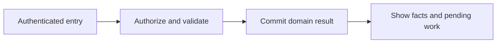
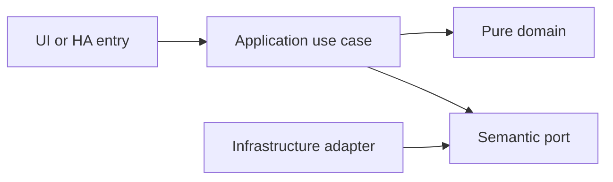

# Home Assistant entities, services and integration

- Status: Draft
- Date: 2026-10-28
- Catalog capability ID: home-assistant-surface
- Last verified: 2026-10-29 (document structure only; no implementation evidence)
- Owners: Domus maintainer; engineering/product reviewers to be assigned
- Scope: Domus exposes its household capabilities as native Home Assistant entities, services and events. The already integrated HA MCP consumes these surfaces; no gateway work or second MCP is included.
- Related issues/PRs: https://github.com/vypdev/domus/issues/2
- Required review gates: product UX, architecture, testing, documentation, security/operations
- Open decisions blocking readiness: Public service schemas and scope review; technical principal authorization; response-service exposure contract; supported HA matrix. Catalog gate prerequisites remain unverified.

## 1. Executive summary

Domus exposes its household capabilities as native Home Assistant entities, services and events. The already integrated HA MCP consumes these surfaces; no gateway work or second MCP is included.

```text
Authenticated member -> validated domain command -> durable result -> household and HA projections
```

This is a prospective Draft, not an implemented or accepted capability. The first usable release covers all domains and both deployment targets.

## 2. Problem, current behavior, and evidence

Agents and HA automations need stable, bounded ways to query and act on Domus without treating entity state as a complete database or bypassing domain permissions.

Current verified sequence: (1) the repository has a minimal README and installed Copilot automation; (2) no Domus application, public service or tests exist; (3) this contract proposes the behavior to build.

Evidence: the owner's attached brief and subsequent decisions in [product vision](../docs/product-vision.md), the pinned [reference investigation](../docs/reference-investigation.md), and the existing repository baseline. Retrospective classification is not applicable: no as-built product baseline is reconstructed.

## 3. Actors, surfaces, and terminology

Actors: HA user; HA automation; Domus companion integration; existing HA MCP consumer.

Primary surfaces: application UI, HTTP domain boundary, relevant HA entities/services, activity and diagnostics. Definitions of member, principal, occurrence, demand and ledger are shared in the [glossary](../docs/glossary.md). The actor recording an action is distinct from its selected target and actual performer.

## 4. Goals, non-goals, and fixed invariants

Goals and fixed invariants are the following normative requirements. No configuration may weaken authorization, ledger integrity, attribution or idempotency.

| Requirement | Behavior |
|---|---|
| home-assistant-surface-R1 | HA entities MUST have stable unique IDs, bounded attributes and honest unavailable/stale states while Domus remains authoritative. |
| home-assistant-surface-R2 | Public services MUST use validated versioned schemas and bounded structured responses instead of encoding rich data in entity attributes. |
| home-assistant-surface-R3 | Every mutation MUST traverse the same Domus authorization, state, revision, idempotency and audit rules as the UI. |
| home-assistant-surface-R4 | Human and technical principals MUST remain distinct; member_id and caller-provided identity fields cannot grant permissions. |
| home-assistant-surface-R5 | Task and shopping projections MUST preserve occurrence/item identity and refuse unsupported native operations rather than corrupt richer domain states. |
| home-assistant-surface-R6 | HA-facing rule invocations MUST preserve trigger identity, rule revision, technical-principal scope and causal correlation, delegating deduplication/cooldown/loop decisions to the owning Domus automation engine rather than implementing another rule evaluator. |
| home-assistant-surface-R7 | Both deployment targets MUST support reconnection, bounded queries and lifecycle unload without polling storms or leaking credentials. |
| home-assistant-surface-R8 | The integration MUST expose enough query/action metadata for HA consumers while requiring no MCP implementation or gateway modification. |

Non-goals: changing Copilot, changing the existing gateway, building an MCP server, adding mandatory cloud/AI dependencies, or claiming production readiness from a document.

## 5. Current versus proposed product journey

| Stage | Current | Proposed | User/operator effect |
|---|---|---|---|
| Enter | No Domus UI | Verified HA principal opens the relevant surface | Role and scope are explicit |
| Act | No domain command | Validate input, permission and current revision | Invalid data leaves the draft intact |
| Commit | No durable domain record | Store change and operation receipt atomically | Retry cannot duplicate effects |
| Observe | No projection | Show committed facts and pending downstream projections | Partial success remains understandable |



Text equivalent: authenticated entry -> authorization and validation -> durable domain commit -> visible facts with any pending projection. Domain-specific alternatives are described below.

## 6. Functional behavior and state model

### 6.1 Domain model and normal path

A companion integration connects to the application through a scoped installation credential and maintains projection cursors and availability. Entities have stable unique IDs based on household/record IDs, independent of renamed entity_ids. Proposed entities: sensor.domus_tasks_due, sensor.domus_tasks_overdue, sensor.domus_low_stock_products, sensor.domus_member_points_<member>, binary_sensor.domus_attention_required, calendar.domus_schedule, optional separate calendar.domus_completion_history, todo.domus_tasks and todo.domus_shopping. Rich fields stay in bounded response services. Service operations and response envelopes are defined in the linked contract document. A technical principal is not a household member and cannot assert a human identity through parameters.

### 6.2 States and alternatives

Integration setup -> connected -> stale/unavailable -> reconnecting -> connected. A command returns completed, pending projection, conflict, denied, invalid or unavailable with an operation ID. A transport timeout means outcome unknown until receipt lookup; no automatic fresh-key retry. External HA automations may call typed Domus commands or invoke a stored Domus rule with stable trigger identity and causal correlation. The in-application simple/advanced editors and durable execution policy belong to [household automation](household-automation.md); this integration owns only their HA entrypoint mapping.

A duplicate uses its original operation receipt. A changed payload under the same key is a conflict. Out-of-order events use aggregate revision and source identity. Cancellation never erases an already committed ledger effect; compensation is explicit.

## 7. User-facing configuration

| Input | Type | Recommended default | Allowed values/range | Scope/persistence |
|---|---|---|---|---|
| `integration_enabled` | boolean | true | explicitly configured per installation | installation; persisted |
| `projection_poll_seconds` | integer | 30 | 5..300 as fallback; push notifications preferred | integration; restart-safe cursor |
| `service_max_items` | integer | 100 | 1..200; pagination required | request; not persisted |
| `automation_mutations_enabled` | boolean | false | explicit scoped grants required | installation; revocation checked per command |

These are proposed defaults pending review. Invalid values and contradictory combinations are rejected before saving; unknown future values require an explicit compatibility error. Precedence is fixed invariants, installation constraints, household policy, then member preferences; lower scopes cannot expand permissions. In-flight commands snapshot relevant policy versions, while revocation is checked at the transaction boundary.

Recommended example: keep the defaults above. Meaningful alternative: a member selects Spanish and dark theme while the same household policies remain in force. Transport secrets are installation concerns and are never domain form fields.

## 8. Clean Architecture design

### 8.1 Responsibilities and dependency direction

The companion integration adapts public HA entity/service APIs to Domus QueryHousehold and CommandHousehold use cases. Credentials stay server-side and are distinct from human authentication. A verified HA user context can map to that user's Domus role; absent or automation context uses only explicitly configured technical grants. member_id selects an authorized target, never authenticates the caller. No arbitrary proxy to Domus HTTP or Python execution is exposed. Native task/shopping entities are projections of Domus records, not independent stores or mirrors of unrelated HA lists.

Automation rule list/preview/run/enable adapters call the owning engine ports. They cannot compile a different DSL, apply their own collaboration points algorithm or maintain independent cooldown policy. Direct task/shopping commands continue to use their domain command receipts; invoking a stored rule additionally uses that rule's admitted trigger and durable run state.

| Boundary | Owns | Forbidden dependency |
|---|---|---|
| Domain | Entities, value objects and pure rules | HA, HTTP, SQL, UI frameworks |
| Application | Authorized commands, queries and semantic ports | Concrete adapters and framework DTOs |
| Adapters | Schema mapping, persistence and provider error mapping | Alternate business rules |
| Composition | Explicit deployment wiring | Business decisions |
| Presentation | View models and rendering | Database access or client-only authorization |



Text equivalent: entrypoints call use cases; use cases depend on pure domain and ports; infrastructure implements ports. Architecture checks reject forbidden imports and cycles. Shared contract tests exercise each port adapter; schemas and migration checks enforce durable boundaries.

## 9. UI/UX and content contract

### 9.1 Primary state examples

| State | Visible content |
|---|---|
| Pending | Connecting Domus entities to Home Assistant. |
| Action required | This automation needs permission to create maintenance tasks. Review its Domus service grants. |
| Blocked | Home Assistant rejected this command. No household data changed. Review the service error code. |
| Partial | The task is complete in Domus. Home Assistant is refreshing its projection. View operation. |
| Complete | Domus entities and services are connected. View the Home Assistant contract. |

The primary view names current status, retained facts and one next action, followed by descriptive links to the record/operation. Technical codes and correlation IDs are progressively disclosed. Duplicate responses update the same operation status rather than adding notifications. At most one routine notification per transition, with opt-out and bounded retry summaries.

English and Spanish use stable translation keys, base-language matching and English fallback. Mobile, tablet and desktop layouts, keyboard operation, visible focus, non-color status, accessible names, light/dark contrast and reduced motion are acceptance concerns. Untrusted text is rendered inert; no arbitrary HTML, commands or secret-bearing links.

## 10. Failure, recovery, and cleanup

| Failure | Retained facts | Retry / action | Cleanup |
|---|---|---|---|
| Invalid or denied input | Existing business records and form draft | Correct fields or request the proper role | No side effects |
| Stale revision | Current committed aggregate; user's entered fields | Review current state and submit a new deliberate operation | No automatic overwrite |
| Lost response after commit | Domain result and receipt | Look up or replay the same key | Never issue a fresh-key duplicate |
| Downstream projection unavailable | Successful domain result and durable pending event | Bounded backoff, then visible retry | Acknowledge outbox only after safe consumption |
| Restart or cancellation | Committed records; identified pending work | Recover receipts/cursors; compensate only by explicit command | Remove listeners and owned temporary artifacts |

Errors explain impact, safe cause, action and retained state. External availability is distinct from authorization denial. Retries are bounded and use deterministic backoff tests, not real waits.

## 11. Security, permissions, and privacy

Backend authorization applies to reads and writes. All requests and HA values are untrusted input; only authenticated principals and validated adapter context establish identity. Cross-household IDs, replayed operations and stale roles are covered in the inventory. A person entity and selected member ID do not authenticate a caller. Logs, traces, exports and browser artifacts redact credentials and unnecessary personal data. The technical HA principal has explicit narrow grants and cannot impersonate a household administrator.

## 12. Observability and operational UX

Show operation state and projection freshness to members; expose sanitized correlation, source event, aggregate revision, duration and safe error code to operators. No raw credentials or unrestricted HA payloads enter diagnostics. Counters distinguish denied, invalid, conflict, unavailable and completed operations. One durable activity entry per business transition; retries do not multiply notifications. No telemetry leaves the installation by default.

## 13. Compatibility, migration, rollout, and rollback

No existing Domus application data requires migration yet. The first schema is versioned from its first implementation. Upgrade fixtures cover pending operations and ledger compatibility; a backup precedes destructive migration. Unknown future schemas block writes. Downgrade requires a compatible image/database pair, never silent interpretation of newer data.

Both Supervisor and standalone are first-release acceptance targets. Stable and Edge use separate credentials, IDs, volumes and endpoint bindings. Experimental artifacts cannot automatically promote production. Publication, merge and deployment remain in the existing authorized maintainer lifecycle.

## 14. Testing strategy and numeric budget

Minimum: 24 distinct cases, derived from the explicit risk inventory below. Each inventory row counts once. The budget is a floor, not a claim of completeness or executed tests.

| Area | Minimum distinct cases | Behaviors/risks covered |
|---|---:|---|
| Adapters and HA contracts | 7 | a renamed task entity; a query with more items than its page limit; a response-service call |
| UI and accessibility | 1 | a disconnected backend |
| Deployment and contracts | 3 | a large household; standalone Core API access; service discovery |
| Domain and configuration | 2 | unknown service fields or unsupported contract version; an event caused by the same automation correlation |
| State and concurrency | 3 | a repeated HA completion command; a stale expected revision; replay of the same sensor-trigger identity |
| Security and privacy | 4 | a service principal without stock-correction grant; a caller-supplied administrator member_id; an HA automation without verified human context |
| Integration and recovery | 4 | backend item changes; an automation disabled during a pending retry; disconnect and reconnect |
| **Total** | **24** | No double counting |

| Case ID | Area | Requirements | Scenario |
|---|---|---|---|
| home-assistant-surface-C01 | Adapters and HA contracts | home-assistant-surface-R1 | Given a renamed task entity, its registry unique ID and underlying task identity stay stable. |
| home-assistant-surface-C02 | UI and accessibility | home-assistant-surface-R1 | Given a disconnected backend, entity availability changes to unavailable rather than falsely reporting zero tasks. |
| home-assistant-surface-C03 | Deployment and contracts | home-assistant-surface-R1 | Given a large household, sensor attributes contain counts and bounded metadata rather than all records. |
| home-assistant-surface-C04 | Adapters and HA contracts | home-assistant-surface-R2 | Given a query with more items than its page limit, a cursor is returned without silent truncation. |
| home-assistant-surface-C05 | Domain and configuration | home-assistant-surface-R2 | Given unknown service fields or unsupported contract version, validation rejects the request. |
| home-assistant-surface-C06 | Adapters and HA contracts | home-assistant-surface-R2 | Given a response-service call, its result distinguishes empty success from upstream unavailability. |
| home-assistant-surface-C07 | State and concurrency | home-assistant-surface-R3 | Given a repeated HA completion command, one completion and one award allocation exist. |
| home-assistant-surface-C08 | State and concurrency | home-assistant-surface-R3 | Given a stale expected revision, the service returns conflict and applies no change. |
| home-assistant-surface-C09 | Security and privacy | home-assistant-surface-R3 | Given a service principal without stock-correction grant, the domain rejects its correction command. |
| home-assistant-surface-C10 | Security and privacy | home-assistant-surface-R4 | Given a caller-supplied administrator member_id, the service does not elevate the authenticated principal. |
| home-assistant-surface-C11 | Security and privacy | home-assistant-surface-R4 | Given an HA automation without verified human context, only its technical grant scope is used. |
| home-assistant-surface-C12 | Adapters and HA contracts | home-assistant-surface-R4 | Given a verified HA user context, permissions resolve to the linked active member and revocation still applies. |
| home-assistant-surface-C13 | Adapters and HA contracts | home-assistant-surface-R5 | Given native to-do completion of a task requiring verification, the projection preserves awaiting-verification semantics. |
| home-assistant-surface-C14 | Adapters and HA contracts | home-assistant-surface-R5 | Given native removal of a ledger-backed shopping item, the adapter rejects unsupported deletion and explains cancellation. |
| home-assistant-surface-C15 | Integration and recovery | home-assistant-surface-R5 | Given backend item changes, to-do projections retain stable UIDs across refresh and restart. |
| home-assistant-surface-C16 | State and concurrency | home-assistant-surface-R6 | Given replay of the same sensor-trigger identity, exactly one maintenance occurrence is created. |
| home-assistant-surface-C17 | Domain and configuration | home-assistant-surface-R6 | Given an event caused by the same automation correlation, loop detection suppresses retriggering. |
| home-assistant-surface-C18 | Integration and recovery | home-assistant-surface-R6 | Given an automation disabled during a pending retry, no new mutation executes after revocation. |
| home-assistant-surface-C19 | Deployment and contracts | home-assistant-surface-R7 | Given standalone Core API access, integration queries and services run without Supervisor assumptions. |
| home-assistant-surface-C20 | Integration and recovery | home-assistant-surface-R7 | Given disconnect and reconnect, projections resume from a cursor and reconcile missing events once. |
| home-assistant-surface-C21 | Adapters and HA contracts | home-assistant-surface-R7 | Given integration unload, listeners and polling are cancelled without deleting business data. |
| home-assistant-surface-C22 | Deployment and contracts | home-assistant-surface-R8 | Given service discovery, HA exposes registered schemas, selectors and response support for each proposed action. |
| home-assistant-surface-C23 | Security and privacy | home-assistant-surface-R8 | Given diagnostic export, no installation token, upstream token or unbounded user payload is included. |
| home-assistant-surface-C24 | Integration and recovery | home-assistant-surface-R8 | Given no gateway process during Domus acceptance, normal UI workflows and HA entity/service tests still pass. |

Every implemented first-party module starts with meaningful behavior tests. Target and proposed merge gate: 100% lines/statements/functions/branches where the selected tools expose those metrics, enforced separately across backend, frontend and integration code. Third-party/generated artifacts are distinguished from authored source; broad exclusions cannot hide untested logic. No application coverage currently exists.

Inject deterministic clocks, IDs, provider fakes and transaction failures. Use semantic assertions alongside golden content, real adapter contracts and disposable HA integration environments. Add Google Chrome evidence from the owner's authorized local HA for real UX; it does not replace automated tests or unit coverage. CI Check runs the complete applicable suite for every PR update.

## 15. Documentation and discoverability

The following paths are explicit proposed documentation changes relative to the clean repository baseline; implementation source/test paths are intentionally not invented.

| Path | Change |
|---|---|
| specs/home-assistant-surface.md | create |
| specs/household-automation.md | create |
| specs/README.md | create |
| specs/_template.md | create |
| specs/catalog.json | create |
| specs/CATALOG.md | create |
| docs/architecture.md | create |
| docs/product-vision.md | create |
| docs/glossary.md | create |
| docs/decisions.md | create |
| docs/reference-investigation.md | create |
| docs/copilot-adoption.md | create |
| docs/operations.md | create |
| docs/user-guide.md | create |
| docs/contracts/home-assistant.md | create |
| docs/acceptance-plan.md | create |
| docs/roadmap.md | create |
| README.md | update |

| Audience | Artifact | Required content |
|---|---|---|
| Member | [User guide](../docs/user-guide.md) | Normal path, defaults and state meaning |
| Administrator/operator | [Operations](../docs/operations.md) | Setup, permissions, recovery, backup and rollback |
| Contributor | [Architecture](../docs/architecture.md) | Boundaries and executable constraints |
| HA consumer | [Entity/service contract](../docs/contracts/home-assistant.md) | Stable schemas, semantics and error handling |
| Reviewer | [Acceptance plan](../docs/acceptance-plan.md) | Tests, coverage and human evidence |

Link/path validation accompanies updates. Implementation changes update the owning SDD, catalog evidence, actual tests and user documentation together.

## 16. Acceptance scenarios

The Given/When/Then-equivalent observable scenarios in section 14 are the executable acceptance inventory. For each case, the given precondition and action must produce the specified result with state and side-effect assertions; tests are not implementation snapshots.

Acceptance includes normal, alternative, invalid, duplicate, concurrent, partial, failure, recovery, security, localization and accessibility paths as allocated above. Human review verifies the primary-state examples on desktop/mobile and light/dark themes. Live acceptance remains pending until an implemented artifact is exercised; no result is inferred from the budget.

## 17. Requirements traceability

| Requirement | Cases |
|---|---|
| home-assistant-surface-R1 | home-assistant-surface-C01, home-assistant-surface-C02, home-assistant-surface-C03 |
| home-assistant-surface-R2 | home-assistant-surface-C04, home-assistant-surface-C05, home-assistant-surface-C06 |
| home-assistant-surface-R3 | home-assistant-surface-C07, home-assistant-surface-C08, home-assistant-surface-C09 |
| home-assistant-surface-R4 | home-assistant-surface-C10, home-assistant-surface-C11, home-assistant-surface-C12 |
| home-assistant-surface-R5 | home-assistant-surface-C13, home-assistant-surface-C14, home-assistant-surface-C15 |
| home-assistant-surface-R6 | home-assistant-surface-C16, home-assistant-surface-C17, home-assistant-surface-C18 |
| home-assistant-surface-R7 | home-assistant-surface-C19, home-assistant-surface-C20, home-assistant-surface-C21 |
| home-assistant-surface-R8 | home-assistant-surface-C22, home-assistant-surface-C23, home-assistant-surface-C24 |

All requirement cases are reciprocal with section 14. Domain invariants are owned by pure policy, command/state rules by application use cases, provider behavior by adapters, and visible content by presentation; the boundary table in section 8 assigns these responsibilities. Evidence and user/operator documentation are linked in section 15.

## 18. Implementation sequence

1. Resolve the blocking decisions and review this contract before Ready for implementation.
2. Establish test harness, CI Check and architecture checks with the first source files.
3. Implement pure policies and their complete branch tests, then transactional use cases.
4. Add adapters, schema/error contracts, retry/race fixtures and both deployment wiring paths.
5. Build the accessible localized UI and HA projections with tests alongside each flow.
6. Verify migration, recovery, security, channel isolation and documentation.
7. Run the complete suite, review coverage, perform local Chrome dogfooding with recorded cleanup, and collect human evidence.

These are internal implementation steps within the first integrated release; they do not remove other domains or deployment targets from launch.

## 19. Definition of Done

- [ ] Every normative requirement has observable acceptance and reciprocal case links.
- [ ] Every declared case is implemented meaningfully; the numeric budget is met.
- [ ] Clean Architecture constraints and port contracts pass.
- [ ] All supported first-party coverage metrics reach 100% from the first implementation.
- [ ] CI Check passes for the current PR revision with no omitted required jobs.
- [ ] Configuration, state, permission, idempotency and recovery behaviors agree.
- [ ] Primary UI states, localization, responsive behavior and accessibility pass.
- [ ] Both deployment targets and isolated Stable/Edge channels pass acceptance.
- [ ] User/operator documentation, schema/migration evidence and catalog paths are current.
- [ ] Local Google Chrome evidence identifies the artifact, channel, test records and cleanup.
- [ ] The original Copilot validations pass when their real prerequisites exist; no check is weakened.
- [ ] No material decision blocking readiness remains unresolved; Copilot remains unchanged.

## 20. References and decisions

Primary sources: [Copilot standard](https://github.com/vypdev/copilot/blob/f5e5a4cf9a80248994469cd88ad55eecab5b95ca/specs/README.md), [original template](https://github.com/vypdev/copilot/blob/f5e5a4cf9a80248994469cd88ad55eecab5b95ca/specs/_template.md), and the linked [reference investigation](../docs/reference-investigation.md).

Confirmed owner choices and unresolved proposals are separated in [decisions](../docs/decisions.md). [Issue #2](https://github.com/vypdev/domus/issues/2) tracks the documentation foundation. The [adoption note](../docs/copilot-adoption.md) records the current catalog evidence limitation. Optional future depth remains explicitly deferred in the product vision; the gateway's installation and MCP internals are outside Domus scope.
