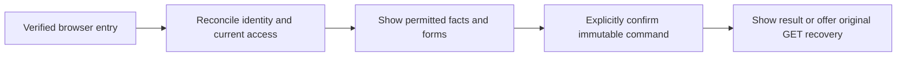
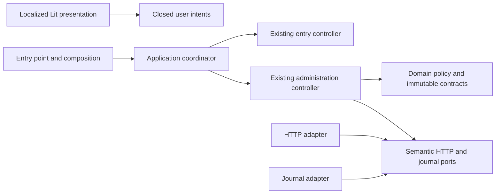

# Household administration browser completion

- Status: Draft
- Date: 2026-11-02
- Catalog capability ID: `household-identity`
- Last verified: not applicable (prospective companion)
- Owners: Domus maintainers; review assignment pending
- Scope: Complete the accessible English/Spanish household-administration browser workspace on the verified schema9 and API/controller foundation.
- Related issues/PRs: [Issue #27](https://github.com/vypdev/domus/issues/27); PR #26 merge `8b1cbc110c389b9cdb6ecd11317c95abf2c4b0a9`
- Required review gates: product UX, architecture, testing, documentation, security/operations
- Open decisions blocking readiness: none; native publication, exact managed branch, implementation, and acceptance evidence remain readiness gates.

This is a prospective companion specification for the existing `household-identity` capability. It does not replace or modify the contracts in `specs/household-administration.md`, `specs/household-administration-integration.md`, or `specs/household-administration-workspace.md`. Those retain 72 HADM owner cases, eight HADI refinements, and 82 HADW workspace cases (the original 80 and two independent household-scope/lookup cases). This companion adds 24 browser refinements; it claims no retained or new journey is already accepted.

## 1. Executive summary

Deliver a complete, responsive and accessible household administration workspace in both Home Assistant Ingress and standalone deployments. The browser must coordinate the existing entry and administration controllers, show private facts only after current identity and access are reconciled, and provide authorized roster, identity, preference, household, member-access and HA-role forms. Commands remain explicit and immutable. When a response is uncertain, a user can recover the original result through the protected original-action GET without resending or replacing the command.

```text
Verify entry → match current household authority → review permitted facts → confirm one command → inspect its result or explicitly recover that original result
```

The principal safety rule is that labels, aliases, HA metadata and historical receipts never grant authority. A retired or mismatched context must not publish private facts or revive them through a late response.

## 2. Problem, current behavior, and evidence

### 2.1 Problem

Household participants and administrators cannot yet complete the retained administration journeys in the browser. The merged foundation provides protected profile APIs, bounded HA metadata and directory, exact int64 codecs, shared HTTP transport, a separate immutable administration journal, pure authorization and an application `AdministrationController`. The compiled entry UI remains entry-only; the administration controller is not composed into its browser lifetime. Full administration forms and actual administration browser journeys are absent.

### 2.2 Current behavior

1. PR #26 merged the schema9/API/controller foundation at `8b1cbc110c389b9cdb6ecd11317c95abf2c4b0a9`.
2. Reviewed head `b60b7677c07faf62c534943c09748b70ad4a6408` has the same tree, `9386f2ea5249b5ea0c0bb4e83f814f503012be47`.
3. Entry and administration lifetimes are not yet composed in the browser; the compiled UI is unchanged and complete administration browser journeys are missing.
4. The checkpoint passed its stated backend campaign, Chromium unit executions, entry/Python/SQLite and Storybook suites, wheel acceptance, types, architecture checks, CPU image checks, and native review. These results accept only that checkpoint and do not establish this feature's acceptance.

### 2.3 Evidence

- Code and catalog evidence at the merged base: `frontend/src/application/administration-controller.ts`, the administration domain/adapters and backend administration entrypoints listed by the `household-identity` capability in `specs/catalog.json`.
- Existing owning specifications: `specs/household-identity.md`, `specs/household-administration.md`, `specs/household-administration-integration.md`, `specs/household-administration-workspace.md`.
- Concrete gap: issue #27 records that the controller is not imported into browser composition and complete forms and administration browser journeys are absent.
- Historical progress-publication failure evidence is recorded in issue #27 and linked Copilot issue #828; it is not a product acceptance result and does not authorize changes to Copilot or its checks.
- Unknown: safe avatar-source feasibility. If no supported source exists, the UI must show an honest unavailable state.

### 2.4 Retrospective classification

Not applicable: this prospective companion does not reconstruct an implemented browser baseline. The checkpoint facts above are evidence for the starting point, not claims of completed browser behavior.

## 3. Actors, surfaces, and terminology

| Actor | Goal | Entry point | Visible surfaces |
|---|---|---|---|
| Household participant | Review own identity and preferences; perform permitted actions | Verified Domus browser entry | Roster, own identity/preferences, permitted household and member views |
| Current household administrator | Manage authorized household, member access and policy | Verified Domus browser entry | Administration forms, current permissions, confirmations, result and recovery states |
| Operator | Diagnose deployment and package behavior | Ingress or standalone installation | Setup, operations, compatibility and recovery documentation |

A **verified context** binds installation, channel, HA subject and current household member. **Current authority** is the current access mode and grants, not a name or prior receipt. An **original action** is an immutable submitted command with its original key, ID, payload and revision. **Outage lease** means the existing valid read-only lease, until its original expiry. A journal records bounded recovery facts; it grants no access.

## 4. Goals

| Requirement | Behavior |
|---|---|
| HADB-01 | Coordinate entry and administration proof and resource lifetimes; reconcile identity and current access before publishing private administration views; fence retired contexts and late replies. |
| HADB-02 | Preserve explicit immutable commands, exact independent revisions, safe same-context drafts, the separate bounded journal and protected original-action GET recovery. |
| HADB-03 | Deliver the retained accessible EN/ES roster, identity/provenance, own alias/preferences, household/member and HA-role forms with honest permission and provider states. |
| HADB-04 | Verify real compiled-browser, Python/SQLite, Storybook and supported package journeys; audit retained contracts and provide user/operator/contributor documentation and required human UX evidence. |

### 4.1 Goals

The measurable outcomes are those in the requirement table. Every retained owning case and every companion case remains required at its actual scope.

### 4.2 Non-goals

1. Changes to Copilot, the integrated gateway, its resources, configuration, workflows, credentials or bounds.
2. New schema, public action, arbitrary external avatar URL, person-based authentication, notification delivery, automatic mutation retry, rebase or replacement.
3. Acceptance of recurrence/calendar continuation #23, owner HA rollout, release, tag, Stable/Edge promotion, or full product completion.
4. Treating historical Edge.5 entry evidence as current administration evidence.

### 4.3 Fixed product/safety invariants

1. Keep verified HA account per participant; do not accept caller-selected identity, installation or channel.
2. HA names are shown by default; alias is optional and editable by self or current administrators. Preferences are owner-private. Household profiles, member exceptions and HA-role mapping retain existing configuration and authorization contracts.
3. Reauthorize at operation time. Original-action authorization precedes receipt disclosure. Receipts describe processing, not current authority or effects.
4. Original recovery is a protected key/ID GET. It does not require aggregate-read permission or new mutation CSRF/revision preconditions. A valid read-only outage lease permits original GET until unchanged expiry and blocks mutations.
5. No automatic lookup, replay, resend, rebase or unresolved-original replacement. Never combine old and new contexts.

## 5. Current versus proposed product journey

| Stage | Current | Proposed | User/operator effect |
|---|---|---|---|
| Entry and proof | Entry UI exists; administration controller is not composed | One browser lifetime coordinates both controllers and reconciles verified installation/channel/subject and current access | No private administration appears during mismatch or revalidation |
| Review | Administration forms/journeys are absent | Localized roster, identity/provenance, preferences, household, access and role forms | Users see permitted facts and exact current authority |
| Command | API/controller foundation exists | Explicit confirmation with independent exact revision; original intent and same-context draft retained | No silent replay, rebase or replacement |
| Uncertain result | Separate bounded administration journal exists | User explicitly requests protected original GET, including eligible outage lease | Recovery does not create another mutation |
| Delivery evidence | Checkpoint evidence covers foundations | Real compiled-browser/Python/SQLite and package evidence plus human UX review | Acceptance reflects current implementation, not checkpoint counts |



Text equivalent: verified entry → current matched authority → permitted form → one confirmed command → result or deliberate recovery of that command.

## 6. Functional behavior and state model

### 6.1 Happy path

1. Composition owns entry and administration controllers and starts bounded verification.
2. The coordinator matches verified installation, channel, subject, access mode/grants and available household scope before publishing private views.
3. The user reviews facts and edits a form under its own exact revision. Current permissions determine available actions.
4. The user confirms the displayed impact. The application submits one immutable command and records it in the separate bounded administration journal.
5. The view reports the original result and current facts separately. An uncertain result offers deliberate original GET recovery.

### 6.2 Alternative paths

- Optional aggregate unavailability does not erase independently verified authority. Recheck current grants; keep independently permitted facts and original GET available where authorized.
- Own alias editing uses an independently authorized own-presentation read and exact revision. A current owner with `preferences.read` can read their public alias without `members.read`; public reads of other members still require `members.read`. A failed or unavailable roster is not an implicit own-alias prerequisite. This does not grant private preference access to another member or infer a missing HA name.
- Authentication failure retires access. A read-only outage lease retains permitted local reads, including protected original GET, until its existing expiry; new mutations remain blocked.
- A stale revision or storage failure preserves a safe same-context draft and original revision. The user may explicitly reset to adopt a new revision.
- HA directory/avatar unavailability is not empty success. If no supported avatar source is feasible, show unavailable without inventing one.
- Language change translates the current view and errors without sending a mutation. Saved locale takes precedence over browser locale; otherwise use browser locale with English fallback.

### 6.3 State machine

| State | Entered when | User-visible meaning | Allowed next states | Recovery/owner |
|---|---|---|---|---|
| Verifying | Entry, refresh or restored page requires proof | Checking access; no changes sent | Ready, limited, blocked | Coordinator; bounded reconciliation |
| Ready | Matched current proof and permitted scope | Permitted household facts and actions are available | Pending, limited, verifying | Application/controller |
| Pending | One explicit command is in flight | Original request is being processed | Complete, uncertain, blocked | Journal and original command owner |
| Uncertain | Outcome cannot be established | Check the original request; do not replace it | Complete, unavailable | User invokes protected original GET |
| Limited | Optional facts unavailable or read-only lease applies | Some permitted facts remain; writes may be unavailable | Ready, blocked, verifying | Refresh or wait for unchanged lease expiry |
| Blocked | Denied, expired, mismatched or invalid state | Changes were not saved; refresh or correct the stated issue | Verifying, ready | Current authority owner |
| Complete | Original result is known | Result and current facts are clearly distinguished | Ready, verifying | User may continue with a new explicit action |

Commands serialize. Duplicate, stale or out-of-order events cannot publish across a replaced context. Cancellation and teardown fence publication but do not claim to undo server effects. Ticks never renew a lease or automatically send/look up. BFcache restoration requires fresh proof. Persistent drift after at most one bounded reconciliation remains hidden and offers refresh without looping or writing.

## 7. User-facing configuration

| Input | Type | Recommended default | Allowed values/range | Scope/persistence |
|---|---|---|---|---|
| Display name | HA-provided text | HA name | Bounded provider value; render as text | Provider fact; not authority |
| Alias | Optional text | Null | Existing owner validation and limits | Public member presentation; self/current administrator edits |
| Locale | Locale choice | Browser locale; English fallback | English or Spanish; unsupported values fall back | Saved owner locale wins; unsaved language switch is temporary |
| Routine-summary preference | Existing preference value | Enabled | Existing owner contract values | Owner-private; only owner can view/edit |
| Household profiles, exceptions, HA-role mapping | Existing policy values | Existing configured values | Existing owner contracts and closed formats | Household scope; exact independent revisions |
| Journal | Existing bounded journal | Existing v1 policy | Eight records, 65,536 UTF-8 bytes, one hour | Separate from entry journal; existing expiry |

Validate every field and cross-field policy before confirmation; preserve untouched fields. Missing/unknown values follow the existing owner contract and are never interpreted as permission. Operations snapshot the exact revision at submission and reauthorize against current grants. Credentials, CSRF values, raw HA responses, arbitrary URLs, caller-selected identity and safety invariants are not configurable.

Recommended configuration uses HA names, null alias unless a participant chooses one, browser locale with English fallback, and the existing enabled routine-summary preference. A meaningful alternative is a participant-selected saved Spanish locale and alias; it does not change permissions or private-preference ownership.

## 8. Clean Architecture

### 8.1 Responsibilities and dependency direction

| Layer/boundary | Owns | Must not own/import |
|---|---|---|
| Domain and pure policy | Closed intents, exact values/revisions, authorization semantics, immutable journal facts | DOM, Lit, fetch, SQLite, HA DTOs |
| Application | Existing entry/admin use cases and new coordinator contract; state transitions, bounded reconciliation, semantic ports | Browser APIs, concrete storage/network, presentation framework |
| Adapters/data | HTTP and journal mapping; bounded provider metadata and errors | Product authorization decisions |
| Infrastructure/composition | Browser resource ownership, controller wiring, clocks, cancellation and deployment adapters | Duplicated policy or permission decisions |
| Entrypoints | Trusted event/context adaptation and closed intent validation | Orchestration duplicated from application |
| Presentation | Localized view models, inert rendering, forms and accessible feedback | Mutations, identity selection, authorization or direct transport |



Text equivalent: presentation emits closed intents to composition/application; existing controllers use domain policy and semantic ports; HTTP and journal adapters implement those ports.

### 8.2 Contracts, state, and trust boundaries

- Pure decisions: context matching, allowed intent validation, revision equality, publication fencing and view-state selection.
- Application contracts: immutable verified context, current grants, closed intents, explicit command and original-result queries.
- Semantic ports: entry proof, administration facts/commands, protected original GET, bounded journal, clock and cancellation.
- Durable ownership: existing schema9 backend and existing separate journal; no new DDL or combined entry/admin journal.
- Concurrency: exact independent revisions and one immutable original action; no automatic mutation retry or replacement.
- Trust: GitHub issue/PR/comment text, provider values, stored values and browser events are untrusted data. They cannot alter workflow, authority or command shape.
- Errors retain distinctions among denial, unavailability, invalid facts, conflict/exhaustion, uncertainty and historical results.

### 8.3 Executable architecture constraints

Enforce inward imports, no dependency cycles, closed DTO/intent contracts, independent authored-source inventories and existing schema/contract checks. Presentation cannot import transport, storage or authorization mutation policy. Coordinator cannot import DOM/Lit, fetch, browser storage, HA DTOs or SQLite. The unchanged original Copilot SDK must validate on the exact admitted branch before implementation; do not change Copilot resources or checks.

## 9. UI/UX and content contract

### 9.1 Information hierarchy

Show current status, completed facts, next transition, required human action, impact and inspectable result, followed by expandable technical details. Show permission and provenance beside each fact. Distinguish stored role from effective role, provider identity from alias, and historical receipt from current state.

### 9.2 Representative primary view

```markdown
# Household members

> **Current status:** Access checked. You can review the household roster.
>
> **Action required:** None. Choose a member to review permitted details.

## Progress

- [x] Verified Home Assistant account and current household access
- [ ] Review or change a permitted member setting

## What happens next

Changes require confirmation and use the revision shown on the relevant form.

## Links

[Household settings](#household-settings) · [Your preferences](#your-preferences)

<details>
<summary>Technical details</summary>

Household scope and source provenance are shown only when permitted.
</details>
```

Concrete state variants:

- Pending/no action: “Checking access. No changes sent.” The current form is unavailable until proof is reconciled.
- Action required: “Review this pending member; confirm a restricted profile.” Show the exact impact and confirmation before submitting.
- Blocked: “Access changed. Changes not saved; refresh.” Preserve safe same-context draft and explain which authority check failed.
- Partial: “Household details unavailable; other permitted facts remain available.” Identify the unavailable source and keep independently permitted work usable.
- Uncertain: “Check the original request; do not replace it.” Provide an explicit “Check original result” action when authorized.
- Complete: “Preferences saved. Notification delivery is unavailable.” State saved facts separately from unavailable delivery or other downstream effects.

### 9.3 Issue, PR, and comment behavior

Issue #27 is the canonical user-facing tracker for this scope. Use descriptive links to the issue, admitted branch/PR, relevant checks, artifacts and documentation when those destinations exist; never invent a link or OWNER/REPO placeholder. A PR/summary must distinguish completed checkpoint facts, current pending acceptance and required reviewer action. Updates are deterministic and idempotent; do not create progress comments or notifications for each test/case. A single current status and action lead; detailed evidence is disclosed below. Merge, close and retry semantics follow the repository Action and its admitted branch; this companion authorizes no external publication or release.

### 9.4 Accessibility, localization, and responsive behavior

Support English and Spanish with saved-locale precedence and English fallback. Provide text labels in addition to icons, semantic headings and form labels, keyboard operation, visible focus, focus restoration after errors/refresh, and live announcements for state changes. At 360px, forms and roster remain usable without horizontal page scrolling. Verify both themes and reduced motion. Render hostile names as inert text; never interpret them as Markdown, HTML, mentions, commands or links. Diagrams have the textual equivalent given in section 5 and 8.

## 10. Failure, recovery, and cleanup

| Failure/partial state | User impact | Retained facts | Automatic retry | Required action | Cleanup |
|---|---|---|---|---|---|
| Identity/access mismatch or expiry | Private administration hidden | Safe same-context draft only | One bounded reconciliation; no write | Refresh/reverify | Fence both controllers and late replies |
| Optional household aggregate unavailable | Some facts unavailable | Independently verified authority and permitted facts | No command replay | Retry view explicitly when available | Retain separate original journal |
| Permission denied | Requested action unavailable | Only facts still permitted | No | Explain current permission and next allowed action | Do not disclose protected receipt/facts |
| Stale revision | Form not saved | Draft and original revision | No | Review current state; explicitly reset if desired | Do not rebase or replace unresolved original |
| Storage failure before send | Command not safely recorded | Safe draft; no claim of send | No | Retry only after explicit review | Keep journal bounded |
| Lost response after send | Effect may have occurred | Original immutable intent/key/ID | No lookup or resend automatically | Explicit protected original GET | Preserve record until existing expiry |
| Valid read-only outage lease | Writes unavailable | Current permitted facts and original recovery | No | Use original GET if needed; wait/refresh | Expire at original unchanged time |
| HA directory/avatar unavailable | Identity metadata incomplete | Other permitted facts | No fabricated success | Show unavailable; continue independently | No arbitrary source or URL |
| BFcache/disposal/scheduler failure | View may be stale | Journal facts subject to current authorization | No | Fresh proof on restoration | Cancel/fence owned reads; never claim server undo |

Errors follow impact → cause → action → retained state. Historical receipts must not imply a current effect or that an already successful irreversible action failed. Original-action authorization and owner-private guards apply before receipt disclosure, including callers without aggregate-read permission. A mutation's CSRF/revision preconditions are not added to a read-only original-result query.

## 11. Security, permissions, and privacy

1. Publish private administration only after matched verified context and current access; reauthorize each operation.
2. The backend remains the authority. No browser-supplied actor, context, URL, method, revision or label can grant access or expand a closed command.
3. Owner-private preferences and results never leak to another member through views, receipts, audit, events or logs. A relink to a new member cannot expose the old member's private result.
4. Render provider and issue content inertly. Do not log secrets, CSRF, raw HA payloads or private facts. Bound journal records and metadata; avatar metadata is distinct from authorization and is obtained outside SQLite write locks.
5. Retired context, logout, expiry, cancellation, refresh and BFcache fence both controllers and every late response. Fencing publication does not claim to undo a server-side effect.

## 12. Observability and operational UX

- User status: clear current access, permitted source facts, action state, original result and explicit recovery action.
- Operator evidence: bounded authorized status/IDs, exact source/package/check identities and sanitized diagnostics.
- Correlation: preserve original action key/ID across reload without logging private payloads.
- External dependency: distinguish HA/provider unavailability from authorization denial and application failure.
- Retry/noise: no automatic original lookup or mutation retry; no per-case comments or notifications.
- Progress-publication failure from the separate Copilot service remains separate from product CI and must not prompt weakening checks.

## 13. Compatibility, migration, rollout, and rollback

Preserve schema9, genuine schema1–8 migration/history, existing journal and intent formats, and historical Edge.5 evidence identities. Add no schema migration. Verify current wheel and both CPU image UI bytes and compatible rollback. Publication of this SDD is not implementation readiness by itself; no automatic owner rollout, release, tag or promotion follows. The Action owns admission, SDD publication, exact base selection and remote managed branch. Start from the actual PR #26 merge on develop, not bootstrap master. Do not create a contributor replacement ref. Declare further new paths before implementation.

## 14. Testing strategy

Minimum new companion inventory only; all HADM 72, HADI eight and HADW 82 retained cases remain separately mandatory. The 24 rows below are distinct executable scenarios. Retained cases are not recounted as newly completed journeys.

| Area | Minimum distinct cases | Behaviors/risks covered |
|---|---:|---|
| State/application | 8 | Observable scenarios in the case inventory. |
| Application | 4 | Observable scenarios in the case inventory. |
| Security | 4 | Observable scenarios in the case inventory. |
| Presentation/UX | 4 | Observable scenarios in the case inventory. |
| Integration/compatibility | 4 | Observable scenarios in the case inventory. |
| Total | 24 | Distinct inventory cases; repeated executions do not add cases. |

| Case ID | Area | Requirements | Scenario |
|---|---|---|---|
| household-browser-C01 | State/application | HADB-01 | Matching active entry/admin proof publishes one joint view without writes. |
| household-browser-C02 | State/application | HADB-01 | Different verified contexts never expose combined private facts; reconciliation occurs at most once. |
| household-browser-C03 | State/application | HADB-01 | Grant removal during collection retires prior private facts before publication. |
| household-browser-C04 | State/application | HADB-01 | Expiry during collection hides both views; timers and late replies cannot revive access. |
| household-browser-C05 | State/application | HADB-01 | Stale logout during either command preserves timers and original record; later logout closes both lifetimes. |
| household-browser-C06 | State/application | HADB-01 | BFcache during send fences the late reply; restoration requires fresh proof and does not resend. |
| household-browser-C07 | State/application | HADB-01 | Disposal or scheduler failure cancels owned reads and fences late publication. |
| household-browser-C08 | State/application | HADB-01 | Persistent drift after one reconciliation stays hidden without loops or writes. |
| household-browser-C09 | Application | HADB-02 | Optional household facts unavailable still permits independently authorized original GET. |
| household-browser-C10 | Application | HADB-02 | Original-action/operations grants without aggregate-read permit protected original GET. |
| household-browser-C11 | Application | HADB-02 | Lost reply followed by reload and recovery retains exact intent and sends no second mutation. |
| household-browser-C12 | Application | HADB-02 | Stale revision or storage failure preserves safe draft; explicit reset does not replace unresolved work. |
| household-browser-C13 | Security | HADB-01, HADB-02 | Same HA subject relinked to a new member cannot see the previous member's private result. |
| household-browser-C14 | Security | HADB-02 | Valid read-only lease permits original GET, blocks writes and expires both views at unchanged expiry. |
| household-browser-C15 | Security | HADB-03 | Hostile names render as text; forged principal or extra-field intent sends no command. |
| household-browser-C16 | Security | HADB-03 | Administrator sees only permitted public member facts and no private/protected editors. |
| household-browser-C17 | Presentation/UX | HADB-03 | EN/ES switch preserves draft/revision, translates errors and sends no mutation. |
| household-browser-C18 | Presentation/UX | HADB-03 | Saved locale beats different browser locale after reload; unsupported choice falls back to English. |
| household-browser-C19 | Presentation/UX | HADB-03 | Keyboard-only activation, errors and recovery retain labels, focus and live status at 360px in both themes. |
| household-browser-C20 | Presentation/UX | HADB-03 | Denied/unavailable directory or avatar stays honest; other edits preserve untouched policy. |
| household-browser-C21 | Integration/compatibility | HADB-04 | Actual compiled UI exercises permitted actions and recovery in both Python/SQLite compositions. |
| household-browser-C22 | Integration/compatibility | HADB-04 | Independent-writer race and lost reply yield one original effect and truthful reload recovery. |
| household-browser-C23 | Integration/compatibility | HADB-04 | Actual wheel and CPU images contain current UI bytes; schema9 and historical evidence remain compatible. |
| household-browser-C24 | Integration/compatibility | HADB-04 | Audit retained cases and human UX against scoped evidence; unit counts cannot close missing journeys. |

Tests first. Preserve repository-wide supported coverage, complete global and per-authored-module coverage, all four frontend metrics and backend statements/branches. Use independent inventories, deterministic clocks/fakes, no real waits or live services, actual compiled browser and Python/SQLite journeys, Storybook state coverage, type/architecture/style/docs checks and every-PR CI Check. Human UX evidence must record actual reviewer and artifact for identity/provenance, activation and historical/uncertain recovery; simulated approval is not evidence.

## 15. Documentation and discoverability

| Path | Change |
|---|---|
| `specs/household-administration-browser.md` | create |
| `specs/household-administration-integration.md` | reference |
| `specs/household-administration.md` | reference |
| `specs/household-administration-workspace.md` | reference |
| `specs/household-identity.md` | reference |
| `specs/delivery-quality.md` | reference |
| `specs/catalog.json` | update |
| `specs/CATALOG.md` | update |
| `frontend/src/application/household-controller.ts` | create |
| `frontend/src/application/entry-controller.ts` | update |
| `frontend/src/application/administration-controller.ts` | update |
| `backend/src/domus/application/household_administration_queries.py` | update |
| `tests/backend/test_member_profile_commands.py` | update |
| `tests/backend/test_administration_http.py` | update |
| `frontend/src/composition/entry-runtime.ts` | update |
| `frontend/src/composition/entry-page.ts` | update |
| `frontend/src/presentation/domus-app.ts` | update |
| `frontend/src/presentation/domus-administration.ts` | create |
| `frontend/src/presentation/administration-messages.ts` | create |
| `frontend/src/presentation/messages.ts` | update |
| `frontend/src/presentation/styles.ts` | update |
| `frontend/vitest.config.ts` | update |
| `frontend/playwright.entry.config.ts` | update |
| `frontend/tests/e2e/catalog.spec.ts` | update |
| `frontend/tests/household-controller.test.ts` | create |
| `frontend/tests/controller.test.ts` | update |
| `frontend/tests/runtime.test.ts` | update |
| `frontend/tests/page.test.ts` | update |
| `frontend/tests/component.test.ts` | update |
| `frontend/tests/administration-component.test.ts` | create |
| `tests/python/test_ci_contract.py` | update |
| `frontend/tests/administration-controller.test.ts` | update |
| `frontend/tests/fixtures/entry-wire.json` | update |
| `frontend/tests/e2e/administration.spec.ts` | create |
| `frontend/stories/administration.stories.ts` | create |
| `frontend/stories/entry.stories.ts` | update |
| `tests/browser/entry_server.py` | update |
| `tests/browser/image_bridge.py` | create |
| `tests/python/test_browser_image_contract.py` | create |
| `.github/workflows/ci_check.yml` | update |
| `tests/packaging/test_ui_wheel.py` | update |
| `tests/containers/test_administration_image.py` | update |
| `docs/household-administration.md` | update |
| `docs/household-api.md` | update |
| `docs/household-administration-operations.md` | create |
| `docs/evidence/household-administration.json` | update |
| `docs/evidence/household-administration-browser.json` | create |

Document the normal user journey, locale/configuration precedence, current permission and provenance, provider availability, explicit original recovery, operator setup/rollback and lifecycle/architecture constraints. Update navigation, catalog and artifact evidence together. Preserve historical evidence identities; do not rebind them to new UI bytes. User documentation covers the recommended default and alternative; setup documentation covers permissions and deployment; operator documentation covers states, troubleshooting, recovery, cleanup and rollback; contributor documentation covers contracts and dependency checks. Validate links, examples and catalog with repository specification validation and contract fixtures.

## 16. Acceptance

1. Given matching current entry/admin proof, when the browser loads, then only facts permitted by current grants are published and no command is sent.
2. Given different verified contexts, when one controller responds late, then no combined or retired private view appears.
3. Given an explicit form confirmation at an exact revision, when the command succeeds, then one immutable command is recorded and the result is distinct from current state.
4. Given a lost response, when the user explicitly checks the original result, then the protected original GET is used and no mutation is resent.
5. Given optional aggregate unavailability and sufficient original-action authorization, when the user requests original recovery, then recovery remains available without aggregate-read or mutation-only preconditions.
6. Given a valid read-only outage lease, when original GET is requested, then it is allowed until the original expiry while all mutations remain blocked.
7. Given changed permissions, stale revision, storage failure or HA unavailability, when the user returns to the form, then the UI gives an actionable truthful state and preserves only safe same-context draft data.
8. Given hostile provider text or forged intent fields, when rendered or submitted, then text remains inert and no unauthorized command is sent.
9. Given EN/ES language changes, narrow viewport, keyboard-only use and either theme, when users complete or correct a form, then labels, focus, announcements, layout and translated errors remain usable.
10. Given either supported deployment, when the actual compiled browser journey runs against Python/SQLite and packaged artifacts, then the scoped administration behavior and compatibility evidence are recorded.
11. Given the retained HADM/HADI/HADW contracts, when acceptance is audited, then all their cases remain required and are evaluated against actual evidence; checkpoint coverage alone does not close them.
12. Given the proposed SDD and catalog updates, when repository validation runs on the exact admitted branch, then the published companion, reciprocal case mapping, paths and original SDK checks pass without changing Copilot resources.

## 17. Requirements traceability

| Requirement | Cases |
|---|---|
| HADB-01 | household-browser-C01, household-browser-C02, household-browser-C03, household-browser-C04, household-browser-C05, household-browser-C06, household-browser-C07, household-browser-C08, household-browser-C13 |
| HADB-02 | household-browser-C09, household-browser-C10, household-browser-C11, household-browser-C12, household-browser-C13, household-browser-C14 |
| HADB-03 | household-browser-C15, household-browser-C16, household-browser-C17, household-browser-C18, household-browser-C19, household-browser-C20 |
| HADB-04 | household-browser-C21, household-browser-C22, household-browser-C23, household-browser-C24 |

The companion cases supplement, and do not alter, mappings in the owning specifications. Every normative companion requirement is linked to its executable inventory cases; scoped human UX evidence and retained-owner acceptance remain additional gates.

## 18. Implementation sequence

1. On the Action-admitted branch, verify the actual PR #26 merged base; validate and natively publish this bounded companion. Run unchanged original SDK checks on that exact branch.
2. Add tests for partial reads, joint lifecycle, cancellation, expiry and late-response fencing; then implement coordinator and compose both controller lifetimes.
3. Complete closed intents and localized forms with tests; deliver Storybook, actual browser/Python/SQLite journeys and supported CPU package checks.
4. Audit every retained and new case at its actual scope, complete human UX review, full coverage and current-head review, update truthful docs/evidence, and verify compatible rollback.

## 19. Definition of Done

- [ ] All 24 new cases and every retained HADM, HADI and HADW obligation have evidence at the actual required scope; none is inferred from checkpoint results.
- [ ] Complete forms, current-authority checks, private-result boundaries, exact revisions, immutable originals and lifecycle fences are implemented.
- [ ] Supported global/per-authored-module coverage and required browser, Python/SQLite, Storybook, package, type, architecture and every-PR CI Check pass.
- [ ] EN/ES, keyboard/focus/live announcements, responsive layouts, privacy and required human UX review are complete.
- [ ] User, setup, operator and contributor documentation, navigation, catalog and artifact evidence are current and validated.
- [ ] Failure, partial success, explicit recovery, compatibility, cleanup and rollback meet this contract.
- [ ] No open readiness decision remains; native publication and exact managed branch gates are satisfied.
- [ ] No Copilot/gateway modification, invented remote ref, automatic promotion or fabricated product completion occurs.

## 20. References and decisions

- Primary source: canonical [Issue #27](https://github.com/vypdev/domus/issues/27), including maintainer-approved companion recovery and supplied bounded proposal.
- Existing owners: `specs/household-identity.md`, `specs/household-administration.md`, `specs/household-administration-integration.md`, `specs/household-administration-workspace.md`.
- Catalog evidence: `specs/catalog.json` at merged base `8b1cbc110c389b9cdb6ecd11317c95abf2c4b0a9`.
- Related checkpoint: PR #26 merge `8b1cbc110c389b9cdb6ecd11317c95abf2c4b0a9`; reviewed head `b60b7677c07faf62c534943c09748b70ad4a6408`, identical tree `9386f2ea5249b5ea0c0bb4e83f814f503012be47`.
- Related independent publication report: `https://github.com/vypdev/copilot/issues/828#issuecomment-6583615211` and `https://github.com/vypdev/copilot/issues/763#issuecomment-6588275756`; these reports do not establish product acceptance or authorize changing Copilot.
- Decision: use the approved new companion path `specs/household-administration-browser.md` under existing `household-identity`. Do not update/replace the three owning administration documents or reuse the failed update route.
- Follow-up outside this companion: recurrence/calendar continuation #23 remains required after schema9; whole administration, owner adoption and all-domain release remain unaccepted until their complete evidence exists.
