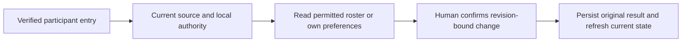
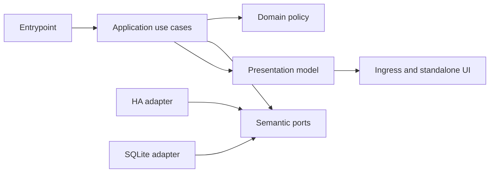

# Household administration integration continuation

- Status: Draft
- Date: 2026-11-02
- Catalog capability ID: household-identity (companion)
- Last verified: not applicable to proposed integration; baseline verified at `4b71969d3b3f6df5f28d617ab0da4e86c9be5884`
- Owners: Domus maintainers (review assignment pending)
- Scope: Complete the retained household administration workspace on the merged schema8 base, adding schema9 while preserving existing owners and all original product journeys.
- Related issues/PRs: [Issue #21](https://github.com/vypdev/domus/issues/21) · [PR #22](https://github.com/vypdev/domus/pull/22) · [Issue #23](https://github.com/vypdev/domus/issues/23)
- Required review gates: product UX, architecture, testing, documentation, security/operations
- Open decisions blocking readiness: None; implementation and acceptance evidence remain outstanding.

This new companion preserves `specs/household-administration.md`, `specs/household-identity.md`, and delivery ownership verbatim. The existing administration owner remains authoritative for all eight HADM requirements and its 72 original case rows. All identity and delivery requirements also remain in force. This companion adds integration constraints and eight separately identified executable refinements; it does not replace or redefine the 72 product journeys. Publication is not implementation acceptance.

## 1. Executive summary

Verified participants need a complete place to understand household membership and manage data they are permitted to change. The proposed workspace provides a current-authority roster, participant and administrator actions, public presentation, and owner-private preferences in Home Assistant (HA) Ingress and standalone deployments, in English and Spanish. Administrators manage participation and existing permission profiles; they cannot inspect another member's private preferences. HA identity and source checks remain authoritative. A name or optional alias is display text, never identity or permission.

Recommended defaults are a nullable alias, browser-language locale with English fallback, and enabled routine-summary preference. The preference is stored only; delivery remains unavailable until its actual owning consumer exists. Mutations use current authorization, aggregate revisions, and original-request recovery. A receipt proves the original request was processed, not that its effects remain current.

```text
Verified entry -> current authorized roster -> explicit revision-bound action -> original receipt -> refreshed current state
```

## 2. Problem, current behavior, and evidence

### 2.1 Problem

Participants can use existing identity and entry capabilities, but cannot yet manage the complete verified household workspace. Without it they cannot reliably review their participation, presentation, or private preferences, while administrators lack the integrated management surface for membership and existing access policy. This gap must be completed without fabricating HA facts, disclosing private preferences, or weakening current-authority checks.

### 2.2 Current behavior

1. The selected development base is the actual PR #22 merge, `4b71969d3b3f6df5f28d617ab0da4e86c9be5884`; its tree is byte-identical to reviewed head `ed7cd14190d750846833cf1bb822988b628560da`.
2. That source has schema8, identity and task APIs, entry UI, pure member-presentation and member-preference models, and merged recurrence schema8, fixed execution, and relative storage/creation.
3. It does not have the complete administration workspace, persisted public/private profile state, HA profile-source adapter, or separate administration journal. Those remain proposed work.
4. The full recurrence/calendar scope continues in issue #23 and is not accepted by this companion. Owner Edge.5 remains a separate schema7 package; this document does not update it.

### 2.3 Evidence

- Code/workflow/documentation references: immutable selected source tree; owning catalog entry `household-identity`; `specs/household-identity.md`, `specs/household-administration.md`, and `specs/delivery-quality.md` at the selected base.
- Baseline measurements supplied for that source: 4,031 backend executions, 137 authored modules, and 100% supported statement/branch coverage globally and per module; applicable product CI and both actual image architectures pass. These establish baseline evidence only, not acceptance of this proposal or all 72 journeys.
- Existing administration owner evidence: `specs/household-administration.md`, 57,838 UTF-8 bytes, Git blob `f315a00d9efbb7da8a9ea44ab0da8a9df2d088e100a`, SHA256 `333791e5664212473dd8874be9751c00c8ee7644cf9f861f11a3876dd97321f3`, 72 case rows, HADM-01 through HADM-08.
- The selected development source contains 22 specification files. Bootstrap master `8ee7e1a15e91c91b6204ca97e8808c3207dee008` has no specs directory and is not the selected source.
- Genuine schema8 input evidence captured before schema9: all 137 source modules were byte-checked against Git; raw database SHA256 `badd63184fa40380462ab3fe54cd957b63a967d1beafb4b73fc6c2475df8340b`; complete logical dump with captured header pragmas SHA256 `041615f0253c0537ac6c713e10a8984fb5043b1f6df29a6a2c7193824ebc6ed5`. This is fictional local HA proof and real application/SQLite execution, not owner data or proof of relative materialization.
- Incidents or concrete examples: issue #21 identifies the unfinished portion of closed issue #16; PR #18 merged only the pure-model checkpoint, not the full 72-case contract.
- External primary sources: not applicable; no external provider behavior is inferred.
- Unknowns: implementation details and runtime acceptance remain to be established. Provider/library feasibility is not inferred from current specification paths.

### 2.4 Retrospective classification (as-built baselines only)

Not applicable: this is a prospective companion, not a reconstruction of implemented behavior. The evidence above describes the verified baseline and does not imply the proposed workspace exists.

## 3. Actors, surfaces, and terminology

| Actor | Goal | Entry point | Visible surfaces |
|---|---|---|---|
| Verified participant | Review identity/access and manage own alias and private preferences | Existing authenticated HA context | Ingress or standalone administration workspace |
| Current household administrator | Manage participation and permitted household/access policy | Existing administrator proof and current household context | Roster, member detail, settings and permission-profile forms |
| Operator | Preserve, inspect, or restore compatible owned application state | Existing installation/recovery tools | Operator and migration documentation |
| Maintainer | Implement and verify the proposed integration | Repository and CI | Specs, code, tests, docs, checks and evidence |

A canonical HA user is the identity. HA name and optional Domus alias are public presentation. Locale and routine-summary choice are owner-private preferences. Membership status, role, permission profile, mapping, household settings, task and recurrence facts remain owned by their existing authoritative models. A technical receipt describes original processing, not present authority or effects.

## 4. Goals, non-goals, and fixed invariants

### 4.1 Goals

| Requirement | Behavior |
|---|---|
| HADI-01 | Integrate public presentation and alias behavior while preserving original HADM-01 identity distinction and HADM-03 authority contracts. |
| HADI-02 | Integrate bounded, honest HA metadata/directory reads and permission-aware roster/detail queries, preserving HADM-01 and HADM-02. |
| HADI-03 | Integrate current-authorized, revisioned alias, household/member/profile/mapping commands and original-result disclosure, preserving HADM-03 and HADM-05. |
| HADI-04 | Persist and expose only owner-authorized locale and routine-summary preferences, preserving HADM-04 and privacy rules. |
| HADI-05 | Add actual schema9 migration and restore compatibility from verified schema8, preserving HADM-06 and genuine original evidence. |
| HADI-06 | Add separate closed administration recovery journal and current-context command/query boundaries, preserving HADM-05. |
| HADI-07 | Complete accessible English/Spanish administration in both deployments and the existing catalog/browser workflow, preserving HADM-07. |
| HADI-08 | Maintain tests-first delivery, full supported per-module/global coverage, Clean Architecture and truthful documentation/quality evidence, preserving HADM-08 and all 72 original cases. |

### 4.2 Non-goals

1. No HA owner update, release/tag, image promotion, deployment, extra port, or production rollout is authorized by publication.
2. No gateway, Copilot resource/configuration/credential changes, person-based authentication, arbitrary external image, or notification delivery is added.
3. Issue #23's unfinished recurrence/calendar scope is not included or claimed accepted.
4. This companion does not copy, replace, or reduce the owning administration or identity contracts.

### 4.3 Fixed product/safety invariants

1. Current HA source checks and current local authorization govern each action; stale grants never authorize a new effect.
2. Alias, display name, avatar, browser state, request key and labels cannot establish identity or grant access.
3. Administrators cannot read or edit another member's private preferences, including through receipts, audit, events, roster, logs or shared projections.
4. Preserve pending, active, suspended and archived membership; inherited permission provenance; protected permissions; and last-effective-administrator safeguards.
5. No automatic mutation retry, request replacement, stale-dialog rebase, or silent replay with a new key.
6. Preserve original identities/history, schema1..8 inputs, processed-operation and restore evidence, immutable fixtures, installation/channel/generation isolation, and compatible complete application/database rollback.
7. Keep administration journal separate from the entry journal; no CSRF, token, cookie or raw provider state is stored in either journal.

## 5. Current versus proposed product journey

| Stage | Current | Proposed | User/operator effect |
|---|---|---|---|
| Entry | Verified identity and setup/join entry exist; no full administration workspace | Open current household workspace in either deployment | Participant sees current verified context |
| Review | Existing APIs/models provide partial building blocks | Permission-aware roster, member details, pending review and honest HA metadata | User can distinguish verified facts from unavailable data |
| Change | Full integrated profile/preferences and administration flow is absent | Explicit form submits a revision-bound, currently authorized action | No implicit authority or stale overwrite |
| Recovery | Existing identity/recovery owners remain authoritative | Separate bounded administration journal retains original operation identity | Lost response is resolved against the same request |
| Upgrade | Selected base is schema8 | Actual migration to schema9 preserves original facts | Operator can verify migration or restore compatible state |



Text equivalent: verified entry -> current source/local authority -> permitted view -> explicit revision-bound change -> original result and refreshed current state.

## 6. Functional behavior and state model

### 6.1 Happy path

1. The entrypoint derives the principal and household only from the existing trusted session/context.
2. Application queries obtain current authority and bounded HA source data; unavailable or denied source data is shown as unavailable, never as an empty verified directory.
3. The participant views public roster data and only their own private preferences. An administrator sees permitted household/member/access data and no other participant's preferences.
4. A human selects an action. The application checks fresh proof, CSRF, Origin/context, expected aggregate revision, source authorization, original key/payload, and current local grants.
5. The writer rechecks mutable local grants after external preparation and commits the action atomically with its original result/audit facts.
6. The interface reports effect and next step, then refreshes current state. Historical receipt and current effect remain distinct.

### 6.2 Alternative paths

- Pending membership remains pending until an authorized administrator acts. Suspension and archive retain their original owner-defined semantics.
- A missing HA name/avatar uses a neutral fallback; no empty directory or invented identity is presented as verified.
- Saving routine-summary preference changes storage only. Delivery is shown as unavailable until the actual owning consumer exists.
- A stale revision, changed permission, unavailable source, or invalid proof blocks a new effect and leaves an actionable draft where safe.
- A lost response retains the same original request for protected lookup/replay. It never creates a replacement operation automatically.
- After restore, original historical processing can be disclosed separately from absent current effects; restore does not recreate those effects or delivery.

### 6.3 State machine

| State | Entered when | User-visible meaning | Allowed next states | Recovery/owner |
|---|---|---|---|---|
| Current | Current source and local context verified | View reflects current authorized facts | Draft, unavailable, denied | Refresh through existing query owner |
| Draft | Human edits a permitted form | No change has been committed | Submitted, canceled, stale | Participant/admin decides; presentation owns draft |
| Submitted | Explicit request sent with original key/revision | Outcome may be processing or uncertain | Committed, rejected, uncertain | Application command and journal |
| Uncertain | Response absent or unreadable | Effect is not yet known | Recovered, expired | Recover same original request; no replacement |
| Committed | Original result confirms processing | Original action processed | Current after refresh, historical after restore | Receipt is historical evidence only |
| Unavailable/denied | Source, proof, or access is not sufficient | No new effect is authorized | Current after recheck, draft | Correct context or retry query after human action |

Duplicates use the original idempotency contract. Out-of-order revisions are rejected. Cancel before send may discard a draft; cancel after send cannot negate an effect. Partial migration or late-write failure rolls back data, defaults, version and associated receipt/audit/outbox together.

## 7. User-facing configuration

| Input | Type | Recommended default | Allowed values/range | Scope/persistence |
|---|---|---|---|---|
| Domus alias | nullable string | null; HA name remains default | null or trimmed 1..80 Unicode code points; reject Cc before trimming; preserve literal text without HTML or Unicode normalization | Public presentation for the canonical member; revisioned persistence |
| Locale | nullable enum | null, following browser base language, then English | null, `en`, `es` | Owner-private preference; persisted and read only by owner |
| Routine-summary preference | boolean | true | strict boolean only | Owner-private persisted choice; no delivery claim |
| Administration journal | closed record collection | empty | version 1, at most 8 records, 65,536 bytes total, one-hour retention | Separate browser namespace; original key/payload/context/lifecycle only |

Household name/timezone, member/profile/mapping limits, at most 256 ordinary decisions, and verified directory result bounds remain those in the existing owner. Unknown fields and boolean-alias/numeric encodings fail safely without changing the original request. No delivery address/channel, arbitrary settings object or image URL is configurable. In-flight actions snapshot their original payload and expected revision; a retry looks up that same operation. Configuration cannot weaken authorization, source checks, journal separation or last-administrator safeguards.

Recommended example: alias unset, locale unset, routine summary enabled. Meaningful alternative: participant chooses a bounded alias and Spanish locale, and disables routine-summary preference; none of these changes identity or sends a notification.

## 8. Clean Architecture design

### 8.1 Responsibilities and dependency direction

| Layer/boundary | Owns | Must not own/import |
|---|---|---|
| Domain/pure policy | Member presentation/preference values, bounds, alias validation, permission invariants | HA SDK, HTTP, browser, SQLite |
| Application | Administration commands/queries, authorization ordering, semantic ports, revisions and result contracts | Concrete SDK/process calls or UI orchestration |
| Adapters/data | HA metadata translation, strict persistence, journal codec and error mapping | Product permission decisions |
| Infrastructure/composition | SQLite transactions, deployment wiring and credentials | Business decisions or principal selection from request data |
| Entrypoints | Closed DTO parsing and trusted current-context adaptation | Duplicated orchestration or accepting a principal from browser payload |
| Presentation | Accessible view models, localized content, inert text rendering | Authorization or durable mutation policy |



Text equivalent: entrypoints adapt trusted context to application use cases; application uses pure domain policy and semantic ports; HA/SQLite adapters implement those ports; presentation renders results for both deployment surfaces.

### 8.2 Contracts, state, and trust boundaries

- Pure decisions: alias bounds/literal handling, nullable defaults, locale selection, preference ownership, permission-profile provenance and last-administrator invariants.
- Application contracts: immutable narrow commands/queries with canonical member identity, expected revision and trusted current context supplied by composition.
- Semantic ports: bounded verified HA profile/directory read, member-profile persistence, current authority, and atomic original-operation journal/result access.
- Durable state/schema ownership: schema9 adds public presentation and owner-private preference state without changing identity or task/recurrence authority. Independent checkpoint inspection validates new records.
- Concurrency/idempotency: aggregate revision and persisted original key/payload; recheck local mutable grants in writer transaction after external preparation; atomically persist result and related facts.
- Trusted/untrusted inputs: session/composition context is trusted only after existing verification. Browser DTO, aliases, HA labels, journal records and provider response are untrusted until validated.
- Provider error mapping: unavailable, denied, malformed and confirmed-absent are distinct outcomes. None is silently mapped to verified empty data.

### 8.3 Executable architecture constraints

Automated dependency/import checks MUST keep domain free of infrastructure/framework imports, application free of concrete provider SDKs, and presentation free of mutation policy. Contract tests MUST reject unknown DTO fields and malformed journal records. Schema tests MUST inspect actual checkpoints and migration rollback. Shared command/recovery registries MUST enumerate allowed actions; unknown actions cannot gain generic recovery authority. CI MUST run all applicable suites and both image architectures on every PR.

## 9. UI/UX and content contract

### 9.1 Information hierarchy

Show current status, completed facts, next transition, required human action, impact and inspectable route, then collapsed technical evidence. Explain verified versus unavailable HA facts and show delivery unavailable beside the saved routine-summary choice.

### 9.2 Representative primary view

```markdown
# Household members

> **Current status:** Your household information is up to date.
>
> **Action required:** Review the pending member request.

## Members

- Ana García — Active · HA name
- R. — Pending · details available to household administrators

## Your preferences

- Language: English (follows browser)
- Routine summaries: Saved; delivery is unavailable

## What happens next

Choose a permitted action. Changes are checked against current access before saving.
```

Concrete state variants:

- Pending/no action: “Your household is up to date. No action required. The current roster is available below.”
- Action required: “One membership request is pending. Review its verified account details before approving or declining.”
- Blocked before effect: “No change was saved. Your access changed while this page was open. Refresh the roster and choose again; your draft remains on this device.”
- Partial/uncertain: “We could not confirm whether the request completed. Its original request is retained. Check its result before taking another action.”
- Completed: “Your alias was saved. The household view has refreshed; this receipt records the original save, while the roster shows current state.”

### 9.3 Issue, PR, and comment behavior

Issue and PR titles describe household administration integration. Merge or close does not itself prove runtime acceptance. Status updates must be deterministic and idempotent; checks and labels supplement the readable state. Keep comments/notifications to one initial summary and necessary state changes, without repeating unchanged evidence. Link directly to the canonical issue, PR, selected source, docs and recovery destination when those destinations exist. No remote branch or workflow resource is created by this specification.

### 9.4 Accessibility, localization, and responsive behavior

Support English and Spanish. An explicit owner-private locale wins; otherwise use browser base language, then English. Provide keyboard operation, visible focus, screen-reader status, logical headings, responsive reflow and light/dark contrast. Text is the equivalent of icons and diagrams. At narrow widths tables become readable stacked content. Escape all member/provider text as inert text; do not render user text as HTML, mention, URL or command. No arbitrary remote images or uploads.

## 10. Failure, recovery, and cleanup

| Failure/partial state | User impact | Retained facts | Automatic retry | Required action | Cleanup |
|---|---|---|---|---|---|
| Stale revision or permission changed | No new effect | Draft and current server facts | No mutation retry | Refresh and make a new human decision | Expire draft under existing policy |
| HA source unavailable/malformed | Metadata cannot be verified | Last valid application state, clearly dated if shown | Bounded query policy only | Retry read when available | No fabricated directory record |
| Response lost after send | Outcome uncertain | Original journal record and request identity | No replacement/resubmission | Recover same original action | Expire within one hour, retain server evidence |
| Migration or late write fails | Upgrade not committed | Original schema8 DB and associated evidence | No partial continuation | Operator follows migration recovery | Atomic rollback of data/defaults/version/results |
| Historical receipt after restore | Effect may be absent now | Original processed-operation evidence | No replay of old effect | Inspect current state and decide anew | Preserve generation isolation |

Errors follow impact -> cause -> action -> retained state. Cleanup may remove only expired owned browser records and safe terminal build/test outputs; preserve genuine source inputs, failure evidence, original records and rollback state.

## 11. Security, permissions, and privacy

1. Every query and mutation checks current context and relevant current authority. Own-scoped preference checks precede administrator/profile grants, including original receipts and any audit/event projection.
2. A current administrator may manage only owner-approved household settings, membership and permission profiles; they cannot read or edit another member's private locale or routine-summary preference.
3. HA lookups are bounded and source-verified. Revocation, protected-role constraints, mapping proofs, permission provenance and last-effective-administrator recovery remain authoritative.
4. Browser records, aliases, labels and request keys are untrusted. The closed journal cannot replace a key, change owner/context or widen the entry contract.
5. Do not store credentials, CSRF, cookies, tokens, private preference contents in shared audit/outbox/logs, or raw provider state. Sanitize diagnostics and use only necessary correlation identifiers.

## 12. Observability and operational UX

User-facing results distinguish saved, stale, denied, unavailable, uncertain and historical-absent states. Operator evidence records sanitized outcome, correlation/operation identifier and aggregate revision, never credentials or private preference contents. Migration reports name source schema, destination, validation and rollback result. Baseline coverage or green tooling is not evidence of full product delivery. No rate-limit or retry policy may turn an uncertain mutation into a new request; read retries remain bounded by owning adapter contracts.

## 13. Compatibility, migration, rollout, and rollback

Schema8 is merged at the selected base; this issue owns schema9 next. Preserve supported schema1..8 upgrade inputs, original fixtures, identities/history, HA links, roles/status/mappings/setup provenance, tasks/materials/recurrence, processed operations, restore evidence and generation fences. Add nullable legacy presentation and explicit owner-private defaults without inventing HA names. Validate new state on normal use and independent checkpoint inspection.

Use the genuine schema8 evidence identified in section 2.3, retaining original header pragmas and matching installation identity. Do not relabel a newly built fixture as old, change only a version number, or rebuild a supposed old fixture under schema9. Both actual image architectures and persistent runtimes require real upgrade, refusal, restore and compatible rollback evidence. Compatible full application/database/generation rollback remains mandatory. Edge.5/schema7 is a separate immutable control. No HA update, release, tag or deployment follows from this publication. Issue #23 must use the next actually merged schema after9 for later DDL.

## 14. Testing strategy and numeric budget

All 72 original `household-admin-C01` through `household-admin-C72` cases, all owning identity cases `household-identity-C01` through `household-identity-C30`, and applicable delivery-owner cases remain required. They are retained-owner inventory, not rows in this companion's new-case budget. The following eight cases are additional integration refinements; overlap does not make them additional independent product journeys beyond their stated checks. No cases below are claimed executed.

| Area | Minimum distinct cases | Behaviors/risks covered |
|---|---:|---|
| Domain/configuration/pure planning | 1 | Observable scenarios in the case inventory. |
| Adapters/provider contracts | 1 | Observable scenarios in the case inventory. |
| State/application/idempotency/races | 1 | Observable scenarios in the case inventory. |
| Application use cases | 1 | Observable scenarios in the case inventory. |
| Workflows/permissions/schemas/setup | 1 | Observable scenarios in the case inventory. |
| Security/abuse | 1 | Observable scenarios in the case inventory. |
| Presentation/localization/accessibility/sanitization | 1 | Observable scenarios in the case inventory. |
| Integration/end-to-end/compatibility/migration | 1 | Observable scenarios in the case inventory. |
| Total | 8 | Distinct inventory cases; repeated executions do not add cases. |

| Case ID | Area | Requirements | Scenario |
|---|---|---|---|
| household-admin-integration-C01 | Domain/configuration/pure planning | HADI-01 | Two canonical HA members with the same label and an explicit alias remain distinct; defaults and literal bounded alias validation are pure and deterministic. |
| household-admin-integration-C02 | Adapters/provider contracts | HADI-02 | A bounded verified directory lookup distinguishes source failure from confirmed omission and never fabricates name, avatar or selector facts. |
| household-admin-integration-C03 | State/application/idempotency/races | HADI-03 | Independent writers or permission loss during external preparation produce one authorized revision/original result and no partial alias/access effect. |
| household-admin-integration-C04 | Application use cases | HADI-04 | Owner preference change and protected original recovery remain denied to another participant or administrator, with no private shared audit/event leakage. |
| household-admin-integration-C05 | Workflows/permissions/schemas/setup | HADI-05 | Genuine schema8 state migrates atomically to9; a failing addition preserves source, defaults, version, recurrence and original-operation evidence. |
| household-admin-integration-C06 | Security/abuse | HADI-06 | Corrupt, stale, cross-context or wrong-namespace administration journal input cannot replace a key, disclose another owner or widen entry recovery. |
| household-admin-integration-C07 | Presentation/localization/accessibility/sanitization | HADI-07 | Real Python/SQLite English and Spanish browser journeys render permitted roster/forms and private preferences with keyboard, responsive and inert-text states. |
| household-admin-integration-C08 | Integration/end-to-end/compatibility/migration | HADI-08 | Both actual current-source images and owned runtimes preserve schema9 upgrade/refusal/restoration and exact original results with full supported coverage. |

The budget is a floor for distinct executable checks; each inventory row counts once. Existing repository requirement remains 100% supported statement and branch coverage globally and per module. New pure policy also requires complete branch coverage. Use deterministic clocks, IDs and fakes; no real waits or live services in unit/contract tests. Add semantic assertions alongside UI fixtures, structural workflow/schema checks rather than prose grep, migration fixtures from genuine source evidence, race/replay/authorization tests, and manual UX review for readability, focus and comprehensible error content. Every PR CI Check runs all applicable suites and both image architectures. Acceptance remains unproven until results are produced.

## 15. Documentation and discoverability

| Path | Change |
|---|---|
| `specs/household-administration-integration.md` | create |
| `specs/household-administration.md` | reference |
| `specs/household-identity.md` | reference |
| `specs/delivery-quality.md` | reference |
| `specs/catalog.json` | update |
| `specs/CATALOG.md` | update |
| `backend/src/domus/domain/member_profiles.py` | reference |
| `backend/src/domus/application/ports.py` | update |
| `backend/src/domus/application/identity_ports.py` | update |
| `backend/src/domus/application/member_profile_ports.py` | create |
| `backend/src/domus/application/member_profile_commands.py` | create |
| `backend/src/domus/application/household_administration_queries.py` | create |
| `backend/src/domus/infrastructure/sqlite.py` | update |
| `backend/src/domus/infrastructure/sqlite_identity.py` | update |
| `backend/src/domus/infrastructure/sqlite_member_profiles.py` | create |
| `backend/src/domus/infrastructure/sqlite_member_profile_schema.py` | create |
| `backend/src/domus/infrastructure/sqlite_snapshots.py` | update |
| `backend/src/domus/infrastructure/ha_member_profiles.py` | create |
| `backend/src/domus/entrypoints/administration_http.py` | create |
| `backend/src/domus/entrypoints/administration_dto.py` | create |
| `backend/src/domus/composition/household_administration.py` | create |
| `frontend/src/domain/administration.ts` | create |
| `frontend/src/application/administration-controller.ts` | create |
| `frontend/src/adapters/administration-http.ts` | create |
| `frontend/src/adapters/administration-journal.ts` | create |
| `frontend/src/presentation/domus-administration.ts` | create |
| `frontend/src/presentation/messages.ts` | update |
| `tests/backend/test_sqlite_member_profiles.py` | create |
| `tests/backend/test_member_profile_commands.py` | create |
| `tests/backend/test_household_administration_queries.py` | create |
| `tests/backend/test_ha_member_profiles.py` | create |
| `tests/backend/test_administration_http.py` | create |
| `tests/fixtures/sqlite/v8.sql` | create |
| `tests/fixtures/schema8-app/Dockerfile` | create |
| `tests/containers/test_administration_image.py` | create |
| `.github/workflows/ci_check.yml` | update |
| `docs/household-administration.md` | create |
| `docs/household-administration-operations.md` | create |
| `docs/household-administration-migration.md` | create |
| `docs/architecture-household-administration.md` | update |
| `docs/evidence/household-administration.json` | update |

| `tests/backend/test_sqlite_identity.py` | update |
| `tests/backend/test_sqlite_recovery.py` | update |
| `tests/backend/test_sqlite_history.py` | update |
| `tests/backend/test_sqlite_task_integrity.py` | update |
| `tests/backend/test_sqlite_recurrence.py` | update |
| `tests/backend/test_sqlite_recurrence_integrity.py` | update |
| `tests/backend/test_sqlite_relative_recurrence.py` | update |
| `tests/backend/test_sqlite_task_reviews.py` | update |
| `tests/backend/test_sqlite_task_materials.py` | update |
| `tests/backend/test_sqlite_snapshots.py` | update |
| `tests/backend/test_restore_source.py` | update |
| `tests/backend/test_task_restoration.py` | update |
| `tests/backend/test_recurrence_frontier.py` | update |
| `tests/backend/test_activation_compatibility.py` | update |
| `tests/containers/restore_fixture.py` | update |
| `tests/containers/test_app_compatibility.py` | update |
| `tests/containers/test_app_image.py` | update |
| `tests/containers/test_recurrence_image.py` | update |

| `tests/backend/test_sqlite_tasks.py` | update |
| `tests/backend/test_recurrence_until_proof.py` | update |

These are proposed implementation paths, not evidence that files exist or framework execution is supported. Existing catalog paths are evidence of current source locations only. Declare any additional actual paths before implementation. User documentation covers normal journey/defaults; setup documentation covers permissions and deployment context; operator documentation covers states, recovery and cleanup; migration documentation covers schema inputs, verification and rollback; contributor documentation covers ports, trust boundaries and architecture checks. Validate links and examples against implementation fixtures. Preserve repository layout and language conventions.

## 16. Acceptance scenarios

1. Given two distinct verified HA users with the same displayed name, when the roster is rendered, then canonical identities remain distinct and any alias is inert presentation.
2. Given a verified participant, when they save their own locale and routine-summary preference, then the values persist privately and no notification is claimed or sent.
3. Given a current administrator and another member's private preferences, when the administrator queries roster, detail, receipt or audit-visible surfaces, then those preferences are neither returned nor inferable.
4. Given an administrator whose authority changes after external preparation, when the write transaction rechecks grants, then it creates no unauthorized or partial effect and retains the original outcome contract.
5. Given an unavailable or malformed HA source, when the workspace renders directory/member metadata, then it shows unavailable or denied status rather than fabricated empty facts.
6. Given a lost response, when the participant recovers the operation, then only the same original key/payload/context is used; no new automatic mutation is issued.
7. Given a genuine schema8 database and matching installation identity, when upgraded, then schema9 preserves identities, recurrence, originals, restore evidence and generation isolation; injected migration failure leaves the schema8 source intact.
8. Given Ingress and standalone deployments at narrow viewport and keyboard-only use, when English and Spanish views are traversed, then focus, labels, status, responsive content and escaped inert text remain understandable.
9. Given both actual image architectures and owned runtimes, when compatible upgrade/refusal/restore and rollback are exercised, then evidence records the real source/runtime and does not claim issue #23 accepted.
10. Given the completed implementation, when repository validation runs, then all retained owner cases and these new cases are mapped, supported coverage remains 100% globally/per module, CI runs all applicable suites and architectures, and user/setup/operator/contributor/migration documentation links validate.

## 17. Requirements traceability

| Requirement | Cases |
|---|---|
| HADI-01 | household-admin-integration-C01 |
| HADI-02 | household-admin-integration-C02 |
| HADI-03 | household-admin-integration-C03 |
| HADI-04 | household-admin-integration-C04 |
| HADI-05 | household-admin-integration-C05 |
| HADI-06 | household-admin-integration-C06 |
| HADI-07 | household-admin-integration-C07 |
| HADI-08 | household-admin-integration-C08 |

The derived traceability table must map every HADI requirement to its exact integration case and every inventory case back to its requirement. It is a publication consistency check, not runtime/security acceptance.

## 18. Implementation sequence

1. Confirm semantic contracts, trusted context, configuration bounds and architecture checks against the retained owners.
2. Implement pure presentation/preferences policies and branch-complete tests.
3. Implement application queries/commands, authorization ordering, revision/idempotency and race tests.
4. Implement HA and SQLite adapters, schema9, journal separation, migration and rollback tests.
5. Implement Ingress and standalone presentation, accessible fixtures and English/Spanish content.
6. Complete operator/user/setup/contributor/migration documentation alongside behavior; update catalog and evidence only from actual results.
7. Run all applicable integration, security, coverage, browser, workflow and both-architecture checks; obtain human UX review. Do not mark planned cases executed without evidence.

## 19. Definition of Done

- [ ] All HADI requirements and all retained HADM, identity and delivery contracts have acceptance and traceability; the 72 owner cases remain unchanged.
- [ ] Architecture boundaries and executable dependency, DTO, journal and schema constraints pass.
- [ ] Numeric integration budget is met in addition to all retained owner inventories; supported coverage is 100% globally and per module.
- [ ] Defaults, bounds, validation, privacy, schema migration and journal separation match implementation.
- [ ] Ingress and standalone UI states, accessibility, localization, responsive behavior and sanitization pass and receive human UX review.
- [ ] User, setup, operator, contributor and migration documentation is complete, discoverable and validated.
- [ ] Failure, partial success, retry, idempotency, concurrency, security, restoration and cleanup behavior pass.
- [ ] Every PR CI Check runs applicable suites and both image architectures; evidence names actual source/runtime and limits.
- [ ] `specs/catalog.json` and `specs/CATALOG.md` are updated consistently and the original pinned SDD format/consistency validation passes.
- [ ] No readiness-blocking decision remains unresolved; Draft status remains until actual implementation evidence and review support readiness.

## 20. References and decisions

- Primary sources: selected immutable development source `4b71969d3b3f6df5f28d617ab0da4e86c9be5884`; [source tree](https://github.com/vypdev/domus/tree/4b71969d3b3f6df5f28d617ab0da4e86c9be5884); [archive](https://github.com/vypdev/domus/archive/4b71969d3b3f6df5f28d617ab0da4e86c9be5884.tar.gz).
- Related specs/ADRs/issues/PRs: `specs/household-administration.md`; `specs/household-identity.md`; `specs/delivery-quality.md`; [issue #21](https://github.com/vypdev/domus/issues/21); [PR #22](https://github.com/vypdev/domus/pull/22); [issue #23](https://github.com/vypdev/domus/issues/23).
- Decisions: use a new companion at `specs/household-administration-integration.md`; preserve existing owner documents and their cases verbatim; schema8 is satisfied and schema9 belongs to this issue; journal is separate and closed; no product decision remains open.
- Follow-up outside this spec: unfinished recurrence/calendar work in issue #23; any release, deployment or HA owner update requires its own authorized work and evidence.