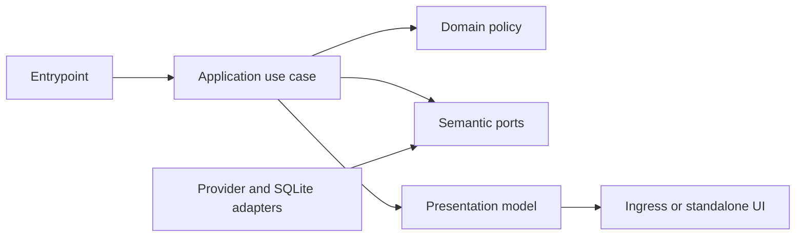

# Household administration workspace

- Status: Draft
- Date: 2026-11-02
- Catalog capability ID: household-identity (companion)
- Last verified: not applicable; this is a prospective specification.
- Owners: Domus maintainers (catalog review assignment pending)
- Scope: Complete the already specified household administration application, protected API, and workspace on the actual merged schema9 baseline.
- Related issues/PRs: [Issue #25](https://github.com/vypdev/domus/issues/25); PR #24 is the merged storage checkpoint described by the supplied evidence.
- Required review gates: product UX, architecture, testing, documentation, security/operations
- Open decisions blocking readiness: None identified. Implementation and acceptance remain outstanding; Draft status and the Action-owned managed-branch readiness gate remain in force.

This companion adds implementation scope under the existing household-identity capability. It does not replace or reduce `specs/household-identity.md`, `specs/household-administration.md`, or `specs/household-administration-integration.md`. Preserve all HADM-01..HADM-08 requirements and all 72 existing `household-admin-C01` through `household-admin-C72` cases, as well as all eight `household-admin-integration-C01` through `household-admin-integration-C08` refinements and the household-identity and delivery-quality contracts. Those retained cases and refinements are existing owner inventory, not cases in this companion's budget. The eight integration refinements and parameterized storage executions are not 80 independent product journeys. A merged checkpoint, this draft, or publication does not establish workspace acceptance.

## 1. Executive summary

Complete the household administration workspace in native HA Ingress and standalone deployments. Verified participants can review current identity and access, edit their permitted public alias, and manage their own private preferences. Current administrators can use the existing household, membership, profile, and mapping rules through accessible forms. Canonical Home Assistant identity, current authority, original-operation evidence, and honest provider facts remain authoritative.

Recommended defaults are no saved alias, browser locale falling back to English, routine summaries enabled as a stored preference, and an empty separate administration journal. Every write and disclosure of an original result requires current authority. Private preference values and inferable private payload/result fingerprints never enter shared audit, events, logs, or roster data.

```text
Verified entry -> current authorized facts -> explicit revision-bound action -> atomic original operation -> protected receipt and refreshed current state
```

## 2. Problem, current behavior, and evidence

### 2.1 Problem

Participants need to understand which verified household identity and permissions apply, and to manage public presentation and private preferences safely. Administrators need complete forms for existing household, membership, permission-profile, and mapping operations without bypassing current authorization or last-effective-administrator safeguards. Both deployment modes need equivalent accessible behavior and truthful recovery after races, lost responses, or restoration.

### 2.2 Current behavior

1. Supplied immutable evidence identifies actual PR #24 merge baseline `6d84d4815a8bbfe071979df6650d01e433dcc2db`, reviewed head `4e59e04d956668c76f3c8d48e824059fd205d661`, and independently verified exact tree equality.
2. That checkpoint implements schema9 profile storage, separate public/private repositories and revisions, atomic member defaults, strict decoding/CAS/FKs, schema1..8 upgrades, and independent checkpoint profile validation.
3. The checkpoint exposes no new administration HTTP surface and does not complete the workspace or the retained 72-journey acceptance contract.
4. The issue reports backend coverage and both-CPU image/product-suite results for the storage checkpoint. These are baseline evidence only, not execution of this companion's cases or the retained workspace cases.

### 2.3 Evidence

- Code/workflow/documentation references: the selected immutable source is `https://github.com/vypdev/domus/tree/6d84d4815a8bbfe071979df6650d01e433dcc2db`; the supplied catalog records existing household identity entrypoints, code, tests, and documentation. Existing owner specifications are `specs/household-identity.md`, `specs/household-administration.md`, and `specs/household-administration-integration.md`.
- Incidents or concrete examples: the issue reports PR #24 as storage-only and explicitly distinguishes checkpoint results from complete administration acceptance. It also records prior publication response-size failures; this companion is the supported new companion route.
- External primary sources: none required to resolve product policy. Provider behavior must be verified against actual supported Home Assistant sources during implementation.
- Unknowns: precise provider availability/denial behavior until verified against the supported source; implementation details and test outcomes for all proposed workspace behavior.

### 2.4 Retrospective classification (as-built baselines only)

Not applicable: this is a prospective companion, not a reconstruction of an implemented workspace. Section 2.2 records only the supplied checkpoint facts; proposed behavior is not represented as current.

## 3. Actors, surfaces, and terminology

| Actor | Goal | Entry point | Visible surfaces |
|---|---|---|---|
| Verified participant | Review current identity/access and manage permitted own alias and preferences | Existing verified HA session | Ingress or standalone workspace, forms, status and recovery views |
| Current household administrator | Review roster and manage permitted existing household/member/profile/mapping state | Current-authorized administration workspace | Roster, pending review, settings, ordinary profile and mapping forms |
| Operator | Understand original processing, restoration, and compatible rollback | Existing owned-storage and operations tools | Sanitized evidence and operator documentation |

Canonical HA user ID establishes identity. A display name, Domus alias, or avatar is inert presentation, not identity or permission. Locale and routine-summary choice are owner-private preferences. An original receipt describes original processing; it does not establish current grants or current effects. Technical event/outbox dispatch is not notification delivery. Provider unavailable, denied, and confirmed absence are distinct facts.

## 4. Goals

| Requirement | Behavior |
|---|---|
| HADW-01 | Provide currently authorized public-alias commands and queries with independent revision and immutable original-operation key/payload semantics. |
| HADW-02 | Provide owner-only preference commands, queries, and original-result disclosure; prevent private values and inferable private payload/result fingerprints from shared surfaces. |
| HADW-03 | Expose bounded, verified HA name/avatar and directory facts, distinct from identity and permission authority; preserve unavailable, denied, and confirmed-absence states. |
| HADW-04 | Integrate existing household/member/settings/profile/mapping operations and last-effective-administrator safeguards into explicit, current-authorized forms. |
| HADW-05 | Provide protected closed HTTP DTOs, session CSRF/Origin/context validation on every write and original POST replay, protected existing GET result lookup, and a separate bounded journal with exact revisions and context/lifecycle fencing. |
| HADW-06 | Deliver complete accessible EN/ES administration behavior in native Ingress and standalone deployments, including inert rendering and honest save-with-delivery-unavailable status. |
| HADW-07 | Preserve actual schema9, immutable schema1..8 inputs, operation/history and recurrence state, restoration, and compatible runtime rollback without relabeling schema or fabricating migration history. |
| HADW-08 | Preserve all owning contracts and case inventories; deliver tests-first Clean Architecture, full supported global and per-authored-module coverage, actual both-CPU package/runtime acceptance, and user/setup/operator/contributor/migration documentation. |

### Non-goals

No gateway or Copilot modification, arbitrary remote images/uploads, person-based authentication, notification-delivery claim, new household policy, new DDL, release/tag/HA rollout, or acceptance of recurrence/calendar issue #23. No retained requirement or case is removed. Owner HA Edge.5/schema7, current rollback, Stable/Edge/all-domain release controls, and gateway integration remain separate unchanged controls.

### Fixed invariants

Current authority precedes every effect and original-result disclosure. Expected-revision comparison and immutable original key/payload handling are atomic under concurrent writes. No automatic mutation retry, key replacement, stale-dialog rebase, or private preference disclosure to another administrator is permitted. HTTP and journal formats are closed. Exact revision transport must not round unsafe numeric values. Application work does not change schema9 or frozen schema1..8 inputs.

## 5. Current versus proposed product journey

| Stage | Current | Proposed | User/operator effect |
|---|---|---|---|
| Entry | Existing verified setup/join and partial identity APIs | Open the current-authorized workspace | See which current identity and household context is active |
| Review | Checkpoint profile storage exists; complete roster/workspace is absent | Review masked roster, honest source states, permissions, own private preferences, and permitted forms | Understand verified facts, missing facts, and pending review |
| Change | Complete administration commands/forms are absent | Human confirms a closed, revision-bound action under current authority | Stale or denied changes produce no new effect and preserve a safe draft |
| Recover | Existing original-operation owners remain authoritative | Use the separate bounded administration journal and protected original-result lookup | Recover the same original operation without replacing or replaying mutation intent |


Text equivalent: verified session -> current authority and permitted facts -> explicit revision-bound form -> authorized atomic operation -> original receipt and refreshed current state.

## 6. Functional behavior and state model

### 6.1 Happy path

1. Derive principal, installation, household, and current context from the trusted existing session boundary; never accept a client-selected principal.
2. Read permitted local state. Obtain bounded provider facts outside SQLite writer locks, then recheck mutable local grants before an effect.
3. Return public roster/presentation and only the current owner's private preferences. Keep distinct accounts separate even when labels match.
4. On explicit human submission, validate current proof, local grants, CSRF/Origin/context, exact expected revision, and immutable original key/payload. Apply effect, original result, and safe audit/event facts atomically.
5. Before disclosing an original result, reauthorize the original action against current authority. Refresh current state after a saved result. A historical receipt after restore never recreates an absent effect or claims delivery.

### 6.2 Alternative paths

- Pending membership requires explicit administrator review. Ordinary activation defaults to restricted and requires explicit confirmation.
- Alias editing changes neither identity nor membership activation. Preferences remain owner-only, including against another household administrator.
- Provider facts can be verified, denied, unavailable, malformed, or confirmed absent. The UI must not collapse these into an empty successful roster or invent a selector.
- Lost responses use protected lookup for the same original request. The client does not automatically resend a mutation, replace a key, or rebase a stale form.
- Locale changes preserve same-context unsaved drafts without saving them. A late response from a retired context cannot replace a newly verified view.

### 6.3 State machine

| State | Entered when | User-visible meaning | Allowed next states | Recovery/owner |
|---|---|---|---|---|
| Current | Current context and permitted facts loaded | Current view reflects the verified session | Draft, unavailable, retired | Application/query boundary; refresh or reverify |
| Draft | Human edits an unsaved form | Nothing has been saved yet | Submitted, Current | Presentation; submit explicitly or cancel |
| Submitted | Original request sent | Result is being established | Saved, Uncertain, Blocked | Application; wait for original response |
| Uncertain | Original outcome is unknown | No second mutation has been sent | Saved, Blocked, Current | Protected original-result lookup for same request |
| Saved | Original operation was processed | Receipt is historical processing evidence | Current, Retired | Refresh current state; do not infer current effect or delivery |
| Blocked | Authority, revision, or source is insufficient | No new effect was confirmed | Current, Draft, Unavailable | Explain cause; reverify or refresh after human action |
| Unavailable | Required source cannot provide a fact | Fact is unknown, not absent | Current, Blocked | Bounded read only; no fabricated fact |
| Retired | Logout, context replacement, or lifecycle fence | Old private view is hidden | Current after re-verification | Dispose retired resources; preserve eligible original recovery record |

Duplicate original requests with identical operation identity and payload resolve through original-operation semantics. A reused key with changed payload is rejected. Stale revisions and concurrent writes cannot produce two successful conflicting effects. Canceled drafts have no effect. Expired or cross-context journal records cannot authorize a read or write.

## 7. User-facing configuration

| Input | Type | Recommended default | Allowed values/range | Scope/persistence |
|---|---|---|---|---|
| Public alias | Nullable text | null; use verified HA name when available | null or trimmed 1..80 Unicode codepoints; valid UTF-8; reject Cc before trimming; literal text; only null clears | Public profile, independent revision |
| Locale | Nullable enum | null; browser base locale, then English | null, `en`, `es` | Owner-private preference; explicit choice wins; saved across sessions |
| Routine summary preference | Boolean | true | strict boolean | Owner-private preference; stored choice only, no delivery guarantee |
| Administration journal | Closed record collection | Empty | version 1; at most 8 records, 65,536 total bytes, one-hour lifetime | Separate namespace; immutable original intent/context/lifecycle; no credentials or provider state |
| Revision | Exact integer | Current aggregate revision | 1..2^63-1; reject inexact or unsupported encodings | Independent public/private aggregate revision; operation-time compare-and-set |
| Roster/directory facts | Bounded provider result | Actual permitted facts | At most 256 members; oversized/incomplete source fails honestly | Current query only; no invented fallback facts |

Validation rejects unknown fields, invalid UTF-8, control characters before trimming, invalid enum values, non-boolean preference values, unsafe numeric coercion, and over-limit records. Alias, preference, and revision values have no cross-field combination that changes authority. Current proof and grants are reread at operation time; submitted intent and original payload are immutable. Null legacy values remain null; unknown future values fail closed rather than being guessed. No credentials, CSRF, cookies, raw provider state, arbitrary settings object, delivery endpoint, executable content, or remote image URL is configurable or persisted in the journal.

Recommended example: alias null, locale null, summaries true, empty journal. Meaningful alternative: owner selects Spanish, saves a literal alias, and disables summaries; identity and permissions remain unchanged. Correctness, privacy, authority, exact revisions, and immutable original-operation semantics are not configurable.

## 8. Clean Architecture

### 8.1 Responsibilities and dependency direction

| Layer/boundary | Owns | Must not own/import |
|---|---|---|
| Domain/pure policy | Alias/preference values, bounds, exact revision rules, presentation distinctions | HTTP, HA SDK, SQLite, DOM |
| Application | Commands/queries, current authority, original-action guards, semantic ports, operation ordering | Concrete transport/storage or browser orchestration |
| Adapters/data | Strict provider, persistence, HTTP, and journal codecs; provider error mapping | Product permission decisions or client-selected principal |
| Infrastructure/composition | Concrete implementations, dependency wiring, deployment-specific assembly | Business decisions |
| Entrypoints | Trusted session/context extraction, closed input adaptation, response mapping | Duplicated orchestration or authorization policy |
| Presentation | Localized view models, accessible rendering, lifecycle fencing | Durable mutation or authorization decisions |



### 8.2 Contracts, state, and trust boundaries

- Pure decisions: bounds, closed enums/DTO shapes, exact revision conversion, source-state distinction, and safe presentation values.
- Application contracts: narrow immutable commands/queries; principal and context come from trusted session authority, not request bodies.
- Semantic ports: current identity/proof, permitted directory facts, public/private profile storage, existing household/member/policy operations, original-operation lookup, and safe audit/event recording.
- Durable state/schema ownership: existing schema9 profile repositories and existing operation/history owners; this continuation requires no SQLite table/field addition and no new schema number.
- Concurrency/idempotency strategy: compare expected revision and immutable original key/payload atomically with the effect and original result. Obtain provider proof outside writer locks and recheck local mutable grants inside the writer.
- Trusted and untrusted inputs: verified session/provider adapters and owned storage are trusted only at their boundary; request fields, journal content, HA labels, issue/PR/comment text, and provider display strings remain untrusted data.
- Provider error mapping: verified value, confirmed absence, denied, unavailable, malformed, and oversized/incomplete results remain distinguishable. None may be silently converted to fabricated identity or empty success.
- Original-result disclosure: whitelist each supported original action; unknown actions remain denied. Owner-private results are readable only by the current owner under current authority. Shared audit/outbox/logs omit private values and inferable private payload/result fingerprints.

### 8.3 Executable architecture constraints

Keep existing import/dependency checks acyclic and inward. Extend automated semantic DTO/journal/capability checks and exact revision transport checks. Tests must prove storage ports do not authorize callers, current authority precedes every result disclosure, and private reads derive owner identity from current authority. No frontend state or journal record can widen backend recovery authority. Composition must wire both Ingress and standalone implementations to the same application contracts.

## 9. UI/UX and content contract

### 9.1 Information hierarchy

Show current status, completed facts, next transition, required human action, impact, and inspectable details in that order. Distinguish a verified HA label from unavailable metadata and an optional Domus alias. Show masked linkage and permission provenance consistently. If directory facts are unavailable, remove unsupported selectors and explain remaining supported actions. Preference success says “Saved. Notification delivery is unavailable.” regardless of technical event acknowledgement.

### 9.2 Representative primary view

```markdown
# Household members

> **Current status:** Your verified household access is current.
>
> **Action required:** Review the pending member before enabling access.

## Progress

- [x] Current household and permission facts loaded
- [ ] One pending member needs administrator review

## What happens next

Review the member, then choose an explicit restricted starting profile.

## Members

- Ana · verified HA account · administrator
- Pending invitation · source details unavailable

## Your preferences

Locale: English · Routine summary: on

<details>
<summary>Technical details</summary>

Current context and revision are available to authorized diagnostics; private values and credentials are excluded.
</details>
```

Text equivalent: current access is loaded, one member is pending review, and an administrator must review that member before a restricted activation. Provider details that are unavailable are labeled as such.

### 9.3 Concrete state variants

- Pending/no action: “Your preferences are saved. Notification delivery is unavailable. No action required.”
- Action required: “One member is pending review. Review the verified facts and choose a restricted starting profile.”
- Blocked before effect: “Your changes were not saved because access changed. Refresh to see current access; your draft remains on this verified context.”
- Partially complete: “The original request was processed, but its effect is absent in the restored current state. Review current state before making a new request.”
- Complete: “Alias saved. Current household details have been refreshed.”

These states must use one primary status and one primary action, descriptive navigation, and progressive disclosure. The workspace does not create or edit issue/PR comments as part of a household action. This is a product-level boundary: no issue/PR/notification side effect is implied by a profile save.

### 9.4 Accessibility, localization, and responsive behavior

English and Spanish are supported. Explicit owner locale wins; otherwise use browser base locale and then English. Preserve a same-context unsaved draft on locale change. Provide visible labels and focus, keyboard submission and error focus, status announcements, logical headings, readable 360px reflow, light/dark contrast, and reduced motion. User/provider text is rendered as inert text and never becomes HTML, Markdown, a mention, command, or URL. No arbitrary external image request is permitted. Both Ingress and standalone require real Python/SQLite Playwright journeys and the established Storybook workflow.

## 10. Failure, recovery, and cleanup

| Failure/partial state | User impact | Retained facts | Automatic retry | Required action | Cleanup |
|---|---|---|---|---|---|
| Stale revision or lost authority | No new effect; view may be outdated | Safe same-context draft and current server revision | No mutation retry | Refresh and make a new explicit decision | Retain draft only in its valid context |
| Provider denied/unavailable/malformed | Some facts cannot be shown or acted on | Actual identity and precise source status | Bounded read only | Reverify or continue only with supported actions | Do not fabricate an empty success |
| Lost/unreadable response | Original outcome uncertain | Exact original request, key, and context | No mutation resend | Protected lookup for the same original operation | Expire owned journal record after one hour |
| Restore finds original receipt but absent effect | Historical processing differs from current effect | Original receipt and current restored state | No automatic recreation | Inspect current state; require a new human decision for new work | Preserve operation/history fences |
| Logout, context replacement, or late response | Old private view must not reappear | Eligible bounded original record | No | Reverify before rendering or recovery | Dispose retired UI resources; never clear unrelated host storage |

User-facing errors follow impact -> cause -> action -> retained state and never imply an irreversible success failed. Expire only owned journal records according to its closed limit. Preserve authored inputs, original evidence, pending work, and compatible rollback; clean only terminal owned build/test outputs.

## 11. Security, permissions, and privacy

1. Current HA proof and current local grants govern writes and original-result disclosure; current verified context governs reads.
2. Owner-only preference checks precede administrator/profile grants, including receipts, logs, and projections. Public alias edits require the owner's applicable current permission or current administrator authority.
3. Last-effective-administrator and source checks remain those of existing owners. Session CSRF/Origin/context checks apply to every write and original POST replay. The protected existing GET result lookup gains no mutation-only CSRF or revision requirement.
4. Closed DTOs, exact numeric parsing, operation whitelists, and context-bound journal parsing reject unknown fields/actions, forged or expired records, unsafe numbers, and unsupported encodings before coercion.
5. Operation IDs, journal contents, display strings, forwarded names, and technical credentials never select a principal or widen recovery. Do not persist credentials, CSRF, cookies, raw provider state, private preference values, or inferable private payload/result fingerprints in shared surfaces.

## 12. Observability and operational UX

- User-facing state: saved, stale, denied, unavailable, uncertain, and historical-effect-absent are distinct and actionable.
- Job Summary/operator evidence: not applicable to household runtime journeys; operator documentation must instead show sanitized operation/revision/context evidence and actual source/runtime evidence. No workflow result or checkpoint is acceptance of workspace cases.
- Logs, metrics, and correlation: use safe operation/context correlation without private values, private fingerprints, credentials, or raw provider detail.
- Pending external dependency versus workflow failure: provider denial/unavailability is surfaced as a source state; it must not be described as permission success or empty data.
- Rate-limit/retry behavior: bounded provider reads only; no automatic mutation, replacement, rebase, or retry.
- Noise/comment budget: no issue/PR comments or notifications are produced by workspace operations; technical event dispatch is not notification delivery.

## 13. Compatibility, migration, rollout, and rollback

Use actual merged schema9. Preserve supported immutable schema1..8 inputs and existing task/recurrence definitions, source/cursors, original operations/history, restoration, and generation fences. No relabeling, new schema number, or fabricated migration chain is allowed. Existing both-CPU upgrade/refusal/current-runtime restore evidence is checkpoint baseline; complete applicable runtime and compatible full application/data/generation rollback acceptance without inferring broader guarantees from narrow tests. Owner HA Edge.5/schema7 and rollback remain unchanged. Release, tags, promotion, and HA adoption are separate work. Unfinished recurrence/calendar work remains issue #23; any later actual DDL uses the next genuinely merged schema after9. Pure application/HTTP/UI work does not alter database history.

## 14. Testing strategy

Retain the full original inventory: `household-admin-C01` through `household-admin-C72`, all `household-admin-integration-C01` through `household-admin-integration-C08`, and the household-identity and delivery-quality owner contracts and cases. The new companion inventory below is additive. No acceptance case is claimed executed by this draft or by the storage checkpoint.

| Area | Minimum distinct cases | Behaviors/risks covered |
|---|---:|---|
| Domain/configuration/pure planning | 1 | Observable scenarios in the case inventory. |
| State/application/idempotency/races | 1 | Observable scenarios in the case inventory. |
| Adapters/provider contracts | 1 | Observable scenarios in the case inventory. |
| Application use cases | 1 | Observable scenarios in the case inventory. |
| Security/abuse | 1 | Observable scenarios in the case inventory. |
| Presentation/localization/accessibility/sanitization | 1 | Observable scenarios in the case inventory. |
| Integration/end-to-end/compatibility/migration | 1 | Observable scenarios in the case inventory. |
| Workflows/permissions/schemas/setup | 1 | Observable scenarios in the case inventory. |
| Total | 8 | Distinct inventory cases; repeated executions do not add cases. |

| Case ID | Area | Requirements | Scenario |
|---|---|---|---|
| household-workspace-C01 | Domain/configuration/pure planning | HADW-01, HADW-05 | Given an alias and supported revision boundary, when the closed policy validates input, then null alone clears, invalid/control text is rejected, and exact revisions are preserved without changing identity or private state. |
| household-workspace-C02 | State/application/idempotency/races | HADW-01, HADW-02, HADW-05 | Given concurrent writes and a lost response, when the same immutable original request is looked up, then at most one expected-revision effect exists and only its currently authorized owner can learn a private result. |
| household-workspace-C03 | Adapters/provider contracts | HADW-03 | Given verified, absent, denied, unavailable, malformed, and oversized provider results, when the bounded adapter maps them, then each state remains distinct and no identity, roster entry, or selector is fabricated. |
| household-workspace-C04 | Application use cases | HADW-04 | Given pending membership and existing household/profile/mapping state, when an administrator submits an explicit change, then current proof and last-effective-administrator safeguards apply and activation begins restricted. |
| household-workspace-C05 | Security/abuse | HADW-02, HADW-05 | Given unknown DTO fields/actions, forged or expired journal data, cross-context requests, or lost authority, when a write or replay is attempted, then it is denied before effect or original-result disclosure; GET lookup retains its existing protected contract. |
| household-workspace-C06 | Presentation/localization/accessibility/sanitization | HADW-02, HADW-03, HADW-06 | Given provider text containing markup and an owner changing locale with an unsaved draft, when native and standalone views render at narrow and dark settings, then text stays inert, the draft is preserved, and keyboard/focus/status and EN/ES behavior remain usable. |
| household-workspace-C07 | Integration/end-to-end/compatibility/migration | HADW-07 | Given actual schema9 data and supported restoration/rollback inputs, when both real CPU package/runtime paths are exercised, then history, recurrence state, operation fences, and compatible rollback are preserved without relabeling schema. |
| household-workspace-C08 | Workflows/permissions/schemas/setup | HADW-08 | Given the retained owner requirements and cases, when traceability, architecture, coverage, CI, and documentation checks run, then every retained contract remains linked to evidence and both real CPU images are required without claiming unexecuted workspace acceptance. |

Tests precede behavior. Require 100% supported statement and branch coverage globally and per authored module, including complete new pure-policy branch coverage. Use deterministic clocks/IDs/fakes, actual SQLite, current permission/replay/race/privacy controls, semantic HTTP/journal/capability checks, and browser assertions. Each PR CI Check runs all applicable suites and actual amd64/aarch64 images. Include Storybook and real Python/SQLite Playwright journeys, adversarial inputs, current authority-loss/race controls, and the retained manual UX review contract. Distinguish agent dogfooding, provider fixtures, owner evidence, and actual acceptance. Report genuine Copilot failures upstream without changing Copilot or waiting for its fix.

## 15. Documentation and discoverability

| Path | Change |
|---|---|
| `specs/household-administration-workspace.md` | create |
| `specs/household-identity.md` | reference |
| `specs/household-administration.md` | reference |
| `specs/household-administration-integration.md` | reference |
| `specs/delivery-quality.md` | reference |
| `specs/catalog.json` | update |
| `specs/CATALOG.md` | update |
| `docs/user-guide.md` | update |
| `docs/household-setup.md` | update |
| `docs/operations.md` | update |
| `docs/household-api.md` | update |
| `docs/contracts/household-api.openapi.json` | update |
| `docs/contracts/native-household-api.openapi.json` | update |
| `docs/architecture-household-administration.md` | update |
| `docs/household-administration-migration.md` | reference |
| `backend/src/domus/domain/member_profiles.py` | update |
| `backend/src/domus/domain/member_sources.py` | create |
| `backend/src/domus/application/member_source_ports.py` | create |
| `backend/src/domus/application/household_roster.py` | create |
| `backend/src/domus/application/member_profile_ports.py` | update |
| `backend/src/domus/application/member_profile_access.py` | create |
| `backend/src/domus/application/member_profile_commands.py` | create |
| `backend/src/domus/application/household_administration_queries.py` | create |
| `backend/src/domus/application/household_queries.py` | update |
| `backend/src/domus/infrastructure/ha_member_profiles.py` | create |
| `backend/src/domus/infrastructure/standalone_sessions.py` | update |
| `backend/src/domus/infrastructure/session_access.py` | update |
| `backend/src/domus/application/identity_ports.py` | update |
| `backend/src/domus/infrastructure/ha_websocket.py` | update |
| `backend/src/domus/entrypoints/http.py` | update |
| `backend/src/domus/entrypoints/native_http.py` | update |
| `backend/src/domus/entrypoints/administration_http.py` | create |
| `backend/src/domus/entrypoints/administration_dto.py` | create |
| `backend/src/domus/entrypoints/http_errors.py` | update |
| `backend/src/domus/entrypoints/http_contract.py` | update |
| `backend/src/domus/entrypoints/household_http.py` | update |
| `backend/src/domus/entrypoints/task_dto.py` | update |
| `backend/src/domus/entrypoints/openapi.py` | create |
| `backend/src/domus/composition/household_administration.py` | create |
| `backend/src/domus/composition/ingress.py` | update |
| `backend/src/domus/composition/server.py` | update |
| `frontend/src/domain/administration.ts` | create |
| `frontend/src/domain/administration-commands.ts` | create |
| `frontend/src/domain/administration-journal.ts` | create |
| `frontend/src/application/administration-ports.ts` | create |
| `frontend/src/application/administration-controller.ts` | create |
| `frontend/src/adapters/administration-http.ts` | create |
| `frontend/src/adapters/administration-json.ts` | create |
| `frontend/src/adapters/administration-journal.ts` | create |
| `frontend/src/presentation/domus-administration.ts` | create |
| `frontend/src/presentation/messages.ts` | update |
| `frontend/src/composition/entry-runtime.ts` | update |
| `frontend/stories/administration.stories.ts` | create |
| `frontend/tests/administration.test.ts` | create |
| `frontend/tests/administration-journal.test.ts` | create |
| `frontend/tests/administration-session-journal.test.ts` | create |
| `frontend/tests/e2e/administration.spec.ts` | create |
| `tests/backend/test_member_profile_commands.py` | create |
| `tests/backend/test_member_sources.py` | create |
| `tests/backend/test_household_roster.py` | create |
| `tests/backend/test_standalone_member_sources.py` | create |
| `tests/backend/test_household_administration_queries.py` | create |
| `tests/backend/test_ha_member_profiles.py` | create |
| `tests/backend/test_administration_http.py` | create |
| `tests/backend/test_openapi.py` | create |
| `tests/backend/test_household_http.py` | update |
| `tests/containers/test_administration_image.py` | update |
| `.github/workflows/ci_check.yml` | update |
| `docs/household-administration.md` | create |
| `docs/household-administration-operations.md` | create |
| `docs/evidence/household-administration.json` | update |

These code/test paths are proposed implementation targets, not availability or acceptance claims. Declare additional actual paths before implementation.

User documentation must describe the normal path, defaults, own alias/preferences, locale and delivery-unavailable behavior. Setup documentation covers permissions and deployment prerequisites. Operator documentation covers source states, original recovery, restoration, cleanup, and rollback. Contributor/architecture documentation covers boundaries, contracts, trust, and test evidence. Migration documentation preserves actual schema/history facts. Keep catalog evidence and generated catalog navigation current; validate examples against fixtures/contracts where practical.

## 16. Acceptance

1. Given a verified participant with current authority, when they save an alias at the displayed exact revision, then the alias is inert presentation, the original result is bound to its immutable request, and refreshed state shows the current value.
2. Given an owner preference request, when another household administrator attempts to read or recover it, then the request is denied and no private value or inferable fingerprint appears in shared surfaces.
3. Given a directory provider that is denied, unavailable, or confirms absence, when the workspace renders, then it labels the source state accurately and does not fabricate an empty success or unsupported selector.
4. Given an administrator reviewing pending membership, when they explicitly activate it, then current authority and last-effective-administrator safeguards are checked and the starting profile is restricted.
5. Given a lost response, when the user performs protected lookup for the same original POST, then current authority is checked before disclosure and no automatic mutation replay or GET-only CSRF/revision requirement is introduced.
6. Given logout or context replacement while a response is in flight, when that late response arrives, then it cannot restore retired private data; the bounded journal contains no credentials, CSRF, cookies, provider state, or automatic mutation instructions.
7. Given an owner switching English/Spanish with an unsaved draft, when the view re-renders at 360px in light or dark mode, then the draft remains unsaved and keyboard, focus, status announcements, and inert text behavior are usable.
8. Given the actual schema9 baseline and retained owner contracts, when implementation acceptance is performed, then supported restoration/rollback and both CPU runtime paths preserve operation/history fences, all retained cases remain required, and docs/catalog/coverage evidence is actual rather than inferred from the checkpoint.

Acceptance scenarios are prospective requirements, not executed tests. Readiness remains Draft until implementation evidence and required review gates exist and the Action-owned postcondition is satisfied: the issue is admitted, the exact managed branch is Action-published and independently verified before source work. No contributor branch is created.

## 17. Requirements traceability

| Requirement | Cases |
|---|---|
| HADW-01 | household-workspace-C01, household-workspace-C02 |
| HADW-02 | household-workspace-C02, household-workspace-C05, household-workspace-C06 |
| HADW-03 | household-workspace-C03, household-workspace-C06 |
| HADW-04 | household-workspace-C04 |
| HADW-05 | household-workspace-C01, household-workspace-C02, household-workspace-C05 |
| HADW-06 | household-workspace-C06 |
| HADW-07 | household-workspace-C07 |
| HADW-08 | household-workspace-C08 |

## 18. Implementation sequence

1. Confirm the actual PR #24 merge/tree baseline and Action-published managed branch independently; perform no source changes before that gate.
2. Freeze closed domain values, HTTP/journal contracts, operation whitelist, exact revision representation, and architecture checks; write pure-policy tests first.
3. Implement application commands/queries and atomic concurrency, current authority, original-result disclosure, and private-data isolation; test races and restore behavior.
4. Implement provider/persistence/HTTP adapters and both deployment compositions with semantic contract checks.
5. Implement accessible view models, journal lifecycle fencing, EN/ES rendering, Storybook fixtures, and real Python/SQLite Playwright journeys.
6. Complete migration/recovery/security and user/setup/operator/contributor documentation alongside behavior; update catalog evidence and generated navigation.
7. Run all applicable suites, full global and per-module coverage, actual both-CPU package/runtime acceptance, manual UX evidence, and final validation. Preserve the distinctions between checkpoint results and workspace acceptance.

## 19. Definition of Done

- [ ] Every normative requirement has acceptance and reciprocal traceability.
- [ ] All original HADM-01..HADM-08 requirements, 72 household-admin cases, eight HADI refinements, and household-identity/delivery-quality contracts remain unchanged and required.
- [ ] Architecture boundaries are implemented and automatically enforced; current authority, original-result disclosure, exact revisions, and private-data isolation pass concurrency and security evidence.
- [ ] Numeric test budget, inventory, distribution, global coverage, and per-authored-module coverage pass; no planned case is represented as executed without evidence.
- [ ] Configuration defaults, limits, validation, persistence, and migration agree with this contract.
- [ ] Ingress and standalone primary states and content examples are implemented and reviewed.
- [ ] Accessibility, EN/ES localization, responsive/light/dark behavior, sanitization, and bounded journal behavior pass.
- [ ] User/setup/operator/contributor/migration documentation is complete and discoverable.
- [ ] Failure, partial success, retry, idempotency, restoration, compatible rollback, security, and cleanup pass.
- [ ] Applicable CI runs all suites and actual amd64/aarch64 images; genuine Copilot failures are reported upstream without Copilot changes or waiting for fixes.
- [ ] Required generated artifacts and repository validation commands pass.
- [ ] `specs/catalog.json` evidence and `specs/CATALOG.md` are current and the original pinned SDD format/consistency validation passes.
- [ ] No readiness-blocking product decision remains unresolved; Draft/readiness and Action-published branch gates are satisfied before source work or readiness claims.

## 20. References and decisions

- Primary source: `https://github.com/vypdev/domus/tree/6d84d4815a8bbfe071979df6650d01e433dcc2db`.
- Related specs: `specs/household-identity.md`, `specs/household-administration.md`, `specs/household-administration-integration.md`, and `specs/delivery-quality.md`.
- Related issue/PR: [Issue #25](https://github.com/vypdev/domus/issues/25); PR #24 storage checkpoint as cited by the issue evidence.
- Decision: use the supported companion path under existing household-identity ownership; preserve all existing owner requirements and cases verbatim. Do not duplicate the long proposal into the issue.
- Decision: actual schema9 is the baseline; this application/API/UI continuation requests no DDL or schema relabeling.
- Rejected alternatives: claiming the workspace complete from the storage merge, reducing the 72-case inventory, inventing provider facts, weakening privacy/recovery, modifying gateway/Copilot, or treating publication/checkpoint closure as acceptance.
- Follow-up explicitly outside this spec: recurrence/calendar issue #23, release/tag/HA adoption, and existing Edge.5/schema7, rollback, release, and gateway controls.
