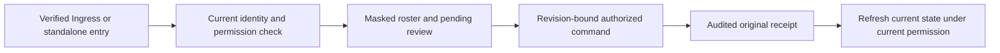
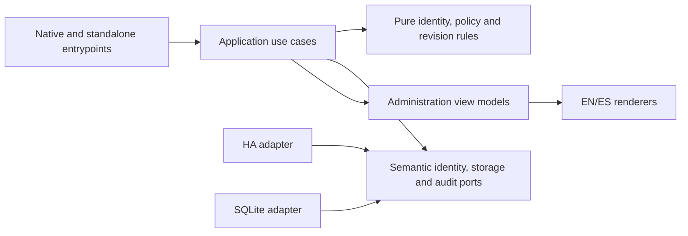

# Household administration workspace

- Status: Draft
- Date: 2026-11-01
- Catalog capability ID: household-identity (companion)
- Last verified: 2026-10-31 for the owning capability; proposed companion, not applicable
- Owners: Domus maintainers (review assignment pending)
- Scope: Add an English/Spanish household administration workspace to native Ingress and standalone deployments, extending household identity without changing the first all-domain release scope.
- Related issues/PRs: [Issue #16](https://github.com/vypdev/domus/issues/16); dependency [PR #15](https://github.com/vypdev/domus/pull/15)
- Required review gates: product UX, architecture, testing, documentation, security/operations
- Open decisions blocking readiness: None. All eight companion contracts are resolved by owner answers; the capability remains Draft until review and implementation evidence exist.

> Draft for review. This companion does not replace or rewrite `specs/household-identity.md`. No behavior in this proposal is implemented or tested by virtue of being specified.

## 1. Executive summary

A household participant can understand their verified identity, access, and private preferences; an authorized administrator can review pending participants and manage household settings, profiles, and permission mappings from the application. The same product behavior is available in native Ingress and standalone deployments. The Home Assistant display name is the default household label, with an optional inert Domus alias. Distinct verified Home Assistant account IDs remain canonical even when names collide.

Every mutation and recovery disclosure uses current human proof, current permission, expected aggregate revision, session CSRF, Origin/context binding, and a persisted original idempotency key and payload. Existing explicit mappings, source checks, inherited-grant provenance, and last-effective-administrator safeguards remain authoritative. No stale dialog, retry, key replacement, rebase, self-activation, or automatic mutation may bypass them.

```text
Verified entry -> current household roster -> inspect access -> authorized, revision-bound change -> audited result
```

## 2. Problem, current behavior, and evidence

### 2.1 Problem

A participant cannot currently administer a household through the application. Administrators must use the API to activate or manage a person. The member model and HTTP responses also lack the complete display-name, avatar, and own-preference presentation surface. This makes household setup incomplete and leaves later domain screens without a consistent identity and access workspace.

### 2.2 Current behavior

1. PR #15 delivered entry, setup, and join behavior and is closed/merged.
2. The verified development base is commit `63d1159f83f51ae0cd3c41f32341d9e9e36bb6da`, tree `f1e3aa8f9e8408076ca6c9740ace5391f8ac8c2b`; the merge tree was compared byte-for-byte with reviewed head `3da78a7` and is identical.
3. Catalogued backend commands and safeguards cover household, membership, policy, session, recovery, and restoration behavior. The present UI does not provide the proposed administration workspace.
4. Proposed behavior in this document is not evidence of implementation, browser execution support, or test completion.

### 2.3 Evidence

- Code/workflow/documentation references: owning catalog capability `household-identity`; `backend/src/domus/application/member_commands.py`, `policy_commands.py`, `household_commands.py`, and `household_queries.py`; HTTP and composition paths listed in the catalog; `docs/household-api.md`, `docs/contracts/household-api.openapi.json`, `docs/identity-household.md`, and `docs/architecture-identity-storage.md`.
- Incidents or concrete examples: administrators currently need API calls to activate/manage a joined person; member responses do not yet provide the complete presentation/preferences surface.
- External primary sources: Home Assistant identity and directory behavior must be established from the deployment's verified provider interfaces; this spec does not assume directory fields are always available.
- Unknowns: No unresolved product contract. Actual framework/browser support and implementation behavior must be demonstrated during implementation and review.

### 2.4 Retrospective classification (as-built baselines only)

Not applicable: this is a prospective companion and reconstructs no implemented baseline.

## 3. Actors, surfaces, and terminology

| Actor | Goal | Entry point | Visible surfaces |
|---|---|---|---|
| Household participant | Understand own identity, access, and preferences | Verified application session | Roster row, own profile and preferences |
| Household administrator | Review members and configure household access | Verified session with current administrator authority | Pending review, roster, household settings, profiles, mapping |
| Setup administrator | Preserve the explicitly proven setup mapping | Existing setup and administration context | Mapping summary and guarded configuration |
| Operator | Recover and restore owned data safely | Existing privileged recovery path | Recovery/restore status and sanitized diagnostics |

A **canonical identity** is the verified Home Assistant account ID associated with a person. A **presentation label** is inert display data; it never selects an actor or grants authority. A **member** is a household record whose role and status are independent of presentation. **Current source** means the presently verified HA authority used by existing mapping and source-revocation rules. **Original receipt** is the immutable result of one persisted command; it is distinct from whether that command's effects currently exist.

## 4. Goals

### 4.1 Goals

| Requirement | Behavior |
|---|---|
| HADM-01 | Present verified HA name/avatar metadata when available, an honest unavailable representation otherwise, and an optional inert alias; canonical HA IDs never merge on label collision. |
| HADM-02 | Provide a permission-aware roster and pending membership review with existing field masking, bounded verified-directory results, and no fabricated selector facts. |
| HADM-03 | Let authorized administrators edit household name/timezone, member role/status/ordinary exceptions, profiles, and explicit HA administrator mappings while preserving all current authority and last-administrator safeguards. |
| HADM-04 | Let each participant read/write only their own locale and notification preference; do not reveal another member's private preference or claim delivery. |
| HADM-05 | Give administration commands a closed, bounded, separate original-request recovery journal with current authorization checks before disclosure or replay. |
| HADM-06 | Define schema 9 persistence and safe restore/replay compatibility from the verified base, preserving authoritative history and current-effect state. |
| HADM-07 | Deliver accessible, responsive EN/ES administration UX in native Ingress and standalone deployments. |
| HADM-08 | Preserve Clean Architecture, enforce full supported first-party coverage globally and per module from the first change, and ship truthful documentation and CI evidence. |

### 4.2 Non-goals

1. Replacing the owning identity or delivery specifications, their case IDs, budgets, or application-experience obligations.
2. Adding authentication by person entity, alias, name, avatar, or arbitrary external image URL; uploads are excluded.
3. Implementing notification delivery, claiming delivery success, or reducing the full first-release notification requirement.
4. Introducing automatic mutations, retries, self-activation, administrator removal that violates safeguards, or a new authority model.
5. Changing Copilot resources, credentials, gateway, Action-owned branch lifecycle, or the first all-domain release scope.

### 4.3 Fixed product/safety invariants

1. Verified HA identity and existing explicit administrator mappings remain the authority. Display data never authenticates, merges, selects an actor, or grants permission.
2. Each mutation uses current proof and permission, expected revision, CSRF, Origin/context binding, and its original persisted key/payload. Permission loss blocks stale-dialog actions and original-result disclosure.
3. Existing protected permissions, role/domain constraints, current HA source checks, inherited-grant provenance, last-effective-administrator protection, and privileged console recovery are fixed.
4. No automatic retry, rebase, key replacement, self-activation, or mutation from a stale result is permitted.

## 5. Current versus proposed product journey

| Stage | Current | Proposed | User/operator effect |
|---|---|---|---|
| Entry | Verified entry/setup/join exists | Both deployment modes route to administration workspace after verified entry | Consistent starting point |
| Review | Administrator may need API | Pending membership is visible with a review action when currently authorized | Clear next action; no automatic activation |
| Manage | Backend commands and safeguards exist | Revision-bound household, member, profile, and mapping forms | Understandable controlled edits |
| Preferences | Complete member surface is absent | Private own preferences and explicit unavailable delivery status | Participant controls own settings without false delivery claim |
| Recovery | Existing entry journal is bounded and closed | Separate administration journal and restoration contract | Entry schema stays unchanged; original result can be recovered safely |



Text equivalent: verified entry -> current identity/permission check -> masked roster/review -> revision-bound command -> audited receipt -> current-state refresh.

## 6. Functional behavior and state model

### 6.1 Happy path

1. The application establishes the current verified participant and deployment context.
2. It loads the roster and household view through existing query policy; unavailable directory facts are represented as unavailable, not as empty facts.
3. An administrator reviews a pending membership and explicitly activates it as restricted by default, or selects another allowed, explicitly displayed role where policy permits.
4. An authorized user edits permitted fields. The UI shows the aggregate revision and submits a closed command with a new persisted idempotency key and immutable payload.
5. The server checks current proof, permission, CSRF, Origin/context, source authority, and expected revision atomically; it records audit and original receipt.
6. The UI reports the receipt and reloads current state. It does not infer current membership from historical receipt success.

### 6.2 Alternative paths

- A participant or current administrator may edit a member's optional alias. Locale and notification preferences remain owner-only.
- Clearing the alias restores HA display-name presentation. If verified name/avatar metadata is unavailable, the UI says so and uses a neutral fallback.
- The mapping modes remain `all_ha_administrators` (no target), `setup_administrator` (original proven setup administrator), and `selected_ha_user` (exact active eligible HA account). No fake directory selector is shown if verified directory data cannot be supplied.
- A stale revision, lost authority, changed HA source, invalid value, or failed proof blocks the command and requires a fresh view and human decision; it never silently rebases.

### 6.3 State machine

| State | Entered when | User-visible meaning | Allowed next states | Recovery/owner |
|---|---|---|---|---|
| Pending membership | Join request recorded | Waiting for explicit administrator review | Active, rejected/unchanged per existing command contract | Current administrator |
| Active | Authorized activation succeeds | Access follows displayed role and permissions | Updated, suspended, archived | Current administrator |
| Suspended | Authorized suspension succeeds | Membership remains recorded but access is disabled | Active or archived if policy permits | Current administrator |
| Archived | Authorized archive succeeds | Historical record retained; no active access | Existing policy-defined transitions only | Current administrator/operator |
| Command uncertain | Response is lost after submission | Original result not yet known | Recovered original result or safely failed before effect | Same authorized actor, original key only |

Duplicate submissions resolve only against the original key/payload. A changed payload requires a new human action after refresh. Cancellation before submission discards the draft. Cancellation after submission cannot erase or negate a committed effect. Historical receipts and absent/current effects are reported separately.

## 7. User-facing configuration

| Input | Type | Recommended default | Allowed values/range | Scope/persistence |
|---|---|---|---|---|
| Household name | Unicode text | Existing value | 1–160 characters; trimmed, nonblank; existing backend validation | Household aggregate, revisioned/audited |
| `time_zone` | IANA zone text | Existing value | 1–128 characters and member of actual IANA catalog | Household aggregate, revisioned/audited |
| Member role | Enum | `restricted` on ordinary activation | `administrator`, `adult`, `restricted`, `viewer`, subject to existing constraints | Member aggregate, revisioned/audited |
| Member status | Enum | Existing status; activation is explicit | `pending`, `active`, `suspended`, `archived` | Member aggregate, revisioned/audited |
| Ordinary permission exceptions | Unique permission/strict boolean decisions | No change unless explicitly submitted | At most 256 entries; supported ordinary permissions only; no protected permission | Member aggregate, revisioned/audited |
| Household profile adjustment | Unique role/ordinary permission/boolean decisions | Existing profile | At most 256 entries; existing protected permission and role/domain constraints apply | Household policy aggregate, revisioned/audited |
| Administrator mapping mode | Enum | Existing explicit mode | `all_ha_administrators`, `setup_administrator`, `selected_ha_user`; mode-specific target rules above | Policy aggregate, revisioned/audited |
| Alias | Nullable Unicode text | Null: HA display name | Null or trimmed 1–80 Unicode characters; valid UTF-8; no Unicode Cc/control characters | Public within household; revisioned/audited |
| Locale | Nullable enum | Null follows browser base language; English fallback | Null, `en`, `es`; explicit choice overrides browser | Private member preference, owner-only |
| `routine_participation_summaries` | Strict boolean | `true` engineering default | `true` or `false` only | Private member preference, owner-only |
| Verified directory/roster | Bounded result | No synthetic entries | At most 256; only facts actually supplied by verified source | Read-only query, current context |
| Administration journal | Closed local browser record | Empty | 8 records, 65,536 bytes total, one-hour retention; namespace/version 1 | Separate from entry journal; no credentials or CSRF |

Validation rejects duplicate decisions, unsupported/protected permissions, invalid roles, malformed aliases, unknown timezones, incomplete mapping targets, and invalid cross-field combinations. Authorization and source checks are reread at operation and recovery time; the expected aggregate revision is an integer from 1 through 2^63−1. No arbitrary settings map, delivery channel, recipient, endpoint, credential, or external image URL is configurable. New presentation data is nullable in legacy rows; missing HA metadata is never invented.

Recommended configuration is null alias, browser-following locale, and the specified routine preference default. A meaningful alternative is an explicit `es` locale and a household-visible alias, without altering canonical identity or authority. These defaults are proposal contracts, not evidence of existing stored values.

## 8. Clean Architecture

### 8.1 Responsibilities and dependency direction

| Layer/boundary | Owns | Must not own/import |
|---|---|---|
| Domain/pure policy | Identity distinction, bounded values, permission/profile decisions, revision and transition invariants | HA SDK, HTTP, SQLite, browser, framework |
| Application | Closed commands/queries, current authorization orchestration, semantic ports, original result semantics | Provider DTOs, concrete process/SDK concerns |
| Adapters/data | HA metadata/directory mapping, SQLite persistence, browser journal encoding, HTTP contract translation | Product policy or authority decisions |
| Infrastructure/composition | Existing deployment wiring, schema migration, storage and lifecycle integration | New business decisions or relaxed validation |
| Entrypoints | Native/standalone request and context adaptation; CSRF/Origin boundary | Duplicated command orchestration |
| Presentation | View models, forms, EN/ES strings, accessible status and errors | Mutation policy, authority inferred from labels |



Text equivalent: entrypoints call application use cases; use cases use pure policies and semantic ports; adapters implement ports; presentation renders application view models without owning authorization or mutations.

### 8.2 Contracts, state, and trust boundaries

- Pure decisions: alias validation/presentation fallback, role and exception bounds, mapping cross-field rules, stale revision and transition decisions.
- Application contracts: separate closed administration command union and query DTOs; never widen the setup/enrollment contract.
- Semantic ports: current verified identity/source, policy/member/household repositories, audit/receipt persistence, time/ID source, and bounded verified directory facts.
- Durable state/schema ownership: owning identity model remains authoritative; this companion adds nullable presentation and private preference state in schema 9. Administration browser recovery is namespace/version 1 and separate from the entry journal.
- Concurrency/idempotency: atomic revision check and original key/payload receipt; no key replacement or payload mutation; current permission checked before result disclosure.
- Trusted and untrusted inputs: authenticated context is established by existing verification; all form, URL, browser-storage, Markdown, names, aliases, and provider metadata are untrusted data and inert when rendered.
- Provider error mapping: unavailable/malformed directory metadata becomes an explicit unavailable state; authorization, conflict, validation, and provider outage remain distinguishable without leaking private facts.

### 8.3 Executable architecture constraints

CI MUST enforce import direction and cycle checks using repository-native module layout; domain/application must not import framework, HA, HTTP, or SQLite implementation modules. Contract checks MUST verify closed DTO unions, separate entry and administration journal schemas, schema migration ordering, and prohibited private fields in roster/receipt/audit responses. These checks are proposed gates, not current execution evidence.

## 9. UI/UX and content contract

### 9.1 Information hierarchy

1. Current household/member status.
2. Verified facts and completed changes.
3. Next available transition.
4. One primary human action or explicit “No action required.”
5. Effect and retained receipt/current-state distinction.
6. Links to member, household, and relevant documentation.
7. Collapsed technical revision, operation ID, and sanitized diagnostics.

### 9.2 Representative primary view

```markdown
# Household members

> **Current status:** 1 request is waiting for review.
>
> **Action required:** Review Alex’s request before granting access.

## Members

| Person | Access | Status | Action |
|---|---|---|---|
| Alex (HA name unavailable) | Restricted | Pending | Review request |
| Sam | Adult | Active | Manage access |

## What happens next

Reviewing a request shows the permitted access choices. Nothing changes until you confirm.

[Household settings](#household-settings) · [Privacy and preferences](#your-preferences)
```

Variants:

- **Pending/no action:** “Your membership is waiting for an administrator. No action is required from you.” Show status and household contact route if available.
- **Action required:** “One membership is waiting for review.” Show the specific pending member and one review action; do not imply activation.
- **Blocked before effect:** “Access was not changed. Your administrator permission changed before this save. Refresh the member list and ask a current administrator to review it. No change was recorded.”
- **Partially successful/response lost:** “The request may have completed, but this screen did not receive its result. Check the original request status with the same session. Do not submit a replacement.” Show retained operation reference, not a false failure.
- **Completed:** “Alex’s access is now Restricted.” Link to the refreshed member record and show the audit/revision detail in a collapsed section.

### 9.3 Issue, PR, and comment behavior

- Deterministic title: `Household administration: <specific outcome>`; no generated content from member names in title.
- Merge/close/retry text must explain that issue closure does not activate or mutate a member; only an authorized application action does.
- Durable administration marker and updates must be idempotent. A retry refers to the same original operation; it cannot mint a replacement key.
- Comment/notification budget: zero routine comments or notifications from the application; only existing explicitly configured delivery mechanisms may send messages. No delivery is claimed here.
- Labels/checks are supplemental state, never authority. Provide descriptive links to issue #16, relevant PR/commit/run, user guide, and recovery docs when present; never fabricate a link.

### 9.4 Accessibility, localization, and responsive behavior

Support English and Spanish, using explicit member locale for that member's own view, otherwise browser base language, then English fallback. Roster status and actions have text labels independent of color or icons. Forms have visible labels, keyboard operation, focus recovery after validation, and screen-reader announcements for saved/blocked outcomes. Tables reflow on narrow screens without hiding status/actions. Use logical headings, descriptive links, and light/dark theme contrast. Render aliases and provider strings as inert text; sanitize Markdown/HTML, mentions, commands, markers, and URLs. No user text becomes a link or command. Diagrams have adjacent text equivalents.

## 10. Failure, recovery, and cleanup

| Failure/partial state | User impact | Retained facts | Automatic retry | Required action | Cleanup |
|---|---|---|---|---|---|
| Stale aggregate revision | Save is blocked | Original draft and current revision | No | Refresh, inspect, submit a new human decision | Expire abandoned draft locally |
| Permission/source lost | Save or result disclosure blocked | Original key/payload/receipt remain server-side | No | Reauthenticate or ask current administrator | Journal expires in one hour |
| Response lost after submit | Effect may have committed | Original key, payload, stage, operation/deadline; server receipt/audit | No | Recover original operation with fresh context and same key | Remove expired local record |
| Provider metadata unavailable | Name/avatar cannot be confirmed | Canonical identity remains; metadata state unavailable | Bounded read behavior only | Continue with neutral fallback or retry a read manually | No fabricated cache entry |
| Invalid configuration | No change | Validation error and draft | No | Correct the named field | Discard on cancel/expiry |
| Restore older backup | Later operations may be absent from restored state | Preserved receipt namespace/fingerprint/operation/result/time, paired audit/outbox identity/position/payload/delivery, archived/current-effect markers and processed inbox/closure proof | No replay of absent effects | Operator follows restore runbook and current authorization | Existing owned-storage retention rules |

Errors follow impact -> cause -> action -> retained state and never describe a committed irreversible action as failed. Administration journal stores no CSRF, token, cookie, or raw provider state; it retains at most 8 records/65,536 bytes for one hour with fresh context and monotonic lifecycle.

## 11. Security, permissions, and privacy

1. Every query and command applies current identity and permission. Private locale and notification preference is readable/writable only by its owner, including through receipts, audit UI, events, and roster paths.
2. Every write and original-result recovery is bound to session CSRF, Origin/context, current proof, current permission, expected revision, and the persisted original key/payload. Permission loss blocks stale dialogs and disclosure.
3. Preserve existing explicit mapping modes, current HA source checks, inherited grant provenance, protected permissions, last-effective-administrator protection, and privileged console recovery.
4. Alias/name/avatar are inert presentation only. No arbitrary image URL, upload, person-based identity, synthetic directory selector, or name-based identity merge is allowed.
5. Preference `routine_participation_summaries` is saved as a preference only. The UI explicitly states delivery is unavailable in this increment; future consumers must honor false before delivery is claimed.
6. Audit records mutation facts without private preferences or credentials. Logs and diagnostics use sanitized IDs and correlation references, not tokens, cookies, or raw provider state.

## 12. Observability and operational UX

- User-facing state: current membership and access, pending review, command result, and whether data is unavailable.
- Job Summary/operator evidence: implementation CI reports named checks, coverage, migration/restore scenarios, and browser journey outcomes. A green check means the named check passed, not that all production deployments support a provider fact.
- Logs, metrics, and correlation: operation ID, aggregate revision, outcome category, and sanitized correlation ID; no preference contents or secrets.
- Pending external dependency versus workflow failure: unavailable HA directory/profile data is a product state; a failed required migration or contract check is a workflow failure.
- Rate-limit/retry behavior: no mutation retry. Reads may use existing bounded transport lifecycle; user-triggered refresh is explicit.
- Noise/comment budget: no routine application comments/notifications; existing bounded operational logging only.

## 13. Compatibility, migration, rollout, and rollback

Schema 7 is the verified base at the cited commit. Recurrence issue #17 owns schema 8 first. This companion owns schema 9 from its verified Action-selected merge; implementation must verify the actual selected base and migration chain before admission. Schema 9 adds nullable presentation data and explicit private preferences. Legacy presentation remains absent/unknown, never an invented HA display name. Defaults for private locale/notification values are explicit and do not disclose another member's values.

Preserve supported historical inputs, original fixtures, installation channel, and compatible complete image/database/generation rollback. IDs, HA links, roles/status, mappings/setup provenance, revisions, task/material/recurrence state, receipts/audit/source/history remain authoritative. Restore preserves later receipt namespace/fingerprint/operation/result/time; paired audit/outbox identity/position/payload/delivery; archived/current-effect markers; and processed inbox/slot/cycle-closure proof, without replaying absent effects. Current authorization and original-action scope apply before any disclosure/replay, including private preferences.

Administration journal namespace/version 1 is separate from entry setup/enrollment storage. No migration may widen or alter the entry journal's closed schema. Rollout requires migration and restore compatibility evidence before UI enablement in either deployment mode. Rollback uses compatible complete image/database/generation artifacts; no automatic downgrade may discard authoritative history or replay absent effects.

## 14. Testing strategy and numeric budget

The following is a minimum of 24 distinct proposed executable cases. Existing owning specification cases and budgets remain unchanged; in particular, this companion does not redefine or consume `household-identity-C01` through `household-identity-C30` or delivery cases. All supported first-party coverage must remain 100% globally and per module from the first change. New pure policy branches require 100% branch coverage. These are acceptance requirements, not executed test results.

| Area | Minimum distinct cases | Behaviors/risks covered |
|---|---:|---|
| Domain/configuration/pure planning | 4 | Observable scenarios in the case inventory. |
| State/application/idempotency/races | 6 | Observable scenarios in the case inventory. |
| Application use cases | 3 | Observable scenarios in the case inventory. |
| Adapters/provider contracts | 2 | Observable scenarios in the case inventory. |
| Workflows/permissions/schemas/setup | 3 | Observable scenarios in the case inventory. |
| Presentation/localization/accessibility/sanitization | 3 | Observable scenarios in the case inventory. |
| Integration/end-to-end/compatibility/migration | 2 | Observable scenarios in the case inventory. |
| Security/abuse | 1 | Observable scenarios in the case inventory. |
| Total | 24 | Distinct inventory cases; repeated executions do not add cases. |

| Case ID | Area | Requirements | Scenario |
|---|---|---|---|
| household-admin-C01 | Domain/configuration/pure planning | HADM-01 | Distinct canonical HA IDs with identical labels remain separate; alias cannot alter identity. |
| household-admin-C02 | Domain/configuration/pure planning | HADM-01 | Null alias displays verified HA name; unavailable metadata displays an honest neutral fallback. |
| household-admin-C03 | Domain/configuration/pure planning | HADM-01 | Alias accepts trimmed 1–80 Unicode text and rejects Cc/control, invalid UTF-8, or out-of-bound input. |
| household-admin-C04 | Domain/configuration/pure planning | HADM-03 | Household name, IANA timezone, role, status, and 256-entry ordinary exception boundaries validate; invalid cross-field mapping is rejected. |
| household-admin-C05 | State/application/idempotency/races | HADM-02,HADM-03 | Pending membership is activated only after explicit authorized confirmation and defaults to restricted. |
| household-admin-C06 | State/application/idempotency/races | HADM-03 | Concurrent independent administrators submit the same revision; one wins and the stale command is blocked without rebase. |
| household-admin-C07 | State/application/idempotency/races | HADM-03 | Current HA source revocation blocks a previously valid mapping/member mutation. |
| household-admin-C08 | State/application/idempotency/races | HADM-03 | Denied protected-permission escalation and last-effective-administrator removal leave state unchanged. |
| household-admin-C09 | State/application/idempotency/races | HADM-05 | Lost original response followed by reload recovers only the original receipt using same key/payload and fresh context. |
| household-admin-C10 | State/application/idempotency/races | HADM-05 | Changed payload, replacement key, expired journal, or lost permission cannot replay or disclose original result. |
| household-admin-C11 | Application use cases | HADM-02,HADM-03 | Roster and member commands use current authorization and mask fields consistently across both deployment entrypoints. |
| household-admin-C12 | Application use cases | HADM-04 | Owner can read/write own locale and preference; another member and administrator cannot read them. |
| household-admin-C13 | Application use cases | HADM-04 | Saved notification preference is labeled saved, while UI and API make no delivery-success claim. |
| household-admin-C14 | Adapters/provider contracts | HADM-01,HADM-02 | HA profile/directory adapter distinguishes unavailable metadata from an empty verified result and never fabricates a selector. |
| household-admin-C15 | Adapters/provider contracts | HADM-03,HADM-05 | HTTP DTOs are closed and administration recovery storage cannot decode as entry setup/enrollment journal. |
| household-admin-C16 | Workflows/permissions/schemas/setup | HADM-03,HADM-08 | All three explicit mapping modes enforce target rules and existing role/protected permission constraints. |
| household-admin-C17 | Workflows/permissions/schemas/setup | HADM-06 | Schema 9 migration from the verified schema-8 chain preserves nullable legacy metadata and explicit preference defaults. |
| household-admin-C18 | Workflows/permissions/schemas/setup | HADM-06 | Restore preserves later receipt/audit/outbox/history identity and current-effect markers without replaying absent effects. |
| household-admin-C19 | Presentation/localization/accessibility/sanitization | HADM-07,HADM-01 | Native and standalone roster renders EN and ES with locale fallback and distinct duplicate-name accounts. |
| household-admin-C20 | Presentation/localization/accessibility/sanitization | HADM-07,HADM-04 | Pending, action-required, blocked, uncertain/partial, and completed views expose meaningful status and next action accessibly. |
| household-admin-C21 | Presentation/localization/accessibility/sanitization | HADM-07,HADM-01 | Alias/provider content cannot inject HTML, Markdown links, mentions, commands, markers, or arbitrary URLs. |
| household-admin-C22 | Integration/end-to-end/compatibility/migration | HADM-07,HADM-08 | Actual Python/SQLite browser journey covers pending-to-active and subsequent profile change in native Ingress. |
| household-admin-C23 | Integration/end-to-end/compatibility/migration | HADM-07,HADM-08 | Actual Python/SQLite browser journey covers pending-to-active and subsequent profile change in standalone deployment. |
| household-admin-C24 | Security/abuse | HADM-02,HADM-03,HADM-04,HADM-05 | Forged Origin/CSRF, stale session, unauthorized cross-member preference request, and permission-loss recovery disclosure are rejected. |

The case budget is derived from independent behavior risks; every inventory row is one distinct case and is counted once. CI MUST retain the repository's supported first-party global and per-module 100% coverage from the first change, and new pure policy MUST have 100% branch coverage. Use table-driven boundary tests, deterministic clocks/IDs/fakes, race and replay tests without real waits or live services, adapter contract tests, migration/restore fixtures, and semantic UI assertions alongside golden fixtures. Every PR's required Check MUST run actual Python/SQLite browser journeys in both deployment modes and real EN/ES Storybook coverage. Human UX review must inspect keyboard/focus behavior, narrow layouts, light/dark readability, and truthful unavailable-data language. No cases above are represented as already executed.

## 15. Documentation and discoverability

| Path | Change |
|---|---|
| `specs/household-administration.md` | create |
| `specs/household-identity.md` | reference |
| `specs/catalog.json` | reference |
| `specs/CATALOG.md` | reference |
| `docs/household-api.md` | reference |
| `docs/contracts/household-api.openapi.json` | reference |
| `docs/identity-household.md` | reference |
| `docs/architecture-identity-storage.md` | reference |
| `docs/migrations-identity-storage.md` | reference |
| `docs/operations-identity-storage.md` | reference |
| `docs/user-guide.md` | reference |
| `docs/configuration.md` | reference |
| `docs/household-administration.md` | create |
| `docs/household-administration-operations.md` | create |
| `docs/household-administration-migration.md` | create |
| `docs/architecture-household-administration.md` | create |

| Audience | Artifact/page | Required content | Validation/navigation |
|---|---|---|---|
| User | `docs/household-administration.md` | Review/join journey, roles, alias, privacy, EN/ES preference, no-delivery statement | Browser journey links and content assertions |
| Setup owner | `docs/household-api.md` and `docs/configuration.md` | Mapping modes, bounds, verified directory availability, permissions | OpenAPI/contract fixtures |
| Operator | `docs/household-administration-operations.md` | State meanings, uncertain response recovery, retention, restore and cleanup | Decision-tree scenarios and restore fixture |
| Contributor | `docs/architecture-household-administration.md` | Ports, DTOs, trust boundaries, schema/journal separation, CI checks | Architecture/import checks |
| Upgrade owner | `docs/household-administration-migration.md` | Schema 9 sequencing, legacy unknown values, compatibility and rollback | Migration/restore contract tests |

The paths marked create are proposed new deliverables, not existing files. Documentation must lead with the normal journey, include a compact flow and text equivalent, and synchronize examples with contract fixtures. The companion and catalog references identify current owning sources; catalog metadata and generated view are updated only with implementation evidence.

## 16. Acceptance

1. Given two verified HA accounts with the same display name, when the roster renders, then both remain distinct canonical members and neither label changes identity or authority.
2. Given a pending membership and current administrator authority, when the administrator explicitly activates it, then the selected allowed role is recorded, restricted is the ordinary default, and the revision/audit receipt is visible.
3. Given a stale revision or concurrent independent edit, when the second command arrives, then it is rejected without rebase, retry, or silent overwrite.
4. Given source revocation, protected permission escalation, or removal of the last effective administrator, when a mutation is attempted, then state remains unchanged and the UI explains the cause and next action.
5. Given a lost response after submission, when the same authorized actor reloads, then only the original persisted key/payload can recover its receipt; current authorization is checked before disclosure.
6. Given an administrator viewing another member, when they open roster, receipt, audit, or events, then that member's locale and notification preference remain inaccessible.
7. Given a saved routine-summary preference while no consumer exists, when the participant views the result, then the interface says the preference is saved and delivery is unavailable, never sent.
8. Given missing HA profile/directory data, when the roster or mapping view renders, then it says unavailable and does not fabricate an empty fact or selector choice.
9. Given schema migration and compatible restore, when schema 9 data is restored, then original receipt/audit/history identifiers and current-effect markers survive and absent effects are not replayed.
10. Given native Ingress and standalone deployment, when the actual Python/SQLite browser journey runs in EN and ES, then pending-to-active and profile-management flows are usable and accessible.
11. Given malicious alias/provider text, when rendered, then it remains inert and cannot create executable markup, a command, or arbitrary link.
12. Given a supported first-party CI run, when any change is proposed, then full global/per-module coverage and all architectural, privacy-negative, migration, browser, and Storybook Checks are required; this acceptance defines a gate and is not test-result evidence.

## 17. Requirements traceability

| Requirement | Cases |
|---|---|
| HADM-01 | household-admin-C01, household-admin-C02, household-admin-C03, household-admin-C14, household-admin-C19, household-admin-C21 |
| HADM-02 | household-admin-C05, household-admin-C11, household-admin-C14, household-admin-C24 |
| HADM-03 | household-admin-C04, household-admin-C05, household-admin-C06, household-admin-C07, household-admin-C08, household-admin-C11, household-admin-C15, household-admin-C16, household-admin-C24 |
| HADM-04 | household-admin-C12, household-admin-C13, household-admin-C20, household-admin-C24 |
| HADM-05 | household-admin-C09, household-admin-C10, household-admin-C15, household-admin-C24 |
| HADM-06 | household-admin-C17, household-admin-C18 |
| HADM-07 | household-admin-C19, household-admin-C20, household-admin-C21, household-admin-C22, household-admin-C23 |
| HADM-08 | household-admin-C16, household-admin-C22, household-admin-C23 |

Every normative requirement HADM-01 through HADM-08 must map to the exact case IDs in the inventory and vice versa. Existing owner cases retain their original meanings and budgets; this table is derived only from the companion inventory. Documentation and publication consistency checks are delivery gates, not runtime/security cases.

## 18. Implementation sequence

1. Verify the Action-selected base and migration chain; freeze command/query DTOs, configuration limits, and architecture checks.
2. Implement pure identity/presentation, validation, permission, and transition policies with boundary/branch tests.
3. Implement application queries/commands and current authorization, revision, receipt, audit, and separate journal behavior.
4. Implement schema 9 and adapters, mapping provider absence honestly; validate migration, restore, replay, and entry-journal separation.
5. Implement native and standalone presentation, EN/ES content, accessibility, and real Storybook/browser fixtures.
6. Write user, setup, operator, migration, and contributor documentation alongside behavior and contract fixtures.
7. Run required checks, both Python/SQLite browser journeys on every PR, privacy negatives, global/per-module coverage, and human UX review; update catalog evidence only from actual implementation.

## 19. Definition of Done

- [ ] Every HADM requirement has executable acceptance and reciprocal traceability.
- [ ] Existing identity/delivery owning cases and budgets are preserved verbatim.
- [ ] Clean Architecture boundaries and closed contracts are automatically enforced.
- [ ] Numeric test budget and supported first-party global/per-module 100% coverage pass; pure policy branch coverage is 100%.
- [ ] Configuration limits, defaults, validation, persistence, migration, and restore behavior agree.
- [ ] Native and standalone EN/ES primary states are implemented and reviewed for accessibility and responsive behavior.
- [ ] No private preference leaks through roster, receipt, audit, or events; no fabricated verified facts or delivery claims exist.
- [ ] Failure, partial success, recovery, idempotency, concurrency, source revocation, and cleanup cases pass.
- [ ] User/setup/operator/contributor/migration documentation is complete and discoverable.
- [ ] Every PR's required Check runs actual Python/SQLite browser journeys and real EN/ES Storybook; evidence describes what actually ran.
- [ ] `specs/catalog.json` evidence and `specs/CATALOG.md` are current and `pnpm run validate:specifications` passes.
- [ ] No readiness-blocking decision remains unresolved; status is not advanced solely because this draft is complete.

## 20. References and decisions

- Primary sources: canonical [Issue #16](https://github.com/vypdev/domus/issues/16); verified base `63d1159f83f51ae0cd3c41f32341d9e9e36bb6da`; catalog entry for `household-identity`; repository Product Specification Standard and `_template.md`.
- Related specs/ADRs/issues/PRs: `specs/household-identity.md`; issue #17 owns schema 8; PR #15 delivered entry/setup/join and is merged.
- Decisions and rejected alternatives: HA display name is default with optional alias; aliases may be edited by the participant or current household administrator; names never authenticate or merge identities. Preferences are private to their owner. Notification delivery is not claimed. Schema 9 follows issue #17 schema 8. Administration recovery is separate from entry journal. Manual API administration and per-domain duplicate identity/settings interfaces are rejected.
- Follow-up work explicitly outside this spec: implement actual delivery consumer honoring opt-out before claiming delivery; retain full first-release notification requirement. No reduction of that owner obligation is implied.
