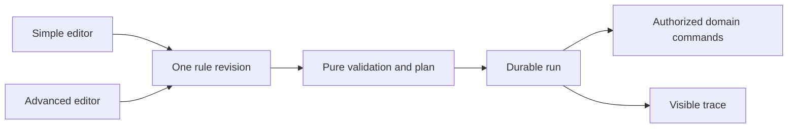

# Household automation engine and simple/advanced rule editors

- Status: Draft
- Date: 2026-10-29
- Catalog capability ID: household-automation
- Last verified: 2026-10-29 (document structure only; no implementation evidence)
- Owners: Domus maintainer; engineering/product reviewers to be assigned
- Scope: Simple/default and optional advanced editors share one durable declarative automation engine in the first release, invoking authorized household commands with replay-safe execution and visible traces.
- Related issues/PRs: https://github.com/vypdev/domus/issues/2; https://github.com/vypdev/domus/pull/3
- Required review gates: product UX, architecture, testing, documentation, security/operations
- Open decisions blocking readiness: Detailed DSL/action catalog, numeric resource limits, in-flight disable/cancel semantics, external-effect receipts and supported HA/browser evidence. Both editor modes and one engine are owner-confirmed launch scope. Catalog gate prerequisites remain unverified.

## 1. Executive summary

The owner confirmed both simple/default and optional advanced automation editing in the first release on 2026-10-29. One declarative engine executes both; Domus remains useful without AI or an available MCP gateway.

```text
Rule editor -> validate and preview -> explicit enable -> durable trigger/run -> authorized domain steps -> visible results
```

## 2. Problem, current behavior, and evidence

Domus has no implemented rule engine yet. HA-facing commands alone do not provide the in-application simple and advanced experiences now requested by the owner. The existing gateway is already integrated and is not changed. HA's automation model, concurrency modes and traces are design references, not a backend to reconfigure or a compatibility promise.

Evidence: owner decisions in [decisions](../docs/decisions.md), the [product vision](../docs/product-vision.md) and primary references in section 20. This is prospective; retrospective classification is not applicable.

## 3. Actors, surfaces, and terminology

An administrator authors/enables rules and grants technical execution scope. Members view permitted results and may invoke authorized manual triggers. A rule principal is distinct from the member named in an action.

RuleDefinition is mutable through revision-controlled edits; RuleRevision is immutable declarative data. TriggerEvent, ConditionTree, ActionPlan, AutomationRun, StepReceipt, WaitDeadline and ExecutionTrace have stable identities. The native HA surface adapts entrypoints; this capability owns internal rule semantics.

## 4. Goals, non-goals, and fixed invariants

| Requirement | Behavior |
|---|---|
| household-automation-R1 | Both first-release editors MUST use one versioned declarative rule model, with simple as the default and optional advanced editing that cannot silently discard unsupported fields. |
| household-automation-R2 | Triggers, condition trees and action plans MUST use validated typed schemas with explicit resource bounds; arbitrary code, unbounded loops and raw network/database access are excluded. |
| household-automation-R3 | Every action MUST call the same authorized Domus application use case as the UI, rechecking principal grants and target scope before each side effect. |
| household-automation-R4 | Execution MUST durably persist run identity, pinned rule revision, waits and step receipts and remain duplicate-safe across concurrent workers, retries and restart. |
| household-automation-R5 | Editing, disabling and cancelling rules MUST have explicit in-flight semantics and retain successful steps after partial failure instead of pretending the entire run rolled back. |
| household-automation-R6 | Causal correlation, cooldown, bounded concurrency/repetition and loop detection MUST prevent duplicate or cyclic automation storms while preserving inspectable suppression reasons. |
| household-automation-R7 | Preview and simulation MUST explain triggers, conditions and proposed effects without side effects; real execution retains sanitized per-step history, policy revisions and actual outcomes. |
| household-automation-R8 | Automation UI and HA-facing operations MUST expose understandable pending, action-required, denied/failed, partial and completed states with accessible English/Spanish presentation and permission-aware bounded queries. |
| household-automation-R9 | The same engine MUST satisfy Clean Architecture and meaningful tests from first implementation, with both deployment targets and isolated Stable/Edge channels; Copilot and the existing gateway remain unchanged. |

Non-goals: arbitrary scripts, SQL/network passthrough, unbounded loops, rewriting HA automation files, replacing domain recurrence/replenishment invariants, or creating another MCP server.

## 5. Current versus proposed product journey

| Stage | Current | Proposed | Effect |
|---|---|---|---|
| Configure | No Domus rule UI | Simple form or optional advanced flow editor | Same versioned rule data |
| Preview | No simulation | Explain trigger/conditions and intended steps | No side effects |
| Enable | No runtime | Explicit validated revision and scoped principal | Safe admission |
| Execute | No durable run | Persist trigger, plan, waits and step receipts | Restart/replay correctness |
| Recover | No trace | Explain committed effects and safe retry/cancel | Honest partial success |



Text equivalent: both editors save one rule model; pure compilation feeds durable execution, which calls domain commands and records a trace.

## 6. Functional behavior and state model

### 6.1 Rule and execution model

Simple mode covers one typed trigger, optional conditions and a short sequence of catalogued actions. Advanced mode adds nested AND/OR/NOT, choose/branch, bounded repeat/for-each, multiple steps, durable delays/waits and bounded parallelism. Typed triggers cover domain events, selected HA state/event changes, schedules and explicit manual invocation. A state crossing is distinct from testing an already-true condition. Rule policy never recalculates points, inventory consolidation or recurrence: it invokes the owning domain use case.

Actions initially create/assign tasks, create attributable shopping demand, request explicit stock commands within grants and send configured notifications. Supported HA operations enter through reviewed typed adapters rather than arbitrary proxies. Every action records its operation ID and real result. Rules and run IDs include household/instance/channel scope.

### 6.2 State and lifecycle

Rule: draft -> validated -> enabled <-> disabled -> archived. Run: queued -> running -> waiting -> running -> completed; denied, failed, partial, timed_out and cancelled are explicit terminal outcomes. Cancellation requested during an atomic command finishes/records that command and prevents subsequent steps.

A run pins its rule revision, action plan and policy at admission. Editing affects new triggers. Disablement suppresses new triggers and, by proposed default, cancels queued/waiting work before its next action; already committed actions remain. A safe retry resumes only failed/pending steps using their original command keys. Permissions and enablement are rechecked before each new action. Unsupported compensation is reported as retained effect.

The proposed default is serial execution per rule, with explicit skip_while_running and bounded_parallel alternatives. Wait deadlines, leases and cursors persist. Trigger identity plus rule revision deduplicates admissions; per-step keys deduplicate commands. Causal rule IDs/hop budgets detect loops across rules and external HA events. Cooldown limits frequency but does not establish idempotency.

## 7. User-facing configuration

| Input | Type | Recommended default | Allowed values/range | Scope/persistence |
|---|---|---|---|---|
| editor_mode | enum | simple | simple or advanced; changing views preserves the rule model | member preference; rule stores representability metadata |
| rule_enabled | boolean | false | explicit enable after validation/preview | rule; current value rechecked before each effect |
| execution_mode | enum | serial | serial, skip_while_running, bounded_parallel | rule revision snapshot |
| parallel_run_limit | integer | 2 | 1..4, only for bounded_parallel | rule revision; global resource cap also applies |
| cooldown_seconds | integer | 300 | 0..86400; zero allowed only with intact deduplication and causal bounds | rule revision snapshot |
| rule_node_limit | integer | 64 | fixed proposed maximum; condition depth <=8 and at most 32 effect nodes | validation invariant, not an escape hatch |
| repetition_limit | integer | 50 | 1..50 and total executable-step budget <=256 | validated plan and run receipt |
| wait_seconds | integer | explicit per wait | 0..2592000; no wait resets after restart | durable absolute deadline |
| queued_run_limit | integer | 100 | per-rule maximum, global queued maximum 1000 | durable admission accounting |

These numeric limits are explicit engineering proposals pending resource tests; no readiness claim depends on them being final. Invalid combinations fail before saving. Example default: a disabled simple rule, one low-stock trigger, one demand action, serial mode. Alternative: an enabled advanced branch with a bounded wait and two parallel runs. Invariants outrank installation limits, which outrank household/rule choices. Revocation/disablement is current; run semantics and policy versions are snapshotted. Unknown schema versions fail closed without rewriting saved rules.

## 8. Clean Architecture design

### 8.1 Boundaries

Domain owns typed conditions, pure plan validation, bounded decision policies and state transitions. Application owns ValidateRule, SimulateRule, AdmitTrigger, AdvanceAutomationRun, CancelRun and RetryRun. Semantic ports include RuleRepository, RunRepository, DurableScheduler, DomainCommandPort, AuthorizationPort, Clock, EventInbox and TraceSink. SQLite, HA transport and notification providers are adapters; composition wires the selected deployment.

UI editors map one schema to view models; they do not execute policy. The native HA adapter delegates to this engine instead of implementing a second rule evaluator. DomainCommandPort routes to existing task, points, stock and shopping use cases; it cannot bypass their ledgers or permissions.

### 8.2 Durable state and architecture checks

Admission and trigger receipt commit atomically. Each step uses a stable run/node/iteration command key. Its durable receipt resolves a crash or lost response without duplicating the owning domain effect. External notification effects without idempotent receipt support report ambiguous outcome and require explicit review before re-sending.

Executable import/cycle rules reject infrastructure in domain/application and API calls inside presentation primitives. Schema fixtures validate both editors; port contracts verify step/receipt semantics. No broker, second MCP or Copilot change is introduced.

## 9. UI/UX and content contract

| State | Primary content |
|---|---|
| Pending | Filter reminder is waiting until 18:00. The earlier task was saved. No action required. |
| Action required | This rule has advanced branching. Open the advanced editor to change it; your rule is retained. |
| Blocked | Create-task permission was revoked. No new step ran. Review the rule's grants. |
| Partial | The maintenance task was created, but its notification failed. View the task or retry the notification. |
| Complete | Filter reminder completed. One task was created and its notification was sent. View execution history. |

Settings -> Automations provides rule list, simple/advanced editor, validation/preview, enable/disable, run history and per-step trace. The outer HA shell is not duplicated. Simple mode renders unsupported advanced content as a summary, not an editable lossy projection. English/Spanish, keyboard flow editing, visible focus, non-color branch/status labels, narrow layouts and reduced motion are acceptance gates. At most one routine notification per meaningful transition; retried steps update the same run view.

## 10. Failure, recovery, and cleanup

| Failure | Retained result | Action |
|---|---|---|
| Invalid plan or denied admission | Saved prior rule; no run effect | Correct highlighted fields or grants |
| False condition | Inspectable no-action decision | No retry required |
| Crash during durable wait | Original absolute deadline and cursor | Resume once after restart |
| Lost command response | Stable domain operation key | Lookup/replay original receipt |
| Later step fails | Successful prior step receipts and real domain records | Retry only supported failed work |
| Disable/cancel after effects | Existing successful effects and cancellation trace | Stop later steps; compensate only through explicit supported commands |
| Queue/loop budget reached | Suppression reason and causal IDs | Inspect rule and limit; never silently drop a committed domain result |

Cleanup releases owned listeners/leases and temporary simulation state; it never deletes business ledgers or another channel's records. Retries use bounded backoff and per-step receipts.

## 11. Security, permissions, and privacy

Only an authorized principal may author/enable or manually invoke effects. Technical rule grants are narrow and do not inherit a role from member_id. Recheck rights per action. Conditions and schemas accept data, never executable code. Cross-instance IDs, hostile expressions, event floods and forged HA context fail before side effects. Tokens/private payloads are absent from rules, exported traces and browser artifacts; export includes only permitted sanitized identifiers and decisions.

## 12. Observability and operational UX

Members see current run state, saved facts and a single next action. Operators see bounded rule revision, trigger/run/step IDs, correlation chain, duration, decision code, attempt and receipt references. Metrics distinguish condition false, suppressed, denied, unavailable, partial and completed. A failed notification is not a failed task creation. Trace retention is bounded independently of immutable business ledgers; proposed 30 days for routine traces and explicit export before pruning.

## 13. Compatibility, migration, rollout, and rollback

No Domus automation data exists yet. Schemas are versioned from first implementation. Editors preserve unknown future revisions by refusing unsupported edits. Migrations cover enabled rules, queued/waiting runs and receipts; compatible image/database backups are required for downgrade. Both Supervisor and standalone include simple and advanced modes at first release; Stable/Edge never share rules, cursors or service credentials. Publication remains separately authorized.

## 14. Testing strategy and numeric budget

Minimum: 42 distinct cases, derived from the editor, DSL, permission, durable-run, recovery and loop risk inventory. Cases are planned, not executed tests.

| Area | Minimum distinct cases | Behaviors/risks covered |
|---|---:|---|
| Editors and schema | 4 | Explicit editors and schema scenarios below |
| UI and accessibility | 4 | Explicit ui and accessibility scenarios below |
| Domain and planning | 7 | Explicit domain and planning scenarios below |
| Security and permissions | 5 | Explicit security and permissions scenarios below |
| Adapters and contracts | 4 | Explicit adapters and contracts scenarios below |
| State and durability | 9 | Explicit state and durability scenarios below |
| Integration and recovery | 5 | Explicit integration and recovery scenarios below |
| Deployment and architecture | 4 | Explicit deployment and architecture scenarios below |
| **Total** | **42** | No double counting |

| Case ID | Area | Requirements | Scenario |
|---|---|---|---|
| household-automation-C01 | Editors and schema | household-automation-R1 | Given a simple rule, opening it in the advanced editor preserves the exact rule revision and execution semantics. |
| household-automation-C02 | Editors and schema | household-automation-R1 | Given an advanced branch/wait not representable in the simple form, simple mode shows a non-destructive summary and directs editing to advanced mode. |
| household-automation-C03 | Editors and schema | household-automation-R1 | Given a simple-editor save, unknown advanced fields are never silently removed or defaulted. |
| household-automation-C04 | UI and accessibility | household-automation-R1 | Given a new household, rule creation starts in the simple editor and advanced mode remains an explicit optional choice. |
| household-automation-C05 | Domain and planning | household-automation-R2 | Given a typed household event and matching condition tree, compilation produces a deterministic bounded plan. |
| household-automation-C06 | Domain and planning | household-automation-R2 | Given nested AND/OR/NOT conditions, pure evaluation returns the expected decision and a structured explanation. |
| household-automation-C07 | Editors and schema | household-automation-R2 | Given an unknown schema version or action type, validation rejects the rule without replacing its saved revision. |
| household-automation-C08 | Security and permissions | household-automation-R2 | Given embedded script, SQL, arbitrary URL or unsafe expression text, compilation refuses execution. |
| household-automation-C09 | Domain and planning | household-automation-R2 | Given excess condition depth, node count, wait duration or repetition count, validation names the exceeded bound without truncating the plan. |
| household-automation-C10 | Domain and planning | household-automation-R2 | Given a numeric-state crossing trigger, an already-true initial state does not masquerade as a new crossing; explicit state-condition/manual behavior is distinct. |
| household-automation-C11 | Security and permissions | household-automation-R3 | Given a technical rule principal without task-assignment grant, its assignment step is denied before mutation. |
| household-automation-C12 | Security and permissions | household-automation-R3 | Given a caller-provided administrator member ID, run authorization does not elevate the trusted rule principal. |
| household-automation-C13 | Security and permissions | household-automation-R3 | Given grant revocation while a run is waiting, the next action is denied without undoing prior authorized facts. |
| household-automation-C14 | Adapters and contracts | household-automation-R3 | Given equivalent rule and direct UI task commands, both use the same transition/verification/points policies. |
| household-automation-C15 | State and durability | household-automation-R4 | Given duplicate delivery of the same trigger event to the same rule revision, one run and one set of action receipts exist. |
| household-automation-C16 | State and durability | household-automation-R4 | Given a crash after a task step commits but before the engine records its local status, recovery replays the same command key and retains one task. |
| household-automation-C17 | State and durability | household-automation-R4 | Given a durable wait and process restart, the saved deadline resumes without restarting the delay from zero. |
| household-automation-C18 | State and durability | household-automation-R4 | Given two executors claiming one run, lease/revision fencing permits only one effective step transition. |
| household-automation-C19 | State and durability | household-automation-R4 | Given two distinct admitted trigger events, receipts remain distinct while the selected concurrency mode is enforced. |
| household-automation-C20 | Integration and recovery | household-automation-R4 | Given a lost step response, receipt lookup/replay resolves the known operation instead of creating a fresh-key duplicate. |
| household-automation-C21 | State and durability | household-automation-R5 | Given a rule edit during execution, the active run keeps its pinned revision and a later trigger uses the new revision. |
| household-automation-C22 | State and durability | household-automation-R5 | Given rule disablement, new triggers are suppressed and queued/waiting runs stop before their next action under the documented default. |
| household-automation-C23 | State and durability | household-automation-R5 | Given cancellation during one atomic domain action, that action's real result is retained and no subsequent step starts. |
| household-automation-C24 | Integration and recovery | household-automation-R5 | Given the second action failing after the first succeeded, status is partial and lists both the committed result and failed step. |
| household-automation-C25 | Integration and recovery | household-automation-R5 | Given retry of a partial run, completed steps keep their receipts and only the safe failed/pending portion resumes. |
| household-automation-C26 | Integration and recovery | household-automation-R5 | Given an external effect that has no supported compensation, cancellation reports it as retained rather than claiming rollback. |
| household-automation-C27 | Domain and planning | household-automation-R6 | Given a causal event returning to a rule already in the same chain, loop policy suppresses the re-entry and records its reason. |
| household-automation-C28 | Domain and planning | household-automation-R6 | Given an otherwise valid repeat trigger within its cooldown, execution is suppressed without treating cooldown as event deduplication. |
| household-automation-C29 | State and durability | household-automation-R6 | Given bounded repeat or parallel execution, the fixed step/run budgets stop further work at the limit with an inspectable result. |
| household-automation-C30 | Integration and recovery | household-automation-R6 | Given an event flood, admission respects per-rule/global queue bounds and reports rejected work rather than allocating unbounded memory. |
| household-automation-C31 | Domain and planning | household-automation-R7 | Given simulation, trigger/condition/step decisions are produced without task, points, stock, notification or HA side effects. |
| household-automation-C32 | UI and accessibility | household-automation-R7 | Given a false condition, the explanation identifies the tested predicate and why no action ran without exposing another member's private data. |
| household-automation-C33 | Adapters and contracts | household-automation-R7 | Given a real execution, audit links rule revision, trigger, operation and each actual result through one correlation chain. |
| household-automation-C34 | Security and permissions | household-automation-R7 | Given a provider error containing a token or private payload, logs and downloadable traces expose only redacted safe diagnostics. |
| household-automation-C35 | UI and accessibility | household-automation-R8 | Given pending, denied, failed, partial and completed runs, each view states what happened, what is retained and one next action. |
| household-automation-C36 | UI and accessibility | household-automation-R8 | Given narrow-screen keyboard use, rule branching controls have accessible names, focus order and English/Spanish messages. |
| household-automation-C37 | Adapters and contracts | household-automation-R8 | Given HA queries or explicit run/enable actions, schemas validate instance/rule IDs, permissions, revisions, idempotency and bounded responses. |
| household-automation-C38 | Adapters and contracts | household-automation-R8 | Given Domus or HA unavailability, projection and run views distinguish stale/unavailable data from successful empty results. |
| household-automation-C39 | Deployment and architecture | household-automation-R9 | Given an automation domain module importing HA, HTTP or SQL, the executable dependency check rejects the boundary violation. |
| household-automation-C40 | Deployment and architecture | household-automation-R9 | Given the same deterministic automation fixture in Supervisor and standalone modes, commands and run outcomes agree. |
| household-automation-C41 | Deployment and architecture | household-automation-R9 | Given Stable and Edge with equivalent rules, an event or credential from one instance cannot execute the other's rule. |
| household-automation-C42 | Deployment and architecture | household-automation-R9 | Given the first engine implementation, CI Check enforces meaningful first-party coverage and contract checks without editing Copilot or gateway files. |

Each row counts once. The first implementation includes deterministic clocks, IDs, injected crash points, lease races and adapter fakes, with 100% supported first-party coverage metrics in CI Check. Semantic UI assertions supplement reviewed golden fixtures; no real waits or live HA is required for unit/contract tests. Disposable HA proves integration contracts; controlled Google Chrome dogfooding on the owner's authorized local HA proves actual UI use and records cleanup. Local browser evidence does not replace automated coverage.

## 15. Documentation and discoverability

| Path | Change |
|---|---|
| specs/household-automation.md | create |
| specs/home-assistant-surface.md | create |
| specs/README.md | create |
| specs/_template.md | create |
| specs/catalog.json | create |
| specs/CATALOG.md | create |
| docs/architecture.md | create |
| docs/product-vision.md | create |
| docs/glossary.md | create |
| docs/decisions.md | create |
| docs/reference-investigation.md | create |
| docs/copilot-adoption.md | create |
| docs/operations.md | create |
| docs/user-guide.md | create |
| docs/contracts/home-assistant.md | create |
| docs/acceptance-plan.md | create |
| docs/roadmap.md | create |
| docs/adr/0005-one-automation-engine.md | create |
| README.md | update |

[User guide](../docs/user-guide.md) covers creating, previewing and understanding a rule. [Operations](../docs/operations.md) covers grants, waits, partial success, restart, cancellation and cleanup. [Architecture](../docs/architecture.md) and [HA contract](../docs/contracts/home-assistant.md) explain ownership and typed entrypoints. [Acceptance plan](../docs/acceptance-plan.md) tracks original validators, actual implementation tests, both targets/channels and browser evidence. Documentation and contract fixtures change with behavior.

## 16. Acceptance scenarios

The section-14 Given/action/result rows are the executable acceptance inventory. The critical complete journey is: create a simple maintenance rule, preview it without effects, enable it, admit a HA/domain event, create exactly one task, survive restart during a wait, show a later notification failure as partial, and retry only that notification. Advanced-editor round trips, revocation during waits, rule edits, flood/cycle suppression and channel isolation are equally required. Human acceptance reviews narrow-screen editing, keyboard and trace readability.

## 17. Requirements traceability

| Requirement | Cases |
|---|---|
| household-automation-R1 | household-automation-C01, household-automation-C02, household-automation-C03, household-automation-C04 |
| household-automation-R2 | household-automation-C05, household-automation-C06, household-automation-C07, household-automation-C08, household-automation-C09, household-automation-C10 |
| household-automation-R3 | household-automation-C11, household-automation-C12, household-automation-C13, household-automation-C14 |
| household-automation-R4 | household-automation-C15, household-automation-C16, household-automation-C17, household-automation-C18, household-automation-C19, household-automation-C20 |
| household-automation-R5 | household-automation-C21, household-automation-C22, household-automation-C23, household-automation-C24, household-automation-C25, household-automation-C26 |
| household-automation-R6 | household-automation-C27, household-automation-C28, household-automation-C29, household-automation-C30 |
| household-automation-R7 | household-automation-C31, household-automation-C32, household-automation-C33, household-automation-C34 |
| household-automation-R8 | household-automation-C35, household-automation-C36, household-automation-C37, household-automation-C38 |
| household-automation-R9 | household-automation-C39, household-automation-C40, household-automation-C41, household-automation-C42 |

Pure policies own plan/condition/budget decisions; application use cases own durable execution and authorization; adapters own schema/provider mapping; presentation owns editor and trace states. Requirements link exactly to the case inventory in both directions. User/operator evidence is linked in section 15.

## 18. Implementation sequence

1. Review the typed schema, action catalog, resource bounds and lifecycle contracts.
2. Establish CI Check, meaningful tests and executable dependency rules before implementing engine code.
3. Implement pure conditions, compilation and preview; verify zero simulation effects.
4. Implement durable admission, receipts, waits, leases and partial/retry/cancel behavior with failure injection.
5. Add thin native HA/notification adapters and both deployment profiles.
6. Build simple and advanced editors over the same contracts, with Storybook/Playwright and localization/accessibility.
7. Verify both channels, schema migration, security, docs and controlled Chrome dogfooding before release acceptance.

Both editors are launch scope; internal sequencing is not a proposal to defer advanced mode.

## 19. Definition of Done

- [ ] All nine requirements have reciprocal case links and observable assertions.
- [ ] The planned 42-case floor and complete behavior/coverage gates pass with real implementation.
- [ ] Both editors preserve one schema and all unsupported advanced fields.
- [ ] Permission, deduplication, waits, races, limits, partial recovery and safe cancellation are tested.
- [ ] Clean Architecture checks and 100% supported first-party coverage pass in CI Check.
- [ ] User/setup/operator docs and typed HA schemas agree with actual code.
- [ ] Desktop/mobile, keyboard, English/Spanish, themes and trace readability have evidence.
- [ ] Both deployment targets and Stable/Edge isolation pass.
- [ ] Catalog implementation evidence is real; no Copilot/gateway modification or weakened validation occurred.
- [ ] Material schema/resource/recovery decisions are resolved before Ready for implementation; no implementation/readiness claim is inferred from this Draft.

## 20. References and decisions

Owner decisions are recorded in [decisions](../docs/decisions.md). Related contracts: [HA surface](home-assistant-surface.md) and [architecture](../docs/architecture.md). [Issue #2](https://github.com/vypdev/domus/issues/2) tracks the documentation foundation.

[ADR 0005](../docs/adr/0005-one-automation-engine.md) records the accepted product direction while preserving the detailed engine's Draft review gates.

Primary design references: [HA automation concepts](https://www.home-assistant.io/docs/automation/), [execution modes](https://www.home-assistant.io/docs/automation/modes/), [building blocks](https://www.home-assistant.io/docs/automation/building-blocks/) and [troubleshooting/traces](https://www.home-assistant.io/docs/automation/troubleshooting/). These inform explicit Domus choices, not an assertion that its semantics are identical to HA or that HA/gateway code will be changed. The original [Copilot template](https://github.com/vypdev/copilot/blob/f5e5a4cf9a80248994469cd88ad55eecab5b95ca/specs/_template.md) supplies the twenty-section format.
