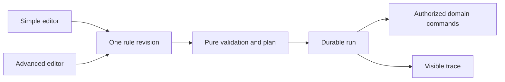

# Household automation engine and simple/advanced rule editors

- Status: Draft
- Date: 2026-10-29
- Catalog capability ID: household-automation
- Last verified: 2026-10-29 (document structure only; no implementation evidence)
- Owners: Domus maintainer; engineering/product reviewers to be assigned
- Scope: Simple/default and optional advanced editors share one durable declarative automation engine in the first release, invoking authorized household commands with replay-safe execution and visible traces.
- Related issues/PRs: https://github.com/vypdev/domus/issues/2; https://github.com/vypdev/domus/pull/3
- Required review gates: product UX, architecture, testing, documentation, security/operations
- Open decisions blocking readiness: Detailed DSL/action catalog, numeric resource limits, external-effect receipts and supported HA/browser evidence. The owner confirmed both editors, one engine and disablement that stops new runs/later steps while retaining already-started atomic commands and effects. Catalog gate prerequisites remain unverified.

## 1. Executive summary

The owner confirmed both simple/default and optional advanced automation editing in the first release on 2026-10-29. One declarative engine executes both; Domus remains useful without AI or an available MCP gateway.

```text
Rule editor -> validate and preview -> explicit enable -> durable trigger/run -> authorized domain steps -> visible results
```

## 2. Problem, current behavior, and evidence

Domus has no implemented rule engine yet. HA-facing commands alone do not provide the in-application simple and advanced experiences now requested by the owner. The existing gateway is already integrated and is not changed. HA's automation model, concurrency modes and traces are design references, not a backend to reconfigure or a compatibility promise.

Evidence: owner decisions in [decisions](../docs/decisions.md), the [product vision](../docs/product-vision.md) and primary references in section 20. This is prospective; retrospective classification is not applicable.

## 3. Actors, surfaces, and terminology

An administrator authors/enables rules and grants technical execution scope. Members view permitted results and may invoke authorized manual triggers. A rule principal is distinct from the member named in an action.

RuleDefinition is mutable through revision-controlled edits; RuleRevision is immutable declarative data. TriggerEvent, ConditionTree, ActionPlan, AutomationRun, StepReceipt, WaitDeadline and ExecutionTrace have stable identities. The native HA surface adapts entrypoints; this capability owns internal rule semantics.

## 4. Goals, non-goals, and fixed invariants

| Requirement | Behavior |
|---|---|
| household-automation-R1 | Both first-release editors MUST use one versioned declarative rule model, with simple as the default and optional advanced editing that cannot silently discard unsupported fields. |
| household-automation-R2 | Triggers, condition trees and action plans MUST use validated typed schemas with explicit resource bounds; arbitrary code, unbounded loops and raw network/database access are excluded. |
| household-automation-R3 | Every action MUST call the same authorized Domus application use case as the UI, rechecking principal grants and target scope before each side effect. |
| household-automation-R4 | Execution MUST durably persist run identity, pinned rule revision, waits and step receipts and remain duplicate-safe across concurrent workers, retries and restart. |
| household-automation-R5 | Editing MUST preserve active run snapshots; disabling MUST prevent new runs and later steps, finish/record already-started atomic commands and retain their effects; cancellation and partial failure MUST expose actual retained outcomes rather than claim rollback. |
| household-automation-R6 | Causal correlation, cooldown, bounded concurrency/repetition and loop detection MUST prevent duplicate or cyclic automation storms while preserving inspectable suppression reasons. |
| household-automation-R7 | Preview and simulation MUST explain triggers, conditions and proposed effects without side effects; real execution retains sanitized per-step history, policy revisions and actual outcomes. |
| household-automation-R8 | Automation UI and HA-facing operations MUST expose understandable pending, action-required, denied/failed, partial and completed states with accessible English/Spanish presentation and permission-aware bounded queries. |
| household-automation-R9 | The same engine MUST satisfy Clean Architecture and meaningful tests from first implementation, with both deployment targets and isolated Stable/Edge channels; Copilot and the existing gateway remain unchanged. |

Non-goals: arbitrary scripts, SQL/network passthrough, unbounded loops, rewriting HA automation files, replacing domain recurrence/replenishment invariants, or creating another MCP server.

## 5. Current versus proposed product journey

| Stage | Current | Proposed | Effect |
|---|---|---|---|
| Configure | No Domus rule UI | Simple form or optional advanced flow editor | Same versioned rule data |
| Preview | No simulation | Explain trigger/conditions and intended steps | No side effects |
| Enable | No runtime | Explicit validated revision and scoped principal | Safe admission |
| Execute | No durable run | Persist trigger, plan, waits and step receipts | Restart/replay correctness |
| Recover | No trace | Explain committed effects and safe retry/cancel | Honest partial success |



Text equivalent: both editors save one rule model; pure compilation feeds durable execution, which calls domain commands and records a trace.

## 6. Functional behavior and state model

### 6.1 Rule and execution model

Simple mode covers one typed trigger, optional conditions and a short sequence of catalogued actions. Advanced mode adds nested AND/OR/NOT, choose/branch, bounded repeat/for-each, multiple steps, durable delays/waits and bounded parallelism. Typed triggers cover domain events, selected HA state/event changes, schedules and explicit manual invocation. A state crossing is distinct from testing an already-true condition. Rule policy never recalculates points, inventory consolidation or recurrence: it invokes the owning domain use case.

Actions initially create/assign tasks, create attributable shopping demand, request explicit stock commands within grants and send configured notifications. Supported HA operations enter through reviewed typed adapters rather than arbitrary proxies. Every action records its operation ID and real result. Rules and run IDs include household/instance/channel scope.

### 6.2 State and lifecycle

Rule: draft -> validated -> enabled <-> disabled -> archived. Run: queued -> running -> waiting -> running -> completed; denied, failed, partial, timed_out and cancelled are explicit terminal outcomes. Cancellation requested during an atomic command finishes/records that command and prevents subsequent steps.

A run pins its rule revision, action plan and policy at admission. Editing affects new triggers. The owner confirmed that disablement suppresses new runs and prevents subsequent steps in queued, waiting or active runs. An atomic domain command already started may finish; its real receipt and effects remain visible. Disable admission and step admission serialize through a durable rule control revision: a worker's old enablement check is not enough to start another action after disablement. In parallel branches, only commands already started may settle; no new branch action starts. Persist the stop reason and cancellation request across restart. Re-enabling the rule admits future triggers but does not silently resume the old cancelled queue or waits. The disable response distinguishes authoritative disabled state from in-flight commands whose outcomes are still settling.

A safe retry resumes only failed/pending steps using their original command keys and current grants; it cannot clear a disablement cancellation or bypass the rule's current enablement. Explicitly reviewed future execution is separate from automatically resuming cancelled work. Permissions and enablement are rechecked before each new action. Unsupported compensation is reported as retained effect; disablement does not automatically undo successful domain or external actions.

The proposed default is serial execution per rule, with explicit skip_while_running and bounded_parallel alternatives. Wait deadlines, leases and cursors persist. Trigger identity plus rule revision deduplicates admissions; per-step keys deduplicate commands. Causal rule IDs/hop budgets detect loops across rules and external HA events. Cooldown limits frequency but does not establish idempotency.

## 7. User-facing configuration

| Input | Type | Recommended default | Allowed values/range | Scope/persistence |
|---|---|---|---|---|
| editor_mode | enum | simple | simple or advanced; changing views preserves the rule model | member preference; rule stores representability metadata |
| rule_enabled | boolean | false | explicit enable after validation/preview | rule; current value rechecked before each effect |
| execution_mode | enum | serial | serial, skip_while_running, bounded_parallel | rule revision snapshot |
| parallel_run_limit | integer | 2 | 1..4, only for bounded_parallel | rule revision; global resource cap also applies |
| cooldown_seconds | integer | 300 | 0..86400; zero allowed only with intact deduplication and causal bounds | rule revision snapshot |
| rule_node_limit | integer | 64 | fixed proposed maximum; condition depth <=8 and at most 32 effect nodes | validation invariant, not an escape hatch |
| repetition_limit | integer | 50 | 1..50 and total executable-step budget <=256 | validated plan and run receipt |
| wait_seconds | integer | explicit per wait | 0..2592000; no wait resets after restart | durable absolute deadline |
| queued_run_limit | integer | 100 | per-rule maximum, global queued maximum 1000 | durable admission accounting |

These numeric limits are explicit engineering proposals pending resource tests; no readiness claim depends on them being final. Invalid combinations fail before saving. Example default: a disabled simple rule, one low-stock trigger, one demand action, serial mode. Alternative: an enabled advanced branch with a bounded wait and two parallel runs. Invariants outrank installation limits, which outrank household/rule choices. Revocation/disablement is current; run semantics and policy versions are snapshotted. Unknown schema versions fail closed without rewriting saved rules.

## 8. Clean Architecture design

### 8.1 Boundaries

Domain owns typed conditions, pure plan validation, bounded decision policies and state transitions. Application owns ValidateRule, SimulateRule, AdmitTrigger, AdvanceAutomationRun, CancelRun and RetryRun. Semantic ports include RuleRepository, RunRepository, DurableScheduler, DomainCommandPort, AuthorizationPort, Clock, EventInbox and TraceSink. SQLite, HA transport and notification providers are adapters; composition wires the selected deployment.

UI editors map one schema to view models; they do not execute policy. The native HA adapter delegates to this engine instead of implementing a second rule evaluator. DomainCommandPort routes to existing task, points, stock and shopping use cases; it cannot bypass their ledgers or permissions.

### 8.2 Durable state and architecture checks

Admission and trigger receipt commit atomically. Each step uses a stable run/node/iteration command key. Its durable receipt resolves a crash or lost response without duplicating the owning domain effect. External notification effects without idempotent receipt support report ambiguous outcome and require explicit review before re-sending.

Executable import/cycle rules reject infrastructure in domain/application and API calls inside presentation primitives. Schema fixtures validate both editors; port contracts verify step/receipt semantics. No broker, second MCP or Copilot change is introduced.

## 9. UI/UX and content contract

| State | Primary content |
|---|---|
| Pending | Filter reminder is waiting until 18:00. The earlier task was saved. No action required. |
| Action required | This rule has advanced branching. Open the advanced editor to change it; your rule is retained. |
| Blocked | Create-task permission was revoked. No new step ran. Review the rule's grants. |
| Partial | The maintenance task was created, but its notification failed. View the task or retry the notification. |
| Complete | Filter reminder completed. One task was created and its notification was sent. View execution history. |

Settings -> Automations provides rule list, simple/advanced editor, validation/preview, enable/disable, run history and per-step trace. The outer HA shell is not duplicated. Simple mode renders unsupported advanced content as a summary, not an editable lossy projection. English/Spanish, keyboard flow editing, visible focus, non-color branch/status labels, narrow layouts and reduced motion are acceptance gates. At most one routine notification per meaningful transition; retried steps update the same run view.

## 10. Failure, recovery, and cleanup

| Failure | Retained result | Action |
|---|---|---|
| Invalid plan or denied admission | Saved prior rule; no run effect | Correct highlighted fields or grants |
| False condition | Inspectable no-action decision | No retry required |
| Crash during durable wait | Original absolute deadline and cursor | Resume once after restart |
| Lost command response | Stable domain operation key | Lookup/replay original receipt |
| Later step fails | Successful prior step receipts and real domain records | Retry only supported failed work |
| Disable/cancel after effects | Existing successful effects and cancellation trace | Stop later steps; compensate only through explicit supported commands |
| Queue/loop budget reached | Suppression reason and causal IDs | Inspect rule and limit; never silently drop a committed domain result |

Cleanup releases owned listeners/leases and temporary simulation state; it never deletes business ledgers or another channel's records. Retries use bounded backoff and per-step receipts.

## 11. Security, permissions, and privacy

Only an authorized principal may author/enable or manually invoke effects. Technical rule grants are narrow and do not inherit a role from member_id. Recheck rights per action. Conditions and schemas accept data, never executable code. Cross-instance IDs, hostile expressions, event floods and forged HA context fail before side effects. Tokens/private payloads are absent from rules, exported traces and browser artifacts; export includes only permitted sanitized identifiers and decisions.

## 12. Observability and operational UX

Members see current run state, saved facts and a single next action. Operators see bounded rule revision, trigger/run/step IDs, correlation chain, duration, decision code, attempt and receipt references. Metrics distinguish condition false, suppressed, denied, unavailable, partial and completed. A failed notification is not a failed task creation. Trace retention is bounded independently of immutable business ledgers; proposed 30 days for routine traces and explicit export before pruning.

## 13. Compatibility, migration, rollout, and rollback

No Domus automation data exists yet. Schemas are versioned from first implementation. Editors preserve unknown future revisions by refusing unsupported edits. Migrations cover enabled rules, queued/waiting runs and receipts; compatible image/database backups are required for downgrade. Both Supervisor and standalone include simple and advanced modes at first release; Stable/Edge never share rules, cursors or service credentials. Publication remains separately authorized.

## 14. Testing strategy and numeric budget

Minimum: 45 distinct cases, derived from the editor, DSL, permission, durable-run, recovery and loop risk inventory. Cases are planned, not executed tests.

| Area | Minimum distinct cases | Behaviors/risks covered |
|---|---:|---|
| Editors and schema | 4 | Explicit editors and schema scenarios below |
| UI and accessibility | 4 | Explicit ui and accessibility scenarios below |
| Domain and planning | 7 | Explicit domain and planning scenarios below |
| Security and permissions | 5 | Explicit security and permissions scenarios below |
| Adapters and contracts | 4 | Explicit adapters and contracts scenarios below |
| State and durability | 11 | Explicit state and durability scenarios below |
| Integration and recovery | 6 | Explicit integration and recovery scenarios below |
| Deployment and architecture | 4 | Explicit deployment and architecture scenarios below |
| **Total** | **45** | No double counting |

| Case ID | Area | Requirements | Scenario |
|---|---|---|---|
| household-automation-C01 | Editors and schema | household-automation-R1 | Given a simple rule, opening it in the advanced editor preserves the exact rule revision and execution semantics. |
| household-automation-C02 | Editors and schema | household-automation-R1 | Given an advanced branch/wait not representable in the simple form, simple mode shows a non-destructive summary and directs editing to advanced mode. |
| household-automation-C03 | Editors and schema | household-automation-R1 | Given a simple-editor save, unknown advanced fields are never silently removed or defaulted. |
| household-automation-C04 | UI and accessibility | household-automation-R1 | Given a new household, rule creation starts in the simple editor and advanced mode remains an explicit optional choice. |
| household-automation-C05 | Domain and planning | household-automation-R2 | Given a typed household event and matching condition tree, compilation produces a deterministic bounded plan. |
| household-automation-C06 | Domain and planning | household-automation-R2 | Given nested AND/OR/NOT conditions, pure evaluation returns the expected decision and a structured explanation. |
| household-automation-C07 | Editors and schema | household-automation-R2 | Given an unknown schema version or action type, validation rejects the rule without replacing its saved revision. |
| household-automation-C08 | Security and permissions | household-automation-R2 | Given embedded script, SQL, arbitrary URL or unsafe expression text, compilation refuses execution. |
| household-automation-C09 | Domain and planning | household-automation-R2 | Given excess condition depth, node count, wait duration or repetition count, validation names the exceeded bound without truncating the plan. |
| household-automation-C10 | Domain and planning | household-automation-R2 | Given a numeric-state crossing trigger, an already-true initial state does not masquerade as a new crossing; explicit state-condition/manual behavior is distinct. |
| household-automation-C11 | Security and permissions | household-automation-R3 | Given a technical rule principal without task-assignment grant, its assignment step is denied before mutation. |
| household-automation-C12 | Security and permissions | household-automation-R3 | Given a caller-provided administrator member ID, run authorization does not elevate the trusted rule principal. |
| household-automation-C13 | Security and permissions | household-automation-R3 | Given grant revocation while a run is waiting, the next action is denied without undoing prior authorized facts. |
| household-automation-C14 | Adapters and contracts | household-automation-R3 | Given equivalent rule and direct UI task commands, both use the same transition/verification/points policies. |
| household-automation-C15 | State and durability | household-automation-R4 | Given duplicate delivery of the same trigger event to the same rule revision, one run and one set of action receipts exist. |
| household-automation-C16 | State and durability | household-automation-R4 | Given a crash after a task step commits but before the engine records its local status, recovery replays the same command key and retains one task. |
| household-automation-C17 | State and durability | household-automation-R4 | Given a durable wait and process restart, the saved deadline resumes without restarting the delay from zero. |
| household-automation-C18 | State and durability | household-automation-R4 | Given two executors claiming one run, lease/revision fencing permits only one effective step transition. |
| household-automation-C19 | State and durability | household-automation-R4 | Given two distinct admitted trigger events, receipts remain distinct while the selected concurrency mode is enforced. |
| household-automation-C20 | Integration and recovery | household-automation-R4 | Given a lost step response, receipt lookup/replay resolves the known operation instead of creating a fresh-key duplicate. |
| household-automation-C21 | State and durability | household-automation-R5 | Given a rule edit during execution, the active run keeps its pinned revision and a later trigger uses the new revision. |
| household-automation-C22 | State and durability | household-automation-R5 | Given rule disablement, new triggers are suppressed and queued/waiting runs stop before their next action under the owner-confirmed policy. |
| household-automation-C23 | State and durability | household-automation-R5 | Given cancellation during one atomic domain action, that action's real result is retained and no subsequent step starts. |
| household-automation-C24 | Integration and recovery | household-automation-R5 | Given the second action failing after the first succeeded, status is partial and lists both the committed result and failed step. |
| household-automation-C25 | Integration and recovery | household-automation-R5 | Given retry of a partial run, completed steps keep their receipts and only the safe failed/pending portion resumes. |
| household-automation-C26 | Integration and recovery | household-automation-R5 | Given an external effect that has no supported compensation, cancellation reports it as retained rather than claiming rollback. |
| household-automation-C27 | Domain and planning | household-automation-R6 | Given a causal event returning to a rule already in the same chain, loop policy suppresses the re-entry and records its reason. |
| household-automation-C28 | Domain and planning | household-automation-R6 | Given an otherwise valid repeat trigger within its cooldown, execution is suppressed without treating cooldown as event deduplication. |
| household-automation-C29 | State and durability | household-automation-R6 | Given bounded repeat or parallel execution, the fixed step/run budgets stop further work at the limit with an inspectable result. |
| household-automation-C30 | Integration and recovery | household-automation-R6 | Given an event flood, admission respects per-rule/global queue bounds and reports rejected work rather than allocating unbounded memory. |
| household-automation-C31 | Domain and planning | household-automation-R7 | Given simulation, trigger/condition/step decisions are produced without task, points, stock, notification or HA side effects. |
| household-automation-C32 | UI and accessibility | household-automation-R7 | Given a false condition, the explanation identifies the tested predicate and why no action ran without exposing another member's private data. |
| household-automation-C33 | Adapters and contracts | household-automation-R7 | Given a real execution, audit links rule revision, trigger, operation and each actual result through one correlation chain. |
| household-automation-C34 | Security and permissions | household-automation-R7 | Given a provider error containing a token or private payload, logs and downloadable traces expose only redacted safe diagnostics. |
| household-automation-C35 | UI and accessibility | household-automation-R8 | Given pending, denied, failed, partial and completed runs, each view states what happened, what is retained and one next action. |
| household-automation-C36 | UI and accessibility | household-automation-R8 | Given narrow-screen keyboard use, rule branching controls have accessible names, focus order and English/Spanish messages. |
| household-automation-C37 | Adapters and contracts | household-automation-R8 | Given HA queries or explicit run/enable actions, schemas validate instance/rule IDs, permissions, revisions, idempotency and bounded responses. |
| household-automation-C38 | Adapters and contracts | household-automation-R8 | Given Domus or HA unavailability, projection and run views distinguish stale/unavailable data from successful empty results. |
| household-automation-C39 | Deployment and architecture | household-automation-R9 | Given an automation domain module importing HA, HTTP or SQL, the executable dependency check rejects the boundary violation. |
| household-automation-C40 | Deployment and architecture | household-automation-R9 | Given the same deterministic automation fixture in Supervisor and standalone modes, commands and run outcomes agree. |
| household-automation-C41 | Deployment and architecture | household-automation-R9 | Given Stable and Edge with equivalent rules, an event or credential from one instance cannot execute the other's rule. |
| household-automation-C42 | Deployment and architecture | household-automation-R9 | Given the first engine implementation, CI Check enforces meaningful first-party coverage and contract checks without editing Copilot or gateway files. |
| household-automation-C43 | State and durability | household-automation-R4, household-automation-R5 | Given disablement racing a worker's step admission, the durable control revision prevents any action admitted after disablement while an already-started atomic command retains its actual result. |
| household-automation-C44 | Integration and recovery | household-automation-R4, household-automation-R5 | Given a disabled rule with saved waits and queued work, restart then re-enable does not resume those cancelled runs or reset their waits; only new admitted triggers may execute. |
| household-automation-C45 | State and durability | household-automation-R5 | Given parallel branches when disablement commits, already-started commands may settle with linked receipts but no branch starts another action or automatically compensates a retained effect. |

Each row counts once. The first implementation includes deterministic clocks, IDs, injected crash points, lease races and adapter fakes, with 100% supported first-party coverage metrics in CI Check. Semantic UI assertions supplement reviewed golden fixtures; no real waits or live HA is required for unit/contract tests. Disposable HA proves integration contracts; controlled Google Chrome dogfooding on the owner's authorized local HA proves actual UI use and records cleanup. Local browser evidence does not replace automated coverage.

## 15. Documentation and discoverability

| Path | Change |
|---|---|
| specs/household-automation.md | create |
| specs/home-assistant-surface.md | create |
| specs/README.md | create |
| specs/_template.md | create |
| specs/catalog.json | create |
| specs/CATALOG.md | create |
| docs/architecture.md | create |
| docs/product-vision.md | create |
| docs/glossary.md | create |
| docs/decisions.md | create |
| docs/reference-investigation.md | create |
| docs/copilot-adoption.md | create |
| docs/operations.md | create |
| docs/user-guide.md | create |
| docs/contracts/home-assistant.md | create |
| docs/acceptance-plan.md | create |
| docs/roadmap.md | create |
| docs/adr/0005-one-automation-engine.md | create |
| README.md | update |

[User guide](../docs/user-guide.md) covers creating, previewing and understanding a rule. [Operations](../docs/operations.md) covers grants, waits, partial success, restart, cancellation and cleanup. [Architecture](../docs/architecture.md) and [HA contract](../docs/contracts/home-assistant.md) explain ownership and typed entrypoints. [Acceptance plan](../docs/acceptance-plan.md) tracks original validators, actual implementation tests, both targets/channels and browser evidence. Documentation and contract fixtures change with behavior.

## 16. Acceptance scenarios

The section-14 Given/action/result rows are the executable acceptance inventory. The critical complete journey is: create a simple maintenance rule, preview it without effects, enable it, admit a HA/domain event, create exactly one task, survive restart during a wait, show a later notification failure as partial, and retry only that notification. Advanced-editor round trips, revocation during waits, rule edits, flood/cycle suppression and channel isolation are equally required. Human acceptance reviews narrow-screen editing, keyboard and trace readability.

## 17. Requirements traceability

| Requirement | Cases |
|---|---|
| household-automation-R1 | household-automation-C01, household-automation-C02, household-automation-C03, household-automation-C04 |
| household-automation-R2 | household-automation-C05, household-automation-C06, household-automation-C07, household-automation-C08, household-automation-C09, household-automation-C10 |
| household-automation-R3 | household-automation-C11, household-automation-C12, household-automation-C13, household-automation-C14 |
| household-automation-R4 | household-automation-C15, household-automation-C16, household-automation-C17, household-automation-C18, household-automation-C19, household-automation-C20, household-automation-C43, household-automation-C44 |
| household-automation-R5 | household-automation-C21, household-automation-C22, household-automation-C23, household-automation-C24, household-automation-C25, household-automation-C26, household-automation-C43, household-automation-C44, household-automation-C45 |
| household-automation-R6 | household-automation-C27, household-automation-C28, household-automation-C29, household-automation-C30 |
| household-automation-R7 | household-automation-C31, household-automation-C32, household-automation-C33, household-automation-C34 |
| household-automation-R8 | household-automation-C35, household-automation-C36, household-automation-C37, household-automation-C38 |
| household-automation-R9 | household-automation-C39, household-automation-C40, household-automation-C41, household-automation-C42 |

Pure policies own plan/condition/budget decisions; application use cases own durable execution and authorization; adapters own schema/provider mapping; presentation owns editor and trace states. Requirements link exactly to the case inventory in both directions. User/operator evidence is linked in section 15.

## 18. Implementation sequence

1. Review the typed schema, action catalog, resource bounds and lifecycle contracts.
2. Establish CI Check, meaningful tests and executable dependency rules before implementing engine code.
3. Implement pure conditions, compilation and preview; verify zero simulation effects.
4. Implement durable admission, receipts, waits, leases and partial/retry/cancel behavior with failure injection.
5. Add thin native HA/notification adapters and both deployment profiles.
6. Build simple and advanced editors over the same contracts, with Storybook/Playwright and localization/accessibility.
7. Verify both channels, schema migration, security, docs and controlled Chrome dogfooding before release acceptance.

Both editors are launch scope; internal sequencing is not a proposal to defer advanced mode.

## 19. Definition of Done

- [ ] All nine requirements have reciprocal case links and observable assertions.
- [ ] The planned 42-case floor and complete behavior/coverage gates pass with real implementation.
- [ ] Both editors preserve one schema and all unsupported advanced fields.
- [ ] Permission, deduplication, waits, races, limits, partial recovery and safe cancellation are tested.
- [ ] Clean Architecture checks and 100% supported first-party coverage pass in CI Check.
- [ ] User/setup/operator docs and typed HA schemas agree with actual code.
- [ ] Desktop/mobile, keyboard, English/Spanish, themes and trace readability have evidence.
- [ ] Both deployment targets and Stable/Edge isolation pass.
- [ ] Catalog implementation evidence is real; no Copilot/gateway modification or weakened validation occurred.
- [ ] Material schema/resource/recovery decisions are resolved before Ready for implementation; no implementation/readiness claim is inferred from this Draft.

## 20. References and decisions

Owner decisions are recorded in [decisions](../docs/decisions.md). Related contracts: [HA surface](home-assistant-surface.md) and [architecture](../docs/architecture.md). [Issue #2](https://github.com/vypdev/domus/issues/2) tracks the documentation foundation.

[ADR 0005](../docs/adr/0005-one-automation-engine.md) records the accepted product direction while preserving the detailed engine's Draft review gates.

Primary design references: [HA automation concepts](https://www.home-assistant.io/docs/automation/), [execution modes](https://www.home-assistant.io/docs/automation/modes/), [building blocks](https://www.home-assistant.io/docs/automation/building-blocks/) and [troubleshooting/traces](https://www.home-assistant.io/docs/automation/troubleshooting/). These inform explicit Domus choices, not an assertion that its semantics are identical to HA or that HA/gateway code will be changed. The original [Copilot template](https://github.com/vypdev/copilot/blob/f5e5a4cf9a80248994469cd88ad55eecab5b95ca/specs/_template.md) supplies the twenty-section format.

## Preview a manual household task automation

- Status: Draft
- Owners: Domus maintainers and Automation
- Scope: Protected, read-only preview of a bounded version-one manual task rule
- Open decisions blocking readiness: none for this preview scope

### 1. Executive summary

An authorized administrator can preview a manual rule that proposes creating
one household task. The preview reports the current condition result and
proposed effect without persisting a rule or performing a task command.

### 2. Problem, current behavior, and evidence

The accepted automation direction requires one declarative model and safe
simulation before execution. Domus has household automation configuration
and task creation grants, the protected task input contract and the
Inventory replenishment predicate. There is no automation preview.

### 3. Actors, surfaces, and terminology

An administrator uses the existing automation configuration grant. Current
task creation authority applies to the proposed action. The simple preview
form belongs to the existing Household settings workspace.

### 4. Goals, non-goals, and fixed invariants

| Requirement | Behavior |
|---|---|
| automation-preview-R01 | Validate a version-one rule with one explicit manual trigger, a typed optional condition tree and one task creation proposal using the existing task content limits. Reject unknown members, types, versions and executable input. |
| automation-preview-R02 | Evaluate closed conditions for current Pantry replenishment using the owning inventory facts and current household scope. Bound condition depth and node count using the engineering values in the parent specification. |
| automation-preview-R03 | Require current automation configuration and task creation grants, bind referenced stock to the current household and return an inert, deterministic explanation. Perform no task, stock, notification or Home Assistant mutation. |
| automation-preview-R04 | Provide the simple preview form in English and Spanish, with clear ready, invalid, no-action and unavailable states and recovery that retains the entered draft. |
| automation-preview-R05 | Qualify the preview on both deployment compositions and image architectures and the installed Edge candidate. |

Durable rule storage, enabling, execution, the advanced editor and external
effects have separate acceptance. The validated rule contract can be reused
by later editors without making the preview an execution path.

### 5. Current versus proposed product journey

Open Household settings, enter a task title, optionally choose a product
whose replenishment needs attention, and preview the manual rule. Read the
condition result and the proposed task. Change the draft and preview again.

### 6. Functional behavior and state model

The simple preview submits a manual trigger, one task creation proposal and
an optional stock condition. The same validator accepts bounded all, any and
not nodes over the typed stock predicate for simulation. Evaluate a product
against its existing replenishment minimum using available stock. Unknown
products and unauthorized context fail without exposing a stock value.
Apply the parent specification's maximum condition depth of eight and 64
rule nodes. Preview reports which predicates matched and whether the task
would be proposed. The result is read-only and the draft remains editable.

### 7. User-facing configuration

Use existing household access, locale and automation configuration grant.
The optional condition uses an existing household product. The preview does
not introduce an enabled rule or a new installation setting.

### 8. Clean Architecture design

Domain validates the typed rule and evaluates a bounded condition tree from
verified facts. Application reads authorized household data in one snapshot
and produces the proposed task and explanation. The HTTP adapter validates
scope and request shape. UI uses the published ha-ui controls.

### 9. UI/UX and content contract

Provide Preview rule and a clear explanation of the manual trigger and
whether the task would be created. Preserve input through correctable
errors. The visible result names the proposed task and condition status.
Keep keyboard and narrow touch access in English and Spanish.

### 10. Failure, recovery, and cleanup

Reject unsupported or over-bound rules. A denied or unavailable read keeps
the form editable where authority permits and retires obsolete results.
Retry the preview against current facts. Only temporary test data is removed.

### 11. Security, permissions, and privacy

Require current automation configuration and task creation authority before
reading referenced product facts. Resolve identity and household on the
server. Accept data and fixed predicates. No raw commands, network targets,
script expressions, credentials or identity overrides enter the plan.

### 12. Observability and operational UX

Return a bounded decision trace for the preview and existing safe errors.
The response describes planned effects in conditional language.

### 13. Compatibility, migration, rollout, and rollback

The preview uses current task and stock records and the existing schema.
Verify both deployment modes and a pinned Edge candidate.

### 14. Testing strategy and numeric budget

Minimum seven distinct cases.

| Area | Minimum distinct cases | Behaviors/risks covered |
|---|---:|---|
| Manual plan | 1 | Observable scenarios in the case inventory. |
| Bounded typed input | 1 | Observable scenarios in the case inventory. |
| Authoritative conditions | 1 | Observable scenarios in the case inventory. |
| Current grants and effects | 1 | Observable scenarios in the case inventory. |
| Recovery | 1 | Observable scenarios in the case inventory. |
| Browser | 1 | Observable scenarios in the case inventory. |
| Installed acceptance | 1 | Observable scenarios in the case inventory. |
| Total | 7 | Distinct inventory cases; repeated executions do not add cases. |

| Case ID | Area | Requirements | Scenario |
|---|---|---|---|
| automation-preview-C01 | Manual plan | automation-preview-R01 | Preview a valid manual rule using the existing task title limit and receive one deterministic task proposal. |
| automation-preview-C02 | Bounded typed input | automation-preview-R01, automation-preview-R02 | Exercise nested all, any and not outcomes and the exact depth and size bounds. Reject unknown versions, actions, keys and executable expressions without truncating input. |
| automation-preview-C03 | Authoritative conditions | automation-preview-R02, automation-preview-R03 | Evaluate a tracked product before and after its available amount crosses the configured minimum. Verify the explanation and successful no-action result. |
| automation-preview-C04 | Current grants and effects | automation-preview-R03 | Revoke a current grant and try a foreign product. Verify denial without disclosure and no changes to tasks, stock, receipts, outbox or external calls in either composition. |
| automation-preview-C05 | Recovery | automation-preview-R04 | Correct an invalid draft and retry after a read failure, preserving entered values and retiring an old result on a new context. |
| automation-preview-C06 | Browser | automation-preview-R04 | Preview the simple form with desktop keyboard and narrow touch in English and Spanish in both deployment compositions. |
| automation-preview-C07 | Installed acceptance | automation-preview-R05 | Qualify both image architectures and the installed Edge candidate. Preview using a disposable household and verify its cleanup. |

### 15. Documentation and discoverability

[specs/household-automation.md](household-automation.md) · [docs/roadmap.md](../docs/roadmap.md) · [docs/user-guide.md](../docs/user-guide.md) · [frontend/src/composition/entry-page.ts](../frontend/src/composition/entry-page.ts) · [frontend/src/presentation/domus-app.ts](../frontend/src/presentation/domus-app.ts)

| Path | Change |
|---|---|
| specs/household-automation.md | update |
| docs/roadmap.md | update |
| docs/user-guide.md | update |
| frontend/src/composition/entry-page.ts | update |
| frontend/src/presentation/domus-app.ts | update |

### 16. Acceptance scenarios

Preview an authorized task proposal with a matching and nonmatching stock
condition. Correct a malformed draft and verify that no task was created.

### 17. Requirements traceability

| Requirement | Cases |
|---|---|
| automation-preview-R01 | automation-preview-C01, automation-preview-C02 |
| automation-preview-R02 | automation-preview-C02, automation-preview-C03 |
| automation-preview-R03 | automation-preview-C03, automation-preview-C04 |
| automation-preview-R04 | automation-preview-C05, automation-preview-C06 |
| automation-preview-R05 | automation-preview-C07 |

### 18. Implementation sequence

Define the bounded typed rule, then add the scoped read preview and simple
form. Qualify the automated cases and the installed Edge candidate.

### 19. Definition of Done

Verify seven cases, complete coverage, exact-head CI and both architectures,
and installed Edge evidence with scoped cleanup.

### 20. References and decisions

ADR 0005 and household-automation-R1, R2 and R7 define one typed model and
simulation without effects. Reuse the current automation configuration and
task creation permissions and Inventory replenishment semantics.

## Save and reopen household automation drafts

- Status: Draft
- Date: 2026-11-18
- Catalog capability ID: household-automation
- Owners: Domus maintainers
- Scope: Durable inactive drafts for the existing manual task rule editor
- Related issue: [Domus #118](https://github.com/vypdev/domus/issues/118)
- Required review gates: product UX, architecture, testing, documentation, security/operations
- Open decisions blocking readiness: none within the supported manual rule scope

### 1. Executive summary

A household administrator can save the manual rule they already preview, leave
Household settings and reopen the saved definition with its exact values.
An explicit edit adds a revision under the same rule identity. A saved draft
cannot admit a run.

### 2. Problem, current behavior, and evidence

The manual preview delivered by [issue #98](https://github.com/vypdev/domus/issues/98)
uses the current authorized stock facts. The current editor holds the draft in
browser memory, which is lost after reload. The product roadmap requires a
durable versioned definition before activation and execution can pin a revision.

The selected base preserves the preview qualifier in
`docs/evidence/automation-preview-qualification.md`, the closed rule model in
`backend/src/domus/domain/automation.py`, and the UI state in
`frontend/src/application/automation-preview.ts`. This is a prospective delta.

### 3. Actors, surfaces, and terminology

| Actor | Goal | Entry point | Visible surfaces |
| --- | --- | --- | --- |
| Household administrator with current configuration and task creation grants | Save, reopen, edit and preview the supported manual rule | Household settings | Draft list, editor and save status |
| Household member without current grants | Use only permitted household views | Household settings | Permission feedback without rule details |

A rule ID identifies the draft within one installation, channel and household.
A revision is the immutable typed definition saved at a particular point.
An original save receipt identifies the result of one scoped request.
An inactive draft has no execution authority.

### 4. Goals, non-goals, and fixed invariants

| Requirement | Behavior |
| --- | --- |
| automation-drafts-R01 | Let a currently authorized household administrator save and reopen the exact validated manual rule under a stable identity. Saving and previewing leave execution inactive. |
| automation-drafts-R02 | Keep immutable revisions, require the expected revision on replacement and recover the result of the original save without duplicating a draft or a revision. |
| automation-drafts-R03 | Provide protected draft listing, editing and recoverable errors with English and Spanish keyboard and touch navigation. |
| automation-drafts-R04 | Preserve existing data through migration and verify draft revisions and receipts through restart and restoration in the supported deployments. |

Activation, live triggers, runs, advanced editing, external effects and
distribution have separate acceptance. The server owns scope, resulting
revision and status. No draft input grants permission or starts an effect.

### 5. Current versus proposed product journey

| Stage | Current | Proposed | User effect |
| --- | --- | --- | --- |
| Edit | Manual task rule exists only in the editor | Reuse the same editor and form values | The task title and optional stock predicate stay recognizable |
| Save | Refresh loses the editor draft | Explicit save returns a revision | The notice identifies what was saved |
| Reopen | Start over after leaving the view | Select a current draft in Household settings | Reopen the exact recorded data |
| Edit again | Existing data is ephemeral | Save against the reopened revision | Preserve the old revision and show conflicts clearly |

Text equivalent: edit and preview as needed, save the inactive rule, reopen it
from the list, then explicitly save later changes as a new revision.

### 6. Functional behavior and state model

The first save records one stable identity and revision one. Reopening a saved
item loads its latest authorized revision in the same editor. An edit uses
the expected revision and appends one immutable revision. Creation and edit
produce exactly one original-operation receipt. An identical replay returns
the recorded result. Reusing a request identity for different input fails
without writing. Conflicting edits preserve the draft and both users' results.

The version-one definition carries one explicit manual trigger, one task
proposal and the existing supported optional stock predicate. Save validation
uses the existing typed rule and closed-schema policy. Older or unsupported
content cannot be silently replaced by the simple form. Preview evaluates the
loaded definition against current stock and remains available before saving.

### 7. User-facing configuration

The existing manual task title limit and product selection apply. The stock
predicate is optional. Scope and enabled state come from the server.
There is no new installation configuration. The draft list is bounded and a
member can request the next page when more authorized drafts exist.

### 8. Clean Architecture design

The domain owns typed validation and immutable rule data. The application uses
the existing household authorization and transaction boundaries to admit a
save, validate owned product references, persist the revision and record the
original result atomically. Protected read queries return only the current
member's allowed drafts. SQLite implements storage and snapshot verification.
The existing HTTP compositions map the same validated DTOs and safe outcomes.
The browser owns the draft editor, localized view and exact original-request
recovery. Keep storage and transport dependencies outside domain and
application policy.

### 9. UI/UX and content contract

Show the draft list next to the existing editor in Household settings. An
empty list invites the administrator to save the first draft. Saving shows a
pending state and the resulting revision when confirmed. Treat a lost
response as a recoverable original save. A revision conflict explains how
to review the newer version and preserves unsaved input. A permission loss
retires the user's saved data and editor. Localize list, states and recovery
copy in English and Spanish. Provide visible focus, accessible controls and
a readable narrow layout in light and dark modes.

### 10. Failure, recovery, and cleanup

Invalid input preserves the last valid revision. A failed or conflicting
operation preserves the form and explains the next step. An uncertain save
recovers through its original request identity. Revocation blocks recovery
disclosure. Removing a disposable test installation removes only its own
data and temporary repository source.

### 11. Security, permissions, and privacy

Resolve trusted installation, channel, household and member on the server.
Apply current household read and automation configuration authority to list
and reopen. Apply current write and relevant task permissions to saves.
Reject foreign products without disclosing their data. A draft carries
declarative data, with no raw command, URL, credential or principal override.
Stable and Edge storage remain isolated.

### 12. Observability and operational UX

Show authoritative empty, pending, saved, conflict, denied and unavailable
states. An operation reference supports original-save recovery. Diagnostics
use safe codes and correlation identifiers without private rule data.
Application and UI render exact saved revision and inactivity.

### 13. Compatibility, migration, rollout, and rollback

The storage change upgrades representative schema 31 and schema 20 data.
Verify that existing household records, original-operation receipts and
authorization remain consistent after migration. Verify restart and
snapshot restoration of a saved rule and its immutable revisions. Preserve
the earlier compatible image and data backup for rollback. Exercise Ingress,
standalone, both architectures and a separately installed Edge candidate.

### 14. Testing strategy and numeric budget

| Area | Minimum distinct cases | Behaviors/risks covered |
| --- | --- | --- |
| Managing drafts | 2 | Exact round trip, revision conflicts and original replay |
| Permission boundary | 1 | Current grants and owned references |
| Preview | 1 | Current facts and inactive saves |
| Interaction | 1 | Localized editor and recoverable conflicts |
| Storage lifecycle | 1 | Migration, restart and restoration |
| Deployment evidence | 1 | Both compositions and architectures plus installed Edge |
| Total | 7 | Independently observable cases |

| Case ID | Area | Requirements | Scenario |
| --- | --- | --- | --- |
| automation-drafts-C01 | Managing drafts | automation-drafts-R01 | Save the current manual rule, reload the workspace, reopen the recorded rule and compare the exact task proposal and stock predicate to the original input. The draft is inactive. |
| automation-drafts-C02 | Permission boundary | automation-drafts-R01 | A revoked member or foreign household cannot list, read or save the draft. A malformed rule or foreign stock reference cannot replace a prior revision. |
| automation-drafts-C03 | Managing drafts | automation-drafts-R02 | Two saves with the same expected revision yield one new revision and a conflict. Replaying an original request after a lost response returns its recorded result. Both immutable revisions remain available to storage verification. |
| automation-drafts-C04 | Preview | automation-drafts-R01 | Preview a reopened draft using the current stock facts. Compare task, inventory, notification and outbox state before and after save and preview. |
| automation-drafts-C05 | Interaction | automation-drafts-R03 | Use English desktop keyboard and Spanish narrow touch controls to save and reopen. A conflict or recoverable failure keeps the unsaved input and identifies the next action. |
| automation-drafts-C06 | Storage lifecycle | automation-drafts-R04 | Upgrade representative schema 31 and 20 data, then verify a saved draft, exact revisions and its original receipt after restart and snapshot restoration. |
| automation-drafts-C07 | Deployment evidence | automation-drafts-R03, automation-drafts-R04 | Prove the browser journey in Ingress and standalone, CI images for both architectures and an installed Edge candidate. Clean the disposable installation and data. |

### 15. Documentation and discoverability

| Path | Change |
| --- | --- |
| specs/household-automation.md | update |
| docs/roadmap.md | update |
| docs/user-guide.md | update |
| docs/contracts/household-api.openapi.json | update |
| docs/contracts/native-household-api.openapi.json | update |
| docs/evidence/automation-preview-qualification.md | reference |

Keep the catalog under the existing household-automation capability and
record exact validation evidence in the contributing PR.

### 16. Acceptance scenarios

The seven scenarios in the section 14 inventory define acceptance for this
increment. Existing automation engine and preview cases retain their scope.
Validate the protected reads and same-key write recovery through both HTTP
compositions. Run the browser cases in both languages and verify installed
Edge behavior and scoped cleanup before merge.

### 17. Requirements traceability

| Requirement | Cases |
| --- | --- |
| automation-drafts-R01 | automation-drafts-C01, automation-drafts-C02, automation-drafts-C04 |
| automation-drafts-R02 | automation-drafts-C03 |
| automation-drafts-R03 | automation-drafts-C05, automation-drafts-C07 |
| automation-drafts-R04 | automation-drafts-C06, automation-drafts-C07 |

### 18. Implementation sequence

Reuse the typed rule and protected access boundary. Add durable rule identity,
immutable revisions and the original save receipt. Connect the existing
editor and draft list. Exercise the storage migrations, original save
recovery, browser journey and installed Edge candidate. Update the catalog
and the user guide with verified evidence.

### 19. Definition of Done

- [ ] The seven acceptance cases pass.
- [ ] Existing records, access and read-only preview behavior pass regression checks.
- [ ] Authored runtime files retain complete coverage and architecture checks.
- [ ] Both compositions and architectures pass and the installed Edge test is recorded with scoped cleanup.
- [ ] Requirements, case mappings and catalog agree with the implemented increment.

### 20. References and decisions

[Domus #118](https://github.com/vypdev/domus/issues/118) defines the draft
increment. The existing capability owns the rule model and later execution.
The selected base is `d18391736d425fb7c6a80e44e30371fe12124ad1`.

## Proposed change: Run a saved household automation manually

- Status: Draft
- Catalog capability: household-automation

### 1. Executive summary

This delta lets a household administrator explicitly enable one saved, validated manual automation revision and request a run from Household settings. Before accepting the request, Domus checks current access and the exact revision the administrator confirmed. A run may create only the task proposed by that saved revision; the recorded result identifies the invoking member and any task created. The existing owner remains the contract for the shared automation engine, rule model, and draft behavior.

### 2. Problem, current behavior, and evidence

The retained owner describes a manual preview that proposes at most one task using current authorized stock facts, and saved drafts that remain inactive. The draft editor’s in-memory state is lost on reload; persisted drafts can be reopened as immutable revisions, but cannot admit a run. These are the current boundaries this increment extends: `specs/household-automation.md` (the existing preview and draft contracts), `frontend/src/application/automation-preview.ts` and `frontend/src/application/automation-drafts.ts` (application state), and `docs/evidence/automation-preview-qualification.md` (registered preview qualification evidence). The existing preview is read-only; its qualification records checks that task and stock state remain unchanged. This proposal adds explicit activation and manual execution; it does not claim those behaviors are implemented or qualified. Issue #120 requests exact-revision confirmation, admission-time authorization and product-scope checks, request-time stock evaluation, atomic recording of the run result and ordinary task command, recoverable request identity, and accessible English and Spanish outcome status. Migration, restart, restoration, concurrency, revocation, and deployment qualification remain acceptance work for this delta.

### 3. Actors, surfaces, and terminology

The household administrator uses Household settings to enable a validated saved revision, confirm a manual run, and inspect its outcome. A household member is the attributed requester; current membership and authority are checked when the request is admitted. A saved revision is the immutable definition selected for the run. A stale confirmation names a revision that is no longer the enabled revision and must not admit work. A run result is the original outcome, including whether a task was created; when created, the result links to that task. Stock condition evaluation uses facts current at request time. The UI presents accessible controls and statuses in English and Spanish.

### 4. Goals, non-goals, and fixed invariants

Goals: enable a specific saved validated revision and bind confirmation to it; recheck membership, automation authority, task permissions, and referenced product scope at admission while limiting authority to the saved single task step; attribute the run to the invoking member and evaluate stock at request time; commit the original run result with the ordinary authorized task command, record a no-task run when the optional condition does not match, and recover a lost response with the same request identity; serialize disablement against admission while preserving the task and receipt of an already committed run and never implicitly replacing the enabled revision when a draft changes; provide accessible English and Spanish controls and original outcome status with a task link when applicable; and qualify duplicate requests, concurrency, revocation, previous-schema migration, schema 20 if storage changes, restart, restoration, and the same Edge, Ingress, and standalone contexts used for drafts. Non-goals: event or scheduled triggers, multi-step execution, notifications, and advanced editing, which have separate acceptance. Fixed invariants: drafts and previews remain non-executing; current authorization and household product scope govern admission; a manual run has authority for one saved task step only; disablement blocks future admissions without rewriting an already committed result; duplicate recovery returns the original request result rather than creating another task; and run status reports actual retained effects, never implying rollback.

| Requirement | Behavior |
| --- | --- |
| SDD-I120-U1-R1 | Allow a household administrator to enable an exact saved, validated manual automation revision and identify that revision when confirming a manual run; reject admission from a stale confirmation. |
| SDD-I120-U1-R2 | At admission, recheck current membership, automation authority, task permissions, and referenced product scope; limit execution authority to the saved single task step, attribute the run to the invoking member, and evaluate stock at request time. |
| SDD-I120-U1-R3 | Commit the original run result together with the ordinary authorized task command; when the optional stock condition does not match, record a run with no task; allow recovery of a lost response using the same request identity. |
| SDD-I120-U1-R4 | Serialize disabling against admission so a run already committed retains its original task and receipt; editing a draft does not implicitly replace the enabled revision. |
| SDD-I120-U1-R5 | Provide accessible English and Spanish controls and statuses that show the original run outcome and link to its task when one was created. |
| SDD-I120-U1-R6 | Support the manual-run flow through duplicate requests, concurrency, revocation, migration from the previous schema, schema 20 if storage changes, restart, restoration, and the same Edge, Ingress, and standalone qualification used for drafts. |

### 5. Current versus proposed product journey

The existing owner remains the contract for saved rules, their lifecycle, and execution traces. This issue adds an explicit manual-run journey from Household settings for a saved, validated revision, extending the existing manual invocation trigger described by the owner. Today, saved rules are inactive: they can explain a proposed task against current stock, but a household member cannot request execution from a saved rule or inspect that run’s original result. The proposed change is limited to one saved revision and its single task step; event and scheduled triggers, multi-step execution, notifications, and advanced editing remain outside this increment (issue #120).

A household administrator chooses a saved validated revision and enables it. A member starts a manual run from Household settings; the confirmation identifies that exact revision. If the revision or enablement is stale by admission time, the request is rejected without running it, and the interface explains that the member must review the current saved revision and try again. At admission, the system rechecks current membership, automation authority, task permissions, and referenced product scope. It evaluates the optional stock condition at request time and limits authority to the saved single task step. A matching condition commits the original run result and ordinary authorized task command together; a nonmatching condition still records the run, with no task. The result attributes the invoking member and links to the task when one was created. A retry with the same request identity recovers a lost response. Disabling serializes against admission: an already committed run retains its original task and receipt, while later admissions are refused. Editing a draft does not replace the enabled revision. Accessible English and Spanish controls and statuses expose the original outcome.

Text equivalent: select and enable a saved revision -> confirm that revision for a manual run -> recheck current authority and scope, then record the run and optional task atomically -> inspect the original result and task link, if any.

### 6. Functional behavior and state model

The manual-run addition uses the existing rule and run lifecycle in `specs/household-automation.md`; it does not redefine event-triggered or multi-step execution. The enabled revision remains identifiable independently of draft edits. The confirmation names the revision to be run, and admission must reject a stale confirmation rather than silently substituting a newer revision. Disabling and admission serialize through the owning durable control so that a committed run keeps its original task and receipt and a later request cannot enter under stale enablement.

For each request, admission verifies current household membership, authority to invoke automation, permission to perform the task, and access to every referenced product. Execution receives authority for only the saved single task step, and the run records the invoking member as its actor. The optional stock condition is evaluated against stock as of the request. A matching condition permits the ordinary authorized task command; a nonmatch produces a recorded run with no task. The run result and task command commit together, so the visible result cannot claim a task that was not committed. Repeating the same request identity returns or recovers the original result rather than creating another task. Duplicate and concurrent submissions must preserve this behavior.

The interface reports the original run outcome, including whether the condition matched and whether a task was created; when created, it provides a task link. English and Spanish controls and statuses must be accessible by keyboard and assistive technology. Permission revocation before admission denies the run without a task. A lost response can be recovered with the same request identity. A retry cannot use a stale confirmation or bypass current authorization. Migration from the previous schema, schema 20 if storage changes, restart, restoration, and Edge, Ingress, and standalone qualification must be covered under the same qualification expectations as drafts, as retained by the owner.

The bounded behavior is exercised by the revision-selection flow, admission authorization, atomic run and recovery, disable concurrency, localized result controls, and qualification/lifecycle scenarios defined in the supplied inventory. These are planned acceptance behaviors, not evidence of implementation or executed tests.

### 7. User-facing configuration

This increment adds no household-configurable execution policy. The administrator’s explicit enablement is a persisted rule state, initially disabled according to the existing owner contract; it applies to the exact saved, validated revision. Draft editing does not change the enabled revision. A member’s manual request identifies the revision being confirmed and carries a stable request identity for duplicate suppression and recovery. At admission, authorization and referenced product scope are read again, and stock is evaluated at request time rather than taken from an earlier preview. These revision, permission, single-step authority, atomic-result, and idempotency rules are fixed product invariants, not configuration options.

An invalid or stale revision confirmation is rejected with an actionable status and no task effect. The user can inspect the current saved revision and initiate a new confirmation. Disabling prevents later admissions after it serializes with an in-progress admission; an already committed run retains its result and receipt. No additional run-policy settings or migration values are introduced by this delta. If implementation changes durable storage, the migration and schema-20 condition in the supplied lifecycle acceptance remain applicable.

### 8. Clean Architecture design

The existing Clean Architecture boundaries in `specs/household-automation.md` remain in force. The manual-run delta adds no second execution engine or provider-specific policy: the application admission use case accepts a narrowly defined request containing the selected saved revision and request identity, obtains current member and permission facts through semantic authorization capabilities, checks referenced product scope, evaluates request-time stock through the owning domain capability, and delegates the single task step to the ordinary authorized task use case. Domain policy owns the revision and single-step invariants; presentation builds the confirmation and localized result view without making authorization or mutation decisions. Provider and persistence adapters translate their own records and failures at the ports.

Admission must atomically retain the original run result with the ordinary task command outcome. The durable request identity supports lookup or replay after a lost response without duplicating the task. Disablement and admission must serialize; after admission commits, the run’s task and receipt remain attached to that run even if disabling follows. Draft persistence is separate from the enabled revision so an edit cannot implicitly replace it. Authorization is checked against current membership, automation authority, task permissions, and product scope at admission, and execution authority is scoped to the saved task step. The invoking member is retained for attribution. A false optional stock condition records a no-task run outcome.

The owner’s dependency and cycle constraints continue to apply: domain and application logic must not depend on infrastructure, and presentation primitives must not call APIs or perform state mutation. Extend the owner’s executable dependency, schema, and port-contract checks to cover manual admission, duplicate request recovery, task/result atomicity, and disable races. No repository verification command is asserted here; the concrete invocation and its coverage of these new contracts remain unverified.

### 9. UI/UX and content contract

For this increment, add an explicit manual-run control to the retained Household settings automation experience. Only a household administrator with current authority can enable a saved, validated revision or request a run. Before confirmation, identify the exact revision that will run; reject admission if that confirmation has become stale. Show the original run outcome and link to its task when one was created. A stock condition that does not match is shown as a completed run with no task. Provide accessible English and Spanish controls and statuses, with keyboard access, visible focus, and readable narrow layouts. Keep these additions within the retained owner’s Household settings surface and existing manual-rule scope (`specs/household-automation.md`, immutable base `54b20736fe41cdc36d0f431edd56ca72234ddd52`). The existing typed manual rule and its optional stock condition are represented in `backend/src/domus/domain/automation.py`; draft interaction state is represented in `frontend/src/application/automation-drafts.ts`.

### 10. Failure, recovery, and cleanup

Admission must recheck current membership, automation authority, task permissions, and referenced product scope. If any check fails, deny the run without creating a task or disclosing unauthorized product information. Evaluate the optional stock condition against request-time facts. Commit the original run result and any authorized task command together. If the response is lost, retry or recover with the same request identity and return the original result rather than creating a second run or task. A nonmatching condition still records the run, with no task. Serialize disablement against admission: a run already committed keeps its original task and receipt; disabling prevents subsequent admissions. Editing a draft does not silently replace the enabled revision. Duplicate requests, concurrent admission and disablement, and permission revocation must leave recoverable, truthful outcomes. Do not report rollback of a committed task.

### 11. Security, permissions, and privacy

Resolve installation, household, and invoking member from trusted server context. At admission, enforce current membership and automation authority, the ordinary task permissions, and ownership of every referenced product. Scope execution authority to the saved revision’s single task step, attribute the run to the invoking member, and never accept client-supplied identity or authority overrides. Treat the saved rule as bounded declarative input; it grants no authority by itself. Do not expose product facts when access is denied. Preserve the retained owner’s existing permission and data boundaries (`specs/household-automation.md`, immutable base `54b20736fe41cdc36d0f431edd56ca72234ddd52`).

### 12. Observability and operational UX

Present authoritative states for confirmation, stale revision, pending admission, denied, completed with task, completed without task, and uncertain response. Each displayed result must represent the original committed run outcome; link to the task only when the run created one. An uncertain response offers recovery using the same request identity and must not imply that a second run was started. Localize controls, errors, and statuses in English and Spanish. Operational diagnostics may use safe outcome codes and correlation identifiers, but must not include credentials or unnecessary private rule and product data.

### 13. Compatibility, migration, rollout, and rollback

Keep the change within the existing household-automation owner and qualify the manual-run flow through duplicate requests, concurrency, revocation, restart, and restoration. If storage changes, include schema 20 in migration qualification; also verify migration from the previous schema while preserving existing household data and original run/task receipts. Apply the same Edge, Ingress, and standalone qualification used for drafts. Record evidence for the actual selected deployment targets and cleanup of disposable test data. The selected source was inspected without executing project commands; a concrete invocation and its prerequisites for this qualification remain unverified. Do not treat a declared command as execution or acceptance. This delta does not add scheduled or event triggers, multi-step execution, notifications, or advanced editing; those remain outside this manual-run increment. The retained owner remains `specs/household-automation.md` at immutable base `54b20736fe41cdc36d0f431edd56ca72234ddd52`.

### 14. Testing strategy and numeric budget

The retained owner’s 45-case budget remains the baseline. Add a minimum of 18 distinct cases for this manual-run delta, derived from revision pinning, authorization, atomic task/run recording, concurrency, localization, and recovery risk: 4 revision selection and stale confirmation; 4 admission authorization and request-time stock evaluation; 4 run recording, no-task outcomes, duplicate requests, and lost-response recovery; 2 disable/edit races; 2 accessible localized result views; and 2 lifecycle and deployment qualification. These are planned cases, not executed tests. The approved acceptance inventory supplies six concrete observable scenarios; expand them into distinct test cases without counting aliases or structural traceability as semantic coverage. Use deterministic identities, clocks, and concurrency controls; inject failures around durable commits; avoid live waits and services in unit and contract tests. Include migration from the prior schema, schema 20 when storage changes, restart, restoration, and matching Edge, Ingress, and standalone qualification. Keep existing repository thresholds and changed-module coverage expectations from the retained owner. Verify assertions against implementation and contract fixtures, and retain human accessibility evidence where automation cannot establish the experience. The project declares pnpm 10.34.0 and Node 24.20 through <25, but the selected package scripts do not declare the specification validation or generation invocations; concrete SDD validation prerequisites and invocation remain unverified. Do not treat a declared command as executed or accepted.

| Area | Minimum distinct cases | Behaviors/risks covered |
|---|---:|---|
| revision selection | 1 | Observable scenarios in the case inventory. |
| admission authorization | 1 | Observable scenarios in the case inventory. |
| run commit and recovery | 1 | Observable scenarios in the case inventory. |
| disable concurrency | 1 | Observable scenarios in the case inventory. |
| localized controls and status | 1 | Observable scenarios in the case inventory. |
| qualification and lifecycle | 1 | Observable scenarios in the case inventory. |
| Total | 6 | Distinct inventory cases; repeated executions do not add cases. |

| Case ID | Area | Requirements | Scenario |
| --- | --- | --- | --- |
| inventory1-C01 | revision selection | SDD-I120-U1-R1, SDD-I120-U1-R4 | Enable a saved validated revision, confirm a run against that exact revision, reject a stale confirmation, and verify that editing a draft does not replace the enabled revision. |
| inventory1-C02 | admission authorization | SDD-I120-U1-R2 | At admission, verify current membership, automation authority, task permissions, and referenced product scope; confirm authority covers only the saved single task step, attribution identifies the invoking member, and stock is evaluated at request time. |
| inventory1-C03 | run commit and recovery | SDD-I120-U1-R3 | Verify the run result and authorized task command commit together; a nonmatching optional stock condition records a run without a task; retrying with the same request identity recovers a lost response. |
| inventory1-C04 | disable concurrency | SDD-I120-U1-R4 | Race disabling against admission; verify serialization and that an already committed run retains its original task and receipt. |
| inventory1-C05 | localized controls and status | SDD-I120-U1-R5 | Use accessible English and Spanish controls and verify statuses show the original run outcome and link to the created task when applicable. |
| inventory1-C06 | qualification and lifecycle | SDD-I120-U1-R6 | Verify duplicate requests, concurrency, revocation, migration from the previous schema, schema 20 when storage changes, restart, restoration, and Edge, Ingress, and standalone qualification matching drafts. |

### 15. Documentation and discoverability

Extend the existing automation user and operator guidance to explain enabling a specific saved validated revision, confirming that revision before a manual run, disabling future admission, and reading the original run outcome. Explain the no-task result when the optional stock condition does not match, task navigation when a task is created, safe retry with the same request identity after a lost response, and the effect of revocation, editing, disable races, restart, and restoration. Provide accessible English and Spanish control and status examples. Keep the retained contract’s distinction between the automation engine and its entrypoint adapters. The selected tree contains `docs/user-guide.md`, `docs/operations.md`, `docs/architecture.md`, `docs/contracts/home-assistant.md`, `docs/evidence/automation-draft-qualification.md`, and `docs/evidence/automation-preview-qualification.md`; align relevant guidance and qualification evidence with the implemented behavior. The sole approved specification path is an update to `specs/household-automation.md`; no additional documentation paths are declared by this delta. The selected repository standard names specification validation and catalog generation, while the project package scripts do not expose those names; the concrete invocation and prerequisites remain unverified. Publication must have observable outcomes: the specification satisfies the required format; internal and cross-document consistency is checked; reciprocal catalog ownership, paths, and evidence agree with the generated view. A concrete invocation for these publication checks remains unverified.

| Path | Change |
| --- | --- |
| specs/household-automation.md | update |

[specs/household-automation.md](household-automation.md)

### 16. Acceptance scenarios

Preserve all existing owner cases as references. The manual-run acceptance inventory is defined by the six supplied identities and their concrete assertions:

- `inventory1-C01`: Enable a saved validated revision; confirm a run against that exact revision; reject stale confirmation; editing a draft does not replace the enabled revision.
- `inventory1-C02`: At admission, verify current membership, automation authority, task permissions, and referenced product scope; execution authority covers only the saved single task step; attribution names the invoking member; stock is evaluated at request time.
- `inventory1-C03`: Commit the run result and authorized task command together; a nonmatching optional stock condition records a run without a task; retry with the same request identity recovers a lost response.
- `inventory1-C04`: Race disabling against admission; verify serialization and that an already committed run retains its original task and receipt.
- `inventory1-C05`: Use accessible English and Spanish controls; statuses show the original outcome and link to the task when one was created.
- `inventory1-C06`: Verify duplicate requests, concurrency, revocation, migration from the previous schema, schema 20 when storage changes, restart, restoration, and Edge, Ingress, and standalone qualification matching drafts.

These scenarios refine the manual-run increment to the retained automation contract at issue [#120](https://github.com/vypdev/domus/issues/120). They do not claim implementation, execution, or acceptance.

### 17. Requirements traceability

Trace the six new requirements only to the supplied scenarios that exercise them. `SDD-I120-U1-R1` maps to `inventory1-C01`. `SDD-I120-U1-R2` maps to `inventory1-C02`. `SDD-I120-U1-R3` maps to `inventory1-C03`. `SDD-I120-U1-R4` maps to `inventory1-C01` and `inventory1-C04`. `SDD-I120-U1-R5` maps to `inventory1-C05`. `SDD-I120-U1-R6` maps to `inventory1-C06`. Existing owning requirements and cases remain in the immutable retained owner and are references, not new definitions. This mapping establishes structural coverage only; it does not establish semantic completeness or that checks have run. Publication review must separately confirm required format, internal and cross-document consistency, and reciprocal catalog ownership, paths, and evidence against the generated view.

| Requirement | Cases |
|---|---|
| SDD-I120-U1-R1 | inventory1-C01 |
| SDD-I120-U1-R2 | inventory1-C02 |
| SDD-I120-U1-R3 | inventory1-C03 |
| SDD-I120-U1-R4 | inventory1-C01, inventory1-C04 |
| SDD-I120-U1-R5 | inventory1-C05 |
| SDD-I120-U1-R6 | inventory1-C06 |

### 18. Implementation sequence

Reuse the rule model, saved revision, authorization boundary, and draft lifecycle in the immutable retained owner, `specs/household-automation.md` (sections 6–13). Define explicit enablement for an exact saved validated revision and confirmation bound to that revision; then implement admission checks, request-time stock evaluation, attribution, atomic run and task recording, and same-identity recovery. Serialize disablement with admission and keep draft edits separate from the enabled revision. Add accessible English and Spanish controls and original-outcome status with a task link when applicable. Complete migration and lifecycle qualification, update applicable user and contract documentation and reciprocal catalog evidence, and record verification outcomes. The sequence is planned; it does not claim implementation or checks have run.

### 19. Definition of Done

- [ ] Each new behavior is covered by its concrete acceptance case: exact revision selection and stale confirmation in `inventory1-C01`; current admission authority, single-step scope, attribution, and request-time stock in `inventory1-C02`; atomic result and task recording, no-task condition outcome, and same-request recovery in `inventory1-C03`; disablement serialization and retained committed receipt in `inventory1-C04`; accessible localized controls and original outcome in `inventory1-C05`; duplicate requests, concurrency, revocation, migration, schema 20 when storage changes, restart, restoration, and deployment qualification in `inventory1-C06`.
- [ ] Existing engine, preview, and draft contracts and cases in the immutable retained owner remain intact; every requirement and case mapping is reciprocal and each case verifies only the behavior it exercises.
- [ ] Verify migration and authorization behavior, request replay, concurrency, restart and restoration, and the same Edge, Ingress, and standalone qualification used for drafts. If storage changes, include schema 20 migration evidence. Record accessible English and Spanish interaction evidence and scoped cleanup for disposable qualification data.
- [ ] The specification satisfies the required format; internal and cross-document consistency is checked; reciprocal catalog ownership, paths, and evidence agree with the generated view. These are observable publication outcomes. `specs/README.md` recommends specification validation and generation invocations, but the selected root `package.json` declares neither script; the concrete invocation and prerequisite remain unverified. No declaration or planned check is evidence of execution, passing validation, or product acceptance.

### 20. References and decisions

[Domus #120](https://github.com/vypdev/domus/issues/120) supplies the manual-run delta. Retain the existing rule, preview, and draft contract and cases in `specs/household-automation.md`; this update adds manual enablement and execution while preserving that owner's boundaries. [Domus #118](https://github.com/vypdev/domus/issues/118) defines the saved-draft increment on which exact-revision enablement depends. The selected source revision is `54b20736fe41cdc36d0f431edd56ca72234ddd52`. The repository standard is in `specs/README.md`, and the selected root `package.json` declares pnpm 10.34.0 and Node `>=24.20.0 <25`; its scripts do not include the specification validation or generation invocations named by the standard. Their concrete invocation and prerequisite remain unverified.

## Review previous manual automation runs

- Status: Draft
- Date: 2026-11-18
- Catalog capability ID: household-automation
- Owners: Domus maintainers
- Scope: Protected history of the invoking member's explicit manual runs for one saved rule
- Related issue: [Domus #122](https://github.com/vypdev/domus/issues/122)
- Required review gates: product UX, architecture, testing, documentation, security/operations
- Open decisions blocking readiness: none in this increment

### 1. Executive summary

A currently authorized member can select a saved automation rule and review the
original outcomes of their manual runs. Each result preserves the committed
time, admitted revision, stock decision and whether a task was created.

### 2. Problem, current behavior, and evidence

[Domus #120](https://github.com/vypdev/domus/issues/120) records each explicit run
with its exact rule and control revisions, immutable stock decision and the
ordinary Task receipt when applicable. The original request route recovers a
particular submission, but users cannot find previous runs from Household
settings. The selected owner at `1af12f3f2ecb1c6848f843808569e5ea3ba8da5a` is
`specs/household-automation.md`. The existing qualification is recorded in
`docs/evidence/automation-execution-qualification.md`.

### 3. Actors, surfaces, and terminology

| Actor | Goal | Entry point | Visible surface |
| --- | --- | --- | --- |
| Current authorized invoking member | Review their past manual run and find the task when still accessible | Selected saved rule in Household settings | Protected run history |
| Member without current manual access | Continue to other allowed household views | Household settings | Permission feedback without private outcomes |

A current result belongs to the active database generation. A historical result
is the original evidence for a command retained across restoration. The
original stock decision does not change when the rule or inventory changes.

### 4. Goals, non-goals, and fixed invariants

| Requirement | Behavior |
| --- | --- |
| manual-run-history-R01 | List only the currently authorized caller's manual runs for the selected saved rule. Recheck current access on every page and clear displayed details when scope changes. |
| manual-run-history-R02 | Show recent results first from a bounded page. Use the existing signed five-minute cursor bound to installation, channel, household, member, rule and page size. Start again at the latest page after cursor expiry or key rotation. |
| manual-run-history-R03 | Show authoritative committed time, exact admitted revision and original stock and task decision. Editing and disabling the rule leave prior receipts untouched. |
| manual-run-history-R04 | Show retained restored results distinctly. Link the original task only when the result and task are current and the caller has task read access. |
| manual-run-history-R05 | Provide accessible English and Spanish history, empty, failure and recovery states for keyboard and touch. |
| manual-run-history-R06 | Verify the read through both HTTP compositions, both image architectures and an exact separately installed Edge candidate. Preserve existing records and clean disposable evidence. |

The view performs no run, task, inventory or auxiliary writes. Scheduling,
event triggers, retention policy, additional execution steps and notification
effects have separate acceptance.

### 5. Current versus proposed product journey

| Stage | Current | Proposed | User effect |
| --- | --- | --- | --- |
| Reopen | Select the saved rule and view its execution control | Open the history beside the execution controls | Review recent runs by their saved revision |
| Inspect | The last result or original request is required | Read the immutable stock decision and task outcome | See what actually happened in that earlier run |
| Continue | Earlier requests are difficult to locate | Request older results or return to recent runs | Navigate the list without unbounded data |
| Follow up | A current receipt can link to its task | Open that exact task from the corresponding current result | Confirm the resulting work |

### 6. Functional behavior and state model

Resolve the installation, channel, household and authenticated member in the
current protected context. Verify automation and task creation permissions as
in the manual run access path, and require the selected saved rule. Query that
member's original receipts only, including retained receipts in chronological
commit order. Return each operation once. Retained projections of live results
do not duplicate the live record.

Use a default limit of 25 and accept limits from 1 to 100. Use a single
lookahead result to decide whether to issue the next cursor. The next request
checks authority and cursor binding again. Revoked authority or different
household, member or rule never reveals previous entries. Disabled rules retain
their earlier outcomes.

### 7. User-facing configuration

Use the current English or Spanish language and the household's existing time
context. There is no additional installation setting. Older results are
requested on demand and the view can return to recent results.

### 8. Clean Architecture design

Reuse the application authority for manual automation and the stored receipt
and restoration semantics. SQLite performs bounded, scoped keyset reads in
the current transaction. The application maps stored original facts to the
narrow history contract and resolves current task access. Both HTTP entry
points share the protected route. Frontend adapters validate the history
response and settle requests only for the current application scope. Compose
the localized controls from the already published ha-ui components.

### 9. UI/UX and content contract

In Household settings, expose run history for the selected saved rule. Show each
result's recorded time, revision and task outcome. Identify a restored historical
result with readable text. If a current task is available, link to that exact
task. Show explicit empty, loading, temporary failure and expired-page states
with a clear recovery control. Provide readable narrow layout, keyboard focus
and accessible touch controls in English and Spanish.

### 10. Failure, recovery, and cleanup

Retain the successfully read page during a temporary pagination failure and allow
the same cursor to retry. After a cursor expires or loses its process signing key,
allow the member to return to the recent page. Retire old details when the
selected scope changes or access is revoked. A failed read cannot change any
record. Remove only the synthetic data, temporary app and source created during
installed qualification.

### 11. Security, permissions, and privacy

Both reads and continuations resolve the current member from proven context.
The original receipt must belong to that invoking member and selected rule.
A cursor does not grant authority. No result from another member, household,
installation or channel can be read through the new surface. Authorize the
task link separately with the owning Tasks access and require a current task.

### 12. Observability and operational UX

Use a sanitized operation reference for correlation with the original result.
Display authoritative current and historical outcomes in the user's language.
Expose safe status and recovery messages without logging private task names,
receipt payloads or credentials.

### 13. Compatibility, migration, rollout, and rollback

Reuse the existing run receipts and retained operation history. Read-only
implementation can remain compatible with the existing schema. If schema
changes become necessary, preserve representative schema 33 and schema 20
through upgrade and verify rollback. Verify a real restored result, current
task visibility and restart. The installed version is a pinned Edge candidate
recorded with exact source and scoped cleanup. Stable distribution is outside
this validation.

### 14. Testing strategy and numeric budget

| Area | Minimum distinct cases | Behaviors/risks covered |
| --- | --- | --- |
| Authorization | 2 | Own member and rule boundaries, current revocation and task access |
| Pagination | 2 | Stable bounded order, stale or invalid cursor recovery |
| Committed evidence | 1 | Immutable outcomes and restart |
| Restored evidence | 1 | Current versus historical task link |
| Browser acceptance | 1 | English and Spanish keyboard and touch |
| Deployment acceptance | 1 | Both pinned images and installed Edge |
| Total | 8 | Independently observable cases |

| Case ID | Area | Requirements | Scenario |
| --- | --- | --- | --- |
| manual-run-history-C01 | Authorization | manual-run-history-R01 | In a household with two authorized callers and two rules, show only the authenticated caller's previous manual runs for the selected rule. Include the empty case. |
| manual-run-history-C02 | Authorization | manual-run-history-R01, manual-run-history-R04 | Revoke manual automation access during pagination and verify later reads disclose no prior details. With manual access and no task read permission, show original task creation without a link. |
| manual-run-history-C03 | Pagination | manual-run-history-R02 | Start from the latest committed result, walk bounded pages and add a newer result between reads. Verify no duplicate operation and a fixed limit from one to 100. |
| manual-run-history-C04 | Pagination | manual-run-history-R02, manual-run-history-R05 | Reject copied cursors for another query scope, expired cursors and cursors whose signing key changed. Navigate back to the latest page. |
| manual-run-history-C05 | Committed evidence | manual-run-history-R03 | Record matching and nonmatching runs, edit and disable the rule, restart and compare exact results, revisions and original task decisions. |
| manual-run-history-C06 | Restored evidence | manual-run-history-R03, manual-run-history-R04 | Activate a backup with one present run and one later run preserved as history. Verify the later run remains listed once with its original outcome and no link, and that the current entry opens its exact authorized task. |
| manual-run-history-C07 | Browser acceptance | manual-run-history-R01, manual-run-history-R05 | In both HTTP compositions, exercise English keyboard and narrow Spanish touch history, recover a failed older-page request, and clear displayed outcomes after switching rules. |
| manual-run-history-C08 | Deployment acceptance | manual-run-history-R06 | Run the exact CI Check matrix on amd64 and aarch64 and verify the separately installed candidate's version, task and no-task history, link and cleanup in Home Assistant. |

### 15. Documentation and discoverability

| Path | Change |
| --- | --- |
| specs/household-automation.md | update |
| docs/roadmap.md | update |
| docs/user-guide.md | update |
| docs/contracts/household-api.openapi.json | update |
| docs/contracts/native-household-api.openapi.json | update |
| docs/evidence/automation-execution-qualification.md | reference |
| docs/evidence/automation-run-history-qualification.md | create |

Keep the same capability and retain all existing case identities.

### 16. Acceptance scenarios

Exercise the eight distinct cases in section 14. Confirm that accessing the
history never creates an automation or task effect. Use the self-hosted CI
Check workflow's actual image matrix and the existing Chromium workspace
fixture with both deployments. Record the exact installed Edge source and
the scoped cleanup in the contributing pull request.

### 17. Requirements traceability

| Requirement | Cases |
| --- | --- |
| manual-run-history-R01 | manual-run-history-C01, manual-run-history-C02, manual-run-history-C07 |
| manual-run-history-R02 | manual-run-history-C03, manual-run-history-C04 |
| manual-run-history-R03 | manual-run-history-C05, manual-run-history-C06 |
| manual-run-history-R04 | manual-run-history-C02, manual-run-history-C06 |
| manual-run-history-R05 | manual-run-history-C04, manual-run-history-C07 |
| manual-run-history-R06 | manual-run-history-C08 |

### 18. Implementation sequence

Implement the scoped original-result read and current task link check. Add
the shared HTTP contract and localized controller and view. Qualify storage
restoration, boundaries, browser and image matrices. Install and verify the
pinned Edge candidate and record exact evidence.

### 19. Definition of Done

All eight acceptance cases and the existing regressions pass. The exact PR
revision passes coverage, architecture and both image jobs. The pinned Edge
candidate passes the real workflow with scoped cleanup. Source, API,
specification mappings and evidence agree. The merge is verified on develop.

### 20. References and decisions

The owning specification is `specs/household-automation.md`, including
household-automation-R7. Reuse the existing PageQuery limits and process-scoped
five-minute TaskCursor, as recorded in the maintainer's first clarification
answer. Use `.github/workflows/ci_check.yml` and the contributing PR's installed
version evidence as recorded in the second clarification answer.

## Preview daily automation run times

- Status: Draft
- Date: 2026-11-18
- Catalog capability ID: household-automation
- Owners: Domus maintainers
- Scope: Protected preview of five upcoming times for a proposed daily trigger
- Required review gates: product UX, architecture, testing, documentation, security/operations
- Open decisions blocking readiness: none for the preview

### 1. Executive summary

An authorized household member can enter a time of day and see the next
five resolved daily trigger times in the household's current time zone.

### 2. Problem, current behavior, and evidence

Domus can preview a manual task rule and show committed manual outcomes. A
person choosing a future daily trigger cannot see how it behaves during a
daylight-saving change. The existing pinned time resolver already defines
the household recurrence policy in
`backend/src/domus/infrastructure/recurrence_time.py`.

### 3. Actors, surfaces, and terminology

The authorized automation member opens the preview in Household settings.
A requested time is a local hour and minute. The resolved time is the one
actual instant selected by the existing household policy.

### 4. Goals, non-goals, and fixed invariants

| Requirement | Behavior |
| --- | --- |
| daily-trigger-preview-R01 | Validate a single minute-precision local time and return exactly five upcoming daily instants, strictly after the current server instant. |
| daily-trigger-preview-R02 | Use the verified household zone and pinned recurrence policy. Shift nonexistent time to the first valid instant and resolve repeated time according to the household choice. Show requested and resolved times when they differ. |
| daily-trigger-preview-R03 | Recheck current household and automation authority. Keep the preview free of persistent writes, rule activation and task or stock effects. |
| daily-trigger-preview-R04 | Provide available, invalid, unavailable and recoverable English and Spanish presentation with keyboard and touch. Preserve the entered value on a failed request. |
| daily-trigger-preview-R05 | Qualify both HTTP compositions, both exact image architectures and a separately installed Edge candidate using synthetic data and scoped cleanup. |

Persisting scheduled definitions, background admission, missed-run policy,
rule execution and notification effects have separate acceptance.

### 5. Current versus proposed product journey

Open Household settings, enter a time, request a preview, and review the
five dates. Use the zone and the explanation of any changed time to choose
a daily schedule. Existing manual rule editors and controls remain available.

### 6. Functional behavior and state model

Resolve the current household time policy and clock in the protected
application read. A time uses the ASCII format HH:mm from 00:00
through 23:59. Enumerate days from the household's current local date and
keep candidates whose resolved instant is strictly later than now.
Return five ordered instants with local date, requested time, resolved
local date/time and time-zone resolution when applicable. Keep enumeration
bounded and fail safely when a date or pinned policy cannot be resolved.

### 7. User-facing configuration

Use the existing household time zone and first-or-second repeated time
setting. The preview asks for the daily time only.

### 8. Clean Architecture design

The application uses the already pinned time-resolution port and current
manual automation authority. Both HTTP compositions expose the same protected
preview. Render exact server facts with shared ha-ui controls and localized
messages; browser time-zone arithmetic cannot override those facts.

### 9. UI/UX and content contract

Label the field and display the current household zone. Show dates in
chronological order and use readable labels for a shifted or repeated time.
Present invalid input and a failed read with a clear recovery control.
Retain the entered value during recovery and clear results when the
selected household or current permission changes.

### 10. Failure, recovery, and cleanup

A failed calculation preserves the input and does not write anything.
Retry repeats the read using fresh household time authority. Disposable
installed verification removes only its own app, data and source.

### 11. Security, permissions, and privacy

Resolve session, installation, channel and household through trusted server
context. The preview has the same protected household and manual
automation access checks. The caller cannot supply a household ID, zone,
execution principal or alternate calculation policy.

### 12. Observability and operational UX

Return bounded safe error codes. Show whether a repeated or skipped local
time was resolved with the household policy. Do not log private inputs.

### 13. Compatibility, migration, rollout, and rollback

The preview reads current time policy and does not change stored rule
definitions. Verify both supported deployments and a pinned Edge candidate.
Store recorded candidate results in the contributing pull request.

### 14. Testing strategy and numeric budget

| Area | Minimum distinct cases | Behaviors/risks covered |
| --- | --- | --- |
| Chronology | 1 | Current local date, strict boundaries and five future instants |
| Time policy | 2 | Spring gap and autumn repeated times |
| Authorization | 1 | Current grants, session scope and read-only effects |
| Interaction | 1 | Localized input validation, recovery and accessible controls |
| Deployment | 1 | Exact both-image CI and separately installed Edge |
| Total | 6 | Distinct observable scenarios |

| Case ID | Area | Requirements | Scenario |
| --- | --- | --- | --- |
| daily-trigger-preview-C01 | Chronology | daily-trigger-preview-R01 | Preview before, exactly at, and after today's proposed local time. Verify exactly five strictly future instants in both compositions. |
| daily-trigger-preview-C02 | Time policy | daily-trigger-preview-R02 | Preview a daily time missing during a spring transition. Show the requested time, first valid resolved time and correct UTC instant. |
| daily-trigger-preview-C03 | Time policy | daily-trigger-preview-R02 | Preview a repeated autumn time under each household choice and verify the corresponding distinct instant and resolution label. |
| daily-trigger-preview-C04 | Authorization | daily-trigger-preview-R03 | Reject foreign context or currently revoked permissions. Compare the stored rule, tasks, stock and receipt state before and after an authorized preview. |
| daily-trigger-preview-C05 | Interaction | daily-trigger-preview-R04 | Use English keyboard and Spanish narrow touch to enter a time, recover from a temporary failed preview and review the reordered result only after an authorized read. |
| daily-trigger-preview-C06 | Deployment | daily-trigger-preview-R05 | Verify both exact image architectures and both protected deployments, install the pinned Edge candidate in Home Assistant, exercise a valid preview and remove the disposable installation. |

### 15. Documentation and discoverability

| Path | Change |
| --- | --- |
| specs/household-automation.md | update |
| docs/roadmap.md | update |
| docs/user-guide.md | update |
| docs/contracts/household-api.openapi.json | update |
| docs/contracts/native-household-api.openapi.json | update |
| backend/src/domus/infrastructure/recurrence_time.py | reference |
| docs/evidence/daily-automation-preview-qualification.md | create |

### 16. Acceptance scenarios

Verify the six section 14 scenarios and retain all existing manual cases.
Record exact source, deployment modes, test counts and installed evidence in
the contributing pull request. Use the checked-in CI Check workflow and the
existing fixture tooling.

### 17. Requirements traceability

| Requirement | Cases |
| --- | --- |
| daily-trigger-preview-R01 | daily-trigger-preview-C01 |
| daily-trigger-preview-R02 | daily-trigger-preview-C02, daily-trigger-preview-C03 |
| daily-trigger-preview-R03 | daily-trigger-preview-C04 |
| daily-trigger-preview-R04 | daily-trigger-preview-C05 |
| daily-trigger-preview-R05 | daily-trigger-preview-C06 |

### 18. Implementation sequence

Add the bounded preview application service and shared route. Implement
localized form, result and recovery states. Qualify the current source,
both image architectures and the separate Edge installation.

### 19. Definition of Done

All six cases pass with complete supported coverage for the exact commit.
The installed Edge candidate and scoped cleanup are verified. The source,
contracts and evidence match and the merge is confirmed on develop.

### 20. References and decisions

Extend the owning `specs/household-automation.md` typed trigger and preview
requirements. Preserve the current household repeated-time choice and pinned
rules already used for recurrence.

## Save inactive daily automation drafts

- Status: Draft
- Date: 2026-11-18
- Catalog capability ID: household-automation
- Owners: Domus maintainers
- Scope: Closed daily task definitions as immutable inactive revisions
- Required review gates: product UX, architecture, testing, documentation, security/operations
- Open decisions blocking readiness: none for inactive daily drafts

### 1. Executive summary

An authorized household member can persist and reopen a daily task proposal at a
chosen local time. This increment closes the editor and storage loop for an
inactive rule before admitting background work.

### 2. Problem, current behavior, and evidence

The daily schedule preview renders the next five times with the pinned recurrence
policy. The saved draft command currently accepts version-one manual task proposals
with at most the existing supported stock-condition logic. Its original receipt,
immutable revision and retry behavior are already qualified.

### 3. Actors, surfaces, and terminology

An authorized automation editor uses the simple Household editor. A manual or
daily trigger belongs to one immutable revision. A daily draft contains a civil
time with minute precision. An enabled older manual revision remains independently
pinned by the existing control.

### 4. Goals, non-goals, and fixed invariants

| Requirement | Behavior |
| --- | --- |
| daily-drafts-R01 | Represent and validate one daily trigger with a local HH:mm and the existing single task proposal and optional stock condition. Preserve the existing manual definition and protected contracts. |
| daily-drafts-R02 | Save and reopen exact immutable revisions through the existing original request, expected revision, concurrency and rollback boundaries. |
| daily-drafts-R03 | Enforce verified current household scope and grants. Keep every daily draft inactive and deny manual enablement or execution of a daily revision while preserving existing pinned manual controls and history. |
| daily-drafts-R04 | Provide accessible English and Spanish trigger selection, local time editing, schedule preview, conflict review and original receipt recovery without losing the input where retry is safe. |
| daily-drafts-R05 | Qualify restart, restoration, both protected deployments, exact amd64 and aarch64 images and a separate installed Edge candidate with scoped cleanup. |

Scheduler, background admission, missed-run policy, notification and automatic
task execution have separate acceptance. No authority is persisted from a preview.

### 5. Current versus proposed product journey

In Household, select Daily and enter the desired local time alongside the task
proposal. Preview how it resolves in the current household zone. Save the definition
as an inactive draft and reopen its exact revision later. Existing Manual remains
the default for a new draft and is still available for manual revisions.

### 6. Functional behavior and state model

Use a closed discriminator for the triggered revision and retain strict manual
wire compatibility. Validate daily local time with the same minute rules as the
daily preview. A change appends an immutable revision. An original receipt returns
its own revision after a committed retry. Saving a daily revision cannot create a
manual control, arm a scheduler or run a task. Existing manual controls still
address only the previously pinned manual revision.

### 7. User-facing configuration

The editor offers Manual and Daily. Daily accepts one local time and uses the
current household zone and repeated-time choice for its preview.

### 8. Clean Architecture design

Keep normalized trigger and definition validation in the domain and reuse the
existing application use cases, receipt boundaries and protected HTTP composition.
Persist immutable definitions through the draft port. Render and edit in the
application and presentation layers with existing shared components.

### 9. UI/UX and content contract

Label trigger and time and make the daily draft's inactive status explicit. Reopen
the stored time and rule revision. Invalid, stale, unavailable and original-record
states use existing recovery patterns. The saved daily time remains available after
a recoverable request failure. Verify keyboard and narrow touch interaction in English
and Spanish.

### 10. Failure, recovery, and cleanup

A failed or denied command leaves data consistent. Repeat an uncertain write only
through original receipt recovery. A conflicting edit preserves the local input
until the member reviews the latest revision. Repeat restart and restoration tests
with retained and active evidence. Remove only the disposable installed candidate
and its own data/source.

### 11. Security, permissions, and privacy

Use current installation, channel, household and member authority on every
operation. Existing action and product scope limits apply. A daily draft supplies
no execution principal. Manual enablement and execution must positively recognize
a manual revision. Cross-household and revoked access fail closed.

### 12. Observability and operational UX

Use bounded errors and original receipts. Show the exact saved revision and inactive
status. Do not create task, execution, stock or external effects from saving.

### 13. Compatibility, migration, rollout, and rollback

Keep existing version-one manual definitions readable, editable and runnable.
Reuse the immutable draft storage envelope. The previous runtime rejects unknown
definition versions during storage verification, so advance the SQLite compatibility
version before accepting the new definition. Qualify migration from schema 33 and
schema 20, restart, compatible protected rollback, the pinned Edge package and both
current-source image architectures.

### 14. Testing strategy and numeric budget

| Area | Minimum distinct cases | Behaviors/risks covered |
| --- | --- | --- |
| Definition | 1 | Closed trigger and time validation, old manual codec |
| Revisions | 2 | Exact saves, original lookup, concurrency and rollback |
| Authorization | 2 | Current revocation and manual execution separation |
| Interaction | 1 | Localized editing, preview and retry with retained input |
| Lifecycle | 1 | Restart, restore and compatibility |
| Deployment | 1 | Both protected compositions, images and installed Edge |
| Total | 8 | Distinct observable scenarios |

| Case ID | Area | Requirements | Scenario |
| --- | --- | --- | --- |
| daily-drafts-C01 | Definition | daily-drafts-R01 | Round-trip an existing manual definition and a daily definition, then reject invalid time, unknown trigger and undeclared fields. |
| daily-drafts-C02 | Revisions | daily-drafts-R02 | Save a daily definition, observe a lost response and recover the exact original revision without adding another revision. |
| daily-drafts-C03 | Revisions | daily-drafts-R02 | Race two edits based on the same revision and verify the stale edit and a forced failure leave exactly one new immutable definition. |
| daily-drafts-C04 | Authorization | daily-drafts-R03 | Check a foreign household and revoke current access across reads and writes. Verify neither admission nor private draft data is exposed. |
| daily-drafts-C05 | Authorization | daily-drafts-R03 | Save a daily revision after an enabled manual revision, refuse daily enablement and direct manual dispatch, and show the original manual control and history without new effects. |
| daily-drafts-C06 | Interaction | daily-drafts-R04 | Choose Daily by keyboard, preview and save, then reopen in Spanish on a narrow touch viewport and recover a failed save or stale edit with the input retained. |
| daily-drafts-C07 | Lifecycle | daily-drafts-R02, daily-drafts-R05 | Migrate representative schema 33 and schema 20 data, then restart and restore across a saved daily revision. Verify exact original evidence, compatible stored manual rules, downgrade rejection and no automatic effect. |
| daily-drafts-C08 | Deployment | daily-drafts-R05 | Exercise both protected deployments and exact images, then install the pinned Edge and verify and clean the temporary household. |

### 15. Documentation and discoverability

| Path | Change |
| --- | --- |
| specs/household-automation.md | update |
| docs/roadmap.md | update |
| docs/user-guide.md | update |
| docs/contracts/household-api.openapi.json | update |
| docs/contracts/native-household-api.openapi.json | update |
| docs/evidence/daily-automation-drafts-qualification.md | create |

### 16. Acceptance scenarios

Verify the eight section 14 scenarios and retain the existing manual contract
suite. Record exact image, test and installed evidence in the contributing PR.

### 17. Requirements traceability

| Requirement | Cases |
| --- | --- |
| daily-drafts-R01 | daily-drafts-C01 |
| daily-drafts-R02 | daily-drafts-C02, daily-drafts-C03, daily-drafts-C07 |
| daily-drafts-R03 | daily-drafts-C04, daily-drafts-C05 |
| daily-drafts-R04 | daily-drafts-C06 |
| daily-drafts-R05 | daily-drafts-C07, daily-drafts-C08 |

### 18. Implementation sequence

Add closed versioned definition and protected save/read. Preserve manual execution
eligibility and existing controls. Extend editor and recovery with shared controls.
Qualify source, both migrations, exact images and installed Edge.

### 19. Definition of Done

All cases pass with complete supported coverage on the exact commit. The installed
candidate passes and is cleaned up. Verify destination CI and Branch Sync.

### 20. References and decisions

Extend the typed rule, authorization and immutable-draft contract in
`specs/household-automation.md`. Reuse the existing household clock and
time-zone policy for daily schedule preview.
