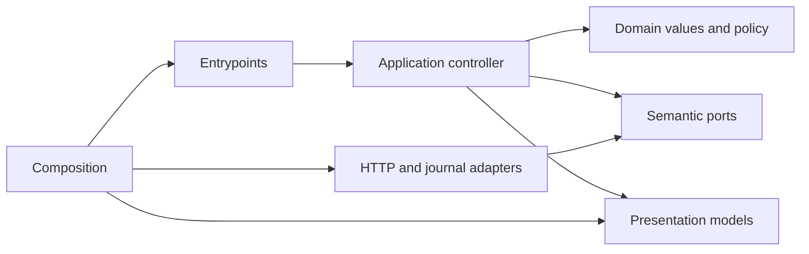

# Household entry interface

- Status: Draft
- Date: 2026-10-31
- Catalog capability ID: application-experience
- Last verified: not applicable; prospective
- Owners: Domus maintainer and product owner
- Scope: Explicit setup, join and landing in both native and standalone deployments
- Related issues/PRs: [#8](https://github.com/vypdev/domus/issues/8); merged foundations described in section 2
- Required review gates: UX, architecture, tests, docs, security/operations
- Open decisions blocking readiness: none; execution and acceptance remain unproven

> This is a proposed companion specification. Its publication and verification on the exact managed branch are prerequisites to implementation. No runtime acceptance is claimed.

## 1. Executive summary

Provide an explicit, responsive household entry interface for native and standalone deployments, in English and Spanish with English fallback. Opening, signing in and reading never initializes a household or enrolls a person. Setup and enrollment require a deliberate user action and current server authorization. The first release serves all six domains and both isolated Stable and Edge channels; this increment supplies entry, setup and join only. Preserve current identity, authorization, idempotency and isolation contracts.

```text
Open under the accepted application base -> verify server session and access -> show the permitted next step -> on deliberate setup/join, persist the original command -> show its truthful result and refresh current state
```

## 2. Problem, current behavior, and evidence

### 2.1 Problem

A household administrator or participant needs an understandable entry point for setup, enrollment and current access. Without an interface, users cannot safely distinguish unconfigured, pending, active, suspended, archived and unavailable states. Accidental entry or refresh must not create household state or membership.

### 2.2 Current behavior

1. At immutable base `a63b2315cd5121dde9585ba8875e286fdef5330e`, no household UI is evidenced by the supplied catalog.
2. Merged PR #7 supplies tested identity and storage foundations.
3. Merged PR #10 proves locked Lit/Vite/Storybook/Chromium execution with a fictional fixture, not product coverage.
4. PR #12 records task-policy defaults. Installed Edge.3 is separate.
5. Existing native and standalone entrypoints are `backend/src/domus/entrypoints/native_http.py` and `backend/src/domus/entrypoints/http.py`. These are distinct repository paths.

### 2.3 Evidence

- Code/workflow/documentation references: immutable base and catalog inventory stated above; current catalog lists `specs/application-experience.md` and the documentation paths in section 15 as evidence locations.
- Incidents or concrete examples: none supplied.
- External primary sources: none required for this proposal.
- Unknowns: implementation execution, product coverage and acceptance remain unproven. PR #10's fixture is not runtime product acceptance.

### 2.4 Retrospective classification (as-built baselines only)

Not applicable: this is a prospective specification and reconstructs no implemented baseline.

## 3. Actors, surfaces, and terminology

| Actor | Goal | Entry point | Visible surfaces |
|---|---|---|---|
| HA administrator | Set up a household | Verified entry interface | Setup form and result |
| Verified participant | Request own linkage | Verified entry interface | Enrollment and membership state |
| Active member | Read permitted facts | Household landing | Own permissions and available facts |
| Missing/grace visitor | Understand access and next step | Entry interface | Sign-in/reopen or read-only guidance |
| Maintainer | Verify execution and cleanup | CI, evidence and docs | Build, browser and cleanup artifacts |

Current authority is distinct from an original receipt; a historical effect may be absent. A journal grants no authority. `application_base` locates the UI and is not an actor or HA endpoint. Stable and Edge are isolated channels. Native and standalone are deployment modes. `pending` is a verified linkage without active access.

## 4. Goals

### 4.1 Goals

| Requirement | Behavior |
|---|---|
| ENTRY-01 | Render a responsive, owned Lit/TypeScript/Vite entry interface in English and Spanish with English fallback, truthful loading/state/freshness, and no invented domain facts. |
| ENTRY-02 | Use existing native or standalone authentication and server-proven deployment/user context; keep assets, API and navigation within the verified same-origin application base. |
| ENTRY-03 | Offer explicit default-mapping household setup only when permitted; validate name/timezone; never initialize on sign-in, entry or refresh. |
| ENTRY-04 | Support deliberate own enrollment and all membership states; pending has no active access; suspended/archived linkage cannot be replaced by self-enrollment. |
| ENTRY-05 | Show only authorized actual household/own-permission facts; bounded HA outages remain visibly read-only through the original session deadline. |
| ENTRY-06 | Preserve the bounded per-tab command journal, original key/payload and uncertain/historical outcomes; never create automatic duplicate work. |
| ENTRY-07 | Keep inner layers framework-free, ports semantic, adapters strict, delivery reproducible, trust boundaries enforced, and owned resources cleaned up. |
| ENTRY-08 | Establish actual unit/component/Storybook/Playwright execution, all four authored frontend coverage metrics at 100%, architecture negatives and fail-closed every-PR CI with truthful artifacts. |

### 4.2 Non-goals

Full member/policy/recovery administration, alternate mapping selectors requiring a verified directory, domain UIs, and the HA entity/service companion are later work. No fake working controls or counts, Copilot/gateway changes, private HA UI dependency, mandatory cloud, or new public port.

### 4.3 Fixed product/safety invariants

Server-proven identity and current policy, scoped receipt disclosure, atomic idempotency, household/channel isolation, source revocation and last-administrator protection remain unchanged. Client presentation cannot grant authority.

## 5. Current versus proposed product journey

| Stage | Current | Proposed | User/operator effect |
|---|---|---|---|
| Entry | No household UI evidenced | Read verified session and authorization | User sees actual state without a write |
| Setup/join | No UI evidenced | Deliberate authorized command, journaled before send | User sees explicit consequences and receipt |
| Result | No UI evidenced | Refresh actual state; preserve uncertain original command | No duplicate automatic action |


Text equivalent: opening verifies and reads; an authorized deliberate action is persisted before sending; the interface reports the result and refreshes actual state.

## 6. Functional behavior and state model

### 6.1 Happy path

1. Load assets and requests relative to the accepted `application_base`.
2. Read session and authorization; show only server-proven context and permitted facts.
3. An authorized administrator may enter a household name and timezone, review the default mapping, and explicitly submit setup. An eligible participant may explicitly request own enrollment.
4. Persist exact command context and idempotency key before sending. Show actual result, then refresh state.

### 6.2 Alternative paths

- Native uses the existing HA session; standalone uses deliberate sign-in. Missing or expired identity follows the deployment's existing authentication path.
- Preview without persistent APIs reports unavailable and offers no household commands.
- Active membership without household-read permission exposes own context only.
- An unresolved command offers a distinct, deliberate “Check previous request” only after fresh identical-context proof; it reuses the original command, including for pending enrollment.
- Known rejection, changed context, suspension, expiry or permission loss never becomes grace access or an automatic retry.

### 6.3 State machine

| State | Entered when | User-visible meaning | Allowed next states | Recovery/owner |
|---|---|---|---|---|
| Unconfigured, setup allowed | Server reports `setup_allowed` | Setup is available | Configured, conflict, unavailable | Administrator submits explicitly |
| Unconfigured, setup denied | Server denies setup | Ask an HA administrator | Recheck | Administrator |
| Not enrolled | Server reports eligible enrollment | Request own membership | Pending, conflict, unavailable | Participant acts explicitly |
| Pending | Verified linkage, inactive access | Wait/contact administrator; refresh | Active, suspended, archived | Administrator/recheck |
| Active | Current access proven | Show permitted facts and own permissions | Suspended, archived, stale | Server policy/recheck |
| Suspended or archived | Existing linkage inactive | Ask administrator to review it | Active or unchanged | Administrator; no replacement self-link |
| Missing/expired identity | Session absent or expired | Reopen HA or sign in | Verified or unchanged | Existing auth flow |
| Read-only grace | Original unexpired grace session | Cached permitted reads only until original deadline | Verified or expired | Reauthenticate; no writes |
| Unavailable/stale/denied | Read failed, stale or prohibited | Show cause and next action, not empty success | Recheck or verified state | User/server |

Duplicate submission is disabled in flight. No automatic retry, rebase or new key follows timeout, transport loss or uncertain 500. Reuse only the original command after full fresh identical-context proof and deliberate recovery. A retired view's response cannot replace a newer view or subject. Partial completion and receipts never assert current membership.

The Application controller refreshes proof/current state before setup, enrollment, recovery or resolved-request dismissal. Server ports bind every read and send to the expected context as an assertion, never an actor selector; concrete adapters must reject a mismatch. Prepared/uncertain work blocks a new key. Recovery checks the original command independently of new-write eligibility: pending own enrollment may recover its original receipt; setup requires current setup permission or active household-management permission. Dismissal never evicts unresolved work. A late receipt is retained without renewing an expired session or exposing expired authority. Reads and all continuations are generation-fenced; cancellation cannot undo a sent command. Native sign-out never invokes standalone revocation, and standalone logout proceeds even when owned storage clearing is unconfirmed.

Existing internal routes are protocol routes, not file names. Browser requests resolve relative equivalents under `application_base`, never the origin root through Ingress.

| Route | Contract |
|---|---|
| `GET /api/v1/session` | Existing `SessionResponse`: verified identity/admin, access/freshness/lifetime and next steps; native source `home_assistant_ingress`. |
| `GET /api/v1/authorization` | Existing `AccessResponse`: states, setup/enrollment flags, own member, policy revision, effective role, household administration scope/permissions and next steps. |
| `GET /api/v1/household` | Permitted `household_id`, name, timezone and revision. |
| `GET /api/v1/auth/csrf` | Actual session CSRF; never journal it. |
| `POST /api/v1/household` | Strict name, timezone, expected revision zero, mapping `all_ha_administrators`; omit `selected_ha_user_id`. |
| `POST /api/v1/members/enrollment` | Strict expected revision zero; server derives actor. |
| `GET /api/v1/operations/{operation_id}` | Original own receipt and actual delivery state, subject to current original-command authority. |

Own member data includes only permitted linkage/exceptions. Omitted fields never grant access. Setup name is at most 160 characters and timezone at most 128; backend validates both. Other backend mappings have no selector in this increment. No body selects actor, installation or household. Writes preserve actual Origin, `X-CSRF-Token`, original `Idempotency-Key`, strict JSON/revision/body/header/deadline guards and `Content-Type: application/json`. Keys are 1–128 ASCII characters, initial alphanumeric, then alphanumeric/underscore/dot/colon/hyphen.

Receipts report committed/historical state, `archived_by`, operation ID, original result, UTC epoch-millisecond creation time and action guidance. A historical effect may be absent; receipt is not current membership. Identical payload/key recovers the original receipt before stale-revision rejection; changed payload or stale new write conflicts. Refresh actual state after a result. Blocked errors carry code/message/action/correlation ID. Distinguish 401, 403, 409, 422, 503 from uncertain 500/timeout/transport loss. Never render raw errors. Console approval has no HTTP endpoint.

Authenticated session context adds installation ID, stable/edge channel, native/standalone deployment, `application_base`, household API availability and nonsecret server time (UTC epoch milliseconds). Derive from validated server installation/composition and accepted native prefix or fixed standalone root, never request-selected host, command or journal. Existing HA identity/access remains proof/freshness. Server time plus monotonic page elapsed time anchors journal lifetime; regression fails closed.

The session wire context contains installation_id, channel, deployment, application_base, household_api_available, server_time and expires_at. Server time and the absolute session deadline use one process-local UTC/monotonic anchor; fresh reads or later wall-clock adjustments cannot extend the original lease. The frontend HTTP adapter sends exactly one X-Domus-Context assertion on bound personal reads and commands, encoded as v1:installation:channel:subject from verified metadata. Both server compositions compare it to their actual installation/channel/verified human before protected work. A mismatch, duplicate, empty, non-ASCII or oversized assertion fails closed without echoing the expected context. This is an assertion, never authentication, an actor selector or a substitute for CSRF/current authorization. Legacy raw API callers may omit it; the new UI must not. Preview reports unavailable business APIs honestly.

Native retains actual Supervisor peer, accepted bounded prefix, exact-human/binding checks and HA session; no second OAuth/Domus cookie. Technical Core authority never becomes a human role. Nonpersonal shell/assets remain behind source/binding guards; personal APIs require proof. Standalone keeps operator origin, state/S256/single-use callback and private session. Deliberate `GET /api/v1/auth/start` succeeds only to fixed same-origin entry shell, with no caller-chosen redirect. `POST /api/v1/auth/logout` keeps Origin/CSRF and truthful revocation/unconfirmed guidance. Native invokes no standalone logout: clear owned tab data/presentation and explain HA-owned sign-out without claiming Supervisor revocation.

## 7. User-facing configuration

| Input | Type | Recommended default | Allowed values/range | Scope/persistence |
|---|---|---|---|---|
| Household name | Text | Explicit user entry | Backend bound: 160 characters | Draft then authorized command |
| Timezone | Text | Explicit user entry | Backend bound: 128 characters and catalog validation | Draft then authorized command |
| Initial mapping | Enum | `all_ha_administrators`; explain before submit | Only this selector in this increment | Existing policy snapshot |
| Journal lifetime | Duration | One hour | Fixed from original server-time anchor | Retry cannot extend |
| Journal capacity | Count/bytes | Eight records, 64 KiB | Fixed limits | Versioned owned per-tab sessionStorage |
| Language | Locale | Explicit supported choice, else browser locale | English, Spanish; English fallback | Presentation only |

Invalid values preserve the draft and show associated validation. Server validates final inputs. Mapping alternatives are not exposed here. Unknown/future journal versions fail closed. Browser timezone, credentials, policy grants and safety invariants are not configurable. Recommended setup uses the default mapping; a meaningful future alternative is a verified-directory selector, explicitly outside this increment.

## 8. Clean Architecture

### 8.1 Responsibilities and dependency direction

| Layer/boundary | Owns | Must not own/import |
|---|---|---|
| Domain/pure policy | Typed entry/journal values and invariants | DOM, storage, fetch, Lit, provider framework |
| Application | Controller and semantic session/household/journal/clock/entropy ports | Concrete SDK/process concerns |
| Adapters/data | Strict HTTP/context decoding and owned storage/URL/time ports | Product policy or authority grants |
| Infrastructure/composition | Wiring, cancellation, resource release | Business decisions |
| Entrypoints | Adapt trusted/untrusted events and delivery context | Duplicated orchestration |
| Presentation | Lit rendering and semantic models | Concrete adapters or mutation policy |



### 8.2 Contracts, state, and trust boundaries

Pure decisions validate entry state and journal bounds. Application contracts are typed and immutable; semantic ports express capabilities. Server remains authoritative for durable household/member state, policy and receipt. Browser journal is per-tab recovery metadata, never authority. Persist exact action/payload/revision/key/context, creation/deadline, stage and known operation reference before first send. Server atomic idempotency and current authorization govern recovery. HTTP/context, storage and host inputs are untrusted; decode strictly and map provider failures to safe typed states.

### 8.3 Executable architecture constraints

Check full-source inward imports, cycles/unresolved imports, production/test separation, forbidden private parent DOM/storage/HA object/message access, and meaningful negative fixtures. No release skip-auth or fixture grant. Generation fencing prevents stale view/session responses. Reuse `tooling/frontend-coverage.mjs` for separate UI scope. Python delivery/context stays in existing entrypoints/composition; household application/domain remain authoritative and framework-free.

## 9. UI/UX and content contract

### 9.1 Information hierarchy

Show current status, completed facts, next transition, required human action, impact and inspectable result, then collapsed technical evidence. Use one primary action. Loading, denied, unavailable, stale and genuinely empty are distinct. No synthetic totals. Forms retain drafts, label inputs, associate errors, focus errors and announce status. Pending explains inactive access; suspended/archived asks review of existing linkage; historical explains the absent effect. Grace shows its original deadline and is visibly read-only.

### 9.2 Representative primary view

```markdown
# Household setup

> **Current status:** No household is configured.
>
> **Action required:** An HA administrator can set up the household.

## Progress

- [x] Your current session and setup permission were verified.
- [ ] Choose a household name and timezone, then review the default administrator mapping.

## What happens next

Domus will submit setup only after you choose **Create household**. Opening or refreshing this page never creates it.

## Links

[Household setup help](../docs/household-entry-interface.md)

<details>
<summary>Technical details</summary>

Sanitized state, channel, freshness and correlation reference only.
</details>
```

Concrete state variants:

- **Pending/no action:** “Your membership request is pending. You do not have active household access yet.” Next: “Refresh status” or contact an administrator; no new enrollment action.
- **Action required:** “No household is configured.” Next: eligible administrator completes the labeled name/timezone form and confirms the default mapping.
- **Blocked before effect:** “Setup was not accepted. No household change was confirmed.” Cause: “The server rejected the current revision.” Next: refresh authorization and review the retained draft. Retained state: original command and key; no automatic rebase.
- **Partially complete/uncertain:** “We could not confirm whether your request completed.” Cause: “The connection ended before a result arrived.” Next: after fresh identical-context verification, choose “Check previous request.” Retained state: original payload/key and deadline; no new command.
- **Completed:** “Household setup completed.” Show actual returned name/timezone and current state after refresh; offer the next permitted action.

### 9.3 Issue, PR, and comment behavior

This companion adds no GitHub automation, issue mutation, PR lifecycle, comments, labels or notifications. The issue is the discoverable request: title “✨ - Deliver the household entry interface for native and standalone deployments”; use its canonical link in this spec. If future implementation PRs report status, their summary must lead with actual state, completed work, next action, impact and descriptive links; separate simulated fixture evidence from live acceptance. No automated comment budget is introduced.

### 9.4 Accessibility, localization, and responsive behavior

Stable translation keys. Explicit supported UI choice wins; otherwise normalize browser `en-*` to English and `es-*` to Spanish. Unsupported/missing languages and localized keys fall back to English; set document language and accessible labels. Language changes no authority, API target, journal lifetime or business record. English remains the code/comment/issue/docs language; Spanish translation data provides confirmed UI support. At 360 CSS pixels no page-level horizontal scroll. Require keyboard-only operation, visible focus, accessible names, error focus, light/dark contrast, reduced motion and status not conveyed by color alone. Bind hostile text inertly; never unsafe HTML, executable commands or unsafe links. Storybook uses fictional data for loading/setup/join/pending/active/suspended/archived/denied/grace/invalid/uncertain/historical. Human UX review follows concrete rendering.

## 10. Failure, recovery, and cleanup

| Failure/partial state | User impact | Retained facts | Automatic retry | Required action | Cleanup |
|---|---|---|---|---|---|
| Storage absent, corrupt, overflow or pre-send failure | Mutation cannot safely proceed | Draft and safe guidance; existing records retained | No | Repair/reload or use supported browser context | Never silently evict unresolved work |
| Timeout, transport loss or uncertain 500 | Effect unknown | Original command/key and immutable deadline | No | Fresh identical context, deliberate check previous request | Preserve until deadline/capacity policy |
| Known denial, suspension, expiry or context change | Access/action unavailable | Safe status only | No | Reauthenticate or administrator review | Hide incompatible journal; never replay |
| HA outage during eligible grace | Read-only until original deadline | Authorized local facts and original deadline | Reads bounded; no writes | Restore service or reauthenticate | Expiry ends local retention |
| Logout/leave | Local presentation ends | Server history remains | No | Follow deployment-specific sign-out guidance | Clear owned data; report uncertainty if clear fails |
| Retired view or teardown | Late result must not alter current view | Current generation only | No | None | Abort owned reads, fence results, release listeners |

Journal is versioned, eight records/64 KiB, per-tab, scoped to server-returned installation/channel/verified subject. Validate bounds and persistence before send. Missing/unavailable/corrupt/future-version/overflow/pre-send failure blocks mutation. Involuntary session loss retains but hides records until full fresh identical context. Another context clears incompatible owned records without revealing/replaying them. Use fresh server time plus monotonic page elapsed time; retries cannot extend the original one-hour deadline. Regression/future inconsistency fails closed. Reload requires fresh context. Expiry/tab closure ends browser retention; server history remains durable. Deliberate logout clears owned journal/presentation; failed clearing is reported, memory discarded, and applicable sign-out completed without claiming persistent cleanup or restoring authority. Never touch HA private storage/cookies. Fixture cleanup removes identified data while retaining compact evidence/current rollback; browser proof needs no owner household mutation.

The first owned journal format is canonical JSON with exactly version=1, context, observedAt and records. Context contains installationId (canonical UUID), channel (stable/edge) and subject (the server's bounded identifier). Records contain only key, action, payload, createdAt, expiresAt, stage and operationId. Actions are setup (the four existing default-mapping fields) or enroll (expected_revision zero). Persist original payload values without normalization. Stages are prepared, uncertain, committed, historical or rejected; committed/historical require the original operation ID, others null. A known operation cannot be replaced or downgraded. No credentials, raw error or arbitrary transport fields are admitted.

All times are safe nonnegative epoch-millisecond integers. expiresAt equals createdAt plus 3,600,000; creation cannot be future-dated and observedAt cannot regress. Refreshing the observation never changes an original deadline. Expired records may be pruned; unresolved unexpired records are never silently evicted. A resolved record may be explicitly dismissed. Eight records remain valid; the ninth is rejected. Canonical JSON decoding rejects duplicate keys and alternate encodings before interpretation, with a 65,536-byte UTF-8 bound.

After fresh server context and current-state reads, opening may establish and verify an empty owned local journal; this creates no household or membership. Missing/unavailable storage capability blocks mutation. Later external change/loss invalidates the opened handle until fresh context/state is obtained again. The adapter compares the exact previously observed serialized value, writes only its owned key and confirms readback before exposing success. Known different context clears incompatible local records before use; unsupported versions/corruption fail closed. Detach hides memory without deleting involuntarily lost-session evidence. Explicit clear drops memory first, removes/verifies only the owned key and reports uncertainty on failure. A post-commit persistence failure never negates a server receipt or authorizes a new key.

Errors follow impact → cause → action → retained state. They never imply an already successful irreversible action failed.

## 11. Security, permissions, and privacy

1. Existing server identity, current policy, scope, receipt and atomic guards remain authoritative. Writes/recovery need fresh full proof; outage reads stop at original expiry. Cached display grants nothing.
2. Journal, bundles and diagnostics exclude tokens, cookies, CSRF, OAuth material, raw errors and private HA storage.
3. Assets/API/navigation remain in verified same-origin supported base. Reject foreign endpoints/redirects, traversal, malformed prefixes and credential forwarding. No private host hints, CDN, CORS expansion, service-worker credential cache, new port or installation privilege expansion.
4. Storage never authenticates. Writes require actual session CSRF and Origin. Hostile text/markup/URL is inert; no actor/installation/household selection by request body.

## 12. Observability and operational UX

Show safe status, channel, freshness and validated operation/correlation references. Do not expose journal, credentials, private Ingress or household diagnostics. Retain source/runtime/browser identity, commands, assertions, case counts, screenshots and cleanup evidence. Keep source/build/fixture/owner claims distinct. Fixture proof is not live HA acceptance. No issue comments or notifications are generated by this feature.

## 13. Compatibility, migration, rollout, and rollback

- Existing in-flight operations and server receipts remain authoritative; no business migration is implied.
- Unknown journal versions are rejected safely; journal loss never prunes server receipts.
- Native public base is accepted Supervisor prefix plus separator; standalone supports root only. Escaped bootstrap conveys deployment/base, no grant or credential. Preserve fixed standalone callback, native trust, base-relative assets, allowlisted MIME, traversal protection, actual CSP and no-store personal responses. Missing assets/API errors never become shell success.
- Use locked compatible Lit/TypeScript/Vite, Storybook and Playwright. Existing policy-tool versions do not prove framework execution support. Fix unsupported runner/measurement scope; never omit runtime or metrics.
- Edge.3 remains immutable. Any new package/adoption needs exact pin, artifact and rollback, isolated channels and separate live/companion acceptance. Roll back UI delivery without claiming reversal of an already committed household operation.

## 14. Testing strategy

The 48 cases below are prospective distinct executable cases; no UI execution is claimed. Existing framework-fixture results add no case credit. Area labels: Domain = domain/configuration/planning; Application = state/idempotency/races; Adapters = provider contracts; Delivery = workflows/setup/schema; UX = UI/localization/sanitization; Integration = security/migration. Repeated runs/viewports do not add cases.

| Area | Minimum distinct cases | Behaviors/risks covered |
|---|---:|---|
| Domain | 8 | Observable scenarios in the case inventory. |
| Application | 9 | Observable scenarios in the case inventory. |
| Adapters | 8 | Observable scenarios in the case inventory. |
| Delivery | 7 | Observable scenarios in the case inventory. |
| UX | 8 | Observable scenarios in the case inventory. |
| Integration | 8 | Observable scenarios in the case inventory. |
| Total | 48 | Distinct inventory cases; repeated executions do not add cases. |

| Case ID | Area | Requirements | Scenario |
|---|---|---|---|
| household-entry-interface-C01 | Domain | ENTRY-01, ENTRY-04 | All membership states select defined action; profile labels never grant access. |
| household-entry-interface-C02 | Domain | ENTRY-02 | Validated server metadata selects context; host message cannot replace it. |
| household-entry-interface-C03 | Domain | ENTRY-03 | Default-only setup UI retains other backend mappings for later selectors. |
| household-entry-interface-C04 | Domain | ENTRY-03, ENTRY-07 | Invalid name/timezone preserves draft; backend validation cannot be bypassed. |
| household-entry-interface-C05 | Domain | ENTRY-06 | Reject malformed/future journal version, action, shape or original command fields. |
| household-entry-interface-C06 | Domain | ENTRY-06 | Retry/backward clock cannot extend original one-hour journal deadline. |
| household-entry-interface-C07 | Domain | ENTRY-06 | Unresolved command retains original payload, action, revision and key. |
| household-entry-interface-C08 | Domain | ENTRY-01, ENTRY-05 | Unavailable facts never become zero, empty success or synthetic totals. |
| household-entry-interface-C09 | Application | ENTRY-02, ENTRY-03, ENTRY-04 | Open, sign-in and refresh issue no setup/enrollment mutation. |
| household-entry-interface-C10 | Application | ENTRY-04, ENTRY-06 | Pending offers refresh/admin review; no new enrollment or replacement linkage. |
| household-entry-interface-C11 | Application | ENTRY-06 | Repeated in-flight submission produces one request/key and one pending result. |
| household-entry-interface-C12 | Application | ENTRY-06 | Lost committed response: deliberate same-key replay returns one receipt/effect. |
| household-entry-interface-C13 | Application | ENTRY-05, ENTRY-06 | Permission loss/suspension before retry is server-enforced; no cached grant. |
| household-entry-interface-C14 | Application | ENTRY-06 | Revision/key conflict retains draft; no silent rebase or new-key retry. |
| household-entry-interface-C15 | Application | ENTRY-02, ENTRY-05 | Outage reads end at original expiry; writes and lease extension remain blocked. |
| household-entry-interface-C16 | Application | ENTRY-05, ENTRY-07 | Retired view response cannot overwrite newer view or another user context. |
| household-entry-interface-C17 | Application | ENTRY-02, ENTRY-06 | Fresh identical-context reauthentication enables deliberate recovery, never auto-write. |
| household-entry-interface-C18 | Adapters | ENTRY-02 | Actual standalone sign-in/logout and native existing-session contracts work. |
| household-entry-interface-C19 | Adapters | ENTRY-02, ENTRY-07 | Native prefixed assets/API/navigation stay within verified public base. |
| household-entry-interface-C20 | Adapters | ENTRY-02, ENTRY-07 | Standalone supported root entry/reload resolves actual built assets and API. |
| household-entry-interface-C21 | Adapters | ENTRY-07 | Malformed/oversized/unexpected API data yields safe error/unavailability, not fake facts. |
| household-entry-interface-C22 | Adapters | ENTRY-02, ENTRY-07 | Writes require actual session CSRF/Origin; storage never authenticates. |
| household-entry-interface-C23 | Adapters | ENTRY-02, ENTRY-07 | Foreign endpoint/host hint/redirect cannot retarget API or export credentials. |
| household-entry-interface-C24 | Adapters | ENTRY-06, ENTRY-07 | Storage/pre-send persistence failure blocks mutation and preserves draft/next action. |
| household-entry-interface-C25 | Adapters | ENTRY-06 | Eight-record/64-KiB overflow is rejected before send; prior records remain. |
| household-entry-interface-C26 | Delivery | ENTRY-07 | Reproducible built UI uses existing listener; no port or UI dependency in domain. |
| household-entry-interface-C27 | Delivery | ENTRY-08 | All runtime, including unimported modules: four metrics at 100% globally/per file. |
| household-entry-interface-C28 | Delivery | ENTRY-08 | Negative fixture fails for uncovered runtime or incomplete supported metrics. |
| household-entry-interface-C29 | Delivery | ENTRY-07, ENTRY-08 | Actual import/cycle/private-host gates accept valid graphs and reject violations. |
| household-entry-interface-C30 | Delivery | ENTRY-08 | Every PR update, including draft/docs-only, runs all suites and strict aggregate. |
| household-entry-interface-C31 | Delivery | ENTRY-01, ENTRY-08 | Real built Storybook exercises normal, pending, denied, unavailable and uncertain states. |
| household-entry-interface-C32 | Delivery | ENTRY-02, ENTRY-08 | Real Chromium runs both compositions; retain browser/build/coverage artifacts. |
| household-entry-interface-C33 | UX | ENTRY-01 | At 360 pixels, primary actions/labels work without page-level horizontal scrolling. |
| household-entry-interface-C34 | UX | ENTRY-01, ENTRY-08 | Keyboard forms, focus, validation messages and accessible names cover full entry. |
| household-entry-interface-C35 | UX | ENTRY-01, ENTRY-05 | Loading/empty/stale/failed reads remain distinct, with understandable next action. |
| household-entry-interface-C36 | UX | ENTRY-01 | English fallback, contrast/themes, reduced motion and status work without color alone. |
| household-entry-interface-C37 | UX | ENTRY-01, ENTRY-07 | Hostile text/markup/links stay inert; no HTML/script/command/unsafe URL execution. |
| household-entry-interface-C38 | UX | ENTRY-03 | Setup explains default mapping; unimplemented selectors never appear working. |
| household-entry-interface-C39 | UX | ENTRY-04 | Suspended/archived guides review existing linkage; no fresh self-linkage. |
| household-entry-interface-C40 | UX | ENTRY-05 | Active view shows current own permissions/denials; hidden controls grant nothing. |
| household-entry-interface-C41 | Integration | ENTRY-02, ENTRY-06 | Wrong subject/installation/channel cannot reveal or replay old journal. |
| household-entry-interface-C42 | Integration | ENTRY-02, ENTRY-06 | Logout clears owned journal/local access; cleanup uncertainty never restores authority. |
| household-entry-interface-C43 | Integration | ENTRY-02, ENTRY-07 | Wrong source/origin/malformed host hints cannot alter identity, role or context. |
| household-entry-interface-C44 | Integration | ENTRY-06 | Historical receipt identifies absent effect; no automatic fresh-key resubmission. |
| household-entry-interface-C45 | Integration | ENTRY-02, ENTRY-07 | No tokens/cookies/CSRF/OAuth/private host storage in journal, bundle or diagnostics. |
| household-entry-interface-C46 | Integration | ENTRY-06, ENTRY-07 | Reload/session loss/expiry/tab closure preserve server receipts and uniqueness guards. |
| household-entry-interface-C47 | Integration | ENTRY-03, ENTRY-06 | Racing administrators reconcile singleton setup and losing conflict; no duplicate home. |
| household-entry-interface-C48 | Integration | ENTRY-07, ENTRY-08 | Teardown releases owned resources, records fixture cleanup and never claims owner adoption. |

Run actual Vitest unit/components and Chromium V8 coverage over every authored runtime module, including unimported modules: statements, branches, functions and lines are 100% globally and per file, separate from backend/tooling/policy. Negatives fail on uncovered code or incomplete metrics. HTML/styles/config receive actual build/browser checks. Owned code stays strict; runtime dependency declarations are checked. Only catalog third-party Storybook declarations may use documented bounded `skipLibCheck`, with an owned-story type negative.

Build/exercise Storybook and real Chromium prefixed-native/root-standalone journeys: disposable SQLite, outer HA/Supervisor fixtures, DOM/assets/requests, reload/reauth/context races, accessibility/keyboard, layouts/CSP/teardown. Simulation is not live HA; no release bypass flag. Every PR, including draft/docs-only, runs actual architecture/host-access negatives and all existing suites; aggregate fails on missing/skipped/failing required jobs. Retain separate coverage/browser/build artifacts. Full-context current-head Bugbot must have no unresolved findings; skipped/partial/neutral analysis cannot pass. Evidence-based dismissal preserves native review history. Manual UX evidence must assess readable rendering, focus, contrast and recovery guidance in both locales/deployments.

## 15. Documentation and discoverability

| Path | Change |
|---|---|
| `specs/household-entry-interface.md` | create |
| `frontend/src/domain/entry.ts` | create |
| `frontend/src/domain/journal.ts` | create |
| `frontend/src/application/ports.ts` | create |
| `frontend/src/application/entry-controller.ts` | create |
| `frontend/src/adapters/http.ts` | create |
| `frontend/src/adapters/session-journal.ts` | create |
| `frontend/src/presentation/domus-app.ts` | create |
| `frontend/src/presentation/styles.ts` | create |
| `frontend/src/presentation/messages.ts` | create |
| `frontend/src/composition/main.ts` | create |
| `frontend/index.html` | create |
| `frontend/vite.config.ts` | create |
| `frontend/vitest.config.ts` | create |
| `frontend/playwright.config.ts` | create |
| `frontend/tsconfig.json` | create |
| `frontend/.storybook/main.ts` | create |
| `frontend/.storybook/preview.ts` | create |
| `frontend/stories/entry.stories.ts` | create |
| `frontend/tests/domain.test.ts` | create |
| `tests/frontend/coverage-evidence.test.mjs` | create |
| `frontend/tests/journal.test.ts` | create |
| `frontend/tests/session-journal.test.ts` | create |
| `frontend/tests/controller.test.ts` | create |
| `frontend/tests/http.test.ts` | create |
| `frontend/tests/component.test.ts` | create |
| `frontend/tests/language.test.ts` | create |
| `frontend/tests/e2e/entry.spec.ts` | create |
| `tests/browser/entry_server.py` | create |
| `backend/src/domus/entrypoints/ui_http.py` | create |
| `backend/src/domus/entrypoints/entry_context.py` | create |
| `tests/backend/test_entry_context.py` | create |
| `tests/backend/test_auth_http.py` | update |
| `tests/backend/test_household_http.py` | update |
| `tests/backend/test_ha_app_launcher.py` | update |
| `tests/backend/test_ui_http.py` | create |
| `tests/backend/test_ui_session.py` | create |
| `docs/household-entry-interface.md` | create |
| `docs/evidence/household-entry-interface.json` | create |
| `frontend/package.json` | update |
| `package.json` | update |
| `pnpm-lock.yaml` | update |
| `tsconfig.json` | update |
| `architecture/frontend.mjs` | update |
| `tests/node/architecture.test.mjs` | update |
| `.github/workflows/ci_check.yml` | update |
| `tooling/domus_tooling/ci_policy.py` | update |
| `tests/python/test_ci_contract.py` | update |
| `backend/pyproject.toml` | update |
| `backend/src/domus/entrypoints/http.py` | update |
| `backend/src/domus/entrypoints/native_http.py` | update |
| `backend/src/domus/composition/server.py` | update |
| `backend/src/domus/composition/ingress.py` | update |
| `docs/contracts/auth-api.openapi.json` | update |
| `docs/contracts/household-api.openapi.json` | update |
| `docs/contracts/native-household-api.openapi.json` | update |
| `docs/household-api.md` | update |
| `docs/native-household-api.md` | update |
| `docs/development.md` | update |
| `docs/roadmap.md` | update |
| `specs/catalog.json` | update |
| `specs/CATALOG.md` | update |
| `specs/_template.md` | reference |
| `specs/application-experience.md` | reference |
| `specs/household-identity.md` | reference |
| `specs/platform-foundation.md` | reference |
| `specs/platform-foundation-identity-sqlite.md` | reference |
| `docs/administrator-recovery.md` | reference |
| `docs/ha-identity-protocol.md` | reference |
| `docs/m1-acceptance-audit.md` | reference |
| `pnpm-workspace.yaml` | reference |
| `vitest.config.mjs` | reference |
| `tooling/frontend-coverage.mjs` | reference |
| `docs/evidence/frontend-toolchain.json` | reference |
| `addon-edge/Dockerfile` | reference |
| `addon-edge/config.yaml` | reference |
| `docs/acceptance-plan.md` | update |

Create paths are proposed, not evidence of current files. Existing paths are base-verified. Declare refinements before code. Label protocol notation. User docs cover normal path/defaults; setup owners get permissions and configuration; operators get state/recovery/cleanup; contributors get architecture/contracts; migration and troubleshooting remain discoverable. Keep evidence and cleanup current. Fixture proof is separate from owner adoption.

## 16. Acceptance

These are executable, prospective acceptance scenarios, not executed tests. Exercise all 48 inventory cases in both deployments where applicable, including explicit setup/join, pending and existing linkage, current authority/grace, original-command recovery and absent historical effects. No automatic writes. Each gate retains concrete evidence; both languages use identical case identities.

1. Given an unconfigured authorized administrator, when the user opens or refreshes entry, then no write occurs; when they submit the validated form, then setup uses the default mapping and actual server result is shown.
2. Given an eligible participant, when they deliberately request membership, then the server derives the actor and the interface shows the actual pending or resulting state.
3. Given pending, suspended or archived membership, when entry renders, then it explains inactive access and offers refresh/review without replacement self-enrollment.
4. Given an uncertain command result, when the user returns with fresh identical context and chooses “Check previous request,” then the original payload/key is reused; no automatic retry or new key occurs.
5. Given a stale revision or known denial, when the command is rejected, then the draft and safe next action remain and no rebase is attempted.
6. Given forged host/context data or a foreign redirect, when requests are formed, then identity and same-origin base cannot be changed and credentials are not forwarded.
7. Given a 360-pixel viewport or keyboard-only use, when both locales render, then no page-level horizontal scroll occurs and forms, focus, labels, errors and status remain accessible.
8. Given built artifacts and CI, when the required checks run, then all cases, architecture negatives, coverage thresholds and evidence gates are present; fixture execution is not reported as live HA acceptance.

## 17. Requirements traceability

| Requirement | Cases |
|---|---|
| ENTRY-01 | household-entry-interface-C01, household-entry-interface-C08, household-entry-interface-C31, household-entry-interface-C33, household-entry-interface-C34, household-entry-interface-C35, household-entry-interface-C36, household-entry-interface-C37 |
| ENTRY-02 | household-entry-interface-C02, household-entry-interface-C09, household-entry-interface-C15, household-entry-interface-C17, household-entry-interface-C18, household-entry-interface-C19, household-entry-interface-C20, household-entry-interface-C22, household-entry-interface-C23, household-entry-interface-C32, household-entry-interface-C41, household-entry-interface-C42, household-entry-interface-C43, household-entry-interface-C45 |
| ENTRY-03 | household-entry-interface-C03, household-entry-interface-C04, household-entry-interface-C09, household-entry-interface-C38, household-entry-interface-C47 |
| ENTRY-04 | household-entry-interface-C01, household-entry-interface-C09, household-entry-interface-C10, household-entry-interface-C39 |
| ENTRY-05 | household-entry-interface-C08, household-entry-interface-C13, household-entry-interface-C15, household-entry-interface-C16, household-entry-interface-C35, household-entry-interface-C40 |
| ENTRY-06 | household-entry-interface-C05, household-entry-interface-C06, household-entry-interface-C07, household-entry-interface-C10, household-entry-interface-C11, household-entry-interface-C12, household-entry-interface-C13, household-entry-interface-C14, household-entry-interface-C17, household-entry-interface-C24, household-entry-interface-C25, household-entry-interface-C41, household-entry-interface-C42, household-entry-interface-C44, household-entry-interface-C46, household-entry-interface-C47 |
| ENTRY-07 | household-entry-interface-C04, household-entry-interface-C16, household-entry-interface-C19, household-entry-interface-C20, household-entry-interface-C21, household-entry-interface-C22, household-entry-interface-C23, household-entry-interface-C24, household-entry-interface-C26, household-entry-interface-C29, household-entry-interface-C37, household-entry-interface-C43, household-entry-interface-C45, household-entry-interface-C46, household-entry-interface-C48 |
| ENTRY-08 | household-entry-interface-C27, household-entry-interface-C28, household-entry-interface-C29, household-entry-interface-C30, household-entry-interface-C31, household-entry-interface-C32, household-entry-interface-C34, household-entry-interface-C48 |

## 18. Implementation sequence

1. Publish and verify this companion on the exact managed branch; settle contracts, decisions and architecture checks.
2. Implement pure domain/journal policies and tests.
3. Implement application orchestration and deterministic race/recovery tests.
4. Implement HTTP/session/storage adapters and backend delivery contracts.
5. Implement presentation, fixtures, accessibility and localization.
6. Complete migration/recovery/security documentation, CI and evidence artifacts.
7. Run integration, coverage, human UX review and final validation. Documentation and UX progress alongside behavior, not after it.

## 19. Definition of Done

- [ ] Every normative requirement has acceptance and traceability.
- [ ] Architecture boundaries are implemented and automatically enforced.
- [ ] Numeric test budget, distribution and coverage requirements pass.
- [ ] Configuration defaults, limits, validation, persistence and migration agree.
- [ ] Primary UI states and content examples are implemented and reviewed.
- [ ] Accessibility, localization, responsive behavior, sanitization and noise budgets pass.
- [ ] User/setup/operator/contributor documentation is complete and discoverable.
- [ ] Failure, partial success, retry, idempotency, security and cleanup pass.
- [ ] Generated artifacts and repository validation commands pass.
- [ ] Catalog evidence and generated catalog are current; `pnpm run validate:specifications` passes.
- [ ] No readiness-blocking decision remains unresolved; execution/acceptance evidence is present before claiming readiness.

## 20. References and decisions

- Primary source: [Issue #8](https://github.com/vypdev/domus/issues/8).
- Immutable catalog/base: `a63b2315cd5121dde9585ba8875e286fdef5330e`; reviewed source snapshot `3e7ceea08e6131360e026937d1c0cc1b120472e0` as stated in the issue.
- Owning specification: `specs/application-experience.md`; the catalog identifies capability `application-experience` as proposed and lists that specification as its current owner. This companion does not own itself.
- Related work: merged PRs #7, #10 and #12 as described in section 2.
- Decision: use the existing application-experience capability and preserve its parent. Both English and Spanish UI are confirmed, with English fallback. No owner product decision remains open. Action publication and exact verified managed branch remain prerequisites to implementation.
- The source declaration names `backend/src/domus/entrypoints/http.py` and `backend/src/domus/entrypoints/native_http.py` as separate existing entrypoints. Protocol routes, Content-Type notation and deployment/access alternatives are not file paths. Browser requests stay relative to accepted application base.
- Proposed source leaves are explicitly listed in section 15. Existing catalog paths establish current source locations only, not future implementation or framework execution support.
