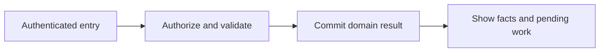
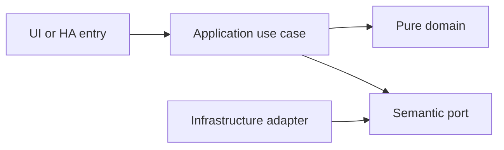

# Household members, Home Assistant identity and permissions

- Status: Draft
- Date: 2026-10-28
- Catalog capability ID: household-identity
- Last verified: 2026-10-29 (document structure only; no implementation evidence)
- Owners: Domus maintainer; engineering/product reviewers to be assigned
- Scope: Each participating person uses their own Home Assistant account. Domus associates that verified user with one household member and applies explicit backend permissions independently of an optional person entity.
- Related issues/PRs: https://github.com/vypdev/domus/issues/2
- Required review gates: product UX, architecture, testing, documentation, security/operations
- Open decisions blocking readiness: Role permission matrix and first-administrator/recovery review; proof of HA authentication in both deployment targets; technical service principal policy. Catalog gate prerequisites remain unverified.

## 1. Executive summary

Each participating person uses their own Home Assistant account. Domus associates that verified user with one household member and applies explicit backend permissions independently of an optional person entity.

```text
Authenticated member -> validated domain command -> durable result -> household and HA projections
```

This is a prospective Draft, not an implemented or accepted capability. The first usable release covers all domains and both deployment targets.

## 2. Problem, current behavior, and evidence

HA users and person entities have different meanings. The owner confirmed individual HA accounts for every participant; a shared adult identity or independent Domus PIN would contradict that requirement.

Current verified sequence: (1) the repository has a minimal README and installed Copilot automation; (2) no Domus application, public service or tests exist; (3) this contract proposes the behavior to build.

Evidence: the owner's attached brief and subsequent decisions in [product vision](../docs/product-vision.md), the pinned [reference investigation](../docs/reference-investigation.md), and the existing repository baseline. Retrospective classification is not applicable: no as-built product baseline is reconstructed.

## 3. Actors, surfaces, and terminology

Actors: Administrator; adult member; restricted member; read-only member; scoped automation principal.

Primary surfaces: application UI, HTTP domain boundary, relevant HA entities/services, activity and diagnostics. Definitions of member, principal, occurrence, demand and ledger are shared in the [glossary](../docs/glossary.md). The actor recording an action is distinct from its selected target and actual performer.

## 4. Goals, non-goals, and fixed invariants

Goals and fixed invariants are the following normative requirements. No configuration may weaken authorization, ledger integrity, attribution or idempotency.

| Requirement | Behavior |
|---|---|
| household-identity-R1 | Every participating member MUST map to a distinct verified HA user; person entities MUST NOT authenticate users. |
| household-identity-R2 | Permissions MUST be enforced in the backend for every read and mutation using administrator, adult, restricted and viewer roles. |
| household-identity-R3 | Suspension, role changes and unlinking MUST revoke effective access without erasing historical actor references. |
| household-identity-R4 | Identity flows MUST work in both deployment targets without trusting arbitrary client headers or exposing HA tokens to diagnostics. |
| household-identity-R5 | Administrators MUST retain control of point values, verification, automation settings and inventory corrections; the last administrator cannot be removed. |
| household-identity-R6 | Members MUST control their locale and notification preferences and view participation without treating points as the sole fairness metric. |

Non-goals: changing Copilot, changing the existing gateway, building an MCP server, adding mandatory cloud/AI dependencies, or claiming production readiness from a document.

## 5. Current versus proposed product journey

| Stage | Current | Proposed | User/operator effect |
|---|---|---|---|
| Enter | No Domus UI | Verified HA principal opens the relevant surface | Role and scope are explicit |
| Act | No domain command | Validate input, permission and current revision | Invalid data leaves the draft intact |
| Commit | No durable domain record | Store change and operation receipt atomically | Retry cannot duplicate effects |
| Observe | No projection | Show committed facts and pending downstream projections | Partial success remains understandable |



Text equivalent: authenticated entry -> authorization and validation -> durable domain commit -> visible facts with any pending projection. Domain-specific alternatives are described below.

## 6. Functional behavior and state model

### 6.1 Domain model and normal path

Member(id, display_name, avatar_reference, ha_user_id, optional person_entity_id, role, active, preferences, revision). The HA user association is unique within the household. A person association supplies profile/presence only. Membership can be invited -> linked -> active -> suspended -> archived; unlinking immediately removes access without deleting historical authorship.

The owner confirmed on 2026-10-29 that adult performers need no completion verification by default and restricted performers require approval by an authorized adult. Administrator control of verification configuration is separate from permission to approve a restricted member's completion. The effective policy follows actual performers; an adult submitting the record does not silently turn restricted work into adult work. Explicit overrides remain administrator-controlled and audited.

### 6.2 States and alternatives

Unlinked membership cannot participate; linked accounts become active after administrator assignment. Suspended users retain historical attribution but cannot access protected reads or commands. The last active administrator cannot be removed.

Authorization applies to operation lookup and duplicate receipts as well as new writes. Replaying a once-authorized command does not bypass a later suspension or expose the old private result to another principal. Household role revocation is checked against current local authority before returning protected data; a snapshotted execution policy is not a permission grant. First-administrator enrollment and recovery after external HA account loss require a reviewed authenticated procedure; never promote the first arbitrary browser session or silently substitute a shared administrator.

A duplicate uses its original operation receipt. A changed payload under the same key is a conflict. Out-of-order events use aggregate revision and source identity. Cancellation never erases an already committed ledger effect; compensation is explicit.

## 7. User-facing configuration

| Input | Type | Recommended default | Allowed values/range | Scope/persistence |
|---|---|---|---|---|
| `default_member_role` | enum | restricted | adult, restricted or viewer; never administrator automatically | household; assigned at activation |
| `session_max_minutes` | integer | 60 | 5..240; revocation checked on each command | installation; bounded server session |
| `locale` | enum | browser preference | en or es, then en fallback | member; persisted |
| `person_entity_id` | optional entity reference | none | person domain only; duplicate mapping rejected | member; persisted |

Owner-confirmed defaults are recorded as accepted choices; other defaults and bounds remain proposals pending review. Invalid values and contradictory combinations are rejected before saving; unknown future values require an explicit compatibility error. Precedence is fixed invariants, installation constraints, household policy, then member preferences; lower scopes cannot expand permissions. In-flight commands snapshot relevant policy versions, while revocation is checked at the transaction boundary.

Recommended example: an administrator activates a linked participant with the restricted role. Meaningful alternative: a viewer can inspect permitted records without receiving mutation grants; changing role is explicit and audited. Transport secrets are installation concerns and are never domain form fields.

## 8. Clean Architecture design

### 8.1 Responsibilities and dependency direction

AuthenticatePrincipal and AuthorizeHouseholdAction are separate use cases. Authentication adapters verify HA identity; MemberRepository maps it to permissions. The application receives a trusted Principal, not an arbitrary member_id as identity. No local passwords or PINs are introduced. A technical HA service principal never inherits an adult role from a caller-supplied field.

| Boundary | Owns | Forbidden dependency |
|---|---|---|
| Domain | Entities, value objects and pure rules | HA, HTTP, SQL, UI frameworks |
| Application | Authorized commands, queries and semantic ports | Concrete adapters and framework DTOs |
| Adapters | Schema mapping, persistence and provider error mapping | Alternate business rules |
| Composition | Explicit deployment wiring | Business decisions |
| Presentation | View models and rendering | Database access or client-only authorization |



Text equivalent: entrypoints call use cases; use cases depend on pure domain and ports; infrastructure implements ports. Architecture checks reject forbidden imports and cycles. Shared contract tests exercise each port adapter; schemas and migration checks enforce durable boundaries.

## 9. UI/UX and content contract

### 9.1 Primary state examples

| State | Visible content |
|---|---|
| Pending | Checking your Home Assistant account. No action required. |
| Action required | Your account is authenticated but is not linked to this household. Ask a household administrator to grant access. |
| Blocked | Your household access is suspended. No changes were saved. Contact an administrator. |
| Partial | The member was updated, but their optional person entity is unavailable. Account access remains linked. |
| Complete | Account linked. Your household role is Restricted member. |

The primary view names current status, retained facts and one next action, followed by descriptive links to the record/operation. Technical codes and correlation IDs are progressively disclosed. Duplicate responses update the same operation status rather than adding notifications. At most one routine notification per transition, with opt-out and bounded retry summaries.

English and Spanish use stable translation keys, base-language matching and English fallback. Mobile, tablet and desktop layouts, keyboard operation, visible focus, non-color status, accessible names, light/dark contrast and reduced motion are acceptance concerns. Untrusted text is rendered inert; no arbitrary HTML, commands or secret-bearing links.

## 10. Failure, recovery, and cleanup

| Failure | Retained facts | Retry / action | Cleanup |
|---|---|---|---|
| Invalid or denied input | Existing business records and form draft | Correct fields or request the proper role | No side effects |
| Stale revision | Current committed aggregate; user's entered fields | Review current state and submit a new deliberate operation | No automatic overwrite |
| Lost response after commit | Domain result and receipt | Look up or replay the same key | Never issue a fresh-key duplicate |
| Downstream projection unavailable | Successful domain result and durable pending event | Bounded backoff, then visible retry | Acknowledge outbox only after safe consumption |
| Restart or cancellation | Committed records; identified pending work | Recover receipts/cursors; compensate only by explicit command | Remove listeners and owned temporary artifacts |

Errors explain impact, safe cause, action and retained state. External availability is distinct from authorization denial. Retries are bounded and use deterministic backoff tests, not real waits.

## 11. Security, permissions, and privacy

Backend authorization applies to reads and writes. All requests and HA values are untrusted input; only authenticated principals and validated adapter context establish identity. Cross-household IDs, replayed operations and stale roles are covered in the inventory. A person entity and selected member ID do not authenticate a caller. Logs, traces, exports and browser artifacts redact credentials and unnecessary personal data. The technical HA principal has explicit narrow grants and cannot impersonate a household administrator.

## 12. Observability and operational UX

Show operation state and projection freshness to members; expose sanitized correlation, source event, aggregate revision, duration and safe error code to operators. No raw credentials or unrestricted HA payloads enter diagnostics. Counters distinguish denied, invalid, conflict, unavailable and completed operations. One durable activity entry per business transition; retries do not multiply notifications. No telemetry leaves the installation by default.

## 13. Compatibility, migration, rollout, and rollback

No existing Domus application data requires migration yet. The first schema is versioned from its first implementation. Upgrade fixtures cover pending operations and ledger compatibility; a backup precedes destructive migration. Unknown future schemas block writes. Downgrade requires a compatible image/database pair, never silent interpretation of newer data.

Both Supervisor and standalone are first-release acceptance targets. Stable and Edge use separate credentials, IDs, volumes and endpoint bindings. Experimental artifacts cannot automatically promote production. Publication, merge and deployment remain in the existing authorized maintainer lifecycle.

## 14. Testing strategy and numeric budget

Minimum: 20 distinct cases, derived from the explicit risk inventory below. Each inventory row counts once. The budget is a floor, not a claim of completeness or executed tests.

| Area | Minimum distinct cases | Behaviors/risks covered |
|---|---:|---|
| Domain and configuration | 3 | two members linked to one HA user; an adult creating an ordinary household task; removal of the last active administrator |
| Security and privacy | 7 | only a person entity ID; a viewer calling task completion directly; a restricted member reading another member's private preferences |
| Adapters and identity | 2 | a valid HA user authentication; an archived account |
| State and concurrency | 3 | a suspended member's existing session; concurrent reassignment and a role downgrade; a concurrent verification-policy change |
| Deployment and contracts | 2 | a forged identity header on standalone HTTP; a verified HA session through Ingress |
| UI and accessibility | 2 | Spanish member preferences; notification opt-out |
| Integration and recovery | 1 | differing task durations and equal points |
| **Total** | **20** | No double counting |

| Case ID | Area | Requirements | Scenario |
|---|---|---|---|
| household-identity-C01 | Domain and configuration | household-identity-R1 | Given two members linked to one HA user, the second association is rejected. |
| household-identity-C02 | Security and privacy | household-identity-R1 | Given only a person entity ID, a request cannot authenticate. |
| household-identity-C03 | Adapters and identity | household-identity-R1 | Given a valid HA user authentication, the corresponding active member is resolved without matching display names. |
| household-identity-C04 | Security and privacy | household-identity-R2 | Given a viewer calling task completion directly, the backend denies it and preserves the task. |
| household-identity-C05 | Security and privacy | household-identity-R2 | Given a restricted member reading another member's private preferences, the backend denies the request. |
| household-identity-C06 | Domain and configuration | household-identity-R2 | Given an adult creating an ordinary household task, the role matrix permits it and records the actor. |
| household-identity-C07 | State and concurrency | household-identity-R3 | Given a suspended member's existing session, the next command is denied. |
| household-identity-C08 | State and concurrency | household-identity-R3 | Given concurrent reassignment and a role downgrade, authorization is checked at the command transaction boundary. |
| household-identity-C09 | Adapters and identity | household-identity-R3 | Given an archived account, historical task and ledger views retain its stable actor reference. |
| household-identity-C10 | Deployment and contracts | household-identity-R4 | Given a forged identity header on standalone HTTP, authentication fails. |
| household-identity-C11 | Deployment and contracts | household-identity-R4 | Given a verified HA session through Ingress, the correct user is resolved without a shared administrator fallback. |
| household-identity-C12 | Security and privacy | household-identity-R4 | Given expired upstream authorization, token renewal fails closed and diagnostics omit token material. |
| household-identity-C13 | Domain and configuration | household-identity-R5 | Given removal of the last active administrator, validation rejects the command. |
| household-identity-C14 | Security and privacy | household-identity-R5 | Given a restricted member editing task point values, the backend denies the request. |
| household-identity-C15 | State and concurrency | household-identity-R5 | Given a concurrent verification-policy change, completion uses the persisted policy revision and returns a conflict if stale. |
| household-identity-C16 | UI and accessibility | household-identity-R6 | Given Spanish member preferences, navigation and notification text use Spanish with English fallback for missing keys. |
| household-identity-C17 | UI and accessibility | household-identity-R6 | Given notification opt-out, routine participation summaries are suppressed. |
| household-identity-C18 | Integration and recovery | household-identity-R6 | Given differing task durations and equal points, participation reports show effort and counts alongside points. |
| household-identity-C19 | Security and privacy | household-identity-R2, household-identity-R3 | Given an operation committed before the member was suspended, replay or lookup after suspension returns no protected result and cannot invoke the old privilege. |
| household-identity-C20 | Security and privacy | household-identity-R1, household-identity-R2 | Given an unlinked authenticated user arriving before household setup is finished, access does not become administrator merely because that browser connected first. |

Every implemented first-party module starts with meaningful behavior tests. Target and proposed merge gate: 100% lines/statements/functions/branches where the selected tools expose those metrics, enforced separately across backend, frontend and integration code. Third-party/generated artifacts are distinguished from authored source; broad exclusions cannot hide untested logic. No application coverage currently exists.

Inject deterministic clocks, IDs, provider fakes and transaction failures. Use semantic assertions alongside golden content, real adapter contracts and disposable HA integration environments. Add Google Chrome evidence from the owner's authorized local HA for real UX; it does not replace automated tests or unit coverage. CI Check runs the complete applicable suite for every PR update.

## 15. Documentation and discoverability

The following paths are explicit proposed documentation changes relative to the clean repository baseline; implementation source/test paths are intentionally not invented.

| Path | Change |
|---|---|
| specs/household-identity.md | create |
| specs/README.md | create |
| specs/_template.md | create |
| specs/catalog.json | create |
| specs/CATALOG.md | create |
| docs/architecture.md | create |
| docs/product-vision.md | create |
| docs/glossary.md | create |
| docs/decisions.md | create |
| docs/reference-investigation.md | create |
| docs/copilot-adoption.md | create |
| docs/operations.md | create |
| docs/user-guide.md | create |
| docs/contracts/home-assistant.md | create |
| docs/acceptance-plan.md | create |
| docs/roadmap.md | create |
| README.md | update |

| Audience | Artifact | Required content |
|---|---|---|
| Member | [User guide](../docs/user-guide.md) | Normal path, defaults and state meaning |
| Administrator/operator | [Operations](../docs/operations.md) | Setup, permissions, recovery, backup and rollback |
| Contributor | [Architecture](../docs/architecture.md) | Boundaries and executable constraints |
| HA consumer | [Entity/service contract](../docs/contracts/home-assistant.md) | Stable schemas, semantics and error handling |
| Reviewer | [Acceptance plan](../docs/acceptance-plan.md) | Tests, coverage and human evidence |

Link/path validation accompanies updates. Implementation changes update the owning SDD, catalog evidence, actual tests and user documentation together.

## 16. Acceptance scenarios

The Given/When/Then-equivalent observable scenarios in section 14 are the executable acceptance inventory. For each case, the given precondition and action must produce the specified result with state and side-effect assertions; tests are not implementation snapshots.

Acceptance includes normal, alternative, invalid, duplicate, concurrent, partial, failure, recovery, security, localization and accessibility paths as allocated above. Human review verifies the primary-state examples on desktop/mobile and light/dark themes. Live acceptance remains pending until an implemented artifact is exercised; no result is inferred from the budget.

## 17. Requirements traceability

| Requirement | Cases |
|---|---|
| household-identity-R1 | household-identity-C01, household-identity-C02, household-identity-C03, household-identity-C20 |
| household-identity-R2 | household-identity-C04, household-identity-C05, household-identity-C06, household-identity-C19, household-identity-C20 |
| household-identity-R3 | household-identity-C07, household-identity-C08, household-identity-C09, household-identity-C19 |
| household-identity-R4 | household-identity-C10, household-identity-C11, household-identity-C12 |
| household-identity-R5 | household-identity-C13, household-identity-C14, household-identity-C15 |
| household-identity-R6 | household-identity-C16, household-identity-C17, household-identity-C18 |

All requirement cases are reciprocal with section 14. Domain invariants are owned by pure policy, command/state rules by application use cases, provider behavior by adapters, and visible content by presentation; the boundary table in section 8 assigns these responsibilities. Evidence and user/operator documentation are linked in section 15.

## 18. Implementation sequence

1. Resolve the blocking decisions and review this contract before Ready for implementation.
2. Establish test harness, CI Check and architecture checks with the first source files.
3. Implement pure policies and their complete branch tests, then transactional use cases.
4. Add adapters, schema/error contracts, retry/race fixtures and both deployment wiring paths.
5. Build the accessible localized UI and HA projections with tests alongside each flow.
6. Verify migration, recovery, security, channel isolation and documentation.
7. Run the complete suite, review coverage, perform local Chrome dogfooding with recorded cleanup, and collect human evidence.

These are internal implementation steps within the first integrated release; they do not remove other domains or deployment targets from launch.

## 19. Definition of Done

- [ ] Every normative requirement has observable acceptance and reciprocal case links.
- [ ] Every declared case is implemented meaningfully; the numeric budget is met.
- [ ] Clean Architecture constraints and port contracts pass.
- [ ] All supported first-party coverage metrics reach 100% from the first implementation.
- [ ] CI Check passes for the current PR revision with no omitted required jobs.
- [ ] Configuration, state, permission, idempotency and recovery behaviors agree.
- [ ] Primary UI states, localization, responsive behavior and accessibility pass.
- [ ] Both deployment targets and isolated Stable/Edge channels pass acceptance.
- [ ] User/operator documentation, schema/migration evidence and catalog paths are current.
- [ ] Local Google Chrome evidence identifies the artifact, channel, test records and cleanup.
- [ ] The original Copilot validations pass when their real prerequisites exist; no check is weakened.
- [ ] No material decision blocking readiness remains unresolved; Copilot remains unchanged.

## 20. References and decisions

Primary sources: [Copilot standard](https://github.com/vypdev/copilot/blob/f5e5a4cf9a80248994469cd88ad55eecab5b95ca/specs/README.md), [original template](https://github.com/vypdev/copilot/blob/f5e5a4cf9a80248994469cd88ad55eecab5b95ca/specs/_template.md), and the linked [reference investigation](../docs/reference-investigation.md).

Confirmed owner choices and unresolved proposals are separated in [decisions](../docs/decisions.md). [Issue #2](https://github.com/vypdev/domus/issues/2) tracks the documentation foundation. The [adoption note](../docs/copilot-adoption.md) records the current catalog evidence limitation. Optional future depth remains explicitly deferred in the product vision; the gateway's installation and MCP internals are outside Domus scope.
