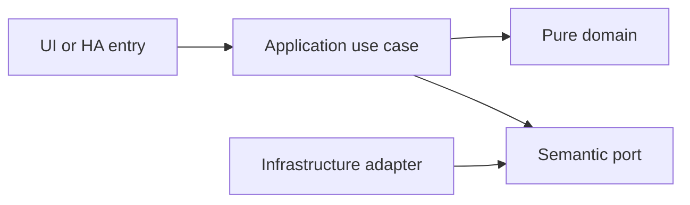

# Product catalog, pantry stock and replenishment

- Status: Draft
- Date: 2026-10-28
- Catalog capability ID: household-inventory
- Last verified: 2026-10-29 (document structure only; no implementation evidence)
- Owners: Domus maintainer; engineering/product reviewers to be assigned
- Scope: The household knows what is available, where it is stored and what needs replenishment through a local product catalog and an immutable stock movement ledger.
- Related issues/PRs: https://github.com/vypdev/domus/issues/2
- Required review gates: product UX, architecture, testing, documentation, security/operations
- Open decisions blocking readiness: Unit/package policy; reservation/replenishment review; barcode library/device evidence; external lookup provider feasibility, terms and response contract. The owner completed the barcode scope on 2026-10-29: camera scan plus manual entry, local catalog and optional Internet lookup. Catalog gate prerequisites remain unverified.

## 1. Executive summary

The household knows what is available, where it is stored and what needs replenishment through a local product catalog and an immutable stock movement ledger.

```text
Authenticated member -> validated domain command -> durable result -> household and HA projections
```

This is a prospective Draft, not an implemented or accepted capability. The first usable release covers all domains and both deployment targets.

## 2. Problem, current behavior, and evidence

A large pantry contains long-life supplies in different packages and storage places. Editing a quantity directly loses receipt, consumption and adjustment history.

Current verified sequence: (1) the repository has a minimal README and installed Copilot automation; (2) no Domus application, public service or tests exist; (3) this contract proposes the behavior to build.

Evidence: the owner's attached brief and subsequent decisions in [product vision](../docs/product-vision.md), the pinned [reference investigation](../docs/reference-investigation.md), and the existing repository baseline. Retrospective classification is not applicable: no as-built product baseline is reconstructed.

## 3. Actors, surfaces, and terminology

Actors: Household member; receiver; authorized stock administrator; replenishment policy.

Primary surfaces: application UI, HTTP domain boundary, relevant HA entities/services, activity and diagnostics. Definitions of member, principal, occurrence, demand and ledger are shared in the [glossary](../docs/glossary.md). The actor recording an action is distinct from its selected target and actual performer.

## 4. Goals, non-goals, and fixed invariants

Goals and fixed invariants are the following normative requirements. No configuration may weaken authorization, ledger integrity, attribution or idempotency.

| Requirement | Behavior |
|---|---|
| household-inventory-R1 | Product identity, package presentation and base measurement unit MUST be distinct and conversions exact. |
| household-inventory-R2 | Every stock change MUST be an immutable, attributable movement; corrections append compensating records rather than deleting history. |
| household-inventory-R3 | Stock and reservations MUST prevent accidental negative availability and handle concurrent consumption and balanced transfers. |
| household-inventory-R4 | Replenishment MUST use minimum/target policies and stable source identities without duplicating task material demand or manual shopping extras. |
| household-inventory-R5 | Receipt integration MUST post only received quantities once and preserve partial-receipt and retry history. |
| household-inventory-R6 | Locations, optional lots and expiry information MUST remain queryable without inferring that expired stock disappeared. |
| household-inventory-R7 | Barcode entry MUST support camera scanning, manual fallback, local validation/catalog search and optional configured Internet product lookup, with explicit camera permission, safe candidate validation and usable local operation when lookup is absent or fails. |
| household-inventory-R8 | Inventory permissions, inactive products, backup/restore and pagination MUST preserve ledger integrity and household privacy. |

Non-goals: changing Copilot, changing the existing gateway, building an MCP server, adding mandatory cloud/AI dependencies, or claiming production readiness from a document.

## 5. Current versus proposed product journey

| Stage | Current | Proposed | User/operator effect |
|---|---|---|---|
| Enter | No Domus UI | Verified HA principal opens the relevant surface | Role and scope are explicit |
| Act | No domain command | Validate input, permission and current revision | Invalid data leaves the draft intact |
| Commit | No durable domain record | Store change and operation receipt atomically | Retry cannot duplicate effects |
| Observe | No projection | Show committed facts and pending downstream projections | Partial success remains understandable |


Text equivalent: authenticated entry -> authorization and validation -> durable domain commit -> visible facts with any pending projection. Domain-specific alternatives are described below.

## 6. Functional behavior and state model

### 6.1 Domain model and normal path

Product owns identity, brand, category, barcode references, description, optional image, active flag and base unit. PackagePresentation owns pack count and conversion to that base unit; six 1-litre cartons may be six pieces or six litres according to a fixed product unit, never both without explicit conversion. Location, optional Lot(expiry, received_at), StockMovement, Reservation and ReplenishmentPolicy are separate records. Quantity uses exact decimal arithmetic. Transfer has balanced source/destination legs in one transaction. Availability equals physical stock minus active reservations. Consumption is explicit; estimates and predictions are future suggestions, not silent stock decrements.

The owner confirmed camera scan and manual entry with optional Internet product lookup on 2026-10-29, closing the missing barcode-scope decision from the truncated attachment. Local catalog lookup runs first. An administrator may configure an external provider; unknown-code lookup is on demand by default. Only the barcode and required provider authentication leave the server boundary, never camera frames, household identity or stock history. Provider responses are untrusted candidates with source/provenance; users review a candidate before importing or matching a product/presentation. No provider is selected or advertised as available yet; feasibility, terms, rate limits and household-product coverage remain adapter review gates.

### 6.2 States and alternatives

Product active -> inactive without deleting history. Reservation active -> consumed/released. Receipt -> posted movement; correction -> compensating movement. Low-stock demand open -> updated -> satisfied, retaining a stable policy/source identity. Optional lot expiration warns but does not silently remove stock.

A duplicate uses its original operation receipt. A changed payload under the same key is a conflict. Out-of-order events use aggregate revision and source identity. Cancellation never erases an already committed ledger effect; compensation is explicit.

## 7. User-facing configuration

| Input | Type | Recommended default | Allowed values/range | Scope/persistence |
|---|---|---|---|---|
| `base_unit` | unit code | piece | piece, gram, millilitre or explicitly supported compatible unit; immutable after movements without migration | product; persisted |
| `minimum_stock` | decimal | 0 | nonnegative, <= target_stock | product/location policy; versioned |
| `target_stock` | decimal | 0 | nonnegative, >= minimum_stock | product/location policy; versioned |
| `expiration_tracking` | boolean | false | requires optional lot dates when enabled; no fabricated date | product; persisted |
| `negative_stock_policy` | enum | reject | reject initially; corrections require a reason | household invariant |
| `external_product_lookup` | enum | off until a provider is configured, then on_demand | off, on_demand or explicit automatic_unknown; administrator-controlled provider setup | household preference; lookup operation snapshots provider/policy version |

These are proposed defaults pending review. Invalid values and contradictory combinations are rejected before saving; unknown future values require an explicit compatibility error. Precedence is fixed invariants, installation constraints, household policy, then member preferences; lower scopes cannot expand permissions. In-flight commands snapshot relevant policy versions, while revocation is checked at the transaction boundary.

Recommended example: keep the defaults above. Meaningful alternative: a member selects Spanish and dark theme while the same household policies remain in force. Transport secrets are installation concerns and are never domain form fields.

## 8. Clean Architecture design

### 8.1 Responsibilities and dependency direction

RecordMovement, TransferStock, ReserveMaterials, CorrectStock and EvaluateReplenishment use StockLedger, ProductRepository and DemandPort. Pure quantity and allocation policies validate units. Ledger movements and reservations share transactional consistency; replenishment uses deterministic source IDs and outbox delivery. Barcode scanning is a client adapter with manual entry fallback. Optional Internet lookup implements ProductLookupPort with bounded requests, candidate schemas, provenance, caching and safe error mapping; neither domain code nor UI primitives import provider SDKs. Remote failure never blocks manual/local catalog workflows.

| Boundary | Owns | Forbidden dependency |
|---|---|---|
| Domain | Entities, value objects and pure rules | HA, HTTP, SQL, UI frameworks |
| Application | Authorized commands, queries and semantic ports | Concrete adapters and framework DTOs |
| Adapters | Schema mapping, persistence and provider error mapping | Alternate business rules |
| Composition | Explicit deployment wiring | Business decisions |
| Presentation | View models and rendering | Database access or client-only authorization |



Text equivalent: entrypoints call use cases; use cases depend on pure domain and ports; infrastructure implements ports. Architecture checks reject forbidden imports and cycles. Shared contract tests exercise each port adapter; schemas and migration checks enforce durable boundaries.

## 9. UI/UX and content contract

### 9.1 Primary state examples

| State | Visible content |
|---|---|
| Pending | Recording stock. No action required. |
| Action required | This pack has no unit conversion. Choose its package format before receiving it. |
| Blocked | Only one unit is available. Nothing was consumed. Review stock or release a reservation. |
| Partial | Stock is saved. Its shopping replenishment requirement is waiting to refresh. |
| Complete | Six litres added to Pantry. View the receipt and movement. |

The primary view names current status, retained facts and one next action, followed by descriptive links to the record/operation. Technical codes and correlation IDs are progressively disclosed. Duplicate responses update the same operation status rather than adding notifications. At most one routine notification per transition, with opt-out and bounded retry summaries.

English and Spanish use stable translation keys, base-language matching and English fallback. Mobile, tablet and desktop layouts, keyboard operation, visible focus, non-color status, accessible names, light/dark contrast and reduced motion are acceptance concerns. Untrusted text is rendered inert; no arbitrary HTML, commands or secret-bearing links.

## 10. Failure, recovery, and cleanup

| Failure | Retained facts | Retry / action | Cleanup |
|---|---|---|---|
| Invalid or denied input | Existing business records and form draft | Correct fields or request the proper role | No side effects |
| Stale revision | Current committed aggregate; user's entered fields | Review current state and submit a new deliberate operation | No automatic overwrite |
| Lost response after commit | Domain result and receipt | Look up or replay the same key | Never issue a fresh-key duplicate |
| Downstream projection unavailable | Successful domain result and durable pending event | Bounded backoff, then visible retry | Acknowledge outbox only after safe consumption |
| Restart or cancellation | Committed records; identified pending work | Recover receipts/cursors; compensate only by explicit command | Remove listeners and owned temporary artifacts |

Errors explain impact, safe cause, action and retained state. External availability is distinct from authorization denial. Retries are bounded and use deterministic backoff tests, not real waits.

## 11. Security, permissions, and privacy

Backend authorization applies to reads and writes. All requests and HA values are untrusted input; only authenticated principals and validated adapter context establish identity. Cross-household IDs, replayed operations and stale roles are covered in the inventory. A person entity and selected member ID do not authenticate a caller. Logs, traces, exports and browser artifacts redact credentials and unnecessary personal data. The technical HA principal has explicit narrow grants and cannot impersonate a household administrator.

## 12. Observability and operational UX

Show operation state and projection freshness to members; expose sanitized correlation, source event, aggregate revision, duration and safe error code to operators. No raw credentials or unrestricted HA payloads enter diagnostics. Counters distinguish denied, invalid, conflict, unavailable and completed operations. One durable activity entry per business transition; retries do not multiply notifications. No telemetry leaves the installation by default.

## 13. Compatibility, migration, rollout, and rollback

No existing Domus application data requires migration yet. The first schema is versioned from its first implementation. Upgrade fixtures cover pending operations and ledger compatibility; a backup precedes destructive migration. Unknown future schemas block writes. Downgrade requires a compatible image/database pair, never silent interpretation of newer data.

Both Supervisor and standalone are first-release acceptance targets. Stable and Edge use separate credentials, IDs, volumes and endpoint bindings. Experimental artifacts cannot automatically promote production. Publication, merge and deployment remain in the existing authorized maintainer lifecycle.

## 14. Testing strategy and numeric budget

Minimum: 28 distinct cases, derived from the explicit risk inventory below. Each inventory row counts once. The budget is a floor, not a claim of completeness or executed tests.

| Area | Minimum distinct cases | Behaviors/risks covered |
|---|---:|---|
| Domain and configuration | 7 | a six-pack of one-litre cartons in a litre-based product; incompatible kilogram and piece units without conversion; a product with movements |
| Adapters and persistence | 3 | an adjustment with a reason; expiration tracking disabled |
| Security and privacy | 5 | deletion of an existing movement; scanning without external lookup configured; a viewer trying stock correction |
| State and concurrency | 4 | a corrected receipt; simultaneous consumption of the last unit; a stock transfer failure between its two legs |
| Integration and recovery | 6 | task-reserved stock; a manual extra demand; four of six purchased units received |
| UI and accessibility | 2 | an approaching expiry; denied camera permission |
| Deployment and contracts | 1 | an inactive product or paginated stock query |
| **Total** | **28** | No double counting |

| Case ID | Area | Requirements | Scenario |
|---|---|---|---|
| household-inventory-C01 | Domain and configuration | household-inventory-R1 | Given a six-pack of one-litre cartons in a litre-based product, receipt adds exactly six litres. |
| household-inventory-C02 | Domain and configuration | household-inventory-R1 | Given incompatible kilogram and piece units without conversion, validation rejects the movement. |
| household-inventory-C03 | Domain and configuration | household-inventory-R1 | Given a product with movements, changing its base unit requires an explicit migration instead of reinterpreting stock. |
| household-inventory-C04 | Adapters and persistence | household-inventory-R2 | Given an adjustment with a reason, the ledger exposes actor, source, timestamp and signed amount. |
| household-inventory-C05 | Security and privacy | household-inventory-R2 | Given deletion of an existing movement, the backend denies it and offers a correction path. |
| household-inventory-C06 | State and concurrency | household-inventory-R2 | Given a corrected receipt, both the original movement and linked compensation remain. |
| household-inventory-C07 | State and concurrency | household-inventory-R3 | Given simultaneous consumption of the last unit, only one transaction succeeds. |
| household-inventory-C08 | State and concurrency | household-inventory-R3 | Given a stock transfer failure between its two legs, neither location balance changes. |
| household-inventory-C09 | Domain and configuration | household-inventory-R3 | Given a reservation larger than available stock, the material shortfall is explicit rather than negative availability. |
| household-inventory-C10 | Domain and configuration | household-inventory-R4 | Given a repeated low-stock evaluation, the same source demand is updated rather than duplicated. |
| household-inventory-C11 | Integration and recovery | household-inventory-R4 | Given task-reserved stock, replenishment calculates availability once and does not add the same reservation twice. |
| household-inventory-C12 | Integration and recovery | household-inventory-R4 | Given a manual extra demand, replenishment changes do not delete or reduce that user intent. |
| household-inventory-C13 | State and concurrency | household-inventory-R5 | Given duplicate receipt messages, one inventory movement exists for each receipt line. |
| household-inventory-C14 | Integration and recovery | household-inventory-R5 | Given four of six purchased units received, stock increases by four only. |
| household-inventory-C15 | Integration and recovery | household-inventory-R5 | Given receipt saved before posting failure, retry posts once and marks that receipt line complete. |
| household-inventory-C16 | Domain and configuration | household-inventory-R6 | Given a product in two locations and two lots, quantities reconcile to the product total. |
| household-inventory-C17 | UI and accessibility | household-inventory-R6 | Given an approaching expiry, the UI shows the lot and date without deleting its quantity. |
| household-inventory-C18 | Adapters and persistence | household-inventory-R6 | Given expiration tracking disabled, a receipt requires no invented expiry date. |
| household-inventory-C19 | UI and accessibility | household-inventory-R7 | Given denied camera permission, the scan view offers manual barcode and product entry. |
| household-inventory-C20 | Domain and configuration | household-inventory-R7 | Given a malformed supported GTIN, local check-digit validation identifies the error. |
| household-inventory-C21 | Security and privacy | household-inventory-R7 | Given scanning without external lookup configured, no image or barcode leaves the installation. |
| household-inventory-C22 | Security and privacy | household-inventory-R8 | Given a viewer trying stock correction, authorization rejects it. |
| household-inventory-C23 | Integration and recovery | household-inventory-R8 | Given a restored backup, physical stock and reservations reconcile to the original ledger. |
| household-inventory-C24 | Deployment and contracts | household-inventory-R8 | Given an inactive product or paginated stock query, history remains available and result bounds are enforced. |
| household-inventory-C25 | Adapters and persistence | household-inventory-R7 | Given an unknown local barcode and an enabled on-demand external lookup, the adapter sends only the barcode and required provider authentication and returns a bounded candidate with source provenance. |
| household-inventory-C26 | Integration and recovery | household-inventory-R7 | Given a provider timeout or rate limit, lookup reports unavailability while manual product creation and local search remain usable without a stock mutation. |
| household-inventory-C27 | Security and privacy | household-inventory-R7 | Given hostile, oversized or incompatible provider fields, validation rejects the candidate and no script, private URL fetch or unreviewed catalog overwrite occurs. |
| household-inventory-C28 | Security and privacy | household-inventory-R7 | Given external lookup off or no provider configured, camera/manual scanning uses local data only and no barcode, frame or household information is sent externally. |

Every implemented first-party module starts with meaningful behavior tests. Target and proposed merge gate: 100% lines/statements/functions/branches where the selected tools expose those metrics, enforced separately across backend, frontend and integration code. Third-party/generated artifacts are distinguished from authored source; broad exclusions cannot hide untested logic. No application coverage currently exists.

Inject deterministic clocks, IDs, provider fakes and transaction failures. Use semantic assertions alongside golden content, real adapter contracts and disposable HA integration environments. Add Google Chrome evidence from the owner's authorized local HA for real UX; it does not replace automated tests or unit coverage. CI Check runs the complete applicable suite for every PR update.

## 15. Documentation and discoverability

The following paths are explicit proposed documentation changes relative to the clean repository baseline; implementation source/test paths are intentionally not invented.

| Path | Change |
|---|---|
| specs/household-inventory.md | create |
| specs/README.md | create |
| specs/_template.md | create |
| specs/catalog.json | create |
| specs/CATALOG.md | create |
| docs/architecture.md | create |
| docs/product-vision.md | create |
| docs/glossary.md | create |
| docs/decisions.md | create |
| docs/reference-investigation.md | create |
| docs/copilot-adoption.md | create |
| docs/operations.md | create |
| docs/user-guide.md | create |
| docs/contracts/home-assistant.md | create |
| docs/acceptance-plan.md | create |
| docs/roadmap.md | create |
| README.md | update |

| Audience | Artifact | Required content |
|---|---|---|
| Member | [User guide](../docs/user-guide.md) | Normal path, defaults and state meaning |
| Administrator/operator | [Operations](../docs/operations.md) | Setup, permissions, recovery, backup and rollback |
| Contributor | [Architecture](../docs/architecture.md) | Boundaries and executable constraints |
| HA consumer | [Entity/service contract](../docs/contracts/home-assistant.md) | Stable schemas, semantics and error handling |
| Reviewer | [Acceptance plan](../docs/acceptance-plan.md) | Tests, coverage and human evidence |

Link/path validation accompanies updates. Implementation changes update the owning SDD, catalog evidence, actual tests and user documentation together.

## 16. Acceptance scenarios

The Given/When/Then-equivalent observable scenarios in section 14 are the executable acceptance inventory. For each case, the given precondition and action must produce the specified result with state and side-effect assertions; tests are not implementation snapshots.

Acceptance includes normal, alternative, invalid, duplicate, concurrent, partial, failure, recovery, security, localization and accessibility paths as allocated above. Human review verifies the primary-state examples on desktop/mobile and light/dark themes. Live acceptance remains pending until an implemented artifact is exercised; no result is inferred from the budget.

## 17. Requirements traceability

| Requirement | Cases |
|---|---|
| household-inventory-R1 | household-inventory-C01, household-inventory-C02, household-inventory-C03 |
| household-inventory-R2 | household-inventory-C04, household-inventory-C05, household-inventory-C06 |
| household-inventory-R3 | household-inventory-C07, household-inventory-C08, household-inventory-C09 |
| household-inventory-R4 | household-inventory-C10, household-inventory-C11, household-inventory-C12 |
| household-inventory-R5 | household-inventory-C13, household-inventory-C14, household-inventory-C15 |
| household-inventory-R6 | household-inventory-C16, household-inventory-C17, household-inventory-C18 |
| household-inventory-R7 | household-inventory-C19, household-inventory-C20, household-inventory-C21, household-inventory-C25, household-inventory-C26, household-inventory-C27, household-inventory-C28 |
| household-inventory-R8 | household-inventory-C22, household-inventory-C23, household-inventory-C24 |

All requirement cases are reciprocal with section 14. Domain invariants are owned by pure policy, command/state rules by application use cases, provider behavior by adapters, and visible content by presentation; the boundary table in section 8 assigns these responsibilities. Evidence and user/operator documentation are linked in section 15.

## 18. Implementation sequence

1. Resolve the blocking decisions and review this contract before Ready for implementation.
2. Establish test harness, CI Check and architecture checks with the first source files.
3. Implement pure policies and their complete branch tests, then transactional use cases.
4. Add adapters, schema/error contracts, retry/race fixtures and both deployment wiring paths.
5. Build the accessible localized UI and HA projections with tests alongside each flow.
6. Verify migration, recovery, security, channel isolation and documentation.
7. Run the complete suite, review coverage, perform local Chrome dogfooding with recorded cleanup, and collect human evidence.

These are internal implementation steps within the first integrated release; they do not remove other domains or deployment targets from launch.

## 19. Definition of Done

- [ ] Every normative requirement has observable acceptance and reciprocal case links.
- [ ] Every declared case is implemented meaningfully; the numeric budget is met.
- [ ] Clean Architecture constraints and port contracts pass.
- [ ] All supported first-party coverage metrics reach 100% from the first implementation.
- [ ] CI Check passes for the current PR revision with no omitted required jobs.
- [ ] Configuration, state, permission, idempotency and recovery behaviors agree.
- [ ] Primary UI states, localization, responsive behavior and accessibility pass.
- [ ] Both deployment targets and isolated Stable/Edge channels pass acceptance.
- [ ] User/operator documentation, schema/migration evidence and catalog paths are current.
- [ ] Local Google Chrome evidence identifies the artifact, channel, test records and cleanup.
- [ ] The original Copilot validations pass when their real prerequisites exist; no check is weakened.
- [ ] No material decision blocking readiness remains unresolved; Copilot remains unchanged.

## 20. References and decisions

Primary sources: [Copilot standard](https://github.com/vypdev/copilot/blob/f5e5a4cf9a80248994469cd88ad55eecab5b95ca/specs/README.md), [original template](https://github.com/vypdev/copilot/blob/f5e5a4cf9a80248994469cd88ad55eecab5b95ca/specs/_template.md), and the linked [reference investigation](../docs/reference-investigation.md).

Confirmed owner choices and unresolved proposals are separated in [decisions](../docs/decisions.md). [Issue #2](https://github.com/vypdev/domus/issues/2) tracks the documentation foundation. The [adoption note](../docs/copilot-adoption.md) records the current catalog evidence limitation. Optional future depth remains explicitly deferred in the product vision; the gateway's installation and MCP internals are outside Domus scope.
