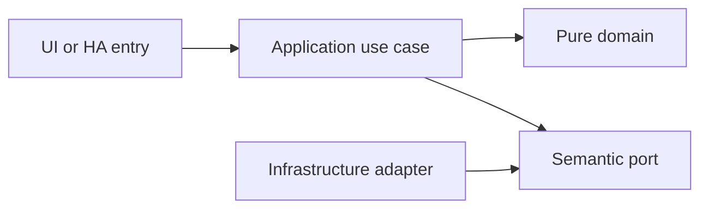

# Product catalog, pantry stock and replenishment

- Status: Draft
- Date: 2026-10-28
- Catalog capability ID: household-inventory
- Last verified: 2026-10-31 (document structure only; no implementation evidence)
- Owners: Domus maintainer; engineering/product reviewers to be assigned
- Scope: The household knows what is available, where it is stored and what needs replenishment through a local product catalog and an immutable stock movement ledger.
- Related issues/PRs: https://github.com/vypdev/domus/issues/2
- Required review gates: product UX, architecture, testing, documentation, security/operations
- Open decisions blocking readiness: Unit/package policy; reservation/replenishment review; barcode library/device evidence; external lookup provider feasibility, terms and response contract. The owner confirmed barcode scope, adjustable material recording and pending regularization rather than negative stock for task material shortfalls on 2026-10-29. Catalog gate prerequisites remain unverified.

## 1. Executive summary

The household knows what is available, where it is stored and what needs replenishment through a local product catalog and an immutable stock movement ledger.

```text
Authenticated member -> validated domain command -> durable result -> household and HA projections
```

This is a prospective Draft, not an implemented or accepted capability. The first usable release covers all domains and both deployment targets.

## 2. Problem, current behavior, and evidence

A large pantry contains long-life supplies in different packages and storage places. Editing a quantity directly loses receipt, consumption and adjustment history.

At the original documentation baseline on 2026-10-28, these domain workflows had no implementation. The merged M1 identity/storage foundation now has separate backend evidence. The task approval and material-authority additions in this review remain prospective; this documentation change adds no runtime behavior.

Evidence: the owner's attached brief and subsequent decisions in [product vision](../docs/product-vision.md), the pinned [reference investigation](../docs/reference-investigation.md), and the existing repository baseline. Retrospective classification is not applicable: no as-built product baseline is reconstructed.

## 3. Actors, surfaces, and terminology

Actors: Household member; receiver; authorized stock administrator; replenishment policy.

Primary surfaces: application UI, HTTP domain boundary, relevant HA entities/services, activity and diagnostics. Definitions of member, principal, occurrence, demand and ledger are shared in the [glossary](../docs/glossary.md). The actor recording an action is distinct from its selected target and actual performer.

## 4. Goals, non-goals, and fixed invariants

Goals and fixed invariants are the following normative requirements. No configuration may weaken authorization, ledger integrity, attribution or idempotency.

| Requirement | Behavior |
|---|---|
| household-inventory-R1 | Product identity, package presentation and base measurement unit MUST be distinct and conversions exact. |
| household-inventory-R2 | Every stock change MUST be an immutable, attributable movement; corrections append compensating records rather than deleting history. |
| household-inventory-R3 | Stock and reservations MUST prevent accidental negative availability and handle concurrent consumption and balanced transfers; insufficient stock in an already-performed task MUST retain a pending consumption intent without inventing a stock movement or blocking completion. |
| household-inventory-R4 | Replenishment MUST use minimum/target policies and stable source identities without duplicating task material demand or manual shopping extras. |
| household-inventory-R5 | Receipt integration MUST post only received quantities once and preserve partial-receipt and retry history. |
| household-inventory-R6 | Locations, optional lots and expiry information MUST remain queryable without inferring that expired stock disappeared. |
| household-inventory-R7 | Barcode entry MUST support camera scanning, manual fallback, local validation/catalog search and optional configured Internet product lookup, with explicit camera permission, safe candidate validation and usable local operation when lookup is absent or fails. |
| household-inventory-R8 | Inventory permissions, inactive products, backup/restore and pagination MUST preserve ledger integrity and household privacy. Validated task-linked consumption MUST accept the configured narrow task authority by default without general inventory permission, while unrelated movements still require their own grants. |

Non-goals: changing Copilot, changing the existing gateway, building an MCP server, adding mandatory cloud/AI dependencies, or claiming production readiness from a document.

## 5. Current versus proposed product journey

| Stage | Current | Proposed | User/operator effect |
|---|---|---|---|
| Enter | No Domus UI | Verified HA principal opens the relevant surface | Role and scope are explicit |
| Act | No domain command | Validate input, permission and current revision | Invalid data leaves the draft intact |
| Commit | No durable domain record | Store change and operation receipt atomically | Retry cannot duplicate effects |
| Observe | No projection | Show committed facts and pending downstream projections | Partial success remains understandable |


Text equivalent: authenticated entry -> authorization and validation -> durable domain commit -> visible facts with any pending projection. Domain-specific alternatives are described below.

## 6. Functional behavior and state model

### 6.1 Domain model and normal path

Product owns identity, brand, category, barcode references, description, optional image, active flag and base unit. PackagePresentation owns pack count and conversion to that base unit; six 1-litre cartons may be six pieces or six litres according to a fixed product unit, never both without explicit conversion. Location, optional Lot(expiry, received_at), StockMovement, Reservation and ReplenishmentPolicy are separate records. Quantity uses exact decimal arithmetic. Transfer has balanced source/destination legs in one transaction. Availability equals physical stock minus active reservations. Consumption is explicit; estimates and predictions are future suggestions, not silent stock decrements.

Task completion may submit explicitly reviewed actual material quantities in the same user action, as confirmed by the owner. Inventory processes those linked intents through the same stock/movement rules as a standalone movement, with validated task-scoped or applicable inventory authority; planned requirements are not proof of usage. Each intent has a stable completion-cycle/line identity and operation outcome. Consuming a task's own reserved material converts that reservation to consumed while decrementing physical stock in the same transaction, so availability is not charged twice. Other tasks' reservations cannot be stolen silently. A task reopen or verification rejection never adds a physical return: a real return/correction is a distinct authorized movement with an explicit reason.

If a submitted material line lacks sufficient usable stock, save a pending_regularization consumption intent while the performed task completes, as confirmed by the owner. The intent is not a StockMovement and does not lower physical or available stock below zero. Keep its requested quantity, location, completion-cycle/line identity, actor and shortage reason visible. The affected quantity is labeled as recorded stock with a discrepancy requiring review, not silently presented as a verified physical count. No partial decrement within that line is silently substituted for the confirmed quantity. Authorized regularization reviews missing receipts, actual counts or erroneous usage, then posts a validated movement or records an explained correction/dismissal of the intent. A restock event alone does not settle it. Settlement, movement and operation receipt commit together; retries cannot post the line twice. A pending intent is not another reservation or purchasing demand, so it cannot double-count an existing material/replenishment source. Explicit zero usage is not_used and creates no stock movement.

The owner confirmed camera scan and manual entry with optional Internet product lookup on 2026-10-29, closing the missing barcode-scope decision from the truncated attachment. Local catalog lookup runs first. An administrator may configure an external provider; unknown-code lookup is on demand by default. Only the barcode and required provider authentication leave the server boundary, never camera frames, household identity or stock history. Provider responses are untrusted candidates with source/provenance; users review a candidate before importing or matching a product/presentation. No provider is selected or advertised as available yet; feasibility, terms, rate limits and household-product coverage remain adapter review gates.

The owner confirmed on 2026-10-31 that a restricted member authorized to complete a task may explicitly record consumption of that task's linked materials by default, without general inventory permission. The household supplies this task-scoped default and an administrator-authorized per-task override may change it. Explicit applicable member denials, installation limits and current task authorization still take precedence; absence of a general stock grant is distinct from an explicit denial of the scoped material action. Resolve eligible material identities, products, units and locations from the server-owned task/completion snapshot; a client-provided task ID or material line is not a general stock grant. Keep the previously accepted adjustable actual quantities, including zero usage. This authority cannot add unrelated products, change storage targets, edit stock arbitrarily, configure its own permission or reach another household. Inventory remains responsible for validating and posting every movement, usable stock and reservations.

If task-scoped consumption is disabled and the actor lacks the applicable inventory authority, retain otherwise valid performed work and the validated linked usage as visibly unposted pending authorization. Do not claim that stock was consumed, discard the reported work or silently request broader access. This normal policy outcome is distinct from forged identity, unrelated/foreign material references or invalid quantities, which still fail admission before new side effects. A later grant or adult approval does not automatically execute a retained material intent: an authorized explicit settlement reuses its completion-cycle/line identity and rechecks current authority and stock. Stock shortage remains pending_regularization, with no negative stock; it is not the same reason as missing authority. Engineering state labels and schema bounds remain subject to implementation review.

Verification controls point eligibility independently of physical usage. An eligible material movement may post while work awaits adult approval; rejection or reopening never fabricates a physical return. Replaying the original completion, approving it or changing either policy cannot consume again. Retained receipts/history explain the original effective policy but never authorize a newly revoked movement.

The distinct new cross-domain scenarios are owned by the [Tasks acceptance inventory](household-tasks.md); this document does not count copies of them as new cases.

### 6.2 States and alternatives

Product active -> inactive without deleting history. Reservation active -> consumed/released. Consumption intent -> pending_authorization, posted or pending_regularization -> posted/corrected/dismissed with retained reason. A pending_authorization intent stays unposted until explicit authorized settlement rechecks authority and stock; that settlement may post it or retain a stock shortfall as pending_regularization. These are proposed engineering state labels for the owner-confirmed retained-work outcome. Receipt -> posted movement; correction -> compensating movement. Low-stock demand open -> updated -> satisfied, retaining a stable policy/source identity. Optional lot expiration warns but does not silently remove stock.

A duplicate uses its original operation receipt. A changed payload under the same key is a conflict. Out-of-order events use aggregate revision and source identity. Cancellation never erases an already committed ledger effect; compensation is explicit.

## 7. User-facing configuration

| Input | Type | Recommended default | Allowed values/range | Scope/persistence |
|---|---|---|---|---|
| `base_unit` | unit code | piece | piece, gram, millilitre or explicitly supported compatible unit; immutable after movements without migration | product; persisted |
| `minimum_stock` | decimal | 0 | nonnegative, <= target_stock | product/location policy; versioned |
| `target_stock` | decimal | 0 | nonnegative, >= minimum_stock | product/location policy; versioned |
| `expiration_tracking` | boolean | false | requires optional lot dates when enabled; no fabricated date | product; persisted |
| `negative_stock_policy` | enum | reject | reject initially; corrections require a reason | household invariant |
| `external_product_lookup` | enum | off until a provider is configured, then on_demand | off, on_demand or explicit automatic_unknown; administrator-controlled provider setup | household preference; lookup operation snapshots provider/policy version |

Owner-confirmed defaults are recorded as accepted choices; other defaults and bounds remain proposals pending review. Invalid values and contradictory combinations are rejected before saving; unknown future values require an explicit compatibility error. Precedence is fixed invariants, installation constraints, household policy, then member preferences; lower scopes cannot expand permissions. In-flight commands snapshot relevant policy versions, while revocation is checked at the transaction boundary.

Recommended example: piece-based stock with local product search, no expiry tracking and no external lookup. Meaningful alternative: a product enables lot dates and an administrator configures on-demand lookup, without changing its established base unit or ledger history. Transport secrets are installation concerns and are never domain form fields.

## 8. Clean Architecture design

### 8.1 Responsibilities and dependency direction

RecordMovement, TransferStock, ReserveMaterials, CorrectStock and EvaluateReplenishment use StockLedger, ProductRepository and DemandPort. Pure quantity and allocation policies validate units. Ledger movements and reservations share transactional consistency; replenishment uses deterministic source IDs and outbox delivery. Barcode scanning is a client adapter with manual entry fallback. Optional Internet lookup implements ProductLookupPort with bounded requests, candidate schemas, provenance, caching and safe error mapping; neither domain code nor UI primitives import provider SDKs. Remote failure never blocks manual/local catalog workflows.

| Boundary | Owns | Forbidden dependency |
|---|---|---|
| Domain | Entities, value objects and pure rules | HA, HTTP, SQL, UI frameworks |
| Application | Authorized commands, queries and semantic ports | Concrete adapters and framework DTOs |
| Adapters | Schema mapping, persistence and provider error mapping | Alternate business rules |
| Composition | Explicit deployment wiring | Business decisions |
| Presentation | View models and rendering | Database access or client-only authorization |



Text equivalent: entrypoints call use cases; use cases depend on pure domain and ports; infrastructure implements ports. Architecture checks reject forbidden imports and cycles. Shared contract tests exercise each port adapter; schemas and migration checks enforce durable boundaries.

## 9. UI/UX and content contract

### 9.1 Primary state examples

| State | Visible content |
|---|---|
| Pending | Recording stock. No action required. |
| Action required | This pack has no unit conversion. Choose its package format before receiving it. |
| Blocked | Only one unit is available. Nothing was consumed. Review stock or release a reservation. |
| Partial | Stock is saved. Its shopping replenishment requirement is waiting to refresh. |
| Complete | Six litres added to Pantry. View the receipt and movement. |

The primary view names current status, retained facts and one next action, followed by descriptive links to the record/operation. Technical codes and correlation IDs are progressively disclosed. Duplicate responses update the same operation status rather than adding notifications. At most one routine notification per transition, with opt-out and bounded retry summaries.

English and Spanish use stable translation keys, base-language matching and English fallback. Mobile, tablet and desktop layouts, keyboard operation, visible focus, non-color status, accessible names, light/dark contrast and reduced motion are acceptance concerns. Untrusted text is rendered inert; no arbitrary HTML, commands or secret-bearing links.

## 10. Failure, recovery, and cleanup

| Failure | Retained facts | Retry / action | Cleanup |
|---|---|---|---|
| Invalid or denied input | Existing business records and form draft | Correct fields or request the proper role | No side effects |
| Valid work with missing material authority | Performed work and validated linked usage remain; no stock movement | Explicit settlement by a currently authorized actor | Never treat a later grant or task approval as automatic consumption |
| Stale revision | Current committed aggregate; user's entered fields | Review current state and submit a new deliberate operation | No automatic overwrite |
| Lost response after commit | Domain result and receipt | Look up or replay the same key | Never issue a fresh-key duplicate |
| Downstream projection unavailable | Successful domain result and durable pending event | Bounded backoff, then visible retry | Acknowledge outbox only after safe consumption |
| Restart or cancellation | Committed records; identified pending work | Recover receipts/cursors; compensate only by explicit command | Remove listeners and owned temporary artifacts |

Errors explain impact, safe cause, action and retained state. External availability is distinct from authorization denial. Retries are bounded and use deterministic backoff tests, not real waits.

## 11. Security, permissions, and privacy

Backend authorization applies to reads and writes. All requests and HA values are untrusted input; only authenticated principals and validated adapter context establish identity. Cross-household IDs, replayed operations and stale roles are covered in the inventory. A person entity and selected member ID do not authenticate a caller. Logs, traces, exports and browser artifacts redact credentials and unnecessary personal data. The technical HA principal has explicit narrow grants and cannot impersonate a household administrator.

## 12. Observability and operational UX

Show operation state and projection freshness to members; expose sanitized correlation, source event, aggregate revision, duration and safe error code to operators. No raw credentials or unrestricted HA payloads enter diagnostics. Counters distinguish denied, invalid, conflict, unavailable and completed operations. One durable activity entry per business transition; retries do not multiply notifications. No telemetry leaves the installation by default.

## 13. Compatibility, migration, rollout, and rollback

The existing M1 database is versioned and its identity, household, history and operation records must be preserved. Implementing these prospective task policies requires reviewed compatible migrations; this documentation-only change introduces no new stored domain records. Upgrade fixtures cover pending operations and ledger compatibility; a backup precedes destructive migration. Unknown future schemas block writes. Downgrade requires a compatible image/database pair, never silent interpretation of newer data.

Both Supervisor and standalone are first-release acceptance targets. Stable and Edge use separate credentials, IDs, volumes and endpoint bindings. Experimental artifacts cannot automatically promote production. Publication, merge and deployment remain in the existing authorized maintainer lifecycle.

## 14. Testing strategy and numeric budget

Minimum: 35 distinct cases, derived from the explicit risk inventory below. Each inventory row counts once. The budget is a floor, not a claim of completeness or executed tests.

| Area | Minimum distinct cases | Behaviors/risks covered |
|---|---:|---|
| Domain and configuration | 9 | a six-pack of one-litre cartons in a litre-based product; incompatible kilogram and piece units without conversion; a product with movements |
| Adapters and persistence | 4 | an adjustment with a reason; expiration tracking disabled |
| Security and privacy | 5 | deletion of an existing movement; scanning without external lookup configured; a viewer trying stock correction |
| State and concurrency | 6 | a corrected receipt; simultaneous consumption of the last unit; a stock transfer failure between its two legs |
| Integration and recovery | 8 | task-reserved stock; a manual extra demand; four of six purchased units received |
| UI and accessibility | 2 | an approaching expiry; denied camera permission |
| Deployment and contracts | 1 | an inactive product or paginated stock query |
| Total | 35 | Distinct inventory cases; repeated executions do not add cases. |

| Case ID | Area | Requirements | Scenario |
|---|---|---|---|
| household-inventory-C01 | Domain and configuration | household-inventory-R1 | Given a six-pack of one-litre cartons in a litre-based product, receipt adds exactly six litres. |
| household-inventory-C02 | Domain and configuration | household-inventory-R1 | Given incompatible kilogram and piece units without conversion, validation rejects the movement. |
| household-inventory-C03 | Domain and configuration | household-inventory-R1 | Given a product with movements, changing its base unit requires an explicit migration instead of reinterpreting stock. |
| household-inventory-C04 | Adapters and persistence | household-inventory-R2 | Given an adjustment with a reason, the ledger exposes actor, source, timestamp and signed amount. |
| household-inventory-C05 | Security and privacy | household-inventory-R2 | Given deletion of an existing movement, the backend denies it and offers a correction path. |
| household-inventory-C06 | State and concurrency | household-inventory-R2 | Given a corrected receipt, both the original movement and linked compensation remain. |
| household-inventory-C07 | State and concurrency | household-inventory-R3 | Given simultaneous consumption of the last unit, only one transaction succeeds. |
| household-inventory-C08 | State and concurrency | household-inventory-R3 | Given a stock transfer failure between its two legs, neither location balance changes. |
| household-inventory-C09 | Domain and configuration | household-inventory-R3 | Given a reservation larger than available stock, the material shortfall is explicit rather than negative availability. |
| household-inventory-C10 | Domain and configuration | household-inventory-R4 | Given a repeated low-stock evaluation, the same source demand is updated rather than duplicated. |
| household-inventory-C11 | Integration and recovery | household-inventory-R4 | Given task-reserved stock, replenishment calculates availability once and does not add the same reservation twice. |
| household-inventory-C12 | Integration and recovery | household-inventory-R4 | Given a manual extra demand, replenishment changes do not delete or reduce that user intent. |
| household-inventory-C13 | State and concurrency | household-inventory-R5 | Given duplicate receipt messages, one inventory movement exists for each receipt line. |
| household-inventory-C14 | Integration and recovery | household-inventory-R5 | Given four of six purchased units received, stock increases by four only. |
| household-inventory-C15 | Integration and recovery | household-inventory-R5 | Given receipt saved before posting failure, retry posts once and marks that receipt line complete. |
| household-inventory-C16 | Domain and configuration | household-inventory-R6 | Given a product in two locations and two lots, quantities reconcile to the product total. |
| household-inventory-C17 | UI and accessibility | household-inventory-R6 | Given an approaching expiry, the UI shows the lot and date without deleting its quantity. |
| household-inventory-C18 | Adapters and persistence | household-inventory-R6 | Given expiration tracking disabled, a receipt requires no invented expiry date. |
| household-inventory-C19 | UI and accessibility | household-inventory-R7 | Given denied camera permission, the scan view offers manual barcode and product entry. |
| household-inventory-C20 | Domain and configuration | household-inventory-R7 | Given a malformed supported GTIN, local check-digit validation identifies the error. |
| household-inventory-C21 | Security and privacy | household-inventory-R7 | Given scanning without external lookup configured, no image or barcode leaves the installation. |
| household-inventory-C22 | Security and privacy | household-inventory-R8 | Given a default viewer without a stock-correction grant, authorization rejects the correction. |
| household-inventory-C23 | Integration and recovery | household-inventory-R8 | Given a restored backup, physical stock and reservations reconcile to the original ledger. |
| household-inventory-C24 | Deployment and contracts | household-inventory-R8 | Given an inactive product or paginated stock query, history remains available and result bounds are enforced. |
| household-inventory-C25 | Adapters and persistence | household-inventory-R7 | Given an unknown local barcode and an enabled on-demand external lookup, the adapter sends only the barcode and required provider authentication and returns a bounded candidate with source provenance. |
| household-inventory-C26 | Integration and recovery | household-inventory-R7 | Given a provider timeout or rate limit, lookup reports unavailability while manual product creation and local search remain usable without a stock mutation. |
| household-inventory-C27 | Security and privacy | household-inventory-R7 | Given hostile, oversized or incompatible provider fields, validation rejects the candidate and no script, private URL fetch or unreviewed catalog overwrite occurs. |
| household-inventory-C28 | Security and privacy | household-inventory-R7 | Given external lookup off or no provider configured, camera/manual scanning uses local data only and no barcode, frame or household information is sent externally. |
| household-inventory-C29 | State and concurrency | household-inventory-R2, household-inventory-R3 | Given two physical units and a two-unit reservation for the completing task, recording one actual unit leaves one physical unit and one active reserved unit; releasing the unused reservation makes one available, without charging the used unit twice. |
| household-inventory-C30 | Integration and recovery | household-inventory-R2 | Given a task material intent already posted, replaying the completion or the linked inventory command returns that movement once and does not decrement stock again. |
| household-inventory-C31 | Domain and configuration | household-inventory-R2 | Given task reopening or rejected verification after material consumption, physical stock does not increase; a confirmed real return appends its own linked movement. |
| household-inventory-C32 | Integration and recovery | household-inventory-R2, household-inventory-R3 | Given a task consumption line larger than usable stock, save a pending intent and its source while the task completes, with no negative stock, partial hidden decrement or fabricated movement. |
| household-inventory-C33 | State and concurrency | household-inventory-R2, household-inventory-R3 | Given two concurrent authorized settlements of one pending intent, at most one validated movement posts and both responses resolve the same retained intent. |
| household-inventory-C34 | Domain and configuration | household-inventory-R3, household-inventory-R4 | Given restocking while an earlier task consumption is pending, the original intent stays visible for review, stock does not decrease automatically and no duplicate material demand is created. |
| household-inventory-C35 | Adapters and persistence | household-inventory-R2 | Given explicit zero usage on a task material line, the linked result is not_used, no stock movement is fabricated and replay preserves the same factual result. |

Every implemented first-party module starts with meaningful behavior tests. Target and proposed merge gate: 100% lines/statements/functions/branches where the selected tools expose those metrics, enforced separately across backend, frontend and integration code. Third-party/generated artifacts are distinguished from authored source; broad exclusions cannot hide untested logic. No application coverage currently exists.

Inject deterministic clocks, IDs, provider fakes and transaction failures. Use semantic assertions alongside golden content, real adapter contracts and disposable HA integration environments. Add Google Chrome evidence from the owner's authorized local HA for real UX; it does not replace automated tests or unit coverage. CI Check runs the complete applicable suite for every PR update.

## 15. Documentation and discoverability

The following documentation operations are relative to develop at e8fa5bbc9ffa179aa7559831f5f3d067c9c9c65c. This policy refinement adds no runtime or test implementation evidence.

| Path | Change |
|---|---|
| specs/household-inventory.md | update |
| specs/README.md | reference |
| specs/_template.md | reference |
| specs/catalog.json | update |
| specs/CATALOG.md | update |
| docs/architecture.md | reference |
| docs/product-vision.md | reference |
| docs/glossary.md | reference |
| docs/decisions.md | update |
| docs/reference-investigation.md | reference |
| docs/copilot-adoption.md | reference |
| docs/operations.md | reference |
| docs/user-guide.md | update |
| docs/contracts/home-assistant.md | reference |
| docs/acceptance-plan.md | update |
| docs/roadmap.md | reference |
| README.md | update |
| specs/household-tasks.md | update |
| specs/household-identity.md | update |
| specs/points-rewards.md | update |
| docs/sdd-validation.md | update |
| docs/evidence/task-policy-sdd-review.json | create |

| Audience | Artifact | Required content |
|---|---|---|
| Member | [User guide](../docs/user-guide.md) | Normal path, defaults and state meaning |
| Administrator/operator | [Operations](../docs/operations.md) | Setup, permissions, recovery, backup and rollback |
| Contributor | [Architecture](../docs/architecture.md) | Boundaries and executable constraints |
| HA consumer | [Entity/service contract](../docs/contracts/home-assistant.md) | Stable schemas, semantics and error handling |
| Reviewer | [Acceptance plan](../docs/acceptance-plan.md) | Tests, coverage and human evidence |

Link/path validation accompanies updates. Implementation changes update the owning SDD, catalog evidence, actual tests and user documentation together.

## 16. Acceptance scenarios

The Given/When/Then-equivalent observable scenarios in section 14 are the executable acceptance inventory. For each case, the given precondition and action must produce the specified result with state and side-effect assertions; tests are not implementation snapshots.

Acceptance includes normal, alternative, invalid, duplicate, concurrent, partial, failure, recovery, security, localization and accessibility paths as allocated above. Human review verifies the primary-state examples on desktop/mobile and light/dark themes. Live acceptance remains pending until an implemented artifact is exercised; no result is inferred from the budget.

## 17. Requirements traceability

| Requirement | Cases |
|---|---|
| household-inventory-R1 | household-inventory-C01, household-inventory-C02, household-inventory-C03 |
| household-inventory-R2 | household-inventory-C04, household-inventory-C05, household-inventory-C06, household-inventory-C29, household-inventory-C30, household-inventory-C31, household-inventory-C32, household-inventory-C33, household-inventory-C35 |
| household-inventory-R3 | household-inventory-C07, household-inventory-C08, household-inventory-C09, household-inventory-C29, household-inventory-C32, household-inventory-C33, household-inventory-C34 |
| household-inventory-R4 | household-inventory-C10, household-inventory-C11, household-inventory-C12, household-inventory-C34 |
| household-inventory-R5 | household-inventory-C13, household-inventory-C14, household-inventory-C15 |
| household-inventory-R6 | household-inventory-C16, household-inventory-C17, household-inventory-C18 |
| household-inventory-R7 | household-inventory-C19, household-inventory-C20, household-inventory-C21, household-inventory-C25, household-inventory-C26, household-inventory-C27, household-inventory-C28 |
| household-inventory-R8 | household-inventory-C22, household-inventory-C23, household-inventory-C24 |

All requirement cases are reciprocal with section 14. Domain invariants are owned by pure policy, command/state rules by application use cases, provider behavior by adapters, and visible content by presentation; the boundary table in section 8 assigns these responsibilities. Evidence and user/operator documentation are linked in section 15.

## 18. Implementation sequence

1. Resolve the blocking decisions and review this contract before Ready for implementation.
2. Establish test harness, CI Check and architecture checks with the first source files.
3. Implement pure policies and their complete branch tests, then transactional use cases.
4. Add adapters, schema/error contracts, retry/race fixtures and both deployment wiring paths.
5. Build the accessible localized UI and HA projections with tests alongside each flow.
6. Verify migration, recovery, security, channel isolation and documentation.
7. Run the complete suite, review coverage, perform local Chrome dogfooding with recorded cleanup, and collect human evidence.

These are internal implementation steps within the first integrated release; they do not remove other domains or deployment targets from launch.

## 19. Definition of Done

- [ ] Every normative requirement has observable acceptance and reciprocal case links.
- [ ] Every declared case is implemented meaningfully; the numeric budget is met.
- [ ] Clean Architecture constraints and port contracts pass.
- [ ] All supported first-party coverage metrics reach 100% from the first implementation.
- [ ] CI Check passes for the current PR revision with no omitted required jobs.
- [ ] Configuration, state, permission, idempotency and recovery behaviors agree.
- [ ] Primary UI states, localization, responsive behavior and accessibility pass.
- [ ] Both deployment targets and isolated Stable/Edge channels pass acceptance.
- [ ] User/operator documentation, schema/migration evidence and catalog paths are current.
- [ ] Local Google Chrome evidence identifies the artifact, channel, test records and cleanup.
- [ ] The original Copilot validations pass when their real prerequisites exist; no check is weakened.
- [ ] No material decision blocking readiness remains unresolved; Copilot remains unchanged.

## 20. References and decisions

Primary sources: [Copilot standard](https://github.com/vypdev/copilot/blob/f5e5a4cf9a80248994469cd88ad55eecab5b95ca/specs/README.md), [original template](https://github.com/vypdev/copilot/blob/f5e5a4cf9a80248994469cd88ad55eecab5b95ca/specs/_template.md), and the linked [reference investigation](../docs/reference-investigation.md).

Confirmed owner choices and unresolved proposals are separated in [decisions](../docs/decisions.md). [Issue #2](https://github.com/vypdev/domus/issues/2) tracks the documentation foundation. The [adoption note](../docs/copilot-adoption.md) records the current catalog evidence limitation. Optional future depth remains explicitly deferred in the product vision; the gateway's installation and MCP internals are outside Domus scope.

## Inventory effects for reviewed recurring work

- Status: Draft
- Owners: Domus maintainers and the Household Inventory capability
- Scope: Inventory persistence and task integration needed to verify the three remaining cross-domain recurrence obligations
- Source baseline: develop at 9b2495922c57a7fddef7c75885fd22acd6a7bd9a
- Related work: https://github.com/vypdev/domus/issues/57 and https://github.com/vypdev/domus/issues/23

### 1. Executive summary

Give scheduled task material reservations, task-generated replenishment demand and physical movements a production Inventory owner. An accepted fixed recurrence replacement moves only compatible unfulfilled effects linked to the affected work. A task can record real material use. Reopening and independent recurrence invalidation preserve movements from retained work. Original command recovery and restored state preserve each decision once.

### 2. Problem, current behavior, and evidence

The selected baseline has task-owned material intents, scoped posting authority and a transaction-local Inventory port in `backend/src/domus/application/task_material_ports.py`. Production task composition in `backend/src/domus/composition/tasks.py` has no concrete Inventory port. Existing recurrence tests observe work, schedule and review state. The Points consumer from https://github.com/vypdev/domus/pull/58 provides real award and reversal observations. Inventory must provide its own positive reservation, demand and movement controls. This delta adds prospective behavior to `specs/household-inventory.md`.

### 3. Actors, surfaces, and terminology

An authorized household Inventory manager records a material reference and stock and establishes the reservation and demand needed by a task. Existing task material permission rules govern actual posting. A household scheduler uses the existing reviewed replacement command. The original work and its replacement are linked through the accepted operation. A reservation affects availability, demand records a replenishment need, and a movement affects physical stock.

### 4. Goals, non-goals, and fixed invariants

| Requirement | Behavior |
|---|---|
| inventory-recurrence-R1 | A reviewed fixed replacement binds the eligible Inventory effects to the review and transfers each compatible unfulfilled task reservation or demand to its exact linked replacement, with durable provenance and unchanged physical stock. |
| inventory-recurrence-R2 | Authorized task material posting appends an exact original-source movement in the real household ledger. Reopening and recurrence invalidation preserve material effects belonging to retained downstream work. |
| inventory-recurrence-R3 | The authoritative receipts, reservations, demands, movements and retained review state preserve household and source identity across contention, rollback, retry, restart, schema migration and compatible restoration. |

Retain immutable physical history and stable source identities. Keep the wider Inventory catalog, shopping UI, external lookups, Gateway and release work with their owning milestones.

### 5. Current versus proposed product journey

An Inventory manager establishes the material, stock and open effects. The scheduler previews a replacement, confirms the same reviewed state and sees the existing linked batch receipt. Recovery uses the original command key. When an authorized member performs work and records actual material use, the ledger records the physical movement. Reopening source work leaves retained successors and their movements visible to the owning services.

### 6. Functional behavior and state model

Bind reviewed replacement to the exact current source effect identities and state. Move only compatible unfulfilled, slot-linked task effects to the matching replacement under the same transaction. Preserve original identity and provenance and keep manual extras outside the replacement. Incompatible effects remain with their source for review. A stale preview cannot silently apply new effects. Cancellation and planning do not change physical stock.

Resolve material references in the household. Record actual consumption using exact quantities and stable task, cycle, line and source-operation identity. Preserve prior movement history. Insufficient stock uses existing pending regularization behavior. An explicit authorized correction links to its original posting. Recurrence invalidation is independent of correction and preserves completed or started work with its existing movements, reservations and demand. Points reverses only the actual award belonging to the reopened source cycle.

### 7. User-facing configuration

Use the existing household roles, task material policy and reviewed recurrence commands. Keep the existing browser settings, material unit values and completion rules. This slice adds no member configuration or new public task response contract.

### 8. Clean Architecture design

Inventory domain policy owns stock quantities, effect compatibility and linked movement rules. Inventory application services enforce authority and coordinate semantic persistence. Recurrence consumes a transaction-local interface to preview and apply reviewed effects. Task material settlement consumes its existing Inventory port. SQLite implements durable identities and shared transactions. Composition binds both deployment modes to the same implementation. Reuse the existing household permission checks and immutable task material values.

### 9. UI/UX and content contract

Use the existing reviewed plan, recovery, material status and retained work surfaces. Keep their English and Spanish behavior and keyboard access. The real Inventory controls are verified through scoped application calls. Broader Inventory presentation remains outside this increment.

### 10. Failure, recovery, and cleanup

The batch command, affected work, Inventory effects and durable receipt commit together. A write failure leaves the prior state and permits original-key retry. A lost response recovers the committed result. Independent SQLite writers serialize before a competing start or invalidation can create conflicting effects. Review retention and restoration preserve actual stock history and prohibit synthetic compensation.

### 11. Security, permissions, and privacy

Scope every effect, reference and movement to the household. Require existing Inventory permission for administrator commands and the existing task-scoped material authority for posting. Preserve actor and original source identity. Keep unrelated work and manual demand outside a scheduler's affected set.

### 12. Observability and operational UX

Integration tests observe exact old and new linked identities, operation receipt, real ledger movement identity and balance, and the existing retained-work review. Record exact test and check revisions in evidence. Keep historical qualification separate from executions on the new change.

### 13. Compatibility, migration, rollout, and rollback

If migration is needed, start from the actual schema 16 SQLite database and preserve its fixture. Its independently captured SQL has SHA-256 032954fc9be4ca2f96359c34df1e6e2a23e5562a481ddbc8fbcb9dcbbeebeb8b. Keep historical task, Points, household and recurrence records readable. Prove migration and rollback with the real fixture and restore through the supported snapshot flow. Use the same production composition in Ingress and standalone.

### 14. Testing strategy and numeric budget

Minimum 4 distinct cases in this delta. The existing recurrence and Inventory acceptance inventories retain their definitions and counts.

| Area | Minimum distinct cases | Behaviors/risks covered |
|---|---:|---|
| Integration and recovery | 2 | Observable scenarios in the case inventory. |
| State and concurrency | 1 | Observable scenarios in the case inventory. |
| Adapters and persistence | 1 | Observable scenarios in the case inventory. |
| Total | 4 | Distinct inventory cases; repeated executions do not add cases. |

| Case ID | Area | Requirements | Scenario |
|---|---|---|---|
| inventory-recurrence-C01 | Integration and recovery | inventory-recurrence-R1, inventory-recurrence-R3 | Given a fixed recurrence batch with real open task reservations and demand, a manual extra and observable physical stock, accept the reviewed replacement, lose the response and recover by its original key after restart. Observe each exact linked transfer once, unchanged physical stock and manual demand, and no extra transfer on recovery. |
| inventory-recurrence-C02 | Integration and recovery | inventory-recurrence-R2, inventory-recurrence-R3 | Given real Points awards and actual material consumption on downstream work, reopen the source cycle. Observe one Points reversal linked to the source award, unchanged downstream award, unchanged movement identity and balance, and no stock return. |
| inventory-recurrence-C03 | State and concurrency | inventory-recurrence-R1, inventory-recurrence-R2, inventory-recurrence-R3 | Given independently connected SQLite writers and downstream work that starts before invalidation, preserve work with its actual Inventory effects and at most one retained review. Roll back a deliberately failed reviewed transfer, reject stale review state, and restore a compatible snapshot without duplicate effects or synthetic compensation. |
| inventory-recurrence-C04 | Adapters and persistence | inventory-recurrence-R2, inventory-recurrence-R3 | Given the preserved schema 16 fixture, migrate and verify existing Points and task records. Run an authorized positive material posting through both deployment compositions, observe its exact persisted movement, and verify that insufficient stock and cross-household access do not create movements. |

### 15. Documentation and discoverability

Record the owner delta and implementation evidence with the retained contracts. Keep planned file navigation derived from the following inventory.

[specs/household-inventory.md](household-inventory.md) · [specs/catalog.json](catalog.json) · [docs/evidence/recurrence-calendar-qualification.md](../docs/evidence/recurrence-calendar-qualification.md) · [backend/src/domus/application/fixed\_batch\_review.py](../backend/src/domus/application/fixed_batch_review.py) · [backend/src/domus/application/recurrence\_review.py](../backend/src/domus/application/recurrence_review.py) · [backend/src/domus/composition/tasks.py](../backend/src/domus/composition/tasks.py) · [backend/src/domus/infrastructure/sqlite.py](../backend/src/domus/infrastructure/sqlite.py) · [tests/fixtures/sqlite/v16-inventory-source.sql](../tests/fixtures/sqlite/v16-inventory-source.sql)

| Path | Change |
|---|---|
| specs/household-inventory.md | update |
| specs/catalog.json | update |
| docs/evidence/recurrence-calendar-qualification.md | update |
| backend/src/domus/application/fixed_batch_review.py | update |
| backend/src/domus/application/recurrence_review.py | update |
| backend/src/domus/composition/tasks.py | update |
| backend/src/domus/infrastructure/sqlite.py | update |
| tests/fixtures/sqlite/v16-inventory-source.sql | create |

### 16. Acceptance scenarios

Use the actual persisted effects in the four case rows and exercise the linked retained recurrence scenarios from the parent issue. Distinguish a positive ledger witness from an asserted absence. Check both actual container architectures and browser compositions in CI for the reviewed revision.

### 17. Requirements traceability

| Requirement | Cases |
|---|---|
| inventory-recurrence-R1 | inventory-recurrence-C01, inventory-recurrence-C03 |
| inventory-recurrence-R2 | inventory-recurrence-C02, inventory-recurrence-C03, inventory-recurrence-C04 |
| inventory-recurrence-R3 | inventory-recurrence-C01, inventory-recurrence-C02, inventory-recurrence-C03, inventory-recurrence-C04 |

### 18. Implementation sequence

Preserve the selected fixture. Implement the minimal transaction-local Inventory domain, commands and SQLite mapping. Wire normal task posting and reviewed batch application. Add compound assertions for exact identity, permission, rollback, concurrency, receipt recovery and restoration. Record checked evidence after execution.

### 19. Definition of Done

All new case rows have actual persisted positive controls and pass on the same reviewed revision. The parent recurrence obligations can cite exact runs. Both compositions, English and Spanish, full global and per-file coverage, amd64 and ARM64, Copilot Verification and Bugbot pass. Catalog publication and runtime acceptance have separate evidence.

### 20. References and decisions

The Inventory owner is `specs/household-inventory.md`. The retained recurrence contracts are `specs/recurrence-calendar.md`, `specs/recurrence-execution-foundation.md` and `specs/recurrence-lifecycle-calendar.md`. Keep existing cases with their owners. The Points consumer in https://github.com/vypdev/domus/pull/58 supplies the authoritative award and reversal witness. This draft records planned behavior.

## Proposed change: Add the protected inventory catalog and basic stock intake

- Status: Draft
- Catalog capability: household-inventory

### 1. Executive summary

This delta adds a protected household inventory workspace for browsing products and their recorded, reserved, and available quantities, registering products, and recording positive stock intake into the household’s default stock location. Product units remain fixed, quantities use exact decimal representation, and intake is recorded through the existing append-only Inventory ledger with replay returning the original command receipt. The existing owner in `specs/household-inventory.md` remains authoritative for the broader inventory contract; this issue narrows the addition to catalog and basic intake.

### 2. Problem, current behavior, and evidence

#### 2.1 Problem

The issue describes a gap between existing material bindings, stock movements, and reservations, and a household-facing product catalog with a basic way to add stock. Without that catalog and intake flow, a household cannot use the protected Inventory workspace to browse product quantities or record opening and subsequent stock while preserving the existing ledger and task-linked behavior. This paragraph reports the requested scope in issue #68; it does not claim independent verification of runtime behavior.

#### 2.2 Current behavior

The immutable retained owner, `specs/household-inventory.md`, describes the broader prospective inventory contract, including movements, reservations, and task-linked material effects. Issue #68 identifies the integrated product catalog and basic intake as the missing increment. The selected source tree has not been inspected for implementation evidence establishing whether those issue-described gaps remain absent at runtime; treat their implementation status as unverified.

#### 2.3 Evidence

The requested scope and constraints are recorded in [issue #68](https://github.com/vypdev/domus/issues/68) and the retained owner `specs/household-inventory.md`. The issue’s statements are requirements, not proof of installed behavior. Runtime implementation and test evidence for this delta remain unverified in this draft.

### 3. Actors, surfaces, and terminology

The actors for this delta are active household members who browse the protected inventory workspace and members granted `inventory.manage` who register products and record intake. The workspace is the member-facing surface; the server authorizes household scope and selects the stock binding used for catalog intake. A product has a stable identity and an immutable base unit. A household’s default stock location is one logical location identified within that household by `pantry`, displayed with a localized Pantry label. Recorded quantity is the ledger-backed stock amount; reserved quantity is committed to reservations; available quantity distinguishes stock usable beyond those reservations. The existing owner remains authoritative for other inventory actors, surfaces, and terms.

### 4. Goals, non-goals, and fixed invariants

#### 4.1 Goals

This delta adds protected, household-scoped product browsing with recorded, reserved, and available quantities; registration of products with stable identities and fixed base units; and positive stock intake at the default household location. Intake uses exact decimal quantities, appends one Inventory ledger movement, and returns the original receipt on retry. Registration creates the catalog record and its default-location binding atomically. The server selects that binding; clients cannot supply or switch the location. The observable acceptance scope includes authorized browsing and denial outside household access, registration and unit persistence, exact intake quantities, original-key replay and concurrent retry behavior, and preservation of existing task-linked bindings, effects, history, and task permissions. These are the requested outcomes, not claims of completed implementation or executed acceptance.

#### 4.2 Non-goals

This increment does not add package or unit conversions, location management, lots, manual stock adjustment, demand or purchasing workflows, partial purchase receipts, or barcode lookup. It does not reclassify existing material bindings into the new catalog.

#### 4.3 Fixed product and safety invariants

Supported product units are piece, gram, and millilitre. Piece quantities are whole; gram and millilitre quantities use exact millionth-unit representation and allow at most six decimal places. Intake must be positive. A binding total must not exceed 999999999999.999999 base units, or 999999999999 pieces for whole-unit stock. A product’s base unit cannot change during its lifetime; reject excess precision and incompatible units, and perform no conversion. Each configured household has one logical default stock location with household-scoped identifier `pantry` and a localized Pantry label. Existing households can use it immediately after upgrade. Existing material bindings, their locations, and ledger history retain their identities; the upgrade does not automatically reclassify them. Catalog and intake changes preserve existing task-linked bindings and effects, historical quantities, and task permissions. Publication retains the standard’s required outcomes: the specification satisfies the required format; internal and cross-document consistency is checked; reciprocal catalog ownership, paths, and evidence agree with the generated view. The concrete invocation and prerequisite for these publication checks remain unverified.

| Requirement | Behavior |
| --- | --- |
| SDD-I68-U1-R1 | Protected inventory workspace lets active household members browse products and recorded, reserved, and available quantities within their household. |
| SDD-I68-U1-R2 | Members with inventory.manage can register products with stable identities and immutable base units. |
| SDD-I68-U1-R3 | Authorized members can record an explicit positive stock intake at the default household stock location using exact decimal quantities, the append-only Inventory ledger, and the original-command receipt. |
| SDD-I68-U1-R4 | Catalog and intake changes preserve existing task-linked bindings and effects, historical quantities, and task permissions. |
| SDD-I68-U2-R1 | Register products using piece, gram, or millilitre units; piece quantities are whole, while gram and millilitre quantities use the existing exact millionth-unit representation with at most six decimal places. |
| SDD-I68-U2-R2 | Require positive intake and prevent a binding total from exceeding 999999999999.999999 base units, or 999999999999 pieces for whole-unit stock. |
| SDD-I68-U2-R3 | Preserve each product's unit for its lifetime and reject excess precision or incompatible units. Do not perform package or unit conversions. |
| SDD-I68-U3-R1 | Each configured household has one logical default stock location with the stable household-scoped identifier `pantry` and a localized Pantry label. |
| SDD-I68-U3-R2 | Registering a product atomically creates its binding at the household’s default stock location together with the catalog record. |
| SDD-I68-U3-R3 | Catalog intake uses the server-selected product binding; clients cannot supply or switch the stock location. |
| SDD-I68-U3-R4 | After upgrade, existing households can immediately use the default stock location, while existing material bindings, their locations, and ledger history retain their identities and are not automatically reclassified into the new catalog. |

### 5. Current versus proposed product journey

This update adds the first protected catalog and basic stock intake to the retained household-inventory contract in `specs/household-inventory.md`; it does not replace that contract’s existing task-linked inventory journey. An active household member opens Inventory and sees only their household’s products and recorded, reserved, and available quantities. A member with `inventory.manage` can register a product and record a positive intake. The product is bound to the household’s default stock location, and the intake appears as a durable ledger movement. A retry with the original command key returns the original receipt; it does not add stock twice. Existing task-linked bindings, effects, quantities, ledger history, and task permissions remain intact.

### 6. Functional behavior and state model

Products have stable identities and a base unit chosen from piece, gram, or millilitre. The unit is immutable for the product’s lifetime. Piece quantities are whole numbers; gram and millilitre quantities use exact millionth-unit representation and accept at most six decimal places. Reject zero or negative intake, excess precision, incompatible units, and an intake that would exceed the binding limit: 999999999999.999999 base units, or 999999999999 pieces for whole-unit stock. Do not convert packages or units.

Each configured household has one logical default stock location, identified within that household by the stable identifier `pantry` and shown with a localized Pantry label. Product registration atomically creates both the catalog record and its binding at that location. Intake resolves the binding on the server; the client cannot supply or switch the location. Record the positive intake through the existing append-only Inventory ledger and return its original-command receipt. The recorded, reserved, and available quantities must reflect the exact amount while retaining the existing reservation and availability rules.

On upgrade, existing households can use the default location immediately. Existing material bindings, their locations, and ledger history retain their identities; migration does not automatically reclassify them into the new catalog. Catalog and intake operations do not reinterpret historical quantities, alter existing task-linked effects, or grant task actors broader inventory permissions. These behaviors extend the retained invariants and state model in `specs/household-inventory.md`.

### 7. User-facing configuration

The product-registration flow requires a supported base unit: piece, gram, or millilitre. Once registered, the unit cannot be changed. The intake flow accepts an explicit positive quantity in that unit and displays validation errors beside the quantity field, preserving the entered draft for correction. Explain whether the value must be whole or may have up to six decimal places, and show the applicable maximum before submission. Do not expose package conversion or location selection in this increment.

Show the household’s localized Pantry label as the intake destination. Keep location choice server-controlled and do not offer a client field that can select another binding. After success, show the recorded quantity and updated recorded, reserved, and available totals; on retry, show the original result. Denials, invalid precision, incompatible units, and limit violations must explain the correction or access action and whether any stock was recorded. All labels and quantity guidance must be localized for English and Spanish on Ingress and standalone surfaces, with accessible names, keyboard operation, visible focus, and status cues that do not rely on color.

### 8. Clean Architecture design

Extend the existing Inventory domain and application boundaries described in `specs/household-inventory.md`. Domain policy owns product identity, immutable base units, exact quantity validation, stock limits, and the household-scoped default-location invariant. The application boundary authorizes household-scoped catalog reads and `inventory.manage` mutations, resolves the server-selected binding, and coordinates product registration with binding creation and intake with the existing ledger and original-command receipt. Persistence must make product-plus-binding registration atomic and preserve ledger append-only behavior and replay semantics under concurrent requests. Presentation renders authorized household projections and validation outcomes; it does not decide authorization, units, or stock location.

Use the existing composition and persistence ownership rather than introducing a parallel architecture. Keep dependency direction from presentation and adapters through application contracts to domain policy; domain code must not depend on UI, HTTP, or persistence details. Verification must establish exact quantity and limit behavior, household authorization, atomic registration, server-selected binding, original-key replay and concurrency, and upgrade compatibility. The concrete specification-validation invocation and any implementation-level architecture or integration verification prerequisites remain unverified for this delta; declaration of a repository command alone is not evidence that it checks these outcomes.

### 9. UI/UX and content contract

#### 9.1 Inventory workspace

The protected Inventory workspace is scoped to the active household. Its product list and product detail show the product name, immutable base unit, recorded quantity, reserved quantity, and available quantity. Use text labels for each quantity; do not rely on color or icons to distinguish them. Show the localized Pantry label for the default stock location. A member without inventory access or from another household receives an access-denied state without product or quantity details. The existing inventory contract remains in `specs/household-inventory.md` (sections 3, 4, and 6); this delta adds catalog browsing and intake.

For an empty catalog, explain that no products are registered and show registration only to a member with `inventory.manage`. A product form requires a name and one supported base unit: piece, gram, or millilitre. Identify the chosen unit as permanent before save. Validate inline and in the accessible error summary; preserve entered values after validation failure. Do not offer package conversion or location selection.

An authorized intake form identifies the product and its base unit, accepts an explicit positive decimal amount, and explains that the amount will be added to Pantry. Show a review/confirmation with product, quantity, and unit before submission. On success, report the recorded amount and updated recorded, reserved, and available quantities, with a link to the product and its receipt or movement. A retry with the original command key returns the same outcome and must not show a second addition. Keep focus visible, associate labels and errors programmatically, support keyboard use and narrow layouts, and communicate status without color alone. English and Spanish are required on Ingress and standalone; use the product locale and a defined English fallback. Do not expose implementation identifiers in primary content; make technical receipt details available progressively.

### 10. Failure, recovery, and cleanup

Invalid, zero, negative, over-precision, incompatible-unit, or over-limit quantities are rejected before any movement is committed. Explain the field error and applicable limit, retain the form draft, and offer correction. A product registration failure must not leave a catalog record without its default-location binding or a binding without its record; retry the registration as one atomic operation.

If intake fails before commit, state that stock was not added and allow correction or retry. If the response is lost after commit, retry or retrieve the receipt using the original command key. Return the original receipt for a repeated key and reject a changed payload under that key as a conflict; never advise a fresh key as a recovery for an uncertain commit. A concurrent duplicate resolves to the same single movement. If the binding total would exceed its applicable maximum, reject the whole intake and show the current quantity and limit without partial addition. Do not automatically delete catalog records, bindings, or ledger history during cleanup. These outcomes extend the retained append-only ledger and replay contract in `specs/household-inventory.md` (sections 4 and 6).

### 11. Security, permissions, and privacy

Authorize product reads and quantity views against the authenticated active household member and household scope on the server. Require `inventory.manage` for product registration and stock intake; a client-selected identity, household, or location is not authority. Deny cross-household access without disclosing whether a foreign product exists. Task permissions remain governed by the retained inventory and task contracts; catalog access must not broaden task authority.

Treat names, quantities, command keys, and all client-supplied identifiers as untrusted input. Validate supported units, decimal precision, positivity, range, and household membership at the application boundary and again where needed for transactional integrity. Select the product binding and default location on the server; reject or ignore no client attempt to switch the target—return a clear validation error and make no movement. Record actor, source, and time with the immutable movement as required by `specs/household-inventory.md` (household-inventory-R2). Logs and operator diagnostics must omit credentials and avoid unnecessary personal data.

### 12. Observability and operational UX

Give the member a clear outcome for each registration and intake: saved, rejected before change, or uncertain response with a safe same-key retry or receipt lookup. Show recorded, reserved, and available quantities after a successful intake, and identify the product and Pantry destination. The receipt must make the original command outcome inspectable; retries must not create duplicate activity or notifications.

Provide operators with sanitized evidence sufficient to investigate authorization denials, invalid quantities, conflicts, binding-limit rejections, and persistence failures, correlated to the original command where available. Distinguish a committed movement from a failed or unresolved request. Do not log secrets or unrestricted request payloads. Metrics or activity records must not imply that an intake committed solely because it was submitted. The concrete logging, metric, and receipt surfaces remain to be specified by implementation; their presence and safe content require verification.

### 13. Compatibility, migration, rollout, and rollback

Upgrade must make the household-scoped `pantry` default stock location immediately usable for each existing configured household, with a localized Pantry label and exactly one logical default. Product registration creates its catalog record and binding at that location atomically. Preserve existing material bindings, their locations, and ledger history with their identities and historical quantities unchanged; do not automatically classify or reclassify them into the new catalog. This delta does not authorize rewriting prior movements or widening existing task permissions.

Before rollout, verify migration behavior against existing households and an activated restore: the default is usable immediately after upgrade, and pre-existing bindings, locations, and ledger history retain identity without automatic reclassification. Preserve the existing owner’s compatible backup/restore and schema safety expectations in `specs/household-inventory.md` (section 13). If migration or restore validation fails, stop rollout and retain the recoverable prior state; do not silently reinterpret newer data on downgrade. The concrete migration mechanism, deployment sequence, and rollback invocation are not established by this delta and remain unverified; define and review them before implementation readiness.

### 14. Testing strategy and numeric budget

This delta adds twelve distinct acceptance cases to the retained household-inventory inventory. The budget is twelve minimum cases, one per new case definition; repeated runs and parameter rows that do not exercise distinct behavior do not increase the count. Cover protected household-scoped browsing and authorization; authorized registration with stable identity and lifetime unit; exact positive intake, append-only movement and original-command receipt; replay, concurrent duplicate requests and changed-payload conflict; preservation of task-linked bindings, effects, history and permissions; each supported unit and precision boundary; zero, negative, incompatible, excess-precision and over-limit rejection, including the separate whole-piece maximum; exactly one localized household default location; atomic product and binding creation; server-selected intake binding despite client location input; and upgrade compatibility without reclassification. These cases refine the existing `specs/household-inventory.md` contract and do not replace its retained cases.

Use deterministic persistence and concurrency controls to assert exact decimal amounts, movement and receipt identities, binding totals, household scope, and absence of duplicate side effects. Exercise permission denial and incompatible input as well as successful paths. The twelve-case delta budget does not claim to satisfy the retained specification's broader test budget or repository-wide coverage thresholds. Existing project-wide thresholds remain in force; establish changed-module and pure-policy coverage expectations against the implementation and its configured tooling. Human acceptance must also inspect the accessible, localized inventory and intake experience in English and Spanish on Ingress and standalone, and the amd64 and ARM64 images. The issue requests global and per-file 100% coverage; record measured results for the implemented revision rather than treating this draft or a declared command as evidence.

The selected source declares `package.json` at the repository root, but no package manager, specification-validation script, or concrete project verification invocation has been established here. The standard in `specs/README.md` names `pnpm run validate:specifications` and `pnpm run generate:specifications`; their selected-project availability and definitions remain unverified, so they are not required steps. Before acceptance, verify specification format and internal and cross-document consistency, and establish the concrete command or other evidence and prerequisites for those outcomes. Keep product acceptance separate from documentation/catalog publication checks.

| Area | Minimum distinct cases | Behaviors/risks covered |
|---|---:|---|
| Browse and authorization | 1 | Observable scenarios in the case inventory. |
| Product registration | 1 | Observable scenarios in the case inventory. |
| Stock intake | 1 | Observable scenarios in the case inventory. |
| Replay and concurrency | 1 | Observable scenarios in the case inventory. |
| Existing task-linked inventory | 1 | Observable scenarios in the case inventory. |
| product registration | 1 | Observable scenarios in the case inventory. |
| stock intake | 1 | Observable scenarios in the case inventory. |
| unit consistency | 1 | Observable scenarios in the case inventory. |
| default-location | 1 | Observable scenarios in the case inventory. |
| product-registration | 1 | Observable scenarios in the case inventory. |
| catalog-intake | 1 | Observable scenarios in the case inventory. |
| upgrade-compatibility | 1 | Observable scenarios in the case inventory. |
| Total | 12 | Distinct inventory cases; repeated executions do not add cases. |

| Case ID | Area | Requirements | Scenario |
| --- | --- | --- | --- |
| inventory1-C01 | Browse and authorization | SDD-I68-U1-R1 | An active household member opens the protected workspace and sees products with recorded, reserved, and available quantities scoped to that household; a member without access or from another household is denied. |
| inventory1-C02 | Product registration | SDD-I68-U1-R2 | A member with inventory.manage registers a product; its stable identity and base unit persist, and the base unit cannot be changed. |
| inventory1-C03 | Stock intake | SDD-I68-U1-R3 | An authorized member records a positive fractional intake; the default household location receives one append-only movement, and recorded, reserved, and available quantities reflect the exact decimal amount. |
| inventory1-C04 | Replay and concurrency | SDD-I68-U1-R3 | Retrying an intake with its original command key returns the original receipt without another movement; concurrent requests for that command resolve to one movement, while a changed payload under the same key conflicts. |
| inventory1-C05 | Existing task-linked inventory | SDD-I68-U1-R4 | After catalog and intake changes, existing task-linked bindings and effects remain readable and usable with historical quantities unchanged, and task access does not gain broader inventory permissions. |
| inventory2-C01 | product registration | SDD-I68-U2-R1 | Register a product in each supported unit; whole-piece quantities and gram or millilitre quantities with up to six decimal places are accepted using exact millionth-unit representation. |
| inventory2-C02 | stock intake | SDD-I68-U2-R2 | Reject zero and negative intake; accept intake that keeps a binding total at or below its applicable limit and reject intake that would exceed the limit, including the distinct whole-piece limit. |
| inventory2-C03 | unit consistency | SDD-I68-U2-R3 | After registration, reject changing the product's unit and reject intake with excess precision or an incompatible unit; verify no package or unit conversion is applied. |
| inventory3-C01 | default-location | SDD-I68-U3-R1 | For a configured household, observe exactly one logical default stock location with household-scoped identifier `pantry` and a localized Pantry label. |
| inventory3-C02 | product-registration | SDD-I68-U3-R2 | Register a product and observe its catalog record and binding at the default stock location established atomically. |
| inventory3-C03 | catalog-intake | SDD-I68-U3-R3 | Submit catalog intake with a client-supplied or switched location and observe that intake targets only the server-selected binding. |
| inventory3-C04 | upgrade-compatibility | SDD-I68-U3-R4 | After upgrade, observe an existing household can use the default stock location immediately and its pre-existing material bindings, locations, and ledger history keep their identities without automatic reclassification. |

### 15. Documentation and discoverability

Update the retained owner `specs/household-inventory.md` with this bounded catalog and basic-intake delta. The member-facing documentation must explain the protected workspace, recorded, reserved and available quantities, product registration, supported base units and precision, and recording an opening quantity or additional stock. Explain that intake is positive, targets the household's server-selected default Pantry location, and can be safely retried with its original command key. Document authorization, household scope, quantity limits, rejected units and precision, and that package or unit conversion is unavailable.

Operator and contributor documentation must describe the default-location upgrade behavior, atomic product-and-binding creation, immutable movement history, task-linked compatibility, recovery and the evidence needed to verify permissions, replay and concurrency. Keep English and Spanish content aligned and ensure the user journey is discoverable from the protected Inventory workspace. The selected owner path is the only approved path operation in this delta; additional documentation destinations and exact verification invocations remain unverified and must be resolved through the host's retained inventory and project evidence.

| Path | Change |
| --- | --- |
| specs/household-inventory.md | update |

[specs/household-inventory.md](household-inventory.md)

### 16. Acceptance scenarios

Acceptance is based on observable member and persisted outcomes. An active household member sees only that household's products and recorded, reserved and available quantities; an unauthorized or cross-household member is denied. A member with `inventory.manage` can register products in piece, gram or millilitre, retaining stable identity and immutable base unit. Whole-piece quantities remain integral; gram and millilitre values preserve exact millionth-unit representation through six decimal places.

An authorized positive intake creates one append-only movement at the household default location, and visible quantities reflect the exact amount. Retrying the original command returns its original receipt without another movement; simultaneous requests with that key resolve to one movement, while reusing the key with a changed payload conflicts. Zero and negative amounts fail. Intake is accepted only when the resulting binding total stays within 999999999999.999999 base units, or 999999999999 pieces for whole-unit stock; an amount exceeding the applicable limit fails without changing stock. Excess precision, incompatible units and attempts to change a product's unit fail, and no package or unit conversion occurs.

Each configured household exposes one logical default stock location with household-scoped identifier `pantry` and a localized Pantry label. Product registration creates the catalog record and its binding at that location atomically. Catalog intake uses the server-selected binding even when a client supplies or attempts to switch a location. After upgrade, an existing household can use the default immediately; prior material bindings, locations and ledger history retain their identities and are not automatically reclassified. Across these outcomes, existing task-linked effects, historical quantities and task permissions remain intact.

### 17. Requirements traceability

The host-owned requirement and case inventories provide the authoritative row definitions. Preserve all eleven supplied requirement identities exactly and map each only to cases that exercise its behavior:

- `SDD-I68-U1-R1` maps to `inventory1-C01`.
- `SDD-I68-U1-R2` maps to `inventory1-C02`.
- `SDD-I68-U1-R3` maps to `inventory1-C03` and `inventory1-C04`.
- `SDD-I68-U1-R4` maps to `inventory1-C05`.
- `SDD-I68-U2-R1` maps to `inventory2-C01`.
- `SDD-I68-U2-R2` maps to `inventory2-C02`.
- `SDD-I68-U2-R3` maps to `inventory2-C03`.
- `SDD-I68-U3-R1` maps to `inventory3-C01`.
- `SDD-I68-U3-R2` maps to `inventory3-C02`.
- `SDD-I68-U3-R3` maps to `inventory3-C03`.
- `SDD-I68-U3-R4` maps to `inventory3-C04`.

Retain the existing owner's requirement and case identities as references; do not redefine or rename them. Reconcile the host-generated reciprocal mappings against the actual case inventory before publication. Structural counts and reciprocal mappings establish consistency only; they do not establish semantic completeness, execution, coverage, or acceptance.

| Requirement | Cases |
|---|---|
| SDD-I68-U1-R1 | inventory1-C01 |
| SDD-I68-U1-R2 | inventory1-C02 |
| SDD-I68-U1-R3 | inventory1-C03, inventory1-C04 |
| SDD-I68-U1-R4 | inventory1-C05 |
| SDD-I68-U2-R1 | inventory2-C01 |
| SDD-I68-U2-R2 | inventory2-C02 |
| SDD-I68-U2-R3 | inventory2-C03 |
| SDD-I68-U3-R1 | inventory3-C01 |
| SDD-I68-U3-R2 | inventory3-C02 |
| SDD-I68-U3-R3 | inventory3-C03 |
| SDD-I68-U3-R4 | inventory3-C04 |

### 18. Implementation sequence

1. Resolve the unit, reservation/replenishment, barcode/provider, upgrade and catalog-gate decisions recorded in the retained owner; review the complete contract before readiness.
2. Establish deterministic tests and enforceable architecture constraints alongside the first implementation. Define atomic product registration, default-location setup, append-only intake movements and original-command receipts before exposing the commands.
3. Implement exact quantity and unit policies, household authorization and scope, then transactional registration and intake use cases. Cover command replay, changed-payload conflicts, concurrent requests and applicable binding limits.
4. Add persistence and adapters for the catalog, household-scoped `pantry` location, binding and ledger. Upgrade configured households so the default is immediately usable while preserving existing bindings, locations and ledger identities without reclassification.
5. Add the protected, localized workspace and accessible browse, registration and intake flows. Show recorded, reserved and available quantities with clear validation and failure outcomes.
6. Verify compatibility, restore behavior, security, both deployment targets and required user/operator documentation. Run the complete applicable checks and coverage review, then collect the specified human UX evidence with artifact, channel, test records and cleanup.

These steps deliver the bounded catalog and basic-intake delta within the retained owner; its other domain goals and cases remain in force. The approved new case inventory has 12 definitions across the three supplied increments; this structural count does not establish semantic completeness or acceptance.

### 19. Definition of Done

Completion requires all of the following:

- Every retained normative requirement and each new requirement maps reciprocally to concrete observable cases; every declared case is implemented meaningfully. Preserve the existing `household-inventory-C01` through `household-inventory-C35` definitions as owner references, and retain each approved new case identity and its specific assertion in the case inventory.
- Protected browsing is household-scoped; registration and intake enforce `inventory.manage` and other applicable permissions. Registration keeps stable product identity and immutable base unit. Intake is positive, exact, append-only, targets the server-selected default binding and returns the original receipt on replay without duplicate movement. Concurrent same-key requests resolve once; a changed payload conflicts.
- Piece, gram and millilitre rules, six-decimal exact representation, whole-piece quantities, precision and unit rejection, and both distinct maximum totals are covered. Catalog registration creates the default binding atomically. The logical household default has stable identifier `pantry` and a localized Pantry label. Existing material bindings, locations and ledger history retain identity and are not automatically reclassified after upgrade.
- Existing task-linked bindings and effects remain readable and usable; historical quantities and task permissions are preserved. Compatibility and activated-restore acceptance establish the required household and inventory outcomes.
- The existing numeric test budget and repository-wide coverage expectations remain applicable. New behavior has deterministic tests for transaction failures, replay and races, and each new requirement is covered. Human UX evidence records the artifact, channel, test records and cleanup; it supplements automated evidence.
- The specification satisfies the required format. Internal and cross-document consistency is checked. Reciprocal catalog ownership, paths and evidence agree with the generated view. These are separate observable publication outcomes; structural counts and maintainer acceptance do not substitute for them.
- User/operator documentation, migration and recovery guidance, catalog evidence, and all declared paths are current. No material readiness decision remains unresolved.

The selected root `package.json` declares `pnpm@10.34.0` and does not declare `validate:specifications` or `generate:specifications`. The repository standard describes those invocations, but their scripts and definitions are unverified in this selected project. Therefore, the concrete invocation and prerequisites remain unverified: the required format, consistency and reciprocal generated-catalog outcomes above must be evidenced without treating an unavailable example command as a required step.

### 20. References and decisions

This is a delta to the immutable retained owner `specs/household-inventory.md` at selected revision `cdae48535cab00d9fdb78b50ede59cee41cf80cc`; its requirements, existing case definitions, broader contract and unrelated deferred decisions remain authoritative. The new catalog and intake behavior is prospective and does not claim implementation or acceptance evidence.

The issue source is [#68](https://github.com/vypdev/domus/issues/68). The requested changes are bounded to `specs/household-inventory.md`. Repository format and publication expectations come from `specs/README.md` and `specs/_template.md`. The owner’s existing testing budget, cases, implementation sequence and DoD are in sections 14, 16, 18 and 19 of `specs/household-inventory.md`; its catalog ownership record is in `specs/catalog.json`, with the generated view in `specs/CATALOG.md`.

The selected root `package.json` identifies pnpm as the package manager. Its scripts do not provide the two specification commands named in the standard; no equivalent format-and-catalog verification invocation was established from the inspected declarations. Their concrete invocation and prerequisites remain unverified. Do not claim a check passed from its declaration alone.

The added decisions are the supplied fixed product constraints: supported units and exact quantity limits; one household-scoped `pantry` default; atomic catalog-and-binding registration; server-selected intake binding; and upgrade compatibility without automatic reclassification. Broader owner decisions remain as recorded in the retained document.

### Inventory catalog implementation evidence

Schema 20 adds the catalog while keeping existing task material bindings and
ledger identities. The current protected routes use the same Inventory writer
in both deployments. See the [catalog qualification](../docs/evidence/inventory-catalog-qualification.md)
for the twelve cases and the verification gates. The wider inventory capability
remains a draft while its remaining workflows are developed.

## Inventory movement history and stock corrections

- Status: Draft
- Owners: Domus maintainers and the Household Inventory capability
- Scope: Protected product movement history and explicit Pantry adjustments and intake reversals
- Source baseline: develop at eab3077fef9cc659978bf4d7c9f6f6a85c287961
- Related issues and pull requests: https://github.com/vypdev/domus/issues/70 and https://github.com/vypdev/domus/pull/69
- Open decisions blocking readiness: none for this increment

### 1. Executive summary

Extend the protected Inventory workspace with the existing ledger's movement history and attributable, exact Pantry corrections.

### 2. Problem, current behavior, and evidence

PR #69 provides protected products, projected quantities, positive intake and original receipts. The ledger also records task material effects. Members need to inspect posted movements and correct an erroneous intake while preserving history and active reservations. This delta extends the existing household-inventory capability in specs/household-inventory.md and preserves its existing requirements and cases.

### 3. Actors, surfaces, and terminology

Current household readers inspect posted movements for a product. Inventory managers may adjust stock or reverse an intake. Tasks retains its own consumption and regularization flow. A reversal is one compensating movement that references its original intake.

### 4. Goals, non-goals, and fixed invariants

| Requirement | Behavior |
|---|---|
| inventory-movements-R1 | A currently authorized household reader can inspect one product's bounded, paginated ledger with exact signed amount, base unit, source, author and date. |
| inventory-movements-R2 | A current inventory.manage grant permits a reasoned signed adjustment or one full intake reversal linked to the unchanged original. Task material settlement stays in Tasks. |
| inventory-movements-R3 | Stock, reservations, correction identity and original receipts are validated and committed atomically with exact quantities. |
| inventory-movements-R4 | Existing data, original receipts and links remain usable through schema upgrade, restart and compatible restoration. The same protected workspace works in English and Spanish on both deployment targets. |

Multiple locations, lots, package conversions, replenishment, shopping, barcodes and Gateway remain outside this increment.

### 5. Current versus proposed product journey

Open a product's movement history from Inventory. Review intake, task consumption and correction entries. Use a signed adjustment to reconcile stock, or reverse an erroneous intake with a reason and use normal intake to record a replacement when needed.

### 6. Functional behavior and state model

Order by newest ledger append first and continue from a stable keyset position. The workspace requests 25 records. The API defaults to 25 and accepts 1 to 100 with the limit included in the cursor binding. A later append appears on refresh. Show the member alias when present and the stable household member ID as fallback. Use localized UTC timestamps. Keep original and compensating movement identities visible and linked.

An intake reversal derives the opposite quantity from the original Pantry intake. One reversal is allowed per original movement. An adjustment can increase or decrease stock. A rejected adjustment or reversal leaves the ledger, balance and reservations intact. A retry with the original key returns its original receipt. A changed payload under that key conflicts.

### 7. User-facing configuration

Reuse the Pantry binding and unchanged base units. Pieces are whole. Grams and millilitres use up to six decimal places. Use a required nonblank reason of up to 240 characters for both writes.

### 8. Clean Architecture design

Application queries and commands authorize the current member and operate through existing Inventory and transaction ports. Exact quantities and validation are independent of transport. SQLite persists and queries the ledger and command receipts. HTTP and shared HA UI components adapt the same contract in both deployments.

### 9. UI/UX and content contract

Use localized labels, signed amounts and visible reasons. Distinguish entries, task consumption, manual adjustments and linked corrections. Expose bounded pagination and original request recovery with keyboard-accessible controls.

### 10. Failure, recovery, and cleanup

Reject invalid scope, unsupported reversal sources, duplicate fresh-key reversals and quantities that would reduce recorded stock below active reservations. Preserve original receipts after an uncertain reply. A restored historical receipt remains distinguishable from the current effect.

### 11. Security, permissions, and privacy

Require current household read access and bind the signed cursor to installation, channel, household, member, current authority context, product and page size. Enforce current inventory.manage and existing write protections. Treat member text as plain text and avoid exposing provider identifiers.

### 12. Observability and operational UX

Show the committed movement and original receipt. Provide safe rejection messages that let an authorized member review stock and correct input.

### 13. Compatibility, migration, rollout, and rollback

When the ledger schema changes, upgrade a real schema 20 fixture with intake, task consumption and its correction, active reservations and original receipts. Preserve durable identities and validate snapshot restoration with a compatible image and database.

### 14. Testing strategy and numeric budget

Minimum 8 distinct cases in this delta. The existing Inventory and Tasks acceptance inventories retain their case definitions and counts.

| Area | Minimum distinct cases | Behaviors/risks covered |
|---|---:|---|
| Protected history | 2 | Observable scenarios in the case inventory. |
| Stock commands | 2 | Observable scenarios in the case inventory. |
| Transaction and recovery | 3 | Observable scenarios in the case inventory. |
| Workspace qualification | 1 | Observable scenarios in the case inventory. |
| Total | 8 | Distinct inventory cases; repeated executions do not add cases. |

| Case ID | Area | Requirements | Scenario |
|---|---|---|---|
| inventory-movements-C01 | Protected history | inventory-movements-R1 | A household reader sees attributable intake, task and correction records for one product. An outsider or a cursor scoped to another reader or product cannot inspect the page. |
| inventory-movements-C02 | Protected history | inventory-movements-R1 | Several entries share a timestamp and a new entry posts between page reads. Each earlier entry appears once and the new entry appears on refresh. |
| inventory-movements-C03 | Stock commands | inventory-movements-R2, inventory-movements-R3 | An authorized member records positive and negative exact adjustments with a reason. A viewer, invalid quantity or missing reason cannot change stock. |
| inventory-movements-C04 | Stock commands | inventory-movements-R2, inventory-movements-R3 | Reversing intake preserves the original and creates one linked negative compensation. The correction command rejects a task movement and leaves task material settlement in Tasks. |
| inventory-movements-C05 | Transaction and recovery | inventory-movements-R3 | An excessive decrease, an active reservation conflict and a failure inside a write leave balances, reservations, history and receipts intact. |
| inventory-movements-C06 | Transaction and recovery | inventory-movements-R3, inventory-movements-R4 | Concurrent writers using the same or different keys cannot duplicate an intake reversal. Replay and restart recover the original receipt. |
| inventory-movements-C07 | Transaction and recovery | inventory-movements-R4 | A representative schema 20 database upgrades with unchanged task and stock history. A restored snapshot reconciles balances and reservations and retains original receipts. |
| inventory-movements-C08 | Workspace qualification | inventory-movements-R1, inventory-movements-R2, inventory-movements-R4 | English and Spanish browser journeys exercise protected history and corrections through Ingress and standalone, including the actual amd64 and ARM64 images. |

### 15. Documentation and discoverability

[specs/household-inventory.md](household-inventory.md) · [docs/roadmap.md](../docs/roadmap.md) · [docs/user-guide.md](../docs/user-guide.md) · [docs/operations.md](../docs/operations.md) · [docs/evidence/inventory-movement-qualification.md](../docs/evidence/inventory-movement-qualification.md) · [backend/src/domus/application/inventory.py](../backend/src/domus/application/inventory.py) · [backend/src/domus/application/inventory\_queries.py](../backend/src/domus/application/inventory_queries.py) · [backend/src/domus/infrastructure/sqlite\_inventory.py](../backend/src/domus/infrastructure/sqlite_inventory.py) · [frontend/src/presentation/domus-inventory.ts](../frontend/src/presentation/domus-inventory.ts) · [frontend/tests/e2e/workspace-navigation.spec.ts](../frontend/tests/e2e/workspace-navigation.spec.ts)

| Path | Change |
|---|---|
| specs/household-inventory.md | update |
| docs/roadmap.md | update |
| docs/user-guide.md | update |
| docs/operations.md | update |
| docs/evidence/inventory-movement-qualification.md | create |
| backend/src/domus/application/inventory.py | update |
| backend/src/domus/application/inventory_queries.py | update |
| backend/src/domus/infrastructure/sqlite_inventory.py | update |
| frontend/src/presentation/domus-inventory.ts | update |
| frontend/tests/e2e/workspace-navigation.spec.ts | update |

### 16. Acceptance scenarios

Execute the eight cases with assertions against the authoritative ledger, exact balances and durable receipts. Link executed evidence from the reviewed source revision.

### 17. Requirements traceability

| Requirement | Cases |
|---|---|
| inventory-movements-R1 | inventory-movements-C01, inventory-movements-C02, inventory-movements-C08 |
| inventory-movements-R2 | inventory-movements-C03, inventory-movements-C04, inventory-movements-C08 |
| inventory-movements-R3 | inventory-movements-C03, inventory-movements-C04, inventory-movements-C05, inventory-movements-C06 |
| inventory-movements-R4 | inventory-movements-C06, inventory-movements-C07, inventory-movements-C08 |

### 18. Implementation sequence

Add the protected ledger projection and transactional stock commands. Preserve compatibility with schema 20, then exercise the localized workspace and both deployment compositions.

### 19. Definition of Done

Keep 100% global and per-file coverage and require CI and Bugbot green for the same commit. An exception for Copilot Verification requires verified exclusive Copilot cause and a linked upstream report. Keep releases and deployments separate.

### 20. References and decisions

The existing household-inventory specification and its prior catalog and task cases remain authoritative. The answers on issue #70 record the full reversal and pagination decisions.

## Pantry minimum and target replenishment

- Status: Draft
- Owners: Domus maintainers and the Household Inventory capability
- Scope: Pantry replenishment settings and one derived need per product
- Source baseline: develop at e05958fd4df855cb24449372151135e361eba650
- Open decisions blocking readiness: none for this increment

### 1. Executive summary

Let inventory managers set a minimum and target for a Pantry product. Current household readers can see the exact amount to replenish when available stock falls below that minimum.

### 2. Problem, current behavior, and evidence

PR #71 exposes attributed movements and exact available stock. Inventory cannot yet turn a low balance into a replenishment need. Extend the existing household-inventory owner at specs/household-inventory.md and qualify household-inventory-R4 for Pantry.

### 3. Actors, surfaces, and terminology

Household readers see the current need on the Inventory product. Members with inventory.manage edit the settings. Available stock is recorded stock minus active reservations. Tasks owns pending consumption and its material effects.

### 4. Goals, non-goals, and fixed invariants

| Requirement | Behavior |
|---|---|
| pantry-replenishment-R1 | Current inventory.manage can update a versioned Pantry policy using exact quantities and recover the original receipt. Current household readers can see the policy and need. |
| pantry-replenishment-R2 | Compare available stock with the minimum and expose target minus availability under one stable source when below the minimum. Resolve that source at or above the minimum. |
| pantry-replenishment-R3 | Keep reservations, task effects, and pending consumption independent of the replenishment projection. |
| pantry-replenishment-R4 | Preserve prior records across migration and retain policy, need identity, and receipts through restart and restoration. Exercise both deployment targets and locales. |

Shopping, manual shopping extras, purchases and purchase receipts remain later increments.

### 5. Current versus proposed product journey

A manager enters minimum and target on the product. Readers see those values and a replenishment amount when available stock is below minimum. An intake or reservation change appears on the next refresh.

### 6. Functional behavior and state model

One policy per Pantry product has a revision. Unconfigured products use minimum and target zero at revision zero. Minimum and target are nonnegative and ordered. A zero minimum suspends the need. Below minimum, the amount is target minus current availability. At or above minimum the need is resolved. Reopening uses the same source identity scoped to the Pantry product. Project the current need from authoritative stock, active reservations, and the durable policy in one read transaction. Repeated reads do not create stored duplicates.

### 7. User-facing configuration

Use the product base unit and existing exact quantity limits. Pieces are whole. Grams and millilitres support up to six decimals. An edit carries the revision the manager saw. Both zero values are permitted.

### 8. Clean Architecture design

Keep exact replenishment arithmetic in the domain. Use the existing transaction, Inventory, authorization, and receipt ports. Persist policy in SQLite and project it through the protected Inventory workspace.

### 9. UI/UX and content contract

Show the minimum, target and replenishment state alongside the selected product in English and Spanish. Provide an accessible editor and reuse existing request recovery.

### 10. Failure, recovery, and cleanup

Reject stale edits, invalid values and unauthorized requests before committing. Retrying an original key recovers the original receipt. Refresh projects the latest facts after a recovery.

### 11. Security, permissions, and privacy

Derive household and Pantry binding from server context. Apply current household read and inventory.manage grants. Keep existing origin, session and CSRF checks.

### 12. Observability and operational UX

Keep the policy edit in the existing operation and audit journal. Inventory shows current settings, current need and safe failures.

### 13. Compatibility, migration, rollout, and rollback

Verify a representative schema 21 database with stock, reservations, task effects and receipts. Preserve those facts after upgrade. Verify restart and compatible snapshot restoration.

### 14. Testing strategy and numeric budget

Minimum eight distinct cases in this delta.

| Area | Minimum distinct cases | Behaviors/risks covered |
|---|---:|---|
| Protected policy | 1 | Observable scenarios in the case inventory. |
| Exact quantities | 1 | Observable scenarios in the case inventory. |
| Demand lifecycle | 1 | Observable scenarios in the case inventory. |
| Task isolation | 1 | Observable scenarios in the case inventory. |
| Write recovery | 1 | Observable scenarios in the case inventory. |
| Migration | 1 | Observable scenarios in the case inventory. |
| Restore | 1 | Observable scenarios in the case inventory. |
| Workspace | 1 | Observable scenarios in the case inventory. |
| Total | 8 | Distinct inventory cases; repeated executions do not add cases. |

| Case ID | Area | Requirements | Scenario |
|---|---|---|---|
| pantry-replenishment-C01 | Protected policy | pantry-replenishment-R1 | A manager edits a product policy and a household reader can see it. A denied or foreign actor cannot change it. |
| pantry-replenishment-C02 | Exact quantities | pantry-replenishment-R1 | Reject inverted bounds, fractional pieces, excess precision and out-of-range values without changing policy. |
| pantry-replenishment-C03 | Demand lifecycle | pantry-replenishment-R2 | Below minimum a fractional gap is exact. Reevaluation, intake, satisfaction and later reopening keep the same source identity. |
| pantry-replenishment-C04 | Task isolation | pantry-replenishment-R2, pantry-replenishment-R3 | A task reservation changes availability once. Existing task demand and pending consumption are preserved through reevaluation and intake. |
| pantry-replenishment-C05 | Write recovery | pantry-replenishment-R1, pantry-replenishment-R4 | Concurrent edits with the same expected revision cannot overwrite each other. Same-key replay, restart and incompatible replay preserve the accepted revision. |
| pantry-replenishment-C06 | Migration | pantry-replenishment-R4 | Schema 21 stock, reservation, task and receipt data survives upgrade with zero defaults. |
| pantry-replenishment-C07 | Restore | pantry-replenishment-R2, pantry-replenishment-R4 | Snapshot restoration recovers policy, demand source, exact amount and original receipts. |
| pantry-replenishment-C08 | Workspace | pantry-replenishment-R1, pantry-replenishment-R4 | Ingress and standalone show and edit replenishment in both languages. Actual amd64 and ARM64 images run the journeys. |

### 15. Documentation and discoverability

[specs/household-inventory.md](household-inventory.md) · [docs/roadmap.md](../docs/roadmap.md) · [docs/user-guide.md](../docs/user-guide.md) · [docs/operations.md](../docs/operations.md) · [docs/evidence/pantry-replenishment-qualification.md](../docs/evidence/pantry-replenishment-qualification.md) · [backend/src/domus/application/inventory.py](../backend/src/domus/application/inventory.py) · [backend/src/domus/application/inventory\_queries.py](../backend/src/domus/application/inventory_queries.py) · [backend/src/domus/infrastructure/sqlite\_inventory.py](../backend/src/domus/infrastructure/sqlite_inventory.py) · [frontend/src/presentation/domus-inventory.ts](../frontend/src/presentation/domus-inventory.ts) · [frontend/tests/e2e/workspace-navigation.spec.ts](../frontend/tests/e2e/workspace-navigation.spec.ts)

| Path | Change |
|---|---|
| specs/household-inventory.md | update |
| docs/roadmap.md | update |
| docs/user-guide.md | update |
| docs/operations.md | update |
| docs/evidence/pantry-replenishment-qualification.md | create |
| backend/src/domus/application/inventory.py | update |
| backend/src/domus/application/inventory_queries.py | update |
| backend/src/domus/infrastructure/sqlite_inventory.py | update |
| frontend/src/presentation/domus-inventory.ts | update |
| frontend/tests/e2e/workspace-navigation.spec.ts | update |

### 16. Acceptance scenarios

Run the listed cases and link evidence from the PR commit. Existing purchase and shopping acceptance remains separately owned.

### 17. Requirements traceability

| Requirement | Cases |
|---|---|
| pantry-replenishment-R1 | pantry-replenishment-C01, pantry-replenishment-C02, pantry-replenishment-C05, pantry-replenishment-C08 |
| pantry-replenishment-R2 | pantry-replenishment-C03, pantry-replenishment-C04, pantry-replenishment-C07 |
| pantry-replenishment-R3 | pantry-replenishment-C04 |
| pantry-replenishment-R4 | pantry-replenishment-C05, pantry-replenishment-C06, pantry-replenishment-C07, pantry-replenishment-C08 |

### 18. Implementation sequence

Persist versioned settings, project the exact current need, integrate the protected workspace, and qualify migration, restoration and both deployments.

### 19. Definition of Done

Keep 100% global and per-file coverage. Require CI and Bugbot green for the PR commit. A Copilot Verification exception requires verified exclusive Copilot cause and a linked upstream report. Keep releases and deployments separate.

### 20. References and decisions

This increment qualifies Pantry aspects of household-inventory-C10, household-inventory-C11 and household-inventory-C34. Shopping integration and household-inventory-C12 follow in a separate increment.
