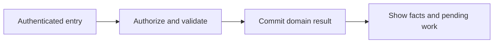
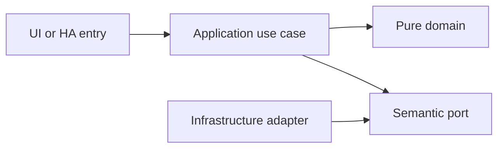

# Task definitions, occurrences and household execution

- Status: Draft
- Date: 2026-10-28
- Catalog capability ID: household-tasks
- Last verified: 2026-10-31 (owner-confirmed policy and document structure; task implementation pending)
- Owners: Domus maintainer; engineering/product reviewers to be assigned
- Scope: Members create and perform household responsibilities with explicit assignments, actual performers and history. A recurring definition survives completion of each individual occurrence.
- Related issues/PRs: https://github.com/vypdev/domus/issues/2
- Required review gates: product UX, architecture, testing, documentation, security/operations
- Open decisions blocking readiness: Executable role/override review; first-release advanced task-type matrix. Adult participation approval and scoped material defaults are owner-confirmed; engineering labels/bounds remain review items. The owner confirmed role-default verification, material-completion handling and preservation of completed downstream work/points when its prerequisite is reopened on 2026-10-29. Catalog gate prerequisites remain unverified.

## 1. Executive summary

Members create and perform household responsibilities with explicit assignments, actual performers and history. A recurring definition survives completion of each individual occurrence.

```text
Authenticated member -> validated domain command -> durable result -> household and HA projections
```

This is a prospective Draft, not an implemented or accepted capability. The first usable release covers all domains and both deployment targets.

## 2. Problem, current behavior, and evidence

A title and completed flag cannot represent recurring or collaborative household work, material requirements, verification and auditable corrections.

At the original documentation baseline on 2026-10-28, these domain workflows had no implementation. The merged M1 identity/storage foundation now has separate backend evidence. The task approval and material-authority additions in this review remain prospective; this documentation change adds no runtime behavior.

Evidence: the owner's attached brief and subsequent decisions in [product vision](../docs/product-vision.md), the pinned [reference investigation](../docs/reference-investigation.md), and the existing repository baseline. Retrospective classification is not applicable: no as-built product baseline is reconstructed.

## 3. Actors, surfaces, and terminology

Actors: Creator; assignee; actual performer; authorized verifier; household administrator.

Primary surfaces: application UI, HTTP domain boundary, relevant HA entities/services, activity and diagnostics. Definitions of member, principal, occurrence, demand and ledger are shared in the [glossary](../docs/glossary.md). The actor recording an action is distinct from its selected target and actual performer.

## 4. Goals, non-goals, and fixed invariants

Goals and fixed invariants are the following normative requirements. No configuration may weaken authorization, ledger integrity, attribution or idempotency.

| Requirement | Behavior |
|---|---|
| household-tasks-R1 | A task definition and occurrence MUST have separate stable identities; completing an occurrence never destroys its definition. |
| household-tasks-R2 | Every transition MUST enforce the explicit state machine, expected revision, dependencies and completion requirements; reopening a prerequisite MUST retain already-completed downstream work and points with a visible review condition, without automatic cascading reopening. |
| household-tasks-R3 | Assignment MUST distinguish planned assignees, completion actor and actual performers and support unassigned pools, reassignment and collaboration. |
| household-tasks-R4 | Completion and reopening MUST be idempotent and emit uniquely identified business events without duplicate downstream rewards. |
| household-tasks-R5 | Verification MUST default to none for adult performers and authorized-adult approval for restricted performers, prevent unauthorized approval and defer points until any required verification succeeds. Approval by an authorized adult who performed the work MUST be allowed by default, configurable by household and authorized task override, without permitting restricted self-approval. |
| household-tasks-R6 | Task history MUST retain creation, assignment, transitions, completion, reopening, schedule changes and related automation actors. |
| household-tasks-R7 | Task creation MUST support a minimal title-only path and optional advanced fields, categories, subtasks, materials and entity links. |
| household-tasks-R8 | Every task command MUST enforce household scope and role permissions and return actionable validation, conflict and recovery results. |
| household-tasks-R9 | Material recording MUST default to an adjustable review in the completion form, configurable per task; one explicit submission MUST retain linked outcomes without duplicate stock changes, insufficient stock MUST leave completed work saved with consumption pending regularization rather than negative stock, and reopening MUST NOT imply a physical material return. Authorized task-linked consumption MUST be allowed by default without general inventory permission, configurable by household/task; a normal lack of material authority MUST retain valid work and visibly unposted usage without an unauthorized movement. |

Non-goals: changing Copilot, changing the existing gateway, building an MCP server, adding mandatory cloud/AI dependencies, or claiming production readiness from a document.

## 5. Current versus proposed product journey

| Stage | Current | Proposed | User/operator effect |
|---|---|---|---|
| Enter | No Domus UI | Verified HA principal opens the relevant surface | Role and scope are explicit |
| Act | No domain command | Validate input, permission and current revision | Invalid data leaves the draft intact |
| Commit | No durable domain record | Store change and operation receipt atomically | Retry cannot duplicate effects |
| Observe | No projection | Show committed facts and pending downstream projections | Partial success remains understandable |



Text equivalent: authenticated entry -> authorization and validation -> durable domain commit -> visible facts with any pending projection. Domain-specific alternatives are described below.

## 6. Functional behavior and state model

### 6.1 Domain model and normal path

TaskDefinition owns title, description, configurable category, tags, priority, estimated duration, complexity, inconvenience, point policy, recurrence reference, material requirements, optional HA entity references, completion requirements and version. TaskOccurrence owns definition snapshot, scheduled start, due date or instant, assignees, participants, state, actual performers, completion actor/time and history. Only title is required for ordinary creation; advanced properties remain optional. Dependencies form an acyclic graph scoped to the household. Subtasks are explicit child occurrences; completion policy is all-required by default.

The owner confirmed adjustable material quantities in the completion form, submitted with the task completion, configurable per task. The default review shows planned quantities, units and storage targets; the member explicitly confirms actual usage, including zero for an unused material. A zero line is retained as not_used without fabricating a zero-quantity stock movement. Merely displaying the form or marking an unrelated task complete never consumes stock. A separate-recording task option retains an explicit later inventory action. The effective mode and submitted lines are snapshotted; the server validates stock permissions, product/unit/location compatibility and stable line identities rather than trusting the client preview.

One application orchestration accepts the completion and explicit material intents under the same operation receipt. Inventory still owns consumption rules and movement records; this is one user submission, not a second implementation of inventory policy in Tasks. Stable child identities link each consumption line to its completion cycle and deduplicate whole-request or line retries. Invalid input, forged or foreign references, unrelated material substitutions and missing task-completion authority fail admission before new effects. Otherwise valid linked usage lacking configured material authority retains valid performed work and unposted usage as described below; stock shortage is a separate recoverable outcome.

The owner confirmed that insufficient stock must not block recording work already performed. Save the completion and the affected intent as pending_regularization, with submitted quantity, source and safe reason; do not post an impossible movement or negative stock. Report each material line separately, including any successful lines, without presenting pending ones as consumed. Existing performer-verification and point rules still apply independently, and recurrence uses actual completion. An authorized member reviews actual inventory facts and explicitly resolves the pending intent; purchasing new stock alone does not silently post an old consumption. Settlement retains the same linked intent identity, handles races/replays once and leaves a visible audit trail.

The owner confirmed on 2026-10-31 that a restricted member authorized to complete a task may explicitly record consumption of that task's linked materials by default, without general inventory permission. The household supplies this task-scoped default and an administrator-authorized per-task override may change it. Explicit applicable member denials, installation limits and current task authorization still take precedence; absence of a general stock grant is distinct from an explicit denial of the scoped material action. Resolve eligible material identities, products, units and locations from the server-owned task/completion snapshot; a client-provided task ID or material line is not a general stock grant. Keep the previously accepted adjustable actual quantities, including zero usage. This authority cannot add unrelated products, change storage targets, edit stock arbitrarily, configure its own permission or reach another household. Inventory remains responsible for validating and posting every movement, usable stock and reservations.

If task-scoped consumption is disabled and the actor lacks the applicable inventory authority, retain otherwise valid performed work and the validated linked usage as visibly unposted pending authorization. Do not claim that stock was consumed, discard the reported work or silently request broader access. This normal policy outcome is distinct from forged identity, unrelated/foreign material references or invalid quantities, which still fail admission before new side effects. A later grant or adult approval does not automatically execute a retained material intent: an authorized explicit settlement reuses its completion-cycle/line identity and rechecks current authority and stock. Stock shortage remains pending_regularization, with no negative stock; it is not the same reason as missing authority. Engineering state labels and schema bounds remain subject to implementation review.

Verification controls point eligibility independently of physical usage. An eligible material movement may post while work awaits adult approval; rejection or reopening never fabricates a physical return. Replaying the original completion, approving it or changing either policy cannot consume again. Retained receipts/history explain the original effective policy but never authorize a newly revoked movement.

The owner confirmed on 2026-10-31 that a restricted member may claim an available task for themselves when it is offered to their profile. This is enabled by default and configurable per household/task. Current eligibility, capacity, profile/member exceptions and explicit applicable denials are checked at commit; competing claims cannot silently reassign work. Claiming does not waive adult verification or authorize another person as claimant. The backend companion specifies and tests this contract independently of the existing 49-case inventory.

The owner confirmed on 2026-11-01 that prerequisite approval timing is configurable per household/task. By default, performed prerequisite work may allow completing its dependent while adult approval is pending; an approved-work alternative waits for approval. This does not make pending points spendable, grant approval authority or waive current permissions. Completion retains the effective gate with its cycle; later settings cannot rewrite it. Rejected verification requests review and does not satisfy either gate.

### 6.2 States and alternatives

Definition: draft -> active <-> paused -> archived. Occurrence: draft -> available <-> assigned -> in_progress; available/assigned/in_progress -> blocked or completed; blocked -> available or assigned; active states -> cancelled or skipped. Reopen completed -> assigned if assignees exist, otherwise available. Verification is a separate pending/approved/rejected decision; pending completion is displayed as awaiting verification and awards no points.

The owner confirmed the role defaults on 2026-10-29. Without an explicit administrator-controlled task override, adult performers need no verification and any restricted actual performer requires approval by an authorized adult. Determine that policy from the actual performers, not merely the authenticated submitter: an adult recording a restricted member's work does not silently bypass the approval step. Restricted members cannot set their own policy to none or approve their own completion. The effective policy and its revision are snapshotted with completion.

The owner confirmed on 2026-10-31 that an authorized adult may approve a completion in which that adult participated by default. The household setting supplies the default and an explicit administrator-authorized task override takes precedence. A configured requirement for an independent adult denies approval by every actual performer; a completion's submitter is not used as a substitute for its performer set. Restricted performers never become adult verifiers through this option. Only currently authorized adults may approve, including after a lost response or policy change. Snapshot the effective participation rule and policy revisions with the completion, alongside its existing role-default verification policy. Later configuration edits govern future completions; they cannot silently waive an earlier pending decision. Current membership, adult status and approval permission are still checked when approval commits. A new completion cycle receives its own snapshot; delayed approval of a closed cycle remains inert. This policy does not add verification to adult-only work unless another explicit rule requires it.

A duplicate uses its original operation receipt. A changed payload under the same key is a conflict. Out-of-order events use aggregate revision and source identity. Cancellation never erases an already committed ledger effect; compensation is explicit.

Each accepted completion has a stable completion-cycle ID. Reopening closes that cycle; a genuine later completion gets a new ID. A delayed completion or approval from the closed cycle cannot create a new award or re-complete the occurrence. Reopening does not prove that consumed supplies physically returned: inventory remains unchanged unless an authorized, separately confirmed return/correction movement records actual facts. Rejection of verification likewise cannot fabricate returned stock.

The owner confirmed that reopening a prerequisite does not reopen its completed dependents or reverse their points. Keep each dependent's completed state, performer/time, accepted completion cycle, points, materials and recurrence facts. Record a separate dependency_attention condition naming the reopened prerequisite and request review. This condition is not a new completion, reversal or forced stock return. An authorized review can resolve the dependency through the normal prerequisite or dependency-edit commands, with actor/reason/history; it cannot erase real downstream work. Unstarted or unfinished dependents continue to enforce the ordinary prerequisite gate before completion. Replayed or stale dependency events are compared with current prerequisite revision so they cannot duplicate notices or reintroduce a resolved warning.

## 7. User-facing configuration

| Input | Type | Recommended default | Allowed values/range | Scope/persistence |
|---|---|---|---|---|
| `default_priority` | enum | normal | low, normal, high, urgent | household; occurrence snapshots |
| `dependency_gate` | enum | performed | performed or approved; rejected verification satisfies neither | household/task override; effective completion snapshot |
| `completion_verification` | enum | role_default | role_default: adults none, restricted performers authorized_adult; explicit none/authorized_adult overrides require administrator permission | definition; effective role policy and revision snapshotted at completion |
| `adult_performer_may_approve` | boolean | true | household default; administrator-authorized task override; false requires an adult outside the actual performer set | effective value and policy revisions snapshotted at completion; current authority always rechecked |
| `task_scoped_material_consumption` | boolean | true | household default; administrator-authorized task override; only validated task-linked material usage, never general stock authority | policy and material snapshot retained with completion; revoked authority cannot post a new movement |
| `dependency_policy` | enum | all_required | all_required only initially; cycles rejected | definition; versioned |
| `category` | string reference | General | active household category; optional | definition; persisted |
| `material_recording` | enum | review_on_completion | review_on_completion or separate_recording; explicit actual quantities, no silent consumption | definition; mode and material lines snapshotted for each completion |

Owner-confirmed defaults are recorded as accepted choices; other defaults and bounds remain proposals pending review. Invalid values and contradictory combinations are rejected before saving; unknown future values require an explicit compatibility error. Precedence is fixed invariants, installation constraints, household policy, then member preferences; lower scopes cannot expand permissions. In-flight commands snapshot relevant policy versions, while revocation is checked at the transaction boundary.

Recommended example: title-only creation, role-default verification and adjustable material review on completion when materials exist. Meaningful alternative: a task records consumption separately while preserving the same inventory permissions and receipts. Transport secrets are installation concerns and are never domain form fields.

## 8. Clean Architecture design

### 8.1 Responsibilities and dependency direction

CreateTask, ClaimTask, AssignTask, TransitionOccurrence, VerifyCompletion and ReopenOccurrence use TaskRepository, AuthorizationPolicy, UnitOfWork and EventOutbox. A completion orchestration delegates explicit material intents to the Inventory application port with stable child command identities. Domain transition and dependency policies are pure. A completion emits a durable event for points and recurrence. HA and HTTP adapters cannot implement alternate completion semantics.

| Boundary | Owns | Forbidden dependency |
|---|---|---|
| Domain | Entities, value objects and pure rules | HA, HTTP, SQL, UI frameworks |
| Application | Authorized commands, queries and semantic ports | Concrete adapters and framework DTOs |
| Adapters | Schema mapping, persistence and provider error mapping | Alternate business rules |
| Composition | Explicit deployment wiring | Business decisions |
| Presentation | View models and rendering | Database access or client-only authorization |



Text equivalent: entrypoints call use cases; use cases depend on pure domain and ports; infrastructure implements ports. Architecture checks reject forbidden imports and cycles. Shared contract tests exercise each port adapter; schemas and migration checks enforce durable boundaries.

## 9. UI/UX and content contract

### 9.1 Primary state examples

| State | Visible content |
|---|---|
| Pending | Saving “Clean the bathrooms”. Keep this screen open. |
| Action required | “Clean the bathrooms” needs a performer. Choose who completed the work. |
| Blocked | This task changed while you were editing it. Your draft is retained. Review the latest version. |
| Partial | Task completed. The points summary is refreshing; the completion is saved. View history. |
| Complete | Completed by Alex today at 10:30. 12 points awarded. |

The primary view names current status, retained facts and one next action, followed by descriptive links to the record/operation. Technical codes and correlation IDs are progressively disclosed. Duplicate responses update the same operation status rather than adding notifications. At most one routine notification per transition, with opt-out and bounded retry summaries.

English and Spanish use stable translation keys, base-language matching and English fallback. Mobile, tablet and desktop layouts, keyboard operation, visible focus, non-color status, accessible names, light/dark contrast and reduced motion are acceptance concerns. Untrusted text is rendered inert; no arbitrary HTML, commands or secret-bearing links.

## 10. Failure, recovery, and cleanup

| Failure | Retained facts | Retry / action | Cleanup |
|---|---|---|---|
| Invalid or denied input | Existing business records and form draft | Correct fields or request the proper role | No side effects |
| Valid work with missing material authority | Performed work and validated linked usage remain; no stock movement | Explicit settlement by a currently authorized actor | Never treat a later grant or task approval as automatic consumption |
| Stale revision | Current committed aggregate; user's entered fields | Review current state and submit a new deliberate operation | No automatic overwrite |
| Lost response after commit | Domain result and receipt | Look up or replay the same key | Never issue a fresh-key duplicate |
| Downstream projection unavailable | Successful domain result and durable pending event | Bounded backoff, then visible retry | Acknowledge outbox only after safe consumption |
| Restart or cancellation | Committed records; identified pending work | Recover receipts/cursors; compensate only by explicit command | Remove listeners and owned temporary artifacts |

Errors explain impact, safe cause, action and retained state. External availability is distinct from authorization denial. Retries are bounded and use deterministic backoff tests, not real waits.

## 11. Security, permissions, and privacy

Backend authorization applies to reads and writes. All requests and HA values are untrusted input; only authenticated principals and validated adapter context establish identity. Cross-household IDs, replayed operations and stale roles are covered in the inventory. A person entity and selected member ID do not authenticate a caller. Logs, traces, exports and browser artifacts redact credentials and unnecessary personal data. The technical HA principal has explicit narrow grants and cannot impersonate a household administrator.

## 12. Observability and operational UX

Show operation state and projection freshness to members; expose sanitized correlation, source event, aggregate revision, duration and safe error code to operators. No raw credentials or unrestricted HA payloads enter diagnostics. Counters distinguish denied, invalid, conflict, unavailable and completed operations. One durable activity entry per business transition; retries do not multiply notifications. No telemetry leaves the installation by default.

## 13. Compatibility, migration, rollout, and rollback

The existing M1 database is versioned and its identity, household, history and operation records must be preserved. Implementing these prospective task policies requires reviewed compatible migrations; this documentation-only change introduces no new stored domain records. Upgrade fixtures cover pending operations and ledger compatibility; a backup precedes destructive migration. Unknown future schemas block writes. Downgrade requires a compatible image/database pair, never silent interpretation of newer data.

Both Supervisor and standalone are first-release acceptance targets. Stable and Edge use separate credentials, IDs, volumes and endpoint bindings. Experimental artifacts cannot automatically promote production. Publication, merge and deployment remain in the existing authorized maintainer lifecycle.

## 14. Testing strategy and numeric budget

Minimum: 49 distinct cases, derived from the explicit risk inventory below. Each inventory row counts once. The budget is a floor, not a claim of completeness or executed tests.

| Area | Minimum distinct cases | Behaviors/risks covered |
|---|---:|---|
| Domain and configuration | 11 | an active recurring definition; a blocked prerequisite; a cyclic dependency or an incomplete required subtask; authorized adult participation, household/task precedence and narrow material authority |
| Adapters and persistence | 2 | a later definition edit; assignment |
| Integration and recovery | 9 | a one-time title-only task; a reopened completed task; pending verification; completion-policy snapshots across edit/restart and closed cycles |
| State and concurrency | 9 | two concurrent transitions with the same revision; two simultaneous claims on a single-assignee task; duplicate completion commands; current approval revocation and explicit material settlement replay |
| UI and accessibility | 8 | a collaborative task; rejected verification; title-only entry on a narrow screen; retained work with separately unposted material authorization |
| Security and privacy | 10 | a verifier policy requiring another member; an arbitrary history deletion request from a member; a foreign-household task ID; independent-adult configuration, unauthorized policy edits, unrelated material input and explicit member denial |
| Total | 49 | Distinct inventory cases; repeated executions do not add cases. |

| Case ID | Area | Requirements | Scenario |
|---|---|---|---|
| household-tasks-C01 | Domain and configuration | household-tasks-R1 | Given an active recurring definition, completing Saturday's occurrence leaves the definition active. |
| household-tasks-C02 | Adapters and persistence | household-tasks-R1 | Given a later definition edit, a completed occurrence retains its original snapshot. |
| household-tasks-C03 | Integration and recovery | household-tasks-R1 | Given a one-time title-only task, exactly one occurrence is available. |
| household-tasks-C04 | Domain and configuration | household-tasks-R2 | Given a blocked prerequisite, completing its dependent task is rejected with the blocking task link. |
| household-tasks-C05 | State and concurrency | household-tasks-R2 | Given two concurrent transitions with the same revision, only one succeeds and the other returns conflict. |
| household-tasks-C06 | Domain and configuration | household-tasks-R2 | Given a cyclic dependency or an incomplete required subtask, validation rejects completion. |
| household-tasks-C07 | State and concurrency | household-tasks-R3 | Given two simultaneous claims on a single-assignee task, one claim wins without silent reassignment. |
| household-tasks-C08 | Domain and configuration | household-tasks-R3 | Given a reassigned task performed by another authorized member, history preserves both assignment and actual performer. |
| household-tasks-C09 | UI and accessibility | household-tasks-R3 | Given a collaborative task, the completion form names participants before confirmation. |
| household-tasks-C10 | State and concurrency | household-tasks-R4 | Given duplicate completion commands, one completion event exists. |
| household-tasks-C11 | Integration and recovery | household-tasks-R4 | Given a reopened completed task, the downstream compensation references its original completion. |
| household-tasks-C12 | State and concurrency | household-tasks-R4 | Given an old completion retry after reopening, the receipt returns the original result without completing again. |
| household-tasks-C13 | Security and privacy | household-tasks-R5 | Given a verifier policy requiring another member, self-verification is denied. |
| household-tasks-C14 | Integration and recovery | household-tasks-R5 | Given pending verification, no points appear until an authorized approval event is committed. |
| household-tasks-C15 | UI and accessibility | household-tasks-R5 | Given rejected verification, the task displays the reason and can be resumed without a false award. |
| household-tasks-C16 | Adapters and persistence | household-tasks-R6 | Given assignment, completion and reopening, activity shows actor, time and changes in stable order. |
| household-tasks-C17 | Integration and recovery | household-tasks-R6 | Given an automation-created occurrence, history preserves the technical origin and correlation. |
| household-tasks-C18 | Security and privacy | household-tasks-R6 | Given an arbitrary history deletion request from a member, the backend rejects it. |
| household-tasks-C19 | UI and accessibility | household-tasks-R7 | Given title-only entry on a narrow screen, the task can be saved without opening advanced fields. |
| household-tasks-C20 | Domain and configuration | household-tasks-R7, household-tasks-R9 | Given review_on_completion with two planned units, the member confirms one actual unit in the same submission; the task result links exactly one one-unit consumption rather than decrementing the estimate. |
| household-tasks-C21 | Domain and configuration | household-tasks-R7 | Given an invalid entity or category reference, validation identifies that field without losing the draft. |
| household-tasks-C22 | Security and privacy | household-tasks-R8 | Given a foreign-household task ID, the request cannot read or change it. |
| household-tasks-C23 | UI and accessibility | household-tasks-R8 | Given a revision conflict, the form preserves entered values and offers reload/review. |
| household-tasks-C24 | Integration and recovery | household-tasks-R8 | Given a lost completion response after commit, retry shows the committed result and history once. |
| household-tasks-C25 | Domain and configuration | household-tasks-R5 | Given only adult performers and no explicit verification override, completion is accepted without an approval step and becomes eligible for one points allocation. |
| household-tasks-C26 | Security and privacy | household-tasks-R5 | Given a restricted actual performer with no policy override, even an adult submitting completion leaves it awaiting authorized-adult approval and awards no points yet. |
| household-tasks-C27 | Security and privacy | household-tasks-R8 | Given a restricted member setting verification to none, backend authorization rejects the override and retains the effective adult-approval policy. |
| household-tasks-C28 | UI and accessibility | household-tasks-R9 | Given review_on_completion, opening the form changes no stock and a member can explicitly submit zero usage for an unused material with the completion. |
| household-tasks-C29 | State and concurrency | household-tasks-R4, household-tasks-R9 | Given a lost response after completion and material recording, replaying the original request returns the same completion and per-line outcomes without consuming twice. |
| household-tasks-C30 | Domain and configuration | household-tasks-R9 | Given separate_recording on a task, completion creates no stock movement and a later explicit inventory action can reference that completion. |
| household-tasks-C31 | Integration and recovery | household-tasks-R4, household-tasks-R9 | Given reopening after confirmed material consumption, task history and points compensation reference the original cycle while physical inventory stays consumed until an explicit factual return or correction. |
| household-tasks-C32 | Security and privacy | household-tasks-R8, household-tasks-R9 | Given a completion material line for another household or an unauthorized stock location, backend validation denies that intent with no unauthorized movement and retains actionable operation state. |
| household-tasks-C33 | State and concurrency | household-tasks-R4, household-tasks-R5 | Given reopening followed by a genuine new completion, delayed approval of the old cycle cannot approve or award the new cycle; identities and history remain distinct. |
| household-tasks-C34 | Integration and recovery | household-tasks-R4, household-tasks-R9 | Given work performed with insufficient material stock, submission saves one completion and a pending_regularization intent, creates no negative stock, and retains the same pending result on replay. |
| household-tasks-C35 | UI and accessibility | household-tasks-R5, household-tasks-R9 | Given a completed task with one posted material line and one shortfall, the result names the posted and pending quantities separately and shows verification/points independently rather than calling the whole submission failed. |
| household-tasks-C36 | Integration and recovery | household-tasks-R2, household-tasks-R4 | Given a completed dependent and its prerequisite being reopened, the dependent retains completion, points, materials and recurrence facts while a linked review condition appears; no automatic reopening or compensation chain occurs. |
| household-tasks-C37 | UI and accessibility | household-tasks-R2, household-tasks-R6 | Given dependency_attention on completed work, the UI retains its actual completion and points, names the changed prerequisite and offers an authorized review without presenting the work as unperformed. |
| household-tasks-C38 | State and concurrency | household-tasks-R2, household-tasks-R4 | Given reviewed dependency recovery followed by a delayed or repeated old reopen event, revision checks keep the resolved state and do not duplicate warnings, completions or awards. |
| household-tasks-C39 | Domain and configuration | household-tasks-R5 | Given a required verification with an authorized adult among the actual performers and no participation override, that adult may approve once; restricted performers still cannot approve and the completion identity is unchanged. |
| household-tasks-C40 | Security and privacy | household-tasks-R5 | Given a snapshotted independent-adult requirement, an adult actual performer is denied approval while an authorized adult outside that performer set can approve; no premature award exists. |
| household-tasks-C41 | Domain and configuration | household-tasks-R5 | Given opposite household and administrator-authorized task participation settings, the explicit task value determines the new completion snapshot in either direction; an absent override inherits the household value. |
| household-tasks-C42 | Security and privacy | household-tasks-R5, household-tasks-R8, household-tasks-R9 | Given an ordinary restricted member editing either participation-approval policy or task-scoped material authority, the edit is denied without changing the policy or granting inventory access. |
| household-tasks-C43 | State and concurrency | household-tasks-R4, household-tasks-R5, household-tasks-R8 | Given an adult who performed the work losing current approval authority before commit or replay, approval is denied and no second decision or reward appears despite the retained completion policy snapshot. |
| household-tasks-C44 | Integration and recovery | household-tasks-R4, household-tasks-R5 | Given pending verification followed by a household/task participation-policy edit and restart, the original completion retains its effective rule; a genuine later completion uses its new snapshot and an old-cycle approval cannot authorize it. |
| household-tasks-C45 | Domain and configuration | household-tasks-R8, household-tasks-R9 | Given a restricted member authorized for the task but lacking general inventory permission, default task-scoped authority admits the reviewed linked material intent with adjusted actual quantities; the member gains no general stock permission. |
| household-tasks-C46 | Security and privacy | household-tasks-R8, household-tasks-R9 | Given a task-scoped material submission that substitutes an unrelated product, unauthorized location or foreign-household material identity, validation denies it before new task or stock effects; a task ID alone cannot authorize the substitution. |
| household-tasks-C47 | UI and accessibility | household-tasks-R5, household-tasks-R9 | Given disabled task-scoped consumption and no applicable inventory authority for otherwise valid linked usage, the task result retains performed work and separately names unposted material authorization; approval/points status is shown independently and stock is unchanged. |
| household-tasks-C48 | State and concurrency | household-tasks-R4, household-tasks-R9 | Given retained unposted material usage followed by a permission grant, nothing posts automatically; explicit authorized settlement reuses the original cycle/line identity, rechecks stock and posts at most once across concurrent retry or approval. |
| household-tasks-C49 | Security and privacy | household-tasks-R8, household-tasks-R9 | Given enabled household/task material policy but a current explicit member denial of scoped material consumption, valid performed work is retained with unposted usage and no new movement; the default cannot override that denial or grant general stock access. |

Every implemented first-party module starts with meaningful behavior tests. Target and proposed merge gate: 100% lines/statements/functions/branches where the selected tools expose those metrics, enforced separately across backend, frontend and integration code. Third-party/generated artifacts are distinguished from authored source; broad exclusions cannot hide untested logic. No application coverage currently exists.

Inject deterministic clocks, IDs, provider fakes and transaction failures. Use semantic assertions alongside golden content, real adapter contracts and disposable HA integration environments. Add Google Chrome evidence from the owner's authorized local HA for real UX; it does not replace automated tests or unit coverage. CI Check runs the complete applicable suite for every PR update.

## 15. Documentation and discoverability

The following documentation operations are relative to develop at e8fa5bbc9ffa179aa7559831f5f3d067c9c9c65c. This policy refinement adds no runtime or test implementation evidence.

| Path | Change |
|---|---|
| specs/household-tasks.md | update |
| specs/README.md | reference |
| specs/_template.md | reference |
| specs/catalog.json | update |
| specs/CATALOG.md | update |
| docs/architecture.md | reference |
| docs/product-vision.md | reference |
| docs/glossary.md | reference |
| docs/decisions.md | update |
| docs/reference-investigation.md | reference |
| docs/copilot-adoption.md | reference |
| docs/operations.md | reference |
| docs/user-guide.md | update |
| docs/contracts/home-assistant.md | reference |
| docs/acceptance-plan.md | update |
| docs/roadmap.md | reference |
| README.md | update |
| specs/household-identity.md | update |
| specs/household-inventory.md | update |
| specs/points-rewards.md | update |
| docs/sdd-validation.md | update |
| docs/evidence/task-policy-sdd-review.json | create |

| Audience | Artifact | Required content |
|---|---|---|
| Member | [User guide](../docs/user-guide.md) | Normal path, defaults and state meaning |
| Administrator/operator | [Operations](../docs/operations.md) | Setup, permissions, recovery, backup and rollback |
| Contributor | [Architecture](../docs/architecture.md) | Boundaries and executable constraints |
| HA consumer | [Entity/service contract](../docs/contracts/home-assistant.md) | Stable schemas, semantics and error handling |
| Reviewer | [Acceptance plan](../docs/acceptance-plan.md) | Tests, coverage and human evidence |

Link/path validation accompanies updates. Implementation changes update the owning SDD, catalog evidence, actual tests and user documentation together.

## 16. Acceptance scenarios

The Given/When/Then-equivalent observable scenarios in section 14 are the executable acceptance inventory. For each case, the given precondition and action must produce the specified result with state and side-effect assertions; tests are not implementation snapshots.

Acceptance includes normal, alternative, invalid, duplicate, concurrent, partial, failure, recovery, security, localization and accessibility paths as allocated above. Human review verifies the primary-state examples on desktop/mobile and light/dark themes. Live acceptance remains pending until an implemented artifact is exercised; no result is inferred from the budget.

## 17. Requirements traceability

| Requirement | Cases |
|---|---|
| household-tasks-R1 | household-tasks-C01, household-tasks-C02, household-tasks-C03 |
| household-tasks-R2 | household-tasks-C04, household-tasks-C05, household-tasks-C06, household-tasks-C36, household-tasks-C37, household-tasks-C38 |
| household-tasks-R3 | household-tasks-C07, household-tasks-C08, household-tasks-C09 |
| household-tasks-R4 | household-tasks-C10, household-tasks-C11, household-tasks-C12, household-tasks-C29, household-tasks-C31, household-tasks-C33, household-tasks-C34, household-tasks-C36, household-tasks-C38, household-tasks-C43, household-tasks-C44, household-tasks-C48 |
| household-tasks-R5 | household-tasks-C13, household-tasks-C14, household-tasks-C15, household-tasks-C25, household-tasks-C26, household-tasks-C33, household-tasks-C35, household-tasks-C39, household-tasks-C40, household-tasks-C41, household-tasks-C42, household-tasks-C43, household-tasks-C44, household-tasks-C47 |
| household-tasks-R6 | household-tasks-C16, household-tasks-C17, household-tasks-C18, household-tasks-C37 |
| household-tasks-R7 | household-tasks-C19, household-tasks-C20, household-tasks-C21 |
| household-tasks-R8 | household-tasks-C22, household-tasks-C23, household-tasks-C24, household-tasks-C27, household-tasks-C32, household-tasks-C42, household-tasks-C43, household-tasks-C45, household-tasks-C46, household-tasks-C49 |
| household-tasks-R9 | household-tasks-C20, household-tasks-C28, household-tasks-C29, household-tasks-C30, household-tasks-C31, household-tasks-C32, household-tasks-C34, household-tasks-C35, household-tasks-C42, household-tasks-C45, household-tasks-C46, household-tasks-C47, household-tasks-C48, household-tasks-C49 |

All requirement cases are reciprocal with section 14. Domain invariants are owned by pure policy, command/state rules by application use cases, provider behavior by adapters, and visible content by presentation; the boundary table in section 8 assigns these responsibilities. Evidence and user/operator documentation are linked in section 15.

## 18. Implementation sequence

1. Resolve the blocking decisions and review this contract before Ready for implementation.
2. Establish test harness, CI Check and architecture checks with the first source files.
3. Implement pure policies and their complete branch tests, then transactional use cases.
4. Add adapters, schema/error contracts, retry/race fixtures and both deployment wiring paths.
5. Build the accessible localized UI and HA projections with tests alongside each flow.
6. Verify migration, recovery, security, channel isolation and documentation.
7. Run the complete suite, review coverage, perform local Chrome dogfooding with recorded cleanup, and collect human evidence.

These are internal implementation steps within the first integrated release; they do not remove other domains or deployment targets from launch.

## 19. Definition of Done

- [ ] Every normative requirement has observable acceptance and reciprocal case links.
- [ ] Every declared case is implemented meaningfully; the numeric budget is met.
- [ ] Clean Architecture constraints and port contracts pass.
- [ ] All supported first-party coverage metrics reach 100% from the first implementation.
- [ ] CI Check passes for the current PR revision with no omitted required jobs.
- [ ] Configuration, state, permission, idempotency and recovery behaviors agree.
- [ ] Primary UI states, localization, responsive behavior and accessibility pass.
- [ ] Both deployment targets and isolated Stable/Edge channels pass acceptance.
- [ ] User/operator documentation, schema/migration evidence and catalog paths are current.
- [ ] Local Google Chrome evidence identifies the artifact, channel, test records and cleanup.
- [ ] The original Copilot validations pass when their real prerequisites exist; no check is weakened.
- [ ] No material decision blocking readiness remains unresolved; Copilot remains unchanged.

## 20. References and decisions

Primary sources: [Copilot standard](https://github.com/vypdev/copilot/blob/f5e5a4cf9a80248994469cd88ad55eecab5b95ca/specs/README.md), [original template](https://github.com/vypdev/copilot/blob/f5e5a4cf9a80248994469cd88ad55eecab5b95ca/specs/_template.md), and the linked [reference investigation](../docs/reference-investigation.md).

Confirmed owner choices and unresolved proposals are separated in [decisions](../docs/decisions.md). [Issue #2](https://github.com/vypdev/domus/issues/2) tracks the documentation foundation. The [adoption note](../docs/copilot-adoption.md) records the current catalog evidence limitation. Optional future depth remains explicitly deferred in the product vision; the gateway's installation and MCP internals are outside Domus scope.

## Proposed change: Show assigned and unclaimed household tasks on Overview

- Status: Draft
- Catalog capability: household-tasks

### 1. Executive summary

This update adds two task summaries to Overview. “Assigned to me” shows the current member’s tasks in the existing Assigned, In progress, and Blocked states; “Unclaimed” shows Available tasks with no assignees. Both use current Tasks read authority, the authoritative household snapshot, and existing bounded Tasks ordering. A selected task opens its protected detail in Tasks.

```text
Open Overview -> read authorized household snapshot -> show the two task groups and exact counts -> open a selected task in Tasks
```

The existing `specs/household-tasks.md` contract and cases remain authoritative for task states, permissions, ordering, and protected details. This delta adds Overview visibility; it does not claim the behavior is implemented.

### 2. Problem, current behavior, and evidence

#### 2.1 Problem

Members currently go to the paginated Tasks workspace to find their assigned or unclaimed work. The visible page cannot establish totals. The proposed Overview summaries let a member see relevant open work on entry and proceed directly to a protected task detail.

#### 2.2 Current behavior

The retained task contract defines task states, assignment, household authorization, and history in `specs/household-tasks.md`. This update proposes surfacing a bounded summary of those existing task facts on Overview; it does not change their meaning or imply that the new summaries already exist.

#### 2.3 Evidence

The requested behavior and current limitation are described in issue https://github.com/vypdev/domus/issues/92. The immutable selected owner is `specs/household-tasks.md`; its sections 1–6 define the prospective task contract, including separate task definitions and occurrences, assignments, state transitions, and household-scoped permissions. The owner records implementation as pending, so this update makes no claim of runtime verification. The issue’s proposed summaries, counts, ordering, navigation, and failure distinction are acceptance requirements for this delta.

### 3. Actors, surfaces, and terminology

The household member is the actor. Overview is the entry surface and shows the two task groups. Tasks remains the protected workspace for task details and the existing task journeys.

“Assigned to me” means tasks assigned to the current member in Assigned, In progress, or Blocked state. “Unclaimed” means Available tasks with no assignees. The count is the exact count from the authoritative household snapshot, subject to the existing bounded Tasks ordering. A visible page of paginated tasks is not the source of a total. “Empty” means a successful authorized read with no matching tasks; it is distinct from a read failure.

### 4. Goals, non-goals, and fixed invariants

#### 4.1 Goals

1. On Overview, show the current member’s Assigned, In progress, and Blocked tasks in “Assigned to me,” and Available tasks with no assignees in “Unclaimed.”
2. Show each group’s exact count from the authoritative household snapshot, apply existing bounded Tasks ordering, distinguish an empty group from a read failure, and open selected task details in the protected Tasks workspace using keyboard or touch.

#### 4.2 Non-goals

1. Changing task states, assignment rules, authorization policy, pagination, or task-detail behavior defined by the retained owner.
2. Adding task creation, claiming, reassignment, or other task mutations to Overview.

#### 4.3 Fixed product/safety invariants

1. Both groups and their counts require current Tasks read authority. Without it, Overview must not disclose protected task data or counts and must communicate read failure distinctly from an empty result.
2. Group membership, counts, and ordering must derive from the authoritative household snapshot and existing Tasks behavior; the visible paginated page must not be used to infer totals.
3. Opening a task must lead to its protected detail in Tasks and preserve existing authorization checks.

| Requirement | Behavior |
| --- | --- |
| SDD-I92-U1-R1 | Overview MUST show an Assigned to me group for the current member using existing Assigned, In progress, and Blocked states, and an Unclaimed group using existing Available tasks with no assignees. Both groups MUST respect current Tasks read authority, show exact counts from the authoritative household snapshot using existing bounded Tasks ordering, distinguish an empty group from a read failure, and open selected task details in the protected Tasks workspace with keyboard and touch input. |

### 5. Current versus proposed product journey

For issue [#92](https://github.com/vypdev/domus/issues/92), extend the Overview journey with two task summaries. A member with current Tasks read authority sees “Assigned to me” for their Assigned, In progress, and Blocked tasks, and “Unclaimed” for Available tasks with no assignees. Each group shows the exact count from the authoritative household snapshot and follows the existing bounded Tasks ordering. The member can open a task’s protected detail in Tasks using keyboard or touch. An empty group is presented as empty; a read failure remains visibly distinct. Without current Tasks read authority, neither group nor its count reveals protected task data. This increment adds the task summaries to the existing owner journey; other Overview summaries remain outside this delta.

### 6. Functional behavior and state model

The Overview derives both groups from the current authoritative household snapshot under current Tasks read authority. “Assigned to me” includes only tasks assigned to the current member in the existing Assigned, In progress, or Blocked states. “Unclaimed” includes only Available tasks with no assignees. Use the existing bounded Tasks ordering and exact snapshot counts; do not infer a household total from a paginated visible page. Refresh or otherwise obtain a current authorized snapshot before presenting the summaries, and do not treat unavailable or incomplete data as zero.

Render each task as an accessible, keyboard- and touch-operable selection that opens its protected detail in the Tasks workspace. Preserve the existing task state and authorization rules. Distinguish a successful empty result from a failed or unauthorized read: failures must not disclose task content or counts and must provide truthful failure feedback rather than an empty-state message.

### 7. User-facing configuration

No new user-facing configuration is introduced. The summaries use the current member, existing task states, assignees, Tasks read authority, and established Tasks ordering.

### 8. Clean Architecture design

Add the Overview summary as a presentation of the existing Tasks read contract. The application-side read must enforce current Tasks authority and return only the authorized task facts and exact counts needed for these groups; the Overview must not derive protected data or household totals from client state or a paginated page. Keep task-state and authorization semantics in the existing domain and application boundaries, with presentation limited to rendering the authorized result and its loading, empty, and failure states.

Selecting a summary item routes to the existing protected task detail in Tasks. Keep the summary and detail authorization checks current; a rendered item or stale Overview snapshot grants no access. Build the interaction with the published ha-ui components and preserve keyboard and touch operation. The existing owner contract remains in `specs/household-tasks.md`; the roadmap identifies authoritative permission-scoped Overview projections and the shared component ownership in `docs/roadmap.md`.

### 9. UI/UX and content contract

The Overview adds two task summaries within the existing household surface. “Assigned to me” includes only the current member’s tasks in Assigned, In progress, or Blocked states. “Unclaimed” includes only Available tasks with no assignees. Both summaries use current Tasks read authority, the authoritative household snapshot for exact counts, and the existing bounded Tasks ordering; a paginated page is not a source for totals. These are summaries, not new task states or assignment controls. Selecting a task opens its protected detail in the Tasks workspace.

```text
Assigned to me · 3
Laundry — In progress
Take out recycling — Assigned
Fix the tap — Blocked

Unclaimed · 1
Water the plants — Available
```

Each group has a localized heading and count. Each task is a descriptive, keyboard-focusable and touch-operable link or control with an accessible name that identifies the task and its state; state is conveyed by text, not color alone. An empty group has a clear empty message and a zero count. Loading, unavailable data, and denied authority must not be rendered as an empty group or zero. Follow the existing English/Spanish translation-key, base-language matching, and English-fallback conventions. Preserve responsive narrow and wide layouts, visible focus, light/dark contrast, and reduced-motion behavior. Existing task labels and state terminology are defined in `frontend/src/presentation/task-messages.ts`; the established shell and Overview region are in `frontend/src/presentation/domus-app.ts`. Acceptance covers the assigned summary, unclaimed summary, empty-versus-failure distinction, and protected navigation as specified by `inventory1-C01`, `inventory1-C02`, and `inventory1-C03`.

### 10. Failure, recovery, and cleanup

If the task summary read is loading, unavailable, or incomplete, identify that the summary could not be loaded and offer the existing safe retry or navigation path when available. Keep failure visibly distinct from a successful empty result; never substitute zero or a count inferred from one page. If access is denied or no longer current, hide task rows and counts and explain that current Tasks access is required. Do not retry indefinitely or change task state as part of summary recovery. A task that changes between summary display and selection is resolved by the protected Tasks detail flow, which remains authoritative. These are read-only summaries and create no task-side effects or cleanup work. The distinction between unavailable or incomplete projections and zero totals is also required by `docs/roadmap.md`.

### 11. Security, permissions, and privacy

Both groups and their counts are protected by current Tasks read authority. Derive the member and household context from the authenticated application context; do not treat a selected member, URL fragment, task identifier, or rendered component event as authority. On denial, expired access, or a context change, disclose neither rows nor counts and present a failure state rather than an empty result. Only validated summary data may reach the Overview renderer; task detail navigation must return to the protected Tasks workspace, where its existing authorization checks apply. Render task titles and other user-controlled values as inert text, without arbitrary HTML or executable links. Do not add credentials, household details, or task data to diagnostics. These rules extend the existing read authorization and untrusted-input contract in `specs/household-tasks.md`.

### 12. Observability and operational UX

Members can tell whether each group is loading, populated, empty, or unavailable, and can reach the Tasks workspace for the full list or a selected detail. A failed read must not be reported as a successful count. Operational evidence may distinguish denied, unavailable, and incomplete summary reads using existing sanitized error handling; it must not include task titles, member names, household identifiers, credentials, or unrestricted payloads. Do not add telemetry leaving the installation or duplicate notifications for these read outcomes. No concrete new metric, logging hook, or verification invocation is established for this delta; its implementation prerequisite remains unverified.

### 13. Compatibility, migration, rollout, and rollback

This is a read-only presentation and projection change. Keep existing task states, authorization rules, bounded ordering, Tasks detail behavior, and persisted read schema compatible; do not add stored task records or migrate existing task data for these summaries. The summary must be based on the authoritative household snapshot and remain correct beyond the visible paginated Tasks page. Verify the behavior in both supported locales, relevant responsive compositions and deployment architectures, with disposable test data, as called for by the issue. Installed Edge-candidate acceptance remains an explicit product-validation outcome; no result is established by this draft. No specific installed invocation for the full specification/catalog checks or Edge acceptance is established here, so those concrete invocations and prerequisites remain unverified.

### 14. Testing strategy and numeric budget

Add a minimum of three distinct cases for this delta, one for each supplied Overview behavior: authorized assigned-task presentation and protected detail navigation; authorized unclaimed-task presentation with empty-result distinction; and denial without task-data disclosure. These cases supplement the immutable testing strategy and retained cases in `specs/household-tasks.md` (sections 14 and 16); they do not replace its existing coverage or establish that any test has run. Each case must use the authoritative household snapshot, verify exact counts and the existing bounded Tasks ordering where applicable, and cover keyboard and touch navigation. Exercise read failure separately from an empty group and verify that missing current Tasks read authority protects both task groups and their counts. Verify the specification satisfies the required format; check internal and cross-document consistency; and verify reciprocal catalog ownership, paths, and evidence agree with the generated view. The selected root `package.json` declares pnpm 10.34.0 and scripts including `test`, but does not declare the `validate:specifications` or `generate:specifications` invocations recommended in `specs/README.md`. The concrete publication-check invocation and prerequisites remain unverified; declarations are not execution, passing checks, or product acceptance.

| Area | Minimum distinct cases | Behaviors/risks covered |
|---|---:|---|
| Overview | 2 | Observable scenarios in the case inventory. |
| Security and recovery | 1 | Observable scenarios in the case inventory. |
| Total | 3 | Distinct inventory cases; repeated executions do not add cases. |

| Case ID | Area | Requirements | Scenario |
| --- | --- | --- | --- |
| inventory1-C01 | Overview | SDD-I92-U1-R1 | With Tasks read authority, the current member sees only their Assigned, In progress, and Blocked tasks in Assigned to me, ordered by the existing bounded Tasks ordering; the displayed count matches the authoritative household snapshot, and selecting a task opens its protected detail in Tasks by keyboard or touch. |
| inventory1-C02 | Overview | SDD-I92-U1-R1 | With Tasks read authority, Unclaimed contains only Available tasks with no assignees; its displayed count matches the authoritative household snapshot, and an empty group is distinguishable from a read failure. |
| inventory1-C03 | Security and recovery | SDD-I92-U1-R1 | Without current Tasks read authority, neither task group nor its counts disclose protected task data, and the Overview distinguishes the read failure from an empty result. |

### 15. Documentation and discoverability

Update the existing household-task user guidance to explain that Overview summarizes the current member’s Assigned, In progress, and Blocked tasks and household Available tasks with no assignees. Explain exact snapshot counts, bounded ordering, the difference between an empty group and a read failure, and that selecting a task opens its protected detail in Tasks. Document that current Tasks read authority governs both groups and their counts, and that keyboard and touch input are supported. Keep this delta within the existing ownership and documentation structure in `specs/household-tasks.md`; the concrete user-document location and any additional path changes are not established by the supplied inventory. The inventory declares only the update to `specs/household-tasks.md`; it is an operation declaration, not evidence of changed files. Publication checks and their concrete invocation remain as described in section 14.

| Path | Change |
| --- | --- |
| specs/household-tasks.md | update |

[specs/household-tasks.md](household-tasks.md)

### 16. Acceptance scenarios

1. With current Tasks read authority, the current member sees only their Assigned, In progress, and Blocked tasks in “Assigned to me,” in the existing bounded Tasks ordering. Its count matches the authoritative household snapshot, and selecting a task opens its protected detail in Tasks by keyboard or touch. This is the observable assertion for `inventory1-C01`.
2. With current Tasks read authority, “Unclaimed” contains only Available tasks with no assignees, and its count matches the authoritative household snapshot. An empty group is distinguishable from a read failure. This is the observable assertion for `inventory1-C02`.
3. Without current Tasks read authority, neither task group nor its count discloses protected task data, and Overview distinguishes the read failure from an empty result. This is the observable assertion for `inventory1-C03`.

These are the three supplied new case identities. Existing task and companion owner cases remain references under their immutable contracts; no new case identity is inferred for them.

### 17. Requirements traceability

`SDD-I92-U1-R1` requires Overview to show the current member’s Assigned, In progress, and Blocked tasks and the household’s Available tasks with no assignees; respect current Tasks read authority; show exact authoritative-snapshot counts using existing bounded Tasks ordering; distinguish empty results from read failures; and open protected task details in Tasks by keyboard and touch. `inventory1-C01` exercises assigned-task filtering, ordering, count, and protected keyboard/touch detail navigation. `inventory1-C02` exercises unclaimed-task filtering, count, and empty-versus-failure distinction. `inventory1-C03` exercises denial and non-disclosure for both groups and counts, including failure-versus-empty presentation. Existing behavior and cases remain owned by the immutable `specs/household-tasks.md` contract. Publication acceptance also requires required-format conformance, an internal and cross-document consistency check, and reciprocal catalog ownership, paths, and evidence agreeing with the generated view; the concrete invocation and prerequisites remain unverified in the selected source.

| Requirement | Cases |
|---|---|
| SDD-I92-U1-R1 | inventory1-C01, inventory1-C02, inventory1-C03 |

### 18. Implementation sequence

1. Finalize the Overview query and presentation contract against the retained task state, authorization, bounded ordering, and protected detail behavior in `specs/household-tasks.md` and `specs/task-execution-foundation.md`.
2. Implement the authoritative, permission-scoped summary so it returns the current member’s Assigned, In progress, and Blocked tasks and Available tasks with no assignees, preserving existing ordering and bounded limits.
3. Add the Overview groups, exact snapshot counts, distinct empty and read-failure states, and protected Tasks detail navigation. Keep keyboard and touch interaction accessible and localized in English and Spanish.
4. Add focused acceptance coverage for both groups, counts, ordering, selection, empty results, and denied or failed reads; include the Overview in supported compositions and architectures and use disposable test data for the installed Edge candidate.
5. Update the owning contract and reciprocal catalog evidence with the verified paths and validation evidence before publication. The selected declarations establish pnpm 10.34.0 with Node `>=24.20.0 <25` and uv/Python `>=3.14,<3.15`; no task-specific verification invocation or prerequisite was verified here.

### 19. Definition of Done

- [ ] Overview shows only the current member’s Assigned, In progress, and Blocked tasks under “Assigned to me,” and only Available tasks with no assignees under “Unclaimed.” Both groups use the authoritative household snapshot, exact counts, and existing bounded Tasks ordering.
- [ ] Current Tasks read authority protects both groups and their counts. A read failure is visibly distinct from a successful empty result, and failure or denied authority discloses no protected task data.
- [ ] Selecting a task opens its protected detail in the Tasks workspace with keyboard and touch input. The groups and states remain accessible and localized in both supported locales and compositions.
- [ ] The three supplied Overview cases are implemented with their concrete observable assertions; requirement `SDD-I92-U1-R1` maps to cases that exercise each specified behavior.
- [ ] Required test, coverage, architecture, localization, and product-validation outcomes are satisfied. The concrete task-specific invocation and prerequisites remain unverified; no command declaration is execution or passing evidence.
- [ ] The specification satisfies the required format; internal and cross-document consistency is checked; reciprocal catalog ownership, paths, and evidence agree with the generated view.
- [ ] No publication outcome is inferred from structural inventory counts or from a declared check alone.

### 20. References and decisions

- Issue: https://github.com/vypdev/domus/issues/92.
- This is a bounded update to the immutable retained owner `specs/household-tasks.md`; its existing contract and cases remain in force. `specs/task-execution-foundation.md` supplies the existing task lifecycle, authorization, bounded query, and protected task-detail context. `specs/household-task-categories.md` remains unchanged.
- The delta adds assigned and unclaimed task summaries to Overview while retaining the existing task states, read authority, ordering, and detail workspace. It adds no task mutations or changes to the task read schema.
- Selected declarations identify pnpm 10.34.0 with Node `>=24.20.0 <25` and uv/Python `>=3.14,<3.15`. The concrete invocation and prerequisites for complete coverage, both locales, compositions, architectures, and installed Edge-candidate validation remain unverified.

## Qualify bounded and scoped Overview task summaries

- Status: Draft
- Owners: Domus maintainers and Tasks
- Scope: Additional qualification of the already published Overview task read
- Open decisions blocking readiness: none

### 1. Executive summary

Record two focused acceptance cases for the Overview read. Verify the
difference between a group total and a bounded preview, and prove that
a delayed read cannot survive a household context change.

### 2. Problem, current behavior, and evidence

Issue 92's first published SDD defines both task groups and three cases.
The implementation uses a fixed 25-item preview with exact counts and
cancellable browser reads. It has distinct witnesses for large groups
and delayed replies, beyond the original basic group and denial cases.

### 3. Actors, surfaces, and terminology

A current member reads Overview. A preview is the bounded set of task
rows from the same authorized snapshot as the exact count. A context
retirement invalidates every pending read bound to the old identity.

### 4. Goals, non-goals, and fixed invariants

| Requirement | Behavior |
|---|---|
| overview-task-evidence-R01 | A group larger than the existing Tasks page bound keeps its exact authorized total, includes only its bounded ordered preview, and is unavailable if the transport returns an incomplete or inconsistent preview. |
| overview-task-evidence-R02 | Replacing or retiring the verified Overview context clears its private result, cancels its owned read and discards a response delivered after retirement. |

Preserve all three previously published cases and the existing user
journey. These assertions qualify the authorized read already in issue 92.

### 5. Current versus proposed product journey

Observe exact counts on Overview even when the group exceeds one page.
After leaving a verified context, only a current authorized response
can fill the next Overview.

### 6. Functional behavior and state model

The read returns one exact total and at most 25 rows per group. The UI
checks that each preview has the expected size and unique task IDs.
Loading, unavailable and retired states carry no private rows or counts.

### 7. User-facing configuration

Use the current household membership, Tasks read permission, locale
and existing page bound.

### 8. Clean Architecture design

Application owns the authorized snapshot and group meaning. SQLite reads
counts and ordered bounded rows in the same transaction. The HTTP adapter
validates the private response. The browser controller owns cancellation
and does not use retired results.

### 9. UI/UX and content contract

Display the exact count beside the group title. A shortened preview
points to the existing Tasks workspace. A failed or superseded read
cannot populate the summary.

### 10. Failure, recovery, and cleanup

A malformed or incomplete result shows the existing unavailable state.
Retry rechecks current authority. Retirement clears old facts while
retaining the existing application navigation.

### 11. Security, permissions, and privacy

The transport uses the verified installation, channel and subject.
The application resolves the current household member and permission.
A late reply never authorizes disclosure in a new context.

### 12. Observability and operational UX

Record test evidence for count completeness and discarded late results.
Use the existing sanitized read errors in the user interface.

### 13. Compatibility, migration, rollout, and rollback

The read uses the existing SQLite schema 30. Verify the pinned Edge.12
runtime and the same-head application and image checks.

### 14. Testing strategy and numeric budget

Minimum two distinct cases.

| Area | Minimum distinct cases | Behaviors/risks covered |
|---|---:|---|
| Bounded snapshot | 1 | Observable scenarios in the case inventory. |
| Context retirement | 1 | Observable scenarios in the case inventory. |
| Total | 2 | Distinct inventory cases; repeated executions do not add cases. |

| Case ID | Area | Requirements | Scenario |
|---|---|---|---|
| overview-task-evidence-C01 | Bounded snapshot | overview-task-evidence-R01 | Seed more than 25 matching rows in both groups. Verify exact totals and the ordered first 25. Pass an incomplete or duplicated preview to the transport decoder and verify the read fails. |
| overview-task-evidence-C02 | Context retirement | overview-task-evidence-R02 | Delay a valid read while changing verified subject or retiring the view. Complete the old read after the change and verify that no old rows or counts appear. Resolve a current read and observe its own result. |

### 15. Documentation and discoverability

[specs/household-tasks.md](household-tasks.md) · [docs/evidence/overview-task-qualification.md](../docs/evidence/overview-task-qualification.md) · [tests/backend/test\_task\_overview.py](../tests/backend/test_task_overview.py) · [frontend/tests/task-overview.test.ts](../frontend/tests/task-overview.test.ts) · [frontend/tests/task-http.test.ts](../frontend/tests/task-http.test.ts)

| Path | Change |
|---|---|
| specs/household-tasks.md | update |
| docs/evidence/overview-task-qualification.md | reference |
| tests/backend/test_task_overview.py | reference |
| frontend/tests/task-overview.test.ts | reference |
| frontend/tests/task-http.test.ts | reference |

### 16. Acceptance scenarios

Run the bounded snapshot and context retirement witnesses. Keep the
three original Overview cases under their published identifiers.

### 17. Requirements traceability

| Requirement | Cases |
|---|---|
| overview-task-evidence-R01 | overview-task-evidence-C01 |
| overview-task-evidence-R02 | overview-task-evidence-C02 |

### 18. Implementation sequence

Trace the existing backend, transport and controller checks to the two
qualification cases and run the same-head application and image checks.

### 19. Definition of Done

Both new witnesses pass with the already published Overview contract,
complete coverage and the exact installed Edge.12 candidate.

### 20. References and decisions

Issue 92 and its first verified publication own the Overview behavior.
This revision adds explicit evidence for the page bound and delayed reads.

## Show tasks due today and overdue on Overview

- Status: Draft
- Owners: Domus maintainers and Tasks
- Scope: Protected read-only task deadline summaries and links to existing task details
- Open decisions blocking readiness: none for the existing deadline semantics

### 1. Executive summary

A household member opens Overview to find open tasks due today and overdue.
Counts and links come from the authoritative task and recurrence records.

### 2. Problem, current behavior, and evidence

Overview shows assigned and unclaimed work. The roadmap also calls for
current task deadline summaries. The protected Calendar and recurrence
review already distinguish actual timed deadlines from date-only deadlines.

### 3. Actors, surfaces, and terminology

A verified household member with current Tasks read access sees the summary.
A timed task has a due instant. A date-only occurrence has an effective
calendar date in its saved scheduling time zone. Overview links to Tasks.

### 4. Goals, non-goals, and fixed invariants

| Requirement | Behavior |
|---|---|
| overview-deadlines-R01 | Report open tasks due today and overdue using their effective deadline and one authoritative observation time. Use the household time zone for the local day of a timed deadline and the saved scheduling time zone for a date-only deadline. |
| overview-deadlines-R02 | Scope counts and item lists to the current household and Tasks read authority. Read exact totals and bounded items from the same snapshot. |
| overview-deadlines-R03 | Present clear loading, empty, unavailable and ready states in English and Spanish. Open details through the existing protected Tasks view with keyboard and touch. |
| overview-deadlines-R04 | Preserve existing task and recurrence records, validate both deployment compositions and architecture images, and verify the installed Edge candidate. |

This increment covers today's and overdue work in the roadmap's Overview.
Future maintenance, stock and family summaries have separate acceptance.

### 5. Current versus proposed product journey

Open Overview, review overdue work and tasks due today, then select a task
to see its details and permitted actions in Tasks. Assigned and unclaimed
summaries remain available.

### 6. Functional behavior and state model

Use the existing Available, Assigned, In progress and Blocked work states.
Exclude work without a deadline and closed or draft work. A timed deadline
becomes overdue after its instant. A date-only deadline becomes overdue
after its effective date in the saved scheduling time zone. Apply reviewed
reschedules through the existing effective-deadline rules. A deadline on
its current local day that has yet to become overdue belongs to Due today.
Return exact totals and at most 25 items per group. A successful empty
result has a zero count. Failed and incomplete reads are unavailable.

### 7. User-facing configuration

Use the existing member locale, household time zone and saved scheduling
policy. No additional configuration is required.

### 8. Clean Architecture design

Application owns authorization, deadline classification and the read
projection. Reuse the existing task and recurrence deadline records,
pinned time conversion and protected Tasks overview route. Presentation
uses ha-ui and the current task selection and focus behavior.

### 9. UI/UX and content contract

Use Due today and Overdue in English and equivalent Spanish labels.
Show task title and deadline with its date-only or timed precision.
Place time-sensitive work before assigned and unclaimed groups. Counts,
retry and task links use the existing Overview interaction patterns.

### 10. Failure, recovery, and cleanup

Reject incomplete summaries and retire any response for a stale context.
Retry the protected read. A removed or changed task uses current detail
recovery. Only disposable candidate data is removed after the live test.

### 11. Security, permissions, and privacy

Enforce current Tasks read access before counts or details. Read only the
verified household. Locale or UI navigation does not establish authority.

### 12. Observability and operational UX

Use existing protected read diagnostics. A date conversion or source
failure produces an unavailable summary with the normal retry action.

### 13. Compatibility, migration, rollout, and rollback

Read current records and retain their task identities. Qualify the
candidate on both compositions and actual image architectures.

### 14. Testing strategy and numeric budget

Minimum six distinct cases.

| Area | Minimum distinct cases | Behaviors/risks covered |
|---|---:|---|
| Timed deadlines | 1 | Observable scenarios in the case inventory. |
| Date-only deadlines | 1 | Observable scenarios in the case inventory. |
| Bounded protected snapshot | 1 | Observable scenarios in the case inventory. |
| Read recovery | 1 | Observable scenarios in the case inventory. |
| Browser acceptance | 1 | Observable scenarios in the case inventory. |
| Installed acceptance | 1 | Observable scenarios in the case inventory. |
| Total | 6 | Distinct inventory cases; repeated executions do not add cases. |

| Case ID | Area | Requirements | Scenario |
|---|---|---|---|
| overview-deadlines-C01 | Timed deadlines | overview-deadlines-R01 | Classify a timed deadline just before, at and after the observed instant, using the household's local date and the next day boundary. Exclude undated and closed tasks. |
| overview-deadlines-C02 | Date-only deadlines | overview-deadlines-R01 | Evaluate fixed and relative date-only work in its saved time zone, including a reviewed date move and a local date that differs from the household date. |
| overview-deadlines-C03 | Bounded protected snapshot | overview-deadlines-R02 | More than 25 matching tasks produce exact counts and bounded rows. Current Tasks read denial excludes both counts and rows. |
| overview-deadlines-C04 | Read recovery | overview-deadlines-R02, overview-deadlines-R03 | Show zero for a successful empty group, offer retry after an unavailable read and retire a delayed result on verified context change. |
| overview-deadlines-C05 | Browser acceptance | overview-deadlines-R03 | Select deadline rows with English desktop keyboard and Spanish narrow touch. Open and focus the existing protected task detail in both compositions. |
| overview-deadlines-C06 | Installed acceptance | overview-deadlines-R04 | Qualify both architecture images and verify the exact installed Edge candidate with disposable household tasks, then remove the test data. |

### 15. Documentation and discoverability

[specs/household-tasks.md](household-tasks.md) · [docs/roadmap.md](../docs/roadmap.md) · [docs/user-guide.md](../docs/user-guide.md) · [backend/src/domus/application/task\_queries.py](../backend/src/domus/application/task_queries.py) · [backend/src/domus/infrastructure/sqlite\_tasks.py](../backend/src/domus/infrastructure/sqlite_tasks.py) · [frontend/src/presentation/domus-task-overview.ts](../frontend/src/presentation/domus-task-overview.ts) · [frontend/src/adapters/task-http.ts](../frontend/src/adapters/task-http.ts)

| Path | Change |
|---|---|
| specs/household-tasks.md | update |
| docs/roadmap.md | update |
| docs/user-guide.md | update |
| backend/src/domus/application/task_queries.py | update |
| backend/src/domus/infrastructure/sqlite_tasks.py | update |
| frontend/src/presentation/domus-task-overview.ts | update |
| frontend/src/adapters/task-http.ts | update |

### 16. Acceptance scenarios

See today's and overdue work for the same protected household. Review a
date-only task and a timed task at the relevant day boundary. Open a listed
task and observe current detail, then exercise read failure and retry.

### 17. Requirements traceability

| Requirement | Cases |
|---|---|
| overview-deadlines-R01 | overview-deadlines-C01, overview-deadlines-C02 |
| overview-deadlines-R02 | overview-deadlines-C03, overview-deadlines-C04 |
| overview-deadlines-R03 | overview-deadlines-C04, overview-deadlines-C05 |
| overview-deadlines-R04 | overview-deadlines-C06 |

### 18. Implementation sequence

Extend the protected aggregate read with effective deadlines and current
time. Add the localized groups and reuse the owning task detail behavior.
Qualify the complete cases and the pinned Edge candidate.

### 19. Definition of Done

Verify six cases, complete coverage, exact-head CI for both architectures
and installed Edge evidence with scoped cleanup.

### 20. References and decisions

The roadmap's Overview section and application-experience-R2 require
current actionable summaries. The recurrence guide's overdue fixed slot
rules and the existing Calendar projection define effective deadlines and
preserve date-only precision.

## Show upcoming scheduled maintenance on Overview

- Status: Draft
- Owners: Domus maintainers and Tasks
- Scope: Protected read-only preview of open recurring work due during the next seven days
- Open decisions blocking readiness: none for the existing task and recurrence rules

### 1. Executive summary

A household member opens Overview to find the maintenance already scheduled
for the next seven days. Each item opens its existing Tasks detail.

### 2. Problem, current behavior, and evidence

Overview shows assigned, unclaimed, due today and overdue tasks. The roadmap
also calls for upcoming maintenance. Calendar and Tasks already display
effective deadlines for materialized fixed and relative recurrence.

### 3. Actors, surfaces, and terminology

A verified household member with current Tasks read access sees the group.
A maintenance item is a materialized task occurrence linked to a fixed or
relative recurrence slot. Timed items use the household's local calendar day.
Date-only items use their effective date and saved scheduling time zone.

### 4. Goals, non-goals, and fixed invariants

| Requirement | Behavior |
|---|---|
| overview-maintenance-R01 | Show open materialized fixed and relative task occurrences due from tomorrow through the seventh upcoming local day, using one observation instant and their effective deadlines. Exclude ad hoc work, closed work and today's work. |
| overview-maintenance-R02 | Require current Tasks read access and one household snapshot. Return an exact count and at most 25 items ordered by effective date and stable occurrence identity. |
| overview-maintenance-R03 | Show a localized Upcoming maintenance group with the task, effective date or time, state and existing detail action. Provide accurate empty and retry states and retire results when the verified context changes. |
| overview-maintenance-R04 | Preserve stored task and recurrence data. Verify both deployment compositions, image architectures and the installed Edge candidate. |

The preview reads current materialized work. Recurrence generation and
editing continue through the existing Calendar and Tasks flows.

### 5. Current versus proposed product journey

Open Overview to see upcoming maintenance after the deadline groups. Select
an item to review the existing task detail and its current permitted actions.

### 6. Functional behavior and state model

Use Available, Assigned, In progress and Blocked occurrences. Use the
household time zone for timed deadlines and the saved scheduling time zone
for date-only deadlines. Apply reviewed moves through effective-deadline
rules. Include the last day of the seven-day window and keep a bounded
preview even when more rows qualify. A successful empty result has zero
matching items. An incomplete result is unavailable.

### 7. User-facing configuration

Use the existing household time zone, recurrence policy and member locale.

### 8. Clean Architecture design

Extend the existing protected Tasks overview projection. Storage streams
household-scoped open scheduled candidates. Application evaluates effective
deadlines from one snapshot and bounds the selected rows. Presentation
reuses the current Overview cards and Tasks detail selection.

### 9. UI/UX and content contract

Label the group Upcoming maintenance and Próximos mantenimientos. Keep each
deadline's precision and show the count and direct detail action. Keep the
existing retry and keyboard focus behavior.

### 10. Failure, recovery, and cleanup

Reject malformed or incomplete groups. Retire stale reads when the context
changes. Offer a retry after an unavailable read. Remove disposable data
after installed acceptance.

### 11. Security, permissions, and privacy

Check current Tasks read authority before returning rows or counts. Use the
verified household scope in the same read transaction.

### 12. Observability and operational UX

Use current protected read diagnostics and the shared Overview recovery.

### 13. Compatibility, migration, rollout, and rollback

Read current task and recurrence records with the existing schema. Verify
both compositions and image architectures before installed acceptance.

### 14. Testing strategy and numeric budget

Minimum six distinct cases.

| Area | Minimum distinct cases | Behaviors/risks covered |
|---|---:|---|
| Timing and selection | 1 | Observable scenarios in the case inventory. |
| Date-only recurrence | 1 | Observable scenarios in the case inventory. |
| Protected bounded snapshot | 1 | Observable scenarios in the case inventory. |
| Recovery | 1 | Observable scenarios in the case inventory. |
| Accessible navigation | 1 | Observable scenarios in the case inventory. |
| Installed qualification | 1 | Observable scenarios in the case inventory. |
| Total | 6 | Distinct inventory cases; repeated executions do not add cases. |

| Case ID | Area | Requirements | Scenario |
|---|---|---|---|
| overview-maintenance-C01 | Timing and selection | overview-maintenance-R01 | Include tomorrow and the seventh day for timed scheduled tasks across a local clock change. Exclude today's work, later work, closed work and ad hoc tasks. |
| overview-maintenance-C02 | Date-only recurrence | overview-maintenance-R01 | Include effective dates for fixed and relative slots in their saved zones, including a reviewed move into or out of the seven-day window. |
| overview-maintenance-C03 | Protected bounded snapshot | overview-maintenance-R02 | Verify deterministic earliest rows and an exact total above 25. Deny both rows and counts after Tasks access is revoked in either composition. |
| overview-maintenance-C04 | Recovery | overview-maintenance-R02, overview-maintenance-R03 | Reject incomplete and malformed groups, show successful zero results, retry a failed read and discard obsolete responses on context change. |
| overview-maintenance-C05 | Accessible navigation | overview-maintenance-R03 | Open a listed task and focus its detail using English desktop keyboard and Spanish narrow touch in both compositions. |
| overview-maintenance-C06 | Installed qualification | overview-maintenance-R04 | Verify both image architectures and the exact installed Edge candidate with disposable maintenance data, then remove the test data. |

### 15. Documentation and discoverability

[specs/household-tasks.md](household-tasks.md) · [docs/roadmap.md](../docs/roadmap.md) · [docs/user-guide.md](../docs/user-guide.md) · [backend/src/domus/application/task\_queries.py](../backend/src/domus/application/task_queries.py) · [backend/src/domus/infrastructure/sqlite\_tasks.py](../backend/src/domus/infrastructure/sqlite_tasks.py) · [frontend/src/presentation/domus-task-overview.ts](../frontend/src/presentation/domus-task-overview.ts) · [frontend/src/adapters/task-http.ts](../frontend/src/adapters/task-http.ts)

| Path | Change |
|---|---|
| specs/household-tasks.md | update |
| docs/roadmap.md | update |
| docs/user-guide.md | update |
| backend/src/domus/application/task_queries.py | update |
| backend/src/domus/infrastructure/sqlite_tasks.py | update |
| frontend/src/presentation/domus-task-overview.ts | update |
| frontend/src/adapters/task-http.ts | update |

### 16. Acceptance scenarios

Find a scheduled household task due in the next seven days and open its
existing detail. Verify date-only and timed deadlines, scope and retry.

### 17. Requirements traceability

| Requirement | Cases |
|---|---|
| overview-maintenance-R01 | overview-maintenance-C01, overview-maintenance-C02 |
| overview-maintenance-R02 | overview-maintenance-C03, overview-maintenance-C04 |
| overview-maintenance-R03 | overview-maintenance-C04, overview-maintenance-C05 |
| overview-maintenance-R04 | overview-maintenance-C06 |

### 18. Implementation sequence

Extend the authorized task projection, validate the wire group and show its
localized rows. Qualify the complete cases and installed Edge candidate.

### 19. Definition of Done

Verify six cases, complete coverage, exact-head CI in both architectures
and installed Edge evidence with scoped cleanup.

### 20. References and decisions

The roadmap's Overview section asks for upcoming maintenance.
Application-experience-R2 defines the overview and current authorized
navigation. The recurrence specification defines materialized work and
existing effective deadlines.

## Proposed change: Set base points when creating a task

- Status: Draft
- Catalog capability: household-tasks

### 1. Executive summary

Issue #111 adds an optional base-point amount to task creation for a creator with current task-configuration authority. Leaving it unset preserves the existing household default and title-only workflow. The amount must remain within the existing minor-point bound; retries and later awards must preserve the original amount and existing award rules.

```text
Authorized creator -> optionally enter base points -> create task
Basic creator -> create task with title only -> household default applies
```

### 2. Problem, current behavior, and evidence

#### 2.1 Problem

Creators who need a task-specific base amount cannot set it while creating a task. They must rely on the household default or use the existing task-override path later. This delta makes the optional override available at creation while preserving the simpler workflow for other creators.

#### 2.2 Current behavior

1. The task creation form accepts a title and other existing creation fields, but exposes no base-point control and sends no base-point amount. See `frontend/src/presentation/domus-tasks.ts`, `frontend/src/application/task-controller.ts`, and `frontend/src/domain/tasks.ts`.
2. The selected task domain supports an optional `point_value_minor` override bounded from 0 through 1,000,000; the task-execution contract identifies the base value as administrator-controlled and snapshotted. See `backend/src/domus/domain/task_values.py` and `specs/task-execution-foundation.md`.
3. The retained Points contract requires current `points.manage` authority for task-definition overrides and defines exact integer minor-point allocation and award behavior. See `specs/points-rewards.md`.

The gap is in the creation form and its request path. This delta extends the retained `specs/household-tasks.md` contract; it does not replace existing task-creation, recovery, or award requirements. Current task-override bounds and authority are the baseline for review.

### 3. Actors, surfaces, and terminology

| Actor | Goal | Entry point | Visible surfaces |
|---|---|---|---|
| Creator with current task-configuration authority | Set an optional base amount when creating a task | Existing task creation form | Localized form control and creation result |
| Creator without that authority | Create a task without configuring points | Existing task creation form | Title-only path and existing household default |
| Household member | Understand the amount used for a created task and its later award | Task view and existing award history | Existing task and Points surfaces |

“Base points” means the task’s base amount expressed in exact integer minor points. The existing household default applies when no override is supplied. Current task-configuration authority is checked at the write boundary; a visible control or client-provided identity does not grant permission. The creation control and its amount must be presented in English and Spanish, following the retained owner’s locale conventions.

### 4. Goals, non-goals, and fixed invariants

#### 4.1 Goals

1. Authorized creators can optionally provide a bounded base-point override during task creation; creators without current task-configuration authority retain title-only creation and the household default.
2. Validate the amount against the existing minor-point bound, preserve the original request’s recovery behavior, and apply the existing task award rules to the exact configured base amount.
3. Present the control and exact amount consistently in English and Spanish.

#### 4.2 Non-goals

1. Changing household defaults, saved task overrides, allocation policy, award rules, or the existing permission model.
2. Requiring a base-point amount for task creation or changing title-only creation.

#### 4.3 Fixed product/safety invariants

1. Omission of the optional amount retains the existing household default; it must not silently become a new default or an invented override.
2. The creation path must enforce the current task-configuration authority and existing amount bounds. Invalid values create no task effect and leave the user able to correct the amount.
3. Recovering the original committed request returns the same task and base amount without creating a duplicate. Later award processing uses that exact amount under existing award and verification rules.
4. Existing task and Points contracts and their cases remain in force; this delta adds the six supplied cases without redefining retained cases. Requirements and cases remain prospective acceptance criteria, not claims of implementation or execution.

| Requirement | Behavior |
| --- | --- |
| SDD-I111-U1-R1 | Task creation MUST expose an optional base-point override to creators with current task configuration authority, while creators without that authority retain title-only creation and the existing household default. |
| SDD-I111-U1-R2 | The override MUST use the current bounded minor-point amount and preserve original request recovery and task award rules. |
| SDD-I111-U1-R3 | The creation form MUST support exact base-point amounts in English and Spanish. |

### 5. Current versus proposed product journey

The existing task journey and retained task contract remain as documented in `specs/household-tasks.md`. This delta adds an optional base-point override to task creation for a creator with current task configuration authority. A creator without that authority keeps title-only creation and the existing household default.

The creator enters an exact bounded minor-point amount in the creation form. The form presents the control and amount in the selected English or Spanish locale. Invalid out-of-range input is rejected without changing the established creation behavior. After creation, the task retains that exact base amount; existing task award rules use it. If the creation response is lost after commit, recovery with the original request returns the same task and amount without creating a duplicate.

### 6. Functional behavior and state model

#### 6.1 Creation flow delta

1. The creator opens task creation. Current task configuration authority determines whether the optional base-point override is available.
2. An authorized creator may submit an exact amount within the existing bounded minor-point range. A creator without that authority submits the existing title-only form and receives the household default.
3. The system validates and commits the task using the existing creation and request-recovery rules. A lost response is recovered by replaying the original request; the same task and base amount are returned.
4. Later award processing applies the existing task award rules using the task's exact base amount.

The existing task lifecycle, state transitions, permissions, and award behavior in `specs/household-tasks.md` remain in force. This change adds no new task lifecycle state. Invalid amounts are rejected before task creation; replay of the same request does not create a second task.

### 7. User-facing configuration

The creation form gains one optional input: base-point override. Its value is an exact minor-point amount within the current supported bounded range. The recommended default is no override, preserving the household default. The value is scoped to the task being created and persists as that task's base amount. Current task configuration authority governs whether the input is available and accepted; the creator cannot expand their own authority. Invalid or out-of-range values are rejected. The control and amount must be presented consistently in English and Spanish. Other task configuration and precedence rules remain those in `specs/household-tasks.md`.

### 8. Clean Architecture design

This delta extends the existing task creation path; it does not introduce a parallel task or points policy. The creation presentation exposes the optional control only when current task configuration authority permits it and submits the amount through the existing task creation boundary. The application and domain validate the bounded minor-point amount and retain it on the created task. Existing request receipt/recovery behavior returns the original committed task for a replay. Existing award processing consumes the task's exact base amount under the established award rules.

The UI must not be the authorization boundary: the creation command rechecks current authority and validates untrusted submitted amounts before committing. Invalid input creates no task. Recovery and award integration must preserve existing idempotency and ledger rules. English and Spanish presentation belongs to the existing localization boundary. This delta adds no new durable state machine; the task's base amount remains part of the existing task record and award flow.

### 9. UI/UX and content contract

#### 9.1 Creation form

For a creator with current task configuration authority, the task creation form MUST expose an optional base-point control alongside the existing title-only path. A creator without that authority continues to create a task using the household default and does not see an editable override. The control accepts and displays the exact bounded minor-point amount; it must not round or silently substitute a value. The established task contract keeps title-only creation minimal (`specs/household-tasks.md`, `household-tasks-R7`); the task execution contract defines `point_value_minor` as an integer from 0 through 1,000,000 (`specs/task-execution-foundation.md`).

Label the control with its purpose and unit, provide an accessible name, keyboard operation, visible focus, and field-level feedback that is not conveyed by color alone. English and Spanish must each present the control, unit, entered amount, and validation feedback consistently in the selected language; use the existing English fallback when no supported language matches. Preserve the entered title and amount when validation fails. On narrow screens the title-only save path remains available without opening advanced fields. These outcomes are exercised by the authorized and basic creator cases, amount boundary case, and localization case defined for this delta.

### 10. Failure, recovery, and cleanup

Reject a missing-authority override, malformed amount, or amount outside the supported minor-point bounds before task creation; identify the field and retain the draft for correction. A creator without override authority may still submit title-only creation under the existing household default. Do not partially create a task or apply an unrequested amount on rejection.

If the creation response is lost after commit, recovery through the original request identity returns the same task and exact base amount without creating another task. A changed request under that identity follows the retained task command conflict behavior. Subsequent award processing uses the committed base amount under the existing award and verification rules; a failed or pending projection must not be reported as a failed creation or as points already awarded. These recovery and award outcomes extend the existing actionable validation, conflict, and receipt contract (`specs/household-tasks.md`, `household-tasks-R8`; `specs/task-execution-foundation.md`, `task-execution-foundation-C22`).

### 11. Security, permissions, and privacy

The override is available only to a creator with current task configuration authority, checked by the protected task command at commit time. Hiding or disabling a control is not authorization: requests that forge an override or use stale/revoked authority must be rejected without changing task state. A creator lacking that authority retains title-only creation and the existing household default. Keep household scoping, current role checks, and original-operation authorization consistent with the retained task contract (`specs/household-tasks.md`, `household-tasks-R8`).

Treat the amount and all request fields as untrusted input. Validate the bounded integer on the server; do not accept a client-selected household, permission, award, or ledger effect through this control. Diagnostics may record a safe outcome and correlation reference, but must not include credentials or unrestricted request payloads, consistent with `specs/household-tasks.md`.

### 12. Observability and operational UX

The creator must be able to distinguish a saved task from validation failure, authorization denial, conflict, and an unresolved response. On failure, state the impact, safe cause, corrective action, and whether the task was retained or committed; after an uncertain response, direct recovery to the original operation rather than inviting a fresh duplicate request. Show the saved base amount with the task when appropriate, and distinguish it from points awarded: the amount is the base for existing award processing, not evidence that an award has posted. Keep operator evidence limited to sanitized outcome, operation correlation, and the committed task reference; do not create duplicate activity or notifications on recovery. Follow the retained operational contract in `specs/household-tasks.md`.

### 13. Compatibility, migration, rollout, and rollback

This delta adds a creation-time way to set the existing task base-point amount. Reuse the existing saved task override and Points rules described by the issue and retained task execution contract; do not define a second points value or change award, verification, replay, or ledger semantics. Existing tasks without an explicit override continue to use the household default, and existing in-flight creation requests retain their original request-recovery behavior.

The selected owner describes task implementation as prospective and does not establish the creation form's storage representation or a migration requirement. Review implementation evidence before deciding whether persistence changes are needed. If a schema change proves necessary, preserve existing task values and operation receipts atomically, and require a compatible image/data pair for rollback; never discard committed base amounts or replay awards as rollback compensation. Rollout must retain title-only creation for creators without current configuration authority. The concrete migration and rollback procedure remains unverified until the implementation and its evidence are available.

### 14. Testing strategy and numeric budget

#### Risk-derived budget and verification

Retain the immutable owner’s 49-case baseline and add six distinct cases for this delta, for a minimum of 55 distinct cases overall. Each new case counts once; repeated executions do not increase the count. The six cases cover authorized and unauthorized creation-form behavior, supported amount boundaries and rejection, recovery of the original request after a lost response, application of the configured base amount under existing award rules, and English/Spanish presentation. Their concrete outcomes are defined by the supplied case inventory. These additions do not claim semantic completeness or executed acceptance.

Tests MUST establish that authorized creators can set an optional bounded minor-point amount, unauthorized creators retain title-only creation and the household default, invalid amounts are rejected without changing the existing task contract, and valid amounts are preserved exactly. Recovery MUST return the same created task and amount without duplication. Subsequent awards MUST use the stored amount under existing award rules. Localization checks MUST verify that the control and exact amount are understandable in both languages. Keep deterministic request/recovery and boundary assertions, and test authorization at the command boundary as well as the form. No test run or coverage result is asserted by this draft. The concrete verification invocation and prerequisites remain unverified in the selected source.

| Area | Minimum distinct cases | Behaviors/risks covered |
|---|---:|---|
| UI and authorization | 2 | Observable scenarios in the case inventory. |
| Domain and validation | 1 | Observable scenarios in the case inventory. |
| Integration and recovery | 1 | Observable scenarios in the case inventory. |
| Integration and awards | 1 | Observable scenarios in the case inventory. |
| UI and localization | 1 | Observable scenarios in the case inventory. |
| Total | 6 | Distinct inventory cases; repeated executions do not add cases. |

| Case ID | Area | Requirements | Scenario |
| --- | --- | --- | --- |
| task-base-points-C01 | UI and authorization | SDD-I111-U1-R1 | Given a creator with current task configuration authority, the creation form exposes an optional base-point override. |
| task-base-points-C02 | UI and authorization | SDD-I111-U1-R1 | Given a creator without current task configuration authority, creation remains title-only and uses the existing household default. |
| task-base-points-C03 | Domain and validation | SDD-I111-U1-R2 | Given an override at each supported boundary and an out-of-range amount, valid bounded minor-point amounts are accepted exactly and the invalid amount is rejected. |
| task-base-points-C04 | Integration and recovery | SDD-I111-U1-R2 | Given a creation request whose response is lost after commit, recovering the original request returns the same created task and base amount without creating a duplicate. |
| task-base-points-C05 | Integration and awards | SDD-I111-U1-R2 | Given a task created with a base-point override, subsequent task award processing applies the existing award rules using that exact base amount. |
| task-base-points-C06 | UI and localization | SDD-I111-U1-R3 | Given English or Spanish selected, the creation form presents the base-point control and its exact amount consistently in that language. |

### 15. Documentation and discoverability

#### Documentation and discoverability

This is a bounded update to `specs/household-tasks.md`; the retained owner’s existing task creation, authorization, default, request recovery, and award contracts remain in force. Update that contract to explain the optional base-point control, who can use it, the bounded minor-point amount, the household default for creators without current configuration authority, and the English and Spanish labels and amount presentation. Describe validation and recovery in user-facing terms without promising a new award behavior.

Document the six supplied cases as the acceptance evidence for this change and link them through the owner’s existing documentation structure. The selected source establishes the owner path; it does not establish new documentation paths or a concrete verification invocation for this delta. Any publication inventory and navigation are host-managed.

| Path | Change |
| --- | --- |
| specs/household-tasks.md | update |

[specs/household-tasks.md](household-tasks.md)

### 16. Acceptance scenarios

#### Acceptance scenarios

The six supplied scenarios define the new observable acceptance inventory. With current task configuration authority, a creator sees an optional base-point override during creation. Without that authority, the creator retains title-only creation and the existing household default. At every supported boundary, valid minor-point amounts are accepted exactly and an out-of-range amount is rejected. If the response is lost after commit, recovery of the original request returns the same task and base amount without a duplicate. A task created with an override uses that exact base amount in subsequent processing governed by existing award rules. In English and Spanish, the creation form presents the control and exact amount consistently in the selected language.

Acceptance MUST assert persisted task state and relevant side effects, including absence of a duplicate on recovery. Existing owner cases remain baseline references and are not redefined by this delta. Human review and execution results remain pending until the implemented artifact is exercised.

### 17. Requirements traceability

#### Requirements traceability

The three supplied requirements map to the cases that exercise them: the authorized override and unauthorized title-only/default behavior map to `task-base-points-C01` and `task-base-points-C02`; bounded exact amounts, original-request recovery, and existing award processing map to `task-base-points-C03`, `task-base-points-C04`, and `task-base-points-C05`; English and Spanish control and amount presentation map to `task-base-points-C06`. These mappings preserve the supplied identities and concrete assertions. Existing task and Points cases remain references to baseline evidence, not new definitions. Reciprocal structural mappings do not establish semantic completeness or passing tests.

| Requirement | Cases |
|---|---|
| SDD-I111-U1-R1 | task-base-points-C01, task-base-points-C02 |
| SDD-I111-U1-R2 | task-base-points-C03, task-base-points-C04, task-base-points-C05 |
| SDD-I111-U1-R3 | task-base-points-C06 |

### 18. Implementation sequence

Extend the immutable retained owner `specs/household-tasks.md` with the optional base-point override during task creation. Preserve its existing contract and cases, and retain the task lifecycle and authorization boundaries in `specs/task-execution-foundation.md` and the category contract in `specs/household-task-categories.md`. Expose the control only to creators with current task configuration authority; preserve title-only creation and the household default for creators without that authority. Validate and persist the exact bounded minor-point amount through the existing task and Points behavior. Preserve recovery of the original request after a lost response and apply the established task award rules. Provide the exact amount control in English and Spanish.

### 19. Definition of Done

Done when the six supplied cases establish that authorized creators can use the optional override while other creators retain title-only creation and the household default; supported boundary amounts are accepted exactly and an out-of-range amount is rejected; recovery of the original committed request returns the same task and base amount without a duplicate; and subsequent award processing uses that exact base amount under existing award rules. The creation control and exact amount are presented consistently in English and Spanish. Verify each behavior with observable UI, authorization, domain, recovery, and award evidence, and map each requirement only to cases that exercise it. The specification satisfies the required format; internal and cross-document consistency is checked; reciprocal catalog ownership, paths and evidence agree with the generated view. These publication outcomes are required; the concrete invocation or prerequisite for SDK consistency verification remains unverified in the selected source.

### 20. References and decisions

Issue: https://github.com/vypdev/domus/issues/111. This is a bounded update to the immutable retained owner `specs/household-tasks.md` at selected revision `209b396f6fde5dc34b69baa13251247918ab01cc`; its existing contract and cases remain authoritative. `specs/task-execution-foundation.md` retains the task execution context, and `specs/household-task-categories.md` remains an owning companion. The issue describes the protected task command, preview, and ledger as already supporting an exact base amount; that claim is issue-provided and was not independently verified here. The package declares pnpm 10.34.0, and `specs/README.md` documents specification validation and generation invocations, but their referenced definitions and execution prerequisites were not inspected here; no command result or SDK consistency verification is claimed.
