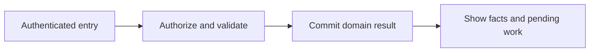
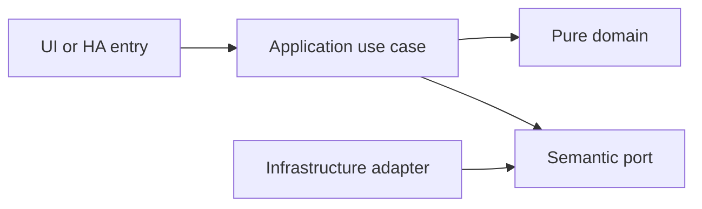

# Task definitions, occurrences and household execution

- Status: Draft
- Date: 2026-10-28
- Catalog capability ID: household-tasks
- Last verified: 2026-10-29 (document structure only; no implementation evidence)
- Owners: Domus maintainer; engineering/product reviewers to be assigned
- Scope: Members create and perform household responsibilities with explicit assignments, actual performers and history. A recurring definition survives completion of each individual occurrence.
- Related issues/PRs: https://github.com/vypdev/domus/issues/2
- Required review gates: product UX, architecture, testing, documentation, security/operations
- Open decisions blocking readiness: Detailed role/override review; first-release advanced task-type matrix. The owner confirmed role-default verification, material-completion handling and preservation of completed downstream work/points when its prerequisite is reopened on 2026-10-29. Catalog gate prerequisites remain unverified.

## 1. Executive summary

Members create and perform household responsibilities with explicit assignments, actual performers and history. A recurring definition survives completion of each individual occurrence.

```text
Authenticated member -> validated domain command -> durable result -> household and HA projections
```

This is a prospective Draft, not an implemented or accepted capability. The first usable release covers all domains and both deployment targets.

## 2. Problem, current behavior, and evidence

A title and completed flag cannot represent recurring or collaborative household work, material requirements, verification and auditable corrections.

Current verified sequence: (1) the repository has a minimal README and installed Copilot automation; (2) no Domus application, public service or tests exist; (3) this contract proposes the behavior to build.

Evidence: the owner's attached brief and subsequent decisions in [product vision](../docs/product-vision.md), the pinned [reference investigation](../docs/reference-investigation.md), and the existing repository baseline. Retrospective classification is not applicable: no as-built product baseline is reconstructed.

## 3. Actors, surfaces, and terminology

Actors: Creator; assignee; actual performer; authorized verifier; household administrator.

Primary surfaces: application UI, HTTP domain boundary, relevant HA entities/services, activity and diagnostics. Definitions of member, principal, occurrence, demand and ledger are shared in the [glossary](../docs/glossary.md). The actor recording an action is distinct from its selected target and actual performer.

## 4. Goals, non-goals, and fixed invariants

Goals and fixed invariants are the following normative requirements. No configuration may weaken authorization, ledger integrity, attribution or idempotency.

| Requirement | Behavior |
|---|---|
| household-tasks-R1 | A task definition and occurrence MUST have separate stable identities; completing an occurrence never destroys its definition. |
| household-tasks-R2 | Every transition MUST enforce the explicit state machine, expected revision, dependencies and completion requirements; reopening a prerequisite MUST retain already-completed downstream work and points with a visible review condition, without automatic cascading reopening. |
| household-tasks-R3 | Assignment MUST distinguish planned assignees, completion actor and actual performers and support unassigned pools, reassignment and collaboration. |
| household-tasks-R4 | Completion and reopening MUST be idempotent and emit uniquely identified business events without duplicate downstream rewards. |
| household-tasks-R5 | Verification MUST default to none for adult performers and authorized-adult approval for restricted performers, prevent unauthorized approval and defer points until any required verification succeeds. |
| household-tasks-R6 | Task history MUST retain creation, assignment, transitions, completion, reopening, schedule changes and related automation actors. |
| household-tasks-R7 | Task creation MUST support a minimal title-only path and optional advanced fields, categories, subtasks, materials and entity links. |
| household-tasks-R8 | Every task command MUST enforce household scope and role permissions and return actionable validation, conflict and recovery results. |
| household-tasks-R9 | Material recording MUST default to an adjustable review in the completion form, configurable per task; one explicit submission MUST retain linked outcomes without duplicate stock changes, insufficient stock MUST leave completed work saved with consumption pending regularization rather than negative stock, and reopening MUST NOT imply a physical material return. |

Non-goals: changing Copilot, changing the existing gateway, building an MCP server, adding mandatory cloud/AI dependencies, or claiming production readiness from a document.

## 5. Current versus proposed product journey

| Stage | Current | Proposed | User/operator effect |
|---|---|---|---|
| Enter | No Domus UI | Verified HA principal opens the relevant surface | Role and scope are explicit |
| Act | No domain command | Validate input, permission and current revision | Invalid data leaves the draft intact |
| Commit | No durable domain record | Store change and operation receipt atomically | Retry cannot duplicate effects |
| Observe | No projection | Show committed facts and pending downstream projections | Partial success remains understandable |



Text equivalent: authenticated entry -> authorization and validation -> durable domain commit -> visible facts with any pending projection. Domain-specific alternatives are described below.

## 6. Functional behavior and state model

### 6.1 Domain model and normal path

TaskDefinition owns title, description, configurable category, tags, priority, estimated duration, complexity, inconvenience, point policy, recurrence reference, material requirements, optional HA entity references, completion requirements and version. TaskOccurrence owns definition snapshot, scheduled start, due date or instant, assignees, participants, state, actual performers, completion actor/time and history. Only title is required for ordinary creation; advanced properties remain optional. Dependencies form an acyclic graph scoped to the household. Subtasks are explicit child occurrences; completion policy is all-required by default.

The owner confirmed adjustable material quantities in the completion form, submitted with the task completion, configurable per task. The default review shows planned quantities, units and storage targets; the member explicitly confirms actual usage, including zero for an unused material. A zero line is retained as not_used without fabricating a zero-quantity stock movement. Merely displaying the form or marking an unrelated task complete never consumes stock. A separate-recording task option retains an explicit later inventory action. The effective mode and submitted lines are snapshotted; the server validates stock permissions, product/unit/location compatibility and stable line identities rather than trusting the client preview.

One application orchestration accepts the completion and explicit material intents under the same operation receipt. Inventory still owns consumption rules and movement records; this is one user submission, not a second implementation of inventory policy in Tasks. Stable child identities link each consumption line to its completion cycle and deduplicate whole-request or line retries. Invalid input or unauthorized intents fail admission before any new completion or movement; a genuine stock shortfall is a recoverable business outcome rather than invalid identity or permission.

The owner confirmed that insufficient stock must not block recording work already performed. Save the completion and the affected intent as pending_regularization, with submitted quantity, source and safe reason; do not post an impossible movement or negative stock. Report each material line separately, including any successful lines, without presenting pending ones as consumed. Existing performer-verification and point rules still apply independently, and recurrence uses actual completion. An authorized member reviews actual inventory facts and explicitly resolves the pending intent; purchasing new stock alone does not silently post an old consumption. Settlement retains the same linked intent identity, handles races/replays once and leaves a visible audit trail.

### 6.2 States and alternatives

Definition: draft -> active <-> paused -> archived. Occurrence: draft -> available <-> assigned -> in_progress; available/assigned/in_progress -> blocked or completed; blocked -> available or assigned; active states -> cancelled or skipped. Reopen completed -> assigned if assignees exist, otherwise available. Verification is a separate pending/approved/rejected decision; pending completion is displayed as awaiting verification and awards no points.

The owner confirmed the role defaults on 2026-10-29. Without an explicit administrator-controlled task override, adult performers need no verification and any restricted actual performer requires approval by an authorized adult. Determine that policy from the actual performers, not merely the authenticated submitter: an adult recording a restricted member's work does not silently bypass the approval step. Restricted members cannot set their own policy to none or approve their own completion. The effective policy and its revision are snapshotted with completion.

A duplicate uses its original operation receipt. A changed payload under the same key is a conflict. Out-of-order events use aggregate revision and source identity. Cancellation never erases an already committed ledger effect; compensation is explicit.

Each accepted completion has a stable completion-cycle ID. Reopening closes that cycle; a genuine later completion gets a new ID. A delayed completion or approval from the closed cycle cannot create a new award or re-complete the occurrence. Reopening does not prove that consumed supplies physically returned: inventory remains unchanged unless an authorized, separately confirmed return/correction movement records actual facts. Rejection of verification likewise cannot fabricate returned stock.

The owner confirmed that reopening a prerequisite does not reopen its completed dependents or reverse their points. Keep each dependent's completed state, performer/time, accepted completion cycle, points, materials and recurrence facts. Record a separate dependency_attention condition naming the reopened prerequisite and request review. This condition is not a new completion, reversal or forced stock return. An authorized review can resolve the dependency through the normal prerequisite or dependency-edit commands, with actor/reason/history; it cannot erase real downstream work. Unstarted or unfinished dependents continue to enforce the ordinary prerequisite gate before completion. Replayed or stale dependency events are compared with current prerequisite revision so they cannot duplicate notices or reintroduce a resolved warning.

## 7. User-facing configuration

| Input | Type | Recommended default | Allowed values/range | Scope/persistence |
|---|---|---|---|---|
| `default_priority` | enum | normal | low, normal, high, urgent | household; occurrence snapshots |
| `completion_verification` | enum | role_default | role_default: adults none, restricted performers authorized_adult; explicit none/authorized_adult overrides require administrator permission | definition; effective role policy and revision snapshotted at completion |
| `dependency_policy` | enum | all_required | all_required only initially; cycles rejected | definition; versioned |
| `category` | string reference | General | active household category; optional | definition; persisted |
| `material_recording` | enum | review_on_completion | review_on_completion or separate_recording; explicit actual quantities, no silent consumption | definition; mode and material lines snapshotted for each completion |

Owner-confirmed defaults are recorded as accepted choices; other defaults and bounds remain proposals pending review. Invalid values and contradictory combinations are rejected before saving; unknown future values require an explicit compatibility error. Precedence is fixed invariants, installation constraints, household policy, then member preferences; lower scopes cannot expand permissions. In-flight commands snapshot relevant policy versions, while revocation is checked at the transaction boundary.

Recommended example: title-only creation, role-default verification and adjustable material review on completion when materials exist. Meaningful alternative: a task records consumption separately while preserving the same inventory permissions and receipts. Transport secrets are installation concerns and are never domain form fields.

## 8. Clean Architecture design

### 8.1 Responsibilities and dependency direction

CreateTask, ClaimTask, AssignTask, TransitionOccurrence, VerifyCompletion and ReopenOccurrence use TaskRepository, AuthorizationPolicy, UnitOfWork and EventOutbox. A completion orchestration delegates explicit material intents to the Inventory application port with stable child command identities. Domain transition and dependency policies are pure. A completion emits a durable event for points and recurrence. HA and HTTP adapters cannot implement alternate completion semantics.

| Boundary | Owns | Forbidden dependency |
|---|---|---|
| Domain | Entities, value objects and pure rules | HA, HTTP, SQL, UI frameworks |
| Application | Authorized commands, queries and semantic ports | Concrete adapters and framework DTOs |
| Adapters | Schema mapping, persistence and provider error mapping | Alternate business rules |
| Composition | Explicit deployment wiring | Business decisions |
| Presentation | View models and rendering | Database access or client-only authorization |



Text equivalent: entrypoints call use cases; use cases depend on pure domain and ports; infrastructure implements ports. Architecture checks reject forbidden imports and cycles. Shared contract tests exercise each port adapter; schemas and migration checks enforce durable boundaries.

## 9. UI/UX and content contract

### 9.1 Primary state examples

| State | Visible content |
|---|---|
| Pending | Saving “Clean the bathrooms”. Keep this screen open. |
| Action required | “Clean the bathrooms” needs a performer. Choose who completed the work. |
| Blocked | This task changed while you were editing it. Your draft is retained. Review the latest version. |
| Partial | Task completed. The points summary is refreshing; the completion is saved. View history. |
| Complete | Completed by Alex today at 10:30. 12 points awarded. |

The primary view names current status, retained facts and one next action, followed by descriptive links to the record/operation. Technical codes and correlation IDs are progressively disclosed. Duplicate responses update the same operation status rather than adding notifications. At most one routine notification per transition, with opt-out and bounded retry summaries.

English and Spanish use stable translation keys, base-language matching and English fallback. Mobile, tablet and desktop layouts, keyboard operation, visible focus, non-color status, accessible names, light/dark contrast and reduced motion are acceptance concerns. Untrusted text is rendered inert; no arbitrary HTML, commands or secret-bearing links.

## 10. Failure, recovery, and cleanup

| Failure | Retained facts | Retry / action | Cleanup |
|---|---|---|---|
| Invalid or denied input | Existing business records and form draft | Correct fields or request the proper role | No side effects |
| Stale revision | Current committed aggregate; user's entered fields | Review current state and submit a new deliberate operation | No automatic overwrite |
| Lost response after commit | Domain result and receipt | Look up or replay the same key | Never issue a fresh-key duplicate |
| Downstream projection unavailable | Successful domain result and durable pending event | Bounded backoff, then visible retry | Acknowledge outbox only after safe consumption |
| Restart or cancellation | Committed records; identified pending work | Recover receipts/cursors; compensate only by explicit command | Remove listeners and owned temporary artifacts |

Errors explain impact, safe cause, action and retained state. External availability is distinct from authorization denial. Retries are bounded and use deterministic backoff tests, not real waits.

## 11. Security, permissions, and privacy

Backend authorization applies to reads and writes. All requests and HA values are untrusted input; only authenticated principals and validated adapter context establish identity. Cross-household IDs, replayed operations and stale roles are covered in the inventory. A person entity and selected member ID do not authenticate a caller. Logs, traces, exports and browser artifacts redact credentials and unnecessary personal data. The technical HA principal has explicit narrow grants and cannot impersonate a household administrator.

## 12. Observability and operational UX

Show operation state and projection freshness to members; expose sanitized correlation, source event, aggregate revision, duration and safe error code to operators. No raw credentials or unrestricted HA payloads enter diagnostics. Counters distinguish denied, invalid, conflict, unavailable and completed operations. One durable activity entry per business transition; retries do not multiply notifications. No telemetry leaves the installation by default.

## 13. Compatibility, migration, rollout, and rollback

No existing Domus application data requires migration yet. The first schema is versioned from its first implementation. Upgrade fixtures cover pending operations and ledger compatibility; a backup precedes destructive migration. Unknown future schemas block writes. Downgrade requires a compatible image/database pair, never silent interpretation of newer data.

Both Supervisor and standalone are first-release acceptance targets. Stable and Edge use separate credentials, IDs, volumes and endpoint bindings. Experimental artifacts cannot automatically promote production. Publication, merge and deployment remain in the existing authorized maintainer lifecycle.

## 14. Testing strategy and numeric budget

Minimum: 38 distinct cases, derived from the explicit risk inventory below. Each inventory row counts once. The budget is a floor, not a claim of completeness or executed tests.

| Area | Minimum distinct cases | Behaviors/risks covered |
|---|---:|---|
| Domain and configuration | 8 | an active recurring definition; a blocked prerequisite; a cyclic dependency or an incomplete required subtask |
| Adapters and persistence | 2 | a later definition edit; assignment |
| Integration and recovery | 8 | a one-time title-only task; a reopened completed task; pending verification |
| State and concurrency | 7 | two concurrent transitions with the same revision; two simultaneous claims on a single-assignee task; duplicate completion commands |
| UI and accessibility | 7 | a collaborative task; rejected verification; title-only entry on a narrow screen |
| Security and privacy | 6 | a verifier policy requiring another member; an arbitrary history deletion request from a member; a foreign-household task ID |
| **Total** | **38** | No double counting |

| Case ID | Area | Requirements | Scenario |
|---|---|---|---|
| household-tasks-C01 | Domain and configuration | household-tasks-R1 | Given an active recurring definition, completing Saturday's occurrence leaves the definition active. |
| household-tasks-C02 | Adapters and persistence | household-tasks-R1 | Given a later definition edit, a completed occurrence retains its original snapshot. |
| household-tasks-C03 | Integration and recovery | household-tasks-R1 | Given a one-time title-only task, exactly one occurrence is available. |
| household-tasks-C04 | Domain and configuration | household-tasks-R2 | Given a blocked prerequisite, completing its dependent task is rejected with the blocking task link. |
| household-tasks-C05 | State and concurrency | household-tasks-R2 | Given two concurrent transitions with the same revision, only one succeeds and the other returns conflict. |
| household-tasks-C06 | Domain and configuration | household-tasks-R2 | Given a cyclic dependency or an incomplete required subtask, validation rejects completion. |
| household-tasks-C07 | State and concurrency | household-tasks-R3 | Given two simultaneous claims on a single-assignee task, one claim wins without silent reassignment. |
| household-tasks-C08 | Domain and configuration | household-tasks-R3 | Given a reassigned task performed by another authorized member, history preserves both assignment and actual performer. |
| household-tasks-C09 | UI and accessibility | household-tasks-R3 | Given a collaborative task, the completion form names participants before confirmation. |
| household-tasks-C10 | State and concurrency | household-tasks-R4 | Given duplicate completion commands, one completion event exists. |
| household-tasks-C11 | Integration and recovery | household-tasks-R4 | Given a reopened completed task, the downstream compensation references its original completion. |
| household-tasks-C12 | State and concurrency | household-tasks-R4 | Given an old completion retry after reopening, the receipt returns the original result without completing again. |
| household-tasks-C13 | Security and privacy | household-tasks-R5 | Given a verifier policy requiring another member, self-verification is denied. |
| household-tasks-C14 | Integration and recovery | household-tasks-R5 | Given pending verification, no points appear until an authorized approval event is committed. |
| household-tasks-C15 | UI and accessibility | household-tasks-R5 | Given rejected verification, the task displays the reason and can be resumed without a false award. |
| household-tasks-C16 | Adapters and persistence | household-tasks-R6 | Given assignment, completion and reopening, activity shows actor, time and changes in stable order. |
| household-tasks-C17 | Integration and recovery | household-tasks-R6 | Given an automation-created occurrence, history preserves the technical origin and correlation. |
| household-tasks-C18 | Security and privacy | household-tasks-R6 | Given an arbitrary history deletion request from a member, the backend rejects it. |
| household-tasks-C19 | UI and accessibility | household-tasks-R7 | Given title-only entry on a narrow screen, the task can be saved without opening advanced fields. |
| household-tasks-C20 | Domain and configuration | household-tasks-R7, household-tasks-R9 | Given review_on_completion with two planned units, the member confirms one actual unit in the same submission; the task result links exactly one one-unit consumption rather than decrementing the estimate. |
| household-tasks-C21 | Domain and configuration | household-tasks-R7 | Given an invalid entity or category reference, validation identifies that field without losing the draft. |
| household-tasks-C22 | Security and privacy | household-tasks-R8 | Given a foreign-household task ID, the request cannot read or change it. |
| household-tasks-C23 | UI and accessibility | household-tasks-R8 | Given a revision conflict, the form preserves entered values and offers reload/review. |
| household-tasks-C24 | Integration and recovery | household-tasks-R8 | Given a lost completion response after commit, retry shows the committed result and history once. |
| household-tasks-C25 | Domain and configuration | household-tasks-R5 | Given only adult performers and no explicit verification override, completion is accepted without an approval step and becomes eligible for one points allocation. |
| household-tasks-C26 | Security and privacy | household-tasks-R5 | Given a restricted actual performer with no policy override, even an adult submitting completion leaves it awaiting authorized-adult approval and awards no points yet. |
| household-tasks-C27 | Security and privacy | household-tasks-R8 | Given a restricted member setting verification to none, backend authorization rejects the override and retains the effective adult-approval policy. |
| household-tasks-C28 | UI and accessibility | household-tasks-R9 | Given review_on_completion, opening the form changes no stock and a member can explicitly submit zero usage for an unused material with the completion. |
| household-tasks-C29 | State and concurrency | household-tasks-R4, household-tasks-R9 | Given a lost response after completion and material recording, replaying the original request returns the same completion and per-line outcomes without consuming twice. |
| household-tasks-C30 | Domain and configuration | household-tasks-R9 | Given separate_recording on a task, completion creates no stock movement and a later explicit inventory action can reference that completion. |
| household-tasks-C31 | Integration and recovery | household-tasks-R4, household-tasks-R9 | Given reopening after confirmed material consumption, task history and points compensation reference the original cycle while physical inventory stays consumed until an explicit factual return or correction. |
| household-tasks-C32 | Security and privacy | household-tasks-R8, household-tasks-R9 | Given a completion material line for another household or an unauthorized stock location, backend validation denies that intent with no unauthorized movement and retains actionable operation state. |
| household-tasks-C33 | State and concurrency | household-tasks-R4, household-tasks-R5 | Given reopening followed by a genuine new completion, delayed approval of the old cycle cannot approve or award the new cycle; identities and history remain distinct. |
| household-tasks-C34 | Integration and recovery | household-tasks-R4, household-tasks-R9 | Given work performed with insufficient material stock, submission saves one completion and a pending_regularization intent, creates no negative stock, and retains the same pending result on replay. |
| household-tasks-C35 | UI and accessibility | household-tasks-R5, household-tasks-R9 | Given a completed task with one posted material line and one shortfall, the result names the posted and pending quantities separately and shows verification/points independently rather than calling the whole submission failed. |
| household-tasks-C36 | Integration and recovery | household-tasks-R2, household-tasks-R4 | Given a completed dependent and its prerequisite being reopened, the dependent retains completion, points, materials and recurrence facts while a linked review condition appears; no automatic reopening or compensation chain occurs. |
| household-tasks-C37 | UI and accessibility | household-tasks-R2, household-tasks-R6 | Given dependency_attention on completed work, the UI retains its actual completion and points, names the changed prerequisite and offers an authorized review without presenting the work as unperformed. |
| household-tasks-C38 | State and concurrency | household-tasks-R2, household-tasks-R4 | Given reviewed dependency recovery followed by a delayed or repeated old reopen event, revision checks keep the resolved state and do not duplicate warnings, completions or awards. |

Every implemented first-party module starts with meaningful behavior tests. Target and proposed merge gate: 100% lines/statements/functions/branches where the selected tools expose those metrics, enforced separately across backend, frontend and integration code. Third-party/generated artifacts are distinguished from authored source; broad exclusions cannot hide untested logic. No application coverage currently exists.

Inject deterministic clocks, IDs, provider fakes and transaction failures. Use semantic assertions alongside golden content, real adapter contracts and disposable HA integration environments. Add Google Chrome evidence from the owner's authorized local HA for real UX; it does not replace automated tests or unit coverage. CI Check runs the complete applicable suite for every PR update.

## 15. Documentation and discoverability

The following paths are explicit proposed documentation changes relative to the clean repository baseline; implementation source/test paths are intentionally not invented.

| Path | Change |
|---|---|
| specs/household-tasks.md | create |
| specs/README.md | create |
| specs/_template.md | create |
| specs/catalog.json | create |
| specs/CATALOG.md | create |
| docs/architecture.md | create |
| docs/product-vision.md | create |
| docs/glossary.md | create |
| docs/decisions.md | create |
| docs/reference-investigation.md | create |
| docs/copilot-adoption.md | create |
| docs/operations.md | create |
| docs/user-guide.md | create |
| docs/contracts/home-assistant.md | create |
| docs/acceptance-plan.md | create |
| docs/roadmap.md | create |
| README.md | update |

| Audience | Artifact | Required content |
|---|---|---|
| Member | [User guide](../docs/user-guide.md) | Normal path, defaults and state meaning |
| Administrator/operator | [Operations](../docs/operations.md) | Setup, permissions, recovery, backup and rollback |
| Contributor | [Architecture](../docs/architecture.md) | Boundaries and executable constraints |
| HA consumer | [Entity/service contract](../docs/contracts/home-assistant.md) | Stable schemas, semantics and error handling |
| Reviewer | [Acceptance plan](../docs/acceptance-plan.md) | Tests, coverage and human evidence |

Link/path validation accompanies updates. Implementation changes update the owning SDD, catalog evidence, actual tests and user documentation together.

## 16. Acceptance scenarios

The Given/When/Then-equivalent observable scenarios in section 14 are the executable acceptance inventory. For each case, the given precondition and action must produce the specified result with state and side-effect assertions; tests are not implementation snapshots.

Acceptance includes normal, alternative, invalid, duplicate, concurrent, partial, failure, recovery, security, localization and accessibility paths as allocated above. Human review verifies the primary-state examples on desktop/mobile and light/dark themes. Live acceptance remains pending until an implemented artifact is exercised; no result is inferred from the budget.

## 17. Requirements traceability

| Requirement | Cases |
|---|---|
| household-tasks-R1 | household-tasks-C01, household-tasks-C02, household-tasks-C03 |
| household-tasks-R2 | household-tasks-C04, household-tasks-C05, household-tasks-C06, household-tasks-C36, household-tasks-C37, household-tasks-C38 |
| household-tasks-R3 | household-tasks-C07, household-tasks-C08, household-tasks-C09 |
| household-tasks-R4 | household-tasks-C10, household-tasks-C11, household-tasks-C12, household-tasks-C29, household-tasks-C31, household-tasks-C33, household-tasks-C34, household-tasks-C36, household-tasks-C38 |
| household-tasks-R5 | household-tasks-C13, household-tasks-C14, household-tasks-C15, household-tasks-C25, household-tasks-C26, household-tasks-C33, household-tasks-C35 |
| household-tasks-R6 | household-tasks-C16, household-tasks-C17, household-tasks-C18, household-tasks-C37 |
| household-tasks-R7 | household-tasks-C19, household-tasks-C20, household-tasks-C21 |
| household-tasks-R8 | household-tasks-C22, household-tasks-C23, household-tasks-C24, household-tasks-C27, household-tasks-C32 |
| household-tasks-R9 | household-tasks-C20, household-tasks-C28, household-tasks-C29, household-tasks-C30, household-tasks-C31, household-tasks-C32, household-tasks-C34, household-tasks-C35 |

All requirement cases are reciprocal with section 14. Domain invariants are owned by pure policy, command/state rules by application use cases, provider behavior by adapters, and visible content by presentation; the boundary table in section 8 assigns these responsibilities. Evidence and user/operator documentation are linked in section 15.

## 18. Implementation sequence

1. Resolve the blocking decisions and review this contract before Ready for implementation.
2. Establish test harness, CI Check and architecture checks with the first source files.
3. Implement pure policies and their complete branch tests, then transactional use cases.
4. Add adapters, schema/error contracts, retry/race fixtures and both deployment wiring paths.
5. Build the accessible localized UI and HA projections with tests alongside each flow.
6. Verify migration, recovery, security, channel isolation and documentation.
7. Run the complete suite, review coverage, perform local Chrome dogfooding with recorded cleanup, and collect human evidence.

These are internal implementation steps within the first integrated release; they do not remove other domains or deployment targets from launch.

## 19. Definition of Done

- [ ] Every normative requirement has observable acceptance and reciprocal case links.
- [ ] Every declared case is implemented meaningfully; the numeric budget is met.
- [ ] Clean Architecture constraints and port contracts pass.
- [ ] All supported first-party coverage metrics reach 100% from the first implementation.
- [ ] CI Check passes for the current PR revision with no omitted required jobs.
- [ ] Configuration, state, permission, idempotency and recovery behaviors agree.
- [ ] Primary UI states, localization, responsive behavior and accessibility pass.
- [ ] Both deployment targets and isolated Stable/Edge channels pass acceptance.
- [ ] User/operator documentation, schema/migration evidence and catalog paths are current.
- [ ] Local Google Chrome evidence identifies the artifact, channel, test records and cleanup.
- [ ] The original Copilot validations pass when their real prerequisites exist; no check is weakened.
- [ ] No material decision blocking readiness remains unresolved; Copilot remains unchanged.

## 20. References and decisions

Primary sources: [Copilot standard](https://github.com/vypdev/copilot/blob/f5e5a4cf9a80248994469cd88ad55eecab5b95ca/specs/README.md), [original template](https://github.com/vypdev/copilot/blob/f5e5a4cf9a80248994469cd88ad55eecab5b95ca/specs/_template.md), and the linked [reference investigation](../docs/reference-investigation.md).

Confirmed owner choices and unresolved proposals are separated in [decisions](../docs/decisions.md). [Issue #2](https://github.com/vypdev/domus/issues/2) tracks the documentation foundation. The [adoption note](../docs/copilot-adoption.md) records the current catalog evidence limitation. Optional future depth remains explicitly deferred in the product vision; the gateway's installation and MCP internals are outside Domus scope.
