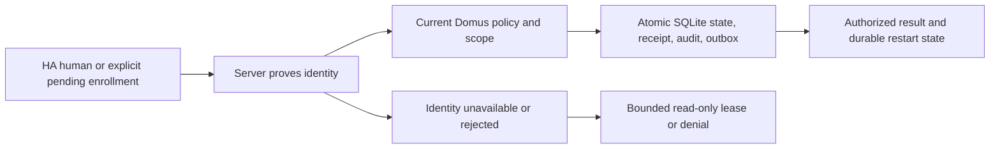
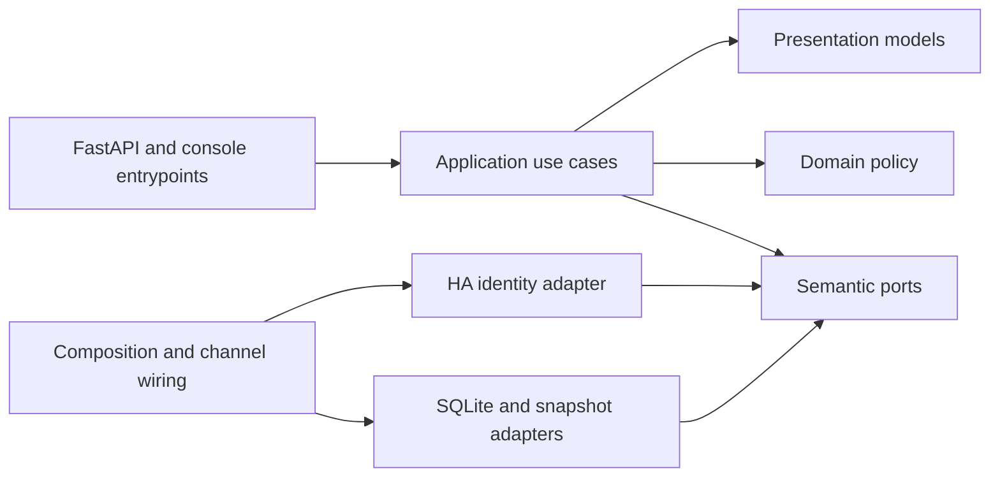

# Home Assistant Identity and SQLite Persistence

- Status: Draft
- Date: 2026-10-31
- Catalog capability ID: `platform-foundation`
- Last verified: not applicable (prospective companion)
- Owners: Domus maintainers (review assignment pending)
- Scope: Specify the next M1 increment: verified human Home Assistant identity, household authorization, and durable SQLite persistence in the existing `platform-foundation` capability.
- Related issues/PRs: [Issue #6](https://github.com/vypdev/domus/issues/6) · [PR #5](https://github.com/vypdev/domus/pull/5)
- Required review gates: product UX, architecture, testing, documentation, security/operations
- Open decisions blocking readiness: none; review gates and target-specific acceptance remain required before readiness.

This companion preserves the ownership and invariants of `specs/platform-foundation.md` and `specs/household-identity.md`; it does not create a new capability owner. Both owning specifications remain Draft with full identity, persistence and recovery acceptance outstanding. The catalog at `0012a172492515e282be09c37921f4014a451e64` records no implementation or test evidence for `platform-foundation`. PR #5 supplied tooling and architecture tests, not the runtime specified here. This is a proposed contract, not a claim of implementation or passing acceptance.

## 1. Executive summary

A human signs in through the configured Home Assistant (HA) path, and Domus binds that session to a current, server-proven HA identity. An authorized administrator explicitly sets up one household, selects the configured administrator mapping, and activates verified members. Household permissions and business records survive restart through SQLite. Every protected action rechecks current HA proof when available and current Domus authorization; unverified identity, stale grants, and duplicate commands cannot create authority or effects.

```text
Prove human identity with HA -> evaluate current household policy -> commit state, receipt, audit and outbox together -> return the authorized result
```

## 2. Problem, current behavior, and evidence

### 2.1 Problem

The household product needs individual HA identities, explicit membership and permission setup, and durable business state. Without those runtime boundaries, a first browser arrival, spoofed identity header, stale grant, process restart, or replay could establish authority incorrectly or lose/duplicate effects.

### 2.2 Current behavior

1. At the immutable base, PR #5 is merged to `develop` and provides reproducible developer tooling and 85 tooling/architecture tests.
2. The household runtime, HA human authentication, SQLite persistence, HTTP domain API, and backend coverage scope are absent from supplied catalog evidence.
3. Existing identity and platform specifications are Draft; their authentication, concurrency, and recovery proof remains outstanding.

These are the supplied baseline facts. No runtime acceptance is inferred from them.

### 2.3 Evidence

- Code/workflow/documentation references: immutable-base catalog evidence lists `docs/product-vision.md`, `docs/architecture.md`, `docs/operations.md`, `docs/user-guide.md`, and `docs/contracts/home-assistant.md`; implementation and test arrays for this capability are empty.
- Incidents or concrete examples: no incident is supplied. Current absence of runtime evidence is the concrete limitation.
- External primary sources: [HA WebSocket API](https://developers.home-assistant.io/docs/api/websocket/) · [HA authorization API](https://developers.home-assistant.io/docs/auth_api/).
- Unknowns: the owner HA About screen was inspected read-only on 2026-10-31; this is version evidence only, not runtime acceptance. The observed reference matrix is standalone Core 2026.10.4; Supervisor target Core 2026.10.4, Supervisor 2026.10.5, HA OS 18.3, Frontend 20260930.5. Every row is pending until the exact protocol, package, and live/browser cases execute. Other versions are unverified.

### 2.4 Retrospective classification (as-built baselines only)

Not applicable: this prospective companion does not reconstruct an implemented runtime baseline.

## 3. Actors, surfaces, and terminology

| Actor | Goal | Entry point | Visible surfaces |
|---|---|---|---|
| HA human | Authenticate and use permitted household functions | HA authorization flow or native Supervisor Ingress | Session, household, member and policy API results |
| Household administrator | Set up household and manage membership/policy | Authenticated versioned API | Revisions, member state, safe errors |
| Installation operator | Approve a requested recovery locally | Owned host/container console | Target-bound request details and approval result |
| Domus operator/contributor | Diagnose, restore and maintain installation | Console, documentation and CI | Sanitized logs, snapshots, checks and contract docs |

A **human identity** is the active, non-system HA user proven by the server. A **household** is the one household per installation whose business records Domus owns. An **installation** has a persistent UUID and a `stable` or `edge` channel. An **administrator mapping** determines how proven HA administrators receive Domus administrator grants. HA authenticates people; Domus owns household records and authorization policy. Identity and persistence invariants remain governed by `specs/household-identity.md` and `specs/platform-foundation.md`.

## 4. Goals, non-goals, and fixed invariants

### 4.1 Goals

| Requirement | Behavior |
|---|---|
| ID-01 | Authenticate a human through a supported HA flow and bind the session only to fresh server-side proof of the exact active, non-system HA user and actual administrator source. |
| ID-02 | Support explicit household setup, verified membership linkage, all three administrator mappings, predefined profiles, household adjustments, member exceptions, deterministic precedence, pending self-enrollment, and last-administrator safety. |
| ID-03 | In selected-user and setup-only modes, recover only with a current proven HA administrator plus explicit installation-console approval bound to a short-lived target-specific request and fresh completion proof. |
| ID-04 | Persist household state, policy/revisions, scoped command receipts, audit and outbox through SQLite adapters, with atomic writes, durable replay behavior, migrations, concurrency limits, backup and restore. |
| ID-05 | Provide a small strict versioned FastAPI identity/household/member/policy surface with safe errors and common Supervisor/Ingress and standalone wiring contracts. |
| ID-06 | Enforce Clean Architecture on real product imports and a separately measured, 100% supported first-party backend coverage scope in every-PR CI. |
| ID-07 | Document user, setup, operator, contributor, migration, recovery and compatibility journeys; report unproven target/live acceptance as pending. |

### 4.2 Non-goals

1. Other household domains, product UI, HA entity/service companion integration, full packaging/channel acceptance, release publication, and automatic backup scheduling/rotation are outside this increment. Packaging and operational retention/recovery objectives remain mandatory first-release review items.
2. Copilot, its installed configuration/resources, and the existing gateway are unchanged. No absent capability is declared implemented.
3. No arbitrary-browser recovery, shared password/PIN, automatic retry under a new key, or silent widening to all HA administrators is provided.

### 4.3 Fixed product/safety invariants

1. Identity, administrator status, and actor never come from submitted IDs, person entities, untrusted forwarding/Ingress headers, or installation transport credentials. Standalone never accepts Ingress identity headers. Supervisor trusts only the actual peer `172.30.32.2` on a private listener with proxy-header rewriting disabled; it requires remote user ID and fresh Core proof. Its fixed Core proxy/token is transport authority only.
2. Standalone uses a fixed operator-configured HA origin and exact Domus public client/callback origin, OAuth state and S256 PKCE, server-side form token exchange, bounded single-use attempts, and server-owned bounded sessions; no central client registration or client secret. Validate URLs and bound I/O; never accept request-chosen hosts, redirects, or proxies.
3. Current HA identity/administrator source and current Domus authorization govern protected actions. HA outage permits existing sessions to query local data only until original absolute expiry, with current local policy and known revocation checks; no extension or mutation. Explicit HA rejection invalidates access.
4. Policy precedence is hard identity/scope/domain constraints, member exception, household profile adjustment, predefined profile, then deny. Same-level contradiction is rejected. Exceptions cannot create administrator identity, bypass restricted-performer approval, cross scope, or weaken invariants. Private preferences of another member are denied by default.
5. Schema/installation/channel identity is checked before mutation. State, receipt, audit and outbox commit atomically. Credentials and session tokens never enter business tables or snapshots.

## 5. Current versus proposed product journey

| Stage | Current | Proposed | User/operator effect |
|---|---|---|---|
| Sign in | No runtime evidence | HA proves exact active human; Domus issues bounded session | User sees identity-bound session or safe denial |
| Initialize/join | No household runtime evidence | Administrator explicitly sets up; verified self-enrollment remains pending until activation | No first-arrival privilege |
| Authorize action | No runtime policy evidence | Current HA source and local policy/revision are checked | Revoked, suspended or stale authority is denied |
| Commit/restart | No durable runtime evidence | SQLite commits effects and replay evidence atomically; restart restores them | Authorized retry returns original result |
| Recover | No recovery runtime proof | Current HA administrator initiates; local console approves; target freshly reproves | Two authorities grant a narrow explicit recovery grant |



Text equivalent: HA entry or pending enrollment -> server identity proof -> current policy check -> atomic durable commit -> authorized result; outage allows only an unexpired read-only session, while explicit rejection denies access.

## 6. Functional behavior and state model

### 6.1 Happy path

1. Standalone completes state/PKCE authorization and server-side token exchange, then current-user WebSocket proof; Supervisor validates actual peer and Ingress identity, then performs fresh Core lookup. Adapters reject inactive, system, malformed, oversized, expired, rejected, or mismatched/correlation-invalid proof.
2. An eligible administrator explicitly creates the household and selects an administrator mapping. The default is `all_ha_administrators`. An ordinary proven, unlinked human may enroll but remains pending until authorized activation. In all_ha_administrators mode, an explicitly enrolling current HA administrator may activate through the verified mapping exception; page arrival never initializes the household or grants an ordinary user access.
3. Each protected use case obtains fresh HA status/source before entering SQLite and checks current local policy inside its transaction. An HA proof and a local commit cannot be atomic across systems; a concurrent independent HA revocation must not be represented as an atomic directory snapshot. Mutations require expected revisions and `Idempotency-Key`.
4. SQLite commits domain state, scoped receipt, audit and outbox in one transaction. Identical authorized replay returns the retained result; different payload conflicts. Restart and verified restore preserve replay guards.

### 6.2 Alternative paths

- Mapping modes: `all_ha_administrators` (default, live inherited grant for every proven current HA administrator); `setup_administrator` (designated proven setup HA administrator); `selected_ha_user` (explicit active human selected by proven HA administrator; selected human need not be HA administrator).
- Configurable default roles: administrator manages members, policy/settings and privileged corrections; adult handles ordinary daily work/supplies and may approve restricted performers; restricted completes assigned work and creates own shopping requests; viewer queries authorized data only; everyone edits own preferences. Configuration of points, verification, automation and privileged corrections is administrator-only.
- A mapping/source change revokes inherited grants, preserves source provenance and independent explicit grants, and never overrides suspension or technical-principal boundaries. Administrator edits require optimistic revisions, transaction-time policy checks and cache invalidation.
- Selected-user/setup-only recovery: a current proven HA administrator requests recovery; the operator runs `domus-admin recovery approve <request-id>` in the owned console and explicitly confirms the exact safely rendered target. The ten-minute approval binds request, target identity, installation UUID, channel, mapping/revision. Fresh proof that the same target remains a current HA administrator is required to complete. Approval and consumed request, explicit grant, receipt, audit and outbox commit atomically. No HTTP approval endpoint.
- During HA outage, a still-valid session may read local data only until its original expiry. It cannot mutate or extend; explicit HA rejection invalidates it.

### 6.3 State machine

| State | Entered when | User-visible meaning | Allowed next states | Recovery/owner |
|---|---|---|---|---|
| Unauthenticated | No valid session | Sign-in required | Proving, denied | Human uses configured HA flow |
| Proving | Bounded auth/proof attempt starts | Identity is being checked | Authenticated, denied, expired | Auth adapter cleans up attempt |
| Authenticated | Fresh human proof and session established | Current bounded access | Pending member, active member, read-only outage, denied, expired | Application rechecks current policy |
| Pending member | Verified human enrolls without activation | Request awaits administrator | Active, suspended, denied | Administrator activates or rejects |
| Active member | Verified linkage and permitted status | Profile/overrides apply within invariants | Suspended, revoked, pending | Administrator changes with revision |
| Recovery pending | Eligible admin requests recovery | Console approval needed before expiry | Approved, expired, canceled | Operator approves exact target locally |
| Recovery approved | Bound console approval awaits atomic completion | Target must freshly reprove; approval is consumed only with the grant | Recovered, expired, denied | HA proof and one atomic transaction |
| Read-only outage | HA unavailable but original session unexpired | Local queries only | Authenticated after fresh proof, expired, denied | No extension; explicit rejection denies |
| Denied/expired | Proof, scope or lifetime fails | Action unavailable | New authentication where allowed | No partial mutation; safe error |

Duplicate identical commands return original authorized results. Changed-payload key reuse conflicts. New writes with stale revisions conflict and are not rebased. Competing writers receive bounded busy/conflict results. Cancellation/rollback leaves state and associated evidence unchanged. Expired recovery approval cannot be revived or retargeted.

## 7. User-facing configuration

| Input | Type | Recommended default | Allowed values/range | Scope/persistence |
|---|---|---|---|---|
| HA origin | Operator URL | Fixed configured HA origin | Strictly validated origin; no request-selected URL | Installation config; never operation supplied |
| Administrator mapping | Enum | `all_ha_administrators` | `all_ha_administrators`, `setup_administrator`, `selected_ha_user` | Household policy with revision and provenance |
| Household profile | Enum | Administrator-selected predefined profile | Administrator, adult, restricted, viewer | Household/member policy; revisioned |
| Member exception | Bounded action decision | No exception | Allow/deny supported ordinary permissions; constraints always deny | Member policy; administrator-only revisioned edit |
| Session lifetime | Bounded duration | Operator/product bounded value | Fixed maximum; absolute expiry, no outage extension | Server session state, not business DB |
| SQLite writer wait | Duration | 250 ms | Fixed bounded budget | Adapter policy; busy returns retryable 503 |
| Pending recovery request lifetime | Duration | 10 minutes | Fixed | Must be approved while live |
| Recovery approval lifetime | Duration | 10 minutes | Fixed, not configurable | Target/request-bound, single use |
| Installation identity | UUID + channel | Generated once at installation | `stable` or `edge`; exact configured match | Persistent DB metadata; mismatch forbids mutation |

Reject unknown fields, invalid enums, out-of-bound text/IDs/timezone, invalid cross-field mappings, arbitrary URLs, and same-level policy contradictions. Existing valid sessions reread current local permission and known revocation on protected requests; writes check current authorization in-transaction. Migrations are explicit and atomic. Missing metadata is handled only by a documented compatible migration; future or unrelated schemas fail before writes. Never silently regenerate installation identity, adopt another database, or open Stable data as Edge. Recommended configuration is the default mapping and an administrator role for the setup administrator; a meaningful alternative is `selected_ha_user` with the same explicit setup and recovery safeguards. Safety constraints are not configurable.

## 8. Clean Architecture design

### 8.1 Responsibilities and dependency direction

| Layer/boundary | Owns | Must not own/import |
|---|---|---|
| Domain/pure policy | Identity references, household/member state, permission precedence, revisions and invariants | FastAPI, HA, HTTP, SQL, credentials |
| Application | Setup, enrollment, authorization, recovery, mutation/replay use cases and immutable contracts | Concrete SDK, process, SQL or transport concerns |
| Adapters/data | HA protocol mapping, SQLite repositories, transaction/error mapping and snapshots | Product authorization decisions |
| Infrastructure/composition | Concrete adapters, channel/instance configuration and wiring | Duplicated business policy |
| Entrypoints | FastAPI DTO validation, cookie/CSRF/origin and Supervisor/standalone input adaptation | Domain entities or duplicated orchestration |
| Presentation | Stable response/error view models and operator/user text | Mutations or policy transitions |



Text equivalent: entrypoints call application use cases; application depends inward on pure domain and semantic ports; HA/SQLite adapters implement ports; composition wires adapters; presentation maps results without owning mutations.

### 8.2 Contracts, state, and trust boundaries

- Pure decisions: identity eligibility, mapping grants, permission precedence, scope, last-admin safety, revisions and recovery eligibility.
- Application contracts: immutable use-case input/output; actor derives only from proven session; mutations carry expected revision and idempotency key.
- Semantic ports: identity proof/current source, unit-of-work/repository, clock/IDs, snapshot/restore and audit/outbox capabilities without provider DTOs.
- Durable state/schema ownership: SQLite adapter owns versioned schema, application marker, installation UUID, channel, business records, policy revisions, receipts, audit and outbox. Credentials/tokens are excluded.
- Concurrency/idempotency strategy: separate per-unit-of-work connections and `BEGIN IMMEDIATE`; 250 ms initial busy budget; transaction-time authorization. Busy is retryable `storage_busy`/503 with `Retry-After` guidance. Identical scoped key/digest returns original result before old expected-revision evaluation; changed payload is `idempotency_conflict`/409; stale new write is `revision_conflict`/409. No automatic new-key retries or silent rebase.
- Trusted and untrusted inputs: only configured endpoint, actual Supervisor peer and fresh server-side HA proof are trusted as described in section 4. Submitted IDs, headers, cookies without validation, forwarding metadata and all request DTOs are untrusted.
- Provider error mapping: bounded timeout/unavailability and malformed/oversized/correlation-invalid responses fail closed; errors expose allowlisted details and correlation ID, never credentials or diagnostic leakage.

### 8.3 Executable architecture constraints

CI must run import-linter against actual `domus` product modules, including unimported runtime files, and reject outward dependencies and cycles. Entrypoints/composition may depend inward; adapters are independent; application depends only on domain and semantic ports; inner layers cannot import FastAPI, HA, HTTP or SQL clients. Add separate backend coverage collection for all authored backend modules and enforce 100% supported executable statements/lines and branches as exposed by coverage.py/pytest-cov. Do not use broad exclusions or test-only production branches. Explicitly identify any genuine generated, third-party or non-executable declaration distinction. Enforce function metrics only where supported. Keep tooling, frontend and future HA integration scopes independent. Every PR head, including docs-only, runs every applicable suite through the fail-closed CI Check aggregate. Installed Copilot resource hashes remain unchanged.

## 9. UI/UX and content contract

The API and console are the applicable surfaces; this increment does not add product UI or GitHub issue/PR automation. Responses lead with current state and next action, then safe details. Errors use `impact -> cause -> action -> retained state` and never imply a committed effect failed.

### 9.1 Information hierarchy

1. Current authentication, membership, policy or operation state.
2. Completed identity proof or durable effect.
3. Next transition and required actor.
4. Impact and retained revision/receipt.
5. Correlation and inspectable operation ID.
6. Technical detail only when allowlisted and sanitized.

### 9.2 Representative primary view

```json
{
  "state": "pending_activation",
  "message": "Your verified request to join this household is waiting for an administrator.",
  "action_required": "Ask a household administrator to review your membership request.",
  "member_id": "mem_01J...",
  "correlation_id": "cor_01J..."
}
```

Pending/no action: `state=active`, “Your household access is active,” “No action required.” Action required: pending enrollment instructs the member to contact an administrator. Blocked before effects: “The household change was not saved. The supplied revision is no longer current. Review the latest policy and submit a new request. No change was committed.” Partial success: “The command was committed, but delivery is pending. The saved result is available by operation ID; retry with the same key to retrieve it.” Completed: “The member was activated,” with member ID and resulting revision. These are semantic examples, not claims of implemented UI.

### 9.3 Issue, PR, and comment behavior

No issue, PR, label, check, comment, or notification automation is introduced. The implementation PR must have a deterministic purpose/title and link Issue #6, this companion, both owning specifications, and inspectable CI/artifact evidence. Merge requires complete coverage and a current-head complete Bugbot review with no unresolved findings; skipped, neutral, or incomplete review is not acceptance. No implementation PR merge, release, or deployment is authorized by this specification.

### 9.4 Accessibility, localization, and responsive behavior

English is the language for repository issues, documentation, source identifiers, comments and tests; conversation with the owner may be Spanish. API enum/error codes are stable and language-neutral; user text uses documented English fallback. Use textual state and action, never color alone. Keep errors and tables usable on narrow screens; ensure semantic headings and descriptive links. Sanitize untrusted Markdown, HTML, mentions, commands, markers, and URLs in any rendered operator text. Diagrams have adjacent textual equivalents. No product UI is in scope; manual API/console content review is required.

## 10. Failure, recovery, and cleanup

| Failure/partial state | User impact | Retained facts | Automatic retry | Required action | Cleanup |
|---|---|---|---|---|---|
| HA timeout/unavailable | New proof and mutations unavailable; valid session may read until absolute expiry | Existing session expiry and local state | No mutation retry; bounded read-only only | Retry sign-in/proof when HA returns | Expire attempt/session; remove transient tokens |
| Explicit HA rejection/revocation | Access denied | Audit-safe outcome only | No | Reauthenticate if eligible | Invalidate session |
| Invalid/mismatched proof or spoofed identity | Denied | Correlation only | No | Correct HA setup/client flow | Clear bounded attempt; no secret logs |
| SQLite busy | Mutation not committed | No partial state; safe correlation | Client may retry same request/key | Retry after bounded guidance | Close unit-of-work connection |
| Stale revision / changed-payload replay | Conflict, no new effect | Prior state/receipt retained | No automatic rebase; identical authorized replay only | Review latest state or use correct same key | Retain replay evidence |
| Migration failure/future/unrelated schema | Startup/mutation blocked safely | Prior recoverable DB unchanged | No blind retry | Restore compatible paired image/schema or operator repair | Preserve source DB and diagnostics without secrets |
| Recovery expires/wrong target/channel | No recovery grant | Request and audit outcome | No | Start new request with current proof | Expire request/approval; never retarget |
| Outbox delivery fails after commit | Business result remains committed | State, receipt, audit and pending outbox | Bounded delivery retry, same event identity | Operator inspects pending operation if prolonged | Mark delivery outcome; do not roll back committed effect |
| Restore candidate corrupt/wrong identity/channel | Active data remains in place | Candidate validation evidence | No activation retry without correction | Choose verified same-installation/channel snapshot | Preserve candidate for inspection; never overwrite active DB |

Snapshots are consistent SQLite snapshots including identity/schema, business state, receipts/replay guards, audit and outbox. Standalone creates snapshots explicitly through installation console and retains successful snapshots until operator removal; no automatic pruning. Supervisor packaging should participate in the operator's normal HA backup using suitable hooks; actual packaging and schedule/retention acceptance remain pending. Restore targets a new owned data directory for the same installation UUID and channel, with writes stopped; verify marker, schema, integrity, manifest/checksum and identity before activation. The visible recovery point is the selected snapshot's committed checkpoint timestamp. No 24-hour RPO or recovery-time SLA is claimed. Pair compatible application/configuration for rollback. Credentials and browser tokens are excluded; users reauthenticate. Cleanup must never remove replay protection while a retry could recur.

## 11. Security, permissions, and privacy

1. Require current proven human identity and current Domus policy for protected actions. The three mapping modes and precedence are fixed in section 4; pending users have no active access. Suspension/revocation, scope, stale revisions and last-active-administrator safety are enforced transactionally.
2. OAuth state/PKCE, exact configured origins, bounded single-use attempts/sessions, Origin/CSRF checks for cookie mutations, strict DTOs, actual Supervisor peer validation, and fixed HA endpoint prevent forgery and request-directed network access.
3. Never persist HA tokens or browser session credentials in business tables, audit, outbox, logs or snapshots. Bound and redact diagnostics; use allowlisted error details and correlation IDs.
4. Scope idempotency keys and receipts; authorize receipt lookup under current permissions. Retain durable replay evidence across restart, cleanup, backup and restore. Recovery requires both authorities, exact target binding, ten-minute expiry, fresh proof and atomic single-use consumption.
5. An installation/channel mismatch, future/unrelated schema, corrupt candidate, malformed provider response, identity-source mismatch or HA rejection fails closed before unauthorized effects.

## 12. Observability and operational UX

- User-facing state: stable session/member/policy/operation state, revision, action, safe error code and correlation ID.
- Operator evidence: installation UUID, channel, schema version, snapshot checkpoint, target binding, migration result, pending outbox and sanitized correlation. Never emit tokens or secrets.
- Logs, metrics, and correlation: structured bounded events for auth outcome, storage busy/conflict, migration/restore and outbox outcome; avoid identity data beyond necessary stable internal references. Correlate requests and receipts without logging credentials.
- Pending external dependency versus workflow failure: HA unavailability is a bounded dependency state; explicit HA rejection is denial. A committed command with pending outbox delivery remains committed and visibly pending.
- Rate-limit/retry behavior: bound protocol I/O and auth attempts; storage wait is 250 ms initially. Give retry guidance only for temporary busy/unavailability; clients retry mutations only with the identical key and payload.
- Noise/comment budget: no automated comments or notifications; one structured operation result per request and no repeated console approval prompts for an already consumed request.

## 13. Compatibility, migration, rollout, and rollback

- Existing in-flight operations/data: no runtime baseline is evidenced. Preserve owning contracts and do not claim compatibility with absent implementations.
- Schema/configuration migration: versioned atomic SQL migrations; inspect marker/schema before journal or schema writes. Reject future/unrelated schemas. Failed migration preserves recoverable prior state. Installation UUID and channel must match before mutation; never silently adopt or regenerate.
- Deprecated behavior and compatibility window: none established. Support only exact independently tested Core/Supervisor/protocol combinations; retain a versioned contract matrix. Other versions remain unverified.
- Rollout stages/feature flag if needed: land contracts/architecture checks, pure policies, use cases, adapters, endpoint wiring, then real-file/security and target acceptance. No feature flag may weaken identity or policy invariants.
- Rollback and irreversible effects: take pre-upgrade recovery snapshot before destructive migration, paired with compatible application/configuration. Atomic transactions prevent partial domain effects. Restore verified same-installation/channel snapshot to a new directory; do not activate a corrupt/future/wrong-identity candidate. Preserve receipts across rollback/restore.
- Compatibility matrix: standalone Core 2026.10.4; Supervisor/Ingress Core 2026.10.4, Supervisor 2026.10.5, HA OS 18.3, Frontend 20260930.5. All pending. Only exact passed artifact/version combinations may be called supported. Actual current versions must be added and tested when connectivity allows. Both deployment targets remain required for first usable release.

## 14. Testing strategy and numeric budget

Budgets are minimum distinct cases; inventory rows define the cases and the publication process derives the budget table and reciprocal traceability. No inventory row represents an executed test. Existing owning baseline case IDs `platform-foundation-C01` through `platform-foundation-C20` are reserved and are not reused or counted here.

| Area | Minimum distinct cases | Behaviors/risks covered |
|---|---:|---|
| Domain/configuration/pure planning | 14 | Observable scenarios in the case inventory. |
| State/application/idempotency/races | 14 | Observable scenarios in the case inventory. |
| Adapters/provider contracts | 13 | Observable scenarios in the case inventory. |
| Workflows/setup/schema | 6 | Observable scenarios in the case inventory. |
| UI/UX/localization/sanitization | 5 | Observable scenarios in the case inventory. |
| Integration/security/migration | 9 | Observable scenarios in the case inventory. |
| Total | 61 | Distinct inventory cases; repeated executions do not add cases. |

| Case ID | Area | Requirements | Scenario |
|---|---|---|---|
| platform-foundation-identity-sqlite-C01 | Domain/configuration/pure planning | ID-01 | Reject an inactive, system, or malformed HA human proof. |
| platform-foundation-identity-sqlite-C02 | Domain/configuration/pure planning | ID-01 | Reject mismatched request correlation and expired proof. |
| platform-foundation-identity-sqlite-C03 | Domain/configuration/pure planning | ID-02 | Default mapping grants each currently proven HA administrator and no nonadministrator. |
| platform-foundation-identity-sqlite-C04 | Domain/configuration/pure planning | ID-02 | Setup-administrator mode grants only designated proven setup administrator. |
| platform-foundation-identity-sqlite-C05 | Domain/configuration/pure planning | ID-02 | Selected-user mode permits an explicitly selected active human who is not an HA administrator. |
| platform-foundation-identity-sqlite-C06 | Domain/configuration/pure planning | ID-02 | Mapping/source change revokes inherited grant but preserves independent explicit grant. |
| platform-foundation-identity-sqlite-C07 | Domain/configuration/pure planning | ID-02 | Verify administrator, adult, restricted and viewer default permission matrix. |
| platform-foundation-identity-sqlite-C08 | Domain/configuration/pure planning | ID-02 | Verify exception/profile/default/deny precedence and reject same-level contradiction. |
| platform-foundation-identity-sqlite-C09 | Domain/configuration/pure planning | ID-02 | Enforce hard scope, suspension, restricted approval and last-administrator constraints over overrides. |
| platform-foundation-identity-sqlite-C10 | Domain/configuration/pure planning | ID-03 | Recovery eligibility requires current HA administrator and exact selected/setup-only mode. |
| platform-foundation-identity-sqlite-C11 | Domain/configuration/pure planning | ID-04 | Canonical payload digest and receipt scope distinguish identical payload from changed payload. |
| platform-foundation-identity-sqlite-C12 | Domain/configuration/pure planning | ID-04 | Validate installation UUID/channel/schema marker and reject future or unrelated schema before writes. |
| platform-foundation-identity-sqlite-C13 | Domain/configuration/pure planning | ID-05 | Strict DTO rejects unknown, unbounded, malformed and cross-field-invalid values. |
| platform-foundation-identity-sqlite-C14 | Domain/configuration/pure planning | ID-06 | Pure policy decision branches cover allow, deny, stale, suspension and undefined action. |
| platform-foundation-identity-sqlite-C15 | State/application/idempotency/races | ID-02 | First browser arrival cannot create household or administrator authority. |
| platform-foundation-identity-sqlite-C16 | State/application/idempotency/races | ID-02 | Verified self-enrollment remains pending until authorized activation. |
| platform-foundation-identity-sqlite-C17 | State/application/idempotency/races | ID-02 | Administrator edits use optimistic revision and transaction-time current policy. |
| platform-foundation-identity-sqlite-C18 | State/application/idempotency/races | ID-02 | Suspension and revocation deny protected action and private preferences remain private. |
| platform-foundation-identity-sqlite-C19 | State/application/idempotency/races | ID-03 | Console approval is exact-target bound, expires at ten minutes and cannot be retargeted. |
| platform-foundation-identity-sqlite-C20 | State/application/idempotency/races | ID-03 | Recovery completion requires fresh same-target administrator proof and is single use. |
| platform-foundation-identity-sqlite-C21 | State/application/idempotency/races | ID-03 | Wrong identity, channel, mapping revision, expiry or concurrent completion creates no grant. |
| platform-foundation-identity-sqlite-C22 | State/application/idempotency/races | ID-04 | Identical authorized retry after restart returns original result before stale-write revision handling. |
| platform-foundation-identity-sqlite-C23 | State/application/idempotency/races | ID-04 | Same scoped key with changed payload returns conflict without new effect. |
| platform-foundation-identity-sqlite-C24 | State/application/idempotency/races | ID-04 | Current permissions govern receipt lookup after actor revocation. |
| platform-foundation-identity-sqlite-C25 | State/application/idempotency/races | ID-04 | Competing writers serialize and produce bounded busy or revision conflict without partial effects. |
| platform-foundation-identity-sqlite-C26 | State/application/idempotency/races | ID-04 | Injected failure rolls back domain state, receipt, audit and outbox atomically. |
| platform-foundation-identity-sqlite-C27 | State/application/idempotency/races | ID-04 | Cleanup preserves replay protection and authorized old retry cannot duplicate effect. |
| platform-foundation-identity-sqlite-C28 | State/application/idempotency/races | ID-04 | Restore preserves receipt/replay evidence and identical authorized retry remains idempotent. |
| platform-foundation-identity-sqlite-C29 | Adapters/provider contracts | ID-01 | Standalone OAuth uses fixed origin, state, S256 PKCE, bounded single-use attempt and server form exchange. |
| platform-foundation-identity-sqlite-C30 | Adapters/provider contracts | ID-01 | Standalone rejects request-chosen host/redirect, Ingress headers and technical transport credential as human identity. |
| platform-foundation-identity-sqlite-C31 | Adapters/provider contracts | ID-01 | HA adapter handles timeout, unavailable, revoked token, malformed/oversized response and cleanup without secret leakage. |
| platform-foundation-identity-sqlite-C32 | Adapters/provider contracts | ID-01 | Supervisor adapter accepts only actual peer 172.30.32.2 and requires fresh Core lookup of active non-system human and actual admin source. |
| platform-foundation-identity-sqlite-C33 | Adapters/provider contracts | ID-01 | Supervisor arbitrary forwarding headers and transport token alone cannot assert user or role. |
| platform-foundation-identity-sqlite-C34 | Adapters/provider contracts | ID-01 | HA outage permits bounded read-only access until original expiry but no mutation or session extension. |
| platform-foundation-identity-sqlite-C35 | Adapters/provider contracts | ID-05 | Stable API errors expose allowlisted details/correlation and map 401, 403, 404, 409, 422 and 503 safely. |
| platform-foundation-identity-sqlite-C36 | Adapters/provider contracts | ID-05 | Cookie mutation requires valid Origin/CSRF checks and actor is never taken from submitted member ID. |
| platform-foundation-identity-sqlite-C37 | Adapters/provider contracts | ID-04 | SQLite uses parameterized operations, separate unit-of-work connections and bounded BEGIN IMMEDIATE writer wait. |
| platform-foundation-identity-sqlite-C38 | Adapters/provider contracts | ID-04 | Atomic migration failure leaves recoverable prior database and performs no partial schema change. |
| platform-foundation-identity-sqlite-C39 | Adapters/provider contracts | ID-04 | Real database file restart preserves household, policy, receipt, audit and outbox. |
| platform-foundation-identity-sqlite-C40 | Adapters/provider contracts | ID-04 | Consistent snapshot verifies integrity/manifest/identity and restores to new same-UUID/channel directory. |
| platform-foundation-identity-sqlite-C41 | Adapters/provider contracts | ID-04 | Corrupt, future, unrelated, wrong-instance or wrong-channel restore candidate cannot replace active DB. |
| platform-foundation-identity-sqlite-C42 | Workflows/setup/schema | ID-05 | OpenAPI and route contract includes specified session, household, member, authorization, operation and recovery routes. |
| platform-foundation-identity-sqlite-C43 | Workflows/setup/schema | ID-05 | Standalone auth start/callback/logout routes and Supervisor-prefixed routing obey common server contract. |
| platform-foundation-identity-sqlite-C44 | Workflows/setup/schema | ID-05 | Recovery approval has console command only and no HTTP approval route. |
| platform-foundation-identity-sqlite-C45 | Workflows/setup/schema | ID-06 | Every PR head including docs-only runs tooling, frontend, documentation and backend suites in fail-closed aggregate. |
| platform-foundation-identity-sqlite-C46 | Workflows/setup/schema | ID-06 | Backend coverage scope includes authored unimported runtime modules and enforces supported statements/lines and branches at 100%. |
| platform-foundation-identity-sqlite-C47 | Workflows/setup/schema | ID-06 | Actual product import graph rejects outward imports and cycles; no broad coverage exclusions hide logic. |
| platform-foundation-identity-sqlite-C48 | UI/UX/localization/sanitization | ID-05 | Pending enrollment response states current status, completed proof, next action and no active access. |
| platform-foundation-identity-sqlite-C49 | UI/UX/localization/sanitization | ID-05 | Blocked pre-commit error names impact, cause, action and retained state without claiming a commit. |
| platform-foundation-identity-sqlite-C50 | UI/UX/localization/sanitization | ID-05 | Committed effect with pending outbox is presented as committed and inspectable by operation ID. |
| platform-foundation-identity-sqlite-C51 | UI/UX/localization/sanitization | ID-05 | Error/console rendering sanitizes untrusted Markdown, HTML, mentions, commands, markers and URLs. |
| platform-foundation-identity-sqlite-C52 | UI/UX/localization/sanitization | ID-05 | API codes remain stable, user text has English fallback, narrow layout and text states remain understandable without color. |
| platform-foundation-identity-sqlite-C53 | Integration/security/migration | ID-01, ID-05 | Standalone protocol fixtures prove OAuth callback/current-user proof and reject invalid state, PKCE, correlation and credentials. |
| platform-foundation-identity-sqlite-C54 | Integration/security/migration | ID-01, ID-05 | Supervisor fixtures prove socket peer boundary, fresh identity lookup and prefixed routing without trusting forwarded headers. |
| platform-foundation-identity-sqlite-C55 | Integration/security/migration | ID-02, ID-04 | Real-file integration proves atomic commit and rollback of state, receipt, audit and outbox across process restart. |
| platform-foundation-identity-sqlite-C56 | Integration/security/migration | ID-03, ID-04 | Recovery race and replay fixtures prove both authorities and atomic single-use grant/evidence. |
| platform-foundation-identity-sqlite-C57 | Integration/security/migration | ID-04 | Real-file concurrent processes verify serialized writers, bounded busy result, stale revision conflict and no duplicate effects. |
| platform-foundation-identity-sqlite-C58 | Integration/security/migration | ID-04 | Backup/reopen integration verifies consistent committed checkpoint, identity/channel, audit/outbox and replay protection. |
| platform-foundation-identity-sqlite-C59 | Integration/security/migration | ID-06 | CI coverage and architecture commands evaluate actual backend modules and fail when threshold or import contract is violated. |
| platform-foundation-identity-sqlite-C60 | Integration/security/migration | ID-07 | Exact reference target matrix records protocol, package and live/browser evidence as pending until run on identified artifact/version. |
| platform-foundation-identity-sqlite-C61 | Integration/security/migration | ID-07 | Authorized local HA/Chrome proof, if run, records exact artifact/version, owned test data and cleanup; absent live proof is explicitly pending. |

Define changed-module backend coverage as 100% of supported executable statements/lines and branches; repository backend scope has the same 100% threshold. Pure policy branches require complete branch coverage. Use deterministic clocks, IDs, fakes, failure injection and real-file/process fixtures; no sleeps as business tests and no live services in automated tests. Parameter rows count separately only when distinct behavior. Contract tests parse routes, schemas, workflow structure and import graph rather than grep prose. Include semantic assertions alongside golden response fixtures. Human review must inspect API/console readability and exact live target/browser evidence; protocol fixtures and coverage alone do not establish deployment acceptance. Do not claim any listed case executed until evidence exists.

## 15. Documentation and discoverability

| Path | Change |
|---|---|
| `specs/platform-foundation-identity-sqlite.md` | create |
| `specs/platform-foundation.md` | reference |
| `specs/household-identity.md` | reference |
| `specs/delivery-quality.md` | reference |
| `docs/product-vision.md` | reference |
| `docs/architecture.md` | reference |
| `docs/operations.md` | reference |
| `docs/user-guide.md` | reference |
| `docs/contracts/home-assistant.md` | reference |
| `docs/identity-household.md` | create |
| `docs/configuration.md` | create |
| `docs/operations-identity-storage.md` | create |
| `docs/architecture-identity-storage.md` | create |
| `docs/migrations-identity-storage.md` | create |
| `docs/compatibility-home-assistant.md` | create |
| `docs/ha-identity-protocol.md` | create |
| `backend/pyproject.toml` | create |
| `backend/src/domus/__init__.py` | create |
| `backend/src/domus/application/__init__.py` | create |
| `backend/src/domus/application/commands.py` | create |
| `backend/src/domus/application/authorization.py` | create |
| `backend/src/domus/application/identity_ports.py` | create |
| `backend/src/domus/application/sessions.py` | create |
| `backend/src/domus/application/ports.py` | create |
| `backend/src/domus/composition/__init__.py` | create |
| `backend/src/domus/domain/__init__.py` | create |
| `backend/src/domus/domain/errors.py` | create |
| `backend/src/domus/domain/identity.py` | create |
| `backend/src/domus/application/session_values.py` | create |
| `backend/src/domus/domain/storage.py` | create |
| `backend/src/domus/entrypoints/__init__.py` | create |
| `backend/src/domus/infrastructure/__init__.py` | create |
| `backend/src/domus/infrastructure/sqlite.py` | create |
| `backend/src/domus/infrastructure/sqlite_identity.py` | create |
| `backend/src/domus/infrastructure/memory_sessions.py` | create |
| `backend/src/domus/infrastructure/ha_config.py` | create |
| `backend/src/domus/infrastructure/ha_http.py` | create |
| `backend/src/domus/infrastructure/ha_websocket.py` | create |
| `backend/src/domus/infrastructure/ha_ingress.py` | create |
| `tests/backend/test_atomic_commands.py` | create |
| `tests/backend/test_sqlite_transactions.py` | create |
| `tests/backend/test_storage_values.py` | create |
| `tests/backend/test_identity_policy.py` | create |
| `tests/backend/test_membership_authorization.py` | create |
| `tests/backend/test_sqlite_identity.py` | create |
| `tests/backend/test_session_leases.py` | create |
| `tests/backend/test_ha_http.py` | create |
| `tests/backend/test_ha_websocket.py` | create |
| `tests/backend/test_ha_ingress.py` | create |
| `tests/fixtures/sqlite/v1.sql` | create |
| `docs/evidence/m1-storage-kernel.json` | create |
| `docs/evidence/m1-identity-policy.json` | create |
| `docs/evidence/m1-ha-protocol.json` | create |
| `docs/evidence/home-assistant-reference.json` | create |
| `pyproject.toml` | update |
| `uv.lock` | update |
| `.github/workflows/ci_check.yml` | update |
| `tooling/domus_tooling/ci_policy.py` | update |
| `tests/python/test_ci_contract.py` | update |
| `docs/development.md` | update |
| `docs/decisions.md` | update |
| `docs/copilot-adoption.md` | update |
| `docs/roadmap.md` | update |
| `docs/sdd-validation.md` | update |
| `specs/catalog.json` | update |
| `specs/CATALOG.md` | update |
| `backend/src/domus/application/authentication.py` | create |
| `backend/src/domus/application/authentication_values.py` | create |
| `backend/src/domus/composition/server.py` | create |
| `backend/src/domus/entrypoints/http.py` | create |
| `backend/src/domus/infrastructure/auth_runtime.py` | create |
| `backend/src/domus/infrastructure/memory_attempts.py` | create |
| `backend/src/domus/infrastructure/standalone_sessions.py` | create |
| `tests/backend/test_authentication_flow.py` | create |
| `tests/backend/test_standalone_sessions.py` | create |
| `tests/backend/test_auth_http.py` | create |
| `tests/backend/test_auth_runtime.py` | create |
| `tests/backend/test_auth_server.py` | create |
| `docs/contracts/auth-api.openapi.json` | create |
| `docs/evidence/m1-standalone-auth.json` | create |
| `architecture/python-application.ini` | update |
| `tests/architecture/test_python_architecture.py` | update |
| `backend/src/domus/entrypoints/bounded_http.py` | create |
| `backend/src/domus/entrypoints/ingress_http.py` | create |
| `backend/src/domus/composition/ingress.py` | create |
| `tests/backend/test_ingress_http.py` | create |
| `tests/backend/test_ingress_server.py` | create |
| `docs/installation-home-assistant.md` | create |
| `docs/evidence/m1-ingress-preview.json` | create |
| `repository.yaml` | create |
| `addon-edge/config.yaml` | create |
| `addon-edge/Dockerfile` | create |
| `addon-edge/README.md` | create |
| `addon-edge/DOCS.md` | create |
| `addon-edge/CHANGELOG.md` | create |
| `tests/backend/test_app_package.py` | create |
| `tests/containers/test_app_image.py` | create |
| `docs/evidence/m1-app-package.json` | create |
| `README.md` | update |
| `backend/src/domus/application/household_queries.py` | create |
| `backend/src/domus/entrypoints/household_http.py` | create |
| `backend/src/domus/entrypoints/http_contract.py` | create |
| `backend/src/domus/composition/household.py` | create |
| `backend/src/domus/infrastructure/session_access.py` | create |
| `tests/backend/test_household_queries.py` | create |
| `tests/backend/test_household_http.py` | create |
| `tests/backend/test_household_runtime.py` | create |
| `tests/backend/test_session_directory.py` | create |
| `docs/household-api.md` | create |
| `docs/contracts/household-api.openapi.json` | create |
| `docs/evidence/m1-household-api.json` | create |
| `backend/src/domus/application/administrator_proof.py` | create |
| `backend/src/domus/application/policy_commands.py` | create |
| `tests/backend/test_policy_commands.py` | create |
| `docs/evidence/m1-policy-administration.json` | create |
| `backend/src/domus/application/member_commands.py` | create |
| `tests/backend/test_member_commands.py` | create |
| `docs/evidence/m1-member-administration.json` | create |
| `backend/src/domus/application/household_commands.py` | create |
| `backend/src/domus/infrastructure/application_runtime.py` | create |
| `backend/src/domus/infrastructure/ha_directory.py` | create |
| `tests/backend/test_household_commands.py` | create |
| `tests/backend/test_application_runtime.py` | create |
| `tests/backend/test_ha_directory.py` | create |
| `docs/household-setup.md` | create |
| `docs/evidence/m1-household-commands.json` | create |
| `docs/evidence/m1-native-ha-acceptance.json` | create |
| `backend/src/domus/entrypoints/native_http.py` | create |
| `backend/src/domus/entrypoints/http_errors.py` | create |
| `backend/src/domus/entrypoints/ingress_boundary.py` | create |
| `backend/src/domus/infrastructure/ingress_sessions.py` | create |
| `tests/backend/test_ingress_sessions.py` | create |
| `tests/backend/test_native_http.py` | create |
| `docs/native-household-api.md` | create |
| `docs/contracts/native-household-api.openapi.json` | create |
| `docs/evidence/m1-native-household-api.json` | create |
| `backend/src/domus/infrastructure/owned_storage.py` | create |
| `tests/backend/test_owned_storage.py` | create |
| `docs/owned-data-directory.md` | create |
| `docs/evidence/m1-owned-storage.json` | create |
| `backend/src/domus/domain/recovery.py` | create |
| `backend/src/domus/application/recovery_commands.py` | create |
| `backend/src/domus/infrastructure/sqlite_recovery.py` | create |
| `backend/src/domus/composition/admin.py` | create |
| `backend/src/domus/entrypoints/console_recovery.py` | create |
| `tests/backend/test_recovery_values.py` | create |
| `tests/backend/test_sqlite_recovery.py` | create |
| `tests/backend/test_recovery_commands.py` | create |
| `tests/backend/test_recovery_console.py` | create |
| `tests/backend/test_recovery_http.py` | create |
| `tests/fixtures/sqlite/v2.sql` | create |
| `docs/administrator-recovery.md` | create |
| `docs/evidence/m1-administrator-recovery.json` | create |
| `backend/src/domus/domain/snapshots.py` | create |
| `backend/src/domus/application/snapshots.py` | create |
| `backend/src/domus/infrastructure/sqlite_snapshots.py` | create |
| `tests/backend/test_snapshot_values.py` | create |
| `tests/backend/test_snapshot_commands.py` | create |
| `tests/backend/test_sqlite_snapshots.py` | create |
| `tests/backend/test_snapshot_console.py` | create |
| `docs/snapshots.md` | create |
| `docs/evidence/m1-snapshots.json` | create |
| `docs/evidence/m1-explicit-storage-boundary.json` | create |
| `docs/evidence/m1-standalone-owned-storage.json` | create |
| `backend/src/domus/composition/ha_app.py` | create |
| `tests/backend/test_ha_app_launcher.py` | create |
| `docs/evidence/m1-ha-app-bootstrap.json` | create |

The new user guide must explain normal sign-in, explicit setup, pending enrollment, defaults and examples. Setup documentation covers HA prerequisites, origin, both deployment paths, permissions, and credential handling. Configuration reference documents every bounded value and precedence. Operator guidance covers state, outage, recovery command, errors, snapshots, restore, replay and cleanup. Migration/compatibility docs explain atomic versioned migration, supported exact matrix, paired rollback, and pending deployment acceptance. Contributor architecture docs show ports, trust boundaries, actual import checks, tests and route contracts. Link and validate examples against fixtures; update catalog evidence only when implementation actually exists. Document standalone explicit snapshots and Supervisor's intended HA backup participation without claiming schedule/retention acceptance.

## 16. Acceptance scenarios

These are executable acceptance requirements, not reports of tests already run.

1. Given a valid standalone authorization, when the server completes state/PKCE exchange and correlated current-user proof, then the session is bound to that exact active human; invalid/revoked/malformed proof yields a safe denial with no secret leakage.
2. Given Supervisor mode, when a request arrives, then only the actual configured peer and fresh Core identity lookup establish user/admin status; forwarding headers or transport credential alone never establish a human.
3. Given each of the three mapping modes, when users and profile/member exceptions are evaluated, then only the specified grants apply, pending users remain inactive, precedence is deterministic, revocation/suspension applies, and the last administrator cannot be removed.
4. Given selected-user or setup-only mode, when recovery is requested, console-approved for the exact target, and completed with fresh proof, then a current HA administrator and operator approval are both required and one atomic single-use grant results; expired, wrong-target, stale or replayed requests grant nothing.
5. Given a mutation with current permission and revision, when SQLite commits, then domain state, receipt, audit and outbox are durable together; injected failure leaves all unchanged and process restart preserves committed state.
6. Given the same authorized key and payload after restart or restore, when retried, then the original result is returned; changed payload conflicts, old permissions do not expose receipts, and cleanup cannot erase replay protection.
7. Given competing writers or stale revisions, when the bounded writer slot or revision check fails, then the caller receives retryable busy/503 or conflict/409 without partial effects or silent rebase.
8. Given a future/unrelated schema or wrong installation/channel database, when opened for mutation, then validation fails before writes; valid migration is atomic and preserves recoverable prior state on failure.
9. Given a consistent snapshot, when restored to a new owned directory for the same installation UUID/channel, then marker, schema, integrity, manifest and identity are verified before activation and receipts/audit/outbox survive. Wrong/corrupt candidates cannot replace active data.
10. Given an HA outage with a previously valid session, when a read occurs before original absolute expiry, then local read is allowed subject to current policy; mutation and extension are denied, and explicit HA rejection invalidates access.
11. Given an API request with unknown fields, forged actor/member ID, invalid Origin/CSRF, or excessive values, when validated, then it receives the specified safe envelope and no business, receipt, audit or outbox effect.
12. Given CI on any PR head including docs-only, when CI Check runs, then all applicable suites and actual import/cycle checks run and supported backend metrics enforce 100%; incomplete review is not acceptance.
13. Given the reference compatibility matrix, when protocol fixtures or controlled live/browser proof have not run for an exact artifact/version, then that row remains pending and is not described as supported. Any authorized live proof records exact versions/artifact, owned test data and cleanup.
14. Given an operator or user reading a response on a narrow screen, when pending, action-required, blocked, partially committed, or complete states render, then status, impact, next action and retained state are understandable as text without color or unsafe untrusted rendering.

## 17. Requirements traceability

| Requirement | Cases |
|---|---|
| ID-01 | platform-foundation-identity-sqlite-C01, platform-foundation-identity-sqlite-C02, platform-foundation-identity-sqlite-C29, platform-foundation-identity-sqlite-C30, platform-foundation-identity-sqlite-C31, platform-foundation-identity-sqlite-C32, platform-foundation-identity-sqlite-C33, platform-foundation-identity-sqlite-C34, platform-foundation-identity-sqlite-C53, platform-foundation-identity-sqlite-C54 |
| ID-02 | platform-foundation-identity-sqlite-C03, platform-foundation-identity-sqlite-C04, platform-foundation-identity-sqlite-C05, platform-foundation-identity-sqlite-C06, platform-foundation-identity-sqlite-C07, platform-foundation-identity-sqlite-C08, platform-foundation-identity-sqlite-C09, platform-foundation-identity-sqlite-C15, platform-foundation-identity-sqlite-C16, platform-foundation-identity-sqlite-C17, platform-foundation-identity-sqlite-C18, platform-foundation-identity-sqlite-C55 |
| ID-03 | platform-foundation-identity-sqlite-C10, platform-foundation-identity-sqlite-C19, platform-foundation-identity-sqlite-C20, platform-foundation-identity-sqlite-C21, platform-foundation-identity-sqlite-C56 |
| ID-04 | platform-foundation-identity-sqlite-C11, platform-foundation-identity-sqlite-C12, platform-foundation-identity-sqlite-C22, platform-foundation-identity-sqlite-C23, platform-foundation-identity-sqlite-C24, platform-foundation-identity-sqlite-C25, platform-foundation-identity-sqlite-C26, platform-foundation-identity-sqlite-C27, platform-foundation-identity-sqlite-C28, platform-foundation-identity-sqlite-C37, platform-foundation-identity-sqlite-C38, platform-foundation-identity-sqlite-C39, platform-foundation-identity-sqlite-C40, platform-foundation-identity-sqlite-C41, platform-foundation-identity-sqlite-C55, platform-foundation-identity-sqlite-C56, platform-foundation-identity-sqlite-C57, platform-foundation-identity-sqlite-C58 |
| ID-05 | platform-foundation-identity-sqlite-C13, platform-foundation-identity-sqlite-C35, platform-foundation-identity-sqlite-C36, platform-foundation-identity-sqlite-C42, platform-foundation-identity-sqlite-C43, platform-foundation-identity-sqlite-C44, platform-foundation-identity-sqlite-C48, platform-foundation-identity-sqlite-C49, platform-foundation-identity-sqlite-C50, platform-foundation-identity-sqlite-C51, platform-foundation-identity-sqlite-C52, platform-foundation-identity-sqlite-C53, platform-foundation-identity-sqlite-C54 |
| ID-06 | platform-foundation-identity-sqlite-C14, platform-foundation-identity-sqlite-C45, platform-foundation-identity-sqlite-C46, platform-foundation-identity-sqlite-C47, platform-foundation-identity-sqlite-C59 |
| ID-07 | platform-foundation-identity-sqlite-C60, platform-foundation-identity-sqlite-C61 |

## 18. Implementation sequence

1. Preserve the two owning contracts; add companion/API/port contracts, versioned compatibility matrix and executable architecture/coverage CI design.
2. Implement pure identity eligibility, mappings, profile/exception precedence, recovery and revision policies with deterministic tests.
3. Implement use cases, semantic ports, authorization-before-receipt lookup and atomic unit-of-work orchestration.
4. Implement HA standalone and Supervisor adapters with bounded protocol fixtures; implement SQLite schema, migrations, receipts, audit/outbox and snapshot/restore adapters with real-file tests.
5. Add FastAPI DTOs/routes, CSRF/origin enforcement, safe errors, console recovery command, and representative response/content fixtures.
6. Deliver user/setup/configuration/operator/contributor/migration/compatibility documentation alongside behavior; update catalog evidence only for implemented paths.
7. Run full every-PR CI, 100% backend coverage, real import/cycle checks, security and real-file acceptance; separately obtain exact package and live/browser evidence before marking target rows passed.

## 19. Definition of Done

- [ ] Every normative requirement has an executable acceptance scenario and reciprocal case traceability.
- [ ] Existing household identity and platform ownership/invariants are preserved; no competing owner is introduced.
- [ ] Architecture boundaries are implemented and enforced against actual product imports and cycles.
- [ ] Numeric test inventory and budget agree; backend supported statements/lines and branches reach 100% without broad exclusions.
- [ ] Identity proof, all mapping defaults, profiles/exceptions, recovery, stale revisions, suspension and last-administrator safety pass.
- [ ] SQLite migration, atomic rollback, restart, concurrency, replay, backup and restore pass on real files.
- [ ] API validation, session/CSRF/origin, safe errors and both wiring contracts pass; deployment/package claims remain limited to exact proven targets.
- [ ] Primary response states, sanitization, accessibility, localization fallback, and manual readability evidence are reviewed.
- [ ] User/setup/operator/contributor, configuration, migration, compatibility and recovery documentation is complete and discoverable.
- [ ] Every-PR CI runs all applicable suites, including docs-only updates, with fail-closed aggregate; merge review gate is complete and current-head.
- [ ] `specs/catalog.json` and generated `specs/CATALOG.md` accurately reflect evidence and specification validation passes.
- [ ] No readiness-blocking decision remains unresolved; unexecuted live/package acceptance remains explicitly pending.

## 20. References and decisions

- Primary sources: [HA authorization API](https://developers.home-assistant.io/docs/auth_api/) · [HA WebSocket API](https://developers.home-assistant.io/docs/api/websocket/)
- Related specs/ADRs/issues/PRs: `specs/household-identity.md`; `specs/platform-foundation.md`; `specs/delivery-quality.md`; [Issue #6](https://github.com/vypdev/domus/issues/6); [PR #5](https://github.com/vypdev/domus/pull/5); [Copilot upstream report #774](https://github.com/vypdev/copilot/issues/774); [Copilot upstream report #777](https://github.com/vypdev/copilot/issues/777).
- Decisions and rejected alternatives: retain HA auth and HTTP/SQLite as replaceable adapters around pure policies and use cases; server-side HA proof is required; use explicit transaction boundaries and parameterized SQLite operations; API schemas are entrypoint DTOs, not domain entities. Recovery requires current HA administrator proof plus installation-console approval; no shared secret or HTTP approval. Backup scope is explicit consistent snapshot/restore primitive, not an automatic scheduler. No untested version is promised.
- Follow-up work explicitly outside this spec: other household domains, product UI, HA entity/service integration, complete package and Stable/Edge deployment acceptance, Supervisor backup hooks and operational retention/recovery objectives, release publication. Both deployment targets remain required for first usable release. Merge/release/deployment is not authorized by this draft.
### Partial implementation checkpoints — 2026-10-31

Each immutable receipt identifies source, executed scope and limits. These checkpoints do not complete
all planned acceptance cases. The specifications remain Draft.

| Checkpoint | Evidence and boundary |
|---|---|
| SQLite kernel | [Receipt](../docs/evidence/m1-storage-kernel.json): atomic storage and replay records. |
| Identity policy and leases | [Receipt](../docs/evidence/m1-identity-policy.json): mappings, permissions and absolute leases. |
| HA protocols | [Receipt](../docs/evidence/m1-ha-protocol.json): fixed endpoints and bounded exact-human proof. |
| Standalone authentication | [Receipt](../docs/evidence/m1-standalone-auth.json): browser-bound auth/cleanup. Browser return unaccepted; grant revoked (1 confirmed, 0 unknown). |
| Installed Edge preview | [Package](../docs/evidence/m1-app-package.json), [protocol](../docs/evidence/m1-ingress-preview.json), [acceptance](../docs/evidence/m1-native-ha-acceptance.json): Edge 0.0.0-edge.1 install/start/UI/reload passed. Stateless; later services absent. |
| Household commands | [Receipt](../docs/evidence/m1-household-commands.json) and [guide](../docs/household-setup.md): explicit setup/enrollment and revisioned edits. |
| Member administration | [Receipt](../docs/evidence/m1-member-administration.json): activation, profile/status/exceptions and last-admin safety. |
| Policy administration | [Receipt](../docs/evidence/m1-policy-administration.json): mapping/profile edits, provenance and independent grants. |
| Standalone household API | [Receipt](../docs/evidence/m1-household-api.json), [guide](../docs/household-api.md), [schema](../docs/contracts/household-api.openapi.json): strict queries/commands and real session/SQLite composition. |
| Native household API | [Receipt](../docs/evidence/m1-native-household-api.json), [guide](../docs/native-household-api.md), [schema](../docs/contracts/native-household-api.openapi.json): services, origins, leases/CSRF, outage reads. Not installed. |
| Owned data lifecycle | [Receipt](../docs/evidence/m1-owned-storage.json) and [guide](../docs/owned-data-directory.md): persisted UUID/channel, private files and lifecycle guards. Packaged /data provisioning pending. |
| Administrator recovery | [Receipt](../docs/evidence/m1-administrator-recovery.json) and [guide](../docs/administrator-recovery.md): both human APIs, console-only approval and atomic consumption; live/package acceptance pending. |
| Snapshot creation/inspection | [Receipt](../docs/evidence/m1-snapshots.json) and [guide](../docs/snapshots.md): consistent private bundles and strict checks. Restore activation/newer-history policy remain pending. |
| Explicit-file boundary | [Receipt](../docs/evidence/m1-explicit-storage-boundary.json): both runtime factories reject owned markers before SQLite initialization. |
| Standalone owned data | [Receipt](../docs/evidence/m1-standalone-owned-storage.json): automatic identity, restart/replay and listener-lifetime locks. |
| HA launcher preparation | [Receipt](../docs/evidence/m1-ha-app-bootstrap.json): fixed private child and ordered privilege drop. Image/kernel acceptance pending. |

No test credentials enter business storage, evidence, responses or snapshots. Native authentication
is independent of standalone OAuth. Current outstanding work includes native private data provisioning, updated app
packaging and UI, restore activation/newer-history policy, standalone companion authority and complete deployment/channel
acceptance. Passing protocol/ASGI fixtures never establishes those remaining live gates.
