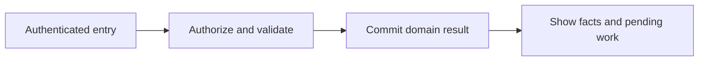
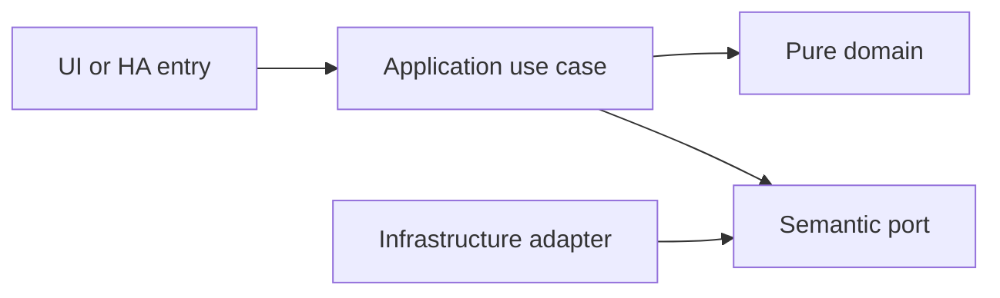

# Local application platform and persistence

- Status: Draft
- Date: 2026-10-28
- Catalog capability ID: platform-foundation
- Last verified: 2026-10-29 (document structure only; no implementation evidence)
- Owners: Domus maintainer; engineering/product reviewers to be assigned
- Scope: One local modular application serves the complete household product in both a Supervisor-managed App and standalone Docker from the first release. Home Assistant owns user authentication; Domus owns its business records.
- Related issues/PRs: https://github.com/vypdev/domus/issues/2
- Required review gates: product UX, architecture, testing, documentation, security/operations
- Open decisions blocking readiness: Storage concurrency verification; supported Home Assistant release matrix; backup retention and restore targets. The owner selected Python/FastAPI, SQLite, one household per installation and a thin HA integration on 2026-10-29. Catalog gate prerequisites remain unverified.

## 1. Executive summary

One local modular application serves the complete household product in both a Supervisor-managed App and standalone Docker from the first release. Home Assistant owns user authentication; Domus owns its business records.

```text
Authenticated member -> validated domain command -> durable result -> household and HA projections
```

This is a prospective Draft, not an implemented or accepted capability. The first usable release covers all domains and both deployment targets.

## 2. Problem, current behavior, and evidence

Domus has no application runtime, database, or deployment artifact. The gateway demonstrates a useful application boundary but is not part of Domus deployment work.

Current verified sequence: (1) the repository has a minimal README and installed Copilot automation; (2) no Domus application, public service or tests exist; (3) this contract proposes the behavior to build.

Evidence: the owner's attached brief and subsequent decisions in [product vision](../docs/product-vision.md), the pinned [reference investigation](../docs/reference-investigation.md), and the existing repository baseline. Retrospective classification is not applicable: no as-built product baseline is reconstructed.

## 3. Actors, surfaces, and terminology

Actors: Household administrator; authenticated member; installation operator.

Primary surfaces: application UI, HTTP domain boundary, relevant HA entities/services, activity and diagnostics. Definitions of member, principal, occurrence, demand and ledger are shared in the [glossary](../docs/glossary.md). The actor recording an action is distinct from its selected target and actual performer.

## 4. Goals, non-goals, and fixed invariants

Goals and fixed invariants are the following normative requirements. No configuration may weaken authorization, ledger integrity, attribution or idempotency.

| Requirement | Behavior |
|---|---|
| platform-foundation-R1 | Every deployment MUST retain household records through application restart and reject unsupported schema versions before writes. |
| platform-foundation-R2 | A command MUST atomically commit its business effects, receipt, audit reference and outbox, and replay an identical key without duplicate effects. |
| platform-foundation-R3 | Both Supervisor App and standalone Container MUST offer the same domain features from the first usable release. |
| platform-foundation-R4 | The application MUST remain useful without Internet, AI or an available gateway; unavailable HA-dependent operations show a precise degraded state. |
| platform-foundation-R5 | Backup and restore MUST preserve ledgers, schema and operation receipts and verify integrity before activation. |
| platform-foundation-R6 | Application boundaries MUST prevent domain imports of HA, HTTP, SQL and UI frameworks and keep secrets out of representations. |

Non-goals: changing Copilot, changing the existing gateway, building an MCP server, adding mandatory cloud/AI dependencies, or claiming production readiness from a document.

## 5. Current versus proposed product journey

| Stage | Current | Proposed | User/operator effect |
|---|---|---|---|
| Enter | No Domus UI | Verified HA principal opens the relevant surface | Role and scope are explicit |
| Act | No domain command | Validate input, permission and current revision | Invalid data leaves the draft intact |
| Commit | No durable domain record | Store change and operation receipt atomically | Retry cannot duplicate effects |
| Observe | No projection | Show committed facts and pending downstream projections | Partial success remains understandable |



Text equivalent: authenticated entry -> authorization and validation -> durable domain commit -> visible facts with any pending projection. Domain-specific alternatives are described below.

## 6. Functional behavior and state model

### 6.1 Domain model and normal path

Household, principal, command receipt, aggregate revision, audit record, outbox event, schema version and backup manifest. One household and one active database writer per installation are proposed defaults. Every record carries household identity. A command transaction commits its domain changes, command receipt and outbox together. Projections are rebuildable; business ledgers are not.

### 6.2 States and alternatives

Starting -> migrating -> ready; a migration error enters maintenance without serving writes. HA unavailable produces a degraded integration state while already authenticated local sessions may read cached household data until their bounded expiry.

A duplicate uses its original operation receipt. A changed payload under the same key is a conflict. Out-of-order events use aggregate revision and source identity. Cancellation never erases an already committed ledger effect; compensation is explicit.

## 7. User-facing configuration

| Input | Type | Recommended default | Allowed values/range | Scope/persistence |
|---|---|---|---|---|
| `deployment_mode` | enum | supervisor | supervisor or standalone; explicit, no fallback | installation; restart |
| `household_timezone` | IANA zone | selected during setup | valid zone required; never assume UTC for local dates | household; commands snapshot version |
| `request_page_size` | integer | 50 | 1..200 | request; not persisted |
| `audit_retention_days` | integer | 365 | 30..3650; never deletes points or stock ledgers | installation; persisted |

These are proposed defaults pending review. Invalid values and contradictory combinations are rejected before saving; unknown future values require an explicit compatibility error. Precedence is fixed invariants, installation constraints, household policy, then member preferences; lower scopes cannot expand permissions. In-flight commands snapshot relevant policy versions, while revocation is checked at the transaction boundary.

Recommended example: keep the defaults above. Meaningful alternative: a member selects Spanish and dark theme while the same household policies remain in force. Transport secrets are installation concerns and are never domain form fields.

## 8. Clean Architecture design

### 8.1 Responsibilities and dependency direction

Application commands depend on UnitOfWork, CommandReceiptStore, EventOutbox, Clock and BackupPort. SQLite is the owner-selected database, with migrations owned by infrastructure. FastAPI and HA integration adapters call the same use cases. Domain modules cannot import frameworks, SQL or HA. A single writer is the initial concurrency proposal; optimistic aggregate revisions bound races without distributed transactions.

| Boundary | Owns | Forbidden dependency |
|---|---|---|
| Domain | Entities, value objects and pure rules | HA, HTTP, SQL, UI frameworks |
| Application | Authorized commands, queries and semantic ports | Concrete adapters and framework DTOs |
| Adapters | Schema mapping, persistence and provider error mapping | Alternate business rules |
| Composition | Explicit deployment wiring | Business decisions |
| Presentation | View models and rendering | Database access or client-only authorization |



Text equivalent: entrypoints call use cases; use cases depend on pure domain and ports; infrastructure implements ports. Architecture checks reject forbidden imports and cycles. Shared contract tests exercise each port adapter; schemas and migration checks enforce durable boundaries.

## 9. UI/UX and content contract

### 9.1 Primary state examples

| State | Visible content |
|---|---|
| Pending | Starting Domus. Your household data is being checked. No action required. |
| Action required | Setup needs a household time zone. Choose a time zone to continue. |
| Blocked | Domus cannot open this database version. Writes are paused. Restore a compatible application; your database is retained. |
| Partial | Your task was saved. Home Assistant projections are waiting to reconnect. View activity. |
| Complete | Domus is ready. Your household data is available. |

The primary view names current status, retained facts and one next action, followed by descriptive links to the record/operation. Technical codes and correlation IDs are progressively disclosed. Duplicate responses update the same operation status rather than adding notifications. At most one routine notification per transition, with opt-out and bounded retry summaries.

English and Spanish use stable translation keys, base-language matching and English fallback. Mobile, tablet and desktop layouts, keyboard operation, visible focus, non-color status, accessible names, light/dark contrast and reduced motion are acceptance concerns. Untrusted text is rendered inert; no arbitrary HTML, commands or secret-bearing links.

## 10. Failure, recovery, and cleanup

| Failure | Retained facts | Retry / action | Cleanup |
|---|---|---|---|
| Invalid or denied input | Existing business records and form draft | Correct fields or request the proper role | No side effects |
| Stale revision | Current committed aggregate; user's entered fields | Review current state and submit a new deliberate operation | No automatic overwrite |
| Lost response after commit | Domain result and receipt | Look up or replay the same key | Never issue a fresh-key duplicate |
| Downstream projection unavailable | Successful domain result and durable pending event | Bounded backoff, then visible retry | Acknowledge outbox only after safe consumption |
| Restart or cancellation | Committed records; identified pending work | Recover receipts/cursors; compensate only by explicit command | Remove listeners and owned temporary artifacts |

Errors explain impact, safe cause, action and retained state. External availability is distinct from authorization denial. Retries are bounded and use deterministic backoff tests, not real waits.

## 11. Security, permissions, and privacy

Backend authorization applies to reads and writes. All requests and HA values are untrusted input; only authenticated principals and validated adapter context establish identity. Cross-household IDs, replayed operations and stale roles are covered in the inventory. A person entity and selected member ID do not authenticate a caller. Logs, traces, exports and browser artifacts redact credentials and unnecessary personal data. The technical HA principal has explicit narrow grants and cannot impersonate a household administrator.

## 12. Observability and operational UX

Show operation state and projection freshness to members; expose sanitized correlation, source event, aggregate revision, duration and safe error code to operators. No raw credentials or unrestricted HA payloads enter diagnostics. Counters distinguish denied, invalid, conflict, unavailable and completed operations. One durable activity entry per business transition; retries do not multiply notifications. No telemetry leaves the installation by default.

## 13. Compatibility, migration, rollout, and rollback

No existing Domus application data requires migration yet. The first schema is versioned from its first implementation. Upgrade fixtures cover pending operations and ledger compatibility; a backup precedes destructive migration. Unknown future schemas block writes. Downgrade requires a compatible image/database pair, never silent interpretation of newer data.

Both Supervisor and standalone are first-release acceptance targets. Stable and Edge use separate credentials, IDs, volumes and endpoint bindings. Experimental artifacts cannot automatically promote production. Publication, merge and deployment remain in the existing authorized maintainer lifecycle.

## 14. Testing strategy and numeric budget

Minimum: 18 distinct cases, derived from the explicit risk inventory below. Each inventory row counts once. The budget is a floor, not a claim of completeness or executed tests.

| Area | Minimum distinct cases | Behaviors/risks covered |
|---|---:|---|
| Domain and configuration | 1 | an unknown schema version |
| Adapters and persistence | 3 | committed household data; a crash between domain SQL and outbox SQL; a consistent snapshot during writes |
| Integration and recovery | 4 | a failed migration; the same command fixtures; Internet and gateway outages |
| State and concurrency | 3 | a repeated command key and identical payload; a repeated key with a different payload; restoration of command receipts |
| Deployment and contracts | 4 | a Supervisor test installation; standalone Compose without Supervisor; a domain import of a concrete HTTP client |
| UI and accessibility | 1 | HA disconnection |
| Security and privacy | 2 | an expired session during HA outage; an exception containing a credential |
| **Total** | **18** | No double counting |

| Case ID | Area | Requirements | Scenario |
|---|---|---|---|
| platform-foundation-C01 | Domain and configuration | platform-foundation-R1 | Given an unknown schema version, startup refuses writes and explains the required compatible version. |
| platform-foundation-C02 | Adapters and persistence | platform-foundation-R1 | Given committed household data, a process restart returns the same IDs and revisions. |
| platform-foundation-C03 | Integration and recovery | platform-foundation-R1 | Given a failed migration, the previous database remains recoverable and maintenance mode is visible. |
| platform-foundation-C04 | State and concurrency | platform-foundation-R2 | Given a repeated command key and identical payload, the original result returns and balances do not change. |
| platform-foundation-C05 | State and concurrency | platform-foundation-R2 | Given a repeated key with a different payload, a conflict returns without applying it. |
| platform-foundation-C06 | Adapters and persistence | platform-foundation-R2 | Given a crash between domain SQL and outbox SQL, the transaction leaves neither effect committed. |
| platform-foundation-C07 | Deployment and contracts | platform-foundation-R3 | Given a Supervisor test installation, the packaged application opens under its Ingress prefix and retains data. |
| platform-foundation-C08 | Deployment and contracts | platform-foundation-R3 | Given standalone Compose without Supervisor, the same household workflow completes with Core APIs. |
| platform-foundation-C09 | Integration and recovery | platform-foundation-R3 | Given the same command fixtures, both deployment targets produce equivalent domain results. |
| platform-foundation-C10 | Integration and recovery | platform-foundation-R4 | Given Internet and gateway outages, authenticated users create and complete local tasks. |
| platform-foundation-C11 | UI and accessibility | platform-foundation-R4 | Given HA disconnection, the integration panel says what is unavailable while showing retained household facts. |
| platform-foundation-C12 | Security and privacy | platform-foundation-R4 | Given an expired session during HA outage, new mutations require reauthentication rather than trusting a stale identity. |
| platform-foundation-C13 | Adapters and persistence | platform-foundation-R5 | Given a consistent snapshot during writes, restoration reproduces stock and points ledger totals. |
| platform-foundation-C14 | Integration and recovery | platform-foundation-R5 | Given a corrupt backup, verification rejects it without replacing the active database. |
| platform-foundation-C15 | State and concurrency | platform-foundation-R5 | Given restoration of command receipts, retrying a previously committed command does not duplicate its effects. |
| platform-foundation-C16 | Deployment and contracts | platform-foundation-R6 | Given a domain import of a concrete HTTP client, the dependency-boundary check fails. |
| platform-foundation-C17 | Security and privacy | platform-foundation-R6 | Given an exception containing a credential, logs and diagnostic exports contain only a safe code. |
| platform-foundation-C18 | Deployment and contracts | platform-foundation-R6 | Given an application adapter cycle, the architecture check rejects the candidate. |

Every implemented first-party module starts with meaningful behavior tests. Target and proposed merge gate: 100% lines/statements/functions/branches where the selected tools expose those metrics, enforced separately across backend, frontend and integration code. Third-party/generated artifacts are distinguished from authored source; broad exclusions cannot hide untested logic. No application coverage currently exists.

Inject deterministic clocks, IDs, provider fakes and transaction failures. Use semantic assertions alongside golden content, real adapter contracts and disposable HA integration environments. Add Google Chrome evidence from the owner's authorized local HA for real UX; it does not replace automated tests or unit coverage. CI Check runs the complete applicable suite for every PR update.

## 15. Documentation and discoverability

The following paths are explicit proposed documentation changes relative to the clean repository baseline; implementation source/test paths are intentionally not invented.

| Path | Change |
|---|---|
| specs/platform-foundation.md | create |
| specs/README.md | create |
| specs/_template.md | create |
| specs/catalog.json | create |
| specs/CATALOG.md | create |
| docs/architecture.md | create |
| docs/product-vision.md | create |
| docs/glossary.md | create |
| docs/decisions.md | create |
| docs/reference-investigation.md | create |
| docs/copilot-adoption.md | create |
| docs/operations.md | create |
| docs/user-guide.md | create |
| docs/contracts/home-assistant.md | create |
| docs/acceptance-plan.md | create |
| docs/roadmap.md | create |
| README.md | update |

| Audience | Artifact | Required content |
|---|---|---|
| Member | [User guide](../docs/user-guide.md) | Normal path, defaults and state meaning |
| Administrator/operator | [Operations](../docs/operations.md) | Setup, permissions, recovery, backup and rollback |
| Contributor | [Architecture](../docs/architecture.md) | Boundaries and executable constraints |
| HA consumer | [Entity/service contract](../docs/contracts/home-assistant.md) | Stable schemas, semantics and error handling |
| Reviewer | [Acceptance plan](../docs/acceptance-plan.md) | Tests, coverage and human evidence |

Link/path validation accompanies updates. Implementation changes update the owning SDD, catalog evidence, actual tests and user documentation together.

## 16. Acceptance scenarios

The Given/When/Then-equivalent observable scenarios in section 14 are the executable acceptance inventory. For each case, the given precondition and action must produce the specified result with state and side-effect assertions; tests are not implementation snapshots.

Acceptance includes normal, alternative, invalid, duplicate, concurrent, partial, failure, recovery, security, localization and accessibility paths as allocated above. Human review verifies the primary-state examples on desktop/mobile and light/dark themes. Live acceptance remains pending until an implemented artifact is exercised; no result is inferred from the budget.

## 17. Requirements traceability

| Requirement | Cases |
|---|---|
| platform-foundation-R1 | platform-foundation-C01, platform-foundation-C02, platform-foundation-C03 |
| platform-foundation-R2 | platform-foundation-C04, platform-foundation-C05, platform-foundation-C06 |
| platform-foundation-R3 | platform-foundation-C07, platform-foundation-C08, platform-foundation-C09 |
| platform-foundation-R4 | platform-foundation-C10, platform-foundation-C11, platform-foundation-C12 |
| platform-foundation-R5 | platform-foundation-C13, platform-foundation-C14, platform-foundation-C15 |
| platform-foundation-R6 | platform-foundation-C16, platform-foundation-C17, platform-foundation-C18 |

All requirement cases are reciprocal with section 14. Domain invariants are owned by pure policy, command/state rules by application use cases, provider behavior by adapters, and visible content by presentation; the boundary table in section 8 assigns these responsibilities. Evidence and user/operator documentation are linked in section 15.

## 18. Implementation sequence

1. Resolve the blocking decisions and review this contract before Ready for implementation.
2. Establish test harness, CI Check and architecture checks with the first source files.
3. Implement pure policies and their complete branch tests, then transactional use cases.
4. Add adapters, schema/error contracts, retry/race fixtures and both deployment wiring paths.
5. Build the accessible localized UI and HA projections with tests alongside each flow.
6. Verify migration, recovery, security, channel isolation and documentation.
7. Run the complete suite, review coverage, perform local Chrome dogfooding with recorded cleanup, and collect human evidence.

These are internal implementation steps within the first integrated release; they do not remove other domains or deployment targets from launch.

## 19. Definition of Done

- [ ] Every normative requirement has observable acceptance and reciprocal case links.
- [ ] Every declared case is implemented meaningfully; the numeric budget is met.
- [ ] Clean Architecture constraints and port contracts pass.
- [ ] All supported first-party coverage metrics reach 100% from the first implementation.
- [ ] CI Check passes for the current PR revision with no omitted required jobs.
- [ ] Configuration, state, permission, idempotency and recovery behaviors agree.
- [ ] Primary UI states, localization, responsive behavior and accessibility pass.
- [ ] Both deployment targets and isolated Stable/Edge channels pass acceptance.
- [ ] User/operator documentation, schema/migration evidence and catalog paths are current.
- [ ] Local Google Chrome evidence identifies the artifact, channel, test records and cleanup.
- [ ] The original Copilot validations pass when their real prerequisites exist; no check is weakened.
- [ ] No material decision blocking readiness remains unresolved; Copilot remains unchanged.

## 20. References and decisions

Primary sources: [Copilot standard](https://github.com/vypdev/copilot/blob/f5e5a4cf9a80248994469cd88ad55eecab5b95ca/specs/README.md), [original template](https://github.com/vypdev/copilot/blob/f5e5a4cf9a80248994469cd88ad55eecab5b95ca/specs/_template.md), and the linked [reference investigation](../docs/reference-investigation.md).

Confirmed owner choices and unresolved proposals are separated in [decisions](../docs/decisions.md). [Issue #2](https://github.com/vypdev/domus/issues/2) tracks the documentation foundation. The [adoption note](../docs/copilot-adoption.md) records the current catalog evidence limitation. Optional future depth remains explicitly deferred in the product vision; the gateway's installation and MCP internals are outside Domus scope.
