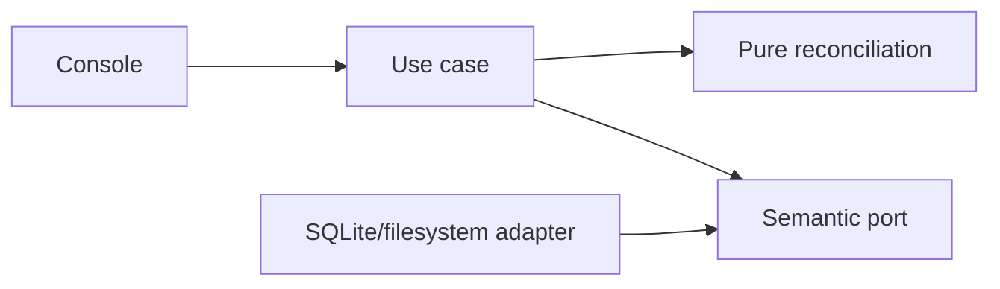

# Checkpoint restoration and retained processed history

- Status: Draft
- Date: 2026-10-31
- Catalog capability ID: platform-foundation
- Last verified: 2026-10-31; local reconciliation/preparation only, complete restoration pending
- Owners: Domus maintainers
- Scope: complete M1 snapshot restoration with retained replay evidence, explicit preparation and verified offline activation.
- Related issues/PRs: [Issue #6](https://github.com/vypdev/domus/issues/6), [PR #7](https://github.com/vypdev/domus/pull/7)
- Required review gates: product UX, architecture, testing, documentation, security/operations
- Open decisions blocking readiness: none for A30; implementation and complete activation evidence remain required.

## 1. Executive summary

Restore the selected checkpoint's business state while keeping readable later operations as already
processed history. An old retry must never execute its effect again. History is distinct from current
state and from a pending external delivery. Preparation never starts a server or replaces active data.

```text
Stop writes -> inspect checkpoint/current evidence -> prepare isolated candidate -> verify -> activate -> reauthenticate
```

## 2. Problem, current behavior, and evidence

### 2.1 Problem

Copying an old database alone loses later receipts, can duplicate external effects and can rearm a
consumed recovery approval. Keeping later business state instead would violate the selected checkpoint.

### 2.2 Current behavior

1. Edge.2 packages schema 3 and consistent snapshot create/inspect.
2. Both managed runtimes persist identity and refuse explicit-file bypass.
3. Owner update/start/reload/restart passed. Pure reconciliation and private blocked preparation
   are implemented locally; runtime history integration and activation remain pending.
4. A30 explicitly selects checkpoint state plus retained later processed history.

### 2.3 Evidence

- [M1 companion](platform-foundation-identity-sqlite.md), [A30](../docs/decisions.md),
  [snapshot guide](../docs/snapshots.md), [owner acceptance](../docs/evidence/m1-persistent-ha-acceptance.json).
- Example: revision 2 is checkpointed, revision 3 commits, restore returns revision 2; retrying revision
  3's original key yields a historical result without rerunning the update.
- Unknowns: complete implementation/runtime evidence is pending. No restore SLA is promised.

### 2.4 Retrospective classification (as-built baselines only)

Not applicable: this is a prospective refinement of M1 ID-04, not an as-built completion claim.

## 3. Actors, surfaces, and terminology

| Actor | Goal | Entry point | Visible surfaces |
|---|---|---|---|
| Installation operator | Restore deliberately with writes stopped | Installation console | Inspection, prepared binding and activation result |
| Proven HA human | Resume permitted work after reauthentication | Existing native/standalone APIs | Current state and distinctly historical operation results |

A checkpoint is a sealed snapshot. Current evidence is the readable operation frontier, including
already archived facts. A historical operation retains its original result/audit/event but does not
assert that its business change exists in restored state. Delivered means actually acknowledged;
suppression by restore must not fabricate delivery.

## 4. Goals, non-goals, and fixed invariants

### 4.1 Goals

| Requirement | Behavior |
|---|---|
| REST-01 | Validate immutable complete operation evidence and reject incompatible histories. |
| REST-02 | Preserve later receipt/audit/event facts separately from checkpoint business state. |
| REST-03 | Suppress rolled-away event delivery and preserve actual delivery knowledge. |
| REST-04 | Prepare/verify a private same-installation/channel candidate without replacing active data. |
| REST-05 | Activate only verified offline data, retain rollback evidence and recover interrupted transitions. |
| REST-06 | Enforce current authority before historical disclosure/replay; prevent reusing consumed recovery. |

### 4.2 Non-goals

No automatic backup schedule, pruning, cross-installation import, HA gateway change, new HTTP restore
endpoint, production release or implicit household/admin creation. These do not defer the complete
restore/activation scope described here.

### 4.3 Fixed product/safety invariants

Preserve UUID/channel, original command scope/fingerprint/result and historical facts. Different
facts for one command key or operation ID are conflicts. Checkpoint evidence must be explainable by
the retained current frontier. Timestamps alone cannot prove ancestry. Never invent an acknowledgement.
Unknown or conflicting later evidence cannot be silently discarded to activate a candidate.

## 5. Current versus proposed product journey

| Stage | Current | Proposed | User/operator effect |
|---|---|---|---|
| Inspect | Verifies snapshot only | Also explains replay frontier | Know the selected state and retained history |
| Prepare | Unavailable | New private blocked candidate | Source remains untouched |
| Activate | Unavailable | Verified offline transition | Only chosen state becomes current |
| Retry | No restore semantics | Historical result distinguished | No duplicate effect or misleading current-state success |


Text equivalent: stop writes, verify both inputs, prepare without serving, activate after verification,
then authenticate again. A failed stage retains the source and candidate for inspection.

## 6. Functional behavior and state model

### 6.1 Happy path

1. Verify snapshot manifest, schema, identity, integrity and exact private files.
2. Read current committed evidence under the appropriate maintenance guard.
3. Reconcile by command key and operation identity, including prior historical facts.
4. Keep checkpoint business rows. Preserve later operations as historical records and keep their
   original delivery status; they never enter the pending delivery queue.
5. For checkpoint events, retain later acknowledgements to avoid redelivery. Preserve sequence
   high-water marks and complete history through repeated restorations.
6. Prepare in a new private directory with a blocked marker; verify every output before activation.
7. Activate only with stopped writes and an unchanged verified source binding. Preserve the previous
   recoverable installation; interrupted activation cannot start an incomplete database.
8. Drop process-local sessions. Require new proof and current restored policy for subsequent access.

### 6.2 Alternative paths

Empty checkpoints remain valid: later history cannot require a current household foreign key or
silently recreate its household. Re-restoring a checkpoint can make a known operation current again;
retain its historical provenance without treating it as another execution. Conflicts, unknown source
history, changed source bindings and wrong installation/channel block activation with retained evidence.

### 6.3 State machine

| State | Entered when | Meaning | Next states | Recovery |
|---|---|---|---|---|
| inspected | Inputs validate | No change made | prepared, rejected | Operator chooses |
| prepared | Complete candidate published | Not serving or active | verified, rejected | Inspect same candidate |
| verified | All hashes/bindings agree | Eligible for offline activation | activating, rejected | Revalidate source |
| activating | Durable transition begins | Server remains blocked | active, interrupted | Resume exact transition |
| active | Verified transition committed | Chosen state with retained history | normal operation | Reauthenticate |
| interrupted/rejected | A stage cannot be proven | No success claim | inspection/recovery | Preserve both copies |

Duplicates identify the same candidate/transition. Reusing a key with changed input conflicts. A
post-publication output failure reports uncertainty and points to inspection, never replacement.

## 7. User-facing configuration

| Input | Type | Recommended default | Allowed values | Persistence |
|---|---|---|---|---|
| Installation/channel | Exact binding | Existing metadata | Same UUID and stable/edge | Candidate and source |
| Checkpoint/current source/target | Operator selection | Explicit private locations | Existing trusted sources; new target | Prepared manifest |
| A30 policy | Fixed policy | Retain later processed history | No discard/overwrite alternative | Restore evidence |

Reject unknown fields, ambiguous identity, reused nonmatching targets and unsafe paths. Browser inputs
cannot select maintenance paths. Example: restore an older same-installation checkpoint while retaining
its later receipts. Alternative: inspect/reject the candidate and keep the existing state unchanged.

## 8. Clean Architecture design

### 8.1 Responsibilities and dependency direction

| Layer | Owns | Excludes |
|---|---|---|
| Domain | Immutable evidence, conflict and reconciliation rules | SQL/filesystem/clock/frameworks |
| Application | Preparation/activation orchestration and semantic ports | Concrete paths, processes and SQL |
| Infrastructure/composition | SQLite, private files, locks, hashes and durable switching | Hidden business policy |
| Entrypoint/presentation | Strict console selection and truthful status | Granting browser maintenance authority |



### 8.2 Contracts, state, and trust boundaries

The pure policy compares complete immutable operation facts, not filesystem timestamps. Adapters
map joined receipt/audit/outbox rows into those values. Current authority precedes replay/disclosure.
Schema migration retains existing data. Archive records may outlive a current household and must
not grant setup provenance or membership. Resource-specific guards prevent a restored old approval
from reusing an already-consumed recovery. Paths and local ownership remain an operator trust boundary.

Preparation reads a coherent committed source view and copies exact selected checkpoint bytes.
Format 1 contains only domus.sqlite3, installation.json, operations.jsonl and restore.json. The identity
is restore_pending; the success manifest is written last. It binds the complete checkpoint, source
frontier digest, journal/identity hashes, operation/current counts and retained position high-water.
The journal is sorted by complete command scope and streams complete original facts, capped at
262,144 bytes per line. Each result/audit/event object independently remains bounded to 65,536 bytes;
do not impose that single-object limit on their aggregate. Identity/position uniqueness sets grow
with history; payloads are streamed. A checkpoint must contain every known position through its
high-water; missing earlier facts are rejected independently of wall-clock ordering.

Current schema 1/2/3 inspection does not import the journal into runtime tables or make the candidate
servable. Independent preparation inspection verifies projection against checkpoint facts, counts,
hashes and private inventory. Activation must later revalidate the source digest under stopped writes;
the digest is a binding, not authentication or proof of unchanged live data by itself.

### 8.3 Executable architecture constraints

Existing import-linter direction/purity/acyclic contracts and negative fixtures apply. Every new
authored module belongs to backend coverage; 100% supported statement/branch coverage is required.

## 9. UI/UX and content contract

### 9.1 Information hierarchy

Show current versus historical state, checkpoint, retained operation count, next action and safe
inspection reference before optional technical details.

### 9.2 Representative primary view

```text
Prepared; not active. Checkpoint state and later processed history are verified.
Action: inspect this candidate, stop writes, then activate the same verified binding.
Existing installation data is retained.
```

Variants: pending verification makes no activation claim; rejected data retains both copies; an
uncertain completed transition requires inspection; active state requests reauthentication. Historical
API results say their effect is absent from current state and must not be retried as a replacement.

### 9.3 Issue, PR, and comment behavior

Use issue #6/PR #7, exact source/check evidence and the existing managed branch. Repeated diagnostics
update the existing upstream issue. No automatic merge, lifecycle-label change or check relaxation.

### 9.4 Accessibility, localization, and responsive behavior

All artifacts/content are English; owner conversation is Spanish. Console status uses text, not color
alone. No raw terminal payload, token, HA cookie, opaque Ingress path or untrusted Markdown is echoed.
The console flow has no responsive layout; API/presentation history distinctions remain accessible.

## 10. Failure, recovery, and cleanup

| Failure | Impact | Retained facts | Retry/action | Cleanup |
|---|---|---|---|---|
| Conflict/incomplete evidence | No activation | Both sources | Resolve exact evidence | Never discard guards |
| Copy/hash/flush failure | Candidate not successful | Private partial output, source | Inspect same target | Deliberate operator cleanup |
| Source changed | Preparation stale | Bound manifest and source | Re-prepare after stopping writes | No overwrite |
| Interrupted activation | Startup blocked | Durable transition and rollback | Resume/inspect exact transition | No premature deletion |
| Output failure after publication | Result uncertain | Published artifact | Inspect it | Never claim no effect |

## 11. Security, permissions, and privacy

Console maintenance is installation authority, not a browser permission. Do not borrow HA technical
privilege as a human role. Preserve current authorization before archived results and ownership before
file access. No credentials/sessions enter snapshots/history. Historical approval/consumption evidence
cannot recreate grants. Private/no-follow/single-link rules and bounded parsing/deadlines apply.

## 12. Observability and operational UX

Report checkpoint, installation/channel, source frontier and candidate identity, counts, current state,
and next safe action. Sanitized errors preserve uncertainty. No scheduled polling or comment flood is
introduced; record actual failures in the existing Copilot reports without waiting for fixes.

## 13. Compatibility, migration, rollout, and rollback

Support verified compatible historical snapshots through explicit migrations on the candidate only.
The installed Edge.2/schema-3 image remains unchanged until a later immutable package passes all
gates. New metadata must block older/unaware runtime paths. Pair image/configuration/schema for
rollback; never strip history to make an older image start. Both deployment modes remain required.

## 14. Testing strategy and numeric budget

Minimum distinct planned cases, not executed-test claims:

| Area | Minimum distinct cases | Behaviors/risks covered |
|---|---:|---|
| Domain/configuration/pure planning | 6 | Evidence, ancestry, conflicts, delivery and repeated restoration |
| State/application/idempotency/races | 3 | Preparation identity, stale source, one-effect retry |
| Adapters/provider contracts | 3 | Real schema/history, backup copy, blocked candidate |
| Workflows/setup/schema | 2 | Migration preservation, old-runtime rejection |
| UI/UX/localization/sanitization | 2 | Historical status, uncertain-output guidance |
| Integration/security/migration | 2 | Recovery rearm prevention, interrupted activation/restart |
| Total | 18 | No double counting |

| Case ID | Area | Requirements | Scenario |
|---|---|---|---|
| platform-restoration-C01 | Domain/configuration/pure planning | REST-01 | Reject invalid/incomplete evidence values. |
| platform-restoration-C02 | Domain/configuration/pure planning | REST-01 | Reject key or operation identity collisions. |
| platform-restoration-C03 | Domain/configuration/pure planning | REST-01 | Checkpoint facts must be explained by current retained frontier, independent of clocks. |
| platform-restoration-C04 | Domain/configuration/pure planning | REST-02 | Later facts become historical without changing checkpoint state. |
| platform-restoration-C05 | Domain/configuration/pure planning | REST-03 | Preserve real acknowledgement; do not enqueue rolled-away effects. |
| platform-restoration-C06 | Domain/configuration/pure planning | REST-02 | Empty and repeated restorations retain scope/history and sequence high-water marks. |
| platform-restoration-C07 | State/application/idempotency/races | REST-04 | Reject a result bound to another selection/installation. |
| platform-restoration-C08 | State/application/idempotency/races | REST-05 | Changed source cannot activate a stale candidate. |
| platform-restoration-C09 | State/application/idempotency/races | REST-06 | Same-key historical replay never executes a second effect. |
| platform-restoration-C10 | Adapters/provider contracts | REST-02 | Real history rows retain original receipt/audit/event facts and current authorization. |
| platform-restoration-C11 | Adapters/provider contracts | REST-04 | Private copy verifies hashes/schema/integrity without changing source. |
| platform-restoration-C12 | Adapters/provider contracts | REST-04 | Prepared/incomplete candidate cannot start through any runtime path. |
| platform-restoration-C13 | Workflows/setup/schema | REST-02 | Frozen historical schemas migrate atomically with retained records. |
| platform-restoration-C14 | Workflows/setup/schema | REST-05 | An unaware older image refuses new metadata/schema without data loss. |
| platform-restoration-C15 | UI/UX/localization/sanitization | REST-06 | Historical response distinguishes rolled-away effect from current committed state. |
| platform-restoration-C16 | UI/UX/localization/sanitization | REST-04 | Post-publication output failure preserves uncertainty without secrets. |
| platform-restoration-C17 | Integration/security/migration | REST-06 | Consumed/canceled recovery cannot be rearmed by an old checkpoint/new key. |
| platform-restoration-C18 | Integration/security/migration | REST-05 | Actual interrupted activation/restart preserves old data and starts only verified state. |

Use real SQLite/files and process interruptions, deterministic clocks/IDs and meaningful negative
fixtures. Run complete supported coverage and exact-head CI, including packaged SQLite behavior.

## 15. Documentation and discoverability

| Audience | Artifact | Content | Validation |
|---|---|---|---|
| Operator | docs/snapshots.md | Preparation, verification, activation, failure and rollback | Executable CLI examples |
| Contributor | docs/architecture-identity-storage.md | Policy/port/adapter boundaries and history schema | Import/schema checks |
| Owner | docs/decisions.md | A30 and unchanged scheduling choices | Explicit accepted policy |

Planned file footprint (implementation is staged; presence is not completion):

| Path | Change |
|---|---|
| `specs/platform-restoration.md` | create |
| `specs/catalog.json` | update |
| `specs/CATALOG.md` | update |
| `specs/platform-foundation-identity-sqlite.md` | reference |
| `backend/src/domus/domain/restoration.py` | create |
| `backend/src/domus/application/restoration.py` | create |
| `backend/src/domus/infrastructure/sqlite_restoration.py` | create |
| `backend/src/domus/infrastructure/owned_storage.py` | update |
| `tests/backend/test_restoration_values.py` | create |
| `tests/backend/test_restoration_commands.py` | create |
| `tests/backend/test_sqlite_restoration.py` | create |
| `docs/restoration.md` | create |
| `docs/evidence/m1-restoration-planning.json` | create |
| `docs/snapshots.md` | update |
| `docs/architecture-identity-storage.md` | update |
| `docs/decisions.md` | reference |

## 16. Acceptance scenarios

1. Given later work, restore only checkpoint state and preserve later original results as historical.
2. Given a same-key retry, authorize currently and return historical outcome without rerunning work.
3. Given a delivered event, restoration never forgets its acknowledgement or emits another copy.
4. Given inconsistent source facts, preparation/activation fails with original data retained.
5. Given interruption or output failure, inspect/resume the same artifact without inventing success.
6. Given a consumed recovery, an older approval and a new key cannot grant it again.
7. Given an empty checkpoint, later history does not implicitly recreate a household or administrator.
8. Given both deployment modes, safe stopped-write activation and paired rollback preserve identities.

## 17. Requirements traceability

| Requirement | Cases |
|---|---|
| REST-01 | platform-restoration-C01, platform-restoration-C02, platform-restoration-C03 |
| REST-02 | platform-restoration-C04, platform-restoration-C06, platform-restoration-C10, platform-restoration-C13 |
| REST-03 | platform-restoration-C05 |
| REST-04 | platform-restoration-C07, platform-restoration-C11, platform-restoration-C12, platform-restoration-C16 |
| REST-05 | platform-restoration-C08, platform-restoration-C14, platform-restoration-C18 |
| REST-06 | platform-restoration-C09, platform-restoration-C15, platform-restoration-C17 |

## 18. Implementation sequence

Pure values/reconciliation and tests first; semantic ports and real SQLite preparation next; historical
runtime replay/disclosure, migration and recovery guards; verified offline activation/interruption
recovery; console/docs/contracts; complete coverage and both real-image/deployment acceptance.

## 19. Definition of Done

- [ ] REST-01 through REST-06 and all 18 cases have implemented evidence.
- [ ] Direction/purity/acyclic checks and 100% supported coverage pass.
- [ ] Both deployment modes activate safely and recover interruption without losing guards.
- [ ] Historical API/console states, current authority and recovery safety are verified.
- [ ] Schema/configuration/CLI/migration/docs/generated catalog agree.
- [ ] Current-head CI and complete Bugbot review pass without unresolved findings.
- [ ] No pending preparation/activation work is described as complete restoration.

## 20. References and decisions

A30 is accepted on 2026-10-31. [Parent M1 contract](platform-foundation-identity-sqlite.md) ID-04 remains
in force. [Snapshot evidence](../docs/evidence/m1-snapshots.json) and
[persistent package evidence](../docs/evidence/m1-persistent-app-package.json) prove earlier primitives,
not restoration. Other functional domains/product UI, standalone companion authority, complete channel
acceptance and release remain in the full product scope, outside this focused restore specification.
