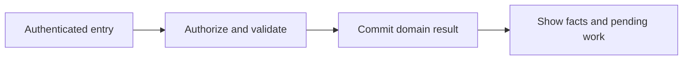
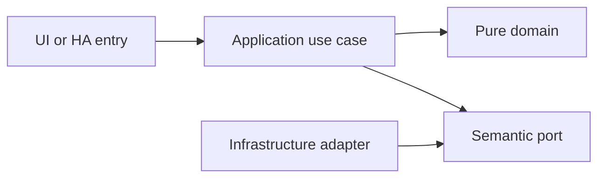

# Auditable points, participation and optional rewards

- Status: Draft
- Date: 2026-10-28
- Catalog capability ID: points-rewards
- Last verified: 2026-11-01 (document structure and A35 only; no implementation evidence)
- Owners: Domus maintainer; engineering/product reviewers to be assigned
- Scope: Task completion produces auditable point entries. Household-configurable collaboration policies determine each share and the actual award total; corrections preserve history and optional rewards never control basic participation.
- Related issues/PRs: https://github.com/vypdev/domus/issues/2
- Required review gates: product UX, architecture, testing, documentation, security/operations
- Open decisions blocking readiness: Deterministic remainder tie-break/override review; child-facing review. The owner confirmed configurable allocation, role-default verification, actual-work reporting, factual negative balances and a funding hold on approved/unfulfilled redemptions without sufficient backing after reversal. Catalog gate prerequisites remain unverified.

## 1. Executive summary

Task completion produces auditable point entries. Household-configurable collaboration policies determine each share and the actual award total; corrections preserve history and optional rewards never control basic participation.

```text
Authenticated member -> validated domain command -> durable result -> household and HA projections
```

This is a prospective Draft, not an implemented or accepted capability. The first usable release covers all domains and both deployment targets.

## 2. Problem, current behavior, and evidence

A mutable points integer cannot explain duplicate awards, reopened tasks, policy changes or who earned credit.

At the original documentation baseline on 2026-10-28, these domain workflows had no implementation. The merged M1 identity/storage foundation now has separate backend evidence. The task approval and material-authority additions in this review remain prospective; this documentation change adds no runtime behavior.

Evidence: the owner's attached brief and subsequent decisions in [product vision](../docs/product-vision.md), the pinned [reference investigation](../docs/reference-investigation.md), and the existing repository baseline. Retrospective classification is not applicable: no as-built product baseline is reconstructed.

## 3. Actors, surfaces, and terminology

Actors: Performer; verifier; administrator; participation viewer.

Primary surfaces: application UI, HTTP domain boundary, relevant HA entities/services, activity and diagnostics. Definitions of member, principal, occurrence, demand and ledger are shared in the [glossary](../docs/glossary.md). The actor recording an action is distinct from its selected target and actual performer.

## 4. Goals, non-goals, and fixed invariants

Goals and fixed invariants are the following normative requirements. No configuration may weaken authorization, ledger integrity, attribution or idempotency.

| Requirement | Behavior |
|---|---|
| points-rewards-R1 | Point awards MUST be append-only, attributable and unique for each accepted completion cycle; all performer shares MUST commit atomically and a policy/version change MUST NOT admit a second award set. |
| points-rewards-R2 | Reopening and correction MUST append compensating entries for the amounts actually awarded and preserve the original award, precision and allocation-policy snapshot. |
| points-rewards-R3 | Collaborative awards MUST apply an administrator-configurable household allocation policy, support conserved splits, rounded equal shares, two-decimal shares and full points per participant, and expose the base value, participants, policy, individual shares and actual awarded total. |
| points-rewards-R4 | Verification and permissions MUST apply adult/no-verification and restricted/adult-approval defaults, prevent premature or unauthorized awards and deny unauthorized task-value or allocation-policy manipulation. The snapshotted household/task participation rule MUST allow approval by an authorized adult performer by default; current authority and any configured independent-adult requirement still gate one award. |
| points-rewards-R5 | Weekly, monthly and historical earned-point/participation summaries MUST attribute work to actual completed_at under household calendar boundaries, expose effort and participation, and distinguish pending points from posted spendable balance; later approval MUST NOT move the work to another period. |
| points-rewards-R6 | Optional rewards MUST support explicit approval, cancellation and duplicate-safe redemption; reversal MUST preserve factual negative balances and fulfilled rewards, block unaffordable new redemptions and hold approved/unfulfilled rewards without sufficient backing until credit recovers or an explicit authorized resolution occurs. |

Non-goals: changing Copilot, changing the existing gateway, building an MCP server, adding mandatory cloud/AI dependencies, or claiming production readiness from a document.

## 5. Current versus proposed product journey

| Stage | Current | Proposed | User/operator effect |
|---|---|---|---|
| Enter | No Domus UI | Verified HA principal opens the relevant surface | Role and scope are explicit |
| Act | No domain command | Validate input, permission and current revision | Invalid data leaves the draft intact |
| Commit | No durable domain record | Store change and operation receipt atomically | Retry cannot duplicate effects |
| Observe | No projection | Show committed facts and pending downstream projections | Partial success remains understandable |



Text equivalent: authenticated entry -> authorization and validation -> durable domain commit -> visible facts with any pending projection. Domain-specific alternatives are described below.

## 6. Functional behavior and state model

### 6.1 Domain model and normal path

PointsLedgerEntry has immutable ID, member, signed integer minor-point amount, completion-cycle source, source-event identity, allocation-policy version, precision, reason, issuer and timestamp. One point is 100 minor units so two-decimal awards use exact integer arithmetic rather than binary floating point. One allocation record is unique per household and completion cycle; each performer has at most one share in that allocation. Policy/version is immutable evidence, not part of a uniqueness key that could permit a second award for the same cycle. Reversal entries reference original entries; balances are projections.

The owner's expanded decision on 2026-10-29 supersedes universal conservation of the task's base point value: families configure allocation in the application. A household policy supplies the default; only an administrator-authorized task override may change it. The completion and award snapshot the base value, policy/version, precision, performers, shares and actual total. A later policy edit affects future completions, not recorded or retrying awards. A member cannot choose a more rewarding policy in an ordinary completion request. Equal division of one conserved total remains the initial default; other supported modes intentionally may award less or more than that base.

| Mode | Ten base points, three performers | Actual total | Meaning |
|---|---|---:|---|
| conserve_total, precision 0 | 3, 3, 4 | 10 | Preserve one total; explicit deterministic remainder distribution |
| equal_share, precision 0, floor | 3, 3, 3 | 9 | Same rounded-down share for all |
| equal_share, precision 0, ceil | 4, 4, 4 | 12 | Same rounded-up share for all |
| equal_share, precision 2, floor | 3.33, 3.33, 3.33 | 9.99 | Two-decimal equal shares; no hidden extra 0.01 award |
| conserve_total, precision 2 | 3.33, 3.33, 3.34 | 10 | Two-decimal split preserving the total |
| full_per_participant | 10, 10, 10 | 30 | Every performer earns the full task value |
| manual | Explicit authorized amounts, for example 3, 3, 4 | Sum of entered amounts | Validate every share and show the resulting total before approval |

Only conserve_total enforces equality between base and awarded total. Other modes record the difference as policy semantics, not duplicate awards or an unexplained adjustment. The owner confirmed on 2026-11-01 that conserved-split remainders rotate among participants of the same task by default. The scope is the stable task definition across occurrences and genuine completion cycles, rather than a household-wide rotation across unrelated tasks. Durable allocation order must make that rotation deterministic and replay-safe; an identical award retry cannot advance it twice. Exact tie-breaks, changing participant sets and transactional reversal/recovery behavior remain engineering review items, not additional owner-approved details. Task value and policy changes affect future completions only. Optional rewards define cost, eligibility, redemption and approval; no punitive streak resets.

Validate precision against the actual policy rather than silently rounding stored facts. For conserve_total at precision 0, a base of 10.50 cannot be represented as integer shares summing exactly to that base: reject the combination and offer precision 2. Full-performer and manual shares must also be representable at the selected precision. equal_share may intentionally change the total through its explicit rounding policy. Individual award shares are nonnegative; negative ledger entries arise from separately authorized reversal/correction or spending, never a disguised negative performer allocation.

The owner confirmed on 2026-10-31 that an authorized adult may approve a completion in which that adult participated by default. The household setting supplies the default and an explicit administrator-authorized task override takes precedence. A configured requirement for an independent adult denies approval by every actual performer; a completion's submitter is not used as a substitute for its performer set. Restricted performers never become adult verifiers through this option. Only currently authorized adults may approve, including after a lost response or policy change. Snapshot the effective participation rule and policy revisions with the completion, alongside its existing role-default verification policy. Later configuration edits govern future completions; they cannot silently waive an earlier pending decision. Current membership, adult status and approval permission are still checked when approval commits. A new completion cycle receives its own snapshot; delayed approval of a closed cycle remains inert. This policy does not add verification to adult-only work unless another explicit rule requires it.

Physical material usage and its task-scoped permission remain independent of point approval: a posted movement does not authorize points, and an unposted intent does not erase performed work. Only a required valid approval makes the completion eligible for its single allocation; rejection/reopening cannot fabricate returned stock. The [Tasks acceptance inventory](household-tasks.md) owns the distinct new participation/material scenarios without counting them again here.

### 6.2 States and alternatives

Completion -> awaiting verification or eligible -> awarded. Award -> reversed through compensation; corrections are new entries. Redemption requested -> approved -> fulfilled or cancelled; approved -> funding_hold -> approved or explicitly cancelled when backing credit is lost. Hold preserves the original approval and is not fulfillment. Points are reserved transactionally and released on cancellation, with no double spend.

One transaction commits the complete performer allocation, exact total, durable remainder-order advancement and inbox receipt. A crash cannot expose only some performers' awards. A reopened or rejected completion cycle is durably closed to later awards; if that closing event arrives before its completion/approval event, the late event cannot issue points. Already-posted awards are reversed once; an unawarded cycle produces no fabricated negative reversal. A genuine new completion of a reopened occurrence has its own cycle ID and may earn one new allocation under its own snapshot.

The owner confirmed that reopening reverses the full actual award even if some points have already been spent. The resulting ledger balance may be negative; never clamp it to zero, reduce the reversal or erase the redemption to hide the deficit. Fulfilled rewards stay fulfilled. New redemption requests/reservations are blocked while the spendable balance is negative and always require sufficient unreserved points for their cost. Later earned points offset the deficit through ordinary ledger arithmetic. The UI explains the cause and linked entries without a punishment or demand to return an already-delivered reward. Reversal and redemption admission serialize against the same member balance so a racing request cannot spend credit already reversed.

The owner also confirmed a funding hold when reversal removes the backing for an approved reward not yet delivered. Retain its approval, cost snapshot and reservation, expose the shortfall and block delivery while credit is insufficient. Do not silently cancel, release its reservation or mark it fulfilled. Admission reserves the cost; fulfillment atomically posts one spend debit and releases that same reservation, so the cost is not subtracted twice. Fulfillment requires posted balance minus other active reservations to cover its own cost. Check affordability and record fulfillment atomically, serializing with reversal and reservation/funding-state updates. Recovering credit can restore funded approval, but physical delivery still requires its normal authorized fulfillment command. Explicit reviewed cancellation/correction retains actor and reason; cancellation releases its reservation once. Review cannot bypass affordability or fabricate credit. Existing fulfilled rewards are outside this hold and remain delivered.

The owner confirmed that work performed on Sunday and approved on Monday belongs to Sunday's household week. Retain actual completed_at as the work-period timestamp, verified_at as the approval fact and ledger posted_at as the time credit becomes available. Pending verification may appear as pending participation/points, never as spendable credit. After approval, the historical earned-points summary updates in the work period while the balance gains credit at posting. Linked reversals correct that original work period and retain their real later posting/audit timestamp. Weekly earned points, lifetime ledger balance and spendable balance after reservations are distinct views; a reward debit is spending rather than a new negative task-performance record. Month/week boundaries and all projections use the same household-zone policy, not the viewing browser's zone.

A duplicate uses its original operation receipt. A changed payload under the same key is a conflict. Out-of-order events use aggregate revision and source identity. Cancellation never erases an already committed ledger effect; compensation is explicit.

## 7. User-facing configuration

| Input | Type | Recommended default | Allowed values/range | Scope/persistence |
|---|---|---|---|---|
| `points_enabled` | boolean | true | false hides summaries but preserves existing ledger | household; persisted |
| `default_task_points` | decimal points | 0 | 0..10000, at most 2 decimals; administrator-controlled | definition; completion snapshot, stored as minor units |
| `collaborative_allocation_mode` | enum | conserve_total | conserve_total, equal_share, full_per_participant or manual; administrator-controlled | household default; authorized task override; completion/award snapshot |
| `allocation_precision` | integer | 0 | 0 or 2 decimal places; exact minor-unit arithmetic | same allocation-policy snapshot |
| `allocation_rounding` | enum | floor | floor, ceil or half_up for equal_share; reject irrelevant/contradictory combinations | same allocation-policy snapshot |
| `allocation_remainder_strategy` | enum | rotating | owner-confirmed rotation among participants of the same task for conserve_total; deterministic and replay-safe | durable order plus allocation-policy snapshot |
| `rewards_enabled` | boolean | false | true or false; optional, not a launch dependency | household; persisted |

Owner-confirmed defaults are recorded as accepted choices; other defaults and bounds remain proposals pending review. Invalid values and contradictory combinations are rejected before saving; unknown future values require an explicit compatibility error. Precedence is fixed invariants, installation constraints, household policy, then member preferences; lower scopes cannot expand permissions. In-flight commands snapshot relevant policy versions, while revocation is checked at the transaction boundary.

Recommended example: conserve_total splits one task value using exact minor units. Meaningful alternative: an authorized household policy selects full_per_participant and the preview discloses the resulting larger actual total before completion. Transport secrets are installation concerns and are never domain form fields.

## 8. Clean Architecture design

### 8.1 Responsibilities and dependency direction

AwardCompletionPoints and ReverseCompletionPoints consume durable task events through an inbox receipt and ledger transaction, serializing lifecycle closure and allocation for the same completion cycle. AllocationPolicy is pure. QueryParticipation aggregates ledger, durations and counts without overwriting facts. The ledger adapter is append-only to application roles. Reward redemption uses the same concurrency and receipt controls.

| Boundary | Owns | Forbidden dependency |
|---|---|---|
| Domain | Entities, value objects and pure rules | HA, HTTP, SQL, UI frameworks |
| Application | Authorized commands, queries and semantic ports | Concrete adapters and framework DTOs |
| Adapters | Schema mapping, persistence and provider error mapping | Alternate business rules |
| Composition | Explicit deployment wiring | Business decisions |
| Presentation | View models and rendering | Database access or client-only authorization |



Text equivalent: entrypoints call use cases; use cases depend on pure domain and ports; infrastructure implements ports. Architecture checks reject forbidden imports and cycles. Shared contract tests exercise each port adapter; schemas and migration checks enforce durable boundaries.

## 9. UI/UX and content contract

### 9.1 Primary state examples

| State | Visible content |
|---|---|
| Pending | Updating participation totals. Your completed task is saved. |
| Action required | This task needs verification before points can be awarded. View task. |
| Blocked | You cannot change this award. Ask a household administrator; existing points are unchanged. |
| Partial | Completion is saved. Its point award is waiting for processing. View activity. |
| Complete | 12 points awarded to Alex. View the ledger entry. |

The primary view names current status, retained facts and one next action, followed by descriptive links to the record/operation. Technical codes and correlation IDs are progressively disclosed. Duplicate responses update the same operation status rather than adding notifications. At most one routine notification per transition, with opt-out and bounded retry summaries.

English and Spanish use stable translation keys, base-language matching and English fallback. Mobile, tablet and desktop layouts, keyboard operation, visible focus, non-color status, accessible names, light/dark contrast and reduced motion are acceptance concerns. Untrusted text is rendered inert; no arbitrary HTML, commands or secret-bearing links.

## 10. Failure, recovery, and cleanup

| Failure | Retained facts | Retry / action | Cleanup |
|---|---|---|---|
| Invalid or denied input | Existing business records and form draft | Correct fields or request the proper role | No side effects |
| Stale revision | Current committed aggregate; user's entered fields | Review current state and submit a new deliberate operation | No automatic overwrite |
| Lost response after commit | Domain result and receipt | Look up or replay the same key | Never issue a fresh-key duplicate |
| Downstream projection unavailable | Successful domain result and durable pending event | Bounded backoff, then visible retry | Acknowledge outbox only after safe consumption |
| Restart or cancellation | Committed records; identified pending work | Recover receipts/cursors; compensate only by explicit command | Remove listeners and owned temporary artifacts |

Errors explain impact, safe cause, action and retained state. External availability is distinct from authorization denial. Retries are bounded and use deterministic backoff tests, not real waits.

## 11. Security, permissions, and privacy

Backend authorization applies to reads and writes. All requests and HA values are untrusted input; only authenticated principals and validated adapter context establish identity. Cross-household IDs, replayed operations and stale roles are covered in the inventory. A person entity and selected member ID do not authenticate a caller. Logs, traces, exports and browser artifacts redact credentials and unnecessary personal data. The technical HA principal has explicit narrow grants and cannot impersonate a household administrator.

## 12. Observability and operational UX

Show operation state and projection freshness to members; expose sanitized correlation, source event, aggregate revision, duration and safe error code to operators. No raw credentials or unrestricted HA payloads enter diagnostics. Counters distinguish denied, invalid, conflict, unavailable and completed operations. One durable activity entry per business transition; retries do not multiply notifications. No telemetry leaves the installation by default.

## 13. Compatibility, migration, rollout, and rollback

The existing M1 database is versioned and its identity, household, history and operation records must be preserved. Implementing these prospective task policies requires reviewed compatible migrations; this documentation-only change introduces no new stored domain records. Upgrade fixtures cover pending operations and ledger compatibility; a backup precedes destructive migration. Unknown future schemas block writes. Downgrade requires a compatible image/database pair, never silent interpretation of newer data.

Both Supervisor and standalone are first-release acceptance targets. Stable and Edge use separate credentials, IDs, volumes and endpoint bindings. Experimental artifacts cannot automatically promote production. Publication, merge and deployment remain in the existing authorized maintainer lifecycle.

## 14. Testing strategy and numeric budget

Minimum: 44 distinct cases, derived from the explicit risk inventory below. Each inventory row counts once. The budget is a floor, not a claim of completeness or executed tests.

| Area | Minimum distinct cases | Behaviors/risks covered |
|---|---:|---|
| State and concurrency | 10 | the same completion event delivered twice; a reopened task; two redemptions competing for the same available points |
| Adapters and persistence | 4 | a displayed balance; corrected historical entries |
| Security and privacy | 4 | a member attempting to overwrite an existing ledger amount; pending completion verification; an adult without point-administration permission |
| Domain and configuration | 13 | a later task-value edit; 10 points and three performers; duplicate or inactive performer IDs |
| Integration and recovery | 8 | repeated correction commands; authorized approval after a retry; a cancelled pending redemption |
| UI and accessibility | 5 | collaborative completion; equal point totals with different durations; rewards disabled |
| Total | 44 | Distinct inventory cases; repeated executions do not add cases. |

| Case ID | Area | Requirements | Scenario |
|---|---|---|---|
| points-rewards-C01 | State and concurrency | points-rewards-R1 | Given the same completion event delivered twice, only one award set exists. |
| points-rewards-C02 | Adapters and persistence | points-rewards-R1 | Given a displayed balance, drilling into it lists every source award and correction. |
| points-rewards-C03 | Security and privacy | points-rewards-R1 | Given a member attempting to overwrite an existing ledger amount, the operation is denied. |
| points-rewards-C04 | State and concurrency | points-rewards-R2 | Given a reopened task, one reversal offsets its award while retaining both entries. |
| points-rewards-C05 | Domain and configuration | points-rewards-R2 | Given a later task-value edit, the old award keeps the accepted value. |
| points-rewards-C06 | Integration and recovery | points-rewards-R2 | Given repeated correction commands, one compensating entry is applied. |
| points-rewards-C07 | Domain and configuration | points-rewards-R3 | Given conserve_total with precision 0, 10 base points and three performers, shares are 3, 3 and 4, total 10, with the extra recipient determined by the snapshotted remainder strategy. |
| points-rewards-C08 | Domain and configuration | points-rewards-R3 | Given duplicate or inactive performer IDs, allocation is rejected before an award. |
| points-rewards-C09 | UI and accessibility | points-rewards-R3 | Given collaborative completion, members see the base points, allocation mode, each share and actual awarded total before submission. |
| points-rewards-C10 | Security and privacy | points-rewards-R4 | Given pending completion verification, the ledger contains no award. |
| points-rewards-C11 | Security and privacy | points-rewards-R4 | Given an adult without point-administration permission, changing an award policy is denied. |
| points-rewards-C12 | Integration and recovery | points-rewards-R4 | Given authorized approval after a retry, the completion produces one award set. |
| points-rewards-C13 | Domain and configuration | points-rewards-R5 | Given work completed Sunday and approved Monday in the household zone, approved points and participation belong to Sunday's week and become spendable only after Monday's approval/posting. |
| points-rewards-C14 | UI and accessibility | points-rewards-R5 | Given equal point totals with different durations, the report shows both effort and task counts. |
| points-rewards-C15 | Adapters and persistence | points-rewards-R5 | Given corrected historical entries, summary totals reconcile exactly with ledger sums. |
| points-rewards-C16 | State and concurrency | points-rewards-R6 | Given two redemptions competing for the same available points, only the affordable transaction succeeds. |
| points-rewards-C17 | Integration and recovery | points-rewards-R6 | Given a cancelled pending redemption, its reservation is released once. |
| points-rewards-C18 | UI and accessibility | points-rewards-R6 | Given rewards disabled, members can complete tasks normally and no streak penalty is shown. |
| points-rewards-C19 | Domain and configuration | points-rewards-R3 | Given equal_share with precision 0 and floor, 10 base points across three performers awards 3 each and records actual total 9. |
| points-rewards-C20 | Domain and configuration | points-rewards-R3 | Given equal_share with precision 0 and ceil, 10 base points across three performers awards 4 each and records actual total 12. |
| points-rewards-C21 | Domain and configuration | points-rewards-R3 | Given equal_share with precision 2 and floor, 10 base points across three performers awards exactly 3.33 each and records total 9.99 without floating-point drift. |
| points-rewards-C22 | Domain and configuration | points-rewards-R3 | Given full_per_participant, three performers of a 10-point task each receive 10 and the recorded awarded total is 30. |
| points-rewards-C23 | Domain and configuration | points-rewards-R3 | Given authorized manual shares 3, 3 and 4, validation records those exact amounts and total 10; invalid or duplicate performer allocations are rejected. |
| points-rewards-C24 | State and concurrency | points-rewards-R2, points-rewards-R3 | Given a policy change after completion was recorded, a delayed award or retry uses the original snapshotted policy and does not recalculate historical shares. |
| points-rewards-C25 | Security and privacy | points-rewards-R4 | Given a restricted performer supplying full_per_participant in an ordinary completion request, authorization rejects the policy override without increasing their award. |
| points-rewards-C26 | Integration and recovery | points-rewards-R2 | Given a full_per_participant award of 30 actual points from a base of 10, reopening reverses all 30 actual points exactly once. |
| points-rewards-C27 | UI and accessibility | points-rewards-R3 | Given ceil allocation producing 12 actual points from 10 base points, the application explains the selected policy and difference before the award and in its ledger history. |
| points-rewards-C28 | State and concurrency | points-rewards-R1, points-rewards-R3 | Given an already-awarded completion cycle redelivered with a different event or policy version, no second allocation is admitted and the original snapshot remains authoritative. |
| points-rewards-C29 | Adapters and persistence | points-rewards-R1, points-rewards-R3 | Given failure while writing the second of three performer shares, allocation, balance effects, remainder order and inbox receipt all roll back; recovery commits one complete allocation. |
| points-rewards-C30 | Integration and recovery | points-rewards-R1, points-rewards-R2, points-rewards-R4 | Given cycle reopening delivered before its delayed completion or approval, the closed-cycle record prevents an award and no negative reversal is fabricated for an unawarded cycle. |
| points-rewards-C31 | State and concurrency | points-rewards-R1, points-rewards-R2 | Given an awarded cycle reopened and the occurrence genuinely completed again, the old award has one linked reversal and the new cycle has at most one independent allocation; late old messages change neither. |
| points-rewards-C32 | Integration and recovery | points-rewards-R2, points-rewards-R6 | Given 10 awarded points, an 8-point fulfilled reward and reopening, one full 10-point reversal leaves balance -8, retains the fulfilled reward and blocks new redemption. |
| points-rewards-C33 | UI and accessibility | points-rewards-R5, points-rewards-R6 | Given a negative balance caused by reopening, history explains the award, redemption and reversal with the exact deficit and recovery path, without requesting return of the delivered reward. |
| points-rewards-C34 | State and concurrency | points-rewards-R2, points-rewards-R6 | Given a reversal racing a new redemption request, serialization enforces affordability against committed balance and never admits a request based on already-reversed points. |
| points-rewards-C35 | Domain and configuration | points-rewards-R6 | Given balance -8 followed by ordinary earnings of 5 then 4, balances become -3 then 1; new redemptions remain blocked during the deficit and only an affordable cost can be requested afterward. |
| points-rewards-C36 | State and concurrency | points-rewards-R4, points-rewards-R5 | Given approval delayed past month-end, pending points are not spendable before approval and the eventual single posting updates the original work-month summary without moving the task or duplicating credit. |
| points-rewards-C37 | Integration and recovery | points-rewards-R2, points-rewards-R5 | Given reversal several weeks after an award, the original work-period earned total is corrected once while activity and ledger preserve the reversal's real posting timestamp and current balance effect. |
| points-rewards-C38 | Adapters and persistence | points-rewards-R5, points-rewards-R6 | Given prior-period earnings and a reward debit this week, the weekly work total, lifetime balance and available balance after reservations remain distinct and reconcile to their appropriate source entries. |
| points-rewards-C39 | Domain and configuration | points-rewards-R3 | Given conserve_total, precision 0 and base 10.50, validation rejects the incompatible combination with a precision-2 option instead of silently rounding the base or violating conservation. |
| points-rewards-C40 | Domain and configuration | points-rewards-R3, points-rewards-R4 | Given manual allocation with a negative share or a share not representable at its selected precision, validation rejects it before any award or remainder-state change. |
| points-rewards-C41 | Integration and recovery | points-rewards-R2, points-rewards-R6 | Given an approved unfulfilled reward whose backing points are reversed, the full reversal commits and the reward enters funding_hold with its approval and reservation retained; delivery is blocked and no spend debit is fabricated. |
| points-rewards-C42 | State and concurrency | points-rewards-R2, points-rewards-R6 | Given reversal racing fulfillment, serialization either records a genuinely funded fulfillment before reversal or blocks the unfunded delivery; it never fulfills using already-reversed credit. |
| points-rewards-C43 | Domain and configuration | points-rewards-R6 | Given a held reward and later earnings sufficient to cover its cost and other reservations, funded approval may resume but no automatic delivery occurs; authorized fulfillment posts one debit and releases its own reservation once. |
| points-rewards-C44 | State and concurrency | points-rewards-R1, points-rewards-R6 | Given explicit cancellation of a held redemption followed by replay or restart, one retained cancellation releases its reservation once without deleting approval, reversing delivered rewards or generating credit. |

Every implemented first-party module starts with meaningful behavior tests. Target and proposed merge gate: 100% lines/statements/functions/branches where the selected tools expose those metrics, enforced separately across backend, frontend and integration code. Third-party/generated artifacts are distinguished from authored source; broad exclusions cannot hide untested logic. No application coverage currently exists.

Inject deterministic clocks, IDs, provider fakes and transaction failures. Use semantic assertions alongside golden content, real adapter contracts and disposable HA integration environments. Add Google Chrome evidence from the owner's authorized local HA for real UX; it does not replace automated tests or unit coverage. CI Check runs the complete applicable suite for every PR update.

## 15. Documentation and discoverability

The following documentation operations are relative to develop at e8fa5bbc9ffa179aa7559831f5f3d067c9c9c65c. This policy refinement adds no runtime or test implementation evidence.

| Path | Change |
|---|---|
| specs/points-rewards.md | update |
| specs/README.md | reference |
| specs/_template.md | reference |
| specs/catalog.json | update |
| specs/CATALOG.md | update |
| docs/architecture.md | reference |
| docs/product-vision.md | reference |
| docs/glossary.md | reference |
| docs/decisions.md | update |
| docs/reference-investigation.md | reference |
| docs/copilot-adoption.md | reference |
| docs/operations.md | reference |
| docs/user-guide.md | update |
| docs/contracts/home-assistant.md | reference |
| docs/acceptance-plan.md | update |
| docs/roadmap.md | reference |
| README.md | update |
| specs/household-tasks.md | update |
| specs/household-identity.md | update |
| specs/household-inventory.md | update |
| docs/sdd-validation.md | update |
| docs/evidence/task-policy-sdd-review.json | create |

| Audience | Artifact | Required content |
|---|---|---|
| Member | [User guide](../docs/user-guide.md) | Normal path, defaults and state meaning |
| Administrator/operator | [Operations](../docs/operations.md) | Setup, permissions, recovery, backup and rollback |
| Contributor | [Architecture](../docs/architecture.md) | Boundaries and executable constraints |
| HA consumer | [Entity/service contract](../docs/contracts/home-assistant.md) | Stable schemas, semantics and error handling |
| Reviewer | [Acceptance plan](../docs/acceptance-plan.md) | Tests, coverage and human evidence |

Link/path validation accompanies updates. Implementation changes update the owning SDD, catalog evidence, actual tests and user documentation together.

## 16. Acceptance scenarios

The Given/When/Then-equivalent observable scenarios in section 14 are the executable acceptance inventory. For each case, the given precondition and action must produce the specified result with state and side-effect assertions; tests are not implementation snapshots.

Acceptance includes normal, alternative, invalid, duplicate, concurrent, partial, failure, recovery, security, localization and accessibility paths as allocated above. Human review verifies the primary-state examples on desktop/mobile and light/dark themes. Live acceptance remains pending until an implemented artifact is exercised; no result is inferred from the budget.

## 17. Requirements traceability

| Requirement | Cases |
|---|---|
| points-rewards-R1 | points-rewards-C01, points-rewards-C02, points-rewards-C03, points-rewards-C28, points-rewards-C29, points-rewards-C30, points-rewards-C31, points-rewards-C44 |
| points-rewards-R2 | points-rewards-C04, points-rewards-C05, points-rewards-C06, points-rewards-C24, points-rewards-C26, points-rewards-C30, points-rewards-C31, points-rewards-C32, points-rewards-C34, points-rewards-C37, points-rewards-C41, points-rewards-C42 |
| points-rewards-R3 | points-rewards-C07, points-rewards-C08, points-rewards-C09, points-rewards-C19, points-rewards-C20, points-rewards-C21, points-rewards-C22, points-rewards-C23, points-rewards-C24, points-rewards-C27, points-rewards-C28, points-rewards-C29, points-rewards-C39, points-rewards-C40 |
| points-rewards-R4 | points-rewards-C10, points-rewards-C11, points-rewards-C12, points-rewards-C25, points-rewards-C30, points-rewards-C36, points-rewards-C40 |
| points-rewards-R5 | points-rewards-C13, points-rewards-C14, points-rewards-C15, points-rewards-C33, points-rewards-C36, points-rewards-C37, points-rewards-C38 |
| points-rewards-R6 | points-rewards-C16, points-rewards-C17, points-rewards-C18, points-rewards-C32, points-rewards-C33, points-rewards-C34, points-rewards-C35, points-rewards-C38, points-rewards-C41, points-rewards-C42, points-rewards-C43, points-rewards-C44 |

All requirement cases are reciprocal with section 14. Domain invariants are owned by pure policy, command/state rules by application use cases, provider behavior by adapters, and visible content by presentation; the boundary table in section 8 assigns these responsibilities. Evidence and user/operator documentation are linked in section 15.

## 18. Implementation sequence

1. Resolve the blocking decisions and review this contract before Ready for implementation.
2. Establish test harness, CI Check and architecture checks with the first source files.
3. Implement pure policies and their complete branch tests, then transactional use cases.
4. Add adapters, schema/error contracts, retry/race fixtures and both deployment wiring paths.
5. Build the accessible localized UI and HA projections with tests alongside each flow.
6. Verify migration, recovery, security, channel isolation and documentation.
7. Run the complete suite, review coverage, perform local Chrome dogfooding with recorded cleanup, and collect human evidence.

These are internal implementation steps within the first integrated release; they do not remove other domains or deployment targets from launch.

## 19. Definition of Done

- [ ] Every normative requirement has observable acceptance and reciprocal case links.
- [ ] Every declared case is implemented meaningfully; the numeric budget is met.
- [ ] Clean Architecture constraints and port contracts pass.
- [ ] All supported first-party coverage metrics reach 100% from the first implementation.
- [ ] CI Check passes for the current PR revision with no omitted required jobs.
- [ ] Configuration, state, permission, idempotency and recovery behaviors agree.
- [ ] Primary UI states, localization, responsive behavior and accessibility pass.
- [ ] Both deployment targets and isolated Stable/Edge channels pass acceptance.
- [ ] User/operator documentation, schema/migration evidence and catalog paths are current.
- [ ] Local Google Chrome evidence identifies the artifact, channel, test records and cleanup.
- [ ] The original Copilot validations pass when their real prerequisites exist; no check is weakened.
- [ ] No material decision blocking readiness remains unresolved; Copilot remains unchanged.

## 20. References and decisions

Primary sources: [Copilot standard](https://github.com/vypdev/copilot/blob/f5e5a4cf9a80248994469cd88ad55eecab5b95ca/specs/README.md), [original template](https://github.com/vypdev/copilot/blob/f5e5a4cf9a80248994469cd88ad55eecab5b95ca/specs/_template.md), and the linked [reference investigation](../docs/reference-investigation.md).

Confirmed owner choices and unresolved proposals are separated in [decisions](../docs/decisions.md). [Issue #2](https://github.com/vypdev/domus/issues/2) tracks the documentation foundation. The [adoption note](../docs/copilot-adoption.md) records the current catalog evidence limitation. Optional future depth remains explicitly deferred in the product vision; the gateway's installation and MCP internals are outside Domus scope.

## Proposed change: Implement the durable Points consumer for recurrence lifecycle acceptance

- Status: Draft
- Catalog capability: points-rewards

### 1. Executive summary

This delta defines the durable Points consumer needed to turn the existing task lifecycle feed into auditable recurrence awards. Eligible completion cycles produce one authoritative allocation in exact integer minor units; every processed event has a durable inbox receipt; and a reopening reverses only its original posted award, once. Pending, missed, or closed cycles earn no points, including after replay or restoration. A bounded internal ledger query makes real allocations and reversals observable for integration verification.

```text
Lifecycle event -> eligibility and closure checks -> atomic ledger entries and inbox receipt -> bounded ledger read
```

This remains a prospective Draft. It extends the existing owner at `specs/points-rewards.md` and leaves its allocation, verification, attribution, and optional-reward contract in force.

### 2. Problem, current behavior, and evidence

#### 2.1 Problem

Recurrence acceptance needs evidence that points follow the actual task lifecycle. Successor creation or an empty/mocked consumer cannot establish that pending or missed work receives no award, that eligible approval produces a real award, or that reopening compensates the original award without touching unrelated downstream work.

#### 2.2 Current behavior

The task lifecycle source exports completion, verification, and reopening facts with cycle snapshots, eligibility and award-closure signals. Its read is internal, paginated, and read-only; it does not itself issue points or settle materials. The selected implementation and tests in `backend/src/domus/application/task_events.py` and `tests/backend/test_task_events.py` establish this producer boundary and exercise pending versus eligible completion, closure, stable event/cycle identity, and bounded page validation. `backend/src/domus/infrastructure/sqlite.py` declares schema version 15.

This source view does not establish a durable Points ledger consumer or consumer acceptance. This delta specifies that missing consumer; it does not treat recurrence producer behavior as proof of award delivery.

#### 2.3 Evidence

- Existing Points policy and lifecycle invariants: `specs/points-rewards.md`.
- Lifecycle feed and its observable behavior: `backend/src/domus/application/task_events.py`; `tests/backend/test_task_events.py`.
- SQLite schema version declaration: `backend/src/domus/infrastructure/sqlite.py`.
- Issue context: https://github.com/vypdev/domus/issues/56; parent recurrence work: https://github.com/vypdev/domus/issues/23.
- The consumer’s real-schema migration, durable persistence, replay/recovery behavior, and integration acceptance are prospective requirements, not verified implementation evidence.

Retrospective classification is not applicable: this is a prospective consumer specification, not an as-built Points baseline.

### 3. Actors, surfaces, and terminology

| Actor | Goal | Entry point | Visible surfaces |
|---|---|---|---|
| Performer | Have only an eligible, accepted completion credited once | Existing task lifecycle producer | Task and Points history |
| Authorized adult verifier | Approve or reopen work under the retained task rules | Existing task lifecycle producer | Task state and resulting Points history |
| Integration/operator | Verify persisted awards, receipts, and reversals | Bounded internal ledger query | Real SQLite ledger evidence |

A lifecycle event is a producer-owned immutable task fact. A completion cycle is the identity to which one allocation and any linked compensation belong. An inbox receipt records that the consumer processed an event; it is not an award. An allocation is the authoritative set of exact minor-unit shares for one eligible cycle. A reversal is a linked compensating ledger entry for an already-posted source award. The task producer owns completion, verification, performer snapshots, and cycle closure; the Points owner owns ledger entries, consumer receipts, and balance projection. Internal integration queries do not add or change a human task HTTP contract.

### 4. Goals, non-goals, and fixed invariants

#### 4.1 Goals

1. Consume authenticated lifecycle events into one atomic, authoritative allocation per eligible completion cycle, using the retained cycle and performer snapshots and exact integer minor-unit arithmetic.
2. Persist a receipt for each processed event and make duplicate delivery, concurrent replay, restart, restoration, and transaction failure safe and idempotent.
3. Award nothing for pending verification, missed occurrences, or closed cycles, including when completion or approval arrives late after closure.
4. When a previously awarded cycle is reopened, append exactly one reversal linked to its original source award; preserve unrelated and later-cycle work.
5. Provide a bounded internal ledger query that lets integration acceptance inspect real persisted positive awards and reversals.

#### 4.2 Non-goals

This increment does not change existing task HTTP contracts, recurrence rules, approval authority, performer attribution, or the broader Points policy. It does not add a Family interface, configurable distribution, reward redemption, inventory effects, or combined inventory acceptance. Allocation uses the existing default conserved policy and exact minor-unit rules, including stable same-definition remainder rotation; it does not introduce new allocation modes.

#### 4.3 Fixed product and safety invariants

- The existing `specs/points-rewards.md` remains the owner of the Points contract and existing case identities. This delta supplements its recurrence lifecycle acceptance without replacing those cases or weakening its rules.
- Only producer-authenticated lifecycle facts and their immutable completion snapshots determine eligibility and attribution. The consumer must not infer approval, performance, or authority from a successor, a client claim, or a replay.
- Ledger entries, event receipts, allocation uniqueness, and any remainder-order advancement commit atomically. Failure cannot leave a partial performer allocation or a receipt that suppresses required work.
- Event identity and completion-cycle identity remain distinct: each event is receipted once, while a cycle can receive at most one allocation. Closure is durable so late or restored events cannot award a closed cycle; an unawarded cycle never receives a fabricated negative reversal.
- Reversal links to and offsets only the original posted award, exactly once. A genuine later completion cycle remains independently eligible under its own snapshot.
- Migration must begin from the real selected schema version 15 and preserve existing data. Both deployment compositions must wire the same consumer behavior; no human HTTP endpoint is added for internal ledger verification.

| Requirement | Behavior |
| --- | --- |
| SDD-I56-U1-R1 | The durable Points consumer processes authenticated task lifecycle events into one authoritative exact-minor-unit allocation per eligible completion cycle, persists an inbox receipt per processed event, prevents awards for pending or missed occurrences and closed cycles, reverses a previously posted award exactly once against its original source, and exposes a bounded internal ledger query for integration verification. |

### 5. Current versus proposed product journey

The existing Points contract already defines household allocation policy, verification eligibility, immutable cycle snapshots, and ledger ownership. This delta adds a durable consumer of the task lifecycle feed so recurrence outcomes produce real Points ledger facts. The feed is a trusted local-consumer read port with bounded pages of 1–100 events (`backend/src/domus/application/task_events.py`, `TaskEventSource.read`); the consumer maintains its own durable inbox and closure state.

| Stage | Current | Proposed | User/operator effect |
|---|---|---|---|
| Task lifecycle | Task completion, verification, and reopening are represented in the authenticated lifecycle feed. | The Points consumer reads bounded pages and applies each event against the snapshotted completion cycle. | The task remains authoritative for lifecycle facts; Points records its own processing receipt. |
| Pending completion | Existing task completion may await adult approval. | A pending restricted completion creates no award; approval makes the eligible cycle awardable once. | A pending completion cannot appear as earned points. |
| Missed occurrence | Recurrence maintenance can record a missed weekly occurrence. | No allocation is made for a missed occurrence, including on replay or restoration. | Operators can verify absence of an award without a test double. |
| Reopening | The task feed can report a reopened cycle. | The consumer closes the old cycle and appends one reversal linked to its original award, if any. | Unrelated later work remains intact. |
| Verification | The Points owner has no durable event consumer or ledger query for this lifecycle acceptance. | A bounded internal ledger query exposes persisted entries for integration verification. | Integration checks can observe both a positive award and its reversal in SQLite. |

Text equivalent: task lifecycle event -> durable receipt and cycle decision -> allocation, linked reversal, or no ledger entry -> bounded internal ledger observation. This is an internal integration and operator capability; it adds no member-facing configuration or new task HTTP contract.

### 6. Functional behavior and state model

#### 6.1 Consumer behavior

For each authenticated lifecycle event, the consumer MUST persist a receipt keyed to the event identity and apply its ledger effect atomically with that receipt. It MUST allow at most one authoritative allocation for an eligible completion cycle, using the existing Points owner’s snapshotted performer, value, and allocation rules. Exact integer minor-unit arithmetic remains the ledger representation. An eligible positive-control completion MUST produce a real SQLite ledger allocation observable through the bounded internal query.

A pending restricted completion MUST produce no allocation. Approval permits one allocation for the eligible cycle; repeated delivery or recovery cannot create another. A missed weekly occurrence MUST never earn points, including after replay or restoration. Reopening closes the prior cycle and, only when an award exists, appends exactly one reversal linked to that original source award. It MUST NOT reverse unrelated downstream work or create a negative reversal for a cycle that was never awarded. A genuine later completion belongs to its own cycle and may receive its own single allocation.

#### 6.2 State and recovery

| Consumer state | Meaning | Permitted effect |
|---|---|---|
| Unseen event | No durable receipt exists yet. | Evaluate the source event and cycle under transaction protection. |
| Processed, ineligible | Receipt committed; cycle is pending, missed, or otherwise not awardable. | No allocation; replay returns the recorded outcome. |
| Processed, awarded | Receipt and one cycle allocation committed. | Duplicate event or another event for that already-awarded cycle cannot add an allocation. |
| Processed, reversed | Reopening receipt and one linked reversal committed for the source award. | Replays cannot add reversals; later unrelated entries are untouched. |

Event receipt, cycle closure/award state, allocation or reversal, and any conserved-remainder order change MUST commit or roll back together. Concurrent replay, a failure during a multi-share write, restart, and restoration MUST leave either the prior committed state or one complete effect with its receipt. In particular, a reopening observed before a delayed completion or approval prevents a late award for that closed cycle. The receipt is durable evidence of processing, not authority to alter the task’s immutable completion rules.

### 7. User-facing configuration

This consumer adds no user-facing configuration. It MUST use the existing Points owner’s household and task allocation settings, verification rules, and immutable completion snapshots; it does not add a new policy input or permit the consumer to reinterpret a recorded value. Existing defaults, bounds, precedence, and migration decisions remain as specified in the retained Points contract. The internal ledger query is bounded and read-only for integration verification; the implementation note records its scope and bound.

### 8. Clean Architecture design

#### 8.1 Responsibilities and dependency direction

The task lifecycle feed remains the source of task facts. `TaskEventSource` exposes bounded read-only event pages; it explicitly leaves durable inbox and closure ownership to trusted local consumers (`backend/src/domus/application/task_events.py`, `TaskEventSource`). The event model carries stable event and cycle identities, the snapshotted `TaskCycle`, and eligibility/closure indicators (`backend/src/domus/domain/task_events.py`, `TaskLifecycleEvent`). The consumer MUST treat these as validated source facts, not as a mutable task command surface.

The Points domain owns pure award eligibility, cycle closure, exact allocation, and linked-reversal rules. Its application use cases coordinate event consumption, inbox receipt, cycle state, ledger writes, and the bounded internal query through semantic ports. Persistence adapters own SQLite schema mapping, transactions, durable receipts, and migration; composition wires the consumer in both supported deployment compositions. Entrypoints expose no new task HTTP contract. The internal query MUST remain bounded and read-only. Existing Points allocation policy and task verification authority remain with their current owners.

Dependency direction remains entrypoint/composition -> application -> domain and semantic ports, with persistence adapters implementing ports. Domain policy MUST NOT import HTTP, SQLite, or deployment frameworks; application policy MUST NOT depend on concrete adapters or provider DTOs. Transaction boundaries serialize consumption for the same cycle so inbox receipt, cycle closure, allocation/reversal, and remainder rotation cannot diverge.

#### 8.2 Observable architecture constraints

Adapter and integration evidence MUST exercise actual SQLite persistence, including migration from real schema 15, concurrent event replay, rollback, restart, restoration, and both deployment compositions. Positive allocation and reopening reversal controls MUST be observed in that ledger; structural inventory counts alone do not establish semantic coverage. The concrete repository verification invocation and any prerequisite remain unverified in this draft. Acceptance requires evidence that the consumer uses the existing feed and immutable snapshots, that transaction failure cannot strand a receipt or partial award, and that the internal ledger query is bounded.

### 9. UI/UX and content contract

#### 9. UI/UX and content contract

This consumer adds no member-facing controls or changes to existing task HTTP contracts. Existing points views continue to distinguish pending participation from spendable credit and show posted ledger activity under the retained `specs/points-rewards.md` contract. Internal integration verification uses a bounded ledger query and reports whether an eligible cycle has an allocation, whether a processed event has an inbox receipt, and whether a reversal links to its original award. It must not expose unrestricted ledger history or treat a pending completion as an award. The query's concrete response shape and operator presentation remain to be defined during implementation.

### 10. Failure, recovery, and cleanup

#### 10. Failure, recovery, and cleanup

Event handling, allocation or reversal, and the processed-event receipt must commit atomically. A failed transaction leaves no partial shares, ledger effect, remainder-order change, or receipt; retrying the same event can then complete the operation once. Concurrent and repeated delivery must converge on the same receipt and authoritative cycle result. A changed payload for an already processed event must be treated as a conflict rather than silently accepted. A closed cycle remains ineligible after delayed delivery, replay, restart, or restoration; a reversal is created only for an existing posted award and remains linked to that original source. Recovery must preserve the receipt and ledger relationship, not create a fresh award. The implementation must demonstrate these outcomes through the specified rollback, replay, restart, and restoration cases; concrete recovery commands and operator procedures remain unverified.

### 11. Security, permissions, and privacy

#### 11. Security, permissions, and privacy

The consumer must accept lifecycle events only through the existing authenticated task lifecycle feed and use its immutable completion rules and performer snapshots. Event payloads and identifiers are untrusted until authenticated and validated against the authoritative task lifecycle state. The consumer must not infer approval from a completion event that is still pending, award a missed occurrence, or permit a late event to bypass cycle closure. Preserve the task's snapshotted integer minor-unit value and exact arithmetic; do not trust a newly supplied value to rewrite an existing award. Ledger mutation belongs to the consumer's authorized application boundary, while the bounded verification query must remain internal and read-only. Define and verify the concrete principal, grants, and sensitive-field logging policy during implementation; their selected-source details are not established here.

### 12. Observability and operational UX

#### 12. Observability and operational UX

Integration evidence must be inspectable from the real SQLite ledger and bounded query: one eligible completion has one allocation, each processed event has its receipt, and a reopening reversal identifies the original award. Diagnostics should distinguish rejected or conflicting events, transaction failures, successful processing, and duplicate replay without logging credentials or unrestricted event payloads. Retry and recovery evidence must show the retained cycle, source identity, and receipt relationship. The specified integration cases must include both positive award and reversal controls so an inert consumer cannot pass by producing no entries. Metrics, correlation identifiers, retention periods, and operator-facing surfaces remain implementation decisions.

### 13. Compatibility, migration, rollout, and rollback

#### 13. Compatibility, migration, rollout, and rollback

The consumer must migrate from the real SQLite schema 15 while preserving the existing ledger and lifecycle facts. Migration, concurrent replay, transaction rollback, restart, restoration, and both deployment compositions must preserve exactly one allocation or the exact linked reversal together with its processed-event receipt. Keep existing task HTTP contracts and the owning points contract in `specs/points-rewards.md`; the consumer implementation note is `docs/tasks/points-consumer.md`. Verify migration against the selected schema and both deployment compositions before rollout. Backup, downgrade behavior, rollout controls, and a concrete rollback procedure remain to be specified and verified; do not assume that reverting application code alone safely reverses a durable schema change.

### 14. Testing strategy and numeric budget

#### 14. Testing strategy and numeric budget

Retain the immutable owner’s existing 44-case minimum and all existing case definitions. Add five distinct cases for the durable consumer, bringing the minimum to 49. These additions are prospective acceptance criteria, not evidence that implementation or tests exist.

The added integration and recovery cases cover these observable behaviors: a restricted performer’s pending completion creates exactly one recurrence successor and no Points allocation; after adult approval the eligible cycle has exactly one real allocation, returned by a bounded ledger query; a missed weekly occurrence earns no allocation, including after replay or restoration; reopening a cycle with a posted award creates exactly one linked reversal for that original source award without reversing unrelated downstream work; and positive allocation and reopening reversal are visible in the real SQLite ledger, proving the consumer posts and compensates entries rather than remaining inert.

The adapter and persistence case covers migration from real schema 15, concurrent event replay, transaction rollback, restart, restoration and both deployment compositions. Each must preserve one allocation or its exact reversal and a processed-event receipt. The eligible allocation uses exact integer minor units and the default conserved allocation with stable same-definition remainder rotation. Test through real task commands, recurrence maintenance and SQLite ledger reads; do not substitute a mocked consumer for the required integration evidence.

The required verification outcomes include current source checks, the schema migration and recovery behaviors above, and both deployment compositions. The concrete invocation and prerequisites for these checks remain unverified in this selected source view; no command is asserted or made a prerequisite here. A declared check is not execution, a passing result or acceptance.

| Area | Minimum distinct cases | Behaviors/risks covered |
|---|---:|---|
| Integration and recovery | 3 | Observable scenarios in the case inventory. |
| State and concurrency | 1 | Observable scenarios in the case inventory. |
| Adapters and persistence | 1 | Observable scenarios in the case inventory. |
| Total | 5 | Distinct inventory cases; repeated executions do not add cases. |

| Case ID | Area | Requirements | Scenario |
| --- | --- | --- | --- |
| inventory1-C01 | Integration and recovery | SDD-I56-U1-R1 | A restricted performer's pending completion creates exactly one recurrence successor and no Points allocation; after adult approval, the eligible cycle has exactly one real allocation and a bounded ledger query returns it. |
| inventory1-C02 | Integration and recovery | SDD-I56-U1-R1 | A missed weekly occurrence produces no Points allocation, including after replay or restoration. |
| inventory1-C03 | State and concurrency | SDD-I56-U1-R1 | Reopening a cycle with a posted award creates exactly one linked reversal for that original source award and does not reverse unrelated downstream work. |
| inventory1-C04 | Adapters and persistence | SDD-I56-U1-R1 | Migration from the real schema 15, concurrent event replay, transaction rollback, restart, restoration, and both deployment compositions preserve one allocation or exact reversal and its processed-event receipt. |
| inventory1-C05 | Integration and recovery | SDD-I56-U1-R1 | A positive eligible award and its reopening reversal are observed in the real SQLite ledger, demonstrating that the consumer posts and compensates entries. |

### 15. Documentation and discoverability

#### 15. Documentation and discoverability

This update retains `specs/points-rewards.md` as the owning contract and documents the consumer in `docs/tasks/points-consumer.md`. That note covers the authenticated task lifecycle feed, immutable completion rules and performer snapshots, durable inbox receipts, one allocation per eligible cycle, linked reversals, closed-cycle handling, and the bounded internal ledger query. Keep the existing task HTTP contracts, Family interface, configurable distribution and reward redemption with their existing owners and scope.

The implementation note records the delivered consumer and links its migration fixture and tests. The owning case inventory remains in this specification.

| Path | Change |
| --- | --- |
| specs/points-rewards.md | update |
| docs/tasks/points-consumer.md | create |

[specs/points-rewards.md](points-rewards.md) · [Points consumer implementation](../docs/tasks/points-consumer.md)

### 16. Acceptance scenarios

#### 16. Acceptance scenarios

Preserve all existing owner scenarios and case identities. The added acceptance inventory has five distinct cases, all mapped to `SDD-I56-U1-R1`:

- `inventory1-C01` verifies the restricted pending-completion path creates exactly one recurrence successor with no allocation, then adult approval yields exactly one real allocation for the eligible cycle and the bounded ledger query returns it.
- `inventory1-C02` verifies a missed weekly occurrence has no allocation, including after replay or restoration.
- `inventory1-C03` verifies reopening a cycle with a posted award appends one reversal linked to that original award and leaves unrelated downstream work untouched.
- `inventory1-C04` verifies schema-15 migration, concurrent replay, rollback, restart, restoration and both deployment compositions preserve one allocation or exact reversal together with its processed-event receipt.
- `inventory1-C05` verifies a positive eligible award and its reopening reversal in the real SQLite ledger, demonstrating both posting and compensation.

Use real task commands, recurrence maintenance and real SQLite ledger reads for these behaviors. Acceptance remains pending until the implemented consumer is exercised; the specified cases and budget do not establish execution or success.

### 17. Requirements traceability

#### 17. Requirements traceability

The new requirement `SDD-I56-U1-R1` covers the durable Points consumer: authenticated lifecycle-event processing; one authoritative exact-minor-unit allocation per eligible completion cycle; a persisted inbox receipt per processed event; no award for pending or missed occurrences or closed cycles; exactly-once reversal against the original posted source; and a bounded internal ledger query for integration verification.

Map `SDD-I56-U1-R1` to each of the five added cases: `inventory1-C01`, `inventory1-C02`, `inventory1-C03`, `inventory1-C04` and `inventory1-C05`. Each exercises the concrete behaviors stated in its acceptance scenario. Retain the existing owner requirements and case identities as specified in the immutable owner; this delta does not redefine them.

| Requirement | Cases |
|---|---|
| SDD-I56-U1-R1 | inventory1-C01, inventory1-C02, inventory1-C03, inventory1-C04, inventory1-C05 |

### 18. Implementation sequence

1. Keep the retained Points contract and cases in `specs/points-rewards.md` as the owner. Define the consumer boundary, durable inbox and ledger ownership, bounded internal query, and lifecycle-event handling in the implementation note `docs/tasks/points-consumer.md`.
2. Ground the consumer in the existing authenticated lifecycle feed, immutable completion facts, performer snapshots, and supported integer minor-unit values. The selected source defines lifecycle event eligibility and closure in `backend/src/domus/domain/task_events.py`; preserve those producer rules and the existing task HTTP contracts.
3. Implement cycle eligibility and exact allocation, then atomic persistence of the allocation and processed-event receipt. Handle duplicates, changed event identity, concurrency, rollback, restart, and restoration without partial shares, duplicate awards, or late awards to closed cycles. Add linked compensation against only the original posted award.
4. Add migration from the real schema 15, integration with recurrence maintenance, and both deployment compositions. Expose a bounded internal ledger query sufficient to verify posted allocations and reversals. Keep inventory effects and combined acceptance as separate work; leave the Family interface, configurable distribution, and reward redemption with their owning work.
5. Exercise the retained concrete acceptance behaviors: restricted pending completion creates a successor without points and adult approval posts one real allocation; missed weekly occurrences remain unawarded through replay and restoration; reopening reverses only its original award; migration, concurrent replay, transaction rollback, restart, restoration, and both compositions preserve allocation/reversal and receipt; and positive award plus reopening reversal are visible in the real SQLite ledger. Existing owner cases remain references, not new definitions.

### 19. Definition of Done

- [ ] Every concrete behavior in the retained inventory is implemented and verified with observable state and side-effect assertions; the five newly defined cases retain their supplied identities and assertions. Structural counts and reciprocal mappings do not establish semantic completeness or executed acceptance.
- [ ] Eligible completion cycles produce one authoritative exact-minor-unit allocation; every processed event has a durable inbox receipt; pending, missed, rejected, or closed cycles receive no award, including after replay or restoration.
- [ ] Reopening commits at most one reversal linked to the original source award and does not reverse unrelated downstream work. Allocation/reversal and inbox receipt remain transactionally consistent under failure and concurrency.
- [ ] Real SQLite evidence demonstrates a positive award and its reopening reversal. Migration from schema 15, rollback, restart, restoration, recurrence integration, and both deployment compositions have acceptance evidence. The bounded internal ledger query returns the expected entries.
- [ ] The specification satisfies the required format; internal and cross-document consistency is checked; reciprocal catalog ownership, paths, and evidence agree with the generated view. These are publication outcomes, not product goals. The selected declarations do not establish a concrete SDK specification-validation invocation or its prerequisites; that invocation remains unverified.
- [ ] No command declaration is treated as execution or passing acceptance. The catalog and generated-view checks have evidence of agreement, not merely a generic maintainer review or source-claim review.

### 20. References and decisions

This is a delta to the immutable retained owner `specs/points-rewards.md`, especially its lifecycle, atomicity, and historical-cycle rules in sections 6.1–6.2 and its existing acceptance inventory. The implementation note records the consumer separately from the owning contract. The selected task lifecycle source is `backend/src/domus/domain/task_events.py`; it supplies the existing event semantics and eligibility boundary. Issue context: https://github.com/vypdev/domus/issues/56 (parent: https://github.com/vypdev/domus/issues/23).

Decisions carried from the issue: use the authenticated lifecycle feed and immutable completion rules and performer snapshots; retain the current default conserved allocation and exact minor-unit arithmetic with stable same-definition remainder rotation; preserve original-source identity and pending, awarded, and reversed lifecycle states. The implementation note covers this consumer. Inventory effects and combined acceptance remain separate; the Family interface, configurable distribution, and reward redemption remain with their owning work. No selected-source evidence establishes implementation of this consumer, a concrete verification invocation, passing checks, or publication.

## Proposed change: Show protected Family points, history and participation

- Status: Draft
- Catalog capability: points-rewards

### 1. Executive summary

This delta adds a protected Family workspace for members to understand their posted balance, available balance, pending points, signed award and reversal history, and weekly and monthly participation. It is a prospective read-only projection of the existing Points ledger and task facts; it does not grant spendable credit before posting or change ledger ownership.

```text
Verified member -> household-authorized Family read -> balances, signed history, and period participation
```

The retained owner contract in `specs/points-rewards.md` continues to govern ledger integrity, work-period attribution, and pending versus posted credit. This delta adds the bounded Family presentation and read behavior described here.

### 2. Problem, current behavior, and evidence

#### Problem and current behavior

Members need a protected place to reconcile their points and understand their participation. The retained owner says weekly, monthly, and historical summaries use actual `completed_at` under household calendar boundaries; approval and posting remain distinct facts, and pending points are not spendable credit. The current consumer note describes a bounded internal ledger query for a household and completion cycle, explicitly not an HTTP route. The owner also states that member-facing controls and a Family interface are not part of that consumer increment.

Evidence: `specs/points-rewards.md` sections 6, 8, 9, and 19; `docs/tasks/points-consumer.md`. These sources establish existing ledger and consumer boundaries, not an implemented Family destination or its authorization behavior. The Family read surface, its current-authority checks, and the shared workspace integration are proposed by this delta. Implementation details for the UI and its read contract remain to be established during design and implementation.

### 3. Actors, surfaces, and terminology

The member is the reader; current household membership and authorization determine which Family data can be read. The Family destination is part of the shared `@vypdev/ha-ui` workspace and is expected to work on Ingress and standalone deployment targets. It presents points and participation without offering ledger mutation.

“Posted” means a ledger entry has been recorded. “Available” means posted balance available for use under the retained owner rules. “Pending verification” means completed work is awaiting required approval; “pending posting” means approved work has not yet become posted credit. “Work date” is the actual completion date interpreted with the household calendar zone. Approval and posting dates remain separately inspectable audit facts. “Signed history” includes positive awards and linked negative reversals.

### 4. Goals, non-goals, and fixed invariants

#### Goals

- **family-participation-R1:** A currently authorized household member can read their posted and available balance and bounded signed ledger history. Reads MUST enforce current household authority and member scope; forged context, revoked membership, and cross-household identifiers MUST NOT disclose balance or history. Awards and reversals remain linked, and displayed totals reconcile with the ledger.
- **family-participation-R2:** The workspace reports completed-task count and recorded effort by actual work date, week, and month in the household zone. It shows pending verification and pending posting separately from posted credit. Late approval, reversal, restart, and restore preserve the original work period and do not duplicate posting.
- **family-participation-R3:** The protected Family workspace uses shared components, supports English and Spanish, and works on Ingress and standalone targets. Balance, pending values, work counts, effort, and dated reversals remain understandable and accessible in each supported presentation.

#### Non-goals

This delta does not change the Points ledger owner, task completion or approval rules, allocation policy, task HTTP contracts, or calendar policy. It does not add configurable allocation, redemption, spendable credit for pending work, or a general-purpose ledger API. It does not claim the proposed Family surface is already implemented.

#### Fixed invariants

Every read MUST derive identity from authenticated context and validate current household authority at the read boundary; a caller-supplied member or household ID is not proof of authority. Reads MUST be household-scoped and bounded, and MUST expose no unrestricted ledger history. The Family projection is read-only: awards and reversals are owned by the Points ledger, and presentation code cannot create, alter, or erase entries.

The projection MUST distinguish posted balance, available balance, pending verification, and pending posting. Pending work never becomes spendable credit early. Work-period summaries use the original completion timestamp and household calendar boundaries; later approval or reversal does not move work into the current period. Actual approval and posting timestamps remain available as separate facts. Reversals retain their link to the award and their actual posting time. Restart and restore preserve ledger and period-correction facts without duplicate posting.

The read and presentation behavior MUST be verified for both languages and deployment targets, including denied and revoked access, period-boundary reporting, linked reversal reconciliation, and recovery. Publication of this delta retains the owner’s required observable outcomes: the specification satisfies the required format; internal and cross-document consistency is checked; and reciprocal catalog ownership, paths, and evidence agree with the generated view. The concrete verification invocation and its prerequisites are unverified in the selected source; command declaration or existence alone would not establish execution or acceptance.

| Requirement | Behavior |
| --- | --- |
| family-participation-R1 | Read the verified member's posted and available balance and bounded signed ledger history under current household authority. |
| family-participation-R2 | Report participation and separate pending verification and posting by actual work date in the household zone. |
| family-participation-R3 | Render the protected Family workspace with shared components in English and Spanish on both deployment targets. |

### 5. Current versus proposed product journey

This delta adds a protected Family destination to the existing Points journey. A currently authorized household member opens Family and sees their posted balance, available balance after reservations, pending verification and pending posting separately, and signed award/reversal history. They can compare those ledger facts with weekly and monthly participation counts and recorded effort. Household authority is checked for each read; forged context, revoked membership, or cross-household scope returns no member data. Pending work is never spendable credit.

A task’s actual completion time determines its household week and month. Approval and posting retain their own actual timestamps: late approval updates the original work period while credit becomes available only when posted. A later reversal remains linked to its award, corrects that original period, and displays its later posting date. Restart or restore recovers the same ledger and original-period correction without a duplicate. This is a read-only projection and workspace slice; allocation configuration and reward redemption remain outside this delta. The retained owner journey and invariants continue to apply (see immutable `specs/points-rewards.md`, sections 5–6).

### 6. Functional behavior and state model

Family reads an authorized member-scoped projection of the Points ledger and task facts. Show posted balance and available balance as distinct values; available balance accounts for active reservations. Show pending verification separately from approved work waiting to post, and exclude both from spendable credit. History presents signed awards and reversals with their linkage, work date, approval date, and posting date where applicable. Participation reports completed-task counts and recorded effort by actual work date, grouped using the household calendar zone rather than the viewer’s browser zone.

Keep work period and processing state distinct. A Sunday completion approved on Monday remains in Sunday’s week and month; its pending values move through verification and posting without changing the work date. A reversal corrects the award’s original work period while preserving the actual later reversal timestamp. Restart and restore retain ledger entries, period attribution, and correction linkage; replay must not post a duplicate. These behaviors are exercised by the Sunday month-end progression, recovery, and protected localized workspace scenarios; the retained owner state model remains authoritative (`specs/points-rewards.md`, section 6; `docs/tasks/points-consumer.md`).

Treat inaccessible, revoked, forged, or cross-household requests as denied reads without exposing balance or history. Adapter or projection failures must not present pending credit as posted; retain the last known committed facts with a clear unavailable/stale state and a safe retry path. A successful ledger read must reconcile its signed entries with the displayed posted balance, while available balance must disclose any reservation effect.

### 7. User-facing configuration

No new user-facing allocation, verification, or reward configuration is introduced. Family uses the existing household member and calendar context. Provide English and Spanish labels and date/number formatting consistently on Ingress and standalone deployments. The protected workspace visibly distinguishes posted, available, pending verification, pending posting, work date, approval date, and posting date; reversal history remains signed and linked. Counts and effort are both visible in weekly and monthly participation. Pending values are labeled as not yet spendable, and access denial or stale data is communicated without leaking another member’s records.

### 8. Clean Architecture design

Keep ledger ownership in Points and expose only a household-scoped, currently authorized read model to Family. Reuse task completion facts and household calendar rules for count, effort, and period attribution; do not make the browser authoritative for identity, access, balances, or period boundaries. Preserve the existing immutable ledger and source-event processing behavior documented in `backend/src/domus/application/points.py` and `docs/tasks/points-consumer.md`; that implementation’s exact-household/cycle ledger read is internal, not a Family HTTP route. The new read boundary must enforce current authority independently of caller-supplied member or household identifiers.

Family’s presentation should consume an application projection through the existing frontend adapter/application/composition boundaries. Keep persistence and provider details behind adapters, authorization and projection semantics in application/domain boundaries, and rendering in the shared `@vypdev/ha-ui` workspace. Provide equivalent protected behavior in both deployment targets and both locales. Validate the projection against signed ledger entries, original work-period attribution, pending/posting state distinctions, access denial, and restart/restore idempotency; verify both amd64 and ARM64 images under the project’s applicable validation workflow.

### 9. UI/UX and content contract

This delta adds a protected Family destination in the shared `@vypdev/ha-ui` workspace. After current household authorization, a member can review posted and available points, pending verification and pending posting as separate amounts, signed awards and reversals, and weekly and monthly participation with completed-task counts and recorded effort. Label participation by the task’s actual work date and group it using household calendar boundaries; show approval and posting dates separately where they differ. Keep pending points visibly distinct from available credit so unposted work cannot appear spendable. The view must support English and Spanish in both Ingress and standalone deployments. Use accessible names, keyboard navigation, visible focus, and status cues that do not rely on color, consistent with the retained owner contract. The shared workspace and localization implementation are prospective; concrete component and translation-key choices remain to be established.

### 10. Failure, recovery, and cleanup

If the protected read is denied or unavailable, show a clear, non-sensitive message and do not substitute cached or cross-household balance or history. Keep task completion and verification facts distinct from Points posting status: a saved task may remain pending verification or approved pending posting without creating spendable credit. A failed or interrupted read can be retried; retrying must not create a ledger movement. The durable Points consumer described in `docs/tasks/points-consumer.md` records receipts and postings transactionally and makes replay safe, but this Family projection must not mutate the ledger. Restart and restore must retain ledger history and the original work-period attribution, including late approval or a later reversal, without a duplicate posting. Exact member-facing recovery wording and retry controls remain implementation decisions.

### 11. Security, permissions, and privacy

Resolve the authenticated member and current household authority on every balance and history read. A selected member ID, client-supplied household context, or stale authorization must not grant access; deny forged context, revoked membership, and cross-household reads without disclosing whether another member’s records exist. Return only the authorized member’s bounded signed ledger history and relevant participation projection. Keep ledger ownership and award/reversal rules in the retained `specs/points-rewards.md` contract; the Family surface is a read-only projection and cannot approve work, post points, reverse awards, or grant spendable credit. Treat request values and event payloads as untrusted until validated by the authoritative application boundary. Diagnostics must omit credentials and unnecessary personal or ledger data.

### 12. Observability and operational UX

Show members the distinction between posted, pending verification, and pending posting values, and make dated reversals understandable alongside their original awards. Participation totals must remain associated with the original work date and household week/month when approval arrives later; actual approval and posting timestamps remain separately available for audit. Operational diagnostics should distinguish authorization denial, unavailable reads, and projection or posting delay without exposing unrestricted ledger history or sensitive payloads. The read model is for display and reconciliation; a successful display or structural inventory count is not evidence that award, reversal, replay, or restore behavior passed product acceptance. The concrete freshness indicator, operator surface, and diagnostic retention remain to be defined.

### 13. Compatibility, migration, rollout, and rollback

Deliver this as the first M2 Family increment from `develop`, reusing the existing Points ledger and task facts while keeping ledger ownership in Points. Support both Ingress and standalone deployment targets, with English and Spanish presentation. Preserve existing ledger data, task work dates, household calendar rules, and signed award/reversal relationships; late approval and reversal affect the original work period while retaining their actual timestamps. This is a read-only projection and workspace slice: configurable allocation and reward redemption remain separate work, and Copilot installation assets remain preserved. The selected consumer note records schema 16 and its schema-15 fixture, but the Family projection’s storage or migration needs are not established by that note; do not assume a new schema is required. Migration, backup, downgrade, rollout, and rollback details for any projection-specific persistence remain unverified and must be resolved against the implementation before deployment.

### 14. Testing strategy and numeric budget

This delta adds a floor of five distinct cases, counted once each; repeated runs do not increase the count. The cases cover authorization and household isolation; ledger reconciliation for an award and linked reversal; reporting a Sunday completion across month end as it moves through verification, posting, and correction; restart and restore without duplicate posting; and the protected, localized Family view on both deployment targets. These cases supplement the immutable retained owner and its existing inventory; they do not replace or recount its cases. Exercise pure period calculations with household-zone boundary fixtures, authorization and ledger reads through application contracts, persistence and recovery against the real adapter, and rendered states with accessibility and locale assertions. Keep the effort, count, available balance, pending values, and dated corrections independently observable. Run the full applicable suite and coverage gates required by the retained owner; this delta supplies no executed test evidence. The specification-format outcome, internal and cross-document consistency outcome, and reciprocal catalog ownership/path/evidence agreement with the generated view remain required publication outcomes. Their concrete invocation and prerequisites are unverified in this source view.

| Area | Minimum distinct cases | Behaviors/risks covered |
|---|---:|---|
| Security and privacy | 1 | Observable scenarios in the case inventory. |
| Adapters and persistence | 1 | Observable scenarios in the case inventory. |
| Domain and configuration | 1 | Observable scenarios in the case inventory. |
| Integration and recovery | 1 | Observable scenarios in the case inventory. |
| UI and accessibility | 1 | Observable scenarios in the case inventory. |
| Total | 5 | Distinct inventory cases; repeated executions do not add cases. |

| Case ID | Area | Requirements | Scenario |
| --- | --- | --- | --- |
| family-participation-C01 | Security and privacy | family-participation-R1 | A forged context or revoked member cannot read a balance or history. |
| family-participation-C02 | Adapters and persistence | family-participation-R1 | An award and its signed reversal remain linked and reconcile to the posted and available balance. |
| family-participation-C03 | Domain and configuration | family-participation-R2 | Sunday work at month-end stays in its original week and month as it moves from pending verification to pending posting and then to posted. |
| family-participation-C04 | Integration and recovery | family-participation-R1, family-participation-R2 | Restart and restore retain the ledger and the original-period correction without posting a duplicate. |
| family-participation-C05 | UI and accessibility | family-participation-R2, family-participation-R3 | Both languages and deployment targets display the work count, available and pending values, and dated reversals in the protected workspace. |

### 15. Documentation and discoverability

Update the existing owner at `specs/points-rewards.md`; retain its contract and existing cases, adding this delta's requirements and five cases. The selected tree includes `docs/tasks/points-consumer.md`, which describes the existing ledger and schema context; it is implementation context, not evidence that the Family read model or workspace is implemented. The new Family view must be discoverable from the protected Family destination and use shared workspace components. Provide English and Spanish member-facing explanations for posted, available, pending verification, pending posting, participation counts and effort, and signed corrections; explain that corrections retain the original work period and actual later posting date. Setup, authorization, recovery, and implementation documentation must describe the household-scoped read model and preserve Points ledger ownership. No new documentation path is declared by this delta. The retained owner's documentation and catalog maintenance requirements continue to apply; a concrete validation invocation and its prerequisites are unverified here.

| Path | Change |
| --- | --- |
| specs/points-rewards.md | update |

[specs/points-rewards.md](points-rewards.md)

### 16. Acceptance scenarios

Acceptance adds five observable behaviors to the immutable retained owner. A forged household context or revoked member receives no balance or history, and no cross-household facts are disclosed (family-participation-C01). An award and its signed reversal remain linked and reconcile against posted and available balance (family-participation-C02). Sunday work at month end remains in its original household week and month as it transitions from pending verification to pending posting and posted; approval and posting timestamps remain their actual dates (family-participation-C03). Restart and restore retain the ledger and original-period correction without duplicate posting (family-participation-C04). In the protected workspace, both languages and deployment targets show work count, effort, available and pending values, and dated reversals with accessible status and action labels (family-participation-C05). Assert authorization, persisted state, period attribution, visible content, and absence of duplicate side effects; live acceptance remains pending until an implementation is exercised.

### 17. Requirements traceability

The three delta requirements trace to the supplied five-case inventory: household-authorized balance and bounded signed history are exercised by the security/privacy, ledger reconciliation, and restart/restore behaviors; participation reporting with separate verification and posting states and actual work-period attribution is exercised by the month-boundary transition, recovery, and rendered reporting behaviors; the protected shared Family workspace, English and Spanish, and both deployment targets are exercised by the localized UI behavior. Each case maps only to the requirement or requirements it exercises, as recorded in the host-retained inventory. Existing owning case identities remain references, not new definitions. Structural reciprocal mapping does not establish semantic completeness or execution; acceptance requires the behaviors above plus the retained owner's quality gates and publication outcomes.

| Requirement | Cases |
|---|---|
| family-participation-R1 | family-participation-C01, family-participation-C02, family-participation-C04 |
| family-participation-R2 | family-participation-C03, family-participation-C04, family-participation-C05 |
| family-participation-R3 | family-participation-C05 |

### 18. Implementation sequence

1. Extend the retained `specs/points-rewards.md` contract with the Family read projection, current household authorization, pending-work states, participation periods, and protected localized workspace. Keep ledger ownership with Points and derive participation from task facts and household calendar boundaries.
2. Define bounded reads for the verified member’s posted and available balance and signed ledger history. Preserve award-to-reversal linkage, distinguish pending verification from pending posting, and report work by its actual date in the household zone while retaining approval and posting timestamps.
3. Implement and verify authorization, ledger reconciliation, period attribution, restart and restore behavior, and duplicate prevention for original-period corrections. A reversal changes the original work period while retaining its actual reversal record; it must not grant spendable credit before posting.
4. Integrate the protected Family destination in the shared `@vypdev/ha-ui` workspace. Provide accessible English and Spanish views on Ingress and standalone targets, showing completed task counts, recorded effort, available and pending values, and dated awards and reversals.
5. Exercise the five delta cases as concrete behaviors: forged or revoked authority cannot read balances or history; an award and signed reversal reconcile and remain linked; Sunday work at month-end retains its original week and month through verification, posting, and correction; restart and restore retain ledger and period correction without duplicate posting; and both languages and deployment targets display the specified values and reversals in the protected workspace. Existing owner cases remain references, not new definitions.

### 19. Definition of Done

- [ ] Each of the three delta requirements has concrete acceptance in its mapped cases, and each case maps only to requirements it exercises. The five new case identities and their supplied observable assertions are retained; counts and reciprocal mappings establish structural consistency only, not semantic completeness or executed acceptance.
- [ ] Current household authority is enforced for every balance and history read, including forged context and revoked membership. Posted and available balances reconcile with bounded signed history, with reversals linked to their source awards.
- [ ] Participation reports completed work counts and recorded effort by actual work date and household calendar boundaries. Pending verification and pending posting are distinct; late approval, posting, reopening, correction, restart, and restore preserve original-period attribution and actual timestamps without duplicate or premature spendable credit.
- [ ] The protected Family workspace is accessible and displays the required counts, available and pending values, and dated reversals in English and Spanish on both Ingress and standalone deployment targets.
- [ ] The specification satisfies the required format; internal and cross-document consistency is checked; reciprocal catalog ownership, paths, and evidence agree with the generated view. These are observable publication outcomes, not product goals. The selected declarations do not establish a concrete specification-validation or generated-view verification invocation and its prerequisites; those invocations remain unverified. A command declaration, generic maintainer acceptance, or source-claim review alone does not satisfy these outcomes.
- [ ] No declaration is represented as execution, a passing check, or acceptance evidence without observed results.

### 20. References and decisions

This delta updates the immutable retained owner `specs/points-rewards.md` (selected revision `a9c029064c196ad686df5191492c50b0c6a4cff7`). Retain its existing contract, requirements, and cases; this delta adds only the five Family participation cases and three requirements supplied for this issue. Existing ledger and task rules remain owned by the retained contract and their respective domains.

Issue: https://github.com/vypdev/domus/issues/62. The selected source identifies `docs/tasks/points-consumer.md` as describing the existing ledger and schema. The repository README describes English and Spanish product support, Supervisor App/Ingress and standalone Container deployment targets, and the project’s shared HA-coherent presentation components. These facts inform the proposed UI scope; they do not establish that this Family projection or its acceptance has been implemented.

Decisions carried by the issue: make this a read-only projection and workspace slice; retain Points as ledger owner; use task completion facts and household calendar rules; separate pending verification from approved work awaiting posting; and attribute late approval and later reversal to the original work period while preserving actual approval and posting times. Configurable allocation and reward redemption remain separate future work. Selected-source declarations do not establish implementation, passing verification, or publication.

## Proposed change: Configure collaborative points allocation and retain award snapshots

- Status: Draft
- Catalog capability: points-rewards

### 1. Executive summary

This delta specifies household-controlled allocation defaults and authorized task-definition overrides for collaborative point awards. Before submission, performers can review the base value, effective policy and precision, named shares, and actual total in English or Spanish. Exact integer minor points, an immutable completion snapshot, and a single ledger transaction keep delayed approval, retries, and reopening tied to the original award. The immutable retained owner remains `specs/points-rewards.md` at revision `fda57bbe905956a56e30b90ff9d6e8200359dc9c`; this delta supplements its existing requirements, cases, and historical changes.

### 2. Problem, current behavior, and evidence

#### 2.1 Problem

Collaborative work needs clear, reviewable allocation choices. Administrators need to decide how future completions divide points, while performers need to understand each share and why the awarded total may differ from the task's base value. Delayed approval, concurrent policy edits, retries, and reopening must not silently recalculate or duplicate an award.

#### 2.2 Current behavior

The selected source documents a prospective allocation capability and partial existing implementation evidence; it does not establish that the new configurable allocation behavior is implemented. The retained owner describes the existing Points worker as conserving the original task value and rotating remainders per task definition. The project README reports collaborative allocation as configurable product scope, while the owner’s implementation status records the default conserved allocation and exact reversal as partial evidence. These statements describe different scope and evidence levels; they do not establish that the requested allocation modes, authority checks, preview, or award snapshots are all installed.

#### 2.3 Evidence

The retained contract and existing points cases are in `specs/points-rewards.md`. The selected catalog registers the points-rewards capability and its evidence paths in `specs/catalog.json` and `specs/CATALOG.md`. The README describes overall project status and intended product scope in `README.md`. The HA contract records that ordinary completion callers cannot override policy and describes allocation result fields in `docs/contracts/home-assistant.md`. These documents provide context, not proof that all proposed behavior has passed implementation or acceptance checks. The issue and confirmed refinement define this delta’s requested decisions; no repository file outside the cited evidence is asserted to prove them.

### 3. Actors, surfaces, and terminology

The actors are household administrators who manage the default and task overrides, performers who review and submit collaborative work, and authorized verifiers who may approve it. The surfaces are the application’s allocation configuration, pre-submission preview, completion and approval flow, and Family history. Existing Home Assistant and standalone deployment surfaces remain in the owning contract’s scope.

A household default is the policy used for future completions unless an authorized task-definition override applies. Clearing an override makes the current household default apply to future completions. A completion snapshot is the immutable record of the base, effective policy and revision, precision, performer set, exact shares, actual total, and deterministic remainder position. Minor points are integer units: precision zero represents whole points and precision two represents hundredths. A conserved split preserves the base total; equal shares apply the selected rounding rule without redistributing remainder; full shares give each participant the base; manual shares are explicit amounts.

### 4. Goals, non-goals, and fixed invariants

#### 4.1 Goals

1. Let an actor with current `points.manage` authority set the household allocation default and an explicit task-definition override. The task override takes precedence; clearing it restores the current household default for future completions. Initial configuration defaults to conserved allocation at precision zero. Automatic fractional precision applies only to pre-configuration legacy behavior.
2. Allocate exact integer minor points at precision zero or two. Conserved splits require a representable base, distribute leftover quanta among performers ordered by stable member ID, resume at or after the saved recipient and wrap as needed, and save the next recipient after the last extra share. Equal shares support explicitly selected floor, ceil, or half-up rounding without redistributing remainder. Full shares grant each participant the base and require representability. Manual shares are exact, with no rounding. Only conserved splits must total the base.
3. Accept one to 32 distinct currently active performers under existing task-attribution checks. Manual allocation requires current `points.manage` authority and exactly one nonnegative, representable share per performer, including an explicit zero where intended, subject to the existing one-million-minor-point per-share bound. Ordinary completion payloads cannot select policy or inject manual amounts.
4. Freeze the base, effective policy and revision, performer set, exact shares, actual total, and deterministic remainder position in the transaction recording a new completion cycle. Approval and ledger posting reuse that snapshot. Retries cannot allocate or rotate again. Reopening reverses exactly the posted shares once; closing an unposted cycle creates no debit. A genuine new cycle gets a fresh snapshot.
5. Before collaborative submission, show the base value, effective policy and precision, named shares, and actual total in English and Spanish. Family history shows the retained applied policy and revision, original work period, pending verification or posting, and any linked reversal; it explains when policy or rounding changes the total. Later configuration changes affect future completions only.

#### 4.2 Non-goals

1. Reward redemption, which remains a separate increment.
2. Changing the existing remainder rotation beyond the specified stable-member ordering and saved-recipient behavior.
3. Changing the existing gateway or introducing an MCP server, mandatory cloud or AI dependencies, or changes to basic task participation.

#### 4.3 Fixed invariants

1. Existing authorization, attribution, ledger integrity, idempotency, and task lifecycle rules in the retained owner continue to apply. Policy edits require current management authority, and a member cannot choose policy through an ordinary completion request.
2. Award facts use exact integer arithmetic. Invalid precision, unrepresentable values, unauthorized changes, or invalid performer sets leave policy and credit unchanged.
3. Completion snapshot, approval, posting, retry, and reversal preserve the original shares and policy revision. A policy edit cannot change pending work; replay cannot create a second award or advance remainder rotation again; reopening reverses only what posted and only once.
4. Preserve the owner's existing requirements and case identities, both historical deltas, and all approved new case identities and concrete assertions. Requirements must map only to cases that exercise them; each goal must have a concrete case. Publication constraints belong in the owning validation and invariant sections, not as product goals. The publication outcome must establish that the specification satisfies the required format, internal and cross-document consistency is checked, and reciprocal catalog ownership, paths, and evidence agree with the generated view. The concrete invocation or prerequisite for these checks remains unverified in this draft.

| Requirement | Behavior |
| --- | --- |
| family-allocation-R1 | Apply validated revisioned household and authorized task allocation settings using exact integer arithmetic. |
| family-allocation-R2 | Freeze the effective policy and shares with the completion and post or reverse exactly those shares through the existing ledger. |
| family-allocation-R3 | Preview base value, policy, each share and actual total in English and Spanish before submission. |
| SDD-I64-U2-R1 | Current points.manage authority is required to change the household allocation default and to set an explicit task-definition allocation override; an authorized task override takes precedence, and clearing it makes the current household default apply to future completions. The initial default is conserved, with automatic fractional precision applying only to pre-configuration legacy behavior. |
| SDD-I64-U3-R1 | Use exact integer minor points with precision zero or two. |
| SDD-I64-U3-R2 | Conserved splits require a representable base and rotate leftover quanta per task definition over stable member IDs, resuming at or after the saved recipient and wrapping if needed. |
| SDD-I64-U3-R3 | Equal shares use explicitly selected floor, ceil or half-up with no redistribution of the remainder. |
| SDD-I64-U3-R4 | Full shares grant the base to each participant and require representability. |
| SDD-I64-U3-R5 | Manual shares are explicit exact amounts with no rounding. |
| SDD-I64-U3-R6 | Only conserved splits must equal the base total. |
| inventory-4-R1 | Require one to 32 distinct currently active performers under the existing task attribution checks. |
| inventory-4-R2 | Manual amounts require points.manage authority and exactly one nonnegative representable share per performer, including an explicit zero where intended; apply the existing one-million-minor-point bound per share. |
| inventory-4-R3 | Ordinary completion payloads cannot select a policy or inject manual amounts. |
| SDD-I64-U5-R1 | When recording a new completion cycle, freeze the base and effective policy and revision, performer set, exact shares, actual total, and deterministic remainder position in the writer transaction. |
| SDD-I64-U5-R2 | Approval and ledger posting reuse the frozen cycle snapshot, and retrying never reallocates shares or rotates the remainder position. |
| SDD-I64-U5-R3 | Reopening reverses exactly what posted once and closes an unposted cycle without a debit; a genuine new cycle takes a fresh snapshot. |

### 5. Current versus proposed product journey

The retained owner at `specs/points-rewards.md` already defines auditable awards, completion-cycle snapshots, immutable ledger history, and a conserved allocation default. The selected source implements conserved integer allocation in `backend/src/domus/domain/points.py` and processes lifecycle events in `backend/src/domus/application/points.py`; those files do not establish the configurable policy set or household/task configuration described by this delta. This update adds that configuration and its durable award snapshot while keeping the retained verification, attribution, ledger, and reward contracts in force.

For a future collaborative completion, the member sees the task’s base value and current effective allocation before submission. The effective policy is the authorized task-definition override when set, otherwise the current household default. The member reviews the named performers, exact shares, precision, rounding or remainder rule, and actual total. Ordinary completion input cannot choose a policy or supply manual amounts. Once accepted, the completion cycle retains the effective policy revision and calculated shares through verification, posting, retry, and any later reversal. Configuration changes apply only to future completions. In Family history, members can inspect the retained policy, revision, original work period, pending verification or posting state, actual shares and total, and any linked reversal.

### 6. Functional behavior and state model

Allocation uses integer minor points, with configured precision of zero or two decimal places. Configuration starts with a conserved household default at precision zero; fractional legacy behavior is limited to awards predating explicit configuration. At precision zero, a conserved split whose base cannot be represented is rejected with a precision-two option rather than silently rounded. The retained owner defines the ledger and source facts in `specs/points-rewards.md`; the current conserved calculation in `backend/src/domus/domain/points.py` is the selected implementation evidence for that existing mode, not evidence that the new modes are implemented.

A conserved split sorts the distinct active performers by stable member ID, resumes at or after the saved next recipient, wraps when needed, and assigns leftover quanta from that position. It stores the next recipient after the last extra share. A zero-remainder split and a reversal do not move that position. Conserved shares equal the base. Equal shares apply the explicitly selected floor, ceiling, or half-up rule and do not redistribute the remainder, so the total may differ from the base. Full shares grant each participant the base and reject an unrepresentable base. Manual allocation requires current `points.manage` authority and exactly one explicit, nonnegative, representable amount for each performer; zero is valid when explicitly entered. Each share is bounded by one million minor points. Only conserved allocation requires the shares to sum to the base.

The performer set contains one to 32 distinct, currently active performers and passes the existing task attribution checks. Current `points.manage` authority is required to change the household default, set or clear a task override, and submit manual shares. An override takes precedence; clearing it makes the current household default apply to future completions. Invalid configuration or performer data is rejected before credit or rotation state changes.

In the writer transaction that records a new completion cycle, freeze the base value, effective policy and revision, precision, performer set, exact shares, actual total, and deterministic remainder position. Approval and posting reuse this snapshot. A policy edit while approval is pending cannot recalculate it; retries cannot allocate or rotate again. Reopening reverses exactly the shares actually posted, once, with linked entries. Closing an unposted cycle creates no debit; a genuine new completion cycle gets a fresh snapshot. These rules extend the owner's existing atomicity and append-only ledger invariants in `specs/points-rewards.md`.

### 7. User-facing configuration

The household settings surface lets an authorized administrator choose the default allocation mode, precision, and—when equal shares are selected—the rounding rule. It identifies the conserved default and explains that precision zero rejects fractional conserved bases. An authorized task editor can set an explicit allocation override or clear it to inherit the current household default. Manual amounts are available only to an actor with current `points.manage` authority. Unauthorized changes are denied without changing configuration or credit; contradictory or unrepresentable settings receive a field-level explanation and preserve the draft for correction.

Before collaborative submission, show the base value, effective mode and precision, each performer’s name and exact share, and the actual total. Explain that conserved shares sum to the base, equal-share rounding can change the total without redistributing its remainder, full shares multiply the base by the performer count, and manual totals reflect the entered amounts. Present amounts in the selected precision without floating-point drift. Provide this preview and the Family history explanation in English and Spanish, with accessible labels and a non-color indication of pending verification or posting. Later configuration changes must not alter the history display of the applied policy or revision.

### 8. Clean Architecture design

Keep policy calculation as a pure domain responsibility: validate precision and representability, calculate exact shares for each supported mode, and return the next deterministic remainder position where applicable. Application commands authorize household-default changes, task overrides, and manual shares using current `points.manage` authority. Completion processing resolves override precedence and freezes the effective policy and resulting allocation with the new cycle in the same writer transaction that records the completion. Approval, posting, idempotent retry, and reversal consume that snapshot rather than recalculating from mutable configuration.

Persistence must retain versioned household and task allocation settings and the award snapshot alongside the existing cycle and ledger evidence. Enforce one allocation per completion cycle and atomic writes for all shares and remainder advancement; failure must leave neither partial credit nor advanced rotation. Reopening links compensating entries to the original shares exactly once. Application queries project the retained policy, revision, performers, amounts, actual total, work period, posting status, and linked reversal for the Family view. Presentation renders these values and the pre-submission preview; adapters map persisted settings and snapshots without introducing business rules. Preserve the dependency direction and boundaries in the retained architecture contract at `specs/points-rewards.md`; the selected conserved-point calculation and consumer evidence are `backend/src/domus/domain/points.py` and `backend/src/domus/application/points.py`.

### 9. UI/UX and content contract

#### 9. UI/UX and content contract

This delta extends the retained owner at `specs/points-rewards.md`; it does not replace its existing Points and history presentation contract. Before a collaborative completion is submitted, show the base value, effective household or task policy and precision, each named performer’s share, and the actual total. Explain any difference from the base in plain language, including the selected equal-share rounding rule or full-performer allocation. Use English and Spanish with the owner’s locale fallback and accessible text equivalents; values and status must not depend on color alone.

In Family history, show the applied policy and revision, original work period, each performer’s exact share, actual total, whether verification or posting is pending, and any linked reversal. Later policy edits must not rewrite this record. Keep the normal action clear, make keyboard focus and labels usable, and keep names, amounts, and explanations readable on narrow screens. Acceptance includes both locales and deployment targets; the detailed observable presentation assertions remain in the retained owner’s case inventory.

### 10. Failure, recovery, and cleanup

#### 10. Failure, recovery, and cleanup

Reject invalid settings, precision, performer sets, and manual amounts before changing policy or credit; retain entered values when safe so an authorized user can correct them. Explain the impact, cause, next action, and retained state. An unrepresentable base is rejected with the precision-two option explained where applicable. An authorization denial identifies the required points-management authority without disclosing protected household data.

The completion transaction freezes the base, effective policy and revision, performer set, exact shares, total, and deterministic remainder position with the new cycle. Delayed verification, policy edits, retries, restart, and restore reuse that snapshot; retries must not allocate again or rotate the remainder position again. Reopening reverses exactly the shares actually posted, once, and links the reversal to the award. Closing a cycle with no posted award creates no debit. A genuinely new completion cycle takes a fresh snapshot. Recovery evidence must show one complete award or no award after a failed transaction, never a partial share set. The underlying allocation and lifecycle contract is retained in `specs/points-rewards.md`.

### 11. Security, permissions, and privacy

#### 11. Security, permissions, and privacy

Require current `points.manage` authority to change the household default, set or clear an explicit task-definition override, and submit manual shares. Recheck authority at the write boundary. A task override takes precedence only for future completions; clearing it returns future completions to the current household default. Ordinary completion input cannot choose a policy or inject manual amounts.

Accept only one to 32 distinct currently active performers that pass the existing task-attribution checks. Manual allocation requires exactly one nonnegative, representable amount per performer, including an explicit zero when intended, and enforces the existing one-million-minor-point per-share bound. Use exact integer minor units at precision zero or two. Keep identity and authorization separate from supplied member IDs; validate all input before effects. Do not expose credentials or unnecessary personal data in history, errors, or operational evidence. These controls refine the existing owner at `specs/points-rewards.md`.

### 12. Observability and operational UX

#### 12. Observability and operational UX

Members can distinguish a saved completion awaiting verification, a verified completion awaiting posting, a posted award, and a reopened cycle with its linked reversal. Show the original work period and exact retained shares so a later policy change cannot make an earlier award ambiguous. For failed or denied actions, state whether policy, completion, and ledger facts were retained and identify the safe next action.

Operational evidence should correlate a completion cycle with its frozen policy revision, award entries, and any reversal, while avoiding secrets and unnecessary personal data. Verification must exercise concurrent replay, policy changes during pending approval, restart and restore, and reopening; assert that each cycle has at most one allocation and one exact reversal. These are required acceptance outcomes, not claims that checks have been run.

### 13. Compatibility, migration, rollout, and rollback

#### 13. Compatibility, migration, rollout, and rollback

Preserve existing household settings, task definitions, historical awards, and in-flight completion behavior. The initial household allocation default is conserved; precision zero applies to an explicitly configured default, while automatic fractional precision remains limited to pre-configuration legacy behavior. Do not reinterpret historical awards when settings change. Pending work keeps its captured allocation through approval and retry; only future completions observe a changed default or task override.

Define and verify any required persistence migration against existing and in-flight records before implementation. Cover both deployment targets, backup and restore, replay after restart, and rollback with a compatible data/schema version; block unsafe writes rather than silently reinterpret unknown allocation data. The selected source view establishes the existing owner at `specs/points-rewards.md`, but this delta does not establish a specific migration mechanism or invocation. Record the concrete migration prerequisite and rollback procedure as unresolved until evidenced and reviewed.

### 14. Testing strategy and numeric budget

The new appendix adds 22 distinct acceptance cases to the retained 44-case minimum, for a combined minimum of 66. Each case counts once; repeated runs do not increase the count. The cases cover permission and precedence for household defaults and task overrides; exact allocation precision and each supported split mode; active performer limits, manual-share validation and legacy behavior; and snapshots, retries, remainders, reversals, recovery, and localized previews. These are acceptance criteria, not evidence of implementation or execution. Existing owner cases and historical deltas remain in force.

Acceptance checks must establish each stated observable result with state and side-effect assertions, including that denied or invalid operations do not alter policy, credit, or remainder state. Exercise concurrent changes and replay, pending approval, restart and restore, both deployment targets and locales, and both image architectures. Verify real authorization, allocation arithmetic, durable snapshots, and the links between awards and reversals. Do not infer semantic completeness from case or requirement counts.

The selected source establishes the specification files but does not establish an available invocation for validation or product checks. The concrete invocation and prerequisites remain unverified; a declared check is not execution, a passing result, or acceptance.

| Area | Minimum distinct cases | Behaviors/risks covered |
|---|---:|---|
| Domain and configuration | 3 | Observable scenarios in the case inventory. |
| Security and privacy | 1 | Observable scenarios in the case inventory. |
| State and concurrency | 1 | Observable scenarios in the case inventory. |
| Integration and recovery | 1 | Observable scenarios in the case inventory. |
| UI and accessibility | 1 | Observable scenarios in the case inventory. |
| Security and configuration | 1 | Observable scenarios in the case inventory. |
| precision | 1 | Observable scenarios in the case inventory. |
| conserved-split | 1 | Observable scenarios in the case inventory. |
| equal-shares | 1 | Observable scenarios in the case inventory. |
| full-shares | 1 | Observable scenarios in the case inventory. |
| manual-shares | 1 | Observable scenarios in the case inventory. |
| allocation-total | 1 | Observable scenarios in the case inventory. |
| allocation | 1 | Observable scenarios in the case inventory. |
| manual amounts | 1 | Observable scenarios in the case inventory. |
| completion payload | 1 | Observable scenarios in the case inventory. |
| completion snapshot | 1 | Observable scenarios in the case inventory. |
| approval and posting | 1 | Observable scenarios in the case inventory. |
| reopening posted cycle | 1 | Observable scenarios in the case inventory. |
| reopening unposted cycle | 1 | Observable scenarios in the case inventory. |
| new completion cycle | 1 | Observable scenarios in the case inventory. |
| Total | 22 | Distinct inventory cases; repeated executions do not add cases. |

| Case ID | Area | Requirements | Scenario |
| --- | --- | --- | --- |
| family-allocation-C01 | Domain and configuration | family-allocation-R1 | Conserved, equal, full and manual splits produce the specified exact totals and reject incompatible precision. |
| family-allocation-C02 | Security and privacy | family-allocation-R1 | Unauthorized policy edits or manual shares and invalid performer sets leave policy and credit intact. |
| family-allocation-C03 | State and concurrency | family-allocation-R1, family-allocation-R2 | Changing the policy while approval is pending leaves the snapshotted shares and version authoritative through approval and retry. |
| family-allocation-C04 | Integration and recovery | family-allocation-R2 | Concurrent replay, restart, restore and reopening preserve one award and an exact linked reversal. |
| family-allocation-C05 | UI and accessibility | family-allocation-R3 | The preview and Family history explain the exact values and retained policy in both languages and deployments. |
| inventory2-C01 | Security and configuration | SDD-I64-U2-R1 | Given an actor without current points.manage authority, attempts to change either the household allocation default or an explicit task-definition override are denied. |
| inventory2-C02 | Domain and configuration | SDD-I64-U2-R1 | Given an authorized explicit task-definition allocation override and a different household default, a future completion uses the task override; after the override is cleared, a future completion uses the current household default. |
| inventory2-C03 | Domain and configuration | SDD-I64-U2-R1 | Given initial configuration, the household allocation default is conserved; automatic fractional precision applies to pre-configuration legacy behavior only. |
| inventory3-C01 | precision | SDD-I64-U3-R1 | Award amounts use integer minor points with precision zero or two. |
| inventory3-C02 | conserved-split | SDD-I64-U3-R2, SDD-I64-U3-R6 | A conserved split rejects an unrepresentable base; leftover quanta rotate over stable member IDs, resume at or after the saved recipient, and wrap as needed; resulting shares equal the base total. |
| inventory3-C03 | equal-shares | SDD-I64-U3-R3 | Equal shares apply the explicitly selected floor, ceil, or half-up rule and leave the remainder undistributed. |
| inventory3-C04 | full-shares | SDD-I64-U3-R4 | Each participant receives the full base, and an unrepresentable base is rejected. |
| inventory3-C05 | manual-shares | SDD-I64-U3-R5 | Explicit manual amounts are awarded exactly without rounding. |
| inventory3-C06 | allocation-total | SDD-I64-U3-R6 | A non-conserved allocation is permitted to differ from the base total. |
| inventory4-C01 | allocation | inventory-4-R1 | Attribution accepts one and 32 distinct currently active performers; it rejects zero, more than 32, duplicate, or inactive performers under the existing task attribution checks. |
| inventory4-C02 | manual amounts | inventory-4-R2 | Without points.manage authority, manual allocation is rejected. With authority, allocation requires exactly one nonnegative representable share per performer, accepts an explicit zero where intended, and rejects a share above one million minor points. |
| inventory4-C03 | completion payload | inventory-4-R3 | An ordinary completion payload that selects a policy or injects manual amounts is rejected. |
| inventory5-C01 | completion snapshot | SDD-I64-U5-R1 | Recording a new completion cycle stores the base and effective policy and revision, performer set, exact shares, actual total, and deterministic remainder position together in the writer transaction. |
| inventory5-C02 | approval and posting | SDD-I64-U5-R2 | Approving and posting a completion cycle use its stored snapshot; retrying the operation leaves shares and remainder position unchanged. |
| inventory5-C03 | reopening posted cycle | SDD-I64-U5-R3 | Reopening a cycle with a posted ledger entry reverses exactly that posted entry once. |
| inventory5-C04 | reopening unposted cycle | SDD-I64-U5-R3 | Reopening a cycle with no posted ledger entry closes it without creating a debit. |
| inventory5-C05 | new completion cycle | SDD-I64-U5-R1, SDD-I64-U5-R3 | A genuine new completion cycle captures a fresh snapshot rather than reusing the prior cycle's snapshot. |

### 15. Documentation and discoverability

This delta updates the existing owner at `specs/points-rewards.md`; retain its contract, case identities, and historical deltas. The host-generated file inventory is the navigation source for this update. Keep member-facing documentation discoverable from the user guide, and keep operator recovery and permission guidance in operations documentation. Documentation updates must explain the selected allocation, its exact preview and actual total, the retained award policy and revision, pending status, and any linked reversal in English and Spanish. The source view does not establish that these prospective documentation changes have been made.

| Path | Change |
| --- | --- |
| specs/points-rewards.md | update |

[specs/points-rewards.md](points-rewards.md)

### 16. Acceptance scenarios

Treat every case below as an independent observable acceptance scenario. Existing owning cases remain references in the retained owner; the following are the new appendix definitions.

- `inventory2-C01` verifies that an actor without current `points.manage` authority cannot change either the household default or a task-definition override.
- `inventory2-C02` verifies that an authorized task override takes precedence for future completions and that clearing it returns future completions to the current household default.
- `inventory2-C03` verifies the initial conserved default and confines automatic fractional precision to pre-configuration legacy behavior.
- `inventory3-C01` verifies integer minor-point arithmetic at precision zero or two.
- `inventory3-C02` rejects an unrepresentable conserved base and verifies leftover rotation over stable member IDs, resumption at or after the saved recipient, wrapping, and equality of shares to the base total.
- `inventory3-C03` verifies explicitly selected floor, ceil, or half-up equal shares, with no redistribution of the remainder.
- `inventory3-C04` verifies that full shares give each participant the base and reject an unrepresentable base.
- `inventory3-C05` verifies that manual shares are explicit exact amounts with no rounding.
- `inventory3-C06` verifies that only conserved splits are required to equal the base total.
- `inventory4-C01` verifies acceptance of one to 32 distinct currently active performers under existing task attribution checks, and rejection of invalid performer sets.
- `inventory4-C02` verifies that manual allocation requires `points.manage`, exactly one nonnegative representable share per performer, explicit zero shares where intended, and the one-million-minor-point per-share bound; invalid input leaves credit unchanged.
- `inventory4-C03` verifies that an ordinary completion payload cannot select an allocation policy or inject manual amounts.
- `inventory5-C01` verifies that the writer transaction freezes the base, effective policy and revision, performer set, exact shares, actual total, and deterministic remainder position with a new completion cycle.
- `inventory5-C02` verifies that approval and ledger posting reuse the frozen snapshot, and a retry neither reallocates nor rotates again.
- `inventory5-C03` verifies that reopening reverses exactly the shares posted, once, and closes an unposted cycle without a debit.
- `inventory5-C04` verifies that a genuine new cycle receives a fresh snapshot.
- `inventory5-C05` verifies the pre-submission preview of base, effective policy and precision, named shares, and actual total in English and Spanish; Family history retains the applied policy and revision, work period, pending verification or posting, and linked reversal, and explains total differences.
- `family-allocation-C01` verifies exact totals for conserved, equal, full, and manual splits and rejection of incompatible precision.
- `family-allocation-C02` verifies that unauthorized policy edits or manual shares, and invalid performer sets, leave policy and credit intact.
- `family-allocation-C03` verifies that changing policy while approval is pending does not replace the snapshotted shares and version through approval and retry.
- `family-allocation-C04` verifies that concurrent replay, restart, restore, and reopening preserve one award and an exact linked reversal.
- `family-allocation-C05` verifies that preview and Family history explain exact values and retained policy in both languages and both deployment targets.

For every scenario, assert persisted state and side effects as well as the visible result. Exercise authorization with current authority, actual task attribution, races, retry, restart and restore. The scenarios specify required acceptance; they do not claim tests have run.

### 17. Requirements traceability

Map each requirement to only the scenarios that exercise it. The household policy and snapshot requirements are covered by `family-allocation-C01` through `family-allocation-C05`: exact policy outcomes, authorization and invalid-input safety, pending-approval snapshot stability, replay and reversal recovery, and user-visible explanation. The household default and override requirement maps to `inventory2-C01`, `inventory2-C02`, and `inventory2-C03` for authority, precedence and the initial/legacy defaults.

Exact minor-unit precision maps to `inventory3-C01`; conserved rotation and total equality map to `inventory3-C02`; equal-share rounding maps to `inventory3-C03`; full shares map to `inventory3-C04`; exact manual shares map to `inventory3-C05`; and the conserved-only equality rule maps to `inventory3-C06`. Performer count and active attribution map to `inventory4-C01`; manual authority, representability and bounds map to `inventory4-C02`; and rejection of policy injection through ordinary completion maps to `inventory4-C03`.

The durable completion snapshot maps to `inventory5-C01`; reuse through approval and retry maps to `inventory5-C02`; exact reversal and closure without debit map to `inventory5-C03`; a new cycle snapshot maps to `inventory5-C04`; and localized preview and retained history maps to `inventory5-C05`. Each listed scenario has at least one concrete behavior, and each scenario is assigned only to the requirement or requirements it exercises. This mapping establishes structural traceability, not semantic completeness or executed acceptance.

| Requirement | Cases |
|---|---|
| family-allocation-R1 | family-allocation-C01, family-allocation-C02, family-allocation-C03 |
| family-allocation-R2 | family-allocation-C03, family-allocation-C04 |
| family-allocation-R3 | family-allocation-C05 |
| SDD-I64-U2-R1 | inventory2-C01, inventory2-C02, inventory2-C03 |
| SDD-I64-U3-R1 | inventory3-C01 |
| SDD-I64-U3-R2 | inventory3-C02 |
| SDD-I64-U3-R3 | inventory3-C03 |
| SDD-I64-U3-R4 | inventory3-C04 |
| SDD-I64-U3-R5 | inventory3-C05 |
| SDD-I64-U3-R6 | inventory3-C02, inventory3-C06 |
| inventory-4-R1 | inventory4-C01 |
| inventory-4-R2 | inventory4-C02 |
| inventory-4-R3 | inventory4-C03 |
| SDD-I64-U5-R1 | inventory5-C01, inventory5-C05 |
| SDD-I64-U5-R2 | inventory5-C02 |
| SDD-I64-U5-R3 | inventory5-C03, inventory5-C04, inventory5-C05 |

### 18. Implementation sequence

1. Extend the immutable retained owner in `specs/points-rewards.md` with the household default and task-override precedence, exact allocation rules, performer and manual-share limits, and completion-cycle snapshot contract. Keep existing requirements and cases intact; existing owner cases remain references.
2. Define and verify pure integer-minor-point allocation for precision zero or two: conserved splits with representable bases and stable-ID rotating remainder position; equal shares with explicit floor, ceil, or half-up and no redistribution; full shares with representable bases; and exact manual shares. Preserve the initial conserved default and pre-configuration legacy precision behavior.
3. Implement current `points.manage` authorization for household defaults, task overrides, and manual shares. Validate one to 32 distinct active performers under existing attribution checks, and enforce the one-million-minor-point per-share limit. Ordinary completion input cannot choose policy or inject manual amounts.
4. Persist the effective policy and revision, base, performer set, exact shares, actual total, and deterministic remainder position atomically with each new completion cycle. Approval and posting reuse that snapshot; retries do not allocate or rotate again. Reopening reverses posted shares exactly once and closes an unposted cycle without a debit. A genuine new cycle takes a fresh snapshot.
5. Build the pre-submission preview and Family history states for English and Spanish. Show base, effective policy and precision, named shares, actual total, retained policy and revision, work period, verification or posting state, and any linked reversal; explain total differences from rounding or policy.
6. Exercise the concrete allocation, authorization, override, snapshot, retry, concurrency, reopening, recovery, preview, and history behaviors in the supplied case inventory. Verify both deployment targets and image architectures, and complete the retained owner's applicable integration, documentation, security, accessibility, and migration work before publication.

### 19. Definition of Done

- [ ] Every retained owner requirement and each new allocation behavior has observable acceptance coverage; each requirement maps to cases that exercise it, and each case lists only requirements it exercises. Preserve the supplied new case identities and assertions. Counts and reciprocal mappings establish structural consistency, not semantic completeness or executed acceptance.
- [ ] Current `points.manage` authority governs household defaults, explicit task-definition overrides, and manual shares. Task overrides take precedence for future completions; clearing an override uses the current household default. Ordinary completion input cannot choose policy or provide manual amounts.
- [ ] Precision is zero or two using exact integer minor points. Conserved, equal, full, and manual allocation follow their stated arithmetic rules; performer validation and the per-share bound are enforced. The initial default remains conserved, with automatic fractional precision limited to pre-configuration legacy behavior.
- [ ] Each new completion cycle atomically retains its effective policy revision, exact shares, actual total, performer set, and remainder position. Approval, posting, retries, policy edits, replay, restart, and restore preserve that snapshot without duplicate allocation or rotation. Reopening posts only the exact linked reversal when shares were posted, once; an unposted cycle closes without debit.
- [ ] Before submission and in Family history, English and Spanish content exposes the required allocation and lifecycle facts accessibly on both deployment targets. Rounding and policies that change the total are explained. Both image architectures are covered by the required verification evidence.
- [ ] The specification satisfies the required format; internal and cross-document consistency is checked; reciprocal catalog ownership, paths, and evidence agree with the generated view. These are observable publication outcomes. The selected declarations do not establish a concrete invocation and prerequisites for specification validation or generated-view consistency verification; those remain unverified. Generic maintainer acceptance, source-claim review, or structural counts do not satisfy these outcomes.
- [ ] Required product validation covers permissions, invalid inputs, concurrency, retry, restart, restore, historical awards, reversals, both locales and deployment targets, and both image architectures. No declaration is treated as execution, a passing check, or acceptance without observed evidence.

### 20. References and decisions

This delta updates the immutable retained owner `specs/points-rewards.md` at selected revision `fda57bbe905956a56e30b90ff9d6e8200359dc9c`. It retains the existing contract, cases, and historical deltas; it adds the supplied collaborative allocation scope for issue https://github.com/vypdev/domus/issues/64. Reward redemption remains a separate increment.

The issue decisions carried into this delta are exact integer minor units at precision zero or two; an initially conserved household default; task override precedence with current-authority checks; stable member-ID remainder rotation; explicit equal-share rounding; full and manual shares; and a durable completion snapshot reused through approval, posting, retry, and reversal. The required Family explanation includes the actual total when a policy or rounding makes it differ from the base. These are proposed requirements, not evidence that the behavior is implemented or accepted.

The selected root `package.json` declares pnpm 10.34.0 and Node 24.20.x, but no specification-validation or specification-generation script. `specs/README.md` names `pnpm run validate:specifications` and `pnpm run generate:specifications`; their script definitions and prerequisites are not established by that declaration. No validation invocation or result is claimed here. Publication must still produce the three observable outcomes stated in section 19.

## Proposed change: Redeem Family rewards with reservations and funding holds

- Status: Draft
- Catalog capability: points-rewards

### 1. Executive summary

This delta completes the optional Family rewards increment: an authorized administrator can enable rewards and manage the catalog, and an active member can request an affordable reward using their own available points. Each request reserves its snapshotted cost; approval is retained; authorized physical delivery posts one debit and releases the reservation once. If a reversal removes backing before delivery, the reward remains approved and reserved in funding hold until backing recovers or an authorized cancellation occurs. The existing points, participation, and rewards contract and its cases remain in `specs/points-rewards.md`.

### 2. Problem, current behavior, and evidence

Members need to understand which points can be spent and what is happening to a reward request. Requests, approvals, fulfillment, cancellation, and reversals must serialize with Points postings so concurrent actions cannot spend reversed or already reserved credit. A full reversal may leave a negative balance; delivered rewards and their history remain intact, while an approved undelivered reward whose backing is insufficient is held without losing approval or reservation. Later earnings may restore funding but never trigger physical delivery automatically.

This is a prospective addition to the Draft owner, not a claim about implemented reward behavior. The retained owner describes rewards as optional and records approval, cancellation, duplicate-safe redemption, factual negative balances, and funding holds as intended behavior; it also identifies the capability as lacking implementation evidence. See `specs/points-rewards.md` sections 1, 2, 4, and 6, and the shared funding-hold definition in `docs/glossary.md`. Issue #65 supplies the Family increment’s catalog, reservation, concurrency, recovery, and bilingual UX requirements. Implementation details and concrete verification invocations remain unverified here.

### 3. Actors, surfaces, and terminology

The actors are an authorized household administrator, who enables rewards and manages the optional catalog; an active household member, who reads their own balance and requests or cancels their own redemption; and an authorized reviewer or delivery actor, who performs only permitted transitions. Catalog management and administrative review do not grant access to another member’s private redemption details.

Use the owner’s existing terms: posted balance is the ledger-derived balance; reserved points back approved or pending redemption obligations; available points are the amount eligible for another request after reservations and any deficit are accounted for. A redemption retains its original reward and cost snapshot. Funding hold means approval and reservation persist while insufficient backing blocks delivery. Fulfillment is the explicit authorized physical-delivery action and its single spending debit. These terms extend the retained points and ledger contract; they do not replace it.

### 4. Goals, non-goals, and fixed invariants

The delta’s goals are to make the optional catalog and every redemption transition subject to current authority, keep member reads scoped to that member, and preserve the immutable reward-cost snapshot; reserve, spend, cancel, reverse, and place rewards on hold atomically against the posted balance; preserve request results, audited transitions, reservations, and ledger evidence through replay, restart, and restore; and explain posted, reserved, available, and redemption states accessibly in English and Spanish. The six supplied redemption scenarios cover authorization and privacy, competing requests, approval and duplicate-safe delivery, cancellation, reversal races and funding holds, recovery after later earnings, and bilingual Family presentation.

Non-goals are changes to Gateway, deployments, releases, or M3, and any change to the retained points-award, participation, or historical-ledger contracts. Rewards remain optional and must not gate ordinary task participation.

Fixed invariants: only current authority may change the catalog or perform a transition; members may act on and inspect only their own redemptions. Admission and all balance-affecting transitions serialize with postings and reversals. An affordable request reserves its original cost exactly once; delivery posts one debit and releases that reservation once; cancellation releases an undelivered reservation once. Reversal preserves factual balances, including negative balances, and never erases delivered rewards or their spending history. Insufficient backing places an approved undelivered reward on hold with approval and reservation retained; delivery remains blocked until funded, and funding recovery does not deliver automatically. Retries and recovery preserve authoritative results without duplicate effects.

| Requirement | Behavior |
| --- | --- |
| family-redemption-R1 | Current authority controls the optional catalog and each transition, with member-scoped reads and immutable reward cost. |
| family-redemption-R2 | Reserve, spend, cancel, reverse, and hold atomically against the existing posted balance. |
| family-redemption-R3 | Preserve request results, audited transitions, reservations, and ledger evidence through replay, restart, and restore. |
| family-redemption-R4 | Explain available points and every redemption state accessibly in English and Spanish. |

### 5. Current versus proposed product journey

This update completes the Family rewards increment after #64. The existing points-rewards contract and cases in `specs/points-rewards.md` remain authoritative; this delta adds the reward lifecycle and its interaction with the existing posted Points balance.

An administrator with current authority can enable the optional rewards catalog and manage its entries. An active member can view rewards and request one using only their own available points. The request records the reward and its cost at request time. Review retains the approval decision and reserved amount. Delivery is a separate, explicitly authorized action that records physical delivery and posts one spend debit. Cancellation of an undelivered request releases its reservation once. A full reversal that removes backing for an approved undelivered reward places it on funding hold while retaining its approval and reservation; later earnings can restore backing, but do not trigger delivery. A delivered reward and its spending history remain intact even if a later reversal makes the posted balance negative.

Members can distinguish posted, reserved, and available points, and follow pending review, approval, funding hold, delivery, or cancellation. History identifies reward spending separately from points earned for work in the actual work period. Gateway, deployments, releases, and M3 remain outside this increment.

### 6. Functional behavior and state model

Use the existing posted Points balance as the authority for affordability and funding. For each member, available points are posted points less active reward reservations. Admission, posting or reversal, reservation changes, delivery, and cancellation must serialize through the same SQLite writer so competing requests cannot spend the same backing. A request succeeds only when its snapshotted reward cost is affordable; concurrent requests against the same credit must not create multiple affordable reservations. Catalog changes or later price edits do not change a request's recorded cost.

Keep request identity and results, approval, reservation, lifecycle transitions, and ledger evidence durable and replay-safe. Approval retains the reservation. Delivery must atomically record delivery, post exactly one debit at the snapshotted cost, and release the reservation. Retrying delivery cannot duplicate the debit. Cancellation releases an undelivered reservation exactly once. A linked reversal that leaves an approved undelivered request without sufficient backing preserves approval and reservation in funding hold and blocks delivery. Subsequent earnings may restore funded approval without performing delivery. A reversal after delivery does not erase the delivery or its spending record. Restart and restore must preserve authoritative balances, historical receipts, and idempotent outcomes without duplicate effects.

Enforce current authority for catalog administration and every review, delivery, and cancellation transition. Reject forged subjects and unauthorized actions without effects; reads of requests and balances are member-scoped. Do not expose another member's reward or points data. Verify these behaviors under competing requests, reversal races, delivery retries, restart, and restore, including that rejected operations leave state unchanged.

### 7. User-facing configuration

The member view presents posted, reserved, and available points as separate amounts and makes the affordability of each optional reward clear. Disable an unaffordable reward with an accessible explanation. Show the request lifecycle in plain language, including approval, funding hold and its shortfall, delivery, and cancellation; explain that restored backing does not itself cause delivery. Identify the spending entry separately from earned points and associate earnings with the actual work period.

Provide equivalent, accessible explanations in English and Spanish. Verify the complete member experience in both deployments and both locales, including disabled rewards, the separate balance amounts, each lifecycle state and shortfall, and the reward spending entry. Preserve the established Family permissions and navigation in the retained owner.

### 8. Clean Architecture design

Extend the existing points-rewards design in `specs/points-rewards.md`; retain its owning contract, cases, and historical deltas. Integrate reward reservations and spend postings with the existing Points ledger and SQLite write serialization rather than introducing an independent balance authority. Persist the reward price snapshot, reservation, authorization decision, lifecycle state, idempotent request result, and linked ledger evidence so transitions remain auditable and recoverable.

Keep catalog administration, member-scoped reads, review, delivery, and cancellation behind current authority checks. Model funding hold as an approved but undeliverable request whose reservation and approval remain recorded until backing is restored or an authorized cancellation releases it. Make delivery an explicit command after recovery; recovery itself must not deliver a physical reward. Make the debit and reservation release one atomic, retry-safe transition, and retain delivered history across later reversals.

Acceptance covers current permissions, concurrent requests and reversals, retries, restart and restore, full coverage, both locales and deployments, and amd64 and ARM64. Publication must establish that the specification satisfies the required format, that internal and cross-document consistency is checked, and that reciprocal catalog ownership, paths, and evidence agree with the generated view. The concrete invocation and prerequisite for those publication checks remain unverified from the available source context; verify them against the selected immutable project before relying on any command.

### 9. UI/UX and content contract

#### 9.1 Redemption and balance views

Extend the retained Points views with separate posted balance, active reservations, and available points (posted balance minus reservations). Show the reward’s current price and the immutable price snapshot on its request. A reward that is disabled or unaffordable remains visible with a plain-language reason and no request action. Do not imply that pending points are spendable.

For every request, show one primary status, the completed facts, the next permitted action, and whether the member or an authorized administrator must act. Explain requested, approved, funding hold, delivered, and cancelled states in words; do not rely on color or icons. A funding hold identifies the shortfall, preserves the approved state and reservation, and says delivery must wait until backing is sufficient. Recovery of backing restores funded approval but does not deliver the reward. Delivery and cancellation each show the resulting reservation and ledger effect. Members see only their own request details and history.

Use representative content such as: “Reward on hold — Your approved reward costs 30 points; 20 points are currently backed. Your request and reservation are saved. Delivery is paused until you have enough points available. View points activity.” For an affordable request, explain the cost and remaining available balance before submission. Show a clear confirmation after a successful request, delivery, or cancellation; a repeated request result must not appear as a second redemption.

Explain a negative posted balance and later recovery without suggesting that an already delivered reward must be returned. Reward spending appears separately from earned points and is attributed to its actual posting period; earned summaries remain attributed to the work period. Keep amounts, labels, and accessible names consistent across balance, request, and history views.

All redemption states and balance explanations are available in English and Spanish, with the retained English fallback behavior. Acceptance checks keyboard use, visible focus, screen-reader names and status announcements, non-color distinctions, contrast, responsive layouts, and light/dark themes on both deployments. Untrusted reward names and reasons render as inert text, never executable markup.

#### 9.2 State changes and feedback

Use one primary action per view: request an affordable reward, review a pending request, deliver a funded approved reward, or cancel when authorized. Explain denied or stale actions with their impact, cause, next action, and retained state. Duplicate submissions update the existing operation result. Routine notifications remain bounded to one per business transition; retries do not create extra notices.

### 10. Failure, recovery, and cleanup

#### 10.1 Redemption failure and recovery

| Failure or transition | Retained facts and user impact | Recovery and cleanup |
|---|---|---|
| Invalid, unauthorized, or stale request | No new reservation or ledger effect; current request and balance remain authoritative. | Correct the input or obtain current authority, refresh the displayed state, and submit a deliberate operation. |
| Competing requests or reversal | Admission is serialized against the posted balance. Only requests affordable at commit reserve points; rejected requests do not partially reserve. | Refresh available points and request again if sufficient. Never auto-replay with a new operation identity. |
| Lost response or repeated delivery command | The committed request result, approval, reservation, or spend remains recorded. | Look up or retry the same operation. A delivery retry posts at most one debit and releases its reservation once. |
| Reversal removes backing from an approved, undelivered reward | Approval, snapshotted price, and reservation remain; delivery is blocked and the shortfall is visible. | Later earnings may restore funded approval. Physical delivery still requires its explicit authorized command. An explicit authorized cancellation releases the reservation once and retains its reason and actor. |
| Reversal after delivery | Delivered reward and spending history remain; the factual balance may be negative. | Preserve the linked reversal and explain the deficit. Block new unaffordable reservations; later earnings offset the deficit through ordinary balance arithmetic. |
| Restart, retry, or restore | Durable receipts, transitions, reservations, and ledger evidence remain authoritative. | Resume from durable state and retry idempotently. Restore must not duplicate a debit, cancellation, or release. |

Errors state the impact, safe cause, available action, and retained state. Recovery never silently cancels a held reward, removes a delivered reward, clamps a negative balance, or fabricates credit. Temporary resources and pending work are cleaned up only after durable state makes the outcome safe.

### 11. Security, permissions, and privacy

#### 11.1 Authorization and privacy for rewards

The optional catalog is controlled by currently authorized administrators. Each catalog change and request transition rechecks current authority at commit; a prior role, selected member, person entity, or client-supplied subject does not establish permission. An active member may request and cancel only their own eligible reward. Review and physical delivery require the appropriate current administrator authority. Members cannot review, deliver, alter another member’s request, or change reward cost through request input.

Every read is member-scoped. Reject forged subjects, cross-member identifiers, stale roles, unauthorized catalog changes, review, delivery, and cancellation without side effects. Validate all identifiers, amounts, and state transitions at the trusted boundary. Snapshot reward cost when requested; later catalog edits do not change an existing request’s price or reservation.

Keep audit evidence for the actor, action, reason where required, request identity, price snapshot, and linked ledger effects. Logs, traces, exports, and browser artifacts omit credentials and unnecessary personal data. Do not expose another member’s request or balance through error messages, activity, or operational diagnostics.

### 12. Observability and operational UX

#### 12.1 Redemption status and operational evidence

Members can inspect posted points, reserved points, available points, and each of their redemption states, including any funding shortfall and the next permitted action. Keep earned points, reward spending, and reversal evidence distinguishable in activity and attribute them to their actual work or posting periods as defined by the retained owner.

Operators can correlate a request and its transitions with sanitized operation identity, actor, source event where applicable, aggregate revision, duration, and safe error code. Counters distinguish denied or invalid transitions, conflicts, unavailable storage, funding holds, completed deliveries, cancellations, and successful recovery. Diagnostics must not include raw credentials, unrestricted adapter payloads, or another member’s request details. Retries must not multiply durable activity entries or notifications; no telemetry leaves the installation by default.

### 13. Compatibility, migration, rollout, and rollback

#### 13.1 Compatibility and release boundary

This delta extends the immutable retained owner at `specs/points-rewards.md`; it preserves the existing Points contracts, cases, and historical deltas. Reward redemption is optional and disabled by default, so installations without an enabled catalog retain ordinary participation and points behavior. Existing posted balances remain the source for affordability; reservations are accounted for separately and must not rewrite historical earned entries.

Implementation must provide a reviewed compatible migration for any new durable catalog, request, reservation, transition, receipt, or ledger-link state. Preserve existing identity, history, operation, and ledger records. Migration and restore acceptance must cover pending and approved undelivered requests, delivered rewards, cancellations, reversals, funding holds, and replay without duplicate effects. Unknown future schemas block writes rather than being reinterpreted; rollback requires a compatible image and database pair.

Acceptance covers both Supervisor and standalone deployments, English and Spanish, and amd64 and ARM64. Keep Gateway, deployments, releases, and M3 outside this increment. Publication, merge, and deployment remain within the existing authorized maintainer lifecycle.

### 14. Testing strategy and numeric budget

Budget a minimum of six distinct acceptance cases for this delta: one security and privacy case, two state and concurrency cases, one adapter and persistence case, one integration and recovery case, and one UI and accessibility case. The budget follows the risks of current authorization, member-scoped data, competing requests, reversals, funding holds, retry, and durable state. The six cases below are the minimum inventory, not evidence of semantic completeness or executed acceptance. Exercise denied operations without side effects, atomic balance changes, idempotent retries, restart and restore, and persisted ledger links. Use deterministic concurrency and persistence fixtures where applicable; verify accessible English and Spanish content on both deployments and verification evidence for amd64 and ARM64. The immutable selected source establishes the existing owner and repository specification guidance, but the concrete validation invocation and prerequisites remain unverified; no command or passing result is claimed. Publication must establish the required format, internal and cross-document consistency, and agreement between reciprocal catalog ownership, paths, evidence, and generated view.

| Area | Minimum distinct cases | Behaviors/risks covered |
|---|---:|---|
| Security and privacy | 1 | Observable scenarios in the case inventory. |
| State and concurrency | 2 | Observable scenarios in the case inventory. |
| Adapters and persistence | 1 | Observable scenarios in the case inventory. |
| Integration and recovery | 1 | Observable scenarios in the case inventory. |
| UI and accessibility | 1 | Observable scenarios in the case inventory. |
| Total | 6 | Distinct inventory cases; repeated executions do not add cases. |

| Case ID | Area | Requirements | Scenario |
| --- | --- | --- | --- |
| family-redemption-C01 | Security and privacy | family-redemption-R1 | A member can request and cancel their own reward. Unauthorized review, delivery, catalog changes, forged subjects and other-member reads are rejected without effects. |
| family-redemption-C02 | State and concurrency | family-redemption-R1, family-redemption-R2 | Two requests competing for the same credit produce only one affordable reservation with its original reward price. |
| family-redemption-C03 | Adapters and persistence | family-redemption-R2, family-redemption-R3 | Approval retains the reservation. Retry of physical delivery posts one debit and releases its reservation, and cancellation releases an undelivered reservation once. |
| family-redemption-C04 | State and concurrency | family-redemption-R2, family-redemption-R3 | A linked reversal races admission and delivery. Approved undelivered rewards enter funding hold with approval and reservation retained. A delivered reward survives a factual negative balance. |
| family-redemption-C05 | Integration and recovery | family-redemption-R2, family-redemption-R3 | Later earnings restore backing without delivery. Restart, retry, and restore preserve authoritative balances and historical receipts without duplicate effects. |
| family-redemption-C06 | UI and accessibility | family-redemption-R4 | Family explains disabled rewards, separate balance amounts, lifecycle and shortfall, and the spending entry in both languages and both deployments. |

### 15. Documentation and discoverability

This delta extends the retained owner `specs/points-rewards.md`; its existing contract, cases, and historical deltas remain in force. Keep member guidance discoverable from the user guide and operator permission and recovery guidance in operations documentation. Explain the optional catalog, how members see posted, reserved, and available points, and the approval, funding-hold, delivery, and cancellation states in English and Spanish. Content must make clear that a hold blocks delivery until backing is sufficient, and that later earnings restore backing without triggering delivery. The selected source establishes the owner path but does not establish that these prospective documentation updates have been made.

| Path | Change |
| --- | --- |
| specs/points-rewards.md | update |

[specs/points-rewards.md](points-rewards.md)

### 16. Acceptance scenarios

Treat each of the following as an independent observable acceptance scenario; these are the supplied new case identities.

- `family-redemption-C01` verifies that an active member can request and cancel their own reward; unauthorized review, delivery, catalog changes, forged subjects, and reads of another member’s data are rejected without effects.
- `family-redemption-C02` verifies that two requests competing for the same credit produce only one affordable reservation, and that the reservation retains the reward’s original price.
- `family-redemption-C03` verifies that approval retains the reservation, retrying physical delivery posts one debit and releases that reservation, and cancellation releases an undelivered reservation exactly once.
- `family-redemption-C04` verifies a linked reversal racing with admission and delivery: an approved undelivered reward enters funding hold with approval and reservation retained, while a delivered reward remains recorded through a factual negative balance.
- `family-redemption-C05` verifies that later earnings restore backing without delivering the reward, and restart, retry, and restore preserve authoritative balances and historical receipts without duplicate effects.
- `family-redemption-C06` verifies that Family explains disabled rewards, separate balance amounts, lifecycle and shortfall, and the spending entry accessibly in English and Spanish on both deployments.

Assert persisted state and side effects as well as visible results, including current authorization, reservation and ledger links, and exact-once release or debit. These scenarios define required acceptance; they do not claim tests have run.

### 17. Requirements traceability

`family-redemption-R1` maps to `family-redemption-C01` for current authority, member-scoped access, and own-request/cancellation behavior, and to `family-redemption-C02` for affordability and the immutable snapshotted reward cost. `family-redemption-R2` maps to `family-redemption-C02` for competing reservations, `family-redemption-C03` for delivery debit and cancellation release, and `family-redemption-C04` for reversal and funding-hold atomicity. `family-redemption-R3` maps to `family-redemption-C03` for retry-safe transitions, `family-redemption-C04` for retained approval and reservation during hold and preservation after delivery, and `family-redemption-C05` for recovery, replay, and durable receipts. `family-redemption-R4` maps to `family-redemption-C06` for accessible localized balances, disabled rewards, lifecycle, shortfall, and spending history. Each case maps only to requirements exercised by its stated behavior. This mapping establishes structural traceability, not semantic completeness or executed acceptance.

| Requirement | Cases |
|---|---|
| family-redemption-R1 | family-redemption-C01, family-redemption-C02 |
| family-redemption-R2 | family-redemption-C02, family-redemption-C03, family-redemption-C04, family-redemption-C05 |
| family-redemption-R3 | family-redemption-C03, family-redemption-C04, family-redemption-C05 |
| family-redemption-R4 | family-redemption-C06 |

### 18. Implementation sequence

Extend the immutable retained owner `specs/points-rewards.md` for the Family redemption increment after #64. Keep its existing contracts and case identities. Add the optional administrator-managed reward catalog and member-scoped request, review, delivery, and cancellation behavior. Snapshot reward cost at request time; serialize reservation and redemption transitions with existing Points postings and reversals. Retain approval and reservation when backing is removed, block delivery during funding hold, and allow later earnings to restore funded approval without implicitly delivering the reward. Delivery records one spend debit and releases the reservation once; cancellation releases an undelivered reservation once. Preserve delivered rewards and their spending history. Keep Gateway, deployments, releases, and M3 outside this delta.

### 19. Definition of Done

Completion requires the concrete behaviors represented by the retained owner cases and the six supplied redemption cases: current authority and member privacy govern catalog access and transitions; competing affordable requests serialize against posted balance and retain the original reward price; approval, delivery retries, and cancellation preserve one reservation and one debit or release as applicable; a linked reversal racing admission or delivery preserves approval and reservation under funding hold, while delivered history survives a factual negative balance; later earnings restore backing without delivery, and restart, retry, and restore preserve authoritative balances and historical receipts without duplicate effects; Family explains disabled rewards, posted/reserved/available amounts, lifecycle, shortfall, and spending history accessibly in English and Spanish across both deployments. Acceptance covers current permissions, concurrency, reversals, retries, restart, restore, full coverage, both locales and targets, and amd64 and ARM64. The specification satisfies the required format; internal and cross-document consistency is checked; reciprocal catalog ownership, paths, and evidence agree with the generated view. These publication outcomes are required independently of structural inventory counts; the concrete invocation or prerequisite for SDK consistency verification remains unverified.

### 20. References and decisions

Issue: https://github.com/vypdev/domus/issues/65. This delta applies to the immutable selected source revision `2e660f3fba255315316f6835a4b30cd6ee793629` and updates the registered owner `specs/points-rewards.md`; its retained contracts and cases remain authoritative. The issue specifies use of the Action-managed branch from `develop` after #64 merges and excludes Gateway, deployments, releases, and M3. No additional repository verification invocation is asserted here; any concrete invocation or prerequisite remains unverified.

## Proposed change: Show this week's Family participation on Overview

- Status: Draft
- Catalog capability: points-rewards

### 1. Executive summary

This delta adds a compact Overview summary of the verified member’s completed-task count and earned points for the current Family week, plus one action to open Family for the full report. The Overview points figure includes only that member’s posted earned points for the current week. Points pending verification or pending posting remain visible in the full Family report. The existing points, participation, and rewards contract and cases remain authoritative in `specs/points-rewards.md`; this delta does not change ledger ownership or award behavior.

### 2. Problem, current behavior, and evidence

Members can currently see participation and points after opening Family, while the Overview specification calls for weekly points and participation. This delta brings a bounded weekly summary to the initial workspace and links to Family for details. It relies on the retained owner’s rules: work is attributed by actual `completed_at` under household calendar boundaries; approval and posting are distinct; pending points are not spendable credit. The existing Family proposal defines protected, member-scoped reads and separates pending verification, pending posting, and posted credit. These are documented contracts, not evidence that the proposed surfaces are implemented. Evidence: `specs/points-rewards.md` sections 6, 8, 9, and 19; `specs/points-rewards.md` section “Proposed change: Show protected Family points, history and participation”; `specs/application-experience.md` section “Dashboard and navigation”; issue #105 at https://github.com/vypdev/domus/issues/105. The supplied source establishes the Overview’s weekly-summary expectation and existing Family report context; implementation details for the Overview projection and its integration remain to be established.

### 3. Actors, surfaces, and terminology

The reader is the verified household member. The Overview is the initial workspace surface; Family remains the destination for the full participation report, including pending values. Use the retained owner’s identity, read-permission, ledger, and Family terminology. “Current Family week” means the current period under the household calendar policy, not the browser’s local week. “Posted earned points” means credit already recorded for the verified member. Completed-task count is based on completed work in that same period; it does not imply that pending points are posted. The single Overview action opens Family.

### 4. Goals, non-goals, and fixed invariants

This delta has one product goal: show only the verified member’s posted earned points for the current Family week on Overview, while keeping pending verification and pending posting in the full Family report. The Overview summary also shows that week’s completed-task count and offers one action to open Family. Acceptance includes exclusion of points from earlier and future Family weeks, exclusion of pending verification and pending posting from Overview while retaining each in Family, and member scoping so another member’s points do not appear. Existing Points and Family case IDs remain references to baseline coverage; the six new Overview participation cases are defined in the host inventory.

This delta does not change the ledger, attribution, read permissions, Family’s role as the full report, or the household calendar policy. It does not expose another member’s data or treat pending points as spendable credit. The specification satisfies the required format; internal and cross-document consistency is checked; reciprocal catalog ownership, paths, and evidence agree with the generated view. The concrete invocation and prerequisites for those publication checks remain unverified in the selected source; no execution or passing result is claimed.

| Requirement | Behavior |
| --- | --- |
| SDD-I105-U3-R1 | The Overview shows only posted earned points for the verified member's current Family week; pending verification and pending posting remain in the full Family report. |

### 5. Current versus proposed product journey

This delta adds a small participation summary to the verified member’s Overview, with one action to open Family. Family remains the full report; this change does not move ledger ownership or alter the retained Points and Family contracts (`specs/points-rewards.md`, sections 5–6).

| Stage | Current | Proposed | User effect |
|---|---|---|---|
| Open Overview | Weekly points and participation are specified in the retained contract, but this Overview summary is not specified here. | Show the verified member’s completed-task count and earned points for the current Family week. | The member can see this week’s participation from the initial workspace. |
| Read totals | Family provides the full report. | Include only that member’s posted earned points for the current Family week. | The summary has a clear, bounded meaning. |
| See pending work | Pending verification and pending posting remain in the full Family report. | Exclude both from the Overview summary. | Pending values are not mistaken for posted points. |
| Continue | Open Family for the full report. | Provide one accessible action to open Family. | The member can inspect the full report for pending values and other details. |

The summary MUST exclude points attributed to earlier or future Family weeks and MUST be scoped to the currently verified member. In text: open Overview → read this week’s completed-task count and posted earned points → open Family for the full report.

### 6. Functional behavior and state model

The Overview MUST show the verified member’s completed-task count and earned points for the current Family week. Its points total includes only posted earned points attributed to that Family week. Points attributed to earlier or future Family weeks are excluded. Points pending verification and approved points pending posting are excluded from Overview and remain visible in the full Family report. Do not infer posting from completion or approval alone.

The Overview read MUST use the existing Family week definition, read permissions, and ledger attribution. It MUST scope the result to the verified member and recheck current household authority at the read boundary, consistent with the retained Family read contract (`specs/points-rewards.md`, sections 4 and 6). The summary is read-only and does not create, alter, or erase ledger entries. Family remains the destination for the full report.

Acceptance is observable across the current-week, earlier-week, future-week, pending-verification, pending-posting, and member-scope situations: only the verified member’s posted earned points for the current Family week appear in that member’s Overview; pending values remain visible in Family. These are covered by the six Overview participation cases in the inventory.

### 7. User-facing configuration

No new user-facing configuration is introduced. The summary uses the existing verified member, Family week, read permissions, and ledger attribution. Its scope and inclusion rules are fixed: configuration cannot include another member’s entries, a different week, pending verification, or pending posting. Family remains the full-report destination.

### 8. Clean Architecture design

The Overview should consume a member-scoped, read-only participation projection using the existing Points and Family contracts. Keep authorization and current household authority checks at the read boundary; derive member scope from verified context rather than caller-supplied identifiers. Reuse the existing Family week and ledger attribution rules so Overview does not introduce a competing calendar or posting policy.

Presentation code renders the completed-task count and posted earned-points total and provides the Family action. It must not calculate a separate ledger balance, expose pending values as posted, or mutate ledger state. Preserve the Clean Architecture boundaries and verification expectations of the immutable owning specification (`specs/points-rewards.md`, sections 6 and 8); concrete implementation boundaries remain to be established during design.

### 9. UI/UX and content contract

Overview adds a concise participation summary for the verified member: completed-task count and earned points for the current Family week, plus one clear action that opens Family for the full report. Show only posted earned points. Keep points awaiting verification or posting out of this summary and visible in the full Family report. The summary must distinguish zero activity from unavailable data and use accessible labels that identify both the week and the measures. English and Spanish content must fit the existing application experience and remain understandable to assistive technology. The retained owner defines the baseline; this issue adds only the bounded Overview delta. The selected source must be checked for the exact retained UI contract before implementation.

### 10. Failure, recovery, and cleanup

If the current-week participation summary cannot load, keep the Overview usable, show an accessible unavailable state, and provide a retry path or the existing route to Family. Do not show stale-week or unverified values as current. Opening Family remains the recovery path to the full report, including pending verification and pending posting. Retry behavior must not duplicate ledger activity or alter earned points.

### 11. Security, permissions, and privacy

Use existing Family week boundaries, read permissions, and ledger attribution. The summary is scoped to the verified member and must not expose another member's participation or points. Include only that member's posted earned points in the current Family week; pending verification and pending posting remain confined to the full Family report. Do not change ledger ownership, permissions, or the existing Family report's access rules. Confirm the exact authorization and attribution rules against the immutable owner before implementation.

### 12. Observability and operational UX

The Overview must make the selected Family week and the completed-task and posted-points measures understandable without exposing ledger history or pending values. Loading and unavailable states must be accessible and must not imply that missing data is zero. The Family action must give a clear route to the full report. Validate the displayed week, member scope, posted-only total, pending-value exclusion, and English and Spanish presentation against the observable scenarios in the approved inventory. No new telemetry or operational instrumentation is specified by this delta.

### 13. Compatibility, migration, rollout, and rollback

This is an additive Overview change. Preserve the existing Family report, week definition, read permissions, ledger attribution, and the retained owning contract and cases in `specs/points-rewards.md` at immutable revision `da5dd58efc90ecf94dd65cf814cc3f4ddd573017`. Use the application's existing localization and navigation conventions where confirmed in the selected source. The source declarations for the relevant presentation, localization, and navigation entry points have not been inspected here, so their exact names and any migration, rollout, or rollback mechanism remain unverified. Do not alter stored data or introduce a migration as part of this delta.

### 14. Testing strategy and numeric budget

The retained owner budget is 44 distinct cases. This delta adds six distinct Overview participation cases, bringing the minimum to 50. The six added cases exercise the same requirement through current-week inclusion, exclusion of earlier and future weeks, pending-verification and pending-posting visibility in the full Family report, and member-specific attribution. They are separate observable assertions; the total is a floor, not evidence that tests have run or that coverage is complete. Allocate the six additional cases to presentation and accessibility behavior, with underlying period and attribution rules covered by the existing domain, adapter, and integration budget where applicable. Preserve the retained owner’s deterministic clocks, fakes, coverage expectations, and human UX evidence. The concrete verification invocation and prerequisites for this delta remain unverified.

| Area | Minimum distinct cases | Behaviors/risks covered |
|---|---:|---|
| Overview participation | 6 | Observable scenarios in the case inventory. |
| Total | 6 | Distinct inventory cases; repeated executions do not add cases. |

| Case ID | Area | Requirements | Scenario |
| --- | --- | --- | --- |
| overview-participation-C01 | Overview participation | SDD-I105-U3-R1 | The verified member's Overview shows only posted earned points from the current Family week. |
| overview-participation-C02 | Overview participation | SDD-I105-U3-R1 | Points earned in an earlier Family week are excluded from the verified member's Overview. |
| overview-participation-C03 | Overview participation | SDD-I105-U3-R1 | Points earned in a future Family week are excluded from the verified member's Overview. |
| overview-participation-C04 | Overview participation | SDD-I105-U3-R1 | Points pending verification are excluded from the Overview and remain visible in the full Family report. |
| overview-participation-C05 | Overview participation | SDD-I105-U3-R1 | Points pending posting are excluded from the Overview and remain visible in the full Family report. |
| overview-participation-C06 | Overview participation | SDD-I105-U3-R1 | Only the verified member's posted earned points for the current Family week appear in that member's Overview. |

### 15. Documentation and discoverability

This update adds the Overview participation contract to the existing points and Family reporting documentation. The member-facing explanation must describe the current Family week, completed-task count, posted earned points, and the action to open Family for the full report. Explain that pending verification and pending posting remain visible in the full Family report and are excluded from Overview. Present this behavior in English and Spanish, consistent with the issue’s stated audience. The selected source does not establish a concrete documentation update destination or invocation for validating this delta; those remain unverified. Publication requires the specification to satisfy the required format, internal and cross-document consistency to be checked, and reciprocal catalog ownership, paths, and evidence to agree with the generated view.

| Path | Change |
| --- | --- |
| specs/points-rewards.md | update |

[specs/points-rewards.md](points-rewards.md)

### 16. Acceptance scenarios

Acceptance requires observable evidence that the verified member’s Overview includes only posted earned points and completed-task participation for the current Family week. Work attributed to an earlier or future Family week does not appear. Points pending verification and points pending posting do not appear on Overview and remain visible in the full Family report. Attribution is scoped to the verified member, so another member’s points do not appear in that member’s Overview. Provide the single Family action to reach the full report. These scenarios refine the six new inventory assertions; no acceptance result is inferred from their declaration. The existing owning contract and cases remain in force.

### 17. Requirements traceability

The new requirement, SDD-I105-U3-R1, is exercised by overview-participation-C01 for current-week posted points; overview-participation-C02 and overview-participation-C03 for earlier- and future-week exclusion; overview-participation-C04 and overview-participation-C05 for pending-state exclusion from Overview with retention in the full Family report; and overview-participation-C06 for verified-member attribution. These are the supplied concrete assertions, not a claim of semantic completeness or executed acceptance. Existing points and Family case identities remain references through the retained owner; they are not redefined by this delta.

| Requirement | Cases |
|---|---|
| SDD-I105-U3-R1 | overview-participation-C01, overview-participation-C02, overview-participation-C03, overview-participation-C04, overview-participation-C05, overview-participation-C06 |

### 18. Implementation sequence

1. Extend the retained Points and Family contract in `specs/points-rewards.md` with a member-scoped Overview summary for the current Family week, preserving the existing owner requirements and case definitions. The six supplied Overview cases are new definitions; existing Points and Family cases remain references.
2. Define the Overview projection from the existing Family-week attribution and read permissions. Show the verified member’s completed-task count and posted earned points for the current Family week only. Keep pending verification and pending posting visible in the full Family report, and provide one action to open Family.
3. Implement the accessible English and Spanish Overview content using the existing Family and Overview surfaces. Do not make the Overview a new ledger or change ledger attribution, balances, or posting behavior.
4. Cover current-week inclusion, earlier- and future-week exclusion, pending-state visibility in Family, and verified-member scoping with the six supplied observable cases. Complete applicable localization, accessibility, permission, and integration acceptance before publication.

### 19. Definition of Done

- [ ] The verified member’s Overview shows only that member’s posted earned points and completed-task count for the current Family week; earlier and future Family weeks are excluded.
- [ ] Points pending verification and points pending posting are excluded from Overview and remain visible in the full Family report. The Overview offers one action to open Family.
- [ ] English and Spanish content is accessible and consistent with the existing Overview and Family surfaces and their read permissions. No change to ledger ownership, attribution, balance, or posting semantics is introduced.
- [ ] Each retained owner requirement and each of the six supplied Overview cases has observable acceptance coverage. Every requirement maps to cases that exercise it, and each case lists only requirements it exercises. Structural counts and reciprocal mappings do not establish semantic completeness or executed acceptance.
- [ ] The specification satisfies the required format; internal and cross-document consistency is checked; reciprocal catalog ownership, paths, and evidence agree with the generated view. These are observable publication outcomes. `specs/README.md` names `pnpm run validate:specifications` and `pnpm run generate:specifications`, but the selected root `package.json` does not declare those scripts; concrete invocation and prerequisites for specification validation and generated-view consistency verification remain unverified. Do not treat a declaration as execution, a passing check, or acceptance.
- [ ] Product acceptance verifies current-week boundaries, member scoping, pending verification and posting behavior, localization, and accessible navigation. A source review or structural inventory count alone does not satisfy these outcomes.

### 20. References and decisions

This delta updates the immutable retained owner `specs/points-rewards.md` at selected source revision `da5dd58efc90ecf94dd65cf814cc3f4ddd573017` for [issue #105](https://github.com/vypdev/domus/issues/105). The owner’s existing Family contract attributes participation to actual work dates under household calendar boundaries; approval and posting remain distinct, and pending points are not spendable credit. The retained contract also establishes member-scoped Family reads and English and Spanish presentation. This delta adds only the Overview summary and Family navigation action.

`docs/roadmap.md` identifies household participation as an Overview destination concern and requires authoritative, permission-scoped projections. `specs/application-experience.md` describes Overview as a shared localized surface. The selected root `package.json` declares pnpm 10.34.0 and Node 24.20.x but has no specification-validation or generation script; the README’s named invocations and their prerequisites therefore remain unverified in this selected project.
