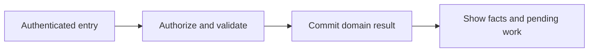
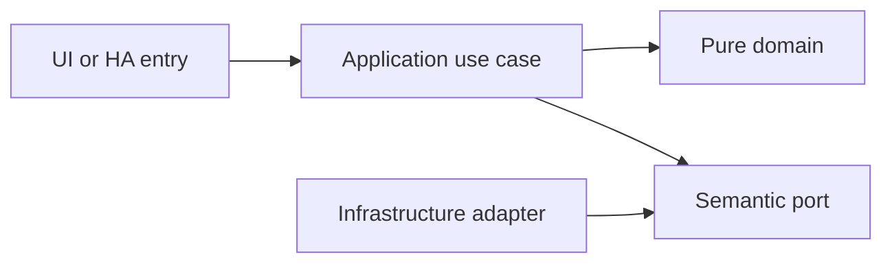

# Auditable points, participation and optional rewards

- Status: Draft
- Date: 2026-10-28
- Catalog capability ID: points-rewards
- Last verified: 2026-11-01 (document structure and A35 only; no implementation evidence)
- Owners: Domus maintainer; engineering/product reviewers to be assigned
- Scope: Task completion produces auditable point entries. Household-configurable collaboration policies determine each share and the actual award total; corrections preserve history and optional rewards never control basic participation.
- Related issues/PRs: https://github.com/vypdev/domus/issues/2
- Required review gates: product UX, architecture, testing, documentation, security/operations
- Open decisions blocking readiness: Deterministic remainder tie-break/override review; child-facing review. The owner confirmed configurable allocation, role-default verification, actual-work reporting, factual negative balances and a funding hold on approved/unfulfilled redemptions without sufficient backing after reversal. Catalog gate prerequisites remain unverified.

## 1. Executive summary

Task completion produces auditable point entries. Household-configurable collaboration policies determine each share and the actual award total; corrections preserve history and optional rewards never control basic participation.

```text
Authenticated member -> validated domain command -> durable result -> household and HA projections
```

This is a prospective Draft, not an implemented or accepted capability. The first usable release covers all domains and both deployment targets.

## 2. Problem, current behavior, and evidence

A mutable points integer cannot explain duplicate awards, reopened tasks, policy changes or who earned credit.

At the original documentation baseline on 2026-10-28, these domain workflows had no implementation. The merged M1 identity/storage foundation now has separate backend evidence. The task approval and material-authority additions in this review remain prospective; this documentation change adds no runtime behavior.

Evidence: the owner's attached brief and subsequent decisions in [product vision](../docs/product-vision.md), the pinned [reference investigation](../docs/reference-investigation.md), and the existing repository baseline. Retrospective classification is not applicable: no as-built product baseline is reconstructed.

## 3. Actors, surfaces, and terminology

Actors: Performer; verifier; administrator; participation viewer.

Primary surfaces: application UI, HTTP domain boundary, relevant HA entities/services, activity and diagnostics. Definitions of member, principal, occurrence, demand and ledger are shared in the [glossary](../docs/glossary.md). The actor recording an action is distinct from its selected target and actual performer.

## 4. Goals, non-goals, and fixed invariants

Goals and fixed invariants are the following normative requirements. No configuration may weaken authorization, ledger integrity, attribution or idempotency.

| Requirement | Behavior |
|---|---|
| points-rewards-R1 | Point awards MUST be append-only, attributable and unique for each accepted completion cycle; all performer shares MUST commit atomically and a policy/version change MUST NOT admit a second award set. |
| points-rewards-R2 | Reopening and correction MUST append compensating entries for the amounts actually awarded and preserve the original award, precision and allocation-policy snapshot. |
| points-rewards-R3 | Collaborative awards MUST apply an administrator-configurable household allocation policy, support conserved splits, rounded equal shares, two-decimal shares and full points per participant, and expose the base value, participants, policy, individual shares and actual awarded total. |
| points-rewards-R4 | Verification and permissions MUST apply adult/no-verification and restricted/adult-approval defaults, prevent premature or unauthorized awards and deny unauthorized task-value or allocation-policy manipulation. The snapshotted household/task participation rule MUST allow approval by an authorized adult performer by default; current authority and any configured independent-adult requirement still gate one award. |
| points-rewards-R5 | Weekly, monthly and historical earned-point/participation summaries MUST attribute work to actual completed_at under household calendar boundaries, expose effort and participation, and distinguish pending points from posted spendable balance; later approval MUST NOT move the work to another period. |
| points-rewards-R6 | Optional rewards MUST support explicit approval, cancellation and duplicate-safe redemption; reversal MUST preserve factual negative balances and fulfilled rewards, block unaffordable new redemptions and hold approved/unfulfilled rewards without sufficient backing until credit recovers or an explicit authorized resolution occurs. |

Non-goals: changing Copilot, changing the existing gateway, building an MCP server, adding mandatory cloud/AI dependencies, or claiming production readiness from a document.

## 5. Current versus proposed product journey

| Stage | Current | Proposed | User/operator effect |
|---|---|---|---|
| Enter | No Domus UI | Verified HA principal opens the relevant surface | Role and scope are explicit |
| Act | No domain command | Validate input, permission and current revision | Invalid data leaves the draft intact |
| Commit | No durable domain record | Store change and operation receipt atomically | Retry cannot duplicate effects |
| Observe | No projection | Show committed facts and pending downstream projections | Partial success remains understandable |



Text equivalent: authenticated entry -> authorization and validation -> durable domain commit -> visible facts with any pending projection. Domain-specific alternatives are described below.

## 6. Functional behavior and state model

### 6.1 Domain model and normal path

PointsLedgerEntry has immutable ID, member, signed integer minor-point amount, completion-cycle source, source-event identity, allocation-policy version, precision, reason, issuer and timestamp. One point is 100 minor units so two-decimal awards use exact integer arithmetic rather than binary floating point. One allocation record is unique per household and completion cycle; each performer has at most one share in that allocation. Policy/version is immutable evidence, not part of a uniqueness key that could permit a second award for the same cycle. Reversal entries reference original entries; balances are projections.

The owner's expanded decision on 2026-10-29 supersedes universal conservation of the task's base point value: families configure allocation in the application. A household policy supplies the default; only an administrator-authorized task override may change it. The completion and award snapshot the base value, policy/version, precision, performers, shares and actual total. A later policy edit affects future completions, not recorded or retrying awards. A member cannot choose a more rewarding policy in an ordinary completion request. Equal division of one conserved total remains the initial default; other supported modes intentionally may award less or more than that base.

| Mode | Ten base points, three performers | Actual total | Meaning |
|---|---|---:|---|
| conserve_total, precision 0 | 3, 3, 4 | 10 | Preserve one total; explicit deterministic remainder distribution |
| equal_share, precision 0, floor | 3, 3, 3 | 9 | Same rounded-down share for all |
| equal_share, precision 0, ceil | 4, 4, 4 | 12 | Same rounded-up share for all |
| equal_share, precision 2, floor | 3.33, 3.33, 3.33 | 9.99 | Two-decimal equal shares; no hidden extra 0.01 award |
| conserve_total, precision 2 | 3.33, 3.33, 3.34 | 10 | Two-decimal split preserving the total |
| full_per_participant | 10, 10, 10 | 30 | Every performer earns the full task value |
| manual | Explicit authorized amounts, for example 3, 3, 4 | Sum of entered amounts | Validate every share and show the resulting total before approval |

Only conserve_total enforces equality between base and awarded total. Other modes record the difference as policy semantics, not duplicate awards or an unexplained adjustment. The owner confirmed on 2026-11-01 that conserved-split remainders rotate among participants of the same task by default. The scope is the stable task definition across occurrences and genuine completion cycles, rather than a household-wide rotation across unrelated tasks. Durable allocation order must make that rotation deterministic and replay-safe; an identical award retry cannot advance it twice. Exact tie-breaks, changing participant sets and transactional reversal/recovery behavior remain engineering review items, not additional owner-approved details. Task value and policy changes affect future completions only. Optional rewards define cost, eligibility, redemption and approval; no punitive streak resets.

Validate precision against the actual policy rather than silently rounding stored facts. For conserve_total at precision 0, a base of 10.50 cannot be represented as integer shares summing exactly to that base: reject the combination and offer precision 2. Full-performer and manual shares must also be representable at the selected precision. equal_share may intentionally change the total through its explicit rounding policy. Individual award shares are nonnegative; negative ledger entries arise from separately authorized reversal/correction or spending, never a disguised negative performer allocation.

The owner confirmed on 2026-10-31 that an authorized adult may approve a completion in which that adult participated by default. The household setting supplies the default and an explicit administrator-authorized task override takes precedence. A configured requirement for an independent adult denies approval by every actual performer; a completion's submitter is not used as a substitute for its performer set. Restricted performers never become adult verifiers through this option. Only currently authorized adults may approve, including after a lost response or policy change. Snapshot the effective participation rule and policy revisions with the completion, alongside its existing role-default verification policy. Later configuration edits govern future completions; they cannot silently waive an earlier pending decision. Current membership, adult status and approval permission are still checked when approval commits. A new completion cycle receives its own snapshot; delayed approval of a closed cycle remains inert. This policy does not add verification to adult-only work unless another explicit rule requires it.

Physical material usage and its task-scoped permission remain independent of point approval: a posted movement does not authorize points, and an unposted intent does not erase performed work. Only a required valid approval makes the completion eligible for its single allocation; rejection/reopening cannot fabricate returned stock. The [Tasks acceptance inventory](household-tasks.md) owns the distinct new participation/material scenarios without counting them again here.

### 6.2 States and alternatives

Completion -> awaiting verification or eligible -> awarded. Award -> reversed through compensation; corrections are new entries. Redemption requested -> approved -> fulfilled or cancelled; approved -> funding_hold -> approved or explicitly cancelled when backing credit is lost. Hold preserves the original approval and is not fulfillment. Points are reserved transactionally and released on cancellation, with no double spend.

One transaction commits the complete performer allocation, exact total, durable remainder-order advancement and inbox receipt. A crash cannot expose only some performers' awards. A reopened or rejected completion cycle is durably closed to later awards; if that closing event arrives before its completion/approval event, the late event cannot issue points. Already-posted awards are reversed once; an unawarded cycle produces no fabricated negative reversal. A genuine new completion of a reopened occurrence has its own cycle ID and may earn one new allocation under its own snapshot.

The owner confirmed that reopening reverses the full actual award even if some points have already been spent. The resulting ledger balance may be negative; never clamp it to zero, reduce the reversal or erase the redemption to hide the deficit. Fulfilled rewards stay fulfilled. New redemption requests/reservations are blocked while the spendable balance is negative and always require sufficient unreserved points for their cost. Later earned points offset the deficit through ordinary ledger arithmetic. The UI explains the cause and linked entries without a punishment or demand to return an already-delivered reward. Reversal and redemption admission serialize against the same member balance so a racing request cannot spend credit already reversed.

The owner also confirmed a funding hold when reversal removes the backing for an approved reward not yet delivered. Retain its approval, cost snapshot and reservation, expose the shortfall and block delivery while credit is insufficient. Do not silently cancel, release its reservation or mark it fulfilled. Admission reserves the cost; fulfillment atomically posts one spend debit and releases that same reservation, so the cost is not subtracted twice. Fulfillment requires posted balance minus other active reservations to cover its own cost. Check affordability and record fulfillment atomically, serializing with reversal and reservation/funding-state updates. Recovering credit can restore funded approval, but physical delivery still requires its normal authorized fulfillment command. Explicit reviewed cancellation/correction retains actor and reason; cancellation releases its reservation once. Review cannot bypass affordability or fabricate credit. Existing fulfilled rewards are outside this hold and remain delivered.

The owner confirmed that work performed on Sunday and approved on Monday belongs to Sunday's household week. Retain actual completed_at as the work-period timestamp, verified_at as the approval fact and ledger posted_at as the time credit becomes available. Pending verification may appear as pending participation/points, never as spendable credit. After approval, the historical earned-points summary updates in the work period while the balance gains credit at posting. Linked reversals correct that original work period and retain their real later posting/audit timestamp. Weekly earned points, lifetime ledger balance and spendable balance after reservations are distinct views; a reward debit is spending rather than a new negative task-performance record. Month/week boundaries and all projections use the same household-zone policy, not the viewing browser's zone.

A duplicate uses its original operation receipt. A changed payload under the same key is a conflict. Out-of-order events use aggregate revision and source identity. Cancellation never erases an already committed ledger effect; compensation is explicit.

## 7. User-facing configuration

| Input | Type | Recommended default | Allowed values/range | Scope/persistence |
|---|---|---|---|---|
| `points_enabled` | boolean | true | false hides summaries but preserves existing ledger | household; persisted |
| `default_task_points` | decimal points | 0 | 0..10000, at most 2 decimals; administrator-controlled | definition; completion snapshot, stored as minor units |
| `collaborative_allocation_mode` | enum | conserve_total | conserve_total, equal_share, full_per_participant or manual; administrator-controlled | household default; authorized task override; completion/award snapshot |
| `allocation_precision` | integer | 0 | 0 or 2 decimal places; exact minor-unit arithmetic | same allocation-policy snapshot |
| `allocation_rounding` | enum | floor | floor, ceil or half_up for equal_share; reject irrelevant/contradictory combinations | same allocation-policy snapshot |
| `allocation_remainder_strategy` | enum | rotating | owner-confirmed rotation among participants of the same task for conserve_total; deterministic and replay-safe | durable order plus allocation-policy snapshot |
| `rewards_enabled` | boolean | false | true or false; optional, not a launch dependency | household; persisted |

Owner-confirmed defaults are recorded as accepted choices; other defaults and bounds remain proposals pending review. Invalid values and contradictory combinations are rejected before saving; unknown future values require an explicit compatibility error. Precedence is fixed invariants, installation constraints, household policy, then member preferences; lower scopes cannot expand permissions. In-flight commands snapshot relevant policy versions, while revocation is checked at the transaction boundary.

Recommended example: conserve_total splits one task value using exact minor units. Meaningful alternative: an authorized household policy selects full_per_participant and the preview discloses the resulting larger actual total before completion. Transport secrets are installation concerns and are never domain form fields.

## 8. Clean Architecture design

### 8.1 Responsibilities and dependency direction

AwardCompletionPoints and ReverseCompletionPoints consume durable task events through an inbox receipt and ledger transaction, serializing lifecycle closure and allocation for the same completion cycle. AllocationPolicy is pure. QueryParticipation aggregates ledger, durations and counts without overwriting facts. The ledger adapter is append-only to application roles. Reward redemption uses the same concurrency and receipt controls.

| Boundary | Owns | Forbidden dependency |
|---|---|---|
| Domain | Entities, value objects and pure rules | HA, HTTP, SQL, UI frameworks |
| Application | Authorized commands, queries and semantic ports | Concrete adapters and framework DTOs |
| Adapters | Schema mapping, persistence and provider error mapping | Alternate business rules |
| Composition | Explicit deployment wiring | Business decisions |
| Presentation | View models and rendering | Database access or client-only authorization |



Text equivalent: entrypoints call use cases; use cases depend on pure domain and ports; infrastructure implements ports. Architecture checks reject forbidden imports and cycles. Shared contract tests exercise each port adapter; schemas and migration checks enforce durable boundaries.

## 9. UI/UX and content contract

### 9.1 Primary state examples

| State | Visible content |
|---|---|
| Pending | Updating participation totals. Your completed task is saved. |
| Action required | This task needs verification before points can be awarded. View task. |
| Blocked | You cannot change this award. Ask a household administrator; existing points are unchanged. |
| Partial | Completion is saved. Its point award is waiting for processing. View activity. |
| Complete | 12 points awarded to Alex. View the ledger entry. |

The primary view names current status, retained facts and one next action, followed by descriptive links to the record/operation. Technical codes and correlation IDs are progressively disclosed. Duplicate responses update the same operation status rather than adding notifications. At most one routine notification per transition, with opt-out and bounded retry summaries.

English and Spanish use stable translation keys, base-language matching and English fallback. Mobile, tablet and desktop layouts, keyboard operation, visible focus, non-color status, accessible names, light/dark contrast and reduced motion are acceptance concerns. Untrusted text is rendered inert; no arbitrary HTML, commands or secret-bearing links.

## 10. Failure, recovery, and cleanup

| Failure | Retained facts | Retry / action | Cleanup |
|---|---|---|---|
| Invalid or denied input | Existing business records and form draft | Correct fields or request the proper role | No side effects |
| Stale revision | Current committed aggregate; user's entered fields | Review current state and submit a new deliberate operation | No automatic overwrite |
| Lost response after commit | Domain result and receipt | Look up or replay the same key | Never issue a fresh-key duplicate |
| Downstream projection unavailable | Successful domain result and durable pending event | Bounded backoff, then visible retry | Acknowledge outbox only after safe consumption |
| Restart or cancellation | Committed records; identified pending work | Recover receipts/cursors; compensate only by explicit command | Remove listeners and owned temporary artifacts |

Errors explain impact, safe cause, action and retained state. External availability is distinct from authorization denial. Retries are bounded and use deterministic backoff tests, not real waits.

## 11. Security, permissions, and privacy

Backend authorization applies to reads and writes. All requests and HA values are untrusted input; only authenticated principals and validated adapter context establish identity. Cross-household IDs, replayed operations and stale roles are covered in the inventory. A person entity and selected member ID do not authenticate a caller. Logs, traces, exports and browser artifacts redact credentials and unnecessary personal data. The technical HA principal has explicit narrow grants and cannot impersonate a household administrator.

## 12. Observability and operational UX

Show operation state and projection freshness to members; expose sanitized correlation, source event, aggregate revision, duration and safe error code to operators. No raw credentials or unrestricted HA payloads enter diagnostics. Counters distinguish denied, invalid, conflict, unavailable and completed operations. One durable activity entry per business transition; retries do not multiply notifications. No telemetry leaves the installation by default.

## 13. Compatibility, migration, rollout, and rollback

The existing M1 database is versioned and its identity, household, history and operation records must be preserved. Implementing these prospective task policies requires reviewed compatible migrations; this documentation-only change introduces no new stored domain records. Upgrade fixtures cover pending operations and ledger compatibility; a backup precedes destructive migration. Unknown future schemas block writes. Downgrade requires a compatible image/database pair, never silent interpretation of newer data.

Both Supervisor and standalone are first-release acceptance targets. Stable and Edge use separate credentials, IDs, volumes and endpoint bindings. Experimental artifacts cannot automatically promote production. Publication, merge and deployment remain in the existing authorized maintainer lifecycle.

## 14. Testing strategy and numeric budget

Minimum: 44 distinct cases, derived from the explicit risk inventory below. Each inventory row counts once. The budget is a floor, not a claim of completeness or executed tests.

| Area | Minimum distinct cases | Behaviors/risks covered |
|---|---:|---|
| State and concurrency | 10 | the same completion event delivered twice; a reopened task; two redemptions competing for the same available points |
| Adapters and persistence | 4 | a displayed balance; corrected historical entries |
| Security and privacy | 4 | a member attempting to overwrite an existing ledger amount; pending completion verification; an adult without point-administration permission |
| Domain and configuration | 13 | a later task-value edit; 10 points and three performers; duplicate or inactive performer IDs |
| Integration and recovery | 8 | repeated correction commands; authorized approval after a retry; a cancelled pending redemption |
| UI and accessibility | 5 | collaborative completion; equal point totals with different durations; rewards disabled |
| Total | 44 | Distinct inventory cases; repeated executions do not add cases. |

| Case ID | Area | Requirements | Scenario |
|---|---|---|---|
| points-rewards-C01 | State and concurrency | points-rewards-R1 | Given the same completion event delivered twice, only one award set exists. |
| points-rewards-C02 | Adapters and persistence | points-rewards-R1 | Given a displayed balance, drilling into it lists every source award and correction. |
| points-rewards-C03 | Security and privacy | points-rewards-R1 | Given a member attempting to overwrite an existing ledger amount, the operation is denied. |
| points-rewards-C04 | State and concurrency | points-rewards-R2 | Given a reopened task, one reversal offsets its award while retaining both entries. |
| points-rewards-C05 | Domain and configuration | points-rewards-R2 | Given a later task-value edit, the old award keeps the accepted value. |
| points-rewards-C06 | Integration and recovery | points-rewards-R2 | Given repeated correction commands, one compensating entry is applied. |
| points-rewards-C07 | Domain and configuration | points-rewards-R3 | Given conserve_total with precision 0, 10 base points and three performers, shares are 3, 3 and 4, total 10, with the extra recipient determined by the snapshotted remainder strategy. |
| points-rewards-C08 | Domain and configuration | points-rewards-R3 | Given duplicate or inactive performer IDs, allocation is rejected before an award. |
| points-rewards-C09 | UI and accessibility | points-rewards-R3 | Given collaborative completion, members see the base points, allocation mode, each share and actual awarded total before submission. |
| points-rewards-C10 | Security and privacy | points-rewards-R4 | Given pending completion verification, the ledger contains no award. |
| points-rewards-C11 | Security and privacy | points-rewards-R4 | Given an adult without point-administration permission, changing an award policy is denied. |
| points-rewards-C12 | Integration and recovery | points-rewards-R4 | Given authorized approval after a retry, the completion produces one award set. |
| points-rewards-C13 | Domain and configuration | points-rewards-R5 | Given work completed Sunday and approved Monday in the household zone, approved points and participation belong to Sunday's week and become spendable only after Monday's approval/posting. |
| points-rewards-C14 | UI and accessibility | points-rewards-R5 | Given equal point totals with different durations, the report shows both effort and task counts. |
| points-rewards-C15 | Adapters and persistence | points-rewards-R5 | Given corrected historical entries, summary totals reconcile exactly with ledger sums. |
| points-rewards-C16 | State and concurrency | points-rewards-R6 | Given two redemptions competing for the same available points, only the affordable transaction succeeds. |
| points-rewards-C17 | Integration and recovery | points-rewards-R6 | Given a cancelled pending redemption, its reservation is released once. |
| points-rewards-C18 | UI and accessibility | points-rewards-R6 | Given rewards disabled, members can complete tasks normally and no streak penalty is shown. |
| points-rewards-C19 | Domain and configuration | points-rewards-R3 | Given equal_share with precision 0 and floor, 10 base points across three performers awards 3 each and records actual total 9. |
| points-rewards-C20 | Domain and configuration | points-rewards-R3 | Given equal_share with precision 0 and ceil, 10 base points across three performers awards 4 each and records actual total 12. |
| points-rewards-C21 | Domain and configuration | points-rewards-R3 | Given equal_share with precision 2 and floor, 10 base points across three performers awards exactly 3.33 each and records total 9.99 without floating-point drift. |
| points-rewards-C22 | Domain and configuration | points-rewards-R3 | Given full_per_participant, three performers of a 10-point task each receive 10 and the recorded awarded total is 30. |
| points-rewards-C23 | Domain and configuration | points-rewards-R3 | Given authorized manual shares 3, 3 and 4, validation records those exact amounts and total 10; invalid or duplicate performer allocations are rejected. |
| points-rewards-C24 | State and concurrency | points-rewards-R2, points-rewards-R3 | Given a policy change after completion was recorded, a delayed award or retry uses the original snapshotted policy and does not recalculate historical shares. |
| points-rewards-C25 | Security and privacy | points-rewards-R4 | Given a restricted performer supplying full_per_participant in an ordinary completion request, authorization rejects the policy override without increasing their award. |
| points-rewards-C26 | Integration and recovery | points-rewards-R2 | Given a full_per_participant award of 30 actual points from a base of 10, reopening reverses all 30 actual points exactly once. |
| points-rewards-C27 | UI and accessibility | points-rewards-R3 | Given ceil allocation producing 12 actual points from 10 base points, the application explains the selected policy and difference before the award and in its ledger history. |
| points-rewards-C28 | State and concurrency | points-rewards-R1, points-rewards-R3 | Given an already-awarded completion cycle redelivered with a different event or policy version, no second allocation is admitted and the original snapshot remains authoritative. |
| points-rewards-C29 | Adapters and persistence | points-rewards-R1, points-rewards-R3 | Given failure while writing the second of three performer shares, allocation, balance effects, remainder order and inbox receipt all roll back; recovery commits one complete allocation. |
| points-rewards-C30 | Integration and recovery | points-rewards-R1, points-rewards-R2, points-rewards-R4 | Given cycle reopening delivered before its delayed completion or approval, the closed-cycle record prevents an award and no negative reversal is fabricated for an unawarded cycle. |
| points-rewards-C31 | State and concurrency | points-rewards-R1, points-rewards-R2 | Given an awarded cycle reopened and the occurrence genuinely completed again, the old award has one linked reversal and the new cycle has at most one independent allocation; late old messages change neither. |
| points-rewards-C32 | Integration and recovery | points-rewards-R2, points-rewards-R6 | Given 10 awarded points, an 8-point fulfilled reward and reopening, one full 10-point reversal leaves balance -8, retains the fulfilled reward and blocks new redemption. |
| points-rewards-C33 | UI and accessibility | points-rewards-R5, points-rewards-R6 | Given a negative balance caused by reopening, history explains the award, redemption and reversal with the exact deficit and recovery path, without requesting return of the delivered reward. |
| points-rewards-C34 | State and concurrency | points-rewards-R2, points-rewards-R6 | Given a reversal racing a new redemption request, serialization enforces affordability against committed balance and never admits a request based on already-reversed points. |
| points-rewards-C35 | Domain and configuration | points-rewards-R6 | Given balance -8 followed by ordinary earnings of 5 then 4, balances become -3 then 1; new redemptions remain blocked during the deficit and only an affordable cost can be requested afterward. |
| points-rewards-C36 | State and concurrency | points-rewards-R4, points-rewards-R5 | Given approval delayed past month-end, pending points are not spendable before approval and the eventual single posting updates the original work-month summary without moving the task or duplicating credit. |
| points-rewards-C37 | Integration and recovery | points-rewards-R2, points-rewards-R5 | Given reversal several weeks after an award, the original work-period earned total is corrected once while activity and ledger preserve the reversal's real posting timestamp and current balance effect. |
| points-rewards-C38 | Adapters and persistence | points-rewards-R5, points-rewards-R6 | Given prior-period earnings and a reward debit this week, the weekly work total, lifetime balance and available balance after reservations remain distinct and reconcile to their appropriate source entries. |
| points-rewards-C39 | Domain and configuration | points-rewards-R3 | Given conserve_total, precision 0 and base 10.50, validation rejects the incompatible combination with a precision-2 option instead of silently rounding the base or violating conservation. |
| points-rewards-C40 | Domain and configuration | points-rewards-R3, points-rewards-R4 | Given manual allocation with a negative share or a share not representable at its selected precision, validation rejects it before any award or remainder-state change. |
| points-rewards-C41 | Integration and recovery | points-rewards-R2, points-rewards-R6 | Given an approved unfulfilled reward whose backing points are reversed, the full reversal commits and the reward enters funding_hold with its approval and reservation retained; delivery is blocked and no spend debit is fabricated. |
| points-rewards-C42 | State and concurrency | points-rewards-R2, points-rewards-R6 | Given reversal racing fulfillment, serialization either records a genuinely funded fulfillment before reversal or blocks the unfunded delivery; it never fulfills using already-reversed credit. |
| points-rewards-C43 | Domain and configuration | points-rewards-R6 | Given a held reward and later earnings sufficient to cover its cost and other reservations, funded approval may resume but no automatic delivery occurs; authorized fulfillment posts one debit and releases its own reservation once. |
| points-rewards-C44 | State and concurrency | points-rewards-R1, points-rewards-R6 | Given explicit cancellation of a held redemption followed by replay or restart, one retained cancellation releases its reservation once without deleting approval, reversing delivered rewards or generating credit. |

Every implemented first-party module starts with meaningful behavior tests. Target and proposed merge gate: 100% lines/statements/functions/branches where the selected tools expose those metrics, enforced separately across backend, frontend and integration code. Third-party/generated artifacts are distinguished from authored source; broad exclusions cannot hide untested logic. No application coverage currently exists.

Inject deterministic clocks, IDs, provider fakes and transaction failures. Use semantic assertions alongside golden content, real adapter contracts and disposable HA integration environments. Add Google Chrome evidence from the owner's authorized local HA for real UX; it does not replace automated tests or unit coverage. CI Check runs the complete applicable suite for every PR update.

## 15. Documentation and discoverability

The following documentation operations are relative to develop at e8fa5bbc9ffa179aa7559831f5f3d067c9c9c65c. This policy refinement adds no runtime or test implementation evidence.

| Path | Change |
|---|---|
| specs/points-rewards.md | update |
| specs/README.md | reference |
| specs/_template.md | reference |
| specs/catalog.json | update |
| specs/CATALOG.md | update |
| docs/architecture.md | reference |
| docs/product-vision.md | reference |
| docs/glossary.md | reference |
| docs/decisions.md | update |
| docs/reference-investigation.md | reference |
| docs/copilot-adoption.md | reference |
| docs/operations.md | reference |
| docs/user-guide.md | update |
| docs/contracts/home-assistant.md | reference |
| docs/acceptance-plan.md | update |
| docs/roadmap.md | reference |
| README.md | update |
| specs/household-tasks.md | update |
| specs/household-identity.md | update |
| specs/household-inventory.md | update |
| docs/sdd-validation.md | update |
| docs/evidence/task-policy-sdd-review.json | create |

| Audience | Artifact | Required content |
|---|---|---|
| Member | [User guide](../docs/user-guide.md) | Normal path, defaults and state meaning |
| Administrator/operator | [Operations](../docs/operations.md) | Setup, permissions, recovery, backup and rollback |
| Contributor | [Architecture](../docs/architecture.md) | Boundaries and executable constraints |
| HA consumer | [Entity/service contract](../docs/contracts/home-assistant.md) | Stable schemas, semantics and error handling |
| Reviewer | [Acceptance plan](../docs/acceptance-plan.md) | Tests, coverage and human evidence |

Link/path validation accompanies updates. Implementation changes update the owning SDD, catalog evidence, actual tests and user documentation together.

## 16. Acceptance scenarios

The Given/When/Then-equivalent observable scenarios in section 14 are the executable acceptance inventory. For each case, the given precondition and action must produce the specified result with state and side-effect assertions; tests are not implementation snapshots.

Acceptance includes normal, alternative, invalid, duplicate, concurrent, partial, failure, recovery, security, localization and accessibility paths as allocated above. Human review verifies the primary-state examples on desktop/mobile and light/dark themes. Live acceptance remains pending until an implemented artifact is exercised; no result is inferred from the budget.

## 17. Requirements traceability

| Requirement | Cases |
|---|---|
| points-rewards-R1 | points-rewards-C01, points-rewards-C02, points-rewards-C03, points-rewards-C28, points-rewards-C29, points-rewards-C30, points-rewards-C31, points-rewards-C44 |
| points-rewards-R2 | points-rewards-C04, points-rewards-C05, points-rewards-C06, points-rewards-C24, points-rewards-C26, points-rewards-C30, points-rewards-C31, points-rewards-C32, points-rewards-C34, points-rewards-C37, points-rewards-C41, points-rewards-C42 |
| points-rewards-R3 | points-rewards-C07, points-rewards-C08, points-rewards-C09, points-rewards-C19, points-rewards-C20, points-rewards-C21, points-rewards-C22, points-rewards-C23, points-rewards-C24, points-rewards-C27, points-rewards-C28, points-rewards-C29, points-rewards-C39, points-rewards-C40 |
| points-rewards-R4 | points-rewards-C10, points-rewards-C11, points-rewards-C12, points-rewards-C25, points-rewards-C30, points-rewards-C36, points-rewards-C40 |
| points-rewards-R5 | points-rewards-C13, points-rewards-C14, points-rewards-C15, points-rewards-C33, points-rewards-C36, points-rewards-C37, points-rewards-C38 |
| points-rewards-R6 | points-rewards-C16, points-rewards-C17, points-rewards-C18, points-rewards-C32, points-rewards-C33, points-rewards-C34, points-rewards-C35, points-rewards-C38, points-rewards-C41, points-rewards-C42, points-rewards-C43, points-rewards-C44 |

All requirement cases are reciprocal with section 14. Domain invariants are owned by pure policy, command/state rules by application use cases, provider behavior by adapters, and visible content by presentation; the boundary table in section 8 assigns these responsibilities. Evidence and user/operator documentation are linked in section 15.

## 18. Implementation sequence

1. Resolve the blocking decisions and review this contract before Ready for implementation.
2. Establish test harness, CI Check and architecture checks with the first source files.
3. Implement pure policies and their complete branch tests, then transactional use cases.
4. Add adapters, schema/error contracts, retry/race fixtures and both deployment wiring paths.
5. Build the accessible localized UI and HA projections with tests alongside each flow.
6. Verify migration, recovery, security, channel isolation and documentation.
7. Run the complete suite, review coverage, perform local Chrome dogfooding with recorded cleanup, and collect human evidence.

These are internal implementation steps within the first integrated release; they do not remove other domains or deployment targets from launch.

## 19. Definition of Done

- [ ] Every normative requirement has observable acceptance and reciprocal case links.
- [ ] Every declared case is implemented meaningfully; the numeric budget is met.
- [ ] Clean Architecture constraints and port contracts pass.
- [ ] All supported first-party coverage metrics reach 100% from the first implementation.
- [ ] CI Check passes for the current PR revision with no omitted required jobs.
- [ ] Configuration, state, permission, idempotency and recovery behaviors agree.
- [ ] Primary UI states, localization, responsive behavior and accessibility pass.
- [ ] Both deployment targets and isolated Stable/Edge channels pass acceptance.
- [ ] User/operator documentation, schema/migration evidence and catalog paths are current.
- [ ] Local Google Chrome evidence identifies the artifact, channel, test records and cleanup.
- [ ] The original Copilot validations pass when their real prerequisites exist; no check is weakened.
- [ ] No material decision blocking readiness remains unresolved; Copilot remains unchanged.

## 20. References and decisions

Primary sources: [Copilot standard](https://github.com/vypdev/copilot/blob/f5e5a4cf9a80248994469cd88ad55eecab5b95ca/specs/README.md), [original template](https://github.com/vypdev/copilot/blob/f5e5a4cf9a80248994469cd88ad55eecab5b95ca/specs/_template.md), and the linked [reference investigation](../docs/reference-investigation.md).

Confirmed owner choices and unresolved proposals are separated in [decisions](../docs/decisions.md). [Issue #2](https://github.com/vypdev/domus/issues/2) tracks the documentation foundation. The [adoption note](../docs/copilot-adoption.md) records the current catalog evidence limitation. Optional future depth remains explicitly deferred in the product vision; the gateway's installation and MCP internals are outside Domus scope.

## Proposed change: Implement the durable Points consumer for recurrence lifecycle acceptance

- Status: Draft
- Catalog capability: points-rewards

### 1. Executive summary

This delta defines the durable Points consumer needed to turn the existing task lifecycle feed into auditable recurrence awards. Eligible completion cycles produce one authoritative allocation in exact integer minor units; every processed event has a durable inbox receipt; and a reopening reverses only its original posted award, once. Pending, missed, or closed cycles earn no points, including after replay or restoration. A bounded internal ledger query makes real allocations and reversals observable for integration verification.

```text
Lifecycle event -> eligibility and closure checks -> atomic ledger entries and inbox receipt -> bounded ledger read
```

This remains a prospective Draft. It extends the existing owner at `specs/points-rewards.md` and leaves its allocation, verification, attribution, and optional-reward contract in force.

### 2. Problem, current behavior, and evidence

#### 2.1 Problem

Recurrence acceptance needs evidence that points follow the actual task lifecycle. Successor creation or an empty/mocked consumer cannot establish that pending or missed work receives no award, that eligible approval produces a real award, or that reopening compensates the original award without touching unrelated downstream work.

#### 2.2 Current behavior

The task lifecycle source exports completion, verification, and reopening facts with cycle snapshots, eligibility and award-closure signals. Its read is internal, paginated, and read-only; it does not itself issue points or settle materials. The selected implementation and tests in `backend/src/domus/application/task_events.py` and `tests/backend/test_task_events.py` establish this producer boundary and exercise pending versus eligible completion, closure, stable event/cycle identity, and bounded page validation. `backend/src/domus/infrastructure/sqlite.py` declares schema version 15.

This source view does not establish a durable Points ledger consumer or consumer acceptance. This delta specifies that missing consumer; it does not treat recurrence producer behavior as proof of award delivery.

#### 2.3 Evidence

- Existing Points policy and lifecycle invariants: `specs/points-rewards.md`.
- Lifecycle feed and its observable behavior: `backend/src/domus/application/task_events.py`; `tests/backend/test_task_events.py`.
- SQLite schema version declaration: `backend/src/domus/infrastructure/sqlite.py`.
- Issue context: https://github.com/vypdev/domus/issues/56; parent recurrence work: https://github.com/vypdev/domus/issues/23.
- The consumer’s real-schema migration, durable persistence, replay/recovery behavior, and integration acceptance are prospective requirements, not verified implementation evidence.

Retrospective classification is not applicable: this is a prospective consumer specification, not an as-built Points baseline.

### 3. Actors, surfaces, and terminology

| Actor | Goal | Entry point | Visible surfaces |
|---|---|---|---|
| Performer | Have only an eligible, accepted completion credited once | Existing task lifecycle producer | Task and Points history |
| Authorized adult verifier | Approve or reopen work under the retained task rules | Existing task lifecycle producer | Task state and resulting Points history |
| Integration/operator | Verify persisted awards, receipts, and reversals | Bounded internal ledger query | Real SQLite ledger evidence |

A lifecycle event is a producer-owned immutable task fact. A completion cycle is the identity to which one allocation and any linked compensation belong. An inbox receipt records that the consumer processed an event; it is not an award. An allocation is the authoritative set of exact minor-unit shares for one eligible cycle. A reversal is a linked compensating ledger entry for an already-posted source award. The task producer owns completion, verification, performer snapshots, and cycle closure; the Points owner owns ledger entries, consumer receipts, and balance projection. Internal integration queries do not add or change a human task HTTP contract.

### 4. Goals, non-goals, and fixed invariants

#### 4.1 Goals

1. Consume authenticated lifecycle events into one atomic, authoritative allocation per eligible completion cycle, using the retained cycle and performer snapshots and exact integer minor-unit arithmetic.
2. Persist a receipt for each processed event and make duplicate delivery, concurrent replay, restart, restoration, and transaction failure safe and idempotent.
3. Award nothing for pending verification, missed occurrences, or closed cycles, including when completion or approval arrives late after closure.
4. When a previously awarded cycle is reopened, append exactly one reversal linked to its original source award; preserve unrelated and later-cycle work.
5. Provide a bounded internal ledger query that lets integration acceptance inspect real persisted positive awards and reversals.

#### 4.2 Non-goals

This increment does not change existing task HTTP contracts, recurrence rules, approval authority, performer attribution, or the broader Points policy. It does not add a Family interface, configurable distribution, reward redemption, inventory effects, or combined inventory acceptance. Allocation uses the existing default conserved policy and exact minor-unit rules, including stable same-definition remainder rotation; it does not introduce new allocation modes.

#### 4.3 Fixed product and safety invariants

- The existing `specs/points-rewards.md` remains the owner of the Points contract and existing case identities. This delta supplements its recurrence lifecycle acceptance without replacing those cases or weakening its rules.
- Only producer-authenticated lifecycle facts and their immutable completion snapshots determine eligibility and attribution. The consumer must not infer approval, performance, or authority from a successor, a client claim, or a replay.
- Ledger entries, event receipts, allocation uniqueness, and any remainder-order advancement commit atomically. Failure cannot leave a partial performer allocation or a receipt that suppresses required work.
- Event identity and completion-cycle identity remain distinct: each event is receipted once, while a cycle can receive at most one allocation. Closure is durable so late or restored events cannot award a closed cycle; an unawarded cycle never receives a fabricated negative reversal.
- Reversal links to and offsets only the original posted award, exactly once. A genuine later completion cycle remains independently eligible under its own snapshot.
- Migration must begin from the real selected schema version 15 and preserve existing data. Both deployment compositions must wire the same consumer behavior; no human HTTP endpoint is added for internal ledger verification.

| Requirement | Behavior |
| --- | --- |
| SDD-I56-U1-R1 | The durable Points consumer processes authenticated task lifecycle events into one authoritative exact-minor-unit allocation per eligible completion cycle, persists an inbox receipt per processed event, prevents awards for pending or missed occurrences and closed cycles, reverses a previously posted award exactly once against its original source, and exposes a bounded internal ledger query for integration verification. |

### 5. Current versus proposed product journey

The existing Points contract already defines household allocation policy, verification eligibility, immutable cycle snapshots, and ledger ownership. This delta adds a durable consumer of the task lifecycle feed so recurrence outcomes produce real Points ledger facts. The feed is a trusted local-consumer read port with bounded pages of 1–100 events (`backend/src/domus/application/task_events.py`, `TaskEventSource.read`); the consumer maintains its own durable inbox and closure state.

| Stage | Current | Proposed | User/operator effect |
|---|---|---|---|
| Task lifecycle | Task completion, verification, and reopening are represented in the authenticated lifecycle feed. | The Points consumer reads bounded pages and applies each event against the snapshotted completion cycle. | The task remains authoritative for lifecycle facts; Points records its own processing receipt. |
| Pending completion | Existing task completion may await adult approval. | A pending restricted completion creates no award; approval makes the eligible cycle awardable once. | A pending completion cannot appear as earned points. |
| Missed occurrence | Recurrence maintenance can record a missed weekly occurrence. | No allocation is made for a missed occurrence, including on replay or restoration. | Operators can verify absence of an award without a test double. |
| Reopening | The task feed can report a reopened cycle. | The consumer closes the old cycle and appends one reversal linked to its original award, if any. | Unrelated later work remains intact. |
| Verification | The Points owner has no durable event consumer or ledger query for this lifecycle acceptance. | A bounded internal ledger query exposes persisted entries for integration verification. | Integration checks can observe both a positive award and its reversal in SQLite. |

Text equivalent: task lifecycle event -> durable receipt and cycle decision -> allocation, linked reversal, or no ledger entry -> bounded internal ledger observation. This is an internal integration and operator capability; it adds no member-facing configuration or new task HTTP contract.

### 6. Functional behavior and state model

#### 6.1 Consumer behavior

For each authenticated lifecycle event, the consumer MUST persist a receipt keyed to the event identity and apply its ledger effect atomically with that receipt. It MUST allow at most one authoritative allocation for an eligible completion cycle, using the existing Points owner’s snapshotted performer, value, and allocation rules. Exact integer minor-unit arithmetic remains the ledger representation. An eligible positive-control completion MUST produce a real SQLite ledger allocation observable through the bounded internal query.

A pending restricted completion MUST produce no allocation. Approval permits one allocation for the eligible cycle; repeated delivery or recovery cannot create another. A missed weekly occurrence MUST never earn points, including after replay or restoration. Reopening closes the prior cycle and, only when an award exists, appends exactly one reversal linked to that original source award. It MUST NOT reverse unrelated downstream work or create a negative reversal for a cycle that was never awarded. A genuine later completion belongs to its own cycle and may receive its own single allocation.

#### 6.2 State and recovery

| Consumer state | Meaning | Permitted effect |
|---|---|---|
| Unseen event | No durable receipt exists yet. | Evaluate the source event and cycle under transaction protection. |
| Processed, ineligible | Receipt committed; cycle is pending, missed, or otherwise not awardable. | No allocation; replay returns the recorded outcome. |
| Processed, awarded | Receipt and one cycle allocation committed. | Duplicate event or another event for that already-awarded cycle cannot add an allocation. |
| Processed, reversed | Reopening receipt and one linked reversal committed for the source award. | Replays cannot add reversals; later unrelated entries are untouched. |

Event receipt, cycle closure/award state, allocation or reversal, and any conserved-remainder order change MUST commit or roll back together. Concurrent replay, a failure during a multi-share write, restart, and restoration MUST leave either the prior committed state or one complete effect with its receipt. In particular, a reopening observed before a delayed completion or approval prevents a late award for that closed cycle. The receipt is durable evidence of processing, not authority to alter the task’s immutable completion rules.

### 7. User-facing configuration

This consumer adds no user-facing configuration. It MUST use the existing Points owner’s household and task allocation settings, verification rules, and immutable completion snapshots; it does not add a new policy input or permit the consumer to reinterpret a recorded value. Existing defaults, bounds, precedence, and migration decisions remain as specified in the retained Points contract. The internal ledger query is bounded and read-only for integration verification; the implementation note records its scope and bound.

### 8. Clean Architecture design

#### 8.1 Responsibilities and dependency direction

The task lifecycle feed remains the source of task facts. `TaskEventSource` exposes bounded read-only event pages; it explicitly leaves durable inbox and closure ownership to trusted local consumers (`backend/src/domus/application/task_events.py`, `TaskEventSource`). The event model carries stable event and cycle identities, the snapshotted `TaskCycle`, and eligibility/closure indicators (`backend/src/domus/domain/task_events.py`, `TaskLifecycleEvent`). The consumer MUST treat these as validated source facts, not as a mutable task command surface.

The Points domain owns pure award eligibility, cycle closure, exact allocation, and linked-reversal rules. Its application use cases coordinate event consumption, inbox receipt, cycle state, ledger writes, and the bounded internal query through semantic ports. Persistence adapters own SQLite schema mapping, transactions, durable receipts, and migration; composition wires the consumer in both supported deployment compositions. Entrypoints expose no new task HTTP contract. The internal query MUST remain bounded and read-only. Existing Points allocation policy and task verification authority remain with their current owners.

Dependency direction remains entrypoint/composition -> application -> domain and semantic ports, with persistence adapters implementing ports. Domain policy MUST NOT import HTTP, SQLite, or deployment frameworks; application policy MUST NOT depend on concrete adapters or provider DTOs. Transaction boundaries serialize consumption for the same cycle so inbox receipt, cycle closure, allocation/reversal, and remainder rotation cannot diverge.

#### 8.2 Observable architecture constraints

Adapter and integration evidence MUST exercise actual SQLite persistence, including migration from real schema 15, concurrent event replay, rollback, restart, restoration, and both deployment compositions. Positive allocation and reopening reversal controls MUST be observed in that ledger; structural inventory counts alone do not establish semantic coverage. The concrete repository verification invocation and any prerequisite remain unverified in this draft. Acceptance requires evidence that the consumer uses the existing feed and immutable snapshots, that transaction failure cannot strand a receipt or partial award, and that the internal ledger query is bounded.

### 9. UI/UX and content contract

#### 9. UI/UX and content contract

This consumer adds no member-facing controls or changes to existing task HTTP contracts. Existing points views continue to distinguish pending participation from spendable credit and show posted ledger activity under the retained `specs/points-rewards.md` contract. Internal integration verification uses a bounded ledger query and reports whether an eligible cycle has an allocation, whether a processed event has an inbox receipt, and whether a reversal links to its original award. It must not expose unrestricted ledger history or treat a pending completion as an award. The query's concrete response shape and operator presentation remain to be defined during implementation.

### 10. Failure, recovery, and cleanup

#### 10. Failure, recovery, and cleanup

Event handling, allocation or reversal, and the processed-event receipt must commit atomically. A failed transaction leaves no partial shares, ledger effect, remainder-order change, or receipt; retrying the same event can then complete the operation once. Concurrent and repeated delivery must converge on the same receipt and authoritative cycle result. A changed payload for an already processed event must be treated as a conflict rather than silently accepted. A closed cycle remains ineligible after delayed delivery, replay, restart, or restoration; a reversal is created only for an existing posted award and remains linked to that original source. Recovery must preserve the receipt and ledger relationship, not create a fresh award. The implementation must demonstrate these outcomes through the specified rollback, replay, restart, and restoration cases; concrete recovery commands and operator procedures remain unverified.

### 11. Security, permissions, and privacy

#### 11. Security, permissions, and privacy

The consumer must accept lifecycle events only through the existing authenticated task lifecycle feed and use its immutable completion rules and performer snapshots. Event payloads and identifiers are untrusted until authenticated and validated against the authoritative task lifecycle state. The consumer must not infer approval from a completion event that is still pending, award a missed occurrence, or permit a late event to bypass cycle closure. Preserve the task's snapshotted integer minor-unit value and exact arithmetic; do not trust a newly supplied value to rewrite an existing award. Ledger mutation belongs to the consumer's authorized application boundary, while the bounded verification query must remain internal and read-only. Define and verify the concrete principal, grants, and sensitive-field logging policy during implementation; their selected-source details are not established here.

### 12. Observability and operational UX

#### 12. Observability and operational UX

Integration evidence must be inspectable from the real SQLite ledger and bounded query: one eligible completion has one allocation, each processed event has its receipt, and a reopening reversal identifies the original award. Diagnostics should distinguish rejected or conflicting events, transaction failures, successful processing, and duplicate replay without logging credentials or unrestricted event payloads. Retry and recovery evidence must show the retained cycle, source identity, and receipt relationship. The specified integration cases must include both positive award and reversal controls so an inert consumer cannot pass by producing no entries. Metrics, correlation identifiers, retention periods, and operator-facing surfaces remain implementation decisions.

### 13. Compatibility, migration, rollout, and rollback

#### 13. Compatibility, migration, rollout, and rollback

The consumer must migrate from the real SQLite schema 15 while preserving the existing ledger and lifecycle facts. Migration, concurrent replay, transaction rollback, restart, restoration, and both deployment compositions must preserve exactly one allocation or the exact linked reversal together with its processed-event receipt. Keep existing task HTTP contracts and the owning points contract in `specs/points-rewards.md`; the consumer implementation note is `docs/tasks/points-consumer.md`. Verify migration against the selected schema and both deployment compositions before rollout. Backup, downgrade behavior, rollout controls, and a concrete rollback procedure remain to be specified and verified; do not assume that reverting application code alone safely reverses a durable schema change.

### 14. Testing strategy and numeric budget

#### 14. Testing strategy and numeric budget

Retain the immutable owner’s existing 44-case minimum and all existing case definitions. Add five distinct cases for the durable consumer, bringing the minimum to 49. These additions are prospective acceptance criteria, not evidence that implementation or tests exist.

The added integration and recovery cases cover these observable behaviors: a restricted performer’s pending completion creates exactly one recurrence successor and no Points allocation; after adult approval the eligible cycle has exactly one real allocation, returned by a bounded ledger query; a missed weekly occurrence earns no allocation, including after replay or restoration; reopening a cycle with a posted award creates exactly one linked reversal for that original source award without reversing unrelated downstream work; and positive allocation and reopening reversal are visible in the real SQLite ledger, proving the consumer posts and compensates entries rather than remaining inert.

The adapter and persistence case covers migration from real schema 15, concurrent event replay, transaction rollback, restart, restoration and both deployment compositions. Each must preserve one allocation or its exact reversal and a processed-event receipt. The eligible allocation uses exact integer minor units and the default conserved allocation with stable same-definition remainder rotation. Test through real task commands, recurrence maintenance and SQLite ledger reads; do not substitute a mocked consumer for the required integration evidence.

The required verification outcomes include current source checks, the schema migration and recovery behaviors above, and both deployment compositions. The concrete invocation and prerequisites for these checks remain unverified in this selected source view; no command is asserted or made a prerequisite here. A declared check is not execution, a passing result or acceptance.

| Area | Minimum distinct cases | Behaviors/risks covered |
|---|---:|---|
| Integration and recovery | 3 | Observable scenarios in the case inventory. |
| State and concurrency | 1 | Observable scenarios in the case inventory. |
| Adapters and persistence | 1 | Observable scenarios in the case inventory. |
| Total | 5 | Distinct inventory cases; repeated executions do not add cases. |

| Case ID | Area | Requirements | Scenario |
| --- | --- | --- | --- |
| inventory1-C01 | Integration and recovery | SDD-I56-U1-R1 | A restricted performer's pending completion creates exactly one recurrence successor and no Points allocation; after adult approval, the eligible cycle has exactly one real allocation and a bounded ledger query returns it. |
| inventory1-C02 | Integration and recovery | SDD-I56-U1-R1 | A missed weekly occurrence produces no Points allocation, including after replay or restoration. |
| inventory1-C03 | State and concurrency | SDD-I56-U1-R1 | Reopening a cycle with a posted award creates exactly one linked reversal for that original source award and does not reverse unrelated downstream work. |
| inventory1-C04 | Adapters and persistence | SDD-I56-U1-R1 | Migration from the real schema 15, concurrent event replay, transaction rollback, restart, restoration, and both deployment compositions preserve one allocation or exact reversal and its processed-event receipt. |
| inventory1-C05 | Integration and recovery | SDD-I56-U1-R1 | A positive eligible award and its reopening reversal are observed in the real SQLite ledger, demonstrating that the consumer posts and compensates entries. |

### 15. Documentation and discoverability

#### 15. Documentation and discoverability

This update retains `specs/points-rewards.md` as the owning contract and documents the consumer in `docs/tasks/points-consumer.md`. That note covers the authenticated task lifecycle feed, immutable completion rules and performer snapshots, durable inbox receipts, one allocation per eligible cycle, linked reversals, closed-cycle handling, and the bounded internal ledger query. Keep the existing task HTTP contracts, Family interface, configurable distribution and reward redemption with their existing owners and scope.

The implementation note records the delivered consumer and links its migration fixture and tests. The owning case inventory remains in this specification.

| Path | Change |
| --- | --- |
| specs/points-rewards.md | update |
| docs/tasks/points-consumer.md | create |

[specs/points-rewards.md](points-rewards.md) · [Points consumer implementation](../docs/tasks/points-consumer.md)

### 16. Acceptance scenarios

#### 16. Acceptance scenarios

Preserve all existing owner scenarios and case identities. The added acceptance inventory has five distinct cases, all mapped to `SDD-I56-U1-R1`:

- `inventory1-C01` verifies the restricted pending-completion path creates exactly one recurrence successor with no allocation, then adult approval yields exactly one real allocation for the eligible cycle and the bounded ledger query returns it.
- `inventory1-C02` verifies a missed weekly occurrence has no allocation, including after replay or restoration.
- `inventory1-C03` verifies reopening a cycle with a posted award appends one reversal linked to that original award and leaves unrelated downstream work untouched.
- `inventory1-C04` verifies schema-15 migration, concurrent replay, rollback, restart, restoration and both deployment compositions preserve one allocation or exact reversal together with its processed-event receipt.
- `inventory1-C05` verifies a positive eligible award and its reopening reversal in the real SQLite ledger, demonstrating both posting and compensation.

Use real task commands, recurrence maintenance and real SQLite ledger reads for these behaviors. Acceptance remains pending until the implemented consumer is exercised; the specified cases and budget do not establish execution or success.

### 17. Requirements traceability

#### 17. Requirements traceability

The new requirement `SDD-I56-U1-R1` covers the durable Points consumer: authenticated lifecycle-event processing; one authoritative exact-minor-unit allocation per eligible completion cycle; a persisted inbox receipt per processed event; no award for pending or missed occurrences or closed cycles; exactly-once reversal against the original posted source; and a bounded internal ledger query for integration verification.

Map `SDD-I56-U1-R1` to each of the five added cases: `inventory1-C01`, `inventory1-C02`, `inventory1-C03`, `inventory1-C04` and `inventory1-C05`. Each exercises the concrete behaviors stated in its acceptance scenario. Retain the existing owner requirements and case identities as specified in the immutable owner; this delta does not redefine them.

| Requirement | Cases |
|---|---|
| SDD-I56-U1-R1 | inventory1-C01, inventory1-C02, inventory1-C03, inventory1-C04, inventory1-C05 |

### 18. Implementation sequence

1. Keep the retained Points contract and cases in `specs/points-rewards.md` as the owner. Define the consumer boundary, durable inbox and ledger ownership, bounded internal query, and lifecycle-event handling in the implementation note `docs/tasks/points-consumer.md`.
2. Ground the consumer in the existing authenticated lifecycle feed, immutable completion facts, performer snapshots, and supported integer minor-unit values. The selected source defines lifecycle event eligibility and closure in `backend/src/domus/domain/task_events.py`; preserve those producer rules and the existing task HTTP contracts.
3. Implement cycle eligibility and exact allocation, then atomic persistence of the allocation and processed-event receipt. Handle duplicates, changed event identity, concurrency, rollback, restart, and restoration without partial shares, duplicate awards, or late awards to closed cycles. Add linked compensation against only the original posted award.
4. Add migration from the real schema 15, integration with recurrence maintenance, and both deployment compositions. Expose a bounded internal ledger query sufficient to verify posted allocations and reversals. Keep inventory effects and combined acceptance as separate work; leave the Family interface, configurable distribution, and reward redemption with their owning work.
5. Exercise the retained concrete acceptance behaviors: restricted pending completion creates a successor without points and adult approval posts one real allocation; missed weekly occurrences remain unawarded through replay and restoration; reopening reverses only its original award; migration, concurrent replay, transaction rollback, restart, restoration, and both compositions preserve allocation/reversal and receipt; and positive award plus reopening reversal are visible in the real SQLite ledger. Existing owner cases remain references, not new definitions.

### 19. Definition of Done

- [ ] Every concrete behavior in the retained inventory is implemented and verified with observable state and side-effect assertions; the five newly defined cases retain their supplied identities and assertions. Structural counts and reciprocal mappings do not establish semantic completeness or executed acceptance.
- [ ] Eligible completion cycles produce one authoritative exact-minor-unit allocation; every processed event has a durable inbox receipt; pending, missed, rejected, or closed cycles receive no award, including after replay or restoration.
- [ ] Reopening commits at most one reversal linked to the original source award and does not reverse unrelated downstream work. Allocation/reversal and inbox receipt remain transactionally consistent under failure and concurrency.
- [ ] Real SQLite evidence demonstrates a positive award and its reopening reversal. Migration from schema 15, rollback, restart, restoration, recurrence integration, and both deployment compositions have acceptance evidence. The bounded internal ledger query returns the expected entries.
- [ ] The specification satisfies the required format; internal and cross-document consistency is checked; reciprocal catalog ownership, paths, and evidence agree with the generated view. These are publication outcomes, not product goals. The selected declarations do not establish a concrete SDK specification-validation invocation or its prerequisites; that invocation remains unverified.
- [ ] No command declaration is treated as execution or passing acceptance. The catalog and generated-view checks have evidence of agreement, not merely a generic maintainer review or source-claim review.

### 20. References and decisions

This is a delta to the immutable retained owner `specs/points-rewards.md`, especially its lifecycle, atomicity, and historical-cycle rules in sections 6.1–6.2 and its existing acceptance inventory. The implementation note records the consumer separately from the owning contract. The selected task lifecycle source is `backend/src/domus/domain/task_events.py`; it supplies the existing event semantics and eligibility boundary. Issue context: https://github.com/vypdev/domus/issues/56 (parent: https://github.com/vypdev/domus/issues/23).

Decisions carried from the issue: use the authenticated lifecycle feed and immutable completion rules and performer snapshots; retain the current default conserved allocation and exact minor-unit arithmetic with stable same-definition remainder rotation; preserve original-source identity and pending, awarded, and reversed lifecycle states. The implementation note covers this consumer. Inventory effects and combined acceptance remain separate; the Family interface, configurable distribution, and reward redemption remain with their owning work. No selected-source evidence establishes implementation of this consumer, a concrete verification invocation, passing checks, or publication.

## Proposed change: Show protected Family points, history and participation

- Status: Draft
- Catalog capability: points-rewards

### 1. Executive summary

This delta adds a protected Family workspace for members to understand their posted balance, available balance, pending points, signed award and reversal history, and weekly and monthly participation. It is a prospective read-only projection of the existing Points ledger and task facts; it does not grant spendable credit before posting or change ledger ownership.

```text
Verified member -> household-authorized Family read -> balances, signed history, and period participation
```

The retained owner contract in `specs/points-rewards.md` continues to govern ledger integrity, work-period attribution, and pending versus posted credit. This delta adds the bounded Family presentation and read behavior described here.

### 2. Problem, current behavior, and evidence

#### Problem and current behavior

Members need a protected place to reconcile their points and understand their participation. The retained owner says weekly, monthly, and historical summaries use actual `completed_at` under household calendar boundaries; approval and posting remain distinct facts, and pending points are not spendable credit. The current consumer note describes a bounded internal ledger query for a household and completion cycle, explicitly not an HTTP route. The owner also states that member-facing controls and a Family interface are not part of that consumer increment.

Evidence: `specs/points-rewards.md` sections 6, 8, 9, and 19; `docs/tasks/points-consumer.md`. These sources establish existing ledger and consumer boundaries, not an implemented Family destination or its authorization behavior. The Family read surface, its current-authority checks, and the shared workspace integration are proposed by this delta. Implementation details for the UI and its read contract remain to be established during design and implementation.

### 3. Actors, surfaces, and terminology

The member is the reader; current household membership and authorization determine which Family data can be read. The Family destination is part of the shared `@vypdev/ha-ui` workspace and is expected to work on Ingress and standalone deployment targets. It presents points and participation without offering ledger mutation.

“Posted” means a ledger entry has been recorded. “Available” means posted balance available for use under the retained owner rules. “Pending verification” means completed work is awaiting required approval; “pending posting” means approved work has not yet become posted credit. “Work date” is the actual completion date interpreted with the household calendar zone. Approval and posting dates remain separately inspectable audit facts. “Signed history” includes positive awards and linked negative reversals.

### 4. Goals, non-goals, and fixed invariants

#### Goals

- **family-participation-R1:** A currently authorized household member can read their posted and available balance and bounded signed ledger history. Reads MUST enforce current household authority and member scope; forged context, revoked membership, and cross-household identifiers MUST NOT disclose balance or history. Awards and reversals remain linked, and displayed totals reconcile with the ledger.
- **family-participation-R2:** The workspace reports completed-task count and recorded effort by actual work date, week, and month in the household zone. It shows pending verification and pending posting separately from posted credit. Late approval, reversal, restart, and restore preserve the original work period and do not duplicate posting.
- **family-participation-R3:** The protected Family workspace uses shared components, supports English and Spanish, and works on Ingress and standalone targets. Balance, pending values, work counts, effort, and dated reversals remain understandable and accessible in each supported presentation.

#### Non-goals

This delta does not change the Points ledger owner, task completion or approval rules, allocation policy, task HTTP contracts, or calendar policy. It does not add configurable allocation, redemption, spendable credit for pending work, or a general-purpose ledger API. It does not claim the proposed Family surface is already implemented.

#### Fixed invariants

Every read MUST derive identity from authenticated context and validate current household authority at the read boundary; a caller-supplied member or household ID is not proof of authority. Reads MUST be household-scoped and bounded, and MUST expose no unrestricted ledger history. The Family projection is read-only: awards and reversals are owned by the Points ledger, and presentation code cannot create, alter, or erase entries.

The projection MUST distinguish posted balance, available balance, pending verification, and pending posting. Pending work never becomes spendable credit early. Work-period summaries use the original completion timestamp and household calendar boundaries; later approval or reversal does not move work into the current period. Actual approval and posting timestamps remain available as separate facts. Reversals retain their link to the award and their actual posting time. Restart and restore preserve ledger and period-correction facts without duplicate posting.

The read and presentation behavior MUST be verified for both languages and deployment targets, including denied and revoked access, period-boundary reporting, linked reversal reconciliation, and recovery. Publication of this delta retains the owner’s required observable outcomes: the specification satisfies the required format; internal and cross-document consistency is checked; and reciprocal catalog ownership, paths, and evidence agree with the generated view. The concrete verification invocation and its prerequisites are unverified in the selected source; command declaration or existence alone would not establish execution or acceptance.

| Requirement | Behavior |
| --- | --- |
| family-participation-R1 | Read the verified member's posted and available balance and bounded signed ledger history under current household authority. |
| family-participation-R2 | Report participation and separate pending verification and posting by actual work date in the household zone. |
| family-participation-R3 | Render the protected Family workspace with shared components in English and Spanish on both deployment targets. |

### 5. Current versus proposed product journey

This delta adds a protected Family destination to the existing Points journey. A currently authorized household member opens Family and sees their posted balance, available balance after reservations, pending verification and pending posting separately, and signed award/reversal history. They can compare those ledger facts with weekly and monthly participation counts and recorded effort. Household authority is checked for each read; forged context, revoked membership, or cross-household scope returns no member data. Pending work is never spendable credit.

A task’s actual completion time determines its household week and month. Approval and posting retain their own actual timestamps: late approval updates the original work period while credit becomes available only when posted. A later reversal remains linked to its award, corrects that original period, and displays its later posting date. Restart or restore recovers the same ledger and original-period correction without a duplicate. This is a read-only projection and workspace slice; allocation configuration and reward redemption remain outside this delta. The retained owner journey and invariants continue to apply (see immutable `specs/points-rewards.md`, sections 5–6).

### 6. Functional behavior and state model

Family reads an authorized member-scoped projection of the Points ledger and task facts. Show posted balance and available balance as distinct values; available balance accounts for active reservations. Show pending verification separately from approved work waiting to post, and exclude both from spendable credit. History presents signed awards and reversals with their linkage, work date, approval date, and posting date where applicable. Participation reports completed-task counts and recorded effort by actual work date, grouped using the household calendar zone rather than the viewer’s browser zone.

Keep work period and processing state distinct. A Sunday completion approved on Monday remains in Sunday’s week and month; its pending values move through verification and posting without changing the work date. A reversal corrects the award’s original work period while preserving the actual later reversal timestamp. Restart and restore retain ledger entries, period attribution, and correction linkage; replay must not post a duplicate. These behaviors are exercised by the Sunday month-end progression, recovery, and protected localized workspace scenarios; the retained owner state model remains authoritative (`specs/points-rewards.md`, section 6; `docs/tasks/points-consumer.md`).

Treat inaccessible, revoked, forged, or cross-household requests as denied reads without exposing balance or history. Adapter or projection failures must not present pending credit as posted; retain the last known committed facts with a clear unavailable/stale state and a safe retry path. A successful ledger read must reconcile its signed entries with the displayed posted balance, while available balance must disclose any reservation effect.

### 7. User-facing configuration

No new user-facing allocation, verification, or reward configuration is introduced. Family uses the existing household member and calendar context. Provide English and Spanish labels and date/number formatting consistently on Ingress and standalone deployments. The protected workspace visibly distinguishes posted, available, pending verification, pending posting, work date, approval date, and posting date; reversal history remains signed and linked. Counts and effort are both visible in weekly and monthly participation. Pending values are labeled as not yet spendable, and access denial or stale data is communicated without leaking another member’s records.

### 8. Clean Architecture design

Keep ledger ownership in Points and expose only a household-scoped, currently authorized read model to Family. Reuse task completion facts and household calendar rules for count, effort, and period attribution; do not make the browser authoritative for identity, access, balances, or period boundaries. Preserve the existing immutable ledger and source-event processing behavior documented in `backend/src/domus/application/points.py` and `docs/tasks/points-consumer.md`; that implementation’s exact-household/cycle ledger read is internal, not a Family HTTP route. The new read boundary must enforce current authority independently of caller-supplied member or household identifiers.

Family’s presentation should consume an application projection through the existing frontend adapter/application/composition boundaries. Keep persistence and provider details behind adapters, authorization and projection semantics in application/domain boundaries, and rendering in the shared `@vypdev/ha-ui` workspace. Provide equivalent protected behavior in both deployment targets and both locales. Validate the projection against signed ledger entries, original work-period attribution, pending/posting state distinctions, access denial, and restart/restore idempotency; verify both amd64 and ARM64 images under the project’s applicable validation workflow.

### 9. UI/UX and content contract

This delta adds a protected Family destination in the shared `@vypdev/ha-ui` workspace. After current household authorization, a member can review posted and available points, pending verification and pending posting as separate amounts, signed awards and reversals, and weekly and monthly participation with completed-task counts and recorded effort. Label participation by the task’s actual work date and group it using household calendar boundaries; show approval and posting dates separately where they differ. Keep pending points visibly distinct from available credit so unposted work cannot appear spendable. The view must support English and Spanish in both Ingress and standalone deployments. Use accessible names, keyboard navigation, visible focus, and status cues that do not rely on color, consistent with the retained owner contract. The shared workspace and localization implementation are prospective; concrete component and translation-key choices remain to be established.

### 10. Failure, recovery, and cleanup

If the protected read is denied or unavailable, show a clear, non-sensitive message and do not substitute cached or cross-household balance or history. Keep task completion and verification facts distinct from Points posting status: a saved task may remain pending verification or approved pending posting without creating spendable credit. A failed or interrupted read can be retried; retrying must not create a ledger movement. The durable Points consumer described in `docs/tasks/points-consumer.md` records receipts and postings transactionally and makes replay safe, but this Family projection must not mutate the ledger. Restart and restore must retain ledger history and the original work-period attribution, including late approval or a later reversal, without a duplicate posting. Exact member-facing recovery wording and retry controls remain implementation decisions.

### 11. Security, permissions, and privacy

Resolve the authenticated member and current household authority on every balance and history read. A selected member ID, client-supplied household context, or stale authorization must not grant access; deny forged context, revoked membership, and cross-household reads without disclosing whether another member’s records exist. Return only the authorized member’s bounded signed ledger history and relevant participation projection. Keep ledger ownership and award/reversal rules in the retained `specs/points-rewards.md` contract; the Family surface is a read-only projection and cannot approve work, post points, reverse awards, or grant spendable credit. Treat request values and event payloads as untrusted until validated by the authoritative application boundary. Diagnostics must omit credentials and unnecessary personal or ledger data.

### 12. Observability and operational UX

Show members the distinction between posted, pending verification, and pending posting values, and make dated reversals understandable alongside their original awards. Participation totals must remain associated with the original work date and household week/month when approval arrives later; actual approval and posting timestamps remain separately available for audit. Operational diagnostics should distinguish authorization denial, unavailable reads, and projection or posting delay without exposing unrestricted ledger history or sensitive payloads. The read model is for display and reconciliation; a successful display or structural inventory count is not evidence that award, reversal, replay, or restore behavior passed product acceptance. The concrete freshness indicator, operator surface, and diagnostic retention remain to be defined.

### 13. Compatibility, migration, rollout, and rollback

Deliver this as the first M2 Family increment from `develop`, reusing the existing Points ledger and task facts while keeping ledger ownership in Points. Support both Ingress and standalone deployment targets, with English and Spanish presentation. Preserve existing ledger data, task work dates, household calendar rules, and signed award/reversal relationships; late approval and reversal affect the original work period while retaining their actual timestamps. This is a read-only projection and workspace slice: configurable allocation and reward redemption remain separate work, and Copilot installation assets remain preserved. The selected consumer note records schema 16 and its schema-15 fixture, but the Family projection’s storage or migration needs are not established by that note; do not assume a new schema is required. Migration, backup, downgrade, rollout, and rollback details for any projection-specific persistence remain unverified and must be resolved against the implementation before deployment.

### 14. Testing strategy and numeric budget

This delta adds a floor of five distinct cases, counted once each; repeated runs do not increase the count. The cases cover authorization and household isolation; ledger reconciliation for an award and linked reversal; reporting a Sunday completion across month end as it moves through verification, posting, and correction; restart and restore without duplicate posting; and the protected, localized Family view on both deployment targets. These cases supplement the immutable retained owner and its existing inventory; they do not replace or recount its cases. Exercise pure period calculations with household-zone boundary fixtures, authorization and ledger reads through application contracts, persistence and recovery against the real adapter, and rendered states with accessibility and locale assertions. Keep the effort, count, available balance, pending values, and dated corrections independently observable. Run the full applicable suite and coverage gates required by the retained owner; this delta supplies no executed test evidence. The specification-format outcome, internal and cross-document consistency outcome, and reciprocal catalog ownership/path/evidence agreement with the generated view remain required publication outcomes. Their concrete invocation and prerequisites are unverified in this source view.

| Area | Minimum distinct cases | Behaviors/risks covered |
|---|---:|---|
| Security and privacy | 1 | Observable scenarios in the case inventory. |
| Adapters and persistence | 1 | Observable scenarios in the case inventory. |
| Domain and configuration | 1 | Observable scenarios in the case inventory. |
| Integration and recovery | 1 | Observable scenarios in the case inventory. |
| UI and accessibility | 1 | Observable scenarios in the case inventory. |
| Total | 5 | Distinct inventory cases; repeated executions do not add cases. |

| Case ID | Area | Requirements | Scenario |
| --- | --- | --- | --- |
| family-participation-C01 | Security and privacy | family-participation-R1 | A forged context or revoked member cannot read a balance or history. |
| family-participation-C02 | Adapters and persistence | family-participation-R1 | An award and its signed reversal remain linked and reconcile to the posted and available balance. |
| family-participation-C03 | Domain and configuration | family-participation-R2 | Sunday work at month-end stays in its original week and month as it moves from pending verification to pending posting and then to posted. |
| family-participation-C04 | Integration and recovery | family-participation-R1, family-participation-R2 | Restart and restore retain the ledger and the original-period correction without posting a duplicate. |
| family-participation-C05 | UI and accessibility | family-participation-R2, family-participation-R3 | Both languages and deployment targets display the work count, available and pending values, and dated reversals in the protected workspace. |

### 15. Documentation and discoverability

Update the existing owner at `specs/points-rewards.md`; retain its contract and existing cases, adding this delta's requirements and five cases. The selected tree includes `docs/tasks/points-consumer.md`, which describes the existing ledger and schema context; it is implementation context, not evidence that the Family read model or workspace is implemented. The new Family view must be discoverable from the protected Family destination and use shared workspace components. Provide English and Spanish member-facing explanations for posted, available, pending verification, pending posting, participation counts and effort, and signed corrections; explain that corrections retain the original work period and actual later posting date. Setup, authorization, recovery, and implementation documentation must describe the household-scoped read model and preserve Points ledger ownership. No new documentation path is declared by this delta. The retained owner's documentation and catalog maintenance requirements continue to apply; a concrete validation invocation and its prerequisites are unverified here.

| Path | Change |
| --- | --- |
| specs/points-rewards.md | update |

[specs/points-rewards.md](points-rewards.md)

### 16. Acceptance scenarios

Acceptance adds five observable behaviors to the immutable retained owner. A forged household context or revoked member receives no balance or history, and no cross-household facts are disclosed (family-participation-C01). An award and its signed reversal remain linked and reconcile against posted and available balance (family-participation-C02). Sunday work at month end remains in its original household week and month as it transitions from pending verification to pending posting and posted; approval and posting timestamps remain their actual dates (family-participation-C03). Restart and restore retain the ledger and original-period correction without duplicate posting (family-participation-C04). In the protected workspace, both languages and deployment targets show work count, effort, available and pending values, and dated reversals with accessible status and action labels (family-participation-C05). Assert authorization, persisted state, period attribution, visible content, and absence of duplicate side effects; live acceptance remains pending until an implementation is exercised.

### 17. Requirements traceability

The three delta requirements trace to the supplied five-case inventory: household-authorized balance and bounded signed history are exercised by the security/privacy, ledger reconciliation, and restart/restore behaviors; participation reporting with separate verification and posting states and actual work-period attribution is exercised by the month-boundary transition, recovery, and rendered reporting behaviors; the protected shared Family workspace, English and Spanish, and both deployment targets are exercised by the localized UI behavior. Each case maps only to the requirement or requirements it exercises, as recorded in the host-retained inventory. Existing owning case identities remain references, not new definitions. Structural reciprocal mapping does not establish semantic completeness or execution; acceptance requires the behaviors above plus the retained owner's quality gates and publication outcomes.

| Requirement | Cases |
|---|---|
| family-participation-R1 | family-participation-C01, family-participation-C02, family-participation-C04 |
| family-participation-R2 | family-participation-C03, family-participation-C04, family-participation-C05 |
| family-participation-R3 | family-participation-C05 |

### 18. Implementation sequence

1. Extend the retained `specs/points-rewards.md` contract with the Family read projection, current household authorization, pending-work states, participation periods, and protected localized workspace. Keep ledger ownership with Points and derive participation from task facts and household calendar boundaries.
2. Define bounded reads for the verified member’s posted and available balance and signed ledger history. Preserve award-to-reversal linkage, distinguish pending verification from pending posting, and report work by its actual date in the household zone while retaining approval and posting timestamps.
3. Implement and verify authorization, ledger reconciliation, period attribution, restart and restore behavior, and duplicate prevention for original-period corrections. A reversal changes the original work period while retaining its actual reversal record; it must not grant spendable credit before posting.
4. Integrate the protected Family destination in the shared `@vypdev/ha-ui` workspace. Provide accessible English and Spanish views on Ingress and standalone targets, showing completed task counts, recorded effort, available and pending values, and dated awards and reversals.
5. Exercise the five delta cases as concrete behaviors: forged or revoked authority cannot read balances or history; an award and signed reversal reconcile and remain linked; Sunday work at month-end retains its original week and month through verification, posting, and correction; restart and restore retain ledger and period correction without duplicate posting; and both languages and deployment targets display the specified values and reversals in the protected workspace. Existing owner cases remain references, not new definitions.

### 19. Definition of Done

- [ ] Each of the three delta requirements has concrete acceptance in its mapped cases, and each case maps only to requirements it exercises. The five new case identities and their supplied observable assertions are retained; counts and reciprocal mappings establish structural consistency only, not semantic completeness or executed acceptance.
- [ ] Current household authority is enforced for every balance and history read, including forged context and revoked membership. Posted and available balances reconcile with bounded signed history, with reversals linked to their source awards.
- [ ] Participation reports completed work counts and recorded effort by actual work date and household calendar boundaries. Pending verification and pending posting are distinct; late approval, posting, reopening, correction, restart, and restore preserve original-period attribution and actual timestamps without duplicate or premature spendable credit.
- [ ] The protected Family workspace is accessible and displays the required counts, available and pending values, and dated reversals in English and Spanish on both Ingress and standalone deployment targets.
- [ ] The specification satisfies the required format; internal and cross-document consistency is checked; reciprocal catalog ownership, paths, and evidence agree with the generated view. These are observable publication outcomes, not product goals. The selected declarations do not establish a concrete specification-validation or generated-view verification invocation and its prerequisites; those invocations remain unverified. A command declaration, generic maintainer acceptance, or source-claim review alone does not satisfy these outcomes.
- [ ] No declaration is represented as execution, a passing check, or acceptance evidence without observed results.

### 20. References and decisions

This delta updates the immutable retained owner `specs/points-rewards.md` (selected revision `a9c029064c196ad686df5191492c50b0c6a4cff7`). Retain its existing contract, requirements, and cases; this delta adds only the five Family participation cases and three requirements supplied for this issue. Existing ledger and task rules remain owned by the retained contract and their respective domains.

Issue: https://github.com/vypdev/domus/issues/62. The selected source identifies `docs/tasks/points-consumer.md` as describing the existing ledger and schema. The repository README describes English and Spanish product support, Supervisor App/Ingress and standalone Container deployment targets, and the project’s shared HA-coherent presentation components. These facts inform the proposed UI scope; they do not establish that this Family projection or its acceptance has been implemented.

Decisions carried by the issue: make this a read-only projection and workspace slice; retain Points as ledger owner; use task completion facts and household calendar rules; separate pending verification from approved work awaiting posting; and attribute late approval and later reversal to the original work period while preserving actual approval and posting times. Configurable allocation and reward redemption remain separate future work. Selected-source declarations do not establish implementation, passing verification, or publication.
