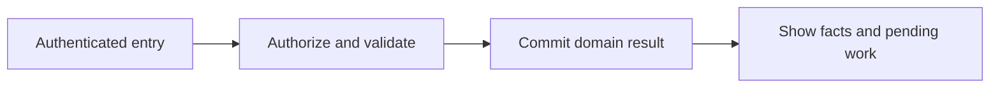
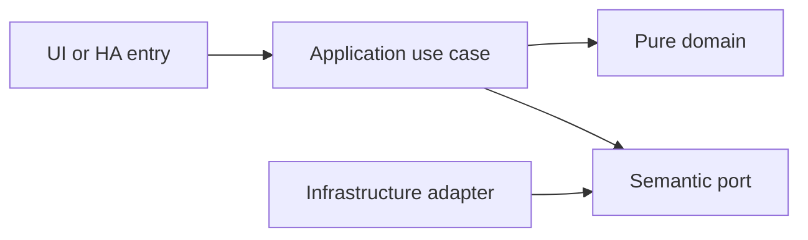

# Auditable points, participation and optional rewards

- Status: Draft
- Date: 2026-10-28
- Catalog capability ID: points-rewards
- Last verified: 2026-10-29 (document structure only; no implementation evidence)
- Owners: Domus maintainer; engineering/product reviewers to be assigned
- Scope: Task completion produces auditable point entries. Household-configurable collaboration policies determine each share and the actual award total; corrections preserve history and optional rewards never control basic participation.
- Related issues/PRs: https://github.com/vypdev/domus/issues/2
- Required review gates: product UX, architecture, testing, documentation, security/operations
- Open decisions blocking readiness: Detailed remainder/override review; reward redemption rules and child-facing review. On 2026-10-29 the owner required in-app configurable allocation supporting conserved splits, rounded equal shares, decimal shares and full points per participant. Adults/no-verification and restricted/adult-approval are the confirmed role defaults. Catalog gate prerequisites remain unverified.

## 1. Executive summary

Task completion produces auditable point entries. Household-configurable collaboration policies determine each share and the actual award total; corrections preserve history and optional rewards never control basic participation.

```text
Authenticated member -> validated domain command -> durable result -> household and HA projections
```

This is a prospective Draft, not an implemented or accepted capability. The first usable release covers all domains and both deployment targets.

## 2. Problem, current behavior, and evidence

A mutable points integer cannot explain duplicate awards, reopened tasks, policy changes or who earned credit.

Current verified sequence: (1) the repository has a minimal README and installed Copilot automation; (2) no Domus application, public service or tests exist; (3) this contract proposes the behavior to build.

Evidence: the owner's attached brief and subsequent decisions in [product vision](../docs/product-vision.md), the pinned [reference investigation](../docs/reference-investigation.md), and the existing repository baseline. Retrospective classification is not applicable: no as-built product baseline is reconstructed.

## 3. Actors, surfaces, and terminology

Actors: Performer; verifier; administrator; participation viewer.

Primary surfaces: application UI, HTTP domain boundary, relevant HA entities/services, activity and diagnostics. Definitions of member, principal, occurrence, demand and ledger are shared in the [glossary](../docs/glossary.md). The actor recording an action is distinct from its selected target and actual performer.

## 4. Goals, non-goals, and fixed invariants

Goals and fixed invariants are the following normative requirements. No configuration may weaken authorization, ledger integrity, attribution or idempotency.

| Requirement | Behavior |
|---|---|
| points-rewards-R1 | Point awards MUST be append-only, attributable and unique for each accepted completion allocation. |
| points-rewards-R2 | Reopening and correction MUST append compensating entries for the amounts actually awarded and preserve the original award, precision and allocation-policy snapshot. |
| points-rewards-R3 | Collaborative awards MUST apply an administrator-configurable household allocation policy, support conserved splits, rounded equal shares, two-decimal shares and full points per participant, and expose the base value, participants, policy, individual shares and actual awarded total. |
| points-rewards-R4 | Verification and permissions MUST apply adult/no-verification and restricted/adult-approval defaults, prevent premature or unauthorized awards and deny unauthorized task-value or allocation-policy manipulation. |
| points-rewards-R5 | Weekly, monthly and historical summaries MUST use household calendar boundaries and expose effort and participation alongside points. |
| points-rewards-R6 | Optional rewards MUST support explicit approval, cancellation and duplicate-safe redemption without punitive or manipulative mechanics. |

Non-goals: changing Copilot, changing the existing gateway, building an MCP server, adding mandatory cloud/AI dependencies, or claiming production readiness from a document.

## 5. Current versus proposed product journey

| Stage | Current | Proposed | User/operator effect |
|---|---|---|---|
| Enter | No Domus UI | Verified HA principal opens the relevant surface | Role and scope are explicit |
| Act | No domain command | Validate input, permission and current revision | Invalid data leaves the draft intact |
| Commit | No durable domain record | Store change and operation receipt atomically | Retry cannot duplicate effects |
| Observe | No projection | Show committed facts and pending downstream projections | Partial success remains understandable |



Text equivalent: authenticated entry -> authorization and validation -> durable domain commit -> visible facts with any pending projection. Domain-specific alternatives are described below.

## 6. Functional behavior and state model

### 6.1 Domain model and normal path

PointsLedgerEntry has immutable ID, member, signed integer minor-point amount, completion-event source, allocation-policy version, precision, reason, issuer and timestamp. One point is 100 minor units so two-decimal awards use exact integer arithmetic rather than binary floating point. Unique source/member/allocation keys prevent duplicate entries. Reversal entries reference original entries; balances are projections.

The owner's expanded decision on 2026-10-29 supersedes universal conservation of the task's base point value: families configure allocation in the application. A household policy supplies the default; only an administrator-authorized task override may change it. The completion and award snapshot the base value, policy/version, precision, performers, shares and actual total. A later policy edit affects future completions, not recorded or retrying awards. A member cannot choose a more rewarding policy in an ordinary completion request. Equal division of one conserved total remains the initial default; other supported modes intentionally may award less or more than that base.

| Mode | Ten base points, three performers | Actual total | Meaning |
|---|---|---:|---|
| conserve_total, precision 0 | 3, 3, 4 | 10 | Preserve one total; explicit deterministic remainder distribution |
| equal_share, precision 0, floor | 3, 3, 3 | 9 | Same rounded-down share for all |
| equal_share, precision 0, ceil | 4, 4, 4 | 12 | Same rounded-up share for all |
| equal_share, precision 2, floor | 3.33, 3.33, 3.33 | 9.99 | Two-decimal equal shares; no hidden extra 0.01 award |
| conserve_total, precision 2 | 3.33, 3.33, 3.34 | 10 | Two-decimal split preserving the total |
| full_per_participant | 10, 10, 10 | 30 | Every performer earns the full task value |
| manual | Explicit authorized amounts, for example 3, 3, 4 | Sum of entered amounts | Validate every share and show the resulting total before approval |

Only conserve_total enforces equality between base and awarded total. Other modes record the difference as policy semantics, not duplicate awards or an unexplained adjustment. The proposed remainder strategy rotates eligible recipients deterministically using durable allocation order; replay cannot advance it twice. Its exact fairness/tie-break rule remains an engineering review item. Task value and policy changes affect future completions only. Optional rewards define cost, eligibility, redemption and approval; no punitive streak resets.

### 6.2 States and alternatives

Completion -> awaiting verification or eligible -> awarded. Award -> reversed through compensation; corrections are new entries. Redemption requested -> approved -> fulfilled or cancelled; points are reserved transactionally and released on cancellation, with no double spend.

A duplicate uses its original operation receipt. A changed payload under the same key is a conflict. Out-of-order events use aggregate revision and source identity. Cancellation never erases an already committed ledger effect; compensation is explicit.

## 7. User-facing configuration

| Input | Type | Recommended default | Allowed values/range | Scope/persistence |
|---|---|---|---|---|
| `points_enabled` | boolean | true | false hides summaries but preserves existing ledger | household; persisted |
| `default_task_points` | decimal points | 0 | 0..10000, at most 2 decimals; administrator-controlled | definition; completion snapshot, stored as minor units |
| `collaborative_allocation_mode` | enum | conserve_total | conserve_total, equal_share, full_per_participant or manual; administrator-controlled | household default; authorized task override; completion/award snapshot |
| `allocation_precision` | integer | 0 | 0 or 2 decimal places; exact minor-unit arithmetic | same allocation-policy snapshot |
| `allocation_rounding` | enum | floor | floor, ceil or half_up for equal_share; reject irrelevant/contradictory combinations | same allocation-policy snapshot |
| `allocation_remainder_strategy` | enum | rotating | proposed rotating distribution for conserve_total only; deterministic and replay-safe | durable order plus allocation-policy snapshot |
| `rewards_enabled` | boolean | false | true or false; optional, not a launch dependency | household; persisted |

These are proposed defaults pending review. Invalid values and contradictory combinations are rejected before saving; unknown future values require an explicit compatibility error. Precedence is fixed invariants, installation constraints, household policy, then member preferences; lower scopes cannot expand permissions. In-flight commands snapshot relevant policy versions, while revocation is checked at the transaction boundary.

Recommended example: keep the defaults above. Meaningful alternative: a member selects Spanish and dark theme while the same household policies remain in force. Transport secrets are installation concerns and are never domain form fields.

## 8. Clean Architecture design

### 8.1 Responsibilities and dependency direction

AwardCompletionPoints and ReverseCompletionPoints consume durable task events through an inbox receipt and ledger transaction. AllocationPolicy is pure. QueryParticipation aggregates ledger, durations and counts without overwriting facts. The ledger adapter is append-only to application roles. Reward redemption uses the same concurrency and receipt controls.

| Boundary | Owns | Forbidden dependency |
|---|---|---|
| Domain | Entities, value objects and pure rules | HA, HTTP, SQL, UI frameworks |
| Application | Authorized commands, queries and semantic ports | Concrete adapters and framework DTOs |
| Adapters | Schema mapping, persistence and provider error mapping | Alternate business rules |
| Composition | Explicit deployment wiring | Business decisions |
| Presentation | View models and rendering | Database access or client-only authorization |



Text equivalent: entrypoints call use cases; use cases depend on pure domain and ports; infrastructure implements ports. Architecture checks reject forbidden imports and cycles. Shared contract tests exercise each port adapter; schemas and migration checks enforce durable boundaries.

## 9. UI/UX and content contract

### 9.1 Primary state examples

| State | Visible content |
|---|---|
| Pending | Updating participation totals. Your completed task is saved. |
| Action required | This task needs verification before points can be awarded. View task. |
| Blocked | You cannot change this award. Ask a household administrator; existing points are unchanged. |
| Partial | Completion is saved. Its point award is waiting for processing. View activity. |
| Complete | 12 points awarded to Alex. View the ledger entry. |

The primary view names current status, retained facts and one next action, followed by descriptive links to the record/operation. Technical codes and correlation IDs are progressively disclosed. Duplicate responses update the same operation status rather than adding notifications. At most one routine notification per transition, with opt-out and bounded retry summaries.

English and Spanish use stable translation keys, base-language matching and English fallback. Mobile, tablet and desktop layouts, keyboard operation, visible focus, non-color status, accessible names, light/dark contrast and reduced motion are acceptance concerns. Untrusted text is rendered inert; no arbitrary HTML, commands or secret-bearing links.

## 10. Failure, recovery, and cleanup

| Failure | Retained facts | Retry / action | Cleanup |
|---|---|---|---|
| Invalid or denied input | Existing business records and form draft | Correct fields or request the proper role | No side effects |
| Stale revision | Current committed aggregate; user's entered fields | Review current state and submit a new deliberate operation | No automatic overwrite |
| Lost response after commit | Domain result and receipt | Look up or replay the same key | Never issue a fresh-key duplicate |
| Downstream projection unavailable | Successful domain result and durable pending event | Bounded backoff, then visible retry | Acknowledge outbox only after safe consumption |
| Restart or cancellation | Committed records; identified pending work | Recover receipts/cursors; compensate only by explicit command | Remove listeners and owned temporary artifacts |

Errors explain impact, safe cause, action and retained state. External availability is distinct from authorization denial. Retries are bounded and use deterministic backoff tests, not real waits.

## 11. Security, permissions, and privacy

Backend authorization applies to reads and writes. All requests and HA values are untrusted input; only authenticated principals and validated adapter context establish identity. Cross-household IDs, replayed operations and stale roles are covered in the inventory. A person entity and selected member ID do not authenticate a caller. Logs, traces, exports and browser artifacts redact credentials and unnecessary personal data. The technical HA principal has explicit narrow grants and cannot impersonate a household administrator.

## 12. Observability and operational UX

Show operation state and projection freshness to members; expose sanitized correlation, source event, aggregate revision, duration and safe error code to operators. No raw credentials or unrestricted HA payloads enter diagnostics. Counters distinguish denied, invalid, conflict, unavailable and completed operations. One durable activity entry per business transition; retries do not multiply notifications. No telemetry leaves the installation by default.

## 13. Compatibility, migration, rollout, and rollback

No existing Domus application data requires migration yet. The first schema is versioned from its first implementation. Upgrade fixtures cover pending operations and ledger compatibility; a backup precedes destructive migration. Unknown future schemas block writes. Downgrade requires a compatible image/database pair, never silent interpretation of newer data.

Both Supervisor and standalone are first-release acceptance targets. Stable and Edge use separate credentials, IDs, volumes and endpoint bindings. Experimental artifacts cannot automatically promote production. Publication, merge and deployment remain in the existing authorized maintainer lifecycle.

## 14. Testing strategy and numeric budget

Minimum: 27 distinct cases, derived from the explicit risk inventory below. Each inventory row counts once. The budget is a floor, not a claim of completeness or executed tests.

| Area | Minimum distinct cases | Behaviors/risks covered |
|---|---:|---|
| State and concurrency | 4 | the same completion event delivered twice; a reopened task; two redemptions competing for the same available points |
| Adapters and persistence | 2 | a displayed balance; corrected historical entries |
| Security and privacy | 4 | a member attempting to overwrite an existing ledger amount; pending completion verification; an adult without point-administration permission |
| Domain and configuration | 9 | a later task-value edit; 10 points and three performers; duplicate or inactive performer IDs |
| Integration and recovery | 4 | repeated correction commands; authorized approval after a retry; a cancelled pending redemption |
| UI and accessibility | 4 | collaborative completion; equal point totals with different durations; rewards disabled |
| **Total** | **27** | No double counting |

| Case ID | Area | Requirements | Scenario |
|---|---|---|---|
| points-rewards-C01 | State and concurrency | points-rewards-R1 | Given the same completion event delivered twice, only one award set exists. |
| points-rewards-C02 | Adapters and persistence | points-rewards-R1 | Given a displayed balance, drilling into it lists every source award and correction. |
| points-rewards-C03 | Security and privacy | points-rewards-R1 | Given a member attempting to overwrite an existing ledger amount, the operation is denied. |
| points-rewards-C04 | State and concurrency | points-rewards-R2 | Given a reopened task, one reversal offsets its award while retaining both entries. |
| points-rewards-C05 | Domain and configuration | points-rewards-R2 | Given a later task-value edit, the old award keeps the accepted value. |
| points-rewards-C06 | Integration and recovery | points-rewards-R2 | Given repeated correction commands, one compensating entry is applied. |
| points-rewards-C07 | Domain and configuration | points-rewards-R3 | Given conserve_total with precision 0, 10 base points and three performers, shares are 3, 3 and 4, total 10, with the extra recipient determined by the snapshotted remainder strategy. |
| points-rewards-C08 | Domain and configuration | points-rewards-R3 | Given duplicate or inactive performer IDs, allocation is rejected before an award. |
| points-rewards-C09 | UI and accessibility | points-rewards-R3 | Given collaborative completion, members see the base points, allocation mode, each share and actual awarded total before submission. |
| points-rewards-C10 | Security and privacy | points-rewards-R4 | Given pending completion verification, the ledger contains no award. |
| points-rewards-C11 | Security and privacy | points-rewards-R4 | Given an adult without point-administration permission, changing an award policy is denied. |
| points-rewards-C12 | Integration and recovery | points-rewards-R4 | Given authorized approval after a retry, the completion produces one award set. |
| points-rewards-C13 | Domain and configuration | points-rewards-R5 | Given a Sunday-to-Monday boundary in the household zone, weekly totals place entries in the correct week. |
| points-rewards-C14 | UI and accessibility | points-rewards-R5 | Given equal point totals with different durations, the report shows both effort and task counts. |
| points-rewards-C15 | Adapters and persistence | points-rewards-R5 | Given corrected historical entries, summary totals reconcile exactly with ledger sums. |
| points-rewards-C16 | State and concurrency | points-rewards-R6 | Given two redemptions competing for the same available points, only the affordable transaction succeeds. |
| points-rewards-C17 | Integration and recovery | points-rewards-R6 | Given a cancelled pending redemption, its reservation is released once. |
| points-rewards-C18 | UI and accessibility | points-rewards-R6 | Given rewards disabled, members can complete tasks normally and no streak penalty is shown. |
| points-rewards-C19 | Domain and configuration | points-rewards-R3 | Given equal_share with precision 0 and floor, 10 base points across three performers awards 3 each and records actual total 9. |
| points-rewards-C20 | Domain and configuration | points-rewards-R3 | Given equal_share with precision 0 and ceil, 10 base points across three performers awards 4 each and records actual total 12. |
| points-rewards-C21 | Domain and configuration | points-rewards-R3 | Given equal_share with precision 2 and floor, 10 base points across three performers awards exactly 3.33 each and records total 9.99 without floating-point drift. |
| points-rewards-C22 | Domain and configuration | points-rewards-R3 | Given full_per_participant, three performers of a 10-point task each receive 10 and the recorded awarded total is 30. |
| points-rewards-C23 | Domain and configuration | points-rewards-R3 | Given authorized manual shares 3, 3 and 4, validation records those exact amounts and total 10; invalid or duplicate performer allocations are rejected. |
| points-rewards-C24 | State and concurrency | points-rewards-R2, points-rewards-R3 | Given a policy change after completion was recorded, a delayed award or retry uses the original snapshotted policy and does not recalculate historical shares. |
| points-rewards-C25 | Security and privacy | points-rewards-R4 | Given a restricted performer supplying full_per_participant in an ordinary completion request, authorization rejects the policy override without increasing their award. |
| points-rewards-C26 | Integration and recovery | points-rewards-R2 | Given a full_per_participant award of 30 actual points from a base of 10, reopening reverses all 30 actual points exactly once. |
| points-rewards-C27 | UI and accessibility | points-rewards-R3 | Given ceil allocation producing 12 actual points from 10 base points, the application explains the selected policy and difference before the award and in its ledger history. |

Every implemented first-party module starts with meaningful behavior tests. Target and proposed merge gate: 100% lines/statements/functions/branches where the selected tools expose those metrics, enforced separately across backend, frontend and integration code. Third-party/generated artifacts are distinguished from authored source; broad exclusions cannot hide untested logic. No application coverage currently exists.

Inject deterministic clocks, IDs, provider fakes and transaction failures. Use semantic assertions alongside golden content, real adapter contracts and disposable HA integration environments. Add Google Chrome evidence from the owner's authorized local HA for real UX; it does not replace automated tests or unit coverage. CI Check runs the complete applicable suite for every PR update.

## 15. Documentation and discoverability

The following paths are explicit proposed documentation changes relative to the clean repository baseline; implementation source/test paths are intentionally not invented.

| Path | Change |
|---|---|
| specs/points-rewards.md | create |
| specs/README.md | create |
| specs/_template.md | create |
| specs/catalog.json | create |
| specs/CATALOG.md | create |
| docs/architecture.md | create |
| docs/product-vision.md | create |
| docs/glossary.md | create |
| docs/decisions.md | create |
| docs/reference-investigation.md | create |
| docs/copilot-adoption.md | create |
| docs/operations.md | create |
| docs/user-guide.md | create |
| docs/contracts/home-assistant.md | create |
| docs/acceptance-plan.md | create |
| docs/roadmap.md | create |
| README.md | update |

| Audience | Artifact | Required content |
|---|---|---|
| Member | [User guide](../docs/user-guide.md) | Normal path, defaults and state meaning |
| Administrator/operator | [Operations](../docs/operations.md) | Setup, permissions, recovery, backup and rollback |
| Contributor | [Architecture](../docs/architecture.md) | Boundaries and executable constraints |
| HA consumer | [Entity/service contract](../docs/contracts/home-assistant.md) | Stable schemas, semantics and error handling |
| Reviewer | [Acceptance plan](../docs/acceptance-plan.md) | Tests, coverage and human evidence |

Link/path validation accompanies updates. Implementation changes update the owning SDD, catalog evidence, actual tests and user documentation together.

## 16. Acceptance scenarios

The Given/When/Then-equivalent observable scenarios in section 14 are the executable acceptance inventory. For each case, the given precondition and action must produce the specified result with state and side-effect assertions; tests are not implementation snapshots.

Acceptance includes normal, alternative, invalid, duplicate, concurrent, partial, failure, recovery, security, localization and accessibility paths as allocated above. Human review verifies the primary-state examples on desktop/mobile and light/dark themes. Live acceptance remains pending until an implemented artifact is exercised; no result is inferred from the budget.

## 17. Requirements traceability

| Requirement | Cases |
|---|---|
| points-rewards-R1 | points-rewards-C01, points-rewards-C02, points-rewards-C03 |
| points-rewards-R2 | points-rewards-C04, points-rewards-C05, points-rewards-C06, points-rewards-C24, points-rewards-C26 |
| points-rewards-R3 | points-rewards-C07, points-rewards-C08, points-rewards-C09, points-rewards-C19, points-rewards-C20, points-rewards-C21, points-rewards-C22, points-rewards-C23, points-rewards-C24, points-rewards-C27 |
| points-rewards-R4 | points-rewards-C10, points-rewards-C11, points-rewards-C12, points-rewards-C25 |
| points-rewards-R5 | points-rewards-C13, points-rewards-C14, points-rewards-C15 |
| points-rewards-R6 | points-rewards-C16, points-rewards-C17, points-rewards-C18 |

All requirement cases are reciprocal with section 14. Domain invariants are owned by pure policy, command/state rules by application use cases, provider behavior by adapters, and visible content by presentation; the boundary table in section 8 assigns these responsibilities. Evidence and user/operator documentation are linked in section 15.

## 18. Implementation sequence

1. Resolve the blocking decisions and review this contract before Ready for implementation.
2. Establish test harness, CI Check and architecture checks with the first source files.
3. Implement pure policies and their complete branch tests, then transactional use cases.
4. Add adapters, schema/error contracts, retry/race fixtures and both deployment wiring paths.
5. Build the accessible localized UI and HA projections with tests alongside each flow.
6. Verify migration, recovery, security, channel isolation and documentation.
7. Run the complete suite, review coverage, perform local Chrome dogfooding with recorded cleanup, and collect human evidence.

These are internal implementation steps within the first integrated release; they do not remove other domains or deployment targets from launch.

## 19. Definition of Done

- [ ] Every normative requirement has observable acceptance and reciprocal case links.
- [ ] Every declared case is implemented meaningfully; the numeric budget is met.
- [ ] Clean Architecture constraints and port contracts pass.
- [ ] All supported first-party coverage metrics reach 100% from the first implementation.
- [ ] CI Check passes for the current PR revision with no omitted required jobs.
- [ ] Configuration, state, permission, idempotency and recovery behaviors agree.
- [ ] Primary UI states, localization, responsive behavior and accessibility pass.
- [ ] Both deployment targets and isolated Stable/Edge channels pass acceptance.
- [ ] User/operator documentation, schema/migration evidence and catalog paths are current.
- [ ] Local Google Chrome evidence identifies the artifact, channel, test records and cleanup.
- [ ] The original Copilot validations pass when their real prerequisites exist; no check is weakened.
- [ ] No material decision blocking readiness remains unresolved; Copilot remains unchanged.

## 20. References and decisions

Primary sources: [Copilot standard](https://github.com/vypdev/copilot/blob/f5e5a4cf9a80248994469cd88ad55eecab5b95ca/specs/README.md), [original template](https://github.com/vypdev/copilot/blob/f5e5a4cf9a80248994469cd88ad55eecab5b95ca/specs/_template.md), and the linked [reference investigation](../docs/reference-investigation.md).

Confirmed owner choices and unresolved proposals are separated in [decisions](../docs/decisions.md). [Issue #2](https://github.com/vypdev/domus/issues/2) tracks the documentation foundation. The [adoption note](../docs/copilot-adoption.md) records the current catalog evidence limitation. Optional future depth remains explicitly deferred in the product vision; the gateway's installation and MCP internals are outside Domus scope.
