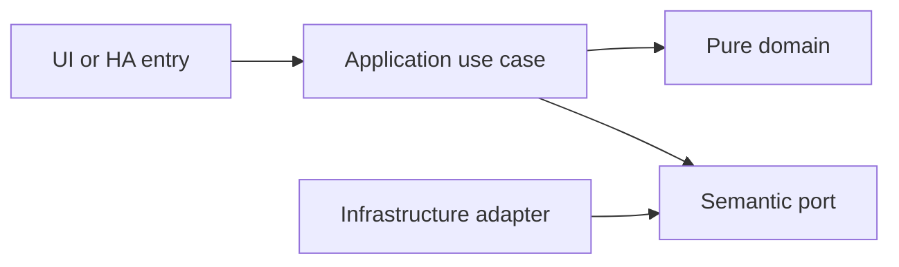

# Recurrence engine and family calendar

- Status: Draft
- Date: 2026-10-28
- Catalog capability ID: recurrence-calendar
- Last verified: 2026-10-28 (document structure only; no implementation evidence)
- Owners: Domus maintainer; engineering/product reviewers to be assigned
- Scope: A bounded scheduler turns task definitions into stable occurrences and a family calendar distinguishes planned start, deadline and actual completion.
- Related issues/PRs: https://github.com/vypdev/domus/issues/2
- Required review gates: product UX, architecture, testing, documentation, security/operations
- Open decisions blocking readiness: DST gap/fold policy review; late completion policy; supported RRULE subset and calendar projection review. Catalog gate prerequisites remain unverified.

## 1. Executive summary

A bounded scheduler turns task definitions into stable occurrences and a family calendar distinguishes planned start, deadline and actual completion.

```text
Authenticated member -> validated domain command -> durable result -> household and HA projections
```

This is a prospective Draft, not an implemented or accepted capability. The first usable release covers all domains and both deployment targets.

## 2. Problem, current behavior, and evidence

Recurring household work must handle late completion, time zones, exceptions and restarts without drifting fixed schedules or generating unlimited work.

Current verified sequence: (1) the repository has a minimal README and installed Copilot automation; (2) no Domus application, public service or tests exist; (3) this contract proposes the behavior to build.

Evidence: the owner's attached brief and subsequent decisions in [product vision](../docs/product-vision.md), the pinned [reference investigation](../docs/reference-investigation.md), and the existing repository baseline. Retrospective classification is not applicable: no as-built product baseline is reconstructed.

## 3. Actors, surfaces, and terminology

Actors: Household planner; assigned member; scheduler; calendar reader.

Primary surfaces: application UI, HTTP domain boundary, relevant HA entities/services, activity and diagnostics. Definitions of member, principal, occurrence, demand and ledger are shared in the [glossary](../docs/glossary.md). The actor recording an action is distinct from its selected target and actual performer.

## 4. Goals, non-goals, and fixed invariants

Goals and fixed invariants are the following normative requirements. No configuration may weaken authorization, ledger integrity, attribution or idempotency.

| Requirement | Behavior |
|---|---|
| recurrence-calendar-R1 | Fixed recurrence MUST preserve its local calendar anchor after late completion, with a documented supported RFC 5545 subset. |
| recurrence-calendar-R2 | Completion-relative recurrence MUST generate only one successor from an accepted completion and handle reopening without orphaned silent work. |
| recurrence-calendar-R3 | Materialization MUST be bounded by time horizon and per-run count and remain duplicate-free across concurrent runs and restarts. |
| recurrence-calendar-R4 | Time handling MUST preserve IANA zones, date-only deadlines and explicit daylight-saving gap/fold semantics. |
| recurrence-calendar-R5 | Pausing, skipping, rescheduling and editing rules MUST preserve exceptions and completed occurrence history. |
| recurrence-calendar-R6 | The calendar MUST distinguish planned start, deadline and actual completion and support month, week, day and agenda views. |
| recurrence-calendar-R7 | Calendar queries MUST support bounded ranges and member, category, status, priority and task-type filters without exposing unauthorized records. |
| recurrence-calendar-R8 | HA calendar export MUST use stable identifiers and mark unavailable projections honestly; external calendar sync remains optional and disabled initially. |

Non-goals: changing Copilot, changing the existing gateway, building an MCP server, adding mandatory cloud/AI dependencies, or claiming production readiness from a document.

## 5. Current versus proposed product journey

| Stage | Current | Proposed | User/operator effect |
|---|---|---|---|
| Enter | No Domus UI | Verified HA principal opens the relevant surface | Role and scope are explicit |
| Act | No domain command | Validate input, permission and current revision | Invalid data leaves the draft intact |
| Commit | No durable domain record | Store change and operation receipt atomically | Retry cannot duplicate effects |
| Observe | No projection | Show committed facts and pending downstream projections | Partial success remains understandable |


Text equivalent: authenticated entry -> authorization and validation -> durable domain commit -> visible facts with any pending projection. Domain-specific alternatives are described below.

## 6. Functional behavior and state model

### 6.1 Domain model and normal path

RecurrenceRule is fixed-calendar or completion-relative, never both. Fixed rules store local DTSTART, IANA zone, supported RFC 5545 rule, exceptions and rule revision; occurrence identity includes definition, nominal local occurrence and rule revision. Relative schedules store interval in local calendar days and the last accepted completion. Calendar entries distinguish scheduled work, due-only markers, completion history and household events. Each occurrence retains its original planned time when rescheduled.

### 6.2 States and alternatives

Rule active <-> paused -> retired. Pause stops new materialization, preserving existing occurrences; resume previews missed dates. Occurrence skip/cancel/reschedule is an exception and never silently rewrites history. Fixed schedules completed late keep future anchored dates. Relative schedules generate one next occurrence from accepted completion; reopening invalidates an unstarted successor and requires review if that successor is already in progress.

A duplicate uses its original operation receipt. A changed payload under the same key is a conflict. Out-of-order events use aggregate revision and source identity. Cancellation never erases an already committed ledger effect; compensation is explicit.

## 7. User-facing configuration

| Input | Type | Recommended default | Allowed values/range | Scope/persistence |
|---|---|---|---|---|
| `materialization_horizon_days` | integer | 60 | 7..366; at most 1000 generated occurrences per definition per run | household; scheduler snapshots |
| `missed_occurrence_policy` | enum | keep_visible | keep_visible or explicitly skip_after_review | definition; versioned |
| `ambiguous_local_time` | enum | first_instant | first_instant or second_instant; explicit proposal | household; rule snapshots |
| `nonexistent_local_time` | enum | skip | skip initially; follows the selected RFC-compatible policy | household; rule snapshots |
| `calendar_week_start` | enum | monday | monday or sunday | member preference |

These are proposed defaults pending review. Invalid values and contradictory combinations are rejected before saving; unknown future values require an explicit compatibility error. Precedence is fixed invariants, installation constraints, household policy, then member preferences; lower scopes cannot expand permissions. In-flight commands snapshot relevant policy versions, while revocation is checked at the transaction boundary.

Recommended example: keep the defaults above. Meaningful alternative: a member selects Spanish and dark theme while the same household policies remain in force. Transport secrets are installation concerns and are never domain form fields.

## 8. Clean Architecture design

### 8.1 Responsibilities and dependency direction

RecurrencePolicy and CalendarProjection are pure. MaterializeOccurrences uses a clock, bounded recurrence library adapter, occurrence uniqueness constraints and a persisted scheduler cursor. Rebuilds never change completed occurrences. A range query projects scheduled events and actual history separately. HA calendar adapters read this projection rather than treating last completion as the next event.

| Boundary | Owns | Forbidden dependency |
|---|---|---|
| Domain | Entities, value objects and pure rules | HA, HTTP, SQL, UI frameworks |
| Application | Authorized commands, queries and semantic ports | Concrete adapters and framework DTOs |
| Adapters | Schema mapping, persistence and provider error mapping | Alternate business rules |
| Composition | Explicit deployment wiring | Business decisions |
| Presentation | View models and rendering | Database access or client-only authorization |



Text equivalent: entrypoints call use cases; use cases depend on pure domain and ports; infrastructure implements ports. Architecture checks reject forbidden imports and cycles. Shared contract tests exercise each port adapter; schemas and migration checks enforce durable boundaries.

## 9. UI/UX and content contract

### 9.1 Primary state examples

| State | Visible content |
|---|---|
| Pending | Loading this week's household plan. |
| Action required | This recurrence uses a daylight-saving transition. Review the preview before saving. |
| Blocked | This recurrence is not supported. Your draft is retained. Choose a supported schedule. |
| Partial | The task was rescheduled. The HA calendar will refresh after reconnection. |
| Complete | Saturday's task is complete. The next fixed occurrence is next Saturday. |

The primary view names current status, retained facts and one next action, followed by descriptive links to the record/operation. Technical codes and correlation IDs are progressively disclosed. Duplicate responses update the same operation status rather than adding notifications. At most one routine notification per transition, with opt-out and bounded retry summaries.

English and Spanish use stable translation keys, base-language matching and English fallback. Mobile, tablet and desktop layouts, keyboard operation, visible focus, non-color status, accessible names, light/dark contrast and reduced motion are acceptance concerns. Untrusted text is rendered inert; no arbitrary HTML, commands or secret-bearing links.

## 10. Failure, recovery, and cleanup

| Failure | Retained facts | Retry / action | Cleanup |
|---|---|---|---|
| Invalid or denied input | Existing business records and form draft | Correct fields or request the proper role | No side effects |
| Stale revision | Current committed aggregate; user's entered fields | Review current state and submit a new deliberate operation | No automatic overwrite |
| Lost response after commit | Domain result and receipt | Look up or replay the same key | Never issue a fresh-key duplicate |
| Downstream projection unavailable | Successful domain result and durable pending event | Bounded backoff, then visible retry | Acknowledge outbox only after safe consumption |
| Restart or cancellation | Committed records; identified pending work | Recover receipts/cursors; compensate only by explicit command | Remove listeners and owned temporary artifacts |

Errors explain impact, safe cause, action and retained state. External availability is distinct from authorization denial. Retries are bounded and use deterministic backoff tests, not real waits.

## 11. Security, permissions, and privacy

Backend authorization applies to reads and writes. All requests and HA values are untrusted input; only authenticated principals and validated adapter context establish identity. Cross-household IDs, replayed operations and stale roles are covered in the inventory. A person entity and selected member ID do not authenticate a caller. Logs, traces, exports and browser artifacts redact credentials and unnecessary personal data. The technical HA principal has explicit narrow grants and cannot impersonate a household administrator.

## 12. Observability and operational UX

Show operation state and projection freshness to members; expose sanitized correlation, source event, aggregate revision, duration and safe error code to operators. No raw credentials or unrestricted HA payloads enter diagnostics. Counters distinguish denied, invalid, conflict, unavailable and completed operations. One durable activity entry per business transition; retries do not multiply notifications. No telemetry leaves the installation by default.

## 13. Compatibility, migration, rollout, and rollback

No existing Domus application data requires migration yet. The first schema is versioned from its first implementation. Upgrade fixtures cover pending operations and ledger compatibility; a backup precedes destructive migration. Unknown future schemas block writes. Downgrade requires a compatible image/database pair, never silent interpretation of newer data.

Both Supervisor and standalone are first-release acceptance targets. Stable and Edge use separate credentials, IDs, volumes and endpoint bindings. Experimental artifacts cannot automatically promote production. Publication, merge and deployment remain in the existing authorized maintainer lifecycle.

## 14. Testing strategy and numeric budget

Minimum: 24 distinct cases, derived from the explicit risk inventory below. Each inventory row counts once. The budget is a floor, not a claim of completeness or executed tests.

| Area | Minimum distinct cases | Behaviors/risks covered |
|---|---:|---|
| Domain and configuration | 6 | a Saturday rule completed on Monday; a monthly day-31 rule; an unsupported RRULE part |
| State and concurrency | 5 | a relative 30-day rule completed late; reopening before the successor starts; parallel scheduler runs |
| Integration and recovery | 4 | reopening after the successor starts; a crash after a batch commit; combined category and status filters |
| Adapters and persistence | 3 | a date-only deadline; an edited rule; HA calendar reads after a retry |
| UI and accessibility | 3 | a task scheduled yesterday and completed today; narrow-screen month view; a due-only task |
| Security and privacy | 2 | a member filter; no external calendar setup |
| Deployment and contracts | 1 | an excessive range |
| **Total** | **24** | No double counting |

| Case ID | Area | Requirements | Scenario |
|---|---|---|---|
| recurrence-calendar-C01 | Domain and configuration | recurrence-calendar-R1 | Given a Saturday rule completed on Monday, the next fixed occurrence remains on Saturday. |
| recurrence-calendar-C02 | Domain and configuration | recurrence-calendar-R1 | Given a monthly day-31 rule, months without that date follow the documented RFC-compatible omission policy. |
| recurrence-calendar-C03 | Domain and configuration | recurrence-calendar-R1 | Given an unsupported RRULE part, setup rejects it rather than partially interpreting the rule. |
| recurrence-calendar-C04 | State and concurrency | recurrence-calendar-R2 | Given a relative 30-day rule completed late, its next due date is 30 local calendar days after accepted completion. |
| recurrence-calendar-C05 | State and concurrency | recurrence-calendar-R2 | Given reopening before the successor starts, that successor is invalidated and linked history remains. |
| recurrence-calendar-C06 | Integration and recovery | recurrence-calendar-R2 | Given reopening after the successor starts, the calendar flags a review conflict instead of deleting active work. |
| recurrence-calendar-C07 | State and concurrency | recurrence-calendar-R3 | Given parallel scheduler runs, uniqueness constraints produce one occurrence per nominal slot. |
| recurrence-calendar-C08 | Integration and recovery | recurrence-calendar-R3 | Given a crash after a batch commit, restart resumes without duplicating prior occurrences. |
| recurrence-calendar-C09 | Domain and configuration | recurrence-calendar-R3 | Given an unbounded daily rule, a run stops at the horizon or 1000 occurrences and retains a continuation cursor. |
| recurrence-calendar-C10 | Domain and configuration | recurrence-calendar-R4 | Given a spring-forward nonexistent time, that local occurrence is skipped according to the selected policy. |
| recurrence-calendar-C11 | Domain and configuration | recurrence-calendar-R4 | Given an autumn repeated hour, only the configured instant is generated with its offset. |
| recurrence-calendar-C12 | Adapters and persistence | recurrence-calendar-R4 | Given a date-only deadline, switching display zones does not shift it into another date. |
| recurrence-calendar-C13 | State and concurrency | recurrence-calendar-R5 | Given a paused definition, no new occurrences appear while existing assigned work remains visible. |
| recurrence-calendar-C14 | Adapters and persistence | recurrence-calendar-R5 | Given an edited rule, completed past occurrences retain their original dates and rule revision. |
| recurrence-calendar-C15 | State and concurrency | recurrence-calendar-R5 | Given a skipped or rescheduled exception, rebuilding the same range preserves that exception. |
| recurrence-calendar-C16 | UI and accessibility | recurrence-calendar-R6 | Given a task scheduled yesterday and completed today, scheduled and history views label both times distinctly. |
| recurrence-calendar-C17 | UI and accessibility | recurrence-calendar-R6 | Given narrow-screen month view, the user can switch to a readable agenda with keyboard controls. |
| recurrence-calendar-C18 | UI and accessibility | recurrence-calendar-R6 | Given a due-only task, the calendar uses a due marker without inventing a scheduled duration. |
| recurrence-calendar-C19 | Security and privacy | recurrence-calendar-R7 | Given a member filter, only records the principal may view are returned. |
| recurrence-calendar-C20 | Deployment and contracts | recurrence-calendar-R7 | Given an excessive range, the API rejects it with its supported limit and keeps existing selections. |
| recurrence-calendar-C21 | Integration and recovery | recurrence-calendar-R7 | Given combined category and status filters, counts and agenda entries use the same predicate. |
| recurrence-calendar-C22 | Adapters and persistence | recurrence-calendar-R8 | Given HA calendar reads after a retry, stable event UIDs remain unchanged. |
| recurrence-calendar-C23 | Integration and recovery | recurrence-calendar-R8 | Given backend unavailability, HA calendar becomes unavailable rather than reporting an empty household. |
| recurrence-calendar-C24 | Security and privacy | recurrence-calendar-R8 | Given no external calendar setup, no household calendar data leaves the local installation. |

Every implemented first-party module starts with meaningful behavior tests. Target and proposed merge gate: 100% lines/statements/functions/branches where the selected tools expose those metrics, enforced separately across backend, frontend and integration code. Third-party/generated artifacts are distinguished from authored source; broad exclusions cannot hide untested logic. No application coverage currently exists.

Inject deterministic clocks, IDs, provider fakes and transaction failures. Use semantic assertions alongside golden content, real adapter contracts and disposable HA integration environments. Add Google Chrome evidence from the owner's authorized local HA for real UX; it does not replace automated tests or unit coverage. CI Check runs the complete applicable suite for every PR update.

## 15. Documentation and discoverability

The following paths are explicit proposed documentation changes relative to the clean repository baseline; implementation source/test paths are intentionally not invented.

| Path | Change |
|---|---|
| specs/recurrence-calendar.md | create |
| specs/README.md | create |
| specs/_template.md | create |
| specs/catalog.json | create |
| specs/CATALOG.md | create |
| docs/architecture.md | create |
| docs/product-vision.md | create |
| docs/glossary.md | create |
| docs/decisions.md | create |
| docs/reference-investigation.md | create |
| docs/copilot-adoption.md | create |
| docs/operations.md | create |
| docs/user-guide.md | create |
| docs/contracts/home-assistant.md | create |
| docs/acceptance-plan.md | create |
| docs/roadmap.md | create |
| README.md | update |

| Audience | Artifact | Required content |
|---|---|---|
| Member | [User guide](../docs/user-guide.md) | Normal path, defaults and state meaning |
| Administrator/operator | [Operations](../docs/operations.md) | Setup, permissions, recovery, backup and rollback |
| Contributor | [Architecture](../docs/architecture.md) | Boundaries and executable constraints |
| HA consumer | [Entity/service contract](../docs/contracts/home-assistant.md) | Stable schemas, semantics and error handling |
| Reviewer | [Acceptance plan](../docs/acceptance-plan.md) | Tests, coverage and human evidence |

Link/path validation accompanies updates. Implementation changes update the owning SDD, catalog evidence, actual tests and user documentation together.

## 16. Acceptance scenarios

The Given/When/Then-equivalent observable scenarios in section 14 are the executable acceptance inventory. For each case, the given precondition and action must produce the specified result with state and side-effect assertions; tests are not implementation snapshots.

Acceptance includes normal, alternative, invalid, duplicate, concurrent, partial, failure, recovery, security, localization and accessibility paths as allocated above. Human review verifies the primary-state examples on desktop/mobile and light/dark themes. Live acceptance remains pending until an implemented artifact is exercised; no result is inferred from the budget.

## 17. Requirements traceability

| Requirement | Cases |
|---|---|
| recurrence-calendar-R1 | recurrence-calendar-C01, recurrence-calendar-C02, recurrence-calendar-C03 |
| recurrence-calendar-R2 | recurrence-calendar-C04, recurrence-calendar-C05, recurrence-calendar-C06 |
| recurrence-calendar-R3 | recurrence-calendar-C07, recurrence-calendar-C08, recurrence-calendar-C09 |
| recurrence-calendar-R4 | recurrence-calendar-C10, recurrence-calendar-C11, recurrence-calendar-C12 |
| recurrence-calendar-R5 | recurrence-calendar-C13, recurrence-calendar-C14, recurrence-calendar-C15 |
| recurrence-calendar-R6 | recurrence-calendar-C16, recurrence-calendar-C17, recurrence-calendar-C18 |
| recurrence-calendar-R7 | recurrence-calendar-C19, recurrence-calendar-C20, recurrence-calendar-C21 |
| recurrence-calendar-R8 | recurrence-calendar-C22, recurrence-calendar-C23, recurrence-calendar-C24 |

All requirement cases are reciprocal with section 14. Domain invariants are owned by pure policy, command/state rules by application use cases, provider behavior by adapters, and visible content by presentation; the boundary table in section 8 assigns these responsibilities. Evidence and user/operator documentation are linked in section 15.

## 18. Implementation sequence

1. Resolve the blocking decisions and review this contract before Ready for implementation.
2. Establish test harness, CI Check and architecture checks with the first source files.
3. Implement pure policies and their complete branch tests, then transactional use cases.
4. Add adapters, schema/error contracts, retry/race fixtures and both deployment wiring paths.
5. Build the accessible localized UI and HA projections with tests alongside each flow.
6. Verify migration, recovery, security, channel isolation and documentation.
7. Run the complete suite, review coverage, perform local Chrome dogfooding with recorded cleanup, and collect human evidence.

These are internal implementation steps within the first integrated release; they do not remove other domains or deployment targets from launch.

## 19. Definition of Done

- [ ] Every normative requirement has observable acceptance and reciprocal case links.
- [ ] Every declared case is implemented meaningfully; the numeric budget is met.
- [ ] Clean Architecture constraints and port contracts pass.
- [ ] All supported first-party coverage metrics reach 100% from the first implementation.
- [ ] CI Check passes for the current PR revision with no omitted required jobs.
- [ ] Configuration, state, permission, idempotency and recovery behaviors agree.
- [ ] Primary UI states, localization, responsive behavior and accessibility pass.
- [ ] Both deployment targets and isolated Stable/Edge channels pass acceptance.
- [ ] User/operator documentation, schema/migration evidence and catalog paths are current.
- [ ] Local Google Chrome evidence identifies the artifact, channel, test records and cleanup.
- [ ] The original Copilot validations pass when their real prerequisites exist; no check is weakened.
- [ ] No material decision blocking readiness remains unresolved; Copilot remains unchanged.

## 20. References and decisions

Primary sources: [Copilot standard](https://github.com/vypdev/copilot/blob/f5e5a4cf9a80248994469cd88ad55eecab5b95ca/specs/README.md), [original template](https://github.com/vypdev/copilot/blob/f5e5a4cf9a80248994469cd88ad55eecab5b95ca/specs/_template.md), and the linked [reference investigation](../docs/reference-investigation.md).

Confirmed owner choices and unresolved proposals are separated in [decisions](../docs/decisions.md). [Issue #2](https://github.com/vypdev/domus/issues/2) tracks the documentation foundation. The [adoption note](../docs/copilot-adoption.md) records the current catalog evidence limitation. Optional future depth remains explicitly deferred in the product vision; the gateway's installation and MCP internals are outside Domus scope.
