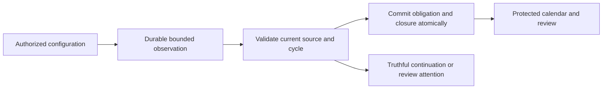
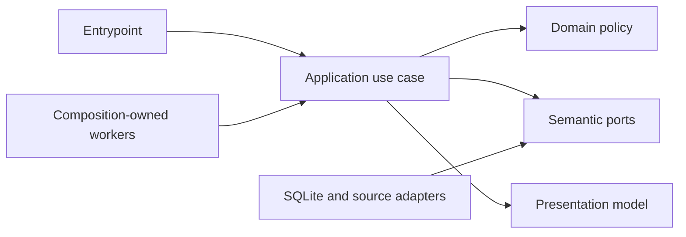

# Relative recurrence lifecycle and protected calendar

- Status: Draft
- Date: 2026-11-03
- Catalog capability ID: recurrence-calendar
- Last verified: not applicable
- Owners: Domus maintainers; engineering and product reviewers
- Scope: Complete relative recurrence lifecycle, shared maintenance, and protected calendar behavior as a companion to the existing recurrence owners.
- Related issues/PRs: https://github.com/vypdev/domus/issues/23; PR #22; PR #24
- Required review gates: product UX, architecture, testing, documentation, security/operations
- Open decisions blocking readiness: no unanswered product choice specific to this companion. Capability readiness remains draft: the retained catalog blockers for the supported RRULE subset, time-zone/gap/fold library interoperability, and calendar projection review still apply. Proposed engineering bounds require implementation evidence.

This is a proposed companion at `specs/recurrence-lifecycle-calendar.md`. Preserve `specs/recurrence-calendar.md`, `specs/recurrence-execution-foundation.md`, and `specs/recurrence-storage-continuation.md` verbatim. Their 37, 52, and four required cases remain required (93 counted cases); retained integration aliases remain unchanged and are not recounted. This draft adds its own cases only. Native SDD publication and verification of the exact Action-managed branch precede implementation. The catalog preflight and checkpoint evidence described in the issue do not establish native publication, branch readiness, or feature acceptance.

## 1. Executive summary

Deliver actual relative initial and successor work, durable source-cycle processing, fair bounded maintenance shared with fixed recurrence, reviewed schedule changes, and truthful protected calendar projections. The recommended defaults remain the retained owners’ defaults. The principal safety rule is that only current, eligible source facts and current authorization may produce effects; durable cycle closure prevents duplicate or late effects across rule changes and compatible restoration.

```text
Configure and review a relative rule -> bounded maintenance observes and validates source facts -> one durable eligible obligation is created -> authorized calendar views distinguish planned, due, and actual facts.
```

### Review correction of the first native publication

The first native publication at 91adfe902055cb2c5bb42ceeb57c2b7ab53fb635 succeeded and remains immutable history. It generated 18 broader cases that overlap the retained owners instead of preserving the supplied independent refinements. The published references remain required below as integration aliases; they are not 18 additional counted journeys. Sections 14 and 17 instead count the 18 explicit technical refinements C19 through C36. An execution satisfying several obligations remains one execution.

| Published integration alias | Retained owning/refinement coverage | Counting |
|---|---|---|
| recurrence-lifecycle-calendar-C01 | recurrence-execution-C06 | Required alias; not an additional counted case. |
| recurrence-lifecycle-calendar-C02 | recurrence-execution-C07, recurrence-execution-C32 | Required alias; not an additional counted case. |
| recurrence-lifecycle-calendar-C03 | recurrence-execution-C29, recurrence-calendar-C12, recurrence-calendar-C25 | Required alias; not an additional counted case. |
| recurrence-lifecycle-calendar-C04 | recurrence-execution-C21, recurrence-execution-C33, recurrence-calendar-C29, recurrence-calendar-C30 | Required alias; not an additional counted case. |
| recurrence-lifecycle-calendar-C05 | recurrence-execution-C24, recurrence-execution-C28 | Required alias; not an additional counted case. |
| recurrence-lifecycle-calendar-C06 | recurrence-execution-C28, recurrence-execution-C30 | Required alias; not an additional counted case. |
| recurrence-lifecycle-calendar-C07 | recurrence-execution-C17, recurrence-execution-C18, recurrence-execution-C19 | Required alias; not an additional counted case. |
| recurrence-lifecycle-calendar-C08 | recurrence-execution-C26 | Required alias; not an additional counted case. |
| recurrence-lifecycle-calendar-C09 | recurrence-execution-C27 | Required alias; not an additional counted case. |
| recurrence-lifecycle-calendar-C10 | recurrence-execution-C34, recurrence-execution-C43 | Required alias; not an additional counted case. |
| recurrence-lifecycle-calendar-C11 | recurrence-execution-C16, recurrence-execution-C23 | Required alias; not an additional counted case. |
| recurrence-lifecycle-calendar-C12 | recurrence-execution-C16, recurrence-execution-C23, recurrence-lifecycle-calendar-C21 | Required alias; not an additional counted case. |
| recurrence-lifecycle-calendar-C13 | recurrence-execution-C20, recurrence-execution-C31, recurrence-execution-C32, recurrence-execution-C36 | Required alias; not an additional counted case. |
| recurrence-lifecycle-calendar-C14 | recurrence-execution-C20, recurrence-execution-C28, recurrence-execution-C30, recurrence-lifecycle-calendar-C22 | Required alias; not an additional counted case. |
| recurrence-lifecycle-calendar-C15 | recurrence-execution-C37, recurrence-execution-C38, recurrence-execution-C39, recurrence-execution-C40, recurrence-execution-C41, recurrence-execution-C42 | Required alias; not an additional counted case. |
| recurrence-lifecycle-calendar-C16 | recurrence-execution-C22, recurrence-execution-C45, recurrence-execution-C46, recurrence-execution-C48, recurrence-execution-C49, recurrence-lifecycle-calendar-C33 | Required alias; not an additional counted case. |
| recurrence-lifecycle-calendar-C17 | recurrence-calendar-C16, recurrence-calendar-C17, recurrence-calendar-C18, recurrence-lifecycle-calendar-C35 | Required alias; not an additional counted case. |
| recurrence-lifecycle-calendar-C18 | recurrence-execution-C38, recurrence-execution-C43, recurrence-execution-C44, recurrence-lifecycle-calendar-C31, recurrence-lifecycle-calendar-C32 | Required alias; not an additional counted case. |

The native draft also cited nonexistent `validate:specifications` and `generate:specifications` pnpm scripts. Both were checked against the exact selected package and both literal commands exited with ERR_PNPM_NO_SCRIPT. The consumer correction uses existing documentation validation and states the original native SDK outcomes without inventing scripts. Reproduction and the separate semantic observations are reported in [copilot#858](https://github.com/vypdev/copilot/issues/858#issuecomment-6615277620). No Copilot source, workflow, model, cache source or bound is changed. This correction changes planned acceptance; it does not claim implementation or test execution.

## 2. Problem, current behavior, and evidence

### 2.1 Problem

Households need recurring task obligations that follow actual completed work, with an understandable calendar and recoverable review flow. The checkpoint does not yet consume relative sources into actual obligations or provide the remaining lifecycle, calendar, and UI journeys. A stored rule or passing foundation cases cannot tell a household that a successor was actually created, nor protect against duplicate or out-of-order source events.

### 2.2 Current behavior

1. The supplied immutable catalog at `8b1cbc110c389b9cdb6ecd11317c95abf2c4b0a9` identifies the three existing owners and current source paths. These paths are evidence of source locations, not proof of future behavior or framework support.
2. The issue reports that the merged checkpoint contains schema 8, fixed execution, relative creation with pristine unconsumed progress, and a fixed-only persistent runner. It lacks actual relative source materialization and the remaining lifecycle/calendar surface.
3. PR #24 merged schema 9; the issue reports current develop `8b1cbc110c389b9cdb6ecd11317c95abf2c4b0a9` contains it. Any later DDL must start from the actual supported schema 9 and use the next genuine version.
4. The issue reports a genuine schema 9 input and preserved earlier fixtures. This is not owner HA data or relative execution acceptance.

### 2.3 Evidence

- Code/catalog references: `backend/src/domus/domain/recurrence_time.py`, `backend/src/domus/application/recurrence_ports.py`, `backend/src/domus/infrastructure/recurrence_time.py`, `backend/src/domus/domain/recurrence_rules.py`, `backend/src/domus/domain/recurrence_rule_text.py`, `backend/src/domus/domain/recurrence_periods.py`, `backend/src/domus/domain/nominal_recurrence.py`, `backend/src/domus/domain/recurrence_planning.py`, `backend/src/domus/application/fixed_recurrence.py`.
- Existing owner specifications: `specs/recurrence-calendar.md`, `specs/recurrence-execution-foundation.md`, `specs/recurrence-storage-continuation.md`.
- Issue evidence: https://github.com/vypdev/domus/issues/23. Reported checkpoint hashes, test counts, reviews, database digests, and preflight results are supplied issue claims; they are not independently reverified here.
- Unknowns: actual adapter behavior and implementation/test evidence. Section 15 declares prospective implementation paths; proposed durable inbox/closure data uses the next genuine schema, subject to implementation verification. These must be established during admitted implementation.

### 2.4 Retrospective classification (as-built baselines only)

Not applicable: this prospective companion does not reconstruct an implemented baseline. Current facts above are bounded to supplied catalog and issue evidence; proposed behavior below is not represented as implemented.

## 3. Actors, surfaces, and terminology

| Actor | Goal | Entry point | Visible surfaces |
|---|---|---|---|
| Authorized household manager | Configure, review, pause, resume, and change schedules | Domus UI and existing authorized commands | Task and recurrence views, review plans |
| Authorized household member | Read allowed schedule and calendar facts | Domus UI or protected HA projection | Month, week, day, and agenda |
| Composition-owned maintenance capability | Consume bounded configured work for its actual installation/channel/household | Owned runtime lifetime | Honest pending, continuation, or failure state |
| Operator | Recover compatible application/data state | Existing operations procedures | Recovery evidence and diagnostics |

A nominal identity is the stable scheduled occurrence. A source event identity is the observed task fact. A completion cycle is the immutable closure unit; record revision is mutable state. Generation identifies rule evolution. A scan position is progress evidence, not proof of effect or complete calendar freshness. Technical maintenance is a composition-owned local capability, never a human permission or caller-selected principal, installation, or channel. Actual performance, approval, planned start, and due date are separate facts.

## 4. Goals

| Requirement | Behavior |
|---|---|
| RCL-01 | Materialize the relative bootstrap and eligible successor as real task obligations; support reviewed compatible attachment/adoption without duplicating first work. |
| RCL-02 | Observe bounded live and historical source facts, persist a durable inbox and per-cycle closure, and retain successor identity across duplicates, rule changes, and compatible restoration. |
| RCL-03 | Rejection or reopening invalidates only unstarted derived successors with reason and history; downstream started/completed work survives with review attention and no fabricated effects. |
| RCL-04 | Fixed and relative work share a durable fair frontier and global 50-definition/1,000-slot budget; source scans have a separate explicit bounded budget and truthful continuation; both owned runtime lifetimes are wired. |
| RCL-05 | Support pause/resume, explicit overdue skip, reschedule exceptions, reviewed preview/apply, collision review, and safe handling of stale previews or lost responses. |
| RCL-06 | Persist task-owned timing classification, date-only/planned/deadline/actual-work facts, configurable household timing defaults, and bounded protected calendar queries. |
| RCL-07 | Protect commands, cursors, and original-operation recovery in both deployments; preserve original permissions, histories, and closed intent namespaces. |
| RCL-08 | Preserve schema 9 and supported fixtures; if new DDL is needed, use the next genuine schema version with compatible migration and rollback evidence. |
| RCL-09 | Deliver retained-case, English/Spanish UI, HA, both deployment, Stable/Edge, and all-domain acceptance with truthful documentation and quality evidence. |

### 4.1 Goals

The measurable outcomes are the nine requirements in the table above. All are required for the first usable all-domain release; foundation and checkpoint completion alone do not satisfy them.

### 4.2 Non-goals

1. Replacing or editing the three existing owning specifications.
2. Taking schema 9 ownership away from the administration continuation.
3. Changing the existing gateway, Copilot source/resources/configuration/credentials/bounds, or owner permission/history contracts.
4. HA update, release/tag/deployment, or automatic production promotion.
5. Claiming external synchronization, points, notifications, approvals, or compensation without their owning consumer and evidence.

### 4.3 Fixed product/safety invariants

1. Preserve actual-work local-calendar-day anchoring, first-valid gap and whole-date handling, one configured fold appearance, and per-task successor visibility.
2. Current authorization and original operation identity govern recovery; request data cannot choose a principal or technical scope.
3. Closure dominates duplicate/out-of-order completion or approval, including after rule changes and compatible restoration. Historical absence is not authority to create an effect.
4. Started/completed work and original history are never silently erased or fabricated. Maintenance is bounded and reports incomplete continuation truthfully.

## 5. Current versus proposed product journey

| Stage | Current | Proposed | User/operator effect |
|---|---|---|---|
| Configure | Relative definition and pristine progress are reported | Review initial-work choice and commit one actual obligation | Household can inspect its first obligation without a duplicate manual task |
| Complete | Existing task lifecycle facts are available | Durable bounded consumer validates source and creates one eligible successor | Actual work drives an explainable due date |
| Reopen/reject | No complete relative closure consumer evidenced | Close cycle; invalidate only unstarted derived work or surface review attention | Existing downstream work and history remain visible |
| Maintain | Fixed-only persistent runner reported | Shared fair mixed frontier plus independent source-scan budget in both owned lifetimes | Pending work is bounded and continuation is inspectable |
| Observe/change | Full calendar/review surface absent | Reviewed plan/apply and protected actual/planned/due calendar | Users can see conflicts and distinguish dates and performance |



Text equivalent: authorized configuration leads to bounded observation, current-source validation, atomic obligation/closure, then protected calendar or explicit continuation/review attention.

## 6. Functional behavior and state model

### 6.1 Happy path

1. A currently authorized manager creates or reviews a relative definition and chooses the retained initial-work policy.
2. The application commits the original result and one bootstrap obligation atomically. It does not consume a completion or create ordinary manual duplicate work.
3. The owned runner scans within both independent budgets, persists exact inbox/source position, and revalidates live occurrence, cycle, rule, policy, definition, scope, and original eligibility at commit.
4. Eligible actual work creates at most one successor at original `performed_at` plus local calendar days in the snapshotted zone. Instant deadlines preserve millisecond wall time; date-only work remains a date.
5. Authorized calendar queries project actual, planned, and due facts with stable identity, masking, bounded page, and honest freshness/continuation.

### 6.2 Alternative paths

- Reviewed attachment preserves existing manual work or adopts an explicitly compatible unstarted occurrence at its exact revision. It cannot duplicate first work.
- Default `at_completion` admits current completed work pending approval; `at_verification` waits for current approval without moving the derived date. Late approval may make the successor overdue.
- Historical absent completion/approval is nonauthorizing. A closed cycle remains closed even when old events arrive after rule edits or restoration.
- Pause blocks new generation but retains assigned work. Resume previews backlog. `keep_visible` remains the default for overdue work; explicit skip records nominal identity, reason, actor, and no award.
- A rejection/reopening cancels only a still-unstarted derived successor. Started or completed downstream work remains, with durable review attention and no fabricated performance, verification, points, stock, or compensation.
- Reschedule preview identifies retained, moved, cancelled/replaced, added, and exceptional slots. Stale revisions, collisions, concurrent starts, or oversized plans require refreshed human review; no partial application is called complete.

### 6.3 State machine

| State | Entered when | User-visible meaning | Allowed next states | Recovery/owner |
|---|---|---|---|---|
| Pending observation | Durable source work remains | Some recurrence facts are not yet reconciled | Processing, attention, current | Owned runner resumes bounded frontier |
| Current | Source, policy, and revision checks pass | Eligible work may be committed | Closed, pending, attention | Application transaction and source adapter |
| Closed | Cycle is consumed, rejected, or reopened | This cycle cannot grant another effect | Closed | Durable closure invariant |
| Review attention | Collision or started downstream work needs review | Existing work is retained; a person must inspect it | Current, closed | Authorized manager reviews explicit plan |
| Paused | Manager pauses rule | Existing assignments remain; new generation stops | Active, retired | Current-authorized rule command |
| Retired | Rule is retired | No new obligations are generated | Retired | Operator preserves history |

Duplicate source identity returns the exact original outcome. Stale and out-of-order observations cannot reopen closure. Cancellation does not erase started work. A partial scan records continuation and never advances past unprocessed work.

Recurrence closure is consumer-owned grant/effect proof, separate from human TaskCycle.closed_at, performance and approval facts. Later rejection/reopening remains processable to invalidate or flag the recorded successor while retaining the closed grant. Consuming a completion never fabricates closure or approval in the human task cycle.

## 7. User-facing configuration

| Input | Type | Recommended default | Allowed values/range | Scope/persistence |
|---|---|---|---|---|
| Horizon | Integer days | 60 local days | 7..366 | Household policy snapshot |
| Definition/slot work | Integer budgets | 50 definitions; 1,000 slots | Global across fixed and relative; minimum implementation limits must not exceed these maxima | One durable shared frontier per run |
| Period scanning | Integer periods | 4,096 | Existing maximum 64,000; empty periods consume work | Per run, durable continuation |
| Source scanning | Integer rows | 4,096 proposed technical default | 1..64,000 per run; every examined row, including duplicate/nonactionable/lookahead, consumes currency | Composition policy; independent from slot/period budgets |
| Source page | Integer rows | At most 100 | No more than remaining scan budget | Per bounded read; no cursor skips unprocessed rows |
| Preview expiry | Seconds | 300 | Fixed bounded expiry | Context-bound reviewed plan |
| Calendar query | Days and rows | 31 days; 25 rows | 1..366 days and 1..100 rows; half-open range | Current authorized query; 300-second context-bound cursor |
| Week start | Enum | Monday | Monday or Sunday | Private member preference; browser-neutral fallback |

Validate cross-field bounds before effects. A run admits at most 50 visited definitions and 1,000 slot work across both recurrence types. A separate source currency counts every examined row. Exhaustion yields incomplete continuation; empty source or period scans consume budget. Resume must preserve a fair durable frontier so a noisy old source cannot starve others. Retain existing RRULE, interval, time-policy, exclusion/addition, text, and horizon bounds. Supported legacy defaults are established only during explicit migration or member creation. Ordinary reads never initialize or repair missing/corrupt records; unknown values fail closed without coercion or silent truncation. One recommended configuration is the defaults above; a meaningful alternative is a 14-day horizon with Monday week start. Safety limits, current authorization, and closure semantics are not configurable.

## 8. Clean Architecture

### 8.1 Responsibilities and dependency direction

| Layer/boundary | Owns | Must not own/import |
|---|---|---|
| Domain/pure policy | Generation, timing classification, source-cycle closure, review transitions | SQL, HA, web framework, provider DTOs |
| Application | Authorization, orchestration, fair admission, original results, bounded calendar predicates | Concrete provider SDK/process details |
| Adapters/data | Semantic source/current-proof mapping and storage mapping | Product policy or permission grants |
| Infrastructure/composition | SQLite, timezone/protocol adaptation, technical scope, clock/IDs, owned workers | Business decisions or caller-selected principal |
| Entrypoints | Input/event adaptation and trusted boundary checks | Duplicated orchestration or implicit authority |
| Presentation | Authorized view models, renderers, deliberate user intents | SQL access, mutation policy, permission transitions |



Text equivalent: entrypoints call application use cases; application depends on pure domain and semantic ports; infrastructure implements ports; presentation renders application results; composition owns workers and technical scope.

### 8.2 Contracts, state, and trust boundaries

- Pure decisions: nominal identity, eligibility, timing, closure dominance, fairness, collision and review classification.
- Application contracts: immutable bounded inputs/outputs, current grant checks, original operation identity, atomic effect/result orchestration.
- Semantic ports: current and historical source observations, current live revalidation, transactional cycle closure, task creation, protected calendar reads.
- Durable state/schema ownership: existing recurrence owners remain authoritative; any new DDL follows actual schema 9 with genuine next version and preserves fixtures 1..9. Declare and create `tests/fixtures/sqlite/v9.sql` before any future commit if that supported input is required by implementation.
- Concurrency/idempotency: unique scoped source/cycle identity, atomic receipt/effect/closure/audit/outbox, optimistic exact revisions, independent-writer and rollback evidence.
- Trust: issue/comment/source text, HA/browser inputs, cursors, and provider DTOs are untrusted. Revalidate live facts and current authorization at commit and recovery.
- Provider errors: bounded transient continuation, explicit conflict/review, safe denial, and fail-closed corruption mapping; never report uncommitted effects as complete.

### 8.3 Executable architecture constraints

Extend repository dependency/cycle and forbidden-import checks for every new runtime module and keep all authored modules within global and per-module statement/branch coverage. Contract tests must parse closed DTOs, schema ownership/version, source adapter bounds, and both runtime wiring paths. Do not infer execution support from catalog paths or fixtures.

## 9. UI/UX and content contract

### 9.1 Information hierarchy

Show current status, completed facts, next transition, required human action, impact, inspectable links, then collapsed technical evidence. A calendar entry labels planned start, due-only date, actual performance, and verification separately. Date-only values never acquire an invented time or UTC midnight.

### 9.2 Representative primary view

This fenced block is a literal interface mockup. The action labels describe application buttons; they are not documentation links or proposed URLs.

```markdown
# Recurrence review: kitchen filter

> **Current status:** The task was completed on 1 January; approval is pending.
>
> **Next task:** The next obligation is due on 31 January.
>
> **Action required:** An adult can review the completed task.

## Progress

- [x] Completion recorded from the current task cycle
- [x] The next task is created under the default completion policy
- [ ] Adult approval of the original work is pending

## What happens next

Approval does not move the next due date. A task explicitly configured to wait for approval shows its next obligation only after approval, using the same actual-work-derived date.

## Actions

Buttons: Open the task · Review the schedule

<details><summary>Technical details</summary>Source cycle, revision, and bounded continuation evidence.</details>
```

### 9.3 Issue, PR, and comment behavior

This companion does not authorize new issue/PR automation, comments, labels, or notifications. Any implementation-facing status must use deterministic titles, one primary action, descriptive links, idempotent updates, and a bounded notification budget of zero unsolicited comments. Merge or close must not be presented as feature completion. Checks are supplemental evidence; only verified product journeys establish acceptance.

### 9.4 Accessibility, localization, and responsive behavior

Support English and Spanish with stable keys, base-language matching, and English fallback. Provide real month/week/day/agenda views, narrow-screen keyboard-accessible agenda, visible focus, non-color status, light/dark contrast, reduced motion, semantic headings/tables, and textual equivalents for visuals. Sanitize untrusted names/reasons as inert text; validate links and never render embedded commands, mentions, HTML markers, or diagrams as executable content. HA consumes the same authorized projection and stable entry identity; external synchronization is initially disabled. The existing gateway remains integrated and untouched. Do not claim an adapter exists until its actual implementation and acceptance paths are declared.

## 10. Failure, recovery, and cleanup

| Failure/partial state | User impact | Retained facts | Automatic retry | Required action | Cleanup |
|---|---|---|---|---|---|
| Source or lock unavailable | Projection is pending | Inbox, closure, original receipts, continuation | Bounded backoff | Inspect current status if persistent | Stop and join owned workers before storage closes |
| Stale preview or concurrent start | Plan cannot safely apply | Original plan and current revisions | No automatic apply | Refresh and review | Expire context-bound draft safely |
| Corrupt or conflicting evidence | Work is blocked for review | Original bytes/receipt and diagnostics | No coercion or repair | Operator follows recovery procedure | Preserve exact compatible backup |
| Response lost after commit | User may not know result | Original key, payload, result, revisions | No new-key retry | Recover original operation under current grants | Retain only original expiry/context |
| Oversized change | No complete plan is committed | Current schedule and requested draft | No partial success claim | Submit smaller reviewed plan | Keep draft until explicit correction |

Errors state impact, cause, action, and retained state in that order. A committed batch resumes from durable facts after crash. Restore preserves later processed evidence without reinstating absent effects. Current authorization precedes original-result disclosure. No automatic fresh-key replacement or POST retry. Changed verified context or logout retires private drafts.

## 11. Security, permissions, and privacy

1. Both deployment entrypoints retain current HA proof, local membership, Origin, session CSRF, expected context, and strict bounded DTO validation.
2. Request data never selects a technical actor, installation, channel, or household. Maintenance uses composition-owned actual scope.
3. Recovery maps each original action explicitly and rechecks current grants before returning private facts. Cursor principal/scope/expiry is bound; a cursor is never authentication.
4. Calendar ranges and filters are closed and bounded. Outage reads retain only original expiry and current local masking; changes remain blocked.
5. Preserve both existing closed intent namespaces and lossless int64 revisions. Do not log secrets or unnecessary household personal data. Reject replay, forged scope, stale revisions, and untrusted markup.

The new recurrence intent journal is a separate closed namespace bounded to eight records, 65,536 UTF-8 bytes and one hour, without automatic expiry renewal. It preserves exact original keys/payloads and lossless int64 revisions; entry and administration journals keep their existing closed contracts and cannot cross-decode recurrence records. Never persist tokens or CSRF secrets in these journals.

Calendar display choices use a separate owner-private record and original-action namespace, including against administrators. Explicit migration and deliberate member creation store the Monday default at independent revision 1; ordinary reads never create or repair missing/corrupt records. Existing locale, summary, public profile and membership revisions remain independent. Private preferences and raw provider payloads are excluded from logs, events and public projections.

## 12. Observability and operational UX

- User-facing state: current, pending with continuation, review attention, paused, or safely blocked; distinguish stale projection from empty calendar.
- Operator evidence: scope, bounded run currency, visited definitions, source position, cycle identity, schema version, and safe correlation ID; no private payload dump.
- Logs/metrics: bounded counts for examined source rows, slot work, continuation age, conflicts, and worker lifecycle. Correlation never grants access.
- External dependency versus workflow failure: transient source outage is pending continuation; corrupt or unauthorized evidence is blocked/attention, not empty success.
- Rate-limit/retry: bounded exponential backoff in the retained five-second polling/backoff lifecycle; respect provider limits and stop/join workers.
- Noise budget: no unsolicited comments or notifications; one durable status update per actual state transition where a status surface exists.

## 13. Compatibility, migration, rollout, and rollback

Preserve schemas1..8 and their immutable fixtures. Capture and publish the genuine supported schema-9 fixture before adding durable inbox/closure/attention/plan data as actual schema 10. Do not edit a version number to reinterpret an unknown layout. Normal operations reject an old supported source until explicit atomic initialization; failed migration preserves original rows/version. Validate canonical tagged data and scope/generation/original-proof relations on direct reads and independent snapshot inspection.

The genuine schema-9 input retains old recurrence and profile/privacy facts. Current schema-9 images must refuse schema 10 without mutation, and rollback selects the compatible complete image/database/generation pair. Restore keeps later original processing history, including closure, without authorizing absent work. Schema 11 adds owner-private calendar preferences and gates the new exception document shape. Preserve the genuine schema-10 fixture, migrate its existing members to independent Monday preferences, and keep the schema-9 input immutable. Both actual architectures and persistent deployment lifetimes require current-source upgrade/refusal/rollback checks. Stable/Edge remain isolated; no automatic promotion or owner HA update is implied. The Edge.7 administration UI was separately installed and tested on the owner's HA; those observations do not certify recurrence, migration or calendar acceptance.

## 14. Testing strategy and numeric budget

All 93 counted cases in the three unchanged owners and their integration aliases remain required. Published C01 through C18 remain required non-counted integration aliases as mapped above. The following 18 independently refined technical cases C19 through C36 replace no owning journey. These are prospective assertions, not passing results. One execution satisfying several obligations still counts as one execution.

| Area | Minimum distinct cases | Behaviors/risks covered |
|---|---:|---|
| State/application/idempotency/races | 6 | Concrete independent refinements in the inventory below. |
| Application use cases | 4 | Concrete independent refinements in the inventory below. |
| Adapters/provider contracts | 2 | Concrete independent refinements in the inventory below. |
| Domain/configuration/pure planning | 1 | Concrete independent refinements in the inventory below. |
| Integration/security/migration | 3 | Concrete independent refinements in the inventory below. |
| Workflows, permissions, schemas, and setup | 1 | Concrete independent refinements in the inventory below. |
| UI/UX/localization/sanitization | 1 | Concrete independent refinements in the inventory below. |
| Total | 18 | Distinct refinement cases; repeated executions and published aliases do not add cases. |

| Case ID | Area | Requirements | Scenario |
|---|---|---|---|
| recurrence-lifecycle-calendar-C19 | State/application/idempotency/races | RCL-01,RCL-08 | A restored relative bootstrap has a retained original but no task; a new runner preserves absence, original identities and zero additional receipt/event effects. |
| recurrence-lifecycle-calendar-C20 | State/application/idempotency/races | RCL-01,RCL-05 | A reviewed manual adoption becomes incompatible before commit; it rejects the exact stale revision without a second initial task or partial mapping. |
| recurrence-lifecycle-calendar-C21 | Application use cases | RCL-02,RCL-04 | A source page spends the final scan unit on a duplicate/nonactionable lookahead; no unread position is certified and a fresh process resumes the exact remaining work. |
| recurrence-lifecycle-calendar-C22 | Adapters/provider contracts | RCL-02,RCL-07 | Current and historical rows have tied times or foreign scope; original source identity/position remains deterministic and no historical approval grants a successor. |
| recurrence-lifecycle-calendar-C23 | State/application/idempotency/races | RCL-02,RCL-03 | A cycle closes under an old rule generation, then delayed completion/approval arrives after a rule edit and restore; durable closure prevents new work without rewriting original completion facts. |
| recurrence-lifecycle-calendar-C24 | State/application/idempotency/races | RCL-03,RCL-08 | A downstream successor starts between invalidation planning and write; preserve its actual work, persist review attention once and invent no point/stock compensation. |
| recurrence-lifecycle-calendar-C25 | Application use cases | RCL-04 | Fixed/relative backlogs and replayed slots share exactly one shared limit of 50 definitions and 1,000 slots ceiling; period and source exhaustion retain separate truthful continuations. |
| recurrence-lifecycle-calendar-C26 | State/application/idempotency/races | RCL-04,RCL-02 | Repeated interruption after individual admission and a noisy unavailable source cannot skip unvisited peers; independent restarted runtimes preserve fair durable frontier and cycle closure. |
| recurrence-lifecycle-calendar-C27 | State/application/idempotency/races | RCL-05,RCL-07 | A plan containing exclusions, reschedules and newly started work becomes stale; original apply cannot overwrite it, and lost-result recovery never replaces the key or payload. |
| recurrence-lifecycle-calendar-C28 | Domain/configuration/pure planning | RCL-05,RCL-08 | Individually legal affected records exceed the complete canonical plan/result byte bound; preview/apply rejects without partial cancellation or silent truncation. |
| recurrence-lifecycle-calendar-C29 | Application use cases | RCL-06 | Combined actual category/type/status/priority/member filters paginate with the same entry/count predicate; due-only dates and actual performers retain different meanings. |
| recurrence-lifecycle-calendar-C30 | Application use cases | RCL-06,RCL-04 | A scan watermark advances while earlier source work remains unresolved; the calendar stays incomplete and never converts that watermark into an empty complete household. |
| recurrence-lifecycle-calendar-C31 | Integration/security/migration | RCL-07,RCL-06 | Another current administrator alters a principal-bound cursor or own calendar preference result key; both deployments reject disclosure without changing bytes or extending an outage lease. |
| recurrence-lifecycle-calendar-C32 | Integration/security/migration | RCL-07,RCL-09 | A calendar edit above 2^53 survives actual browser wire, SQLite and original recovery exactly; corrupt/foreign recurrence intent records cannot decode as entry/admin records. |
| recurrence-lifecycle-calendar-C33 | Workflows, permissions, schemas, and setup | RCL-08 | The actual frozen9input upgrades atomically to schema 10 with two fixed slots, pristine relative progress, false private summaries and original evidence intact; an injected late failure preserves schema-9 bytes/version. |
| recurrence-lifecycle-calendar-C34 | Integration/security/migration | RCL-08,RCL-02 | A compatible restored schema-10 generation retains later cycle closure/original proofs while its successor is absent; an actual schema-9 image refuses schema 10 and no edited header is treated as rollback. |
| recurrence-lifecycle-calendar-C35 | UI/UX/localization/sanitization | RCL-09,RCL-06 | Actual EN/ES narrow-screen month-to-agenda keyboard navigation names planned/due/performed/approval times, retains inert reasons and shows incomplete processing independently of color. |
| recurrence-lifecycle-calendar-C36 | Adapters/provider contracts | RCL-09,RCL-07 | Actual HA calendar retry preserves UIDs/offset policy and becomes unavailable on source failure; disabled external synchronization transmits no household records. |

Tests first, strict types, real independent SQLite writers, deterministic clocks/provider failures, crash/restore, actual HTTP, Storybook, compiled browser and actual image acceptance. Require 100% supported coverage globally and per authored module: all four frontend metrics, backend statements/branches, independent authored-source inventories, and every-PR CI Check. Do not infer semantic or human acceptance from test counts. Preserve existing timeout, retry, privacy and architecture gates, and necessary actual failure evidence.

## 15. Documentation and discoverability

| Path | Change |
|---|---|
| `specs/recurrence-lifecycle-calendar.md` | create |
| `backend/src/domus/domain/relative_lifecycle.py` | create |
| `backend/src/domus/domain/calendar_values.py` | create |
| `backend/src/domus/application/relative_materialization.py` | create |
| `backend/src/domus/application/recurrence_sources.py` | create |
| `backend/src/domus/application/relative_lifecycle.py` | create |
| `backend/src/domus/application/recurrence_review.py` | create |
| `backend/src/domus/application/recurrence_review_target.py` | create |
| `backend/src/domus/application/relative_attachment_review.py` | create |
| `backend/src/domus/application/reschedule_review.py` | create |
| `backend/src/domus/application/task_authorization.py` | update |
| `backend/src/domus/application/task_requests.py` | update |
| `backend/src/domus/application/relative_state_review.py` | create |
| `backend/src/domus/application/fixed_skip_review.py` | create |
| `backend/src/domus/application/fixed_state_review.py` | create |
| `backend/src/domus/application/fixed_pattern_review.py` | create |
| `backend/src/domus/application/fixed_batch_review.py` | create |
| `backend/src/domus/domain/recurrence_records.py` | update |
| `backend/src/domus/application/fixed_exception_review.py` | create |
| `backend/src/domus/infrastructure/sqlite_recurrence_records.py` | update |
| `backend/src/domus/infrastructure/sqlite_recurrence.py` | update |
| `tests/backend/test_fixed_exception_review.py` | create |
| `backend/src/domus/application/commands.py` | update |
| `backend/src/domus/application/calendar_queries.py` | create |
| `backend/src/domus/application/ha_calendar_projection.py` | create |
| `tests/backend/test_ha_calendar_projection.py` | create |
| `backend/src/domus/application/calendar_commands.py` | create |
| `backend/src/domus/infrastructure/sqlite_calendar_preferences.py` | create |
| `backend/src/domus/infrastructure/sqlite_member_profiles.py` | update |
| `frontend/src/composition/entry-page.ts` | update |
| `tests/backend/test_calendar_preferences.py` | create |
| `tests/browser/entry_server.py` | update |
| `tests/fixtures/sqlite/v10.sql` | create |
| `backend/src/domus/infrastructure/sqlite_relative_lifecycle.py` | create |
| `backend/src/domus/infrastructure/sqlite_calendar.py` | create |
| `backend/src/domus/entrypoints/recurrence_http.py` | create |
| `backend/src/domus/entrypoints/calendar_http.py` | create |
| `backend/src/domus/entrypoints/recurrence_dto.py` | create |
| `backend/src/domus/composition/calendar.py` | create |
| `frontend/src/domain/tasks.ts` | create |
| `frontend/src/application/task-ports.ts` | create |
| `frontend/src/application/task-controller.ts` | create |
| `frontend/src/adapters/task-values.ts` | create |
| `frontend/src/adapters/task-http.ts` | create |
| `frontend/src/adapters/task-journal.ts` | create |
| `frontend/src/presentation/domus-tasks.ts` | create |
| `frontend/src/presentation/task-messages.ts` | create |
| `frontend/stories/tasks.stories.ts` | create |
| `frontend/tests/tasks.test.ts` | create |
| `frontend/tests/task-controller.test.ts` | create |
| `frontend/tests/task-http.test.ts` | create |
| `frontend/tests/task-journal.test.ts` | create |
| `frontend/tests/task-component.test.ts` | create |
| `frontend/tests/e2e/tasks.spec.ts` | create |
| `frontend/src/domain/recurrence-review.ts` | create |
| `frontend/src/application/recurrence-review-controller.ts` | create |
| `frontend/src/adapters/recurrence-http.ts` | create |
| `frontend/src/adapters/recurrence-journal.ts` | create |
| `frontend/src/presentation/domus-recurrence-review.ts` | create |
| `frontend/src/presentation/recurrence-messages.ts` | create |
| `frontend/tests/recurrence-review.test.ts` | create |
| `frontend/vitest.config.ts` | update |
| `frontend/src/domain/calendar.ts` | create |
| `frontend/src/application/calendar-controller.ts` | create |
| `frontend/src/application/calendar-preferences.ts` | create |
| `frontend/src/adapters/calendar-preference-http.ts` | create |
| `frontend/tests/calendar-preferences.test.ts` | create |
| `frontend/src/presentation/domus-app.ts` | update |
| `frontend/src/adapters/calendar-http.ts` | create |
| `frontend/src/adapters/calendar-journal.ts` | create |
| `frontend/src/presentation/domus-calendar.ts` | create |
| `frontend/src/presentation/calendar-messages.ts` | create |
| `frontend/stories/calendar.stories.ts` | create |
| `tests/backend/test_relative_materialization.py` | create |
| `tests/backend/test_recurrence_source_observations.py` | create |
| `tests/backend/test_relative_lifecycle.py` | create |
| `tests/backend/test_relative_lifecycle_consumer.py` | create |
| `tests/backend/test_sqlite_relative_lifecycle.py` | create |
| `tests/backend/test_mixed_recurrence.py` | create |
| `tests/backend/test_recurrence_runtime.py` | update |
| `tests/backend/test_recurrence_review.py` | create |
| `tests/backend/test_reschedule_restoration.py` | create |
| `tests/backend/test_fixed_batch_review.py` | create |
| `tests/backend/test_calendar_values.py` | create |
| `tests/backend/test_calendar_queries.py` | create |
| `tests/backend/test_calendar_http.py` | create |
| `tests/backend/test_recurrence_http.py` | create |
| `tests/backend/test_recurrence_lifecycle_migration.py` | create |
| `frontend/tests/calendar-controller.test.ts` | create |
| `frontend/tests/calendar-http.test.ts` | create |
| `frontend/tests/calendar-journal.test.ts` | create |
| `frontend/tests/calendar-component.test.ts` | create |
| `frontend/tests/e2e/calendar.spec.ts` | create |
| `frontend/tests/e2e/workspace-navigation.spec.ts` | update |
| `frontend/tests/e2e/tasks.spec.ts` | update |
| `tests/fixtures/sqlite/v9.sql` | create |
| `tests/containers/test_relative_recurrence_image.py` | create |
| `tests/containers/test_calendar_image.py` | create |
| `docs/tasks/recurrence.md` | create |
| `docs/tasks/calendar.md` | create |
| `docs/evidence/recurrence-lifecycle-calendar.json` | create |
| `docs/evidence/task-workspace.json` | create |
| `docs/evidence/task-navigation-integration.json` | create |
| `tests/packaging/test_ui_wheel.py` | update |
| `specs/catalog.json` | update |
| `specs/CATALOG.md` | update |
| `backend/src/domus/domain/task_events.py` | update |
| `backend/src/domus/application/task_ports.py` | update |
| `backend/src/domus/infrastructure/sqlite_task_history.py` | update |
| `backend/src/domus/domain/tasks.py` | update |
| `backend/src/domus/domain/task_values.py` | update |
| `backend/src/domus/domain/relative_recurrence.py` | update |
| `backend/src/domus/application/ports.py` | update |
| `backend/src/domus/application/recurrence_ports.py` | update |
| `backend/src/domus/application/task_creation.py` | update |
| `backend/src/domus/application/task_commands.py` | update |
| `backend/src/domus/application/task_queries.py` | update |
| `backend/src/domus/entrypoints/task_http.py` | update |
| `backend/src/domus/entrypoints/http_errors.py` | update |
| `backend/src/domus/composition/tasks.py` | update |
| `tests/backend/test_activation_compatibility.py` | update |
| `tests/backend/test_recurrence_frontier.py` | update |
| `tests/backend/test_restore_source.py` | update |
| `tests/backend/test_sqlite_identity.py` | update |
| `tests/backend/test_sqlite_recurrence.py` | update |
| `tests/backend/test_sqlite_task_reviews.py` | update |
| `tests/backend/test_task_restoration.py` | update |
| `tests/containers/restore_fixture.py` | update |
| `tests/backend/test_task_queries.py` | update |
| `tests/backend/test_task_http.py` | update |
| `backend/src/domus/application/task_events.py` | update |
| `backend/src/domus/application/fair_recurrence.py` | update |
| `backend/src/domus/application/fixed_materialization.py` | update |
| `backend/src/domus/application/relative_recurrence_commands.py` | update |
| `backend/src/domus/infrastructure/sqlite.py` | update |
| `backend/src/domus/infrastructure/sqlite_snapshots.py` | update |
| `backend/src/domus/infrastructure/sqlite_recurrence_schema.py` | update |
| `tests/containers/test_administration_image.py` | update |
| `tests/containers/administration_rollback_fixture.py` | update |
| `tests/containers/test_recurrence_image.py` | update |
| `tests/backend/test_sqlite_task_materials.py` | update |
| `tests/backend/test_sqlite_task_integrity.py` | update |
| `tests/backend/test_sqlite_snapshots.py` | update |
| `tests/backend/test_sqlite_recurrence_integrity.py` | update |
| `tests/backend/test_sqlite_recovery.py` | update |
| `tests/backend/test_sqlite_history.py` | update |
| `tests/backend/test_sqlite_member_profiles.py` | update |
| `backend/src/domus/infrastructure/sqlite_recurrence.py` | update |
| `backend/src/domus/infrastructure/sqlite_activation.py` | update |
| `backend/src/domus/infrastructure/sqlite_relative_recurrence.py` | update |
| `backend/src/domus/infrastructure/sqlite_relative_recurrence_records.py` | update |
| `backend/src/domus/infrastructure/sqlite_recurrence_integrity.py` | update |
| `backend/src/domus/infrastructure/sqlite_tasks.py` | update |
| `backend/src/domus/infrastructure/recurrence_worker.py` | update |
| `backend/src/domus/composition/recurrence.py` | update |
| `backend/src/domus/composition/server.py` | update |
| `backend/src/domus/composition/ingress.py` | update |
| `frontend/src/application/household-controller.ts` | update |
| `frontend/src/composition/entry-runtime.ts` | update |
| `frontend/src/presentation/messages.ts` | update |
| `frontend/playwright.entry.config.ts` | update |
| `frontend/tests/page.test.ts` | update |
| `frontend/tests/runtime.test.ts` | update |
| `frontend/tests/household-controller.test.ts` | update |
| `frontend/tests/component.test.ts` | update |
| `frontend/tests/e2e/administration.spec.ts` | update |
| `frontend/tests/e2e/workspace-navigation.spec.ts` | update |
| `frontend/tests/e2e/entry.spec.ts` | update |
| `frontend/tests/e2e/catalog.spec.ts` | update |
| `frontend/src/composition/entry-page.ts` | update |
| `frontend/src/presentation/domus-app.ts` | update |
| `frontend/src/presentation/messages.ts` | update |
| `frontend/tests/component.test.ts` | update |
| `frontend/tests/page.test.ts` | update |
| `tests/browser/entry_server.py` | update |
| `tests/backend/test_openapi.py` | update |
| `tests/python/test_ci_contract.py` | update |
| `.github/workflows/ci_check.yml` | update |
| `architecture/python-application.ini` | update |
| `tests/architecture/test_python_architecture.py` | update |
| `docs/contracts/household-api.openapi.json` | update |
| `docs/contracts/native-household-api.openapi.json` | update |
| `docs/architecture-recurrence.md` | update |
| `docs/tasks/execution.md` | update |
| `docs/tasks/migration.md` | update |
| `docs/development.md` | update |
| `docs/operations.md` | update |
| `docs/user-guide.md` | update |
| `docs/acceptance-plan.md` | update |
| `docs/roadmap.md` | update |
| `specs/recurrence-calendar.md` | reference |
| `specs/recurrence-execution-foundation.md` | reference |
| `specs/recurrence-storage-continuation.md` | reference |
| `specs/household-tasks.md` | reference |
| `specs/task-execution-foundation.md` | reference |
| `specs/household-administration.md` | reference |
| `docs/contracts/home-assistant.md` | update |
| `addon-edge/config.yaml` | update |
| `addon-edge/Dockerfile` | update |
| `addon-edge/artifact.json` | update |
| `addon-edge/CHANGELOG.md` | update |
| `addon-edge/README.md` | update |
| `addon-edge/DOCS.md` | update |
| `tests/backend/test_app_package.py` | update |
| `tests/containers/test_app_ui.py` | update |
| `tests/containers/test_app_image.py` | update |
| `tests/containers/test_app_compatibility.py` | update |
| `tests/containers/test_edge_preview_image.py` | update |
| `docs/installation-home-assistant.md` | update |
| `docs/product-vision.md` | update |
| `docs/architecture.md` | update |
| `docs/evidence/recurrence-execution.json` | update |
| `docs/evidence/recurrence-rules.json` | update |

Operations are prospective and relative to the verified immutable base 8b1cbc110c389b9cdb6ecd11317c95abf2c4b0a9. The task-workspace integration and preview-packaging paths inherited from merged PR #28, including addon-edge/artifact.json, are updates against the Action-published synchronized head a954ce091d19f6350d64eec759670d5a1fadcfb5; all other original operations retain that immutable base. No managed remote branch was synchronized by a contributor. The shared navigation browser suite is an update against develop at 5b7bdcdee3a9e98d6669bfd34ce750ae30a8c775. Each prospective path is checked against its stated actual base. Declare any additional actual implementation/test/integration paths before implementing them. Preserve the three retained owner documents byte-for-byte. The genuine supported schema-9 fixture must be published before further DDL; preserve released1..8fixtures.

The first visible M2 increment connects the existing task commands and queries to a real create/list/detail/claim/complete/review workflow before adding recurrence and calendar controls. The owner requested a usable task surface before further foundation-only increments. Use server-derived allowed actions and current authorization, preserve original command recovery by key, and keep technical identifiers behind optional details. This sequencing does not retire any retained recurrence/calendar case or all-domain launch obligation.

Document normal paths, current authorization, configuration precedence, pending/absent/unavailable states, original recovery, both deployments and compatible operator rollback. Run the actual existing `uv run domus-check docs` navigation/documentation check. Validate SDD format, consistency, reciprocal traceability, repository paths and catalog through the original unchanged native SDK. Regenerate the canonical catalog through its actual original publication/rendering flow when metadata changes; no nonexistent pnpm command or compatibility shim is introduced. Future source/test paths are declarations here, not false existing-file evidence in the catalog.

## 16. Acceptance

1. Given a configured relative rule with no existing compatible task, when bootstrap commits, then exactly one actual initial obligation is visible and pristine progress remains unconsumed.
2. Given current eligible completion at a local-day boundary, when bounded maintenance commits, then one successor has the correct actual-work-derived date and stable identity.
3. Given duplicate, delayed, or historical absent source facts after closure, when observed across rule edits or compatible restore, then no second effect is created and the original closure remains inspectable.
4. Given rejection or reopening, when reconciliation runs, then only unstarted derived work is invalidated; started/completed work retains its facts and receives review attention without fabricated compensation.
5. Given both fixed and relative backlogs, when a run exhausts either work budget, then the shared definition/slot limits and separate scan limit are respected and durable fair continuation is visible.
6. Given a stale preview or a concurrent start, when apply is attempted, then no stale destructive change commits and the user is asked to refresh and review.
7. Given a lost response after a committed command, when the authorized user recovers the original operation, then the exact original result is returned only after current permission checks.
8. Given a protected bounded calendar request, when the user selects a range, then date-only, planned, due, actual, and approval facts remain distinct and unauthorized or stale cursors reveal no data.
9. Given keyboard-only use in English or Spanish on a narrow viewport, when the agenda is reviewed, then focus, labels, status, and next action remain understandable without color or pointer input.
10. Given a genuine schema 9 input and supported fixtures, when a required migration runs, then it preserves original business rows, receipts, recurrence state, and rollback evidence without relabeling unknown layouts.
11. Given the exact admitted Action-owned branch, when implementation is proposed for merge, then every retained and new acceptance case has actual evidence, current-source images and applicable CI checks pass, no unresolved Bugbot finding remains, and no lifecycle label is misrepresented as full feature acceptance.

## 17. Requirements traceability

| Requirement | Cases |
|---|---|
| RCL-01 | recurrence-lifecycle-calendar-C19, recurrence-lifecycle-calendar-C20 |
| RCL-02 | recurrence-lifecycle-calendar-C21, recurrence-lifecycle-calendar-C22, recurrence-lifecycle-calendar-C23, recurrence-lifecycle-calendar-C26, recurrence-lifecycle-calendar-C34 |
| RCL-03 | recurrence-lifecycle-calendar-C23, recurrence-lifecycle-calendar-C24 |
| RCL-04 | recurrence-lifecycle-calendar-C21, recurrence-lifecycle-calendar-C25, recurrence-lifecycle-calendar-C26, recurrence-lifecycle-calendar-C30 |
| RCL-05 | recurrence-lifecycle-calendar-C20, recurrence-lifecycle-calendar-C27, recurrence-lifecycle-calendar-C28 |
| RCL-06 | recurrence-lifecycle-calendar-C29, recurrence-lifecycle-calendar-C30, recurrence-lifecycle-calendar-C31, recurrence-lifecycle-calendar-C35 |
| RCL-07 | recurrence-lifecycle-calendar-C22, recurrence-lifecycle-calendar-C27, recurrence-lifecycle-calendar-C31, recurrence-lifecycle-calendar-C32, recurrence-lifecycle-calendar-C36 |
| RCL-08 | recurrence-lifecycle-calendar-C19, recurrence-lifecycle-calendar-C24, recurrence-lifecycle-calendar-C28, recurrence-lifecycle-calendar-C33, recurrence-lifecycle-calendar-C34 |
| RCL-09 | recurrence-lifecycle-calendar-C32, recurrence-lifecycle-calendar-C35, recurrence-lifecycle-calendar-C36 |

The table covers exactly the 18 independent refinements C19 through C36. The 93 retained owning cases and published integration aliases remain mandatory with their original mappings; they are not recounted here. Every requirement/case link must be reciprocal. Proposed inventories do not establish actual execution or acceptance.

## 18. Implementation sequence

1. Publish this companion through the supported native `companion` action for capability `recurrence-calendar`; preserve the three existing owners byte-for-byte and verify the Action-owned ref.
2. Verify the actual current development base and branch lifecycle. Do not implement on bootstrap master or a contributor replacement ref.
3. Establish pure timing, eligibility, closure, fairness, and review policies with complete branch coverage.
4. Implement durable source inbox, atomic cycle closure, task effects, and exact original-operation recovery; exercise independent-writer, rollback, restart, and restore behavior.
5. Implement shared maintenance budgets, separate source scanning, and both composition-owned runtime lifetimes.
6. Implement reviewed changes, timing classification, protected calendar projections, UI, HA consumption, English/Spanish content, and both deployment acceptance.
7. Complete migration only if required, preserving genuine schema 9 and fixtures; finish documentation, catalog evidence, security, human UX review, and all applicable CI gates.

Do not declare a planned acceptance case executed until its implementation evidence is present. No implementation begins before native SDD publication and exact managed branch verification.

## 19. Definition of Done

- [ ] Every RCL requirement and all retained owner requirements have acceptance and reciprocal traceability.
- [ ] Existing owners remain verbatim; their 93 counted cases and integration aliases remain required and unchanged.
- [ ] Architecture boundaries and executable dependency, DTO, schema, and runtime wiring checks pass.
- [ ] The numeric budget and all inventory cases pass; repository and changed-module coverage thresholds pass, with complete supported statement/branch coverage per authored module.
- [ ] Shared and source budgets are separately enforced, fair, durable, and report truthful continuation in both owned runtime lifetimes.
- [ ] Current authorization, source eligibility, closure, original operation recovery, history, and restore invariants pass.
- [ ] Calendar and review UI, English/Spanish, accessibility, responsive, sanitization, and HA projection acceptance pass in applicable surfaces.
- [ ] Migration starts from genuine supported schema 9 if needed and preserves fixtures and rollback evidence.
- [ ] User, setup, operator, contributor, migration, and troubleshooting documentation is discoverable and validated.
- [ ] Required generated artifacts and applicable OpenAPI/browser/Storybook, architecture, package, type, image, and CI checks pass; no unresolved Bugbot finding remains.
- [ ] `specs/catalog.json` evidence and `specs/CATALOG.md` are current; actual documentation checks and the original native SDK format/consistency/catalog gates pass.
- [ ] No readiness-blocking decision remains unresolved; no release, deployment, HA update, or promotion is inferred.

## 20. References and decisions

- Primary sources: supplied immutable catalog at `8b1cbc110c389b9cdb6ecd11317c95abf2c4b0a9`; issue https://github.com/vypdev/domus/issues/23; repository specification standard and template.
- Related specifications: `specs/recurrence-calendar.md`, `specs/recurrence-execution-foundation.md`, `specs/recurrence-storage-continuation.md`.
- Related work: issue #20 continuation; PR #22 checkpoint; PR #24 schema 9 merge; upstream admission recovery evidence at https://github.com/vypdev/copilot/issues/763#issuecomment-6613738740.
- Decisions: use the supported companion route for the existing `recurrence-calendar` capability and new path `specs/recurrence-lifecycle-calendar.md`; preserve owners verbatim; retain all original product policies; use schema after 9 only if later DDL is required.
- Rejected alternatives: replacing an existing owner, recounting retained cases, inferring execution from test counts or lifecycle labels, taking schema 9 ownership from the administration continuation, or treating a bounded checkpoint as full acceptance.
- Follow-up outside this spec: any later product decision genuinely required by implementation must be recorded and block readiness until resolved; none is presently identified.