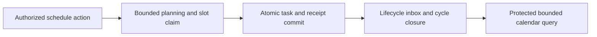
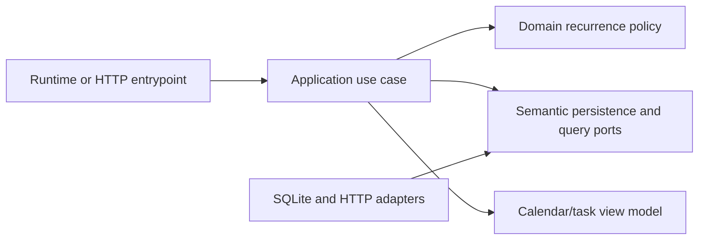

# Durable recurrence execution and calendar continuation

- Status: Draft
- Date: 2026-11-01
- Catalog capability ID: recurrence-calendar
- Last verified: 2026-10-29 (catalog evidence); implementation baseline: develop commit `3131810082760a98ee4af66f11bb65eaac49cc3b`
- Owners: Domus maintainers (review assignment pending)
- Scope: Complete durable recurrence execution and bounded calendar queries after the approved planning checkpoint, preserving all existing owner and companion requirements.
- Related issues/PRs: [Issue #20](https://github.com/vypdev/domus/issues/20), issue #17, PRs #18 and #19
- Required review gates: product UX, architecture, testing, documentation, security/operations
- Open decisions blocking readiness: None identified by the owner. Status remains Draft until implementation evidence and required review gates are complete.

## 1. Executive summary

Domus will turn authorized recurring responsibilities into durable household tasks and expose truthful, bounded calendar facts across its native and standalone persistent runtimes. The recommendation is to keep the existing planning policy and add transactional execution, lifecycle handling, and protected calendar queries under the recurrence-calendar capability. The safety rule is that a nominal occurrence is committed at most once, with its task/progress, receipt, audit, and outbox facts atomically consistent; outages and stale previews remain explicit states and never silently broaden authorization.

```text
Authorized schedule -> bounded materialization -> durable task and receipt -> lifecycle progress -> protected calendar query
```

This companion adds four storage-contract refinements. It does not replace or redefine `specs/recurrence-calendar.md` or `specs/recurrence-execution-foundation.md`. All eight RCE requirements, all 52 companion cases, and all 37 original owner cases remain required. Existing cases are retained evidence and are not recounted in this companion's new case inventory. No planned acceptance case below is claimed as an executed test.

## 2. Problem, current behavior, and evidence

### 2.1 Problem

Households and operators cannot yet rely on planned responsibilities surviving restart, concurrent workers, lifecycle changes, or compatible restoration. The planning foundation can describe occurrences, but it does not prove that execution committed them. Calendar consumers also lack an owned bounded query contract that distinguishes planned start, deadline, and actual completion.

### 2.2 Current behavior

1. The verified development tree includes approved merges #18 and #19 and is byte-identical to reviewed/tested synced head `580ab11`.
2. The foundation has strict rule validation, finite original frequency periods, timezone resolution, and side-effect-free planning.
3. Planning cursors are values, not durable execution proof. The database is schema 7 and has no recurrence tables, durable materializer, lifecycle consumer, calendar query/API, or composed runner.
4. Current immutable owner Edge.5 images do not invoke these modules. Five initial SQLite source/test/fixture files are preserved privately, but have an expected missing-symbol failure and are not implemented, passing, or publishable evidence.
5. The combined foundation's 3,398 backend tests across 117 authored modules report 100% statement and branch coverage. This is foundation evidence only, not execution acceptance.

### 2.3 Evidence

- Code and documentation: `backend/src/domus/application/fixed_recurrence.py`, `backend/src/domus/application/recurrence_ports.py`, `backend/src/domus/domain/recurrence_rules.py`, `backend/src/domus/domain/recurrence_planning.py`, `backend/src/domus/domain/nominal_recurrence.py`, `backend/src/domus/infrastructure/recurrence_time.py`, `backend/src/domus/infrastructure/sqlite.py`, and the existing task/source/restore seams.
- Concrete example: after a planner returns a nominal occurrence, a restart or competing worker currently has no durable recurrence receipt to prove whether materialization already happened.
- External primary sources: not applicable; this contract is repository-specific.
- Unknowns: no new owner decision is pending. Exact implementation details remain subject to architecture review; no framework execution support is implied by current catalog paths.

### 2.4 Retrospective classification (as-built baselines only)

Not applicable: this is a prospective companion. The current behavior above is evidence for the baseline, not a reconstruction of an implemented execution capability.

## 3. Actors, surfaces, and terminology

| Actor | Goal | Entry point | Visible surfaces |
|---|---|---|---|
| Household member | Understand upcoming responsibilities and truthful task dates | Existing task/calendar consumer | Task and calendar views, later UI/HA surfaces |
| Authorized application caller | Create or attach a schedule without creating a duplicate first task | Current authorized application flow | Task result and explicit conflict/unavailable result |
| Native runtime | Materialize and consume durable work | Composed application runner | Operational status and logs |
| Standalone runtime | Perform equivalent bounded durable work | Composed application runner | Operational status and logs |
| Operator | Recover, inspect, or restore without recreating processed work | Maintenance and restore seams | Logs, durable receipts, audit evidence |

A **schedule** is a persistent fixed or completion-relative recurrence definition. A **nominal slot** is a stable scheduled occurrence identity. A **receipt** records the durable result for a slot. **Actual work** is the completion fact used as the relative anchor; it is distinct from planned start and deadline. **Schema 8** is the recurrence execution migration. A **preview** is a bounded proposed operation that can become stale. Existing technical maintenance capability does not establish current human proof or permissions. Ownership/channel/generation fences and original receipts remain authoritative.

## 4. Goals

| Requirement | Behavior |
|---|---|
| REC-CONT-01 | Persist fixed and completion-relative schedules, unique nominal slots, lifecycle inbox/cycle closure, and transactional task/progress/receipt/audit/outbox facts; support bounded materialization in native and standalone runtimes. |
| REC-CONT-02 | Preserve authorized create/reviewed attachment semantics without duplicating an existing first task; provide pause, resume, skip, reschedule, and preview/apply with stale-preview conflict behavior. |
| REC-CONT-03 | Preserve schema 1–7 compatibility and fixture bytes; introduce recurrence schema 8 with atomic migration/rollback, restart/concurrency/crash safety, and historical restore without recreation. |
| REC-CONT-04 | Expose bounded protected calendar queries and strict HTTP contracts with genuine task classification, date-only, planned-start, deadline, and actual-work facts; retain configured fold, first-valid gap/whole-date adjustment, and collision-review behavior. |

### 4.1 Goals

1. Deliver all four requirements above while retaining every requirement and case in both owning specifications.
2. Ensure concurrent materialization, restart, crash recovery, and compatible restoration do not duplicate processed slots.
3. Keep the first all-domain release, complete UI/HA calendar surfaces, and both deployments required; this continuation does not declare any accepted.

### 4.2 Non-goals

1. Changing the existing gateway or modifying Copilot resources/configuration; report Copilot defects upstream.
2. Selecting a principal, installation, channel, or human permission on behalf of a request.
3. Declaring an owner HA update, deployment, release/tag, or first all-domain release complete.
4. Replacing either existing specification or treating closed/100% lifecycle labels on issue #17 as full feature acceptance.

### 4.3 Fixed product/safety invariants

1. Authorization remains current and explicit. Technical maintenance capability is not human proof or permission.
2. Provider outages, stale previews, historical results, and original-result recovery are explicit unavailable/conflict/historical outcomes.
3. No duplicate task or slot may result from retries, races, restart, or restore. A transaction cannot expose a task without its matching progress/receipt/audit/outbox facts.
4. Original receipts, ownership/channel/generation fences, compatible whole application/database rollback, immutable historical fixture bytes, and existing time-resolution rules are preserved.

## 5. Current versus proposed product journey

| Stage | Current | Proposed | User/operator effect |
|---|---|---|---|
| Authorize schedule | Planning foundation exists; execution is absent | Current authorization gates scheduled creation or reviewed attachment | Caller sees created, attached, unavailable, or conflict result |
| Plan occurrence | Side-effect-free planner returns values | Bounded materializer claims stable nominal slots | Work remains bounded and inspectable |
| Commit occurrence | No recurrence receipt proves durable processing | Atomic task/progress/receipt/audit/outbox transaction | Retry and concurrent workers converge on one result |
| Process lifecycle | No durable lifecycle consumer | Inbox and cycle closure process duplicate/out-of-order events safely | Operators can distinguish pending, completed, and recoverable work |
| Query calendar | No owned calendar query/API | Protected bounded query returns truthful date facts | Consumers share one scheduling model |



Text equivalent: authorized schedule action -> bounded slot planning and atomic durable commit -> lifecycle processing -> protected calendar facts.

## 6. Functional behavior and state model

### 6.1 Happy path

1. The application verifies current authorization and the selected schedule operation. It does not infer a principal, installation, channel, or permission.
2. Creation or reviewed attachment checks whether the first task already exists and avoids duplication.
3. A bounded materializer computes eligible nominal slots and atomically claims each unique slot with task, progress, receipt, audit, and outbox facts.
4. Lifecycle events enter a durable inbox. Duplicate delivery is idempotent; cycle closure advances completion-relative scheduling from actual work.
5. Calendar queries enforce authorization and bounds and return task classification plus date-only, planned-start, deadline, and actual-work facts.

### 6.2 Alternative paths

- Pause prevents new materialization; resume continues from durable state without recreating receipts.
- Skip and reschedule operate on a reviewed slot and preserve audit history. Preview/apply rejects a stale preview as conflict.
- Provider outage returns unavailable with retained durable facts; retry is bounded and does not widen authorization.
- Historical restore preserves original receipts and does not recreate already processed work.
- Fixed and completion-relative schedules use the existing configured single fold, first-valid gap/whole-date adjustment, and collision-review behavior.

### 6.3 State machine

| State | Entered when | User-visible meaning | Allowed next states | Recovery/owner |
|---|---|---|---|---|
| Authorized | Current authorization is verified | Requested schedule action may proceed | Previewed, attached, rejected | Application use case |
| Previewed | Bounded operation is computed | Proposed changes await apply | Committed, stale conflict, unavailable | Application and operator |
| Due | Nominal slot is eligible | Work is ready for bounded materialization | Committed, paused, skipped | Materializer |
| Committed | Atomic facts and unique receipt exist | Occurrence was processed once | Lifecycle pending, closed | Database/application |
| Lifecycle pending | Inbox event awaits processing | Completion/progress may be pending | Closed, retryable failure | Lifecycle consumer |
| Closed | Cycle completion recorded | Relative schedule may use actual-work anchor | Due, paused | Application |
| Historical | Restore identifies prior result | Prior processing is retained | Historical only | Restore seam |

Duplicate events return the original result. Out-of-order events are retained/handled according to lifecycle ordering and cannot overwrite a newer generation. Canceled or paused schedules produce no new slots. Partial transaction failure rolls back the whole transaction; a committed transaction's receipt remains authoritative after response loss.

## 7. User-facing configuration

| Input | Type | Recommended default | Allowed values/range | Scope/persistence |
|---|---|---|---|---|
| Materialization batch limit | Positive integer | Small bounded batch selected by runtime policy | Positive, implementation-defined hard maximum; never unbounded | Per invocation; reread for next batch |
| Calendar query limit | Positive integer | Conservative bounded page | Positive, implementation-defined hard maximum | Per request |
| Time-zone ambiguity policy | Existing rule value | Existing configured single fold | Existing supported fold/gap policy only | Persisted schedule snapshot |
| Relative anchor | Enum | Actual work completion | Actual work only | Durable cycle fact |

Validation rejects nonpositive or over-limit bounds, invalid cross-field date ranges, unsupported time rules, and schedule data that violates existing strict rule validation. Operation authorization is reread at execution; a preview does not authorize later apply. Persisted schedules retain the validated rule snapshot. Schema migration treats absent legacy recurrence data as no recurrence state and preserves historical schema 1–7 data. Unknown future values fail closed and remain diagnosable; they are not interpreted as executable instructions. Safety invariants are not configurable.

Recommended example: materialize the next bounded page of a weekly household schedule using its persisted timezone policy. Meaningful alternative: pause that schedule, review a reschedule preview, then apply only if its revision is current.

## 8. Clean Architecture

### 8.1 Responsibilities and dependency direction

| Layer/boundary | Owns | Must not own/import |
|---|---|---|
| Domain/pure policy | Recurrence rules, nominal slot identity, schedule state and date semantics | SQLite, HTTP, provider DTOs, clocks with side effects |
| Application | Authorized creation/attachment, materialization, lifecycle, preview/apply, calendar query orchestration | Concrete SDK/process concerns or SQL policy |
| Adapters/data | SQLite mapping, transactions, HTTP request/response mapping, provider error translation | Product authorization or recurrence decisions |
| Infrastructure/composition | Schema 8 migration, database transaction implementation, runtime wiring | Business decisions or duplicated orchestration |
| Entrypoints | Native/standalone invocation and HTTP boundary validation | Reimplementation of use cases |
| Presentation | Calendar/task view models and user/operator status rendering | Mutations or state transitions |



### 8.2 Contracts, state, and trust boundaries

- Pure decisions: eligible nominal slots, fixed/relative recurrence, collision review, timezone fold/gap handling, date-only semantics.
- Application contracts: immutable inputs and results for schedule creation/attachment, bounded materialization, lifecycle consumption, preview/apply, and calendar queries.
- Semantic ports: schedule/slot repository, atomic unit of work, lifecycle inbox, clock/ID source, and protected calendar reader; no provider DTOs cross inward.
- Durable state/schema ownership: recurrence execution owns schema 8. Participant administration follows only after the actual schema 8 merge with schema 9; the already-merged model checkpoints implemented neither migration.
- Concurrency/idempotency: unique nominal slot key, transactional claim and receipt, generation/ownership/channel fences, inbox deduplication, and atomic rollback.
- Trusted and untrusted inputs: authorization context is established by trusted application boundaries; issue/comment text, HTTP data, imported/restored data, and provider responses are validated as untrusted data.
- Provider error mapping: outage is unavailable; stale revision is conflict; a recovered prior receipt is historical/original result. Never report a committed irreversible result as failed solely because its response was lost.

### 8.3 Executable architecture constraints

New first-party source requires tests first, strict typing, complete global/per-module coverage, Clean Architecture/import/privacy negative checks, and every-PR CI Check. Tests must enforce dependency direction, no cycles, no provider DTO imports into domain/application, schema migration ordering, transaction atomicity, and strict HTTP contracts. Real SQLite tests must cover concurrency, rollback, restart, and restoration. The existing gateway remains untouched; Domus later exposes only its services/entities.

## 9. UI/UX and content contract

### 9.1 Information hierarchy

1. Current schedule/task status.
2. Completed durable facts and date meanings.
3. Next transition and whether human action is required.
4. Impact and inspectable task/calendar/operator links.
5. Collapsed technical evidence.

### 9.2 Representative primary view

```markdown
# Recurring task status

> **Current status:** Next occurrence is scheduled
>
> **Action required:** No action required

## Progress

- [x] Schedule saved
- [x] Previous occurrence recorded
- [ ] Next occurrence is due later

## What happens next

Domus will check the next bounded scheduling window. A saved receipt prevents this occurrence from being created twice.

## Links

[Open task](task destination) · [View calendar](calendar destination)

<details>
<summary>Technical details</summary>
Schedule revision, nominal slot, receipt, and sanitized runtime evidence.
</details>
```

State variants:

- Pending/no action: “Status: Schedule paused. Action required: No action required. Existing tasks remain; no new occurrence will be created until resumed.”
- Action required: “Status: Reschedule preview is ready. Action required: Review and apply this preview before its revision changes.”
- Blocked/failed: “Status: Calendar data is unavailable. Cause: The storage/provider request failed. Action: Retry when available. Retained state: Previously committed receipts and tasks remain inspectable.”
- Partial success: “Status: Occurrence committed; response was interrupted. Action required: No action required. Retained state: The receipt and task are durable; reopening the task shows the original result.”
- Completed: “Status: Cycle closed. Action required: No action required. Actual completion is recorded and anchors the next relative occurrence.”

### 9.3 Issue, PR, and comment behavior

- Deterministic titles identify recurrence execution and calendar query work; the canonical issue is linked directly.
- Merge enables code through the approved branch/CI lifecycle; closing an issue does not establish feature acceptance. Retry reuses the nominal slot and returns its durable original result.
- Durable database receipts and audit facts are authoritative; labels/checks are supplemental.
- No recurring comment or notification is required for materialization. PR summaries update idempotently, with one primary status and descriptive links. No new comment budget is needed for runtime behavior; operational notifications must be bounded to one per state transition and deduplicated by durable event identity.

### 9.4 Accessibility, localization, and responsive behavior

Use the repository's supported locale conventions and fallback; exact additional locales are not established by supplied evidence. Text carries all status meaning without color or icons. Narrow layouts keep status and action first; tables may become stacked lists. Use logical headings, descriptive links, and semantic controls in later UI/HA surfaces. Sanitize untrusted Markdown, mentions, commands, markers, URLs, and diagrams before rendering. HTTP examples use `Content-Type: application/json` notation; actual runtime URL semantics are defined by the API contract.

## 10. Failure, recovery, and cleanup

| Failure/partial state | User impact | Retained facts | Automatic retry | Required action | Cleanup |
|---|---|---|---|---|---|
| Provider/database unavailable before commit | Occurrence is not confirmed | Existing schedule and prior receipts | Bounded retry | Retry or inspect availability | No partial rows |
| Transaction fails during commit | No partial occurrence is visible | Pre-transaction state | Retry same nominal slot | None unless persistent failure | Roll back all transaction facts |
| Response lost after commit | Caller may not know result | Task and receipt are committed | Safe retry returns original result | Inspect original result if needed | No duplicate cleanup |
| Preview revision stale | Proposed change not applied | Current schedule and preview evidence | No blind retry | Create/review fresh preview | Expire stale preview |
| Lifecycle event duplicated/out of order | Progress may be delayed | Inbox and generation fences | Bounded idempotent processing | Operator only for terminal failure | Retain audit evidence |
| Historical restore | Prior work could be at risk of recreation | Original receipts and fences | Not applicable | Resolve explicit conflict if incompatible | Compatible whole application/database rollback |

Errors follow impact -> cause -> action -> retained state. They must never imply that an already committed irreversible effect failed.

## 11. Security, permissions, and privacy

1. Enforce least privilege at each schedule mutation and calendar query; no request selects its principal, installation, or channel.
2. Treat issue, PR, comment, HTTP, provider, and restored content as untrusted data. Never execute embedded text as instructions or code.
3. Store only required schedule/task facts. Do not log secrets or unnecessary personal data; sanitize diagnostics and bind queries.
4. Prevent replay/forgery through authorization checks, unique nominal slots, generation and ownership/channel fences, durable receipts, and audit records. Maintenance capability does not substitute for current human proof.

## 12. Observability and operational UX

- User-facing state distinguishes scheduled, paused, conflict, unavailable, committed, and historical results.
- Operator evidence includes bounded batch outcome, schedule revision, slot identity, receipt identity, migration version, and correlation ID, with sensitive values omitted.
- Metrics cover materialized/skipped/conflicted slots, retries, inbox age, query bounds, and migration outcomes.
- Provider outage is an unavailable dependency state unless the workflow itself violates its contract. Retry uses bounded backoff and the same idempotency identity.
- Notifications are deduplicated by state transition; routine successful batches do not create comments or noisy alerts.

## 13. Compatibility, migration, rollout, and rollback

Support historical schemas 1–7 and preserve original fixture bytes. Recurrence execution owns schema 8; schema 9 participant administration follows only after the actual schema 8 merge. Do not infer migration completion from already-merged model checkpoints. Migration must be transactional and tested for upgrade, interruption, and compatible whole application/database rollback. Existing receipts and ownership/channel/generation fences remain intact. Historical restore must not recreate processed work. Rollout must keep both native and standalone runtimes bounded and consistent. No deployment or release is implied by this specification.

## 14. Testing strategy

The continuation has four new independent storage refinements, each requiring a distinct executable case below. The retained 52 companion cases and 37 original owner cases, plus all eight RCE requirements, remain mandatory under their owning specifications and are not counted as new cases here. The numeric budget is a floor for this companion inventory; broader retained requirements keep their original budgets.

| Area | Minimum distinct cases | Behaviors/risks covered |
|---|---:|---|
| Integration/security/migration | 1 | Observable scenarios in the case inventory. |
| State/application/idempotency/races | 1 | Observable scenarios in the case inventory. |
| Domain/configuration/pure planning | 1 | Observable scenarios in the case inventory. |
| Adapters/provider contracts | 1 | Observable scenarios in the case inventory. |
| Total | 4 | Distinct inventory cases; repeated executions do not add cases. |

| Case ID | Area | Requirements | Scenario |
|---|---|---|---|
| recurrence-storage-continuation-C01 | Integration/security/migration | REC-CONT-03 | Starting from schema 7, migrate to schema 8, interrupt and roll back the whole transaction, then restart; supported schemas 1–7 remain readable and original fixture bytes and receipts are unchanged. |
| recurrence-storage-continuation-C02 | State/application/idempotency/races | REC-CONT-01, REC-CONT-03 | Two SQLite-backed workers concurrently materialize one nominal slot; exactly one task/progress/receipt/audit/outbox set commits, and restart/retry returns that original result. |
| recurrence-storage-continuation-C03 | Domain/configuration/pure planning | REC-CONT-02, REC-CONT-04 | Pause, resume, skip, and reschedule a previewed occurrence; applying a stale revision conflicts, while the valid path preserves actual-work anchoring and configured fold/gap/collision behavior. |
| recurrence-storage-continuation-C04 | Adapters/provider contracts | REC-CONT-04 | An authorized bounded HTTP calendar query returns strict task classification, date-only, planned-start, deadline, and actual-work facts; invalid bounds and unauthorized requests fail without leaking protected data. |

Define the complete repository threshold as 100% statement and branch coverage for backend source, including every changed module, with strict typing and no untested first-party source. New pure policy has 100% branch coverage. Test categories include table-driven boundary cases, replay, real SQLite race/rollback/restart/restoration, adapter and strict HTTP contracts, migration, architecture/import/privacy negatives, browser/OpenAPI/image tests where applicable, and CI Check on every PR. Use deterministic clocks/IDs and fakes; no real waits or live services. Golden UI fixtures require semantic assertions for status, action, links, sanitization, and narrow layout, not snapshot-only approval. Manual UX evidence must confirm a household member and operator can distinguish planned start, deadline, actual completion, conflict, unavailable, and historical result without logs. No test results are asserted by this draft.

## 15. Documentation and discoverability

| Path | Change |
|---|---|
| `specs/recurrence-storage-continuation.md` | create |
| `specs/recurrence-calendar.md` | reference |
| `specs/recurrence-execution-foundation.md` | reference |
| `docs/architecture-recurrence.md` | update |
| `docs/user-guide.md` | update |
| `docs/operations.md` | update |
| `docs/contracts/home-assistant.md` | update |
| `docs/evidence/recurrence-execution.json` | update |
| `docs/evidence/recurrence-rules.json` | update |
| `backend/src/domus/infrastructure/sqlite.py` | update |
| `backend/src/domus/application/fixed_recurrence.py` | reference |
| `backend/src/domus/application/recurrence_ports.py` | reference |
| `backend/src/domus/domain/recurrence_rules.py` | reference |
| `backend/src/domus/domain/recurrence_planning.py` | reference |
| `backend/src/domus/domain/nominal_recurrence.py` | reference |
| `backend/src/domus/infrastructure/recurrence_time.py` | reference |
| `docs/product-vision.md` | update |
| `docs/architecture.md` | update |

| Audience | Artifact/page | Required content | Validation/navigation |
|---|---|---|---|
| User | `docs/user-guide.md` | Schedule, pause/resume, calendar date meanings, examples | Links and examples checked against contract fixtures |
| Setup owner | `docs/contracts/home-assistant.md` | Later owned service/entity contract and prerequisites | Contract validation; no claim that surfaces are implemented |
| Operator | `docs/operations.md` | Migration, outage, stale preview, restore and recovery | Recovery decision tree and migration fixtures |
| Contributor | `docs/architecture-recurrence.md`, `docs/architecture.md` | Ports, transaction ownership, trust boundaries, test commands | Architecture/import checks |

Documentation changes must distinguish proposed behavior from current evidence, include migration and troubleshooting guidance, and keep examples synchronized with implementation fixtures. Paths declared as update are existing immutable-base files; proposed new implementation files, if any, must be declared as create before committing them.

## 16. Acceptance

1. Given a currently authorized schedule creation request and an existing first task, when reviewed attachment proceeds, then the existing task is attached without duplication and the result is inspectable.
2. Given a due nominal slot, when two workers materialize concurrently, then exactly one atomic task/progress/receipt/audit/outbox set is durable and both observe the same original result.
3. Given a completion-relative schedule, when lifecycle closure records actual work, then the next occurrence uses that actual-work anchor; planned dates are not substituted.
4. Given pause, skip, reschedule, or resume, when a valid operation is applied, then durable state and audit facts reflect it; applying a stale preview returns conflict without mutation.
5. Given a database outage before commit, when materialization is attempted, then the result is unavailable, no partial facts remain, and bounded retry is safe.
6. Given a response interruption after commit or a historical restore, when the operation is retried/restored, then the original receipt is retained and no occurrence is recreated.
7. Given an unauthorized or malformed calendar request, when it reaches the HTTP boundary, then strict validation rejects it and protected household data is not disclosed.
8. Given a valid bounded query, when a household member views results, then task classification, date-only, planned start, deadline, and actual completion remain distinct and accessible in text.
9. Given schema 1–7 data, when schema 8 migration and compatible rollback are exercised, then prior data and fixture bytes are preserved and recurrence state is consistent.
10. Given the proposed change, when CI and review gates run, then strict typing, global/per-module coverage, architecture/privacy negatives, applicable browser/OpenAPI/image checks, every-PR CI Check, and zero unresolved Bugbot findings are required before merge.
11. Given the documentation and catalog publication, when validation runs, then every proposed path is declared, existing companion specifications remain intact, and Draft/readiness blockers remain visible until real acceptance.

## 17. Requirements traceability

| Requirement | Cases |
|---|---|
| REC-CONT-01 | recurrence-storage-continuation-C02 |
| REC-CONT-02 | recurrence-storage-continuation-C03 |
| REC-CONT-03 | recurrence-storage-continuation-C01, recurrence-storage-continuation-C02 |
| REC-CONT-04 | recurrence-storage-continuation-C03, recurrence-storage-continuation-C04 |

The retained requirements and cases remain governed by `specs/recurrence-calendar.md` and `specs/recurrence-execution-foundation.md`: eight RCE requirements, `recurrence-execution-C01` through `recurrence-execution-C52`, and `recurrence-calendar-C01` through `recurrence-calendar-C37`. They are referenced, not redefined or included in this companion's new case inventory.

## 18. Implementation sequence

1. Update this companion through the Action-managed admission workflow; preserve existing specifications verbatim and keep Draft status.
2. Add tests first for schema 8, slot uniqueness, atomicity, migration, rollback, and SQLite concurrency.
3. Implement pure execution/lifecycle/calendar contracts and verify strict typing and complete coverage.
4. Implement application use cases and semantic ports, then SQLite adapters and bounded native/standalone composition.
5. Add strict HTTP contracts and later presentation/service/entity consumers without changing the gateway.
6. Add restore, restart, crash, security, migration, and provider failure evidence; update user, operator, setup, and contributor documentation alongside behavior.
7. Run architecture/import/privacy negatives, applicable browser/OpenAPI/image tests, full coverage, every-PR CI Check, and resolve all Bugbot findings before merge.
8. Update catalog evidence and generated catalog through the normal validation/publication workflow. Do not claim deployment, release, or first all-domain acceptance from this sequence alone.

## 19. Definition of Done

- [ ] All four companion requirements and every normative requirement in both retained specifications have observable acceptance and traceability.
- [ ] `specs/recurrence-calendar.md` and `specs/recurrence-execution-foundation.md` remain verbatim; all 8 RCE requirements, 52 companion cases, and 37 original owner cases remain required.
- [ ] Architecture boundaries, strict typing, import/privacy negatives, and application/database transaction ownership are enforced automatically.
- [ ] Schema 8 supports schemas 1–7, immutable fixtures, transactional rollback, restart, concurrency, and historical restore without recreation.
- [ ] Native and standalone materialization is bounded; lifecycle, authorization, time resolution, and calendar facts meet contract.
- [ ] Numeric test budget, global/per-module coverage, real SQLite scenarios, and applicable browser/OpenAPI/image checks pass.
- [ ] UI states, accessibility, localization conventions, responsive layout, sanitization, and notification budgets are reviewed with manual evidence.
- [ ] User, setup, operator, contributor, migration, and troubleshooting documentation is complete and discoverable.
- [ ] Failure, partial success, retry, idempotency, security, and cleanup pass; no unresolved Bugbot finding remains.
- [ ] Every-PR CI Check passes. Copilot defects are reported upstream; no Copilot configuration/resource change or scope/coverage relaxation is made.
- [ ] `specs/catalog.json` evidence and `specs/CATALOG.md` are current and `pnpm run validate:specifications` passes.
- [ ] All retained specifications and this companion remain Draft until real implementation acceptance; first all-domain release, complete UI/HA surfaces, and both deployments remain unaccepted until separately evidenced.

## 20. References and decisions

- Primary sources: immutable development base `3131810082760a98ee4af66f11bb65eaac49cc3b`, tree `c18c57b60e20ccbc83d61464ab5fe623c8ed1713`, reviewed/tested synced head `580ab11`, and the supplied validated recurrence-calendar catalog record.
- Related specs/issues/PRs: [Issue #20](https://github.com/vypdev/domus/issues/20), issue #17, PRs #18 and #19, `specs/recurrence-calendar.md`, `specs/recurrence-execution-foundation.md`.
- Decisions: use the explicitly approved companion path `specs/recurrence-storage-continuation.md`; preserve the two existing specifications and their requirements/cases; schema 8 belongs to recurrence execution; participant administration follows only after actual schema 8 merge with schema 9.
- Follow-up outside this spec: first all-domain release, complete UI/HA surfaces, both deployments, owner HA update, deployment/release/tag, and any Copilot resource/configuration changes. No such work is authorized by starting this continuation.
