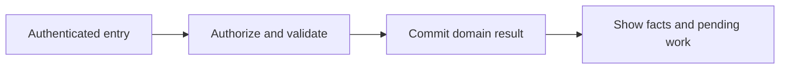
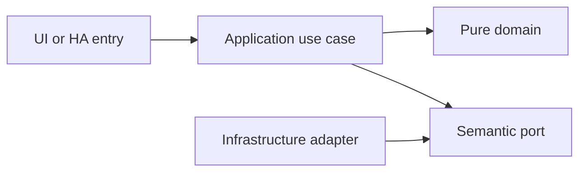

# Shared shopping demand, purchases and receipt

- Status: Draft
- Date: 2026-10-28
- Catalog capability ID: shopping-management
- Last verified: 2026-10-29 (document structure only; no implementation evidence)
- Owners: Domus maintainer; engineering/product reviewers to be assigned
- Scope: Shopping combines manual intent, replenishment and task materials without losing provenance. Buying an item and physically receiving it are separate recorded facts.
- Related issues/PRs: https://github.com/vypdev/domus/issues/2
- Required review gates: product UX, architecture, testing, documentation, security/operations
- Open decisions blocking readiness: Detailed demand-coverage and unit fixtures; partial-receipt UX; price/currency precision; launch purchase-session scope. The owner confirmed manual-extra and duplicate-safe automatic consolidation defaults on 2026-10-29. Catalog gate prerequisites remain unverified.

## 1. Executive summary

Shopping combines manual intent, replenishment and task materials without losing provenance. Buying an item and physically receiving it are separate recorded facts.

```text
Authenticated member -> validated domain command -> durable result -> household and HA projections
```

This is a prospective Draft, not an implemented or accepted capability. The first usable release covers all domains and both deployment targets.

## 2. Problem, current behavior, and evidence

Checking a shopping box cannot safely represent outstanding demand, partial purchases, shared shoppers and stock receipt.

Current verified sequence: (1) the repository has a minimal README and installed Copilot automation; (2) no Domus application, public service or tests exist; (3) this contract proposes the behavior to build.

Evidence: the owner's attached brief and subsequent decisions in [product vision](../docs/product-vision.md), the pinned [reference investigation](../docs/reference-investigation.md), and the existing repository baseline. Retrospective classification is not applicable: no as-built product baseline is reconstructed.

## 3. Actors, surfaces, and terminology

Actors: Requester; shopper; receiver; stock administrator.

Primary surfaces: application UI, HTTP domain boundary, relevant HA entities/services, activity and diagnostics. Definitions of member, principal, occurrence, demand and ledger are shared in the [glossary](../docs/glossary.md). The actor recording an action is distinct from its selected target and actual performer.

## 4. Goals, non-goals, and fixed invariants

Goals and fixed invariants are the following normative requirements. No configuration may weaken authorization, ledger integrity, attribution or idempotency.

| Requirement | Behavior |
|---|---|
| shopping-management-R1 | Shopping MUST accept shared multiple lists and free-text products with quantity, unit, notes, priority and optional shopper/store/prices. |
| shopping-management-R2 | Every demand MUST retain its origin, additive or overlapping semantics and any user-requested extra quantity. |
| shopping-management-R3 | Consolidation MUST reject incompatible units and prevent double-counting reservations or silently discarding manual requests. |
| shopping-management-R4 | Purchase, receipt and inventory posting MUST remain distinct states supporting partial quantities and nontracked goods. |
| shopping-management-R5 | Concurrent shoppers and retries MUST not duplicate purchases, receipts or stock movements. |
| shopping-management-R6 | Purchase history and optional sessions MUST retain shopper, dates, quantities and optional store/prices without requiring a receipt image. |
| shopping-management-R7 | Shopping commands and recovery MUST enforce household permissions, show retained partial facts and preserve cancellable outstanding demand. |

Non-goals: changing Copilot, changing the existing gateway, building an MCP server, adding mandatory cloud/AI dependencies, or claiming production readiness from a document.

## 5. Current versus proposed product journey

| Stage | Current | Proposed | User/operator effect |
|---|---|---|---|
| Enter | No Domus UI | Verified HA principal opens the relevant surface | Role and scope are explicit |
| Act | No domain command | Validate input, permission and current revision | Invalid data leaves the draft intact |
| Commit | No durable domain record | Store change and operation receipt atomically | Retry cannot duplicate effects |
| Observe | No projection | Show committed facts and pending downstream projections | Partial success remains understandable |



Text equivalent: authenticated entry -> authorization and validation -> durable domain commit -> visible facts with any pending projection. Domain-specific alternatives are described below.

## 6. Functional behavior and state model

### 6.1 Domain model and normal path

ShoppingList, Demand(source_type, source_id, product_or_free_text, amount, unit, semantics, revision), PlannedLine, PurchaseSession, PurchaseItem and Receipt. Free-text items need no product record. Demands remain individually attributable when a line is consolidated. Inventory target demand covers target minus available minus outstanding compatible supply; a task reservation is already reflected in availability and is not added twice. Manual demand is additional by default and can explicitly be marked overlapping. Quantities combine only with identical product, compatible units and declared semantics; ambiguous cases remain separate.

The owner confirmed on 2026-10-29 that manual requests are additional by default and automatic stock/material demands consolidate without counting the same requirement twice. Consolidation retains each source and its coverage semantics; matching names alone do not establish overlap. If an automatic four-unit demand already covers a reserved task material, that same material is not added again; a manual extra of two still raises the purchase requirement to six. Distinct independent material needs remain additive. This rule does not silently relabel a manual extra as an automatic threshold.

### 6.2 States and alternatives

Demand open -> planned -> satisfied or cancelled. Purchase planned -> purchased -> partially_received -> received. Stock posting is a separate durable step tied to each receipt line; a received tracked product is pending stock until posting succeeds. Nontracked items finish at receipt without inventory records.

A duplicate uses its original operation receipt. A changed payload under the same key is a conflict. Out-of-order events use aggregate revision and source identity. Cancellation never erases an already committed ledger effect; compensation is explicit.

## 7. User-facing configuration

| Input | Type | Recommended default | Allowed values/range | Scope/persistence |
|---|---|---|---|---|
| `manual_demand_semantics` | enum | additional | additional or explicitly overlapping | demand; persisted |
| `purchase_currency` | ISO currency | selected at setup | one household currency initially; decimal minor-unit validation | purchase session; snapshot |
| `default_list` | list reference | Household shopping | active list only | household; persisted |
| `auto_receive_purchase` | boolean | false | true allowed only with explicit combined-action UI confirmation | household; command snapshot |

These are proposed defaults pending review. Invalid values and contradictory combinations are rejected before saving; unknown future values require an explicit compatibility error. Precedence is fixed invariants, installation constraints, household policy, then member preferences; lower scopes cannot expand permissions. In-flight commands snapshot relevant policy versions, while revocation is checked at the transaction boundary.

Recommended example: keep the defaults above. Meaningful alternative: a member selects Spanish and dark theme while the same household policies remain in force. Transport secrets are installation concerns and are never domain form fields.

## 8. Clean Architecture design

### 8.1 Responsibilities and dependency direction

CreateDemand, ConsolidateDemand, RecordPurchase, ReceivePurchase and PostReceiptStock use separate semantic contracts. A receipt ID and line ID are inventory idempotency sources. The application owns source demand arithmetic; the UI never consolidates by name. Inventory changes and purchase status use transaction/outbox coordination with visible pending state.

| Boundary | Owns | Forbidden dependency |
|---|---|---|
| Domain | Entities, value objects and pure rules | HA, HTTP, SQL, UI frameworks |
| Application | Authorized commands, queries and semantic ports | Concrete adapters and framework DTOs |
| Adapters | Schema mapping, persistence and provider error mapping | Alternate business rules |
| Composition | Explicit deployment wiring | Business decisions |
| Presentation | View models and rendering | Database access or client-only authorization |



Text equivalent: entrypoints call use cases; use cases depend on pure domain and ports; infrastructure implements ports. Architecture checks reject forbidden imports and cycles. Shared contract tests exercise each port adapter; schemas and migration checks enforce durable boundaries.

## 9. UI/UX and content contract

### 9.1 Primary state examples

| State | Visible content |
|---|---|
| Pending | Saving the purchase. No action required. |
| Action required | Four cartons were received. Two are still pending. Record the remaining receipt when it arrives. |
| Blocked | This line changed while another shopper was editing it. Your quantities are retained. Review the latest line. |
| Partial | Purchase and receipt are saved. Inventory posting is pending. Retry stock posting. |
| Complete | Six cartons received and added to inventory. View purchase. |

The primary view names current status, retained facts and one next action, followed by descriptive links to the record/operation. Technical codes and correlation IDs are progressively disclosed. Duplicate responses update the same operation status rather than adding notifications. At most one routine notification per transition, with opt-out and bounded retry summaries.

English and Spanish use stable translation keys, base-language matching and English fallback. Mobile, tablet and desktop layouts, keyboard operation, visible focus, non-color status, accessible names, light/dark contrast and reduced motion are acceptance concerns. Untrusted text is rendered inert; no arbitrary HTML, commands or secret-bearing links.

## 10. Failure, recovery, and cleanup

| Failure | Retained facts | Retry / action | Cleanup |
|---|---|---|---|
| Invalid or denied input | Existing business records and form draft | Correct fields or request the proper role | No side effects |
| Stale revision | Current committed aggregate; user's entered fields | Review current state and submit a new deliberate operation | No automatic overwrite |
| Lost response after commit | Domain result and receipt | Look up or replay the same key | Never issue a fresh-key duplicate |
| Downstream projection unavailable | Successful domain result and durable pending event | Bounded backoff, then visible retry | Acknowledge outbox only after safe consumption |
| Restart or cancellation | Committed records; identified pending work | Recover receipts/cursors; compensate only by explicit command | Remove listeners and owned temporary artifacts |

Errors explain impact, safe cause, action and retained state. External availability is distinct from authorization denial. Retries are bounded and use deterministic backoff tests, not real waits.

## 11. Security, permissions, and privacy

Backend authorization applies to reads and writes. All requests and HA values are untrusted input; only authenticated principals and validated adapter context establish identity. Cross-household IDs, replayed operations and stale roles are covered in the inventory. A person entity and selected member ID do not authenticate a caller. Logs, traces, exports and browser artifacts redact credentials and unnecessary personal data. The technical HA principal has explicit narrow grants and cannot impersonate a household administrator.

## 12. Observability and operational UX

Show operation state and projection freshness to members; expose sanitized correlation, source event, aggregate revision, duration and safe error code to operators. No raw credentials or unrestricted HA payloads enter diagnostics. Counters distinguish denied, invalid, conflict, unavailable and completed operations. One durable activity entry per business transition; retries do not multiply notifications. No telemetry leaves the installation by default.

## 13. Compatibility, migration, rollout, and rollback

No existing Domus application data requires migration yet. The first schema is versioned from its first implementation. Upgrade fixtures cover pending operations and ledger compatibility; a backup precedes destructive migration. Unknown future schemas block writes. Downgrade requires a compatible image/database pair, never silent interpretation of newer data.

Both Supervisor and standalone are first-release acceptance targets. Stable and Edge use separate credentials, IDs, volumes and endpoint bindings. Experimental artifacts cannot automatically promote production. Publication, merge and deployment remain in the existing authorized maintainer lifecycle.

## 14. Testing strategy and numeric budget

Minimum: 21 distinct cases, derived from the explicit risk inventory below. Each inventory row counts once. The budget is a floor, not a claim of completeness or executed tests.

| Area | Minimum distinct cases | Behaviors/risks covered |
|---|---:|---|
| UI and accessibility | 4 | a free-text fruit item; a consolidated line; a session detail view |
| Domain and configuration | 7 | multiple lists; an invalid negative quantity or malformed currency amount; a manual extra of two units |
| Adapters and persistence | 2 | a low-stock demand and manual extra; a purchase session without prices or image |
| State and concurrency | 3 | six units purchased and four received; two shoppers buying the same remaining quantity; a repeated receipt key |
| Integration and recovery | 4 | a nontracked item received; stock posting failure after receipt; a lost purchase response |
| Security and privacy | 1 | a read-only member attempting receipt |
| **Total** | **21** | No double counting |

| Case ID | Area | Requirements | Scenario |
|---|---|---|---|
| shopping-management-C01 | UI and accessibility | shopping-management-R1 | Given a free-text fruit item, a member adds two kilograms without creating an inventory product. |
| shopping-management-C02 | Domain and configuration | shopping-management-R1 | Given multiple lists, assigning a shopper preserves list ownership and quantities. |
| shopping-management-C03 | Domain and configuration | shopping-management-R1 | Given an invalid negative quantity or malformed currency amount, validation identifies the field. |
| shopping-management-C04 | Adapters and persistence | shopping-management-R2 | Given a low-stock demand and manual extra, both source records remain after consolidation. |
| shopping-management-C05 | Domain and configuration | shopping-management-R2 | Given a manual extra of two units, replenishment does not silently absorb those two units. |
| shopping-management-C06 | UI and accessibility | shopping-management-R2 | Given a consolidated line, expanding it shows each source and its semantics. |
| shopping-management-C07 | Domain and configuration | shopping-management-R3 | Given target 10 and available 6 after a task reservation, replenishment requests four rather than adding the reservation twice. |
| shopping-management-C08 | Domain and configuration | shopping-management-R3 | Given incompatible piece and kilogram demands, the list keeps separate lines. |
| shopping-management-C09 | Domain and configuration | shopping-management-R3 | Given compatible overlapping baseline demands, consolidation uses their declared coverage rather than blindly summing them. |
| shopping-management-C10 | State and concurrency | shopping-management-R4 | Given six units purchased and four received, two remain pending receipt and only four can enter stock. |
| shopping-management-C11 | Integration and recovery | shopping-management-R4 | Given a nontracked item received, it completes without a stock movement. |
| shopping-management-C12 | Integration and recovery | shopping-management-R4 | Given stock posting failure after receipt, receipt stays saved and posting is explicitly pending. |
| shopping-management-C13 | State and concurrency | shopping-management-R5 | Given two shoppers buying the same remaining quantity, a revision conflict prevents duplicate fulfillment. |
| shopping-management-C14 | State and concurrency | shopping-management-R5 | Given a repeated receipt key, inventory contains one movement per receipt line. |
| shopping-management-C15 | Integration and recovery | shopping-management-R5 | Given a lost purchase response, retry returns the original purchase rather than a second session. |
| shopping-management-C16 | Adapters and persistence | shopping-management-R6 | Given a purchase session without prices or image, history still shows shopper, date and items. |
| shopping-management-C17 | Domain and configuration | shopping-management-R6 | Given a partial refund or correction, history records a linked correction rather than rewriting the original purchase. |
| shopping-management-C18 | UI and accessibility | shopping-management-R6 | Given a session detail view, quantities purchased and received are labeled separately. |
| shopping-management-C19 | Security and privacy | shopping-management-R7 | Given a read-only member attempting receipt, the backend denies the mutation. |
| shopping-management-C20 | UI and accessibility | shopping-management-R7 | Given cancellation of an unpurchased line, the UI explains remaining source demand before confirming. |
| shopping-management-C21 | Integration and recovery | shopping-management-R7 | Given partial success followed by retry, the response identifies saved purchase facts and retries only the missing stock post. |

Every implemented first-party module starts with meaningful behavior tests. Target and proposed merge gate: 100% lines/statements/functions/branches where the selected tools expose those metrics, enforced separately across backend, frontend and integration code. Third-party/generated artifacts are distinguished from authored source; broad exclusions cannot hide untested logic. No application coverage currently exists.

Inject deterministic clocks, IDs, provider fakes and transaction failures. Use semantic assertions alongside golden content, real adapter contracts and disposable HA integration environments. Add Google Chrome evidence from the owner's authorized local HA for real UX; it does not replace automated tests or unit coverage. CI Check runs the complete applicable suite for every PR update.

## 15. Documentation and discoverability

The following paths are explicit proposed documentation changes relative to the clean repository baseline; implementation source/test paths are intentionally not invented.

| Path | Change |
|---|---|
| specs/shopping-management.md | create |
| specs/README.md | create |
| specs/_template.md | create |
| specs/catalog.json | create |
| specs/CATALOG.md | create |
| docs/architecture.md | create |
| docs/product-vision.md | create |
| docs/glossary.md | create |
| docs/decisions.md | create |
| docs/reference-investigation.md | create |
| docs/copilot-adoption.md | create |
| docs/operations.md | create |
| docs/user-guide.md | create |
| docs/contracts/home-assistant.md | create |
| docs/acceptance-plan.md | create |
| docs/roadmap.md | create |
| README.md | update |

| Audience | Artifact | Required content |
|---|---|---|
| Member | [User guide](../docs/user-guide.md) | Normal path, defaults and state meaning |
| Administrator/operator | [Operations](../docs/operations.md) | Setup, permissions, recovery, backup and rollback |
| Contributor | [Architecture](../docs/architecture.md) | Boundaries and executable constraints |
| HA consumer | [Entity/service contract](../docs/contracts/home-assistant.md) | Stable schemas, semantics and error handling |
| Reviewer | [Acceptance plan](../docs/acceptance-plan.md) | Tests, coverage and human evidence |

Link/path validation accompanies updates. Implementation changes update the owning SDD, catalog evidence, actual tests and user documentation together.

## 16. Acceptance scenarios

The Given/When/Then-equivalent observable scenarios in section 14 are the executable acceptance inventory. For each case, the given precondition and action must produce the specified result with state and side-effect assertions; tests are not implementation snapshots.

Acceptance includes normal, alternative, invalid, duplicate, concurrent, partial, failure, recovery, security, localization and accessibility paths as allocated above. Human review verifies the primary-state examples on desktop/mobile and light/dark themes. Live acceptance remains pending until an implemented artifact is exercised; no result is inferred from the budget.

## 17. Requirements traceability

| Requirement | Cases |
|---|---|
| shopping-management-R1 | shopping-management-C01, shopping-management-C02, shopping-management-C03 |
| shopping-management-R2 | shopping-management-C04, shopping-management-C05, shopping-management-C06 |
| shopping-management-R3 | shopping-management-C07, shopping-management-C08, shopping-management-C09 |
| shopping-management-R4 | shopping-management-C10, shopping-management-C11, shopping-management-C12 |
| shopping-management-R5 | shopping-management-C13, shopping-management-C14, shopping-management-C15 |
| shopping-management-R6 | shopping-management-C16, shopping-management-C17, shopping-management-C18 |
| shopping-management-R7 | shopping-management-C19, shopping-management-C20, shopping-management-C21 |

All requirement cases are reciprocal with section 14. Domain invariants are owned by pure policy, command/state rules by application use cases, provider behavior by adapters, and visible content by presentation; the boundary table in section 8 assigns these responsibilities. Evidence and user/operator documentation are linked in section 15.

## 18. Implementation sequence

1. Resolve the blocking decisions and review this contract before Ready for implementation.
2. Establish test harness, CI Check and architecture checks with the first source files.
3. Implement pure policies and their complete branch tests, then transactional use cases.
4. Add adapters, schema/error contracts, retry/race fixtures and both deployment wiring paths.
5. Build the accessible localized UI and HA projections with tests alongside each flow.
6. Verify migration, recovery, security, channel isolation and documentation.
7. Run the complete suite, review coverage, perform local Chrome dogfooding with recorded cleanup, and collect human evidence.

These are internal implementation steps within the first integrated release; they do not remove other domains or deployment targets from launch.

## 19. Definition of Done

- [ ] Every normative requirement has observable acceptance and reciprocal case links.
- [ ] Every declared case is implemented meaningfully; the numeric budget is met.
- [ ] Clean Architecture constraints and port contracts pass.
- [ ] All supported first-party coverage metrics reach 100% from the first implementation.
- [ ] CI Check passes for the current PR revision with no omitted required jobs.
- [ ] Configuration, state, permission, idempotency and recovery behaviors agree.
- [ ] Primary UI states, localization, responsive behavior and accessibility pass.
- [ ] Both deployment targets and isolated Stable/Edge channels pass acceptance.
- [ ] User/operator documentation, schema/migration evidence and catalog paths are current.
- [ ] Local Google Chrome evidence identifies the artifact, channel, test records and cleanup.
- [ ] The original Copilot validations pass when their real prerequisites exist; no check is weakened.
- [ ] No material decision blocking readiness remains unresolved; Copilot remains unchanged.

## 20. References and decisions

Primary sources: [Copilot standard](https://github.com/vypdev/copilot/blob/f5e5a4cf9a80248994469cd88ad55eecab5b95ca/specs/README.md), [original template](https://github.com/vypdev/copilot/blob/f5e5a4cf9a80248994469cd88ad55eecab5b95ca/specs/_template.md), and the linked [reference investigation](../docs/reference-investigation.md).

Confirmed owner choices and unresolved proposals are separated in [decisions](../docs/decisions.md). [Issue #2](https://github.com/vypdev/domus/issues/2) tracks the documentation foundation. The [adoption note](../docs/copilot-adoption.md) records the current catalog evidence limitation. Optional future depth remains explicitly deferred in the product vision; the gateway's installation and MCP internals are outside Domus scope.

## Protected shopping purchases and partial receipts

- Status: Draft
- Owners: Domus maintainers and Shopping Management
- Scope: Record one-item household purchases, partial receipts and tracked Pantry postings
- Source baseline: develop at 1c88bb4ee84771644b2135efcbeb5755c9538830
- Open decisions blocking readiness: none for this slice

### 1. Executive summary

Provide one shared Shopping section in the protected Inventory workspace. Record a purchase, confirm quantities as they physically arrive, and post each tracked receipt to Pantry as a separate durable action.

### 2. Problem, current behavior, and evidence

Develop has a protected Pantry catalogue, an append-only stock ledger and per-product replenishment. A stock intake cannot distinguish a purchase, an arrival, and a stock posting. Extend specs/shopping-management.md with a bounded implementation slice.

### 3. Actors, surfaces, and terminology

Current household readers see purchases and physical receipt history. A shopping manager records purchases and physical receipts. An inventory manager posts tracked receipts into Pantry. A pending posting is an already recorded physical receipt with no linked stock movement.

### 4. Goals, non-goals, and fixed invariants

| Requirement | Behavior |
|---|---|
| shopping-receipts-R1 | Record an attributed single-item purchase for a current Pantry product or an untracked free-text item. Show purchased, received, remaining and pending stock amounts and retain attributed receipts. |
| shopping-receipts-R2 | Validate exact positive quantities and revisions in the same transaction as each write. A partial physical receipt cannot exceed the remaining purchased amount. Free-text receipt records do not create Inventory bindings or movements. |
| shopping-receipts-R3 | Post each tracked receipt once through the existing Pantry ledger. A rejected posting keeps the physical receipt pending. Replay returns the original result and a changed payload conflicts. |
| shopping-receipts-R4 | Allow one outstanding tracked purchase per product. Subtract compatible open supply from the existing Pantry recommendation without mutating stock, reservations or task effects. |
| shopping-receipts-R5 | Apply current household and operation permissions to reads, writes and recovery. Preserve legacy data and purchase evidence through upgrade, restart and restore. Qualify both deployments and languages. |

Multi-list demand planning, manual demand consolidation and task demand allocation, purchase sessions, prices, refunds, package conversions, and external buying are separate increments.

### 5. Current versus proposed product journey

A member opens Shopping within Inventory. They choose a Pantry product or enter a free-text item and record the quantity already bought. Later, they record the amount that arrived. They can still see the outstanding amount. An authorized stock manager posts each tracked arrival and can inspect its movement link.

### 6. Functional behavior and state model

A purchase identifies the household, immutable item and quantity, shopper and timestamp. A tracked purchase is open while quantity is due or awaiting stock posting. A free-text purchase uses whole pieces and finishes when fully received. Each physical receipt is attributed and stores its own quantity and posting state. A stock posting has a unique movement link. Stock corrections continue to be separately attributed ledger facts. Derive the remaining Pantry recommendation from the existing exact replenishment projection minus the open purchase's unposted amount, floored at zero. A purchase alone never changes recorded stock. Physical receipt and stock posting each commit independently.

### 7. User-facing configuration

Use the existing product base unit. Pieces and untracked items use whole quantities. Grams and millilitres retain the existing precision and bounds. No monetary configuration is needed for this slice.

### 8. Clean Architecture design

Keep exact quantity and transition rules at the domain or application boundary. Store purchase and receipt records through transaction-scoped ports. Reuse Inventory's ledger writer, command authorization, idempotency journal and protected HTTP compositions. Presentation uses shared HA UI components and displays server-authorized state.

### 9. UI/UX and content contract

Show purchase and arrival amounts distinctly, including amounts awaiting stock posting. Use accessible controls for purchase, partial receipt and posting. Provide English and Spanish labels in Ingress and standalone. A pending operation exposes safe recovery by the original key.

### 10. Failure, recovery, and cleanup

An excessive or stale receipt does not change records or balances. An over-capacity or interrupted stock posting leaves the durable physical receipt pending. Retry posting when space is available. Return original command evidence on retry and distinguish historical results after restoration.

### 11. Security, permissions, and privacy

Derive the household, actor and tracked product binding from current server context. Reads require household.read. Purchases and physical receipts require shopping.manage. Posting requires inventory.manage. Writes retain the existing origin, session and CSRF controls. A client-supplied identifier cannot select a different household or warehouse.

### 12. Observability and operational UX

Use the existing audit and original-operation journal. Show receipt identity, actor, date and linked movement in history with safe status and error messages.

### 13. Compatibility, migration, rollout, and rollback

Verify upgrade from representative schema 22 on develop. Preserve Pantry products, policies, stock, task reservations and existing receipts. Exercise restart and activated snapshot restore with purchases, pending physical receipts and posted movements. Both images follow the established compatibility checks.

### 14. Testing strategy and numeric budget

Minimum nine distinct acceptance cases in this slice.

| Area | Minimum distinct cases | Behaviors/risks covered |
|---|---:|---|
| Shopping workflow | 2 | Observable scenarios in the case inventory. |
| Exact quantities | 1 | Observable scenarios in the case inventory. |
| Concurrency and recovery | 2 | Observable scenarios in the case inventory. |
| Replenishment | 1 | Observable scenarios in the case inventory. |
| Authorization | 1 | Observable scenarios in the case inventory. |
| Compatibility | 1 | Observable scenarios in the case inventory. |
| Workspace | 1 | Observable scenarios in the case inventory. |
| Total | 9 | Distinct inventory cases; repeated executions do not add cases. |

| Case ID | Area | Requirements | Scenario |
|---|---|---|---|
| shopping-receipts-C01 | Shopping workflow | shopping-receipts-R1, shopping-receipts-R2 | A six-unit tracked purchase and four-unit physical receipt show two due and four pending stock. Posting adds exactly four. |
| shopping-receipts-C02 | Shopping workflow | shopping-receipts-R1, shopping-receipts-R2 | An untracked item can be purchased and received in whole pieces without any product or ledger movement. |
| shopping-receipts-C03 | Exact quantities | shopping-receipts-R2, shopping-receipts-R3 | A fractional piece, over-receipt or capacity failure leaves authoritative amounts intact. A pending receipt remains retryable. |
| shopping-receipts-C04 | Concurrency and recovery | shopping-receipts-R2, shopping-receipts-R3, shopping-receipts-R4 | Competing tracked purchases, receipt revisions and posting writers produce one accepted effect. Replayed commands return their original results. |
| shopping-receipts-C05 | Replenishment | shopping-receipts-R4 | Open tracked supply reduces the Pantry recommendation once. Posting changes ledger stock and open supply without consuming task reservations or settling pending task usage. |
| shopping-receipts-C06 | Authorization | shopping-receipts-R5 | A reader can see scoped history and cannot mutate it. Shopping and Inventory grants fence each write and its recovery. Invalid CSRF and foreign resources are rejected. |
| shopping-receipts-C07 | Compatibility | shopping-receipts-R5 | A representative schema 22 database upgrades with its policy, reservations, stock history and operation receipts intact. |
| shopping-receipts-C08 | Concurrency and recovery | shopping-receipts-R3, shopping-receipts-R5 | Restart and activated restore preserve pending and posted receipts, original and historical operation results, and exact stock. |
| shopping-receipts-C09 | Workspace | shopping-receipts-R1, shopping-receipts-R5 | The accessible Shopping journey records and posts a partial tracked receipt in both deployments, covers both locales and runs on amd64 and ARM64 images. |

### 15. Documentation and discoverability

[specs/shopping-management.md](shopping-management.md) · [docs/roadmap.md](../docs/roadmap.md) · [docs/user-guide.md](../docs/user-guide.md) · [docs/operations.md](../docs/operations.md) · [docs/evidence/shopping-receipts-qualification.md](../docs/evidence/shopping-receipts-qualification.md) · [backend/src/domus/application/inventory.py](../backend/src/domus/application/inventory.py) · [backend/src/domus/infrastructure/sqlite.py](../backend/src/domus/infrastructure/sqlite.py) · [frontend/src/presentation/domus-inventory.ts](../frontend/src/presentation/domus-inventory.ts) · [frontend/tests/e2e/workspace-navigation.spec.ts](../frontend/tests/e2e/workspace-navigation.spec.ts)

| Path | Change |
|---|---|
| specs/shopping-management.md | update |
| docs/roadmap.md | update |
| docs/user-guide.md | update |
| docs/operations.md | update |
| docs/evidence/shopping-receipts-qualification.md | create |
| backend/src/domus/application/inventory.py | update |
| backend/src/domus/infrastructure/sqlite.py | update |
| frontend/src/presentation/domus-inventory.ts | update |
| frontend/tests/e2e/workspace-navigation.spec.ts | update |

### 16. Acceptance scenarios

Verify each executable case against the source revision proposed for merge. Keep the full authored backend and frontend coverage gates and both actual-image browser runs.

### 17. Requirements traceability

| Requirement | Cases |
|---|---|
| shopping-receipts-R1 | shopping-receipts-C01, shopping-receipts-C02, shopping-receipts-C09 |
| shopping-receipts-R2 | shopping-receipts-C01, shopping-receipts-C02, shopping-receipts-C03, shopping-receipts-C04 |
| shopping-receipts-R3 | shopping-receipts-C03, shopping-receipts-C04, shopping-receipts-C08 |
| shopping-receipts-R4 | shopping-receipts-C04, shopping-receipts-C05 |
| shopping-receipts-R5 | shopping-receipts-C06, shopping-receipts-C07, shopping-receipts-C08, shopping-receipts-C09 |

### 18. Implementation sequence

Persist purchases and physical receipt facts, integrate the stock posting writer and Pantry recommendation, expose the protected shopping journey, and qualify migration, recovery and both deployments.

### 19. Definition of Done

Require CI and Bugbot green for the same PR commit. Copilot Verification must pass or have a verified exclusively upstream defect documented with the upstream report. Keep releases and deployment separately authorized.

### 20. References and decisions

This slice qualifies the purchase and receipt parts of shopping-management-C10, shopping-management-C11, shopping-management-C12, shopping-management-C13, shopping-management-C14, shopping-management-C15, shopping-management-C18, shopping-management-C19 and shopping-management-C21.

## Shared shopping list from Pantry, Tasks and manual extras

- Status: Draft
- Owners: Domus maintainers and Shopping Management
- Scope: One household shopping list with exact source attribution and independent manual extras
- Source baseline: develop at d8840e4acd61425622f2dc7f571ef0adc9092687
- Open decisions blocking readiness: none for this increment

### 1. Executive summary

Add a shared list in the protected Shopping area. For each Pantry product, show the exact quantity to buy from Pantry replenishment, uncovered task materials and manual extras. Preserve each source and keep untracked manual items distinct.

### 2. Problem, current behavior, and evidence

Develop records Pantry policies, outstanding tracked purchases, partial receipts and task material plans. It offers no shared view of the quantities the household still needs. Extend specs/shopping-management.md for one shared list.

### 3. Actors, surfaces, and terminology

A household reader can browse the list. A member with shopping.request can add an extra. A shopping manager can clear an extra. Task source details are visible only when the member can read Tasks. Incoming supply is the unposted amount of a tracked purchase, including units still due and physical receipts awaiting Pantry posting.

### 4. Goals, non-goals, and fixed invariants

| Requirement | Behavior |
|---|---|
| shared-shopping-R1 | Show one protected household list with exact per-product quantities and paginated provenance from Pantry, open task material plans and manual extras. Use product and base-unit identity for tracked grouping. |
| shared-shopping-R2 | Use current Pantry availability, match a reservation only to its task and material line, and apply compatible incoming supply once to the automatic need. Distinct uncovered task material sources add to that need. |
| shared-shopping-R3 | Persist manual extras as independent requests. Support an exact tracked product amount or an untracked named item in whole pieces. Preserve attribution and allow explicit clearing with a durable original operation. |
| shared-shopping-R4 | Protect reads, writes and recovery with current permissions. Verify concurrency, restart, snapshot restoration, and migration from schema 23. Qualify both deployment targets, both locales and both image architectures. |

Multiple lists, optional overlap for manual requests, purchase allocation to individual sources, pricing, sessions, and package conversions are separate increments.

### 5. Current versus proposed product journey

Open the shared Shopping list from Inventory. See the quantities contributed by Pantry, Tasks and extras, then expand the source details for a product. Add an extra using an existing product or a free-text name. A manager explicitly clears a finished or unwanted extra.

### 6. Functional behavior and state model

Use one read snapshot for stock, reservations, open task occurrences, manual requests and purchases. Read task material plans only for open non-draft occurrences and compatible server-owned bindings. For a line with a recorded task demand, use that remaining quantity instead of its planned quantity. Apply its matching reservation first and allocate unreserved physical availability across the remaining task quantities in stable source order. Preserve pending consumption as a separate task fact.

Take the existing Pantry minimum and target need before incoming supply. Add the uncovered task material amounts. Allocate compatible incoming supply once, first to Pantry, then to task shortages in stable source order. Manual extras add after automatic coverage and persist until explicitly cleared. Do not group by text or use incompatible units. The shared list groups tracked products by their stable ID and retains independent free-text extras. A task that is already covered by a matching reservation cannot add that amount again to the purchase total.

### 7. User-facing configuration

The list uses existing Pantry base units. An extra has a positive exact amount, and untracked extras use whole pieces. No list setup is required.

### 8. Clean Architecture design

Keep quantity allocation in pure domain logic. Read task plans, reservations and shopping records through existing transaction-scoped ports and bounded queries. Persist manual extras through the shopping repository and use the existing protected command and original receipt flow. Presentation renders source facts supplied by the server using the shared HA UI.

### 9. UI/UX and content contract

Show the consolidated quantity, the three origin totals and named task and manual source details. Use accessible bilingual controls and pagination for list and source reads. Show manual add and clear controls only for current permitted actors. The pending command journal recovers a lost response without issuing another write.

### 10. Failure, recovery, and cleanup

Reject malformed and foreign items without changing the list. Concurrent clear requests leave one accepted transition and repeated keys recover the original result. Changes to stock, reservations and purchases recompute the automatic sources without deleting manual requests. Restoration distinguishes historical receipts from current effects.

### 11. Security, permissions, and privacy

Require household.read for the list, tasks.read for task projections, shopping.request for adding and shopping.manage for clearing extras. Apply current authority to original command recovery. Derive actor, household and product binding from the server context. Retain session, origin and CSRF checks.

### 12. Observability and operational UX

Expose request provenance and per-source coverage in the protected workspace. Use the original operation journal for successful writes and existing safe error mapping for rejected writes.

### 13. Compatibility, migration, rollout, and rollback

Migrate a representative schema 23 database to the next version and preserve task reservations, Pantry policies, purchase records, pending and posted receipts and existing operations. Verify migration rollback and activated snapshot restoration with durable extras.

### 14. Testing strategy and numeric budget

Minimum nine distinct cases in this increment.

| Area | Minimum distinct cases | Behaviors/risks covered |
|---|---:|---|
| Consolidation | 3 | Observable scenarios in the case inventory. |
| Task provenance | 1 | Observable scenarios in the case inventory. |
| Manual lifecycle | 1 | Observable scenarios in the case inventory. |
| Authorization | 1 | Observable scenarios in the case inventory. |
| Compatibility | 1 | Observable scenarios in the case inventory. |
| Recovery | 1 | Observable scenarios in the case inventory. |
| Workspace | 1 | Observable scenarios in the case inventory. |
| Total | 9 | Distinct inventory cases; repeated executions do not add cases. |

| Case ID | Area | Requirements | Scenario |
|---|---|---|---|
| shared-shopping-C01 | Consolidation | shared-shopping-R1, shared-shopping-R2 | Pantry needs four after a task reservation already covers its material. An additional manual request of two yields six to buy with separate sources. |
| shared-shopping-C02 | Consolidation | shared-shopping-R2 | Independent task shortages add after available stock has been allocated once. Compatible incoming supply covers Pantry and task shortage once. |
| shared-shopping-C03 | Consolidation | shared-shopping-R1, shared-shopping-R2, shared-shopping-R3 | An untracked request and a tracked product with the same label remain separate. Fractional pieces and foreign products are rejected. |
| shared-shopping-C04 | Task provenance | shared-shopping-R1, shared-shopping-R2 | Active task plans and recorded demand use stable material identities. Closed work and pending consumption produce no new task demand. |
| shared-shopping-C05 | Manual lifecycle | shared-shopping-R3, shared-shopping-R4 | Add and clear an attributed extra. Compare competing clears, same-key replay, changed-payload conflict and absence of automatic clearing when the policy or purchase changes. |
| shared-shopping-C06 | Authorization | shared-shopping-R4 | A restricted requester adds an extra and a manager clears it. A viewer cannot write. Revoked grants, invalid CSRF and cursors scoped to other actors or products are rejected. |
| shared-shopping-C07 | Compatibility | shared-shopping-R4 | Representative schema 23 upgrades with prior ledger, task, purchase and receipt data intact. An interrupted migration rolls back. |
| shared-shopping-C08 | Recovery | shared-shopping-R3, shared-shopping-R4 | Restart and activated restore preserve manual sources and distinguish current and historical original commands. |
| shared-shopping-C09 | Workspace | shared-shopping-R1, shared-shopping-R4 | English and Spanish journeys inspect the sources, add and clear an extra and recover the original write in Ingress and standalone on both actual image architectures. |

### 15. Documentation and discoverability

[specs/shopping-management.md](shopping-management.md) · [docs/roadmap.md](../docs/roadmap.md) · [docs/user-guide.md](../docs/user-guide.md) · [docs/operations.md](../docs/operations.md) · [docs/evidence/shared-shopping-list-qualification.md](../docs/evidence/shared-shopping-list-qualification.md) · [backend/src/domus/application/inventory.py](../backend/src/domus/application/inventory.py) · [backend/src/domus/application/inventory\_queries.py](../backend/src/domus/application/inventory_queries.py) · [backend/src/domus/infrastructure/sqlite\_shopping.py](../backend/src/domus/infrastructure/sqlite_shopping.py) · [frontend/src/presentation/domus-shopping.ts](../frontend/src/presentation/domus-shopping.ts) · [frontend/tests/e2e/workspace-navigation.spec.ts](../frontend/tests/e2e/workspace-navigation.spec.ts)

| Path | Change |
|---|---|
| specs/shopping-management.md | update |
| docs/roadmap.md | update |
| docs/user-guide.md | update |
| docs/operations.md | update |
| docs/evidence/shared-shopping-list-qualification.md | create |
| backend/src/domus/application/inventory.py | update |
| backend/src/domus/application/inventory_queries.py | update |
| backend/src/domus/infrastructure/sqlite_shopping.py | update |
| frontend/src/presentation/domus-shopping.ts | update |
| frontend/tests/e2e/workspace-navigation.spec.ts | update |

### 16. Acceptance scenarios

Run and link the listed cases, exact-head CI and both real-image browser results.

### 17. Requirements traceability

| Requirement | Cases |
|---|---|
| shared-shopping-R1 | shared-shopping-C01, shared-shopping-C03, shared-shopping-C04, shared-shopping-C09 |
| shared-shopping-R2 | shared-shopping-C01, shared-shopping-C02, shared-shopping-C03, shared-shopping-C04 |
| shared-shopping-R3 | shared-shopping-C03, shared-shopping-C05, shared-shopping-C08 |
| shared-shopping-R4 | shared-shopping-C05, shared-shopping-C06, shared-shopping-C07, shared-shopping-C08, shared-shopping-C09 |

### 18. Implementation sequence

Persist manual extras, project and paginate exact needs and sources, then integrate Shopping and validate migration and recovery.

### 19. Definition of Done

Keep 100 percent coverage globally and per authored file. Require CI and Bugbot green on the same PR commit. Copilot Verification passes or has an exclusively upstream defect documented with its report. Releases and deployments require separate authorization.

### 20. References and decisions

Qualifies shopping-management-C04, shopping-management-C05, shopping-management-C06, shopping-management-C07, shopping-management-C08, and the reservation and supply coverage portions of shopping-management-C09.

## Multi-item purchase sessions from the shared shopping list

- Status: Draft
- Owners: Domus maintainers and Shopping Management
- Scope: Record a single shopping trip from shared list rows and receive each item independently
- Source baseline: develop at ed41596eaf4ccfcef3b60222e6ff47338cf21b6e
- Open decisions blocking readiness: none for this increment

### 1. Executive summary

A shopping manager can select several rows from the shared Shopping list, enter what was actually bought, and save one purchase session. The session preserves shopper, time, items and each item's existing receipt progress.

### 2. Problem, current behavior, and evidence

The shared list consolidates Pantry replenishment, uncovered Task materials and manual extras. Existing purchase commands record one item and already support physical receipts and separate Pantry posting. A multi-item trip currently needs several independent writes and has no grouped history.

### 3. Actors, surfaces, and terminology

A household reader can browse protected session history. A shopping manager records a session and physical arrivals. An inventory manager posts tracked physical receipts to Pantry. A purchase session groups purchase items made in one trip.

### 4. Goals, non-goals, and fixed invariants

| Requirement | Behavior |
|---|---|
| purchase-session-R1 | A manager selects two to sixteen shared list rows, reviews positive exact amounts in their respective base units, and records one session. |
| purchase-session-R2 | Save the session and every purchase item with one operation receipt. Enforce one open purchase per tracked product even across concurrent sessions and individual purchases. |
| purchase-session-R3 | Provide protected, paginated session history and bounded detail with shopper, time, quantities bought, received, still due and awaiting Pantry posting. Reuse per-item arrival and posting. |
| purchase-session-R4 | Recover the original committed or historical operation with current permissions. Preserve existing purchases, receipt facts and extras through schema 24 migration, restart and activated restoration. |

Pricing, stores, refunds, receipt images, persistent carts, multiple lists, purchase allocation to individual demand sources, package conversions and external ordering are separate increments.

### 5. Current versus proposed product journey

Select rows from the shared list, edit their proposed amounts, and record the trip. Open the session to see every item and its current quantities. Open an item's existing receipt view to record a partial arrival and post a tracked receipt to Pantry.

### 6. Functional behavior and state model

The selection identifies a tracked product or active untracked extra by stable ID. The server resolves labels and units and accepts exact quantities actually bought, which may differ from the recommendation. An untracked extra is measured in whole pieces. Reject a duplicated selection, missing or cleared untracked extra, unknown product, invalid quantity or already open tracked purchase. No partial session or purchase is visible after rejection. Manual extra requests retain their independent lifecycle.

A session is immutable as a grouping and has its own ID, actor and time. Its purchase items retain their existing IDs, current revision and physical receipt lifecycle. A tracked receipt is posted separately through the ledger. A recorded trip creates incoming tracked supply under the existing rule.

### 7. User-facing configuration

No settings are needed. A session has two to sixteen distinct selected rows. Quantities use the selected product's immutable base unit.

### 8. Clean Architecture design

Use the existing protected inventory command boundary, transaction-scoped Shopping port and operation journal. Add a session grouping that points at existing purchase records. Read histories through household-scoped application queries. Use the existing protected workspace and shared HA UI controls.

### 9. UI/UX and content contract

Expose selection and review controls in the shared list to current shopping managers. Retain entered quantities after rejection. Show accessible English and Spanish session history and grouped detail. Each item links to its current physical receipts and the original-command recovery remains available after reload.

### 10. Failure, recovery, and cleanup

A losing concurrent session or invalid item rolls back every write. Same-key replay returns the original session and item identities. Changed payload conflicts. Restoration distinguishes the original historical receipt from effects in the restored database. A failed receipt posting retains the physical arrival.

### 11. Security, permissions, and privacy

Require household.read for reads, shopping.manage for recording and recovering the session, and existing current grants for receiving and posting. Resolve actor, household and list identities server-side. Keep session, origin and CSRF checks and bind pagination to the actor and current scope.

### 12. Observability and operational UX

The history shows attributed session and item facts. Existing original operation receipts and safe error states support retry and recovery.

### 13. Compatibility, migration, rollout, and rollback

Upgrade a representative schema 24 database with existing individual purchases, pending and posted receipts, Pantry effects and manual extras. Verify interrupted migration rollback and activated snapshot recovery. Earlier individual purchases remain individually accessible.

### 14. Testing strategy and numeric budget

Minimum eight distinct cases.

| Area | Minimum distinct cases | Behaviors/risks covered |
|---|---:|---|
| Workspace | 1 | Observable scenarios in the case inventory. |
| State and concurrency | 1 | Observable scenarios in the case inventory. |
| State and recovery | 1 | Observable scenarios in the case inventory. |
| Input and security | 1 | Observable scenarios in the case inventory. |
| Receipt lifecycle | 1 | Observable scenarios in the case inventory. |
| Query and permissions | 1 | Observable scenarios in the case inventory. |
| Compatibility and recovery | 1 | Observable scenarios in the case inventory. |
| Image workspace | 1 | Observable scenarios in the case inventory. |
| Total | 8 | Distinct inventory cases; repeated executions do not add cases. |

| Case ID | Area | Requirements | Scenario |
|---|---|---|---|
| purchase-session-C01 | Workspace | purchase-session-R1, purchase-session-R3 | Select tracked and untracked rows, edit exact quantities, and view one attributed session and its ordered items. |
| purchase-session-C02 | State and concurrency | purchase-session-R2 | Race two sessions or an individual purchase for the same tracked product. The losing batch leaves no purchase, session or operation receipt. |
| purchase-session-C03 | State and recovery | purchase-session-R2, purchase-session-R4 | Replay identical keys, reject changed payloads and recover the original IDs after a lost response. |
| purchase-session-C04 | Input and security | purchase-session-R1, purchase-session-R2, purchase-session-R4 | Reject foreign or cleared items, duplicate selections, invalid exact amounts and missing grants without changing accepted business facts. |
| purchase-session-C05 | Receipt lifecycle | purchase-session-R3 | Receive part of a tracked item and all of an untracked item. Post the tracked receipt once. Show separately the bought, received, due and pending stock amounts. |
| purchase-session-C06 | Query and permissions | purchase-session-R3, purchase-session-R4 | Page history, reject a foreign cursor, deny unauthorized writes and recover only with current grants. |
| purchase-session-C07 | Compatibility and recovery | purchase-session-R4 | Upgrade representative schema 24 data, roll back an interrupted migration, restart and activate an earlier snapshot that preserves current and historical operations. |
| purchase-session-C08 | Image workspace | purchase-session-R1, purchase-session-R3, purchase-session-R4 | Exercise list selection, lost session response, history and per-item partial receiving in English and Spanish in both deployments and both actual image architectures. |

### 15. Documentation and discoverability

[specs/shopping-management.md](shopping-management.md) · [docs/roadmap.md](../docs/roadmap.md) · [docs/user-guide.md](../docs/user-guide.md) · [docs/operations.md](../docs/operations.md) · [docs/evidence/purchase-session-qualification.md](../docs/evidence/purchase-session-qualification.md) · [backend/src/domus/application/inventory.py](../backend/src/domus/application/inventory.py) · [backend/src/domus/application/inventory\_queries.py](../backend/src/domus/application/inventory_queries.py) · [backend/src/domus/infrastructure/sqlite\_shopping.py](../backend/src/domus/infrastructure/sqlite_shopping.py) · [frontend/src/presentation/domus-shopping.ts](../frontend/src/presentation/domus-shopping.ts) · [frontend/tests/e2e/workspace-navigation.spec.ts](../frontend/tests/e2e/workspace-navigation.spec.ts)

| Path | Change |
|---|---|
| specs/shopping-management.md | update |
| docs/roadmap.md | update |
| docs/user-guide.md | update |
| docs/operations.md | update |
| docs/evidence/purchase-session-qualification.md | create |
| backend/src/domus/application/inventory.py | update |
| backend/src/domus/application/inventory_queries.py | update |
| backend/src/domus/infrastructure/sqlite_shopping.py | update |
| frontend/src/presentation/domus-shopping.ts | update |
| frontend/tests/e2e/workspace-navigation.spec.ts | update |

### 16. Acceptance scenarios

Record and recover a two-item trip and partially receive one item. Compare current Pantry supply, per-item receipts and purchase session history through restart and activated restore. Link CI and both image jobs.

### 17. Requirements traceability

| Requirement | Cases |
|---|---|
| purchase-session-R1 | purchase-session-C01, purchase-session-C04, purchase-session-C08 |
| purchase-session-R2 | purchase-session-C02, purchase-session-C03, purchase-session-C04 |
| purchase-session-R3 | purchase-session-C01, purchase-session-C05, purchase-session-C06, purchase-session-C08 |
| purchase-session-R4 | purchase-session-C03, purchase-session-C04, purchase-session-C06, purchase-session-C07, purchase-session-C08 |

### 18. Implementation sequence

Persist the session grouping, connect the transactional command and protected history, then implement the list selection and receipt journey.

### 19. Definition of Done

Keep 100 percent coverage globally and per authored file. Require CI and Bugbot on the same commit. Copilot Verification passes or an exclusively upstream defect is documented. Releases and deployments require separate authorization.

### 20. References and decisions

Qualifies shopping-management-C16 and shopping-management-C18. Rechecks shopping-management-C10 through shopping-management-C15, shopping-management-C19 and shopping-management-C21 for the grouped flow.

## Cancel the unreceived balance of a purchased item

- Status: Draft
- Owners: Domus maintainers and Shopping Management
- Scope: Close the unreceived balance of a single purchase item
- Source baseline: develop at c604e25d295217ef0653e47daa90b39a9b3a353b
- Open decisions blocking readiness: none for this increment

### 1. Executive summary

A shopping manager can close a purchase item's entire unreceived balance when the units will no longer arrive. The cancellation has its own reason, actor, time and original operation receipt. The item remains visible in purchases or its session.

### 2. Problem, current behavior, and evidence

An undelivered amount currently counts as incoming supply indefinitely and can block a replacement purchase. In the standalone recovery test, Playwright sometimes loses the response body while checking the recovered session identity.

### 3. Actors, surfaces, and terminology

A household reader can inspect purchase progress and the cancellation. A member with shopping.manage can close the balance. Inventory managers still post already received tracked items through the existing posting flow.

### 4. Goals, non-goals, and fixed invariants

| Requirement | Behavior |
|---|---|
| purchase-balance-R1 | Close the full positive unreceived balance once, with a reason and the current item revision, from the item detail used by purchases and sessions. |
| purchase-balance-R2 | Commit one attributed cancellation and one operation receipt atomically. A racing arrival or a competing cancellation cannot reuse the balance. Same-key replay returns the original result. |
| purchase-balance-R3 | Preserve the original purchased amount, physical receipts and Pantry posting. Remove the canceled amount from incoming supply and recompute remaining need. Only received units awaiting posting still count as incoming after cancellation. |
| purchase-balance-R4 | Protect commands, reads and recovery with current permissions. Verify legacy data, restart, snapshot restoration and schema 25 migration. Stabilize the compiled standalone purchase-session recovery test. |

Refunds, returns, payments, cancellation of a whole session, editable purchase quantities and additional demand controls are separate increments.

### 5. Current versus proposed product journey

Open a purchase item or open its physical receipt detail from a session. Review the amount still due, enter a reason, and close the remaining balance. History shows the purchased, received, pending posting and canceled amounts. A replacement tracked purchase becomes available once the original item has no remaining supply.

### 6. Functional behavior and state model

If six units were bought and four received, the amount canceled is exactly two. Calculate it from the persisted item inside the transaction after checking the expected revision and current permission. Require a nonblank reason of at most 240 characters. A successful operation increases the item revision and links the cancellation to the purchase. There is one cancellation per item. Future arrivals for the closed item are rejected. Previously recorded physical receipts remain eligible for their normal Pantry posting.

Effective incoming for a tracked item is purchased minus settled minus canceled. An item is open only while that quantity is positive. The original purchased amount, receipts, existing stock movements, extras and reservations retain their identities.

### 7. User-facing configuration

Use existing shopping permissions and purchase units. There is no new household setting.

### 8. Clean Architecture design

Use the purchase aggregate for balance and revision rules. The authorized command uses the existing Shopping port, transactional adapter and operation journal. The item detail uses the existing protected workspace and shared controls. Add a linked cancellation record and keep the invariant for one open purchase per tracked product in SQLite.

### 9. UI/UX and content contract

Show the exact quantity to cancel before confirmation, require the reason and display canceled quantity, actor, time and reason afterward. Reuse the same detail for individual items and session items. Keep current localized receipt and recovery interactions in both deployment modes.

### 10. Failure, recovery, and cleanup

Invalid reason, stale revision, no balance, unavailable item and denied permissions leave no mutation. A retry of the original command returns the existing receipt. Restore distinguishes historical operations from effects present in the activated snapshot. Stabilize the Playwright session recovery assertion by capturing the original response before delivering it to the browser.

### 11. Security, permissions, and privacy

Require household.read for purchase queries and current shopping.manage for cancellation and recovery. Use the existing session, origin and CSRF checks. Resolve household, purchase identity and actor at the command boundary.

### 12. Observability and operational UX

Show attributed cancellation history and reuse the safe operation recovery and conflict messages. Recompute the shared list from current authorized sources.

### 13. Compatibility, migration, rollout, and rollback

Upgrade representative schema 25 data with a purchase session, prior purchases, posted and unposted physical receipts, Pantry effects and manual extras. Existing purchases start with zero canceled. Verify interrupted migration rollback and activated restore with both historical and current receipts.

### 14. Testing strategy and numeric budget

Minimum eight distinct cases.

| Area | Minimum distinct cases | Behaviors/risks covered |
|---|---:|---|
| State and UI | 1 | Observable scenarios in the case inventory. |
| Inventory projection | 1 | Observable scenarios in the case inventory. |
| State and concurrency | 1 | Observable scenarios in the case inventory. |
| Recovery | 1 | Observable scenarios in the case inventory. |
| Authorization | 1 | Observable scenarios in the case inventory. |
| Compatibility | 1 | Observable scenarios in the case inventory. |
| Workspace | 1 | Observable scenarios in the case inventory. |
| Browser recovery | 1 | Observable scenarios in the case inventory. |
| Total | 8 | Distinct inventory cases; repeated executions do not add cases. |

| Case ID | Area | Requirements | Scenario |
|---|---|---|---|
| purchase-balance-C01 | State and UI | purchase-balance-R1, purchase-balance-R3 | Cancel two of six after four were received. Preserve all original quantities and show attributed history in item and session detail. |
| purchase-balance-C02 | Inventory projection | purchase-balance-R3 | The canceled amount ceases to count as incoming. Received pending stock still counts until posted. A later tracked purchase can open once the original is settled. |
| purchase-balance-C03 | State and concurrency | purchase-balance-R2 | Race an arrival against cancellation and race two cancellations. Only the winning mutation commits and balance stays valid. |
| purchase-balance-C04 | Recovery | purchase-balance-R2, purchase-balance-R4 | Replay the original key, reject changed payload and recover original and historical results after restart and activated restore. |
| purchase-balance-C05 | Authorization | purchase-balance-R1, purchase-balance-R4 | Reject invalid reasons, foreign purchases, stale revisions, no remaining balance, denied or revoked grants and missing CSRF. |
| purchase-balance-C06 | Compatibility | purchase-balance-R4 | Migrate the schema 25 fixture, verify rollback on failure and preserve prior sessions, receipts and stock facts. |
| purchase-balance-C07 | Workspace | purchase-balance-R1, purchase-balance-R3, purchase-balance-R4 | Cancel from the session item detail and verify the balance, reason, history and replenishment in English and Spanish and both actual image architectures. |
| purchase-balance-C08 | Browser recovery | purchase-balance-R4 | The session recovery test checks the original session ID from a response captured before browser navigation or refresh. Verify standalone and Ingress. |

### 15. Documentation and discoverability

[specs/shopping-management.md](shopping-management.md) · [docs/roadmap.md](../docs/roadmap.md) · [docs/user-guide.md](../docs/user-guide.md) · [docs/operations.md](../docs/operations.md) · [docs/evidence/purchase-balance-qualification.md](../docs/evidence/purchase-balance-qualification.md) · [backend/src/domus/application/inventory.py](../backend/src/domus/application/inventory.py) · [backend/src/domus/infrastructure/sqlite\_shopping.py](../backend/src/domus/infrastructure/sqlite_shopping.py) · [frontend/src/presentation/domus-shopping.ts](../frontend/src/presentation/domus-shopping.ts) · [frontend/tests/e2e/workspace-navigation.spec.ts](../frontend/tests/e2e/workspace-navigation.spec.ts)

| Path | Change |
|---|---|
| specs/shopping-management.md | update |
| docs/roadmap.md | update |
| docs/user-guide.md | update |
| docs/operations.md | update |
| docs/evidence/purchase-balance-qualification.md | create |
| backend/src/domus/application/inventory.py | update |
| backend/src/domus/infrastructure/sqlite_shopping.py | update |
| frontend/src/presentation/domus-shopping.ts | update |
| frontend/tests/e2e/workspace-navigation.spec.ts | update |

### 16. Acceptance scenarios

Cancel an unreceived amount while retaining a pending physical receipt. Confirm exact incoming supply before and after its Pantry posting. Race independent connections and recover the original cancellation.

### 17. Requirements traceability

| Requirement | Cases |
|---|---|
| purchase-balance-R1 | purchase-balance-C01, purchase-balance-C05, purchase-balance-C07 |
| purchase-balance-R2 | purchase-balance-C03, purchase-balance-C04 |
| purchase-balance-R3 | purchase-balance-C01, purchase-balance-C02, purchase-balance-C07 |
| purchase-balance-R4 | purchase-balance-C04, purchase-balance-C05, purchase-balance-C06, purchase-balance-C07, purchase-balance-C08 |

### 18. Implementation sequence

Add the linked cancellation and guarded command, update the item and supply projections, then add the bilingual control and stable browser checks.

### 19. Definition of Done

Keep 100 percent coverage globally and per authored file. Require CI, both actual image architectures and Bugbot on the same commit. Keep the existing Copilot workflow and verification evidence. Releases and deployments require separate authorization.

### 20. References and decisions

Qualifies the linked quantity-correction portion of shopping-management-C17 and exercises original-operation, receipt and shopping-demand invariants.
