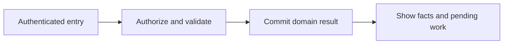
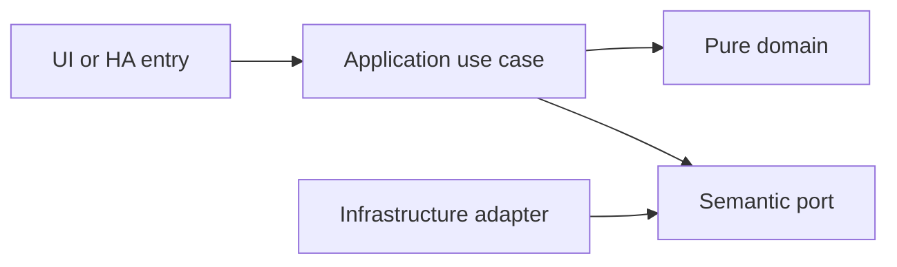

# Shared shopping demand, purchases and receipt

- Status: Draft
- Date: 2026-10-28
- Catalog capability ID: shopping-management
- Last verified: 2026-10-29 (document structure only; no implementation evidence)
- Owners: Domus maintainer; engineering/product reviewers to be assigned
- Scope: Shopping combines manual intent, replenishment and task materials without losing provenance. Buying an item and physically receiving it are separate recorded facts.
- Related issues/PRs: https://github.com/vypdev/domus/issues/2
- Required review gates: product UX, architecture, testing, documentation, security/operations
- Open decisions blocking readiness: Detailed demand-coverage and unit fixtures; partial-receipt UX; price/currency precision; launch purchase-session scope. The owner confirmed manual-extra and duplicate-safe automatic consolidation defaults on 2026-10-29. Catalog gate prerequisites remain unverified.

## 1. Executive summary

Shopping combines manual intent, replenishment and task materials without losing provenance. Buying an item and physically receiving it are separate recorded facts.

```text
Authenticated member -> validated domain command -> durable result -> household and HA projections
```

This is a prospective Draft, not an implemented or accepted capability. The first usable release covers all domains and both deployment targets.

## 2. Problem, current behavior, and evidence

Checking a shopping box cannot safely represent outstanding demand, partial purchases, shared shoppers and stock receipt.

Current verified sequence: (1) the repository has a minimal README and installed Copilot automation; (2) no Domus application, public service or tests exist; (3) this contract proposes the behavior to build.

Evidence: the owner's attached brief and subsequent decisions in [product vision](../docs/product-vision.md), the pinned [reference investigation](../docs/reference-investigation.md), and the existing repository baseline. Retrospective classification is not applicable: no as-built product baseline is reconstructed.

## 3. Actors, surfaces, and terminology

Actors: Requester; shopper; receiver; stock administrator.

Primary surfaces: application UI, HTTP domain boundary, relevant HA entities/services, activity and diagnostics. Definitions of member, principal, occurrence, demand and ledger are shared in the [glossary](../docs/glossary.md). The actor recording an action is distinct from its selected target and actual performer.

## 4. Goals, non-goals, and fixed invariants

Goals and fixed invariants are the following normative requirements. No configuration may weaken authorization, ledger integrity, attribution or idempotency.

| Requirement | Behavior |
|---|---|
| shopping-management-R1 | Shopping MUST accept shared multiple lists and free-text products with quantity, unit, notes, priority and optional shopper/store/prices. |
| shopping-management-R2 | Every demand MUST retain its origin, additive or overlapping semantics and any user-requested extra quantity. |
| shopping-management-R3 | Consolidation MUST reject incompatible units and prevent double-counting reservations or silently discarding manual requests. |
| shopping-management-R4 | Purchase, receipt and inventory posting MUST remain distinct states supporting partial quantities and nontracked goods. |
| shopping-management-R5 | Concurrent shoppers and retries MUST not duplicate purchases, receipts or stock movements. |
| shopping-management-R6 | Purchase history and optional sessions MUST retain shopper, dates, quantities and optional store/prices without requiring a receipt image. |
| shopping-management-R7 | Shopping commands and recovery MUST enforce household permissions, show retained partial facts and preserve cancellable outstanding demand. |

Non-goals: changing Copilot, changing the existing gateway, building an MCP server, adding mandatory cloud/AI dependencies, or claiming production readiness from a document.

## 5. Current versus proposed product journey

| Stage | Current | Proposed | User/operator effect |
|---|---|---|---|
| Enter | No Domus UI | Verified HA principal opens the relevant surface | Role and scope are explicit |
| Act | No domain command | Validate input, permission and current revision | Invalid data leaves the draft intact |
| Commit | No durable domain record | Store change and operation receipt atomically | Retry cannot duplicate effects |
| Observe | No projection | Show committed facts and pending downstream projections | Partial success remains understandable |



Text equivalent: authenticated entry -> authorization and validation -> durable domain commit -> visible facts with any pending projection. Domain-specific alternatives are described below.

## 6. Functional behavior and state model

### 6.1 Domain model and normal path

ShoppingList, Demand(source_type, source_id, product_or_free_text, amount, unit, semantics, revision), PlannedLine, PurchaseSession, PurchaseItem and Receipt. Free-text items need no product record. Demands remain individually attributable when a line is consolidated. Inventory target demand covers target minus available minus outstanding compatible supply; a task reservation is already reflected in availability and is not added twice. Manual demand is additional by default and can explicitly be marked overlapping. Quantities combine only with identical product, compatible units and declared semantics; ambiguous cases remain separate.

The owner confirmed on 2026-10-29 that manual requests are additional by default and automatic stock/material demands consolidate without counting the same requirement twice. Consolidation retains each source and its coverage semantics; matching names alone do not establish overlap. If an automatic four-unit demand already covers a reserved task material, that same material is not added again; a manual extra of two still raises the purchase requirement to six. Distinct independent material needs remain additive. This rule does not silently relabel a manual extra as an automatic threshold.

### 6.2 States and alternatives

Demand open -> planned -> satisfied or cancelled. Purchase planned -> purchased -> partially_received -> received. Stock posting is a separate durable step tied to each receipt line; a received tracked product is pending stock until posting succeeds. Nontracked items finish at receipt without inventory records.

A duplicate uses its original operation receipt. A changed payload under the same key is a conflict. Out-of-order events use aggregate revision and source identity. Cancellation never erases an already committed ledger effect; compensation is explicit.

## 7. User-facing configuration

| Input | Type | Recommended default | Allowed values/range | Scope/persistence |
|---|---|---|---|---|
| `manual_demand_semantics` | enum | additional | additional or explicitly overlapping | demand; persisted |
| `purchase_currency` | ISO currency | selected at setup | one household currency initially; decimal minor-unit validation | purchase session; snapshot |
| `default_list` | list reference | Household shopping | active list only | household; persisted |
| `auto_receive_purchase` | boolean | false | true allowed only with explicit combined-action UI confirmation | household; command snapshot |

These are proposed defaults pending review. Invalid values and contradictory combinations are rejected before saving; unknown future values require an explicit compatibility error. Precedence is fixed invariants, installation constraints, household policy, then member preferences; lower scopes cannot expand permissions. In-flight commands snapshot relevant policy versions, while revocation is checked at the transaction boundary.

Recommended example: keep the defaults above. Meaningful alternative: a member selects Spanish and dark theme while the same household policies remain in force. Transport secrets are installation concerns and are never domain form fields.

## 8. Clean Architecture design

### 8.1 Responsibilities and dependency direction

CreateDemand, ConsolidateDemand, RecordPurchase, ReceivePurchase and PostReceiptStock use separate semantic contracts. A receipt ID and line ID are inventory idempotency sources. The application owns source demand arithmetic; the UI never consolidates by name. Inventory changes and purchase status use transaction/outbox coordination with visible pending state.

| Boundary | Owns | Forbidden dependency |
|---|---|---|
| Domain | Entities, value objects and pure rules | HA, HTTP, SQL, UI frameworks |
| Application | Authorized commands, queries and semantic ports | Concrete adapters and framework DTOs |
| Adapters | Schema mapping, persistence and provider error mapping | Alternate business rules |
| Composition | Explicit deployment wiring | Business decisions |
| Presentation | View models and rendering | Database access or client-only authorization |



Text equivalent: entrypoints call use cases; use cases depend on pure domain and ports; infrastructure implements ports. Architecture checks reject forbidden imports and cycles. Shared contract tests exercise each port adapter; schemas and migration checks enforce durable boundaries.

## 9. UI/UX and content contract

### 9.1 Primary state examples

| State | Visible content |
|---|---|
| Pending | Saving the purchase. No action required. |
| Action required | Four cartons were received. Two are still pending. Record the remaining receipt when it arrives. |
| Blocked | This line changed while another shopper was editing it. Your quantities are retained. Review the latest line. |
| Partial | Purchase and receipt are saved. Inventory posting is pending. Retry stock posting. |
| Complete | Six cartons received and added to inventory. View purchase. |

The primary view names current status, retained facts and one next action, followed by descriptive links to the record/operation. Technical codes and correlation IDs are progressively disclosed. Duplicate responses update the same operation status rather than adding notifications. At most one routine notification per transition, with opt-out and bounded retry summaries.

English and Spanish use stable translation keys, base-language matching and English fallback. Mobile, tablet and desktop layouts, keyboard operation, visible focus, non-color status, accessible names, light/dark contrast and reduced motion are acceptance concerns. Untrusted text is rendered inert; no arbitrary HTML, commands or secret-bearing links.

## 10. Failure, recovery, and cleanup

| Failure | Retained facts | Retry / action | Cleanup |
|---|---|---|---|
| Invalid or denied input | Existing business records and form draft | Correct fields or request the proper role | No side effects |
| Stale revision | Current committed aggregate; user's entered fields | Review current state and submit a new deliberate operation | No automatic overwrite |
| Lost response after commit | Domain result and receipt | Look up or replay the same key | Never issue a fresh-key duplicate |
| Downstream projection unavailable | Successful domain result and durable pending event | Bounded backoff, then visible retry | Acknowledge outbox only after safe consumption |
| Restart or cancellation | Committed records; identified pending work | Recover receipts/cursors; compensate only by explicit command | Remove listeners and owned temporary artifacts |

Errors explain impact, safe cause, action and retained state. External availability is distinct from authorization denial. Retries are bounded and use deterministic backoff tests, not real waits.

## 11. Security, permissions, and privacy

Backend authorization applies to reads and writes. All requests and HA values are untrusted input; only authenticated principals and validated adapter context establish identity. Cross-household IDs, replayed operations and stale roles are covered in the inventory. A person entity and selected member ID do not authenticate a caller. Logs, traces, exports and browser artifacts redact credentials and unnecessary personal data. The technical HA principal has explicit narrow grants and cannot impersonate a household administrator.

## 12. Observability and operational UX

Show operation state and projection freshness to members; expose sanitized correlation, source event, aggregate revision, duration and safe error code to operators. No raw credentials or unrestricted HA payloads enter diagnostics. Counters distinguish denied, invalid, conflict, unavailable and completed operations. One durable activity entry per business transition; retries do not multiply notifications. No telemetry leaves the installation by default.

## 13. Compatibility, migration, rollout, and rollback

No existing Domus application data requires migration yet. The first schema is versioned from its first implementation. Upgrade fixtures cover pending operations and ledger compatibility; a backup precedes destructive migration. Unknown future schemas block writes. Downgrade requires a compatible image/database pair, never silent interpretation of newer data.

Both Supervisor and standalone are first-release acceptance targets. Stable and Edge use separate credentials, IDs, volumes and endpoint bindings. Experimental artifacts cannot automatically promote production. Publication, merge and deployment remain in the existing authorized maintainer lifecycle.

## 14. Testing strategy and numeric budget

Minimum: 21 distinct cases, derived from the explicit risk inventory below. Each inventory row counts once. The budget is a floor, not a claim of completeness or executed tests.

| Area | Minimum distinct cases | Behaviors/risks covered |
|---|---:|---|
| UI and accessibility | 4 | a free-text fruit item; a consolidated line; a session detail view |
| Domain and configuration | 7 | multiple lists; an invalid negative quantity or malformed currency amount; a manual extra of two units |
| Adapters and persistence | 2 | a low-stock demand and manual extra; a purchase session without prices or image |
| State and concurrency | 3 | six units purchased and four received; two shoppers buying the same remaining quantity; a repeated receipt key |
| Integration and recovery | 4 | a nontracked item received; stock posting failure after receipt; a lost purchase response |
| Security and privacy | 1 | a read-only member attempting receipt |
| **Total** | **21** | No double counting |

| Case ID | Area | Requirements | Scenario |
|---|---|---|---|
| shopping-management-C01 | UI and accessibility | shopping-management-R1 | Given a free-text fruit item, a member adds two kilograms without creating an inventory product. |
| shopping-management-C02 | Domain and configuration | shopping-management-R1 | Given multiple lists, assigning a shopper preserves list ownership and quantities. |
| shopping-management-C03 | Domain and configuration | shopping-management-R1 | Given an invalid negative quantity or malformed currency amount, validation identifies the field. |
| shopping-management-C04 | Adapters and persistence | shopping-management-R2 | Given a low-stock demand and manual extra, both source records remain after consolidation. |
| shopping-management-C05 | Domain and configuration | shopping-management-R2 | Given a manual extra of two units, replenishment does not silently absorb those two units. |
| shopping-management-C06 | UI and accessibility | shopping-management-R2 | Given a consolidated line, expanding it shows each source and its semantics. |
| shopping-management-C07 | Domain and configuration | shopping-management-R3 | Given target 10 and available 6 after a task reservation, replenishment requests four rather than adding the reservation twice. |
| shopping-management-C08 | Domain and configuration | shopping-management-R3 | Given incompatible piece and kilogram demands, the list keeps separate lines. |
| shopping-management-C09 | Domain and configuration | shopping-management-R3 | Given compatible overlapping baseline demands, consolidation uses their declared coverage rather than blindly summing them. |
| shopping-management-C10 | State and concurrency | shopping-management-R4 | Given six units purchased and four received, two remain pending receipt and only four can enter stock. |
| shopping-management-C11 | Integration and recovery | shopping-management-R4 | Given a nontracked item received, it completes without a stock movement. |
| shopping-management-C12 | Integration and recovery | shopping-management-R4 | Given stock posting failure after receipt, receipt stays saved and posting is explicitly pending. |
| shopping-management-C13 | State and concurrency | shopping-management-R5 | Given two shoppers buying the same remaining quantity, a revision conflict prevents duplicate fulfillment. |
| shopping-management-C14 | State and concurrency | shopping-management-R5 | Given a repeated receipt key, inventory contains one movement per receipt line. |
| shopping-management-C15 | Integration and recovery | shopping-management-R5 | Given a lost purchase response, retry returns the original purchase rather than a second session. |
| shopping-management-C16 | Adapters and persistence | shopping-management-R6 | Given a purchase session without prices or image, history still shows shopper, date and items. |
| shopping-management-C17 | Domain and configuration | shopping-management-R6 | Given a partial refund or correction, history records a linked correction rather than rewriting the original purchase. |
| shopping-management-C18 | UI and accessibility | shopping-management-R6 | Given a session detail view, quantities purchased and received are labeled separately. |
| shopping-management-C19 | Security and privacy | shopping-management-R7 | Given a read-only member attempting receipt, the backend denies the mutation. |
| shopping-management-C20 | UI and accessibility | shopping-management-R7 | Given cancellation of an unpurchased line, the UI explains remaining source demand before confirming. |
| shopping-management-C21 | Integration and recovery | shopping-management-R7 | Given partial success followed by retry, the response identifies saved purchase facts and retries only the missing stock post. |

Every implemented first-party module starts with meaningful behavior tests. Target and proposed merge gate: 100% lines/statements/functions/branches where the selected tools expose those metrics, enforced separately across backend, frontend and integration code. Third-party/generated artifacts are distinguished from authored source; broad exclusions cannot hide untested logic. No application coverage currently exists.

Inject deterministic clocks, IDs, provider fakes and transaction failures. Use semantic assertions alongside golden content, real adapter contracts and disposable HA integration environments. Add Google Chrome evidence from the owner's authorized local HA for real UX; it does not replace automated tests or unit coverage. CI Check runs the complete applicable suite for every PR update.

## 15. Documentation and discoverability

The following paths are explicit proposed documentation changes relative to the clean repository baseline; implementation source/test paths are intentionally not invented.

| Path | Change |
|---|---|
| specs/shopping-management.md | create |
| specs/README.md | create |
| specs/_template.md | create |
| specs/catalog.json | create |
| specs/CATALOG.md | create |
| docs/architecture.md | create |
| docs/product-vision.md | create |
| docs/glossary.md | create |
| docs/decisions.md | create |
| docs/reference-investigation.md | create |
| docs/copilot-adoption.md | create |
| docs/operations.md | create |
| docs/user-guide.md | create |
| docs/contracts/home-assistant.md | create |
| docs/acceptance-plan.md | create |
| docs/roadmap.md | create |
| README.md | update |

| Audience | Artifact | Required content |
|---|---|---|
| Member | [User guide](../docs/user-guide.md) | Normal path, defaults and state meaning |
| Administrator/operator | [Operations](../docs/operations.md) | Setup, permissions, recovery, backup and rollback |
| Contributor | [Architecture](../docs/architecture.md) | Boundaries and executable constraints |
| HA consumer | [Entity/service contract](../docs/contracts/home-assistant.md) | Stable schemas, semantics and error handling |
| Reviewer | [Acceptance plan](../docs/acceptance-plan.md) | Tests, coverage and human evidence |

Link/path validation accompanies updates. Implementation changes update the owning SDD, catalog evidence, actual tests and user documentation together.

## 16. Acceptance scenarios

The Given/When/Then-equivalent observable scenarios in section 14 are the executable acceptance inventory. For each case, the given precondition and action must produce the specified result with state and side-effect assertions; tests are not implementation snapshots.

Acceptance includes normal, alternative, invalid, duplicate, concurrent, partial, failure, recovery, security, localization and accessibility paths as allocated above. Human review verifies the primary-state examples on desktop/mobile and light/dark themes. Live acceptance remains pending until an implemented artifact is exercised; no result is inferred from the budget.

## 17. Requirements traceability

| Requirement | Cases |
|---|---|
| shopping-management-R1 | shopping-management-C01, shopping-management-C02, shopping-management-C03 |
| shopping-management-R2 | shopping-management-C04, shopping-management-C05, shopping-management-C06 |
| shopping-management-R3 | shopping-management-C07, shopping-management-C08, shopping-management-C09 |
| shopping-management-R4 | shopping-management-C10, shopping-management-C11, shopping-management-C12 |
| shopping-management-R5 | shopping-management-C13, shopping-management-C14, shopping-management-C15 |
| shopping-management-R6 | shopping-management-C16, shopping-management-C17, shopping-management-C18 |
| shopping-management-R7 | shopping-management-C19, shopping-management-C20, shopping-management-C21 |

All requirement cases are reciprocal with section 14. Domain invariants are owned by pure policy, command/state rules by application use cases, provider behavior by adapters, and visible content by presentation; the boundary table in section 8 assigns these responsibilities. Evidence and user/operator documentation are linked in section 15.

## 18. Implementation sequence

1. Resolve the blocking decisions and review this contract before Ready for implementation.
2. Establish test harness, CI Check and architecture checks with the first source files.
3. Implement pure policies and their complete branch tests, then transactional use cases.
4. Add adapters, schema/error contracts, retry/race fixtures and both deployment wiring paths.
5. Build the accessible localized UI and HA projections with tests alongside each flow.
6. Verify migration, recovery, security, channel isolation and documentation.
7. Run the complete suite, review coverage, perform local Chrome dogfooding with recorded cleanup, and collect human evidence.

These are internal implementation steps within the first integrated release; they do not remove other domains or deployment targets from launch.

## 19. Definition of Done

- [ ] Every normative requirement has observable acceptance and reciprocal case links.
- [ ] Every declared case is implemented meaningfully; the numeric budget is met.
- [ ] Clean Architecture constraints and port contracts pass.
- [ ] All supported first-party coverage metrics reach 100% from the first implementation.
- [ ] CI Check passes for the current PR revision with no omitted required jobs.
- [ ] Configuration, state, permission, idempotency and recovery behaviors agree.
- [ ] Primary UI states, localization, responsive behavior and accessibility pass.
- [ ] Both deployment targets and isolated Stable/Edge channels pass acceptance.
- [ ] User/operator documentation, schema/migration evidence and catalog paths are current.
- [ ] Local Google Chrome evidence identifies the artifact, channel, test records and cleanup.
- [ ] The original Copilot validations pass when their real prerequisites exist; no check is weakened.
- [ ] No material decision blocking readiness remains unresolved; Copilot remains unchanged.

## 20. References and decisions

Primary sources: [Copilot standard](https://github.com/vypdev/copilot/blob/f5e5a4cf9a80248994469cd88ad55eecab5b95ca/specs/README.md), [original template](https://github.com/vypdev/copilot/blob/f5e5a4cf9a80248994469cd88ad55eecab5b95ca/specs/_template.md), and the linked [reference investigation](../docs/reference-investigation.md).

Confirmed owner choices and unresolved proposals are separated in [decisions](../docs/decisions.md). [Issue #2](https://github.com/vypdev/domus/issues/2) tracks the documentation foundation. The [adoption note](../docs/copilot-adoption.md) records the current catalog evidence limitation. Optional future depth remains explicitly deferred in the product vision; the gateway's installation and MCP internals are outside Domus scope.
