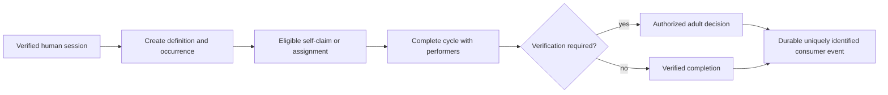
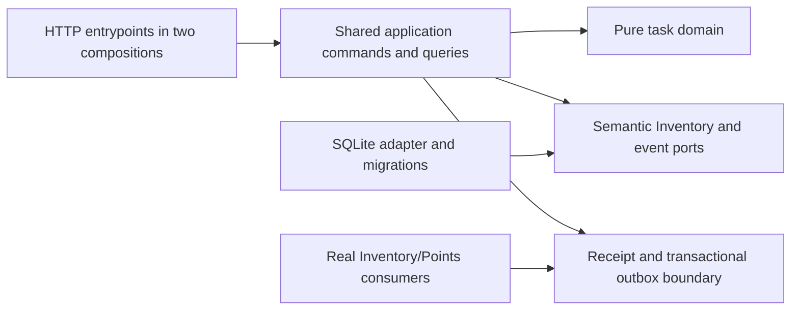

# Task Execution Foundation

- Status: Draft
- Date: 2026-10-31
- Catalog capability ID: household-tasks
- Last verified: not applicable (prospective companion; catalog evidence verified at `a63b2315cd5121dde9585ba8875e286fdef5330e`)
- Owners: Domus maintainers (review assignment pending)
- Scope: Specify a durable first backend increment for task definitions, occurrences, completion cycles, authorization, and honest consumer integration seams.
- Related issues/PRs: [Issue #13](https://github.com/vypdev/domus/issues/13); merged PR #12 is historical context.
- Required review gates: product UX, architecture, testing, documentation, security/operations
- Open decisions blocking readiness: None among the supplied product choices; prerequisite approval timing was confirmed on 2026-11-01. The companion was published on its exact managed branch before implementation; readiness remains Draft until reviewers validate complete contracts/evidence and the application/composition requirements execute. This specification does not establish implementation or runtime acceptance.

## 1. Executive summary

This new companion to `specs/household-tasks.md` defines a backend foundation for creating a title-only task and its first occurrence atomically, assigning or self-claiming eligible work, recording actual performers, and retaining completion, verification, and reopening history. Its default allows a restricted member to claim available work offered to their profile. Claiming never waives required adult approval. Task execution is authoritative only for task facts; Inventory and Points consumers remain owners of their own ledgers.

An adult creates “Wipe table” -> the definition and available occurrence are committed together -> an eligible member claims it -> assigned members perform it -> a completion cycle records performers and actual time -> required adult approval is recorded -> uniquely identified events are available to real consumers.

The companion preserves all 49 existing cases in `specs/household-tasks.md`; its added cases use the `task-execution-foundation-CNN` namespace. The Action registered both documents under household-tasks in commit d4f3f911dd145d77255f47a882542f08e5c98055. Catalog implementation arrays remain empty at publication: a registered contract is not implementation evidence.

## 2. Problem, current behavior, and evidence

### 2.1 Problem

Households need durable task work that survives edits, retries, concurrency, restart, and restore. A single mutable “completed” flag cannot distinguish a recurring definition from its occurrences, identify actual performers, preserve approval facts, or safely represent reopening. Restricted members need a truthful way to claim eligible free work while required approval remains intact. The backend must also avoid implying that absent Inventory or Points consumers have accepted effects.

### 2.2 Current behavior

Verified facts at the immutable base:

1. The household-tasks capability is proposed and its existing specification is `specs/household-tasks.md`, with 49 reserved cases `household-tasks-C01` through `household-tasks-C49`.
2. The M1 source includes identity, household, transaction, receipt, outbox, recovery, and offline restoration foundations. It declares task-related permission enums, but no task entities, repositories, commands, or task API.
3. The supplied capability catalog lists no task workflows, entrypoints, code, or tests. The existing broad Draft specification’s cases are not evidence of implementation.
4. Both Python compositions and task route DTOs are prospective contracts in this document. No task routes exist today.

### 2.3 Evidence

- Code/workflow/documentation references: `specs/catalog.json`; `specs/household-tasks.md`; `docs/architecture.md`; `docs/decisions.md`; `docs/roadmap.md`; `docs/m1-acceptance-audit.md`; `backend/src/domus/application/commands.py`; `backend/src/domus/infrastructure/sqlite.py`.
- Immutable base: commit `a63b2315cd5121dde9585ba8875e286fdef5330e`, tree `60842b62c64c28fe337891344a0eadea1ca8aac5`. Supplied blob identities confirm the cited files at that snapshot; this is evidence of source location, not execution support.
- Related issue: https://github.com/vypdev/domus/issues/13. The owner supplied the checkout, API, lifecycle, material, and coverage decisions as authorized answers on 2026-10-31.
- External primary sources: not applicable; product and repository contract evidence is local.
- Unknowns: maintainers’ final review assignment; implementation feasibility findings that require code; actual Home Assistant adoption and consumer delivery, which require later integration evidence.

### 2.4 Retrospective classification (as-built baselines only)

Not applicable: this prospective companion does not reconstruct an implemented task-execution baseline. Empty implementation arrays and absent task source are preserved as blockers to implementation claims.

## 3. Actors, surfaces, and terminology

| Actor | Goal | Entry point | Visible surfaces |
|---|---|---|---|
| Household adult | Create and manage daily work, approve when required | Existing verified Home Assistant human session; proposed task API | Task views, history, receipt, operation lookup |
| Restricted member | Claim eligible available work, perform assigned work | Same session and task API | Availability, assignment, completion and approval status |
| Administrator | Configure household task policy and privileged values | Existing administrator-authorized command | Policy view and audit history |
| Operator/contributor | Diagnose retained work and integrations | Logs, operations, docs, migration/restore tooling | Sanitized diagnostics and recovery guidance |
| Inventory consumer | Validate and settle task-linked usage in its own domain | Semantic port/event consumer | Actual movement or explicit pending status |
| Points consumer | Consume eligible verified completion facts in its own domain | Durable uniquely identified event | Actual ledger result or no claim of delivery |

A **definition** is the durable reusable task and lifecycle policy. An **occurrence** is one work instance and immutable definition snapshot. A **completion cycle** is one genuine performance attempt with its performers, policy snapshot, verification, and actual time. **Assigned members**, **actual performers**, and the **recording actor** are distinct facts. **Claim** assigns the current human actor to eligible available work. **Performed time** is when work happened; recorded, approved, and posted times are separate. **Task intent** retains material use associated with a cycle; Inventory alone owns stock and movement facts.

## 4. Goals

| Requirement | Behavior |
|---|---|
| TEF-01 | A title-only create atomically creates a durable definition and one available occurrence; advanced fields stay optional. |
| TEF-02 | Definitions, occurrences, and completion cycles have stable separate identities, revisioned lifecycle, snapshots, and retained history. |
| TEF-03 | Enforce the owning task state machine, expected revisions, scoped acyclic prerequisites, all-required subtasks, and no silent reassignment. |
| TEF-04 | Permit configurable self-claim of eligible available work, including restricted members, with current eligibility, capacity, exceptions, denials, and transaction-time rechecks. |
| TEF-05 | Reuse verified HA human proof, active membership, installation/household/channel binding, semantic authorization, and transactional rechecks; keep administrator policy and material authority privileged. |
| TEF-06 | Snapshot actual performers and completion policy; require current authorized-adult approval for any restricted performer, and preserve configured adult-performer approval and independent-adult alternatives. |
| TEF-07 | Preserve actual, recorded, approved, and posted timestamps; make reopening cycle-bound, compensating, revision-aware, and non-cascading. |
| TEF-08 | Retain task-linked material intents and honest outcomes; validate server-owned identities via Inventory ports, never create a second inventory ledger, and settle only through explicit duplicate-safe commands. |
| TEF-09 | Publish durable cycle/source/policy-identified seams for recurrence, Inventory, and Points; reject or retain unavailable integrations truthfully. |
| TEF-10 | Keep Domain pure, orchestration in Application, provider/SQLite mapping in outer adapters, and wire existing compositions through shared services. |
| TEF-11 | Add versioned, guarded SQLite persistence and migration/restart/rollback/restore handling without weakening M1 evidence or duplicate suppression. |
| TEF-12 | Specify bounded task HTTP DTOs and routes for both Python compositions, retaining existing session, proof, Origin, CSRF, outage-write, and authorization rules. |
| TEF-13 | Require complete first-party backend statement and branch coverage from the first source change, strict dependency checks, and meaningful failure/race/recovery evidence. |
| TEF-14 | Document user, setup, operator, and contributor behavior, migration, troubleshooting, and current consumer limitations. |

### 4.1 Goals

1. Deliver a reviewable, testable contract for durable title-only task creation and occurrence execution.
2. Preserve accurate attribution and approval while enabling eligible restricted-member self-claim.
3. Make task state, material status, integration delivery, and recovery facts inspectable without fabricated effects.
4. Ensure every newly authored runtime module is in the measured and enforced backend scope immediately.

### 4.2 Non-goals

1. Complete task UI, recurrence engine, Points ledger, Inventory ledger, HA companion, new gateway/MCP, login, listener, or permission bypass.
2. Claim all-domain, both-deployment-target, Stable/Edge, or first usable release acceptance. Those remain required later integration work.
3. Release, tag, production installation, owner-household mutation, or changes to Copilot’s managed lifecycle.
4. Implement cancellation as a way to bypass required completion validation; cancelled and skipped occurrences are terminal in this increment.

### 4.3 Fixed product/safety invariants

1. No definition edit/archive erases occurrences, cycles, receipts, or history.
2. No task setting can grant approval authority, waive required verification, or turn a technical credential into a human administrator.
3. No absent consumer, fixture, outbox append, or fake port is represented as a delivered ledger effect.
4. No stock movement is fabricated, deleted, or reversed by Tasks; reopening never invents a stock return.
5. Current authorization, installation binding, aggregate revision, and original-cycle identity are rechecked at commit for every mutation.

## 5. Current versus proposed product journey

| Stage | Current | Proposed | User/operator effect |
|---|---|---|---|
| Create | No task command/API evidenced | Title-only create commits definition plus first available occurrence atomically | One simple action produces durable work |
| Find/claim | No task query/claim evidenced | Bounded query; eligible member claims self with expected revision | Assignment is attributable and one concurrent claim wins |
| Perform | No occurrence execution evidenced | Assigned performer completes with actual time and cycle snapshot | Work remains distinct from recording actor |
| Verify | No task verification evidenced | Current adult authority approves/rejects when policy requires | Pending/rejected work earns no points |
| Reopen/integrate | No task events/consumers evidenced | Reopen closes old cycle, emits one compensation event, retains consumer status | No duplicate effect or fabricated ledger result |



Text equivalent: verified session -> atomic task creation -> claim/assignment -> recorded completion -> conditional adult approval -> durable consumer event with honest delivery status.

## 6. Functional behavior and state model

### 6.1 Happy path

1. An authorized adult submits title-only creation. Application validates title and policy, creates stable definition and occurrence IDs, and commits both with receipt/outbox atomically. Default definition state is active and occurrence state available.
2. A member queries available work. The query returns only household-scoped records and current allowed actions; cursors bind query and context.
3. An eligible member claims using the current revision. The server derives the actor as assignee; it never accepts a client-selected claimant. Transaction-time checks include current profile availability, capacity, role/profile/member exceptions, explicit applicable denials, and policy.
4. Assigned work progresses through the state machine. Completion records nonempty actual performer IDs, performed time, effective verification policy, immutable cycle ID, and validated material intent outcomes.
5. If any actual performer is restricted, authorized adult approval is required. Pending or rejected cycles produce no Points award. Approval rechecks current adult and approval authority, cycle identity, and revision.
6. Durable events identify occurrence, cycle, source, and policy. Real consumers acknowledge through their own deduplication boundary; unavailable consumers leave truthful retained pending state.

### 6.2 Alternative paths

- Definition updates/archive affect future work and lifecycle only; existing occurrence and cycle snapshots remain.
- Assignment/release requires an actual nonempty/empty assignee set and explicit task-management authority. On-behalf recording is a separate permission, default adult/admin; a selected member ID grants nothing.
- Rejected work retains its performed facts. Only explicit reopen followed by a genuine later completion creates a new cycle.
- Material usage of zero is `not_used`, with no movement. Valid usage without material authority is retained as `pending_authorization`; shortage is `pending_regularization`; unavailable real Inventory is `pending_processing`.
- Settlement is explicit (`post`, `correct`, `dismiss`) with current authority and reason as applicable. Policy change, approval, stock arrival, or reopening never auto-settles.
- A reopened prerequisite marks completed dependents with a revision-aware review condition; it does not reopen them or reverse their points.
- Recurrence, Points, and Inventory integrations unavailable in the active composition are rejected or retained pending before unsafe effects.

### 6.3 State machine

Definition states: `draft -> active`; `active <-> paused`; `draft|active|paused -> archived`; archived is terminal. Create defaults active. Occurrence states:

| State | Entered when | User-visible meaning | Allowed next states | Recovery/owner |
|---|---|---|---|---|
| draft | Explicit occurrence preparation | Not offered yet | available | Task application publishes after validation |
| available | Initial atomic create or release/unblock without assignees | Eligible to claim/assign | assigned, blocked, completed, cancelled, skipped | Authorized task command; completion requires its separate performer authority |
| assigned | Assignees set | Work has named responsibility | available, in_progress, blocked, completed, cancelled, skipped | Assignment or valid transition |
| in_progress | Assigned work starts | Work underway | blocked, completed, cancelled, skipped | Assigned member or authorized manager |
| blocked | Explicit block or unmet condition | Cannot currently proceed | assigned if assignees remain; otherwise available | Resolve reason and transition |
| completed | Valid completion cycle recorded | Work performed; verification may remain pending/rejected | assigned if assignees remain, otherwise available, only via reopen | Reopen closes current cycle |
| cancelled | Explicit authorized cancellation with reason | This occurrence will not proceed | terminal | Create another occurrence explicitly |
| skipped | Explicit authorized skip with reason | This occurrence was intentionally skipped | terminal | Create another occurrence explicitly |

Completion is not an arbitrary state setter. It validates prerequisites, required subtasks, performers, materials, policy, and verification state. Verification is separate: `none`, `pending`, `approved`, `rejected`. Reopening requires current completed cycle ID and revision, closes that cycle, retains facts, and returns to assigned if assignees remain, otherwise available.

Every mutation requires expected revision. Existing receipt replay occurs after current authorization of the original command and before stale revision rejection: identical key/payload returns original outcome; changed payload conflicts. Fresh-key duplicate completion/approval cannot add cycles/events. Closed-cycle or stale events are inert or conflict. Reopen emits one compensating source event and does not reverse actual stock movements.

## 7. User-facing configuration

| Input | Type | Recommended default | Allowed values/range | Scope/persistence |
|---|---|---|---|---|
| claim_allowed | boolean | true for eligible available work | true/false | Household default, task override; reread at claim commit |
| dependency_gate | enum | performed | performed or approved | Household default and authorized task override; snapshotted per cycle |
| eligible_roles | unique Role list | administrator, adult, restricted | bounded known roles | Household/task; reread at commit with member exceptions |
| verification | enum | role_default | `role_default`, `authorized_adult` | Definition snapshot per completion cycle |
| adult_performer_may_approve | boolean | true | true/false | Household/task; effective value snapshotted; current approval authority rechecked |
| task_scoped_material_consumption | boolean | true | true/false | Household/task; explicit applicable member denial takes precedence |
| material_recording | enum | `review_on_completion` | `review_on_completion`, `separate_recording` | Household/task; snapshot by cycle |
| point_value_minor | integer | 0 | 0..1,000,000 | Administrator-controlled definition value; snapshot; no award without consumer |
| materials | list | empty | Up to 32 server-owned line references with Inventory-validated quantities | Definition snapshot; identity and target cannot be client-forged |
| title/description/tags/priority | bounded text/list/enum | Required title; empty description/tags; normal priority | title 1..160; description 0..4000; up to 16 unique tags, each <=64; low/normal/high/urgent | Definition; updates revisioned |

Policy PUT is administrator-controlled. Cross-field validation rejects unknown roles/values, duplicate tags/IDs, foreign material lines, invalid quantities, unbounded lists, and unsupported providers. Unknown future persisted enum values fail closed and remain inspectable for migration; absent fields receive documented defaults only in migration. No arbitrary URLs, code, refs, secrets, product IDs, units, or locations are accepted. Recommended configuration enables eligible self-claim with adult verification for restricted performers. A meaningful alternative disables self-claim for a household while retaining adult-managed assignment. No configuration can weaken human proof, current authorization, revision checks, performer attribution, or consumer ownership.

### Executable policy refinements before implementation

The Action published this Draft before source changes. The declared paths below are concrete planned leaves; they confer no implementation credit. Domain value objects use exact enums/booleans, valid UTF-8 text without control characters (U+0000 through U+001F or U+007F), except tab/newline/carriage return in multiline descriptions and reasons, bounded unique tuples and positive signed-64-bit revisions. UTC milliseconds are nonnegative signed-64-bit integers. Invalid values cannot be reconstructed permissively from storage. Ordinary title-only creation is active/available; an explicitly draft definition creates a draft occurrence. Initial definition states are draft or active; paused/archived are later transitions. Pausing/archiving stops new occurrence creation but retains existing work and history.

Semantic permission IDs tasks.read, tasks.claim, tasks.manage, tasks.record_for_others and tasks.material_use are additive to the existing tasks.create/complete/approve/configure. Defaults: all profiles can read household tasks; administrator/adult/restricted can claim eligible work and use scoped linked materials; administrator/adult can manage work and record on behalf of others. Viewer mutations remain denied by default. Household/profile/member adjustments apply under the accepted precedence. Claim is a real independent action; it must not pretend an available task was already assigned to evade the existing restricted-completion scope. Restricted completion still requires actual assignment and its own participation. Policy configuration stays administrator-controlled; approval still requires a current adult and approval permission. A new permission never turns a technical identity into a person.

The earlier current-authority checkpoint implements these typed permission IDs and application helpers. The transaction rereads active membership, identity mapping, profile/member exceptions and current task defaults. Only the submitting actor has current HA proof: its performer role uses that verified effective role; other attributed performers retain their current local profiles rather than an assumed external administrator grant. Separate on-behalf authority is mandatory for another performer, and restricted actors must retain their own participation. Verification uses current adult authority and the original cycle's participation rule. Lifecycle, capacity, revision and current-cycle checks remain command preconditions after authorized receipt lookup; a helper alone is not execution or replay acceptance. The subsequent creation/assignment/claim commands implement that transaction boundary for those three actions; complete task execution and public routes remain pending.

Creation, assignment and claim commands obtain fresh human proof before entering the writer transaction. First task creation initializes absent household task defaults in that same transaction, never on a read. A title-only request creates an active definition and available occurrence; an explicitly draft request creates draft work. Supplying any non-inherited task-rule override requires administrator task-configuration authority as well as task-creation authority, including on receipt replay. Assignment requires current management permission and at most 32 distinct active household members; an empty assignment explicitly releases eligible work. Self-claim is exclusive for available unassigned work: it derives the sole assignee from the current actor, has one winner under contention, and never appends a claimant to already assigned work. Current authority and eligibility are checked before receipt disclosure; state/revision preconditions follow receipt lookup, so replay of a successful claim remains possible after that claim changed the state. Definition, first occurrence, any initial defaults, receipt, audit and outbox commit together or roll back together. These commands do not confirm any downstream consumer delivery.

The owner confirmed on 2026-11-01 that dependency_gate is configurable per household/task, with performed as default and approved as the alternative. Pending approval may therefore satisfy the default prerequisite gate, while points remain unavailable until required approval. Rejected verification satisfies neither mode. The effective gate belongs to the completion cycle snapshot, independently of current authority and later configuration changes.

The next domain checkpoint separates resolved household defaults from nullable per-definition overrides: omitted/cleared overrides inherit current defaults; explicit false and an empty eligible-profile set are retained. Occurrences keep their immutable definition/content/override snapshot. Editing or archiving a definition does not rewrite that snapshot; current household defaults are resolved when planning a new completion, and the resulting rules and all source policy revisions are retained by its cycle. Pending cycles keep their original snapshot. Initial draft work has no assignees until published; active definitions create available or explicitly assigned occurrences. Paused/archived definitions cannot generate new occurrences.

Definitions, occurrences and completion cycles have explicit stable IDs, household scope, positive signed-64-bit revisions and supplied timestamps. Cycle performed time cannot exceed recorded time; verification cannot predate recording; closing cannot predate either fact. Approval records a decision without closing the cycle. Only reopening closes it. Completed state requires a current cycle; other states cannot retain an active cycle pointer. Scope, current cycle and definition-snapshot revisions must agree before completion, verification or reopening. Closing preserves the original cycle record, material intent identity and attribution.

Pure requirement evaluation supports the confirmed performed default and configurable approved alternative. A completion uses the gate in its own resolved rule snapshot; a caller cannot select a conflicting weaker gate. Both require completed work; rejected verification never satisfies a requirement. Approved mode accepts no-verification-needed or approved work; performed mode additionally accepts pending approval. Both use the exact server-resolved required occurrence set. Prerequisites and required subtasks each allow 32 IDs; their combined deduplicated graph therefore allows 64 edges per node. Iterative cycle detection remains independent of Python recursion depth.

### Proposed HTTP contract

Both existing Python compositions expose shared application services under `/api/v1/tasks`; these routes are proposals, not current capabilities. Mutations require current session/proof, Origin, CSRF, `Idempotency-Key`, and `expected_revision` (`0` create, positive update). Household, actor, installation, and channel derive server-side. Reject unknown fields. Lists use limit default 25, max 100, cursor max 512; keyset cursors bind query/context and make no cross-page snapshot claim.

| Method and route | Request contract |
|---|---|
| GET, PUT `/api/v1/tasks/policy` | GET policy; PUT bounded booleans/roles/default verification/material recording/dependency_gate, administrator only |
| GET, POST `/api/v1/tasks/definitions` | Filter state; create title (1..160), optional description, priority, tags, state, point value, verification, approval/material/claim settings, roles, material recording, dependency_gate, and up to 32 server-validated material lines. Title-only create creates one available occurrence atomically. |
| GET, PUT `/api/v1/tasks/definitions/{id}` | GET definition; revisioned PUT editable definition fields; lifecycle rules enforced |
| POST `/api/v1/tasks/definitions/{id}/occurrences` | Create occurrence with expected revision 0, assignee/prerequisite/required-subtask ID lists (each unique, max 32), optional UTC millisecond due time |
| GET `/api/v1/tasks/occurrences` | Filter only by state, assignee_id, definition_id; bounded pagination |
| GET `/api/v1/tasks/occurrences/{id}` | Current occurrence, snapshots, allowed actions, current cycle and outcomes |
| PUT `/api/v1/tasks/occurrences/{id}/assignment` | Replace assignee IDs; explicit authority and revision |
| PUT `/api/v1/tasks/occurrences/{id}/dependencies` | Replace prerequisite and required-subtask IDs; validate scope, acyclicity, and revision |
| POST `/api/v1/tasks/occurrences/{id}/claim` | Revision only; claimant derived from authenticated actor |
| POST `/api/v1/tasks/occurrences/{id}/transition` | Revision, target, reason <=1000; reason required for cancel/skip/block decisions as policy specifies |
| POST `/api/v1/tasks/occurrences/{id}/complete` | Revision, nonempty unique performer IDs (max 32), UTC ms performed_at, up to 32 material usages `{line_id, quantity}`; quantity canonical nonnegative decimal string, never float |
| POST `/api/v1/tasks/occurrences/{id}/verify` | Revision, cycle_id, approve/reject, reason; reject requires nonblank reason |
| POST `/api/v1/tasks/occurrences/{id}/reopen` | Revision, cycle_id, nonblank reason |
| GET `/api/v1/tasks/occurrences/{id}/history` | Chronological safe history with event ID, revision, actor, time, action, safe detail |
| POST `/api/v1/tasks/occurrences/{id}/materials/{intent_id}/settlement` | Revision, original cycle_id, action post/correct/dismiss, quantity only for correction, required reason for correction/dismissal |

Responses use existing `ReceiptResponse`, `OperationResponse`, and `ErrorResponse` contracts. Receipt result retains immutable resource/cycle/revision/material facts, never current grants. Resources expose IDs, revisions, states, snapshots, and allowed actions; occurrence includes assignees, dependencies, performers, times, verification, and material outcomes. Material outcome includes intent/cycle/line IDs, submitted canonical quantity, status, reason code, safe message/action, nullable actual movement ID, and revision. `posted` requires actual Inventory confirmation; invalid forged/foreign material rejects before effects. Other valid work may save with visibly unposted outcomes. Current reads show present settlement state separately from original receipt.

## 8. Clean Architecture

### 8.1 Responsibilities and dependency direction

| Layer/boundary | Owns | Must not own/import |
|---|---|---|
| Domain/pure policy | Definition/occurrence/cycle value objects, transitions, dependency graph, eligibility and verification decisions | SQL, HA/HTTP/DOM, global clock or entropy |
| Application | Authorized commands/queries, immutable DTOs, receipts, transaction orchestration, semantic ports | Concrete SDK/process details or provider DTOs |
| Adapters/data | SQLite schema/repository, migration, provider mapping and error conversion | Product authorization policy |
| Infrastructure/composition | Existing native and standalone wiring; shared services in both Python compositions | Duplicated business rules |
| Entrypoints | HTTP parsing, proof/session/Origin/CSRF adaptation | Independent orchestration or client-selected authority |
| Presentation | Task view models, allowed-action display, sanitized history | Mutations or state transitions |
| Consumers | Inventory stock/unit/movement/reservation; Points ledger; recurrence scheduling | Tasks-owned facts or claims of delivery without acknowledgement |



Text equivalent: both HTTP compositions call shared Application services; Application uses pure Domain policy and semantic ports; SQLite and actual consumers implement outer boundaries.

### 8.2 Contracts, state, and trust boundaries

- Pure decisions: transitions, dependency/subtask readiness, claim eligibility, performer/verification policy, and material outcome classification.
- Application contracts: bounded commands/queries, expected revision, idempotency key, immutable receipt, operation lookup, safe history, and current allowed actions.
- Semantic ports: task repository/unit of work, current authorization, server-owned material resolution and Inventory validation/settlement, durable event acknowledgement, clock and ID generation supplied at boundary.
- Durable state/schema ownership: Tasks owns definitions, occurrence snapshots, cycles, task history, material intent references/status, receipt facts, and task event identities. Inventory owns stock and movements; Points owns awards.
- Concurrency/idempotency: SQLite writer transaction rechecks authorization and revision; unique command receipt, entity revision, event ID, cycle ID, and child intent constraints. Claim contention has one winner; loser observes conflict/current state, never silent reassignment.
- Trust: request bodies, IDs, comments, imported/restored data, provider payloads, and event deliveries are untrusted. Actor, household, installation, and channel are bound from verified context. Selected performer/member IDs require separate on-behalf authority.
- Provider errors: distinguish invalid/foreign input, denied authority, conflict/stale revision, unavailable consumer, and internal failure; retain safe pending outcome only after command validity is established.

### 8.3 Executable architecture constraints

Every authored runtime leaf must be declared in the companion before its first source change and enter backend scope/coverage from its first change. Dependency graph and cycle checks cover all runtime files, including composition, HTTP, migration, restore, and unimported modules. Tests enforce Domain has no inward provider/framework imports; Application references semantic ports only; SQLite/provider mapping remains outer; both compositions invoke the same application services. Schema/OpenAPI contract checks parse generated structure and reject undeclared routes/fields. Existing CI Check required groups run on every PR commit; immutable Copilot checks remain unchanged.

## 9. UI/UX and content contract

### 9.1 Information hierarchy

Task screens and operation/issue/PR status show current state, retained completed facts, next transition, required human action, impact, inspectable history/receipt, then technical details. One primary action is shown at a time. Material pending state must never resemble posted stock or earned points.

### 9.2 Representative primary view

```markdown
# Task complete: Wipe table

> **Current status:** Work recorded; adult approval required.
>
> **Action required:** An authorized adult reviews this completion.

## Progress

- [x] Mina claimed the available task.
- [x] Mina recorded the work at 18:10.
- [ ] Adult approval is pending.

## What happens next

Approval will make the completion eligible for the configured Points consumer. No points have been posted yet.

## Links

[Task history](.../api/v1/tasks/occurrences/occ_123/history) · [Operation receipt](...)

<details>
<summary>Technical details</summary>
Cycle cyc_456; revision 4; material usage pending authorization; no inventory movement exists.
</details>
```

Concrete state variants:

**Pending/no action:** “Wipe table — Waiting for scheduled review. Work and cycle are saved. No action is required from you; the authorized adult will review it.”

**Action required:** “Wipe table — Adult approval needed. Mina’s completion is saved, but points are not eligible yet. Review cycle cyc_456 in task history.”

**Blocked before effect:** “Claim not made — This task changed before your claim committed. No assignment was changed. Refresh the task and try again if it is still available.”

**Partial success:** “Work saved; material usage not posted — The completion is retained, but the Inventory consumer is unavailable. No stock movement was created. An authorized operator can inspect the pending intent and retry settlement after service returns.”

**Completed:** “Wipe table — Approved. The work and approval are recorded. Points delivery is shown separately and only after the real Points consumer confirms it.” Approval does not close the cycle; reopening does.

### 9.3 Issue, PR, and comment behavior

- Deterministic issue/PR title describes task-execution-foundation contract; PR summaries link Issue #13, exact managed branch, companion, CI run, and review evidence.
- Merge validates/publishes the companion and exact linked branch before implementation begins; this is a workflow gate, not evidence of runtime support. Merge/close does not imply consumer delivery.
- Durable operation/event IDs and receipts are idempotent. Repeated status refresh edits the existing marker; no comment per retry. Budget: at most one initial summary and one material state-change comment per operation; routine pending refreshes add none.
- Labels/checks supplement rendered status and never replace required action or retained facts.

### 9.4 Accessibility, localization, and responsive behavior

Repository issue/docs/code language is English; owner communication is Spanish. Product strings follow repository locale conventions with English fallback; supported locale set must match existing application localization support, not be invented in this backend companion. Every status, icon, and Mermaid flow has a text equivalent. Tables remain readable on narrow screens; headings are sequential, links descriptive, and light/dark contrast follows existing UI tokens. Sanitize task titles, descriptions, tags, reasons, imported text, and URLs as untrusted Markdown; escape HTML and mentions, prohibit executable commands/embedded HTML, and never render arbitrary provider URLs as trusted links.

## 10. Failure, recovery, and cleanup

| Failure/partial state | User impact | Retained facts | Automatic retry | Required action | Cleanup |
|---|---|---|---|---|---|
| Stale claim/transition | Requested change not applied | Current revision and prior assignment | No | Refresh and decide again | None |
| Identical command replay | Original result returned | Immutable receipt | Safe bounded replay | None | Receipt retention follows existing operation policy |
| Same key, changed payload | Conflict; no second effect | Original receipt | No | Use a new key only for a genuinely new command | None |
| Claim race | One winner; loser unchanged | Winner assignment and loser conflict | No blind retry | Refresh | None |
| SQLite/migration rollback | Command not partially visible | Prior committed state | Bounded infrastructure retry only | Operator sees failure if unavailable | Preserve backup and migration diagnostics |
| Missing material authority | Work may still save; usage visibly pending | Cycle and intent, no movement | No automatic settlement | Authorized user explicitly settles after recheck | Retain audit record |
| Inventory shortage | Work saved; usage pending regularization | Intent and shortage result | No automatic stock mutation | Regularize via Inventory then explicit settlement | Never create negative movement |
| Consumer unavailable | No delivery claim | Outbox/intent and pending status | Bounded consumer retry with dedupe | Operator inspects after threshold | Keep event identity until resolved |
| Reopened prerequisite | Dependent completion remains | Review condition and revisions | No cascade | Human reviews dependent | No automatic reopen or compensation |
| Restore of prior snapshot | Older state may return | Snapshot and duplicate-suppression facts validated | No unsafe replay | Resolve restore validation failure | Preserve historical fixture identities |

Errors follow impact -> cause -> action -> retained state. A committed task completion is never reported as wholly failed because a downstream consumer is pending.

## 11. Security, permissions, and privacy

1. Reuse current verified HA human proof, active membership, and installation/household/channel binding. Recheck semantic authorization inside the writer transaction for every mutation.
2. Restricted members may claim eligible available work for themselves by default; configurable household/task. Commit checks current eligibility, capacity, role/profile/member exceptions and applicable denials. The actor is server-derived. Claim only assigns that actor; it does not grant approval or unrelated permissions.
3. Adults handle daily task operations. Administrator-only controls include verification defaults, point value, and material-authority policy. Any restricted actual performer requires current authorized-adult approval. Adult performer approval is allowed by default; configured independent-adult alternatives apply. Approval authority is independent of settlement authority.
4. Recording another person’s work, reassignment, cancel/skip, and reopen require explicit task-management/on-behalf authority, default adult/admin. A chosen member ID never proves authority. Restricted completion attribution must include its own participation where required; omission cannot evade verification.
5. Bind all IDs and events to installation, household, occurrence, cycle, source, and policy. Reject forged/foreign resources and malformed quantities before effects. Protect replay through idempotency receipts, revisions, uniqueness, and consumer inbox fences.
6. Store only necessary task/actor facts. Logs and safe history omit credentials, proof tokens, and sensitive provider payloads. Retain auditable actor, action, time, and outcome under existing retention policy.

## 12. Observability and operational UX

- User-facing state distinguishes occurrence status, verification, material intent, and consumer delivery.
- Operator evidence includes correlation/operation ID, task/occurrence/cycle IDs, revision, event ID, safe reason code, and consumer status; never secrets.
- Metrics: command outcomes by bounded action/result, stale/conflict and claim-race counts, pending age by consumer/status, migration/restore validation failures, and dedupe hits. Avoid household/member labels in aggregate metrics.
- Consumer pending is not task-command failure. Unavailable composition reports pending or explicit unsupported integration before unsafe effects.
- Retry only idempotent commands/events with bounded backoff and stable IDs. No comment storm; the section 9 budget applies.

## 13. Compatibility, migration, rollout, and rollback

- Preserve M1 household, identity, recovery, generation, inbox/outbox, and operation history. Frozen old-schema fixtures and historical evidence identities remain unchanged.
- Schema 5 introduces typed task policy/definition/occurrence/cycle storage and scoped deferred current-cycle foreign keys; initialization migrates frozen schemas 1 through 4 transactionally. Assignment/dependency references are canonical bounded record data, with complete semantic reference/graph validation during checkpoint inspection. Event/receipt/history and material integration remain part of the full application increment. Use foreign keys, uniqueness and revision guards; migration is transactional and rollback leaves old schema/data usable.
- Snapshot inspection, restore, resume, and rollback validate new task records and duplicate-suppression facts, including operations processed before restoration. Invalid snapshots fail closed; do not weaken existing semantic checks.
- No old task rows are assumed. Unknown future enum/schema versions are retained and reported, not coerced into permissive values. Backfill only when evidence establishes a safe mapping.
- Rollout follows companion publication, then implementation behind existing composition/wiring controls, then real consumer and HA acceptance. No release or production install is part of this specification.
- Rollback may disable task entrypoints while preserving committed task history/receipts. It must not delete ledger effects or replay already processed events. Any irreversible consumer effect is corrected by its owning domain.

## 14. Testing strategy

Budget counts distinct planned executable cases for this companion only. Existing cases `household-tasks-C01` through `household-tasks-C49` remain owned by the baseline and are not counted here. No case below is an executed test or implementation evidence. Python metrics use pinned pytest 9.2.0, pytest-cov 7.1.0, and Coverage.py from `uv.lock`: executed statements/lines and branches both 100%, zero missed statements and missing branch destinations, for each authored backend module and whole backend. No unsupported function metric, exclusions, pragmas, denominator narrowing, or unimported-module omission. Composition, HTTP, migrations, restore, and all new runtime files count immediately. Existing CI command uses backend source and branch coverage; add fail-closed produced-JSON inventory/per-file line and branch audit if needed to include unimported runtime negatives. Existing required CI groups and aggregate remain mandatory on every commit, with current-head complete results and full-context Bugbot without unresolved findings.

Pure policy uses exhaustive decision tables and 100% branches. Use deterministic clocks/IDs, SQLite temp files and controlled concurrent transactions; no real waits or live services. Port fakes are explicitly fake and cannot establish consumer acceptance. Loopback HTTP and real SQLite evidence are reported separately from owner HA adoption. Golden content fixtures require semantic assertions for action, retained facts, links, escaping, and state. Manual evidence reviews narrow/mobile readability, light/dark contrast, and Spanish owner-facing communication. Minimum distinct cases: 42, allocated below; inventory rows are the complete new case set.

| Area | Minimum distinct cases | Behaviors/risks covered |
|---|---:|---|
| Domain/configuration/pure planning | 14 | Observable scenarios in the case inventory. |
| State/application/idempotency/races | 18 | Observable scenarios in the case inventory. |
| Adapters/provider contracts | 4 | Observable scenarios in the case inventory. |
| Workflows/permissions/schemas/setup | 3 | Observable scenarios in the case inventory. |
| UI/UX/localization/sanitization | 2 | Observable scenarios in the case inventory. |
| Integration/security/migration | 1 | Observable scenarios in the case inventory. |
| Total | 42 | Distinct inventory cases; repeated executions do not add cases. |

| Case ID | Area | Requirements | Scenario |
|---|---|---|---|
| task-execution-foundation-C01 | Domain/configuration/pure planning | TEF-01, TEF-02 | Title-only create plan yields distinct stable definition and occurrence identities with active/available defaults. |
| task-execution-foundation-C02 | Domain/configuration/pure planning | TEF-01 | Boundary title lengths 1 and 160 pass; empty and 161-character titles fail. |
| task-execution-foundation-C03 | Domain/configuration/pure planning | TEF-02 | Definition archive preserves occurrence snapshot and cycle history. |
| task-execution-foundation-C04 | Domain/configuration/pure planning | TEF-03 | Each permitted definition transition succeeds and archived definition is terminal. |
| task-execution-foundation-C05 | Domain/configuration/pure planning | TEF-03 | Each occurrence transition follows the specified graph; arbitrary completion setter is rejected. |
| task-execution-foundation-C06 | Domain/configuration/pure planning | TEF-03 | Cross-household, self-referential, and cyclic prerequisites fail; valid scoped DAG passes. |
| task-execution-foundation-C07 | Domain/configuration/pure planning | TEF-03 | Required subtasks must all be complete before parent completion. |
| task-execution-foundation-C08 | Domain/configuration/pure planning | TEF-04 | Eligible restricted member can claim available profile-matched work under enabled default. |
| task-execution-foundation-C09 | Domain/configuration/pure planning | TEF-04 | Disabled claim policy, role mismatch, capacity, profile exception, and explicit denial each prevent claim. |
| task-execution-foundation-C10 | Domain/configuration/pure planning | TEF-06 | Restricted performer requires approval regardless of actor omission or task approval setting. |
| task-execution-foundation-C11 | Domain/configuration/pure planning | TEF-06 | Adult performer approval default and configured independent-adult alternative resolve correctly. |
| task-execution-foundation-C12 | Domain/configuration/pure planning | TEF-08 | Zero material quantity maps to not_used and produces no movement intent. |
| task-execution-foundation-C13 | Domain/configuration/pure planning | TEF-08 | Material outcomes distinguish pending_authorization, pending_regularization, pending_processing, posted, corrected, and dismissed. |
| task-execution-foundation-C14 | Domain/configuration/pure planning | TEF-07 | Reopened prerequisite produces revision-aware dependent review condition without cascading state change. |
| task-execution-foundation-C15 | State/application/idempotency/races | TEF-01, TEF-11 | Atomic title-only create commits definition, first occurrence, receipt, and event together. |
| task-execution-foundation-C16 | State/application/idempotency/races | TEF-01, TEF-11 | Injected failure between writes rolls back every part of create. |
| task-execution-foundation-C17 | State/application/idempotency/races | TEF-04 | Concurrent self-claims have exactly one winner and no silent reassignment. |
| task-execution-foundation-C18 | State/application/idempotency/races | TEF-03, TEF-05 | Stale revision and revoked authority are rechecked at commit and cause no mutation. |
| task-execution-foundation-C19 | State/application/idempotency/races | TEF-03 | Assignment, dependencies, transition and completion reject stale revision. |
| task-execution-foundation-C20 | State/application/idempotency/races | TEF-05 | Client-selected claimant or on-behalf performer without separate authority is rejected. |
| task-execution-foundation-C21 | State/application/idempotency/races | TEF-06 | Completion snapshots actual performers and effective policy while recording actor separately. |
| task-execution-foundation-C22 | State/application/idempotency/races | TEF-06 | Pending/rejected verification awards no points event; approval rechecks current adult authority. |
| task-execution-foundation-C23 | State/application/idempotency/races | TEF-06, TEF-07 | Old closed cycle cannot approve, complete, or reward a later cycle. |
| task-execution-foundation-C24 | State/application/idempotency/races | TEF-07 | Reopen closes current cycle, retains facts, and emits exactly one compensating source event. |
| task-execution-foundation-C25 | State/application/idempotency/races | TEF-07 | Stale/replayed reopen or event cannot duplicate compensation or reintroduce resolved warning. |
| task-execution-foundation-C26 | State/application/idempotency/races | TEF-08 | Valid completion with missing material authority commits work and retains visible unposted usage. |
| task-execution-foundation-C27 | State/application/idempotency/races | TEF-08 | Shortage leaves pending regularization and creates no negative stock movement. |
| task-execution-foundation-C28 | State/application/idempotency/races | TEF-08 | Settlement replay and concurrent settlement produce one stable child outcome. |
| task-execution-foundation-C29 | State/application/idempotency/races | TEF-08 | Grant, approval, stock arrival, or reopen does not auto-settle a retained intent. |
| task-execution-foundation-C30 | State/application/idempotency/races | TEF-09 | Unavailable recurrence/Inventory/Points composition rejects unsafe input or retains truthful pending state. |
| task-execution-foundation-C31 | State/application/idempotency/races | TEF-11 | Restart retains state, receipts, event IDs, revisions, cycles, and duplicate suppression. |
| task-execution-foundation-C32 | State/application/idempotency/races | TEF-11 | Restore validates pre-snapshot processed operation facts and rejects semantic inconsistency. |
| task-execution-foundation-C33 | Adapters/provider contracts | TEF-08 | Inventory adapter validates server-owned line identity and canonical decimal quantity, rejects foreign target. |
| task-execution-foundation-C34 | Adapters/provider contracts | TEF-08, TEF-09 | Inventory unavailable maps to pending_processing without claimed movement. |
| task-execution-foundation-C35 | Adapters/provider contracts | TEF-09 | Event adapter carries stable source, cycle, policy, and dedupe identities. |
| task-execution-foundation-C36 | Adapters/provider contracts | TEF-11 | SQLite uniqueness, foreign-key, revision, and migration constraints reject invalid records. |
| task-execution-foundation-C37 | Workflows/permissions/schemas/setup | TEF-12 | Both Python compositions expose the specified routes through the same application services. |
| task-execution-foundation-C38 | Workflows/permissions/schemas/setup | TEF-12 | DTO parser enforces bounds, rejects extra fields, and expands every route in OpenAPI. |
| task-execution-foundation-C39 | Workflows/permissions/schemas/setup | TEF-12 | Existing session/proof, household binding, Origin, CSRF, and outage-write guards apply. |
| task-execution-foundation-C40 | UI/UX/localization/sanitization | TEF-14 | Pending, action-required, blocked, partial, and completed renderings show next action and retained facts. |
| task-execution-foundation-C41 | UI/UX/localization/sanitization | TEF-14 | Untrusted task text, mentions, HTML, commands, and URLs are rendered safely with descriptive links. |
| task-execution-foundation-C42 | Integration/security/migration | TEF-05, TEF-10, TEF-13 | Full dependency graph has no inward violations/cycles and every authored module passes 100% line and branch audit. |

## 15. Documentation and discoverability

| Path | Change |
|---|---|
| `specs/task-execution-foundation.md` | create |
| `specs/household-tasks.md` | update |
| `specs/catalog.json` | update |
| `specs/CATALOG.md` | update |
| `specs/_template.md` | reference |
| `README.md` | update |
| `docs/architecture.md` | update |
| `docs/decisions.md` | update |
| `docs/roadmap.md` | update |
| `docs/m1-acceptance-audit.md` | reference |
| `docs/product-vision.md` | reference |
| `docs/operations.md` | reference |
| `docs/user-guide.md` | update |
| `docs/contracts/home-assistant.md` | reference |
| `backend/src/domus/application/commands.py` | reference |
| `backend/src/domus/infrastructure/sqlite.py` | update |
| `docs/tasks/execution.md` | create |
| `docs/tasks/operator-recovery.md` | create |
| `docs/tasks/migration.md` | create |
| `backend/src/domus/domain/task_values.py` | create |
| `backend/src/domus/domain/task_policy.py` | create |
| `backend/src/domus/domain/tasks.py` | create |
| `backend/src/domus/application/task_ports.py` | create |
| `backend/src/domus/application/task_authorization.py` | create |
| `backend/src/domus/application/task_commands.py` | create |
| `backend/src/domus/application/task_queries.py` | create |
| `backend/src/domus/application/task_materials.py` | create |
| `backend/src/domus/infrastructure/sqlite_tasks.py` | create |
| `backend/src/domus/infrastructure/sqlite_task_records.py` | create |
| `backend/src/domus/infrastructure/sqlite_task_schema.py` | create |
| `backend/src/domus/infrastructure/sqlite_task_integrity.py` | create |
| `backend/src/domus/infrastructure/task_materials.py` | create |
| `backend/src/domus/infrastructure/task_cursor.py` | create |
| `backend/src/domus/entrypoints/task_http.py` | create |
| `backend/src/domus/entrypoints/task_dto.py` | create |
| `backend/src/domus/composition/tasks.py` | create |
| `tests/backend/test_task_values.py` | create |
| `tests/backend/test_task_policy.py` | create |
| `tests/backend/test_tasks.py` | create |
| `tests/backend/test_task_authorization.py` | create |
| `tests/backend/test_task_commands.py` | create |
| `tests/backend/test_task_queries.py` | create |
| `tests/backend/test_task_materials.py` | create |
| `tests/backend/test_sqlite_tasks.py` | create |
| `tests/backend/test_sqlite_task_records.py` | create |
| `tests/fixtures/sqlite/v4.sql` | create |
| `tests/backend/test_restore_source.py` | update |
| `tests/backend/test_activation_compatibility.py` | update |
| `tests/backend/test_sqlite_identity.py` | update |
| `tests/backend/test_sqlite_recovery.py` | update |
| `tests/backend/test_sqlite_history.py` | update |
| `tests/backend/test_sqlite_task_integrity.py` | create |
| `tests/backend/test_task_http.py` | create |
| `tests/backend/test_task_runtime.py` | create |
| `tests/backend/test_task_restoration.py` | create |
| `docs/evidence/task-execution-foundation.json` | create |
| `tooling/domus_tooling/backend_coverage.py` | create |
| `tests/python/test_backend_coverage.py` | create |
| `docs/household-api.md` | update |
| `docs/native-household-api.md` | update |
| `docs/sdd-validation.md` | update |
| `docs/development.md` | update |
| `specs/README.md` | reference |
| `specs/household-identity.md` | update |
| `backend/src/domus/domain/identity.py` | update |
| `backend/src/domus/application/ports.py` | update |
| `backend/src/domus/infrastructure/sqlite_snapshots.py` | update |
| `backend/src/domus/infrastructure/sqlite_history.py` | update |
| `backend/src/domus/composition/household.py` | update |
| `backend/src/domus/composition/ingress.py` | update |
| `backend/src/domus/composition/server.py` | update |
| `backend/src/domus/entrypoints/household_http.py` | update |
| `backend/src/domus/entrypoints/http.py` | update |
| `backend/src/domus/entrypoints/native_http.py` | update |
| `docs/contracts/household-api.openapi.json` | update |
| `docs/contracts/native-household-api.openapi.json` | update |
| `tooling/domus_tooling/cli.py` | update |
| `tests/python/test_cli.py` | update |
| `.github/workflows/ci_check.yml` | update |
| `tests/python/test_ci_contract.py` | update |
| `tests/architecture/test_python_architecture.py` | update |
| `tests/backend/test_identity_policy.py` | update |
| `tests/backend/test_household_runtime.py` | update |
| `tests/backend/test_sqlite_transactions.py` | update |
| `tests/backend/test_sqlite_snapshots.py` | update |
| `tests/backend/test_sqlite_restoration.py` | update |
| `tests/backend/test_sqlite_history_integrity.py` | update |
| `tests/backend/test_owned_generations.py` | update |
| `tests/backend/test_restored_commands.py` | update |

User guide must show title-only creation, claim, completion, and approval defaults. Setup documentation covers existing proof/session/permissions and states no new gateway/login. Operator guide covers pending consumers, replay, restore, settlement, and recovery. Contributor/architecture documentation shows ports, identity ownership, migration, OpenAPI, and coverage inventory. OpenAPI is generated/contract-validated from the proposed route contract; its planned path must follow the repository’s actual API artifact convention during publication review. Documentation examples are synchronized with contract fixtures. Validate links, route navigation, spec/catalog structure, and the unchanged pinned SDK format/consistency/catalog validators and `uv run domus-check docs`; no missing artifact is treated as existing evidence.

## 16. Acceptance

These are executable acceptance scenarios for future implementation; none is represented as run or passed.

1. Given a verified adult and a valid title-only create request with an idempotency key, when the command commits, then one definition, one available occurrence, one receipt, and one uniquely identified event exist atomically; replay returns the same facts. An empty title is invalid and produces none of those effects.
2. Given an available task offered to a restricted member’s profile and claim enabled, when that member claims at the current revision, then the server assigns the authenticated actor; concurrent claims yield one winner and required approval remains in force.
3. Given a completion with multiple actual performers, when saved, then assigned members, performer set, recording actor, performed time, policy snapshot, recorded time, and cycle ID remain distinct and queryable.
4. Given any restricted performer, when an adult approval is pending or rejected, then no Points award is reported; an authorized adult may approve under current authority and the cycle snapshot rules.
5. Given a completed occurrence, when authorized reopening names its current cycle, then that cycle closes, one compensating source event is retained, no physical stock return is fabricated, and completed dependents remain completed with a review condition.
6. Given valid material use without applicable authority, when completion commits, then work is saved with pending authorization and no movement; later explicit settlement rechecks current authority and stable intent identity.
7. Given insufficient stock or unavailable Inventory, when valid work is recorded, then no negative or synthetic movement appears; shortage is pending regularization and unavailable consumer is pending processing.
8. Given a foreign material line, forged actor/household, stale revision, revoked proof, changed idempotency payload, or old-cycle event, when submitted, then it is rejected/conflicted before unsafe effects and retained facts remain intact.
9. Given each HTTP route, when sent with extra fields, invalid bounds, missing proof/Origin/CSRF, or cross-installation IDs, then a bounded error is returned and no command is invoked; valid requests in both compositions use the same application service.
10. Given a restart, migration rollback, or restore, when task records and processed operation facts are inspected, then uniqueness, history, and duplicate suppression are preserved or restore fails closed.
11. Given the five primary UX states, when rendered in supported locale and narrow/light/dark contexts, then status, completed facts, next action, impact, links, and textual equivalents remain understandable and sanitized.
12. Given the complete authored backend source inventory, when required CI runs on the PR head, then every module has 100% executed statement and branch coverage, dependency/cycle checks pass, all required existing CI groups pass, and full-context Bugbot has no unresolved finding. This validates implementation only after it exists.

## 17. Requirements traceability

| Requirement | Cases |
|---|---|
| TEF-01 | task-execution-foundation-C01, task-execution-foundation-C02, task-execution-foundation-C15, task-execution-foundation-C16 |
| TEF-02 | task-execution-foundation-C01, task-execution-foundation-C03 |
| TEF-03 | task-execution-foundation-C04, task-execution-foundation-C05, task-execution-foundation-C06, task-execution-foundation-C07, task-execution-foundation-C18, task-execution-foundation-C19 |
| TEF-04 | task-execution-foundation-C08, task-execution-foundation-C09, task-execution-foundation-C17 |
| TEF-05 | task-execution-foundation-C18, task-execution-foundation-C20, task-execution-foundation-C42 |
| TEF-06 | task-execution-foundation-C10, task-execution-foundation-C11, task-execution-foundation-C21, task-execution-foundation-C22, task-execution-foundation-C23 |
| TEF-07 | task-execution-foundation-C14, task-execution-foundation-C23, task-execution-foundation-C24, task-execution-foundation-C25 |
| TEF-08 | task-execution-foundation-C12, task-execution-foundation-C13, task-execution-foundation-C26, task-execution-foundation-C27, task-execution-foundation-C28, task-execution-foundation-C29, task-execution-foundation-C33, task-execution-foundation-C34 |
| TEF-09 | task-execution-foundation-C30, task-execution-foundation-C34, task-execution-foundation-C35 |
| TEF-10 | task-execution-foundation-C42 |
| TEF-11 | task-execution-foundation-C15, task-execution-foundation-C16, task-execution-foundation-C31, task-execution-foundation-C32, task-execution-foundation-C36 |
| TEF-12 | task-execution-foundation-C37, task-execution-foundation-C38, task-execution-foundation-C39 |
| TEF-13 | task-execution-foundation-C42 |
| TEF-14 | task-execution-foundation-C40, task-execution-foundation-C41 |

## 18. Implementation sequence

1. Publish this validated companion on the exact linked managed branch; preserve the existing household-tasks specification and all 49 baseline cases.
2. Finalize executable route/OpenAPI, schema, dependency graph, module inventory, policy decisions, and docs contract before source changes.
3. Implement pure Domain policies/value objects and exhaustive tests.
4. Implement Application commands, queries, authorization rechecks, receipts, transaction/outbox orchestration, and race tests.
5. Implement SQLite schema/migrations, restart/rollback/restore, then semantic Inventory and event adapters with honest pending behavior.
6. Wire both existing Python compositions and bounded HTTP DTOs; deliver user/setup/operator/contributor docs with fixtures.
7. Complete meaningful module and whole-backend coverage, real-file SQLite and loopback evidence, full required CI, full-context Bugbot, and later real HA plus actual Inventory/Points consumer acceptance. No implementation begins before companion publication and exact branch validation.

## 19. Definition of Done

- [ ] Every normative requirement has acceptance and reciprocal case traceability.
- [x] This new companion was validated/published before implementation on its exact managed branch; `specs/household-tasks.md` remains intact with its 49 cases.
- [ ] Architecture boundaries, dependency graph, cycles, OpenAPI, schema, and module inventory are executable checks.
- [ ] Numeric budget and per-module plus whole-backend 100% statement/branch coverage pass without exclusions or denominator reduction.
- [ ] Configuration limits, defaults, authority, snapshots, and migration agree with code and fixtures.
- [ ] All five primary UX states, sanitization, accessibility, localization, responsive behavior, and noise budgets pass review.
- [ ] User, setup, operator, contributor, migration, and troubleshooting documentation is complete and discoverable.
- [ ] Failure, partial success, retry, idempotency, concurrency, revocation, restore, security, and cleanup scenarios pass.
- [ ] Required CI jobs pass at current head and full-context Bugbot has no unresolved findings; immutable Copilot checks remain intact.
- [ ] Real SQLite/loopback and port-fake evidence are distinguished; owner HA adoption and real consumer delivery are required before integrated release claims.
- [ ] `specs/catalog.json` evidence and `specs/CATALOG.md` are current and the unchanged pinned SDK format/consistency/catalog validators and `uv run domus-check docs` passes.
- [ ] No readiness-blocking decision remains unresolved; Draft readiness blockers are not waived by this document.

## 20. References and decisions

- Primary sources: verified immutable-base catalog and owning specification; `docs/architecture.md`; `docs/decisions.md`; `docs/roadmap.md`; `docs/m1-acceptance-audit.md`.
- Related spec: `specs/household-tasks.md`; this companion adds a distinct case namespace and does not replace it.
- Issue: https://github.com/vypdev/domus/issues/13.
- Decisions: preserve separate definition/occurrence/cycle identities; title-only atomic create; eligible restricted-member self-claim default confirmed 2026-10-31; current proof and authorization; adult approval for any restricted performer; retain actual versus recorded/approved/posted times; explicit material settlement; consumer-owned ledgers; full first-party backend line and branch coverage.
- Rejected alternatives: one completed flag; implicit reassignment; omission-based verification bypass; synthetic ledger events; second inventory ledger; gateway/MCP or permission bypass; replacing the existing owner specification; treating source paths or fixtures as runtime acceptance.
- Follow-up outside scope: recurrence execution, full task UI, real Inventory and Points domains/consumers, all-domain acceptance, both deployment target acceptance, isolated Stable/Edge, and actual HA entity/service acceptance before first usable release.
